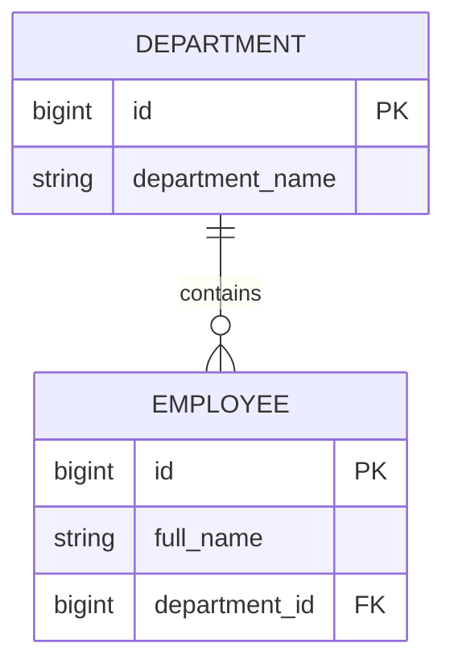
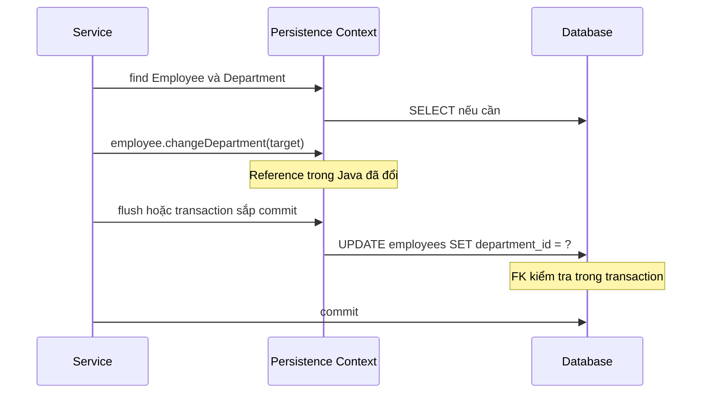

# Ánh xạ `@ManyToOne` ở phía giữ khóa ngoại trong JPA

Trong mô hình quan hệ một-nhiều, câu hỏi quan trọng nhất khi viết entity JPA là **bên nào thật sự giữ khóa ngoại trong bảng database?** Ví dụ, một phòng ban có nhiều nhân viên, nhưng mỗi nhân viên thuộc một phòng ban. Database thường lưu cột `department_id` tại bảng `employees`, do đó entity `Employee` là **phía sở hữu quan hệ (owning side)** và thường khai báo `@ManyToOne` kèm `@JoinColumn`.

Nếu chỉ nhớ một nguyên tắc, hãy nhớ:

> **Trong ánh xạ một-nhiều hai chiều thông dụng, field `@ManyToOne` trên entity con là phía quyết định giá trị khóa ngoại; `@OneToMany(mappedBy = "...")` ở entity cha là phía tham chiếu ngược.**

Điều này ảnh hưởng trực tiếp đến SQL `INSERT`/`UPDATE`, cách thêm hoặc chuyển một phần tử trong collection, cascade, tính bắt buộc của quan hệ và việc chẩn đoán các lỗi “đã thêm vào danh sách nhưng database không có liên kết”.

Bài học sử dụng Jakarta Persistence (JPA), các ví dụ Java và SQL. Hibernate hoặc EclipseLink có thể khác nhau về thời điểm flush, cách fetch và tối ưu hóa SQL, nhưng nguyên tắc sở hữu quan hệ là nội dung cốt lõi của JPA.

## 1. Từ quan hệ trong database đến quan hệ trong Java

Xét hai bảng:

```sql
CREATE TABLE departments (
    id BIGINT PRIMARY KEY,
    department_name VARCHAR(120) NOT NULL
);

CREATE TABLE employees (
    id BIGINT PRIMARY KEY,
    full_name VARCHAR(150) NOT NULL,
    department_id BIGINT NOT NULL,
    CONSTRAINT fk_employees_department
        FOREIGN KEY (department_id) REFERENCES departments(id)
);
```

Một phòng ban có thể có nhiều nhân viên, còn một nhân viên ở ví dụ này phải thuộc đúng một phòng ban:

```text
departments                          employees
+----+----------------+              +----+-------------+---------------+
| id | department_name|              | id | full_name   | department_id |
+----+----------------+              +----+-------------+---------------+
| 10 | Engineering    | <----------- | 91 | An          | 10            |
|    |                | <----------- | 92 | Binh        | 10            |
| 20 | Support        | <----------- | 93 | Chi         | 20            |
+----+----------------+              +----+-------------+---------------+
```

`department_id` là foreign key ở bảng **nhân viên**, không nằm ở bảng phòng ban. JPA mô tả cùng ý nghĩa đó bằng một thuộc tính entity:

```java
@ManyToOne(fetch = FetchType.LAZY, optional = false)
@JoinColumn(name = "department_id", nullable = false)
private Department department;
```

Đây là quan hệ **nhiều Employee → một Department**. Đọc `employee.getDepartment()` là đi từ bên nhiều sang bên một; từ đó có thể truy cập dữ liệu của phòng ban tương ứng.

Nếu cần đi từ Department đến danh sách Employee, ta thêm thuộc tính ở phía cha:

```java
@OneToMany(mappedBy = "department")
private List<Employee> employees = new ArrayList<>();
```

Phía `@OneToMany` dùng `mappedBy = "department"` để chỉ **đúng tên field quan hệ trong `Employee`**, không phải tên cột SQL.

### Cardinality trong hai chiều



Sơ đồ có nghĩa **một Employee thuộc một Department, một Department có thể có 0 đến nhiều Employee**. Việc `employees.department_id NOT NULL` không yêu cầu một Department phải có ít nhất một Employee.

## 2. Ví dụ entity đầy đủ: phía giữ khóa ngoại

Trước hết khai báo entity đích `Department`:

```java
// Department.java
package com.example.hr;

import jakarta.persistence.Column;
import jakarta.persistence.Entity;
import jakarta.persistence.Id;
import jakarta.persistence.Table;

@Entity
@Table(name = "departments")
public class Department {

    @Id
    private Long id;

    @Column(name = "department_name", nullable = false, length = 120)
    private String name;

    protected Department() {
        // JPA constructor
    }

    public Department(Long id, String name) {
        this.id = id;
        this.name = name;
    }

    public Long getId() { return id; }
    public String getName() { return name; }
}
```

Entity nguồn `Employee` khai báo `@ManyToOne`:

```java
// Employee.java
package com.example.hr;

import jakarta.persistence.*;

@Entity
@Table(name = "employees")
public class Employee {

    @Id
    private Long id;

    @Column(name = "full_name", nullable = false, length = 150)
    private String fullName;

    @ManyToOne(fetch = FetchType.LAZY, optional = false)
    @JoinColumn(
        name = "department_id",
        referencedColumnName = "id",
        nullable = false,
        foreignKey = @ForeignKey(name = "fk_employees_department")
    )
    private Department department;

    protected Employee() {}

    public Employee(Long id, String fullName, Department department) {
        if (department == null) {
            throw new IllegalArgumentException("Department is required");
        }
        this.id = id;
        this.fullName = fullName;
        this.department = department;
    }

    public Long getId() { return id; }
    public String getFullName() { return fullName; }
    public Department getDepartment() { return department; }

    public void changeDepartment(Department newDepartment) {
        if (newDepartment == null) {
            throw new IllegalArgumentException("Department is required");
        }
        this.department = newDepartment;
    }
}
```

Ví dụ dùng ID do ứng dụng cung cấp để tập trung vào quan hệ. Trong dự án dùng `@GeneratedValue`, cần chọn chiến lược cấp ID phù hợp với database.

Từng thành phần có vai trò khác nhau:

| Khai báo | Ý nghĩa |
|---|---|
| `@Entity` / `@Table(name = "employees")` | `Employee` là entity được lưu trong bảng `employees`. |
| `@ManyToOne` | Nhiều Employee có thể tham chiếu cùng một Department. |
| `fetch = FetchType.LAZY` | Yêu cầu trì hoãn tải entity đích khi có thể; không tạo hay xóa khóa ngoại. |
| `optional = false` | Quan hệ bắt buộc trong mô hình JPA. |
| `@JoinColumn(name = "department_id")` | Cột liên kết nằm ở phía Employee, thường là `employees.department_id`. |
| `referencedColumnName = "id"` | Cột được tham chiếu trong bảng Department. Nếu trỏ tới PK mặc định có thể lược bỏ. |
| `nullable = false` | Metadata ánh xạ cột khóa ngoại không cho phép SQL `NULL`. |
| `@ForeignKey(name = "...")` | Gợi ý tên ràng buộc FK khi provider sinh DDL; schema hiện hữu vẫn cần được quản lý đúng. |

**Một `Employee` chứa reference đến object `Department` trong Java, còn bảng `employees` chứa một giá trị khóa `department_id`.** JPA chuyển đổi giữa hai biểu diễn theo mapping.

## 3. Ai thực sự là owning side?

Trong thuật ngữ JPA, **owning side** là phía có mapping quyết định cách cập nhật mối liên kết trong cơ sở dữ liệu. Với quan hệ `@ManyToOne` ở ví dụ trên:

```text
Java:      employee.department = department
                               |
                               v
Database:  employees.department_id = departments.id
```

Khi employee là managed entity và field `department` đổi, JPA có thể sinh `UPDATE employees SET department_id = ? WHERE id = ?` khi flush.

Để có quan hệ hai chiều, ta thêm collection ở Department:

```java
@OneToMany(mappedBy = "department")
private List<Employee> employees = new ArrayList<>();
```

`mappedBy = "department"` nói rằng **quan hệ đã được ánh xạ và sở hữu bởi field Employee.department**, vì vậy collection này không định nghĩa một FK khác.

Các sự khác nhau:

| Phía | Annotation | Cột FK được ghi từ phía nào? |
|---|---|---|
| Employee → Department | `@ManyToOne @JoinColumn(name = "department_id")` | Employee là owning side, quyết định FK. |
| Department → Employees | `@OneToMany(mappedBy = "department")` | Inverse side, dùng để điều hướng collection; không tự sở hữu FK. |

JPA không có tham số `mappedBy` ở `@ManyToOne`. Trong thiết kế một-nhiều hai chiều chuẩn, `mappedBy` nằm trên `@OneToMany`, giá trị là **tên thuộc tính Java** ở entity bên nhiều.

### Vì sao đây là điểm dễ sai nhất?

Nếu chỉ gọi:

```java
department.getEmployees().add(employee);
```

mà không làm:

```java
employee.changeDepartment(department);
```

thì collection Java đã đổi nhưng **owning side vẫn chưa thể hiện liên kết mới**. Với relationship hai chiều có `mappedBy`, kết quả lưu FK có thể không như mong đợi.

Ngược lại, gọi:

```java
employee.changeDepartment(department);
```

thì JPA nhận được thay đổi ở phía sở hữu và có thể cập nhật FK, nhưng collection `department.employees` đang nằm trong bộ nhớ **không tự đảm bảo được cập nhật ngay**. Ứng dụng nên duy trì cả hai phía bằng helper methods.

## 4. Quan hệ một chiều: chỉ có `@ManyToOne` cũng hoàn toàn hợp lệ

Không bắt buộc khai `@OneToMany` ở Department. Nếu nghiệp vụ thường chỉ đọc employee rồi xem department, một chiều có thể là đủ:

```java
@Entity
@Table(name = "employees")
public class Employee {
    @Id
    private Long id;

    @ManyToOne(fetch = FetchType.LAZY)
    @JoinColumn(name = "department_id")
    private Department department;
}
```

Không có collection `Department.employees` vẫn không làm mất tính một-nhiều trong database. Nhiều hàng employee vẫn có thể cùng một `department_id`.

Muốn lấy toàn bộ nhân viên của phòng ban thì truy vấn:

```java
List<Employee> staff = entityManager.createQuery(
    "select e from Employee e where e.department.id = :departmentId",
    Employee.class
)
.setParameter("departmentId", 10L)
.getResultList();
```

Cách này thường gọn và giảm công việc giữ hai phía của object graph đồng bộ. Chỉ thêm `@OneToMany` khi việc đi từ parent sang collection có lợi cho mô hình và truy cập dữ liệu.

**Một chiều hay hai chiều là lựa chọn API của object model; phía giữ FK trong schema không thay đổi chỉ vì ta bỏ collection inverse.**

## 5. Biến thể hai chiều: khai báo cả Department và Employee

Khi cần duyệt từ phòng ban tới danh sách nhân viên, ta khai thêm:

```java
// Department.java — phiên bản hai chiều
@Entity
@Table(name = "departments")
public class Department {

    @Id
    private Long id;

    @Column(name = "department_name", nullable = false)
    private String name;

    @OneToMany(mappedBy = "department")
    private List<Employee> employees = new ArrayList<>();

    protected Department() {}

    public List<Employee> getEmployees() {
        return java.util.Collections.unmodifiableList(employees);
    }

    public void addEmployee(Employee employee) {
        java.util.Objects.requireNonNull(employee);
        employee.moveTo(this);
    }

    public void removeEmployee(Employee employee) {
        java.util.Objects.requireNonNull(employee);
        if (employee.getDepartment() == this) {
            employee.moveTo(null);
        }
    }

    void addInternal(Employee employee) {
        if (!employees.contains(employee)) {
            employees.add(employee);
        }
    }

    void removeInternal(Employee employee) {
        employees.remove(employee);
    }
}
```

Để tương thích với việc chuyển một employee giữa các phòng ban, phía Employee có helper kiểm soát cả hai reference:

```java
// Employee.java — phần quan hệ của phiên bản hai chiều
@ManyToOne(fetch = FetchType.LAZY)
@JoinColumn(name = "department_id")
private Department department;

public Department getDepartment() {
    return department;
}

public void moveTo(Department newDepartment) {
    if (this.department == newDepartment) {
        return;
    }

    Department oldDepartment = this.department;

    if (oldDepartment != null) {
        oldDepartment.removeInternal(this);
    }

    this.department = newDepartment; // owning side

    if (newDepartment != null) {
        newDepartment.addInternal(this);
    }
}
```

Hai đoạn là **một biến thể thiết kế khác** với class Employee bắt buộc department ở phần 2. Trong biến thể này, `moveTo(null)` được phép bởi mapping; khi nghiệp vụ bắt buộc mọi employee luôn có department, cần thiết kế phương thức gỡ nhân viên theo hướng **chuyển sang phòng ban khác hoặc xóa entity**, thay vì tách quan hệ về null.

Những điểm quan trọng của helper:

1. Đầu tiên loại employee khỏi collection cũ nếu cần.
2. Cập nhật field `this.department` ở **owning side**.
3. Thêm employee vào collection mới để object graph trong cùng persistence context phản ánh đúng.
4. Không gọi lẫn nhau vô hạn giữa `Department.addEmployee` và `Employee.moveTo`.
5. Nếu collection dùng `Set`, cần thiết kế `equals`/`hashCode` của entity ổn định và phù hợp.

`Collections.unmodifiableList(...)` giúp bên gọi không tùy tiện sửa collection mà bỏ qua helper. Đây là quy tắc thiết kế Java, không phải một yêu cầu bắt buộc của JPA. Trong dự án thực tế, cần xét việc provider sử dụng persistent collection và cách accessor hoạt động.

## 6. `@JoinColumn` định nghĩa điều gì?

Với một FK đơn tới primary key của Department:

```java
@ManyToOne(fetch = FetchType.LAZY, optional = false)
@JoinColumn(name = "department_id", nullable = false)
private Department department;
```

Nếu không ghi tên, JPA có quy tắc đặt tên join column mặc định dựa trên tên field relation và tên cột PK được tham chiếu, chẳng hạn `department_id`. Framework/provider có thể áp dụng naming strategy riêng. Trong schema có sẵn, khai tên rõ ràng sẽ dễ hiểu hơn.

Các tham số của `@JoinColumn` thường gặp:

| Tham số | Vai trò | Lưu ý |
|---|---|---|
| `name` | Tên cột FK ở bảng sở hữu. | Ví dụ `department_id`. |
| `referencedColumnName` | Tên cột ở bảng đích được tham chiếu. | Thường có thể lược bỏ nếu tham chiếu PK. |
| `nullable` | Metadata cho phép cột FK là SQL `NULL` hay không. | Cần đảm bảo schema thực tế khớp. |
| `unique` | Metadata duy nhất trên join column. | **Thường để false cho many-to-one**; true có thể làm một FK chỉ xuất hiện một lần. |
| `insertable` | FK có được JPA ghi khi `INSERT` không? | Mặc định true. |
| `updatable` | FK có được JPA ghi khi `UPDATE` không? | Mặc định true. |
| `foreignKey` | Cấu hình metadata của foreign key khi tạo DDL. | Không thay thế constraint trong schema đang tồn tại. |
| `columnDefinition` | Mô tả DDL tường minh cho cột khi cần. | Phụ thuộc database/dialect. |
| `table` | Bảng chứa join column khi mapping có nhiều bảng thích hợp. | Không nên dùng khi không có secondary table tương ứng. |

### Tại sao `unique = true` thường sai với many-to-one?

Giả sử cột `employees.department_id` có `UNIQUE`. Khi đó không thể có hai employee cùng department 10, trái mô hình “một department có nhiều employees”.

```sql
-- Không phù hợp với nhiều nhân viên cùng một phòng ban:
UNIQUE (department_id)
```

Với `@ManyToOne` thông thường, hãy để FK **không unique**. Chỉ khi nghiệp vụ thật sự là một-một mới cân nhắc mapping `@OneToOne` và uniqueness tương ứng.

## 7. Bắt buộc quan hệ: `optional = false` và `nullable = false`

Hai khai báo thường đi cùng nhau:

```java
@ManyToOne(optional = false)
@JoinColumn(name = "department_id", nullable = false)
private Department department;
```

Nhưng chúng không đồng nghĩa:

| Thành phần | Đối tượng áp dụng | Câu hỏi |
|---|---|---|
| `@ManyToOne(optional = false)` | Association JPA | Employee có bắt buộc được liên kết với Department không? |
| `@JoinColumn(nullable = false)` | Cột join trong metadata ánh xạ | `department_id` có được SQL `NULL` không? |
| `department_id BIGINT NOT NULL` | Schema database | Bất kỳ SQL nào có được ghi `NULL` vào cột không? |
| `FOREIGN KEY (department_id) REFERENCES departments(id)` | Schema database | Giá trị FK khác NULL có trỏ tới Department hợp lệ không? |
| `@NotNull` (Bean Validation) | Giá trị Java khi validation chạy | Tham chiếu `department` có khác null không? |

Nếu `employee.department == null` trong Java, setter vẫn có thể hoàn thành; lỗi có thể được phát hiện bởi constructor, validation, JPA provider, hoặc database khi flush. Thời điểm cụ thể phụ thuộc cấu hình và chiến lược cấp ID.

Nếu `department_id = 9999` nhưng không có hàng department tương ứng, `NOT NULL` vẫn đạt; **FOREIGN KEY** mới từ chối dữ liệu tham chiếu không hợp lệ.

Một `Department` vẫn có thể có **zero Employee** dù mỗi Employee bắt buộc có một Department. FK không-null ở bên nhiều không bảo đảm phía một phải có ít nhất một phần tử.

### Một quan hệ tùy chọn

Ví dụ nhân viên chưa được phân phòng ban trong giai đoạn onboarding:

```java
@ManyToOne(fetch = FetchType.LAZY, optional = true)
@JoinColumn(name = "department_id", nullable = true)
private Department department;
```

Khi đó `department_id` có thể được để `NULL` trong schema, nhưng foreign key vẫn nên tồn tại để kiểm tra trường hợp được gán ID.

Chọn bắt buộc hay tùy chọn theo quy tắc miền nghiệp vụ và vòng đời thực tế. Nếu chỉ bắt buộc sau một trạng thái (ví dụ sau khi `Employee.status = ACTIVE`), `nullable = false` áp dụng cho **mọi hàng** có thể quá chặt; có thể cần validation theo trạng thái hoặc ràng buộc `CHECK` phù hợp.

## 8. Thêm Employee mới: ai được `persist` trước?

Giả sử Department 10 đã có trong database.

```java
@Transactional
public void hireEmployee(Long employeeId, Long departmentId) {
    Department department = entityManager.find(
        Department.class, departmentId);

    if (department == null) {
        throw new IllegalArgumentException("Department not found");
    }

    Employee employee = new Employee(
        employeeId, "Lan", department);

    entityManager.persist(employee);
}
```

Vì `department` đã là managed entity được tìm từ database, việc gọi `persist(employee)` có thể dẫn tới SQL:

```sql
INSERT INTO employees (id, full_name, department_id)
VALUES (101, 'Lan', 10);
```

Giá trị `department_id` được lấy từ định danh của `Department` tham chiếu. **Không cần gọi `persist(department)` lần nữa** cho một Department đã tồn tại và đang managed.

Khi `persist(employee)` được gọi, provider có thể đưa thao tác vào hàng đợi. SQL `INSERT` thường được gửi khi flush hoặc tại thời điểm cần thiết (ví dụ sinh ID bằng `IDENTITY`). Ghi thành công trong transaction chưa đồng nghĩa commit thành công.

### Khi Department cũng mới

Nếu cả department và employee đều chưa được lưu:

```java
@Transactional
public void createDepartmentAndEmployee() {
    Department department = new Department(30L, "Research");
    Employee employee = new Employee(110L, "Mai", department);

    entityManager.persist(department);
    entityManager.persist(employee);
}
```

Không bật cascade mặc định trên `@ManyToOne` vẫn hoạt động khi cả hai được persist rõ ràng trong cùng transaction và provider có thể thực hiện SQL theo ràng buộc FK hợp lệ. Với ID được database sinh, việc gán ID và thứ tự INSERT cần được JPA/provider xử lý phù hợp.

Nếu chỉ gọi:

```java
entityManager.persist(employee);
```

trong khi `employee.department` là một Department **transient** chưa được persist và không có cascade thích hợp, provider có thể báo lỗi về tham chiếu tới unsaved transient entity. Không nên kỳ vọng một object Java có ID chưa đủ điều kiện là một hàng database hợp lệ.

### Tham chiếu bằng ID mà chưa SELECT

Trong một số tình huống, ta đã biết Department ID và chỉ muốn gán FK:

```java
Department department =
    entityManager.getReference(Department.class, departmentId);

employee.changeDepartment(department);
```

`getReference` có thể tạo reference/proxy mà chưa truy vấn ngay database. Nó **không bảo đảm** Department ID tồn tại; nếu không tồn tại, lỗi có thể xuất hiện khi truy cập reference hoặc khi ràng buộc FK được database kiểm tra. Nếu cần báo lỗi nghiệp vụ rõ ràng trước khi ghi, `find` hoặc kiểm chứng phù hợp thường dễ kiểm soát hơn.

## 9. Đổi phòng ban: một `UPDATE` ở bảng giữ FK

Giả sử Employee 101 thuộc Department 10. Khi chuyển sang Department 20:

```java
@Transactional
public void transferEmployee(Long employeeId, Long newDepartmentId) {
    Employee employee = entityManager.find(
        Employee.class, employeeId);
    Department newDepartment = entityManager.find(
        Department.class, newDepartmentId);

    if (employee == null || newDepartment == null) {
        throw new IllegalArgumentException("Employee/Department not found");
    }

    employee.changeDepartment(newDepartment);
}
```

Vì `Employee` đang được quản lý và `department` là field ở owning side, JPA có thể sinh:

```sql
UPDATE employees
SET department_id = 20
WHERE id = 101;
```

Không cần xóa Employee rồi tạo lại. **Thay quan hệ nhiều-về-một** thông thường chính là **đổi giá trị FK** trên hàng phía nhiều.

Nếu mapping hai chiều, helper cần đồng bộ danh sách của Department cũ và mới trong Java. Nhưng quyết định dữ liệu FK vẫn đến từ `employee.department`.

### Reassignment khác việc sửa nội dung Department

Hai thao tác dưới đây có ý nghĩa khác:

```java
employee.changeDepartment(otherDepartment);
```

→ Có thể update `employees.department_id`.

```java
department.rename("Data Platform");
```

→ Có thể update `departments.department_name`, không phải thay FK của Employee.

Việc thay reference tới entity đích không tự động sửa trường dữ liệu của entity đích. Đây là khác biệt giữa **quan hệ** và **trạng thái của đối tượng được tham chiếu**.

## 10. Bỏ liên kết: chỉ hợp lệ khi FK được phép rỗng

Nếu department không bắt buộc, có thể:

```java
employee.changeDepartment(null);
```

và JPA có thể tạo:

```sql
UPDATE employees
SET department_id = NULL
WHERE id = ?;
```

Nếu database đang có `department_id NOT NULL`, SQL trên sẽ bị từ chối. Khi nghiệp vụ yêu cầu mỗi Employee luôn có Department, muốn “gỡ” Employee khỏi Department cũ cần chọn một trong các hành động hợp lệ:

- **Chuyển** Employee sang Department khác.
- **Xóa** Employee theo quy tắc xóa đúng.
- **Thay đổi workflow/schema** để cho phép Employee tồn tại chưa có Department, nếu đây là yêu cầu mới.

Với quan hệ bắt buộc, không nên gọi method `removeEmployee` tạo ra `employee.department = null` rồi trông chờ JPA “tự xóa child”; việc đó chỉ có thể xảy ra khi có cơ chế orphan removal phù hợp, và phải hiểu rõ tác động xóa dữ liệu.

## 11. `@OneToMany(mappedBy = "department")` có nghĩa chính xác gì?

Trong entity Department:

```java
@OneToMany(mappedBy = "department")
private List<Employee> employees = new ArrayList<>();
```

`mappedBy` luôn là **tên thuộc tính relation trong entity Employee**. Không viết:

```java
@OneToMany(mappedBy = "department_id") // Sai nếu Employee không có field này
private List<Employee> employees;
```

vì `department_id` là tên cột database chứ không phải tên field `Employee.department`.

Ngoài ra:

`mappedBy` làm Department trở thành **inverse side** của quan hệ, có nghĩa collection không quyết định giá trị FK. Khi quan hệ này được đồng bộ, provider nhìn vào phía sở hữu `Employee.department` để biết employee đang thuộc Department nào.

Đối với một quan hệ hai chiều, người viết code phải duy trì consistency của cả object graph:

```java
department.addEmployee(employee);
```

Helper tốt sẽ thiết lập `employee.department = department`.

### Có thể dùng `@OneToMany` không có `mappedBy` không?

Có, nhưng đó là **một kiểu mapping khác**: collection có thể là owning side và provider có thể dùng join table, hoặc dùng `@JoinColumn` trong một quan hệ một chiều. Nó có hành vi cập nhật và SQL khác; không phải biến thể tương đương chỉ bỏ một chuỗi `mappedBy`.

Trong bài này, mô hình chính là:

```text
Department (inverse collection)  ←  Employee (owning @ManyToOne)
                                          |
                                          +-- employees.department_id FK
```

Nếu đã chọn `@ManyToOne` làm phía giữ FK, hãy tránh vô tình tạo **hai mapping độc lập cùng quản lý một quan hệ**.

## 12. Thêm vào collection không tự tạo entity con

Cần phân biệt hai ý:

1. **Tạo mối liên kết** giữa Employee và Department.
2. **Đưa một Employee mới vào trạng thái persistent**.

Nếu Employee chưa persistent, chỉ thêm object vào `department.employees` **không bảo đảm** có `INSERT`. Với mapping inverse collection và mặc định không cascade:

```java
Department department = entityManager.find(Department.class, 10L);
Employee newEmployee = new Employee(200L, "Huy", department);

department.getEmployees().add(newEmployee);
// Không mặc nhiên persist newEmployee khi không có cascade.
```

Trong thiết kế mặc định, phải:

```java
entityManager.persist(newEmployee);
```

hoặc cấu hình cascade thích hợp ở quan hệ được phép sở hữu vòng đời của child.

**Cascade điều khiển lan truyền thao tác vòng đời entity; owning side điều khiển giá trị khóa ngoại.** Chúng giải quyết hai vấn đề khác nhau.

## 13. Cascade ở quan hệ một-nhiều: đặt ở đâu là hợp lý?

Mặc định `@ManyToOne` không cascade. Điều này hợp lý vì một Department có thể được tham chiếu bởi nhiều Employee. Khi lưu một Employee, việc tự động `persist`, `merge` hoặc `remove` cả Department thường không phản ánh vòng đời đúng.

Ví dụ không nên viết máy móc:

```java
@ManyToOne(cascade = CascadeType.ALL)
@JoinColumn(name = "department_id")
private Department department;
```

Khi xóa Employee, cascade REMOVE có thể cố xóa Department, trong khi Department vẫn được nhiều nhân viên khác sử dụng. Database FK có thể từ chối; nếu không, đây vẫn có thể là hành vi sai nghiệp vụ.

### Nếu Department thật sự quản lý vòng đời các Employee

Trong một miền nghiệp vụ khác, owner có thể được phép tạo/xóa toàn bộ child; khi đó có thể cấu hình cascade ở collection cha:

```java
@OneToMany(
    mappedBy = "department",
    cascade = {CascadeType.PERSIST, CascadeType.MERGE}
)
private List<Employee> employees = new ArrayList<>();
```

Khi persist Department mới, cascade có thể persist Employee mới trong collection. **Nhưng field `employee.department` ở phía owning vẫn phải được gán** để FK đúng.

Có thể dùng `CascadeType.ALL` trong aggregate thực sự sở hữu vòng đời child, nhưng cần quyết định rất cẩn thận các hành vi REMOVE, DETACH, REFRESH. Đối với nhân viên có lịch sử nhân sự độc lập, cascade REMOVE từ Department thường không phải chính sách hợp lý.

### Bảng quyết định

| Câu hỏi nghiệp vụ | Hướng cân nhắc |
|---|---|
| Department dùng chung, Employee được quản lý độc lập | `@ManyToOne` không cascade. |
| Child mới được tạo và quản lý hoàn toàn cùng parent | `@OneToMany(cascade = PERSIST)` có thể phù hợp. |
| Xóa parent phải xóa toàn bộ child theo nghiệp vụ | Xem xét `REMOVE` và/hoặc orphan removal ở phía parent, cùng ràng buộc DB. |
| Xóa một child không được xóa parent | Tránh `CascadeType.REMOVE` từ child `@ManyToOne` tới parent. |
| Chuyển child từ parent này sang parent khác | Đừng cấu hình orphan removal theo cách khiến việc chuyển bị hiểu thành xóa child. |

## 14. Orphan removal không giống với `@ManyToOne` owning side

Giả sử một `PurchaseOrder` sở hữu hoàn toàn các `OrderLine`, mỗi line không có ý nghĩa khi tách khỏi order. Quan hệ có thể là:

```java
@OneToMany(
    mappedBy = "order",
    cascade = CascadeType.ALL,
    orphanRemoval = true
)
private List<OrderLine> lines = new ArrayList<>();
```

Ở đây `orphanRemoval = true` có nghĩa khi một line bị loại khỏi quan hệ sở hữu trong những trường hợp được định nghĩa, JPA có thể xóa hàng line khỏi database. Nó khác với việc đặt FK thành `NULL`.

Đừng áp dụng quy tắc này máy móc cho `Department.employees`, vì **nhân viên có thể được chuyển bộ phận nhưng vẫn là cùng một nhân viên**, không phải đối tượng cần xóa.

Với `orphanRemoval = true`, thao tác `department.getEmployees().remove(employee)` có thể đưa child vào luồng xóa; nếu ngay sau đó thêm vào Department khác, kết quả có thể gây lỗi hoặc hành vi không mong muốn. Khi child có thể được chuyển owner, cần thiết kế rõ vòng đời và cách chuyển quan hệ.

## 15. Xóa Department khi còn Employee: database quyết định cuối cùng

Nếu `employees.department_id NOT NULL` cùng foreign key tới `departments.id` và Department còn nhân viên, câu SQL:

```sql
DELETE FROM departments WHERE id = 10;
```

thường bị database từ chối nếu chưa xử lý children. Các lựa chọn nghiệp vụ:

1. **Không cho xóa** Department còn Employee và hiển thị lỗi nghiệp vụ rõ ràng.
2. **Chuyển Employee** sang Department khác rồi mới xóa.
3. **Soft delete/deactivate** Department để giữ lịch sử và liên kết.
4. **Xóa cả Employee** nếu đúng chính sách sở hữu, được phép mất dữ liệu và có cascade/transaction phù hợp.

Một số database hỗ trợ `ON DELETE CASCADE` hoặc `ON DELETE SET NULL` ở FK. Đây là hành vi **database**, không đồng nhất với `CascadeType.REMOVE` của JPA. `ON DELETE SET NULL` không phù hợp với cột FK `NOT NULL`. Khi database tự cascade xóa, persistence context đang quản lý các entity liên quan có thể tạm thời không phản ánh ngay toàn bộ thay đổi, nên phải quản lý transaction/context đúng.

## 16. `fetch = LAZY` và mặc định `EAGER` của `@ManyToOne`

Theo JPA, `@ManyToOne` có mặc định `fetch = FetchType.EAGER`. Tức là provider phải đáp ứng yêu cầu tải eager theo quy tắc tương ứng; cách phát SQL cụ thể có thể là JOIN hoặc SELECT bổ sung.

```java
@ManyToOne(fetch = FetchType.LAZY)
@JoinColumn(name = "department_id")
private Department department;
```

Khai báo `LAZY` thường hữu ích khi muốn kiểm soát lúc truy cập Department. Tuy nhiên `LAZY` với một số kiểu relation là **gợi ý fetch theo JPA**, và provider/khả năng proxy, bytecode enhancement hoặc cấu hình có thể ảnh hưởng cách thực thi.

Lưu ý **fetch mode không quyết định owning side**: `LAZY` hoặc `EAGER` đều dùng cùng FK `employees.department_id`.

### Một ví dụ gây N+1 query

```java
List<Employee> staff = entityManager.createQuery(
    "select e from Employee e", Employee.class
).getResultList();

for (Employee employee : staff) {
    System.out.println(employee.getDepartment().getName());
}
```

Tùy fetch plan, query đầu có thể lấy N Employee, sau đó việc tải Department gây nhiều SELECT bổ sung. Khi các nhân viên chia sẻ cùng Department, first-level cache có thể giảm số truy vấn; tuy nhiên không nên mặc định truy vấn luôn tối ưu.

### Giải pháp 1: JPQL `JOIN FETCH`

```java
List<Employee> staff = entityManager.createQuery(
    "select e from Employee e " +
    "join fetch e.department " +
    "where e.id between :fromId and :toId",
    Employee.class
)
.setParameter("fromId", 1L)
.setParameter("toId", 100L)
.getResultList();
```

Đoạn này yêu cầu tải Department cùng Employee theo fetch join. Nếu quan hệ optional và muốn giữ cả employee chưa được phân phòng ban, dùng `left join fetch` thay vì inner join.

### Giải pháp 2: Entity Graph

```java
EntityGraph<Employee> graph =
    entityManager.createEntityGraph(Employee.class);
graph.addAttributeNodes("department");

List<Employee> staff = entityManager.createQuery(
    "select e from Employee e", Employee.class
)
.setHint("jakarta.persistence.fetchgraph", graph)
.getResultList();
```

Entity graph giúp diễn đạt nhu cầu fetch cho truy vấn mà không đổi mọi mapping thành eager. API hint sử dụng namespace Jakarta; dự án `javax.persistence` cũ có tên hint tương ứng.

### Giải pháp 3: Projection khi chỉ cần vài cột

```java
List<Object[]> rows = entityManager.createQuery(
    "select e.id, e.fullName, d.name " +
    "from Employee e join e.department d",
    Object[].class
).getResultList();
```

Nếu chỉ cần tên Department để hiển thị, projection tránh tải toàn bộ đồ thị entity và là lựa chọn đáng cân nhắc.

**Không nên bật EAGER cho mọi relation để “chữa N+1”**: eager rộng có thể tăng số join hoặc truy vấn và tải dữ liệu không cần thiết. Nên đo query thật và chọn fetch plan theo từng use case.

## 17. Lazy reference, persistence context và transaction

Khi `Employee.department` được khai `LAZY`, provider có thể giữ proxy/reference tới Department. Trong transaction:

```java
@Transactional(readOnly = true)
public String lookupDepartmentName(Long employeeId) {
    Employee employee = entityManager.find(Employee.class, employeeId);
    if (employee == null) {
        throw new IllegalArgumentException("Employee not found");
    }
    return employee.getDepartment().getName();
}
```

Truy cập Department bên trong một persistence context còn hoạt động giúp provider có cơ hội tải dữ liệu cần thiết. Nếu EntityManager đã đóng hoặc entity bị detach mà relation chưa được khởi tạo, truy cập field lazy có thể gây `LazyInitializationException` (trong Hibernate) hoặc lỗi tương tự.

Ví dụ:

```java
Employee employee = loadAndReturnEmployee(); // giao dịch đã kết thúc
String name = employee.getDepartment().getName(); // có thể lỗi lazy
```

Giải pháp là quyết định dữ liệu cần đọc **trước** khi kết thúc transaction, dùng fetch join/entity graph hoặc DTO theo use case. Việc trả trực tiếp entity ra REST API và để JSON serializer tự duyệt mọi relation dễ gây lỗi lazy hoặc sinh truy vấn không kiểm soát.

### Object identity

Trong cùng persistence context:

```java
Department a = entityManager.find(Department.class, 10L);
Department b = entityManager.find(Department.class, 10L);
System.out.println(a == b); // true trong cùng persistence context
```

Một managed Department có thể được chia sẻ bởi nhiều managed Employee. Điều đó không nghĩa các Employee bị đồng nhất; mỗi Employee có ID riêng và FK có thể cùng giá trị.

## 18. JPQL truy vấn theo association, không theo tên cột SQL

Với mapping:

```java
@ManyToOne
@JoinColumn(name = "department_id")
private Department department;
```

JPQL dùng **tên thuộc tính Java**:

```java
select e from Employee e where e.department.id = :id
```

không viết:

```java
select e from Employee e where e.department_id = :id
```

vì `department_id` là tên cột database, không phải property của Employee.

Những truy vấn thường gặp:

| Nhu cầu | JPQL |
|---|---|
| Tất cả Employee của một Department | `select e from Employee e where e.department.id = :id` |
| Tìm theo tên Department | `select e from Employee e join e.department d where d.name = :name` |
| Tải Employee và Department một lần | `select e from Employee e join fetch e.department` |
| Employee chưa được phân phòng ban (nếu optional) | `select e from Employee e where e.department is null` |
| Tổng Employee theo Department | `select e.department.id, count(e) from Employee e group by e.department.id` |

Provider có thể tối ưu điều kiện `e.department.id = :id` thành lọc trực tiếp FK mà không join, nhưng SQL chính xác phụ thuộc mapping/provider. Khi cần thuộc tính của Department như `d.name`, JOIN là cách biểu đạt tự nhiên.

### Với Spring Data JPA

```java
import org.springframework.data.jpa.repository.JpaRepository;
import java.util.List;

public interface EmployeeRepository
        extends JpaRepository<Employee, Long> {

    List<Employee> findByDepartmentId(Long departmentId);

    List<Employee> findByDepartmentName(String name);
}
```

Tên method phụ thuộc chính xác vào property của entity. Nếu property relation tên `department`, Spring Data có thể phân giải đường dẫn `department.id` hoặc `department.name` qua derived query. Khi tên trở nên nhập nhằng, có thể dùng dấu gạch dưới để chỉ ranh giới nested path, ví dụ `findByDepartment_Id`. Với truy vấn phức tạp, `@Query` rõ ràng thường dễ bảo trì hơn.

## 19. Thêm child trong hai chiều: trình tự đúng

Giả sử Department mới được tạo và ứng dụng muốn thêm Employee trong cùng transaction:

```java
@Transactional
public void createDepartmentWithEmployees() {
    Department department = new Department(40L, "Platform");

    Employee first = new Employee(301L, "An", department);
    Employee second = new Employee(302L, "Binh", department);

    // Khi mapping phía Department có collection helper,
    // cần đồng bộ collection theo API của phiên bản hai chiều.

    entityManager.persist(department);
    entityManager.persist(first);
    entityManager.persist(second);
}
```

Nếu chỉ có mapping một chiều Employee → Department, ví dụ không cần cập nhật `department.employees`. Nếu có mapping hai chiều thì helper phải thiết lập cả hai phía.

Các SQL về mặt ý nghĩa có thể như sau:

```sql
INSERT INTO departments (id, department_name)
VALUES (40, 'Platform');

INSERT INTO employees (id, full_name, department_id)
VALUES (301, 'An', 40);

INSERT INTO employees (id, full_name, department_id)
VALUES (302, 'Binh', 40);
```

Provider được phép trì hoãn thao tác đến flush và có thể sắp thứ tự các statement theo mapping, batching và chiến lược sinh ID. Thứ tự lời gọi `persist()` trong source không phải hợp đồng cứng về mọi thứ tự SQL.

**Đơn vị transaction** nên bao phủ cả phòng ban và nhân viên nếu nghiệp vụ cần tất cả thao tác cùng thành công hoặc cùng rollback.

## 20. Dirty checking khi chỉ đổi field owning side

Trong transaction đang mở:

```java
Employee employee = entityManager.find(Employee.class, 301L);
Department target = entityManager.find(Department.class, 20L);

employee.changeDepartment(target);
```

Nếu Employee là managed entity, dirty checking khi flush có thể phát hiện reference Department thay đổi và tạo `UPDATE employees SET department_id = 20`. Không cần gọi `entityManager.merge(employee)` để ép lưu một entity đã managed.

Các mốc khác nhau:



- Thay reference Java **chưa chắc** gửi SQL ngay.
- Flush gửi thay đổi xuống database, **chưa phải** commit.
- Commit xác nhận transaction, có thể thất bại dù flush trước đó đã thành công.
- Rollback hủy thay đổi database chưa commit, nhưng Java objects không tự trở về trạng thái cũ.

Nếu Employee đã **detached**, thay `employee.department` không tự phát SQL. Cần lấy lại managed instance hoặc merge đúng cách; `merge` trả về managed entity, không biến chính detached instance thành managed.

## 21. Khi dùng nhiều field ánh xạ cùng một FK

Đôi khi API cần truy cập trực tiếp `departmentId` mà vẫn muốn association:

```java
@Column(name = "department_id", insertable = false, updatable = false)
private Long departmentId;

@ManyToOne(fetch = FetchType.LAZY)
@JoinColumn(name = "department_id")
private Department department;
```

Ở thiết kế trên:

- `department` là **nguồn ghi giá trị FK**.
- `departmentId` chỉ đọc từ cùng cột vì có `insertable = false, updatable = false`.
- Nếu cả hai mapping đều cố ghi `department_id`, provider có thể báo lỗi repeated/duplicate column.
- Sau khi đổi association trong bộ nhớ, property scalar `departmentId` **không được bảo đảm tự đồng bộ ngay** tới ID mới trước khi flush/refresh.
- Cần chọn rõ đâu là nguồn sự thật thay vì vừa set `departmentId` vừa set `department` với hai giá trị khác nhau.

Đừng lạm dụng mapping kép chỉ để tránh `getDepartment().getId()`; đôi khi projection DTO hoặc query theo FK giải quyết nhu cầu gọn hơn.

## 22. Composite foreign key: khi Department có ID nhiều thành phần

Trong multi-tenant, một Department có thể được định danh bởi cặp `(tenant_id, department_code)`. Khi Employee tham chiếu, FK cũng gồm hai cột.

SQL minh họa:

```sql
CREATE TABLE tenant_departments (
    tenant_id BIGINT NOT NULL,
    department_code VARCHAR(30) NOT NULL,
    display_name VARCHAR(100) NOT NULL,
    PRIMARY KEY (tenant_id, department_code)
);

CREATE TABLE tenant_employees (
    employee_id BIGINT PRIMARY KEY,
    tenant_id BIGINT NOT NULL,
    department_code VARCHAR(30) NOT NULL,
    full_name VARCHAR(150) NOT NULL,
    FOREIGN KEY (tenant_id, department_code)
        REFERENCES tenant_departments(tenant_id, department_code)
);
```

JPA có thể ánh xạ bằng `@JoinColumns`:

```java
@ManyToOne(fetch = FetchType.LAZY, optional = false)
@JoinColumns({
    @JoinColumn(
        name = "tenant_id",
        referencedColumnName = "tenant_id",
        nullable = false
    ),
    @JoinColumn(
        name = "department_code",
        referencedColumnName = "department_code",
        nullable = false
    )
})
private TenantDepartment department;
```

Ví dụ này giả định `TenantDepartment` dùng `@EmbeddedId` hoặc `@IdClass` tương ứng. Cột `tenant_id` và `department_code` ở phía Employee **cùng tham gia** FK; một cột riêng lẻ không xác định đủ Department.

Nếu `tenant_id` vừa là scalar của Employee vừa thuộc FK quan hệ, cần tránh hai mapping ghi trùng cột. Có thể dùng ánh xạ scalar read-only, thiết kế khóa dẫn xuất bằng `@MapsId` khi FK là thành phần ID của Employee, hoặc tổ chức mapping khác phù hợp với JPA và schema.

**Ràng buộc tenant vẫn cần kiểm soát phân quyền**: có tenant ID trong composite FK giúp duy trì dữ liệu trong phạm vi khóa, nhưng không thay thế authorization và truy vấn giới hạn tenant.

### Nếu FK là một phần khóa chính của child

Ví dụ dòng đơn hàng có PK `(order_id, line_no)`, field owning là `OrderLine.order`:

```java
@EmbeddedId
private OrderLineId id;

@MapsId("orderId")
@ManyToOne(fetch = FetchType.LAZY, optional = false)
@JoinColumn(name = "order_id", nullable = false)
private PurchaseOrder order;
```

`@MapsId("orderId")` biểu diễn **danh tính dẫn xuất**: thành phần `orderId` của khóa ghép lấy từ quan hệ `order`. Cơ chế này hữu ích khi cùng cột `order_id` vừa là FK vừa là thành phần PK. Nó không cần thiết cho mọi `@ManyToOne` thông thường; chỉ dùng khi mapping danh tính của entity đòi hỏi.

## 23. Tạo index cho FK và hiểu hướng truy vấn

Một FK bảo đảm toàn vẹn tham chiếu, nhưng **không thể mặc định** mọi database tự tạo index riêng trên cột FK. Với bảng Employees lớn và query thường lọc theo Department:

```sql
SELECT id, full_name
FROM employees
WHERE department_id = 10;
```

có thể cân nhắc:

```sql
CREATE INDEX idx_employees_department_id
ON employees(department_id);
```

Index giúp truy vấn theo department và có thể hỗ trợ kiểm tra/thao tác liên quan FK tùy database. Tuy vậy nó có chi phí ghi và lưu trữ, nên dựa trên workload thực tế.

Nếu ứng dụng thường truy vấn employee của department theo tên và trạng thái, có thể cần composite index thích hợp, nhưng thứ tự cột, phân bố dữ liệu và kế hoạch thực thi phải được đánh giá theo database.

Trong JPA, `@Table(indexes = @Index(...))` có thể cung cấp metadata khi sinh schema; với môi trường sản xuất dùng migration, nên quản lý index trong migration.

### FK không có nghĩa có `UNIQUE`

Điều này rất quan trọng với quan hệ nhiều-về-một. Một FK như `employees.department_id` có thể lặp ở hàng nghìn nhân viên; điều đó là **đúng**. Constraint FK đảm bảo ID đích tồn tại, còn UNIQUE trên FK một cột sẽ làm hỏng cardinality nhiều-về-một nếu nhiều employee cùng Department được phép.

## 24. Optimistic locking khi chuyển liên kết

Giả sử hai request cùng đổi phòng ban của Employee 301:

- Transaction T1 chuyển Employee sang Department 10.
- Transaction T2 chuyển Employee sang Department 20.
- Cả hai đọc cùng trạng thái ban đầu.

Nếu cần phát hiện lost update, có thể thêm `@Version` trên **Employee**:

```java
@Version
@Column(name = "version", nullable = false)
private Long version;
```

Provider có thể dùng SQL như:

```sql
UPDATE employees
SET department_id = ?, version = ?
WHERE id = ? AND version = ?;
```

Khi version không khớp, optimistic locking có thể phát hiện xung đột và transaction cần xử lý/retry phù hợp.

**Đổi association Employee.department chủ yếu là cập nhật trạng thái của Employee**. Không nên mặc định version của Department tăng chỉ vì một Employee chuyển đến hay rời đi, đặc biệt nếu collection ở Department là inverse side. Nếu nghiệp vụ cần giới hạn số nhân viên của phòng ban, chỉ optimistic locking Employee thường không đủ; cần ràng buộc nghiệp vụ, locking/isolation hoặc cơ chế đếm đồng bộ thích hợp.

## 25. Khi nào `@ManyToOne` có thể không dùng `@JoinColumn` trực tiếp?

Mặc dù trường hợp phổ biến là FK nằm ở bảng child, JPA cũng cho phép một số association dùng **join table**, ví dụ quan hệ nhiều-về-một được ánh xạ qua bảng liên kết trong schema đặc biệt. Khi đó cần `@JoinTable` và các join columns tương ứng.

Điều này là ngoại lệ thiết kế; với một parent có nhiều child trong schema chuẩn, mô hình:

```text
employees.department_id -> departments.id
```

thường đơn giản hơn, dễ đọc và dễ truy vấn. Nếu schema đang là bảng liên kết, trước tiên cần xác định liệu bảng đó phục vụ quan hệ many-to-many, dữ liệu lịch sử hay một quy tắc nhiều-về-một đặc biệt; không tự đổi sang `@JoinColumn` khi chưa đánh giá dữ liệu và ràng buộc.

Một trường hợp khác là **foreign key tham chiếu non-PK unique column** qua `referencedColumnName`. Database yêu cầu cột đích là khóa/unique phù hợp và mức hỗ trợ mapping có thể phụ thuộc provider; việc dùng PK của entity đích thường dễ dự đoán hơn. Nếu cần business code, có thể ánh xạ mã riêng có UNIQUE nhưng vẫn dùng PK kỹ thuật làm FK để giảm ràng buộc giữa schema và thuộc tính có thể thay đổi.

## 26. Dùng `@ManyToOne` trong API REST: tránh vòng JSON và query ngầm

Nếu Department có `List<Employee>` và Employee có `Department`, khi serialize trực tiếp entity:

```text
Department
  -> employees
      -> Employee.department
          -> Department.employees
              -> ...
```

một JSON serializer có thể đi theo vòng quan hệ, sinh JSON lặp hoặc kích hoạt lazy loading ngoài transaction.

Giải pháp thường là trả DTO chuyên cho API:

```java
public record EmployeeResponse(
    Long id,
    String fullName,
    Long departmentId,
    String departmentName
) {}
```

Trong service, chọn fetch theo nhu cầu và xây DTO khi dữ liệu còn sẵn. Không phải cứ có `@ManyToOne` là phải trả toàn bộ Department hoặc employees collection trong response.

Với update API, nhận `departmentId` thay vì nhận một object Department không rõ managed/detached state:

```java
public record TransferEmployeeRequest(Long departmentId) {}
```

Sau đó service xác thực ID, lấy Department và gán relation. Điều này giúp phân biệt thao tác **đổi liên kết FK** với thao tác **sửa nội dung Department**.

## 27. Ví dụ thực hành hoàn chỉnh với Spring Service

Giả sử hệ thống có Department 10 và 20. Nghiệp vụ:

1. Tạo Employee mới thuộc một Department có thật.
2. Chuyển Employee sang Department khác.
3. Không cho Employee không có Department.
4. Không tự xóa Department khi xóa Employee.

Các entity có mapping:

```java
// Phía sở hữu trong Employee
@ManyToOne(fetch = FetchType.LAZY, optional = false)
@JoinColumn(name = "department_id", nullable = false)
private Department department;
```

Service minh họa:

```java
import jakarta.persistence.EntityManager;
import jakarta.persistence.PersistenceContext;
import org.springframework.stereotype.Service;
import org.springframework.transaction.annotation.Transactional;

@Service
public class EmployeeService {

    @PersistenceContext
    private EntityManager em;

    @Transactional
    public void hire(Long employeeId, String name, Long departmentId) {
        Department department = requireDepartment(departmentId);
        Employee employee = new Employee(employeeId, name, department);
        em.persist(employee);
    }

    @Transactional
    public void transfer(Long employeeId, Long departmentId) {
        Employee employee = em.find(Employee.class, employeeId);
        if (employee == null) {
            throw new IllegalArgumentException("Employee not found");
        }
        Department target = requireDepartment(departmentId);
        employee.changeDepartment(target);
    }

    @Transactional
    public void removeEmployee(Long employeeId) {
        Employee employee = em.find(Employee.class, employeeId);
        if (employee == null) {
            return;
        }
        em.remove(employee);
        // Không xóa Department do employee tham chiếu.
    }

    private Department requireDepartment(Long departmentId) {
        if (departmentId == null) {
            throw new IllegalArgumentException("Department is required");
        }
        Department department = em.find(Department.class, departmentId);
        if (department == null) {
            throw new IllegalArgumentException("Unknown department");
        }
        return department;
    }
}
```

Đoạn này sử dụng **quan hệ một chiều Employee → Department** như phần 2. Nếu hệ thống có thêm collection hai chiều, service hoặc phương thức domain cần dùng helper để đồng bộ object graph trong bộ nhớ. Không nên đồng thời dùng cả `employee.changeDepartment(target)` đơn giản và collection inverse mà không xác định chính sách đồng bộ.

Luồng SQL điển hình:

| Thao tác | SQL có thể xuất hiện tại flush |
|---|---|
| `hire(301, "An", 10)` | `INSERT INTO employees (..., department_id) VALUES (..., 10)` |
| `transfer(301, 20)` | `UPDATE employees SET department_id = 20 WHERE id = 301` |
| `removeEmployee(301)` | `DELETE FROM employees WHERE id = 301` |
| `requireDepartment(20)` | `SELECT ... FROM departments WHERE id = 20`, trừ khi đã có trong persistence context |

Cần xử lý exception, transaction boundary, validation và concurrency theo ứng dụng thực tế. Đặc biệt, việc Department tồn tại khi `find` chạy không loại bỏ hoàn toàn khả năng bị xóa đồng thời trước khi insert Employee; FK database vẫn cần tồn tại để bảo vệ toàn vẹn tham chiếu.

## 28. Những lỗi mapping thường gặp

| Triệu chứng | Nguyên nhân có thể | Hướng xem xét |
|---|---|---|
| Thêm Employee vào `department.employees` nhưng FK không đổi | Chỉ sửa inverse collection, chưa sửa `employee.department` | Gán owning side và dùng helper đồng bộ hai phía. |
| `mappedBy = "department_id"` báo lỗi | `mappedBy` nhận tên field Java, không phải cột SQL | Dùng `mappedBy = "department"`. |
| Bị tạo thêm join table ngoài ý muốn | Mapping `@OneToMany` một chiều hoặc thiếu `mappedBy` so với thiết kế | Kiểm tra ownership và mapping cả hai phía. |
| `department_id` không tồn tại | Sai `@JoinColumn(name)`, naming strategy hoặc schema | Xem SQL/DDL thực tế. |
| Vi phạm `NOT NULL` khi insert | Field `department` null, hoặc SQL ghi null vào FK | Đồng bộ domain, `optional`, `nullable` và DDL. |
| Vi phạm foreign key | Department không tồn tại hoặc chưa được persist hợp lệ | Kiểm tra target ID, transaction và thứ tự persist. |
| Báo unsaved transient instance | Employee tham chiếu Department mới chưa lưu, không cascade | Persist parent phù hợp hoặc quản lý cascade theo miền. |
| Xóa Employee kéo theo xóa Department | Cascade REMOVE/ALL cấu hình sai trên `@ManyToOne` | Bỏ cascade xóa từ child tới parent dùng chung. |
| Không chuyển Employee giữa Department được | `orphanRemoval` hoặc helper xử lý tách child như xóa | Xem lại quyền sở hữu vòng đời child. |
| Query tạo nhiều SELECT | EAGER/LAZY và fetch plan gây N+1 | Đo SQL; dùng join fetch, entity graph hoặc projection. |
| Truy cập `getDepartment()` ngoài transaction bị lỗi lazy | Proxy chưa khởi tạo khi context đã đóng | Tải dữ liệu trong transaction/DTO. |
| JSON lặp hoặc quá lớn | Serialize entity quan hệ hai chiều trực tiếp | DTO hoặc cấu hình serialization có chủ đích. |
| `@JoinColumn(unique = true)` gây trùng khóa | Một Department chỉ được một Employee tham chiếu | Bỏ UNIQUE nếu nghiệp vụ là many-to-one. |
| Có cả `departmentId` và `department` báo duplicated column | Hai mapping cùng ghi FK | Chỉ một mapping ghi; mapping còn lại read-only. |
| Chỉ đổi collection inverse rồi mong Department version tăng | Inverse collection không phải nguồn cập nhật FK | Hiểu versioning của owner và chính sách concurrency. |
| JPA mapping báo đúng nhưng DB còn cho FK null | Annotation chưa được migration thành `NOT NULL` | Kiểm tra schema và xử lý dữ liệu cũ. |

## 29. Khi thêm `@ManyToOne` vào schema đã có

Giả sử ban đầu Employee không có Department. Muốn bổ sung quan hệ bắt buộc cần xử lý theo trình tự phù hợp:

1. Thêm cột `department_id` với chiến lược tạm nullable khi dữ liệu cũ chưa được gán.
2. Xác định Department hợp lệ cho các Employee cũ dựa trên nghiệp vụ.
3. Backfill giá trị FK, kiểm tra orphan values.
4. Thêm ràng buộc FOREIGN KEY và chuyển sang `NOT NULL` sau khi dữ liệu đã hợp lệ.
5. Cập nhật entity `@ManyToOne(optional = false)` / `@JoinColumn(nullable = false)`, service và mọi luồng import dữ liệu.
6. Kiểm soát thứ tự triển khai nếu nhiều phiên bản ứng dụng cùng truy cập một database.

Ví dụ SQL PostgreSQL:

```sql
ALTER TABLE employees
ADD COLUMN department_id BIGINT;

-- Backfill theo dữ liệu nghiệp vụ đã được kiểm chứng.
-- UPDATE employees SET department_id = ... WHERE ...;

ALTER TABLE employees
ADD CONSTRAINT fk_employees_department
FOREIGN KEY (department_id) REFERENCES departments(id);

ALTER TABLE employees
ALTER COLUMN department_id SET NOT NULL;
```

Nếu còn Employee có `department_id NULL`, bước cuối sẽ thất bại. Nếu `department_id` chứa ID không tồn tại, FK có thể thất bại. Thay đổi annotation Java không tự động sửa sạch dữ liệu lịch sử hoặc bảo đảm database hiện có đã tạo constraint.

Trong dự án sản xuất, migration bằng Flyway/Liquibase thường phù hợp hơn việc trông chờ chế độ schema update của provider cho mọi thay đổi.

## 30. Tư duy đọc một mapping `@ManyToOne`

Khi đọc code:

```java
@ManyToOne(fetch = FetchType.LAZY, optional = false)
@JoinColumn(name = "team_id", nullable = false)
private Team team;
```

hãy tự trả lời theo thứ tự:

1. **Cái gì là bên nhiều?** Entity đang chứa field `team`: ví dụ `Member`.
2. **Cái gì là bên một?** `Team` được tham chiếu.
3. **Khóa ngoại nằm ở đâu?** Trong bảng của entity hiện tại, ví dụ `members.team_id`.
4. **Ai là owning side?** Field `Member.team`.
5. **Quan hệ bắt buộc hay tùy chọn?** Xem `optional` và schema `NOT NULL`; kiểm tra có khớp nghiệp vụ không.
6. **Nếu có collection ở Team, mappedBy chỉ tới đâu?** `@OneToMany(mappedBy = "team")`.
7. **Muốn đổi Team của Member thì sửa field nào?** Gán `member.team = targetTeam`; helper cập nhật collection nếu có hai chiều.
8. **Ai quản lý vòng đời?** Xác định cascade, orphan removal và chính sách xóa độc lập với ownership.
9. **Query có truy cập Team ở đâu?** Chọn fetch plan để tránh N+1 và lazy-access ngoài transaction.
10. **Database có bảo vệ liên kết không?** Kiểm tra FK thực, nullability và index theo workload.

## 31. Các câu hỏi thường gặp

### Có bắt buộc phải viết `@OneToMany` trong Team/Department không?

Không. `@ManyToOne` một chiều là mapping JPA hoàn chỉnh cho nhiều-về-một, sử dụng FK trong bảng bên nhiều. Collection inverse chỉ cần nếu muốn điều hướng từ bên một sang các child trong object model.

### `@OneToMany(mappedBy = "department")` có tự sinh cột FK không?

Nó sử dụng mapping owning đã có ở `Employee.department`. Cột FK được xác định bởi `@JoinColumn` bên nhiều và schema database. Một `@OneToMany` một chiều không `mappedBy` có thể dẫn đến cấu trúc join table khác.

### Nếu Employee đã managed, có cần gọi repository.save(employee) sau khi đổi Department?

Không bắt buộc chỉ để đồng bộ một thay đổi ở managed entity trong transaction. JPA có dirty checking và sẽ flush khi thích hợp. Với entity detached hoặc mới tạo, cần xử lý persist/merge/repository tương ứng.

### Có nên dùng `CascadeType.ALL` ở `@ManyToOne`?

Thường không, đặc biệt khi bên một được nhiều child chia sẻ. Cascade REMOVE có thể cố xóa parent khi xóa child. Chỉ cấu hình cascade theo **quy tắc sở hữu vòng đời**, không theo sự thuận tiện khi gọi `persist`.

### `@ManyToOne` có phải luôn làm phát sinh JOIN khi đọc Employee?

Không. JPA có thể chỉ cần FK để biểu diễn association và chỉ tải Department khi cần, hoặc eager-fetch tùy cấu hình. Dạng SQL phụ thuộc query, fetch mode và provider. Nếu cần Department trong một truy vấn cụ thể, fetch join/entity graph là công cụ phù hợp.

### Có thể thay giá trị `department_id` bằng cách sửa trực tiếp `Department.id` không?

Không nên. `Department.id` là danh tính của entity đích; thay ID của managed entity không phải cách chuyển Employee sang Department khác. Cách đúng là gán một **Department entity khác** vào `employee.department`.

### FK phải đánh index không?

Không phải mọi database tự tạo index trên FK. Nên đánh giá việc tạo index `employees.department_id` nếu ứng dụng thường lọc Employee theo Department hoặc cần hỗ trợ thao tác quan hệ ở quy mô lớn.

### Nếu `department_id` nullable mà `optional = false` thì sao?

Mapping đang biểu đạt ý đồ không thống nhất: JPA nói association bắt buộc, cột được mô tả là cho phép SQL NULL. Provider có thể xử lý metadata khác nhau, còn database có schema hiện hành riêng. Nên thống nhất cả hai với nghiệp vụ và constraint thực tế.

### Nếu một Department bị xóa, Employee có tự động bị xóa?

Không phải mặc định. Việc đó phụ thuộc cascade JPA, `orphanRemoval`, hành vi `ON DELETE` của FK và logic service. Trong quan hệ Department–Employee thông thường, việc xóa cả nhân viên theo Department dễ là hành vi nghiệp vụ sai.

## 32. Ghi nhớ

Ánh xạ `@ManyToOne` là cách tự nhiên để biểu diễn **phía nhiều đang giữ khóa ngoại** trong JPA:

```java
@ManyToOne(fetch = FetchType.LAZY, optional = false)
@JoinColumn(name = "department_id", nullable = false)
private Department department;
```

Một quan hệ hai chiều có thể bổ sung:

```java
@OneToMany(mappedBy = "department")
private List<Employee> employees = new ArrayList<>();
```

Từ hai khai báo này, hãy phân biệt rõ:

- **Owning side:** `Employee.department` quyết định giá trị FK của hàng Employee.
- **Inverse side:** `Department.employees` giúp điều hướng và phải được giữ nhất quán trong bộ nhớ nếu ứng dụng dùng hai chiều.
- **Persistence:** tạo/xóa entity là chuyện riêng; `persist`, cascade và `orphanRemoval` không đồng nghĩa với việc sở hữu khóa ngoại.
- **Database:** `NOT NULL` bảo đảm FK không rỗng; `FOREIGN KEY` bảo đảm tham chiếu hợp lệ; index hỗ trợ truy vấn tùy workload.
- **Query và transaction:** thay reference trong Java có thể dẫn tới `UPDATE` khi flush; fetch mode kiểm soát đọc; commit/rollback quyết định dữ liệu cuối cùng.

Khi hiểu đúng **phía giữ FK**, bạn có thể giải thích vì sao gán `employee.department` sẽ cập nhật liên kết, vì sao chỉ sửa inverse collection có thể không ghi được FK, và vì sao cấu hình cascade hoặc fetch phải được quyết định độc lập với cách ánh xạ nhiều-về-một.
