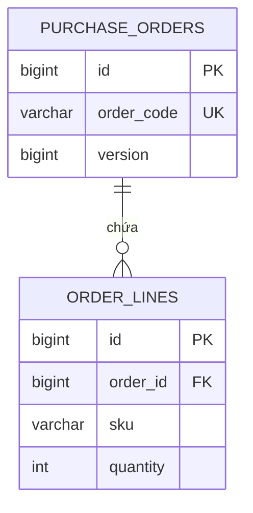

# Thêm và bỏ phần tử mà vẫn đồng bộ hai phía

Trong JPA, một quan hệ **một-nhiều hai chiều** (*bidirectional one-to-many*) có hai góc nhìn của cùng một liên kết: entity cha giữ một collection các entity con, còn từng entity con giữ tham chiếu về cha. Nếu ứng dụng chỉ cập nhật một phía, hai object trong bộ nhớ sẽ mô tả **hai trạng thái quan hệ khác nhau**. Điều này có thể dẫn tới SQL không như dự kiến, lỗi khóa ngoại hoặc logic nghiệp vụ đọc dữ liệu cũ ngay trong một transaction.

Cách thực hành phổ biến là tạo các **phương thức hỗ trợ liên kết** (*association helper methods*) trên entity, chẳng hạn `addLine(...)` và `removeLine(...)`. Mỗi phương thức thay đổi **cả collection phía cha lẫn tham chiếu phía con**, đồng thời được thiết kế phù hợp với vai trò **owning side**, `cascade` và `orphanRemoval`.

Bài học thuộc chương **Quan hệ một-nhiều** của chủ đề *Data Persistence Relational Access ORM JPA* giải thích vì sao cần đồng bộ hai phía, đưa ra mã Java hoàn chỉnh và phân tích sự khác biệt giữa bỏ liên kết, xóa bản ghi con và chuyển phần tử giữa hai cha.

## 1. Quan hệ một-nhiều hai chiều có những phía nào?

Ví dụ đơn hàng có nhiều dòng hàng:

- Một `PurchaseOrder` có thể chứa nhiều `OrderLine`.
- Một `OrderLine` thuộc về đúng một `PurchaseOrder` trong mô hình này.
- Trong cơ sở dữ liệu, bảng `order_lines` giữ cột `order_id` làm khóa ngoại đến `purchase_orders.id`.



Một schema quan hệ minh họa:

```sql
CREATE TABLE purchase_orders (
    id BIGINT GENERATED BY DEFAULT AS IDENTITY PRIMARY KEY,
    order_code VARCHAR(60) NOT NULL UNIQUE,
    version BIGINT
);

CREATE TABLE order_lines (
    id BIGINT GENERATED BY DEFAULT AS IDENTITY PRIMARY KEY,
    order_id BIGINT NOT NULL,
    sku VARCHAR(80) NOT NULL,
    quantity INTEGER NOT NULL CHECK (quantity > 0),
    CONSTRAINT fk_order_lines_order
        FOREIGN KEY (order_id) REFERENCES purchase_orders(id)
);
```

Trong JPA, có hai annotation quan trọng:

```java
// Bên cha: phía nghịch đảo (inverse / non-owning).
@OneToMany(mappedBy = "order")
private List<OrderLine> lines = new ArrayList<>();

// Bên con: phía sở hữu (owning side).
@ManyToOne
@JoinColumn(name = "order_id")
private PurchaseOrder order;
```

**`@ManyToOne` bên con là owning side** của liên kết khóa ngoại. `@OneToMany(mappedBy = "order")` bên cha là inverse side: nó nói rằng tên field `order` trên entity `OrderLine` mới là nơi quyết định quan hệ ở tầng mapping.

Thuộc tính `mappedBy = "order"` phải trỏ đúng **tên thuộc tính Java `order`** của `OrderLine`, không phải tên cột SQL `order_id`.

### Hai phía không tự được đồng bộ như một cấu trúc Java duy nhất

Giả sử có:

```java
PurchaseOrder order = ...;
OrderLine line = ...;
```

Nếu chỉ gọi `order.getLines().add(line)`, collection phía cha đã chứa `line`, nhưng `line.getOrder()` có thể vẫn `null`. Ngược lại, nếu chỉ gọi `line.setOrder(order)`, khóa ngoại phía sở hữu đã được chỉ định nhưng collection `order.getLines()` trong bộ nhớ có thể vẫn không chứa `line`.

JPA không tự đảm bảo rằng mọi phép gán Java vào một phía đều ngay lập tức cập nhật phía còn lại. **Ứng dụng phải giữ các object nhất quán khi thao tác quan hệ hai chiều**.

## 2. Định nghĩa bất biến khi thêm và bỏ

Một **bất biến** (*invariant*) là điều kiện cần luôn đúng sau mỗi thao tác nghiệp vụ công khai.

Trong ví dụ này, ta mong muốn:

| Tình huống | `order.lines` | `line.order` |
|---|---|---|
| Dòng đã thuộc đơn | Có chứa đúng instance `line` | Trỏ tới `order` |
| Dòng mới chưa gắn đơn | Không nằm trong collection của đơn nào | `null` |
| Dòng vừa được thêm vào đơn | Đã chứa `line` | Được gán `order` |
| Dòng vừa bị bỏ khỏi đơn | Không còn `line` | Được đặt `null` |
| Dòng của đơn khác | Không được tự động chuyển nếu chính sách cấm | Vẫn trỏ tới đơn cũ |

Ta có thể viết bất biến chính bằng ý tưởng:

```text
Nếu một OrderLine thuộc PurchaseOrder:
    order.lines chứa line
    VÀ
    line.order == order

Nếu OrderLine đã được tách khỏi PurchaseOrder:
    order.lines không chứa line
    VÀ
    line.order != order
```

**Tính nhất quán của object model** là mục tiêu ngay tại thời điểm gọi phương thức; còn **tính nhất quán trong database** phụ thuộc vào transaction, flush, constraint và mapping JPA. Hai lớp trách nhiệm này liên quan nhưng không đồng nhất.

## 3. Mẫu entity hoàn chỉnh: PurchaseOrder và OrderLine

Ví dụ sử dụng Jakarta Persistence (`jakarta.persistence.*`), Java 17+ và cách truy cập bằng field vì annotation đặt trên field.

### 3.1. Bên cha: PurchaseOrder

File `src/main/java/demo/PurchaseOrder.java`:

```java
package demo;

import jakarta.persistence.CascadeType;
import jakarta.persistence.Column;
import jakarta.persistence.Entity;
import jakarta.persistence.GeneratedValue;
import jakarta.persistence.GenerationType;
import jakarta.persistence.Id;
import jakarta.persistence.OneToMany;
import jakarta.persistence.Table;
import jakarta.persistence.Version;

import java.util.ArrayList;
import java.util.Collections;
import java.util.Iterator;
import java.util.List;
import java.util.Objects;

@Entity
@Table(name = "purchase_orders")
public class PurchaseOrder {

    @Id
    @GeneratedValue(strategy = GenerationType.IDENTITY)
    private Long id;

    @Column(name = "order_code",
            nullable = false, unique = true, length = 60)
    private String orderCode;

    @Version
    private Long version;

    @OneToMany(
            mappedBy = "order",
            cascade = CascadeType.ALL,
            orphanRemoval = true
    )
    private List<OrderLine> lines = new ArrayList<>();

    protected PurchaseOrder() {
        // Constructor không tham số theo yêu cầu JPA.
    }

    public PurchaseOrder(String orderCode) {
        this.orderCode = Objects.requireNonNull(orderCode, "orderCode");
        if (orderCode.isBlank()) {
            throw new IllegalArgumentException("orderCode is blank");
        }
    }

    public Long getId() {
        return id;
    }

    public String getOrderCode() {
        return orderCode;
    }

    public List<OrderLine> getLines() {
        return Collections.unmodifiableList(lines);
    }

    public void addLine(OrderLine line) {
        Objects.requireNonNull(line, "line");

        PurchaseOrder currentParent = line.getOrder();
        if (currentParent != null && currentParent != this) {
            throw new IllegalArgumentException(
                    "Line already belongs to another order");
        }

        // So sánh bằng reference để phân biệt các entity mới
        // chưa có ID, tránh phụ thuộc equals/hashCode.
        for (OrderLine existing : lines) {
            if (existing == line) {
                line.linkTo(this);
                return;
            }
        }

        lines.add(line);
        line.linkTo(this);
    }

    public void removeLine(OrderLine line) {
        Objects.requireNonNull(line, "line");

        Iterator<OrderLine> it = lines.iterator();
        while (it.hasNext()) {
            if (it.next() == line) {
                it.remove();
                if (line.getOrder() == this) {
                    line.linkTo(null);
                }
                return;
            }
        }
    }
}
```

Ý nghĩa các quyết định:

- `mappedBy = "order"` chỉ ra rằng bên `OrderLine.order` là owning side.
- `cascade = CascadeType.ALL` có cả `PERSIST`, `MERGE` và `REMOVE`, phù hợp khi các dòng hàng thuộc trọn vòng đời của đơn; **không mặc định phù hợp với entity được nhiều cha dùng chung**.
- `orphanRemoval = true` yêu cầu xóa entity con khi nó bị tách khỏi quan hệ và trở thành orphan trong mô hình vòng đời này.
- Collection được khởi tạo thành `new ArrayList<>()` để thêm phần tử trước khi entity được persist.
- Getter trả một `unmodifiableList` nhằm hướng mã nghiệp vụ đến `addLine`/`removeLine`.
- Hai phương thức helper thao tác **cả hai phía**, ngăn việc caller sửa collection mà quên sửa `line.order`.
- So sánh `existing == line` giúp phương thức thao tác với đúng instance, ngay cả khi hai entity mới cùng có `id == null`. Đây là chính sách phù hợp với helper minh họa; không thay thế một chiến lược entity equality tổng quát.

**Lưu ý:** getter không sửa được collection không có nghĩa collection tự bất biến với JPA. Provider vẫn có thể quản lý field `lines` trực tiếp thông qua field access.

### 3.2. Bên con: OrderLine

File `src/main/java/demo/OrderLine.java`:

```java
package demo;

import jakarta.persistence.Column;
import jakarta.persistence.Entity;
import jakarta.persistence.FetchType;
import jakarta.persistence.GeneratedValue;
import jakarta.persistence.GenerationType;
import jakarta.persistence.Id;
import jakarta.persistence.JoinColumn;
import jakarta.persistence.ManyToOne;
import jakarta.persistence.Table;

import java.util.Objects;

@Entity
@Table(name = "order_lines")
public class OrderLine {

    @Id
    @GeneratedValue(strategy = GenerationType.IDENTITY)
    private Long id;

    @Column(name = "sku", nullable = false, length = 80)
    private String sku;

    @Column(name = "quantity", nullable = false)
    private int quantity;

    @ManyToOne(fetch = FetchType.LAZY, optional = false)
    @JoinColumn(name = "order_id", nullable = false)
    private PurchaseOrder order;

    protected OrderLine() {
        // JPA constructor.
    }

    public OrderLine(String sku, int quantity) {
        this.sku = Objects.requireNonNull(sku, "sku");
        if (sku.isBlank()) {
            throw new IllegalArgumentException("sku is blank");
        }
        if (quantity <= 0) {
            throw new IllegalArgumentException("quantity must be positive");
        }
        this.quantity = quantity;
    }

    public Long getId() {
        return id;
    }

    public String getSku() {
        return sku;
    }

    public int getQuantity() {
        return quantity;
    }

    public PurchaseOrder getOrder() {
        return order;
    }

    // Package-private: tránh cho code bên ngoài tự đổi một phía.
    void linkTo(PurchaseOrder order) {
        this.order = order;
    }

    public void changeQuantity(int newQuantity) {
        if (newQuantity <= 0) {
            throw new IllegalArgumentException("quantity must be positive");
        }
        this.quantity = newQuantity;
    }
}
```

Các thuộc tính đáng chú ý:

- `@ManyToOne` biểu diễn mỗi dòng thuộc một đơn.
- `@JoinColumn(name = "order_id")` là nơi ánh xạ FK trong `order_lines`.
- `optional = false` và `nullable = false` diễn đạt rằng dòng đã lưu phải thuộc về một đơn; constraint `NOT NULL` thực tế ở database vẫn cần được duy trì.
- `fetch = FetchType.LAZY` tránh mặc định tải cha mỗi khi truy vấn con; provider có thể sử dụng proxy/cơ chế lazy.
- `linkTo` không public, nhằm thống nhất việc sửa liên kết thông qua helper của cha thay vì để mọi nơi gọi setter độc lập.

Đây là hai entity mô tả một quan hệ, không phải hai collection độc lập. Mỗi dòng hàng có một FK thật, và **owning side chính là field `OrderLine.order`**.

## 4. Đi qua từng bước của addLine()

Giả sử:

```java
PurchaseOrder order = new PurchaseOrder("PO-2026-001");
OrderLine coffee = new OrderLine("SKU-COFFEE", 2);

order.addLine(coffee);
```

Phương thức `addLine` thực hiện:

1. Từ chối `null` để tránh collection chứa giá trị không phải entity hợp lệ.
2. Nếu dòng đã thuộc **một đơn khác**, ném lỗi thay vì âm thầm chuyển quyền sở hữu.
3. Nếu đúng instance đã nằm trong collection, đảm bảo lại phía con rồi kết thúc; không thêm trùng.
4. Nếu chưa có, thêm `coffee` vào `order.lines`.
5. Gán `coffee.order = order`.

Sau lệnh, các điều kiện sau đúng ngay trong Java:

```java
order.getLines().contains(coffee); // true nếu dùng identity-based equals mặc định.
coffee.getOrder() == order;         // true
```

Không phải đợi `flush` hoặc `commit` mới có sự đồng bộ này. Đó là lý do helper nên nằm gần mô hình domain.

### Vì sao không viết mỗi dòng này?

```java
order.getLines().add(coffee);
```

Ngoài việc getter minh họa trả collection không cho sửa, ngay cả khi getter trả list trực tiếp thì câu lệnh trên **chỉ thay đổi inverse side**. Field `coffee.order` vẫn `null`. Khi được persist, provider có thể không có giá trị hợp lệ cho FK `order_id` và database từ chối vì `NOT NULL`.

### Vì sao không chỉ gọi setter bên con?

```java
coffee.setOrder(order); // Ví dụ cách viết thường thấy.
```

Nếu setter chỉ gán field owning side, SQL có thể được lập theo FK mới, nhưng `order.getLines()` đang được sử dụng trong cùng persistence context có thể **không phản ánh dòng vừa gắn**. Các quy tắc tính tổng tiền, kiểm tra số lượng hoặc hiển thị dữ liệu đang dùng collection có thể nhận kết quả sai.

**Mẫu tốt:** code bên ngoài gọi `order.addLine(coffee)`; entity cha chịu trách nhiệm làm đúng cả hai cập nhật.

## 5. Đi qua từng bước của removeLine()

Giả sử `coffee` đang nằm trong `order`:

```java
order.removeLine(coffee);
```

Helper:

1. Duyệt collection và tìm **đúng instance** `coffee`.
2. Xóa instance khỏi `order.lines`.
3. Nếu phía con đang trỏ về `order`, đặt `coffee.order = null`.

Ngay sau đó:

```java
order.getLines().contains(coffee); // false
coffee.getOrder() == null;          // true
```

Đây là trạng thái **đối tượng trong bộ nhớ**. Trong mapping hiện tại, khi entity cha đang managed và transaction flush, `orphanRemoval = true` làm cho entity con bị tách khỏi collection được lên lịch **xóa khỏi database**. Như vậy cột FK có `NOT NULL` không buộc ứng dụng phải lưu trạng thái orphan cuối cùng với `order_id = NULL`.

Cần phân biệt ý nghĩa của hai sự kiện:

- **Bỏ khỏi collection:** một thao tác Java.
- **Xóa hàng của con:** hành vi persistence được cấu hình bằng `orphanRemoval = true` và xảy ra khi provider đồng bộ thay đổi trong transaction.

Với entity đang `new` chưa được persist, bỏ khỏi collection trước khi persist thường chỉ khiến entity đó **không được chèn** qua cascade từ cha. Không có hàng DB nào để xóa.

### Không dùng removeLine để chuyển một dòng đang tồn tại sang cha khác

Ví dụ này đặt `orphanRemoval = true` vì dòng hàng là thành phần vòng đời của đơn. Một khi đã tách, nó được xem là orphan cần xóa. **Không nên** gọi `oldOrder.removeLine(line)` rồi `newOrder.addLine(line)` trong cùng transaction với kỳ vọng dòng cũ được chuyển chủ an toàn: provider có thể đã đánh dấu nó để xóa và báo lỗi khi tái gắn.

Nếu nghiệp vụ thực sự cho phép chuyển con giữa các cha, cần thiết kế mapping **không có orphan removal tự động** cho phép chuyển quyền sở hữu; cách làm được trình bày ở phần sau.

## 6. Cascade và orphanRemoval là hai cơ chế khác nhau

Dễ nhầm `cascade = CascadeType.REMOVE` và `orphanRemoval = true` vì cả hai đều có thể dẫn tới xóa entity con.

| Hành động | `cascade = REMOVE` | `orphanRemoval = true` |
|---|---|---|
| Gọi `em.remove(parent)` | Thao tác remove lan sang con theo mapping | Con thuộc riêng parent cũng được xử lý theo vòng đời phụ thuộc |
| Chỉ gọi `parent.removeLine(child)` | **Không tự động xóa chỉ vì phần tử bị bỏ khỏi collection** | Có thể xóa child vì bị tách khỏi quan hệ |
| Đổi parent của child | Không quyết định tự động xóa | Rủi ro child bị coi là orphan; không dùng để chuyển ownership |
| Phù hợp khi | Parent remove cần lan tới các dependent entity | Child có vòng đời không tồn tại độc lập ngoài parent |

`CascadeType.ALL` bao gồm `PERSIST`, `MERGE`, `REMOVE`, `REFRESH`, `DETACH`. Trong mô hình order/line, lựa chọn `ALL` cộng `orphanRemoval = true` có thể hợp lý vì dòng hàng không tồn tại hợp lệ ngoài đơn. Nhưng nếu quan hệ là **Department–Employee**, nhân viên có vòng đời riêng và có thể chuyển phòng ban, không nên mặc định dùng `orphanRemoval = true` hoặc cascade remove toàn bộ.

### Nếu orphanRemoval = false thì sao?

Giả sử đổi mapping:

```java
@OneToMany(mappedBy = "order",
           cascade = {CascadeType.PERSIST, CascadeType.MERGE})
private List<OrderLine> lines = new ArrayList<>();
```

Khi `removeLine` gán `line.order = null`, bên owning side yêu cầu xóa liên kết. Nếu database cho phép FK `NULL`, JPA có thể cập nhật `order_id = NULL`, và dòng vẫn tồn tại ở DB. Nếu FK bị khai báo `NOT NULL` như ví dụ, transaction có thể thất bại vì không thể lưu một dòng không có cha.

Do đó, **helper và mapping phải cùng thể hiện chính sách vòng đời**:

- Con được phép độc lập → FK nullable phù hợp, không cần orphanRemoval.
- Con phải bị xóa khi tách → orphanRemoval true và helper remove tương ứng.
- Con được chuyển từ cha này sang cha khác → không tự động orphan-remove, cập nhật sở hữu bằng một thao tác chuyển liên kết.
- Muốn “bỏ liên kết” nhưng vẫn giữ FK non-null và con không chuyển cha → yêu cầu nghiệp vụ/schema đang mâu thuẫn; cần chọn hành vi cụ thể thay vì chỉ sửa một phía trong Java.

## 7. Java SE: ví dụ thêm, persist, bỏ và commit

Ta sử dụng các entity ở phần 3, `EntityManagerFactory` và transaction `RESOURCE_LOCAL`. Tạo tệp `src/main/resources/META-INF/persistence.xml`:

```xml
<?xml version="1.0" encoding="UTF-8"?>
<persistence xmlns="https://jakarta.ee/xml/ns/persistence"
             xmlns:xsi="http://www.w3.org/2001/XMLSchema-instance"
             xsi:schemaLocation="
                 https://jakarta.ee/xml/ns/persistence
                 https://jakarta.ee/xml/ns/persistence/persistence_3_1.xsd"
             version="3.1">

    <persistence-unit name="ordersPU" transaction-type="RESOURCE_LOCAL">
        <provider>org.hibernate.jpa.HibernatePersistenceProvider</provider>
        <class>demo.PurchaseOrder</class>
        <class>demo.OrderLine</class>
        <exclude-unlisted-classes>true</exclude-unlisted-classes>

        <properties>
            <property name="jakarta.persistence.jdbc.driver"
                      value="org.h2.Driver"/>
            <property name="jakarta.persistence.jdbc.url"
                      value="jdbc:h2:mem:ordersdb;DB_CLOSE_DELAY=-1"/>
            <property name="jakarta.persistence.jdbc.user"
                      value="sa"/>
            <property name="jakarta.persistence.jdbc.password"
                      value=""/>

            <property name="jakarta.persistence.schema-generation.database.action"
                      value="drop-and-create"/>
        </properties>
    </persistence-unit>
</persistence>
```

Ứng dụng cần dependency tương thích của `jakarta.persistence-api`, một JPA provider như Hibernate ORM và JDBC driver H2. Thuộc tính `drop-and-create` chỉ phù hợp trong môi trường học/test vì có thể **xóa dữ liệu**; ứng dụng thật nên quản lý schema bằng migration.

File `src/main/java/demo/Main.java`:

```java
package demo;

import jakarta.persistence.EntityManager;
import jakarta.persistence.EntityManagerFactory;
import jakarta.persistence.EntityTransaction;
import jakarta.persistence.Persistence;

public class Main {

    public static void main(String[] args) {
        EntityManagerFactory emf =
                Persistence.createEntityManagerFactory("ordersPU");

        try {
            Long orderId = createOrder(emf);
            removeFirstLine(emf, orderId);
            inspectOrder(emf, orderId);
        } finally {
            emf.close();
        }
    }

    private static Long createOrder(EntityManagerFactory emf) {
        EntityManager em = emf.createEntityManager();

        try {
            EntityTransaction tx = em.getTransaction();
            try {
                tx.begin();

                PurchaseOrder order = new PurchaseOrder("PO-2026-001");
                OrderLine first = new OrderLine("SKU-COFFEE", 2);
                OrderLine second = new OrderLine("SKU-TEA", 1);

                order.addLine(first);
                order.addLine(second);

                // Một lần persist parent; CascadeType.ALL
                // bao gồm PERSIST cho các dòng đang liên kết.
                em.persist(order);

                tx.commit();
                return order.getId();
            } catch (RuntimeException ex) {
                if (tx.isActive()) {
                    tx.rollback();
                }
                throw ex;
            }
        } finally {
            em.close();
        }
    }

    private static void removeFirstLine(
            EntityManagerFactory emf, Long orderId) {
        EntityManager em = emf.createEntityManager();

        try {
            EntityTransaction tx = em.getTransaction();
            try {
                tx.begin();

                PurchaseOrder order =
                        em.find(PurchaseOrder.class, orderId);

                if (order == null || order.getLines().isEmpty()) {
                    throw new IllegalStateException("No lines to remove");
                }

                OrderLine first = order.getLines().get(0);
                order.removeLine(first);

                // orphanRemoval=true => child được xóa
                // khi transaction flush/commit.
                tx.commit();
            } catch (RuntimeException ex) {
                if (tx.isActive()) {
                    tx.rollback();
                }
                throw ex;
            }
        } finally {
            em.close();
        }
    }

    private static void inspectOrder(
            EntityManagerFactory emf, Long orderId) {
        EntityManager em = emf.createEntityManager();

        try {
            PurchaseOrder order =
                    em.find(PurchaseOrder.class, orderId);

            if (order == null) {
                throw new IllegalStateException("Order not found");
            }

            System.out.println("Order: " + order.getOrderCode());
            System.out.println("Lines remaining: "
                    + order.getLines().size());
        } finally {
            em.close();
        }
    }
}
```

Với một lần chạy thành công và không có dữ liệu khác, kết quả dự kiến tương tự:

```text
Order: PO-2026-001
Lines remaining: 1
```

Đây là kết quả minh họa; log và thứ tự SQL cụ thể phụ thuộc provider và cấu hình. Chương trình tạo hai dòng, persist cha cùng con nhờ cascade, tải lại đơn rồi bỏ một dòng qua helper. Do orphanRemoval, số hàng con còn lại sau commit là một.

### SQL có thể trông như thế nào?

Khi tạo:

```sql
INSERT INTO purchase_orders (order_code, version) VALUES (?, ?);
INSERT INTO order_lines (order_id, sku, quantity) VALUES (?, ?, ?);
INSERT INTO order_lines (order_id, sku, quantity) VALUES (?, ?, ?);
```

Khi xóa một dòng:

```sql
DELETE FROM order_lines WHERE id = ?;
```

SQL trên chỉ diễn đạt **ý tưởng**. Provider có thể thay đổi thứ tự cột, thêm ràng buộc optimistic locking, batch, cách sinh ID hoặc lệnh cập nhật tùy chiến lược và mapping. Nên xem log SQL và execution behavior thực tế nếu cần chẩn đoán.

## 8. Đồng bộ khi xóa cả entity cha

Nếu trong transaction ta gọi:

```java
PurchaseOrder order = em.find(PurchaseOrder.class, orderId);
em.remove(order);
```

`cascade = CascadeType.ALL` bao gồm `REMOVE`, nên thao tác remove từ parent được lan đến các dependent `OrderLine`. Provider sắp xếp hoặc phát các thao tác cần thiết để đáp ứng foreign key và semantics của mapping.

Đây là tình huống **khác** với gọi `order.removeLine(line)`:

- `em.remove(order)`: yêu cầu xóa chính entity cha và lan remove theo cascade.
- `order.removeLine(line)`: entity cha vẫn tồn tại, chỉ một con bị tách và xóa theo orphanRemoval.

Nếu child còn liên kết với dữ liệu độc lập khác hoặc được nhiều parent tham chiếu, cascade remove rộng có thể gây xóa dữ liệu không mong đợi hoặc lỗi FK. Mô hình vòng đời cần được quyết định theo nghiệp vụ trước khi chọn `CascadeType.ALL`.

## 9. Trường hợp chuyển phần tử giữa hai cha

Trong một số quan hệ một-nhiều, entity con **được phép chuyển chủ**; ví dụ nhân viên chuyển phòng ban. Đây là nghiệp vụ khác với xóa dòng hàng của đơn.

Giả sử `Department` ↔ `Employee`:

```java
@Entity
public class Department {
    @Id
    private Long id;

    @OneToMany(mappedBy = "department")
    private List<Employee> employees = new ArrayList<>();

    // Chuyển employee khi quan hệ không có orphanRemoval.
    public void assignEmployee(Employee employee) {
        Objects.requireNonNull(employee);

        Department previous = employee.getDepartment();
        if (previous == this) {
            if (employees.stream().noneMatch(e -> e == employee)) {
                employees.add(employee);
            }
            return;
        }

        if (previous != null) {
            previous.employees.removeIf(e -> e == employee);
        }

        if (employees.stream().noneMatch(e -> e == employee)) {
            employees.add(employee);
        }
        employee.linkToDepartment(this);
    }
}
```

Ở phía con, `Employee.department` là owning side:

```java
@Entity
public class Employee {
    @Id
    private Long id;

    @ManyToOne(fetch = FetchType.LAZY, optional = false)
    @JoinColumn(name = "department_id", nullable = false)
    private Department department;

    public Department getDepartment() {
        return department;
    }

    void linkToDepartment(Department next) {
        this.department = next;
    }
}
```

Các snippet này chỉ minh họa **phần liên kết**; cần bổ sung constructor JPA, import và thuộc tính nghiệp vụ để thành ứng dụng độc lập. Trong phương thức `assignEmployee`:

1. Lấy cha cũ trước khi thay đổi.
2. Gỡ đúng instance khỏi collection cha cũ.
3. Thêm vào collection cha mới.
4. Đặt `employee.department = newDepartment`, là owning side.

Khi cả hai parent và employee đang managed trong transaction, provider có thể phát `UPDATE employee SET department_id = ? WHERE id = ?`. Cách này tránh trạng thái `department_id = NULL` giữa hai nơi nếu cuối cùng employee luôn phải thuộc một department.

**Điều kiện:** mapping chuyển chủ trong ví dụ **không dùng orphanRemoval**, không cascade REMOVE tùy tiện và cả hai phía đang được thao tác theo vòng đời phù hợp. Với dòng đơn có orphanRemoval, chuyển quyền sở hữu bằng hai helper remove/add thường không an toàn.

## 10. Đồng bộ trong Spring Data JPA và tầng service

Mặc dù ví dụ chính dùng Java SE, nguyên tắc tương tự áp dụng khi Spring quản lý transaction.

Một service tạo đơn:

```java
@Service
public class OrderService {
    private final PurchaseOrderRepository repository;

    public OrderService(PurchaseOrderRepository repository) {
        this.repository = repository;
    }

    @Transactional
    public Long createOrder(String code) {
        PurchaseOrder order = new PurchaseOrder(code);
        order.addLine(new OrderLine("SKU-001", 2));
        order.addLine(new OrderLine("SKU-002", 1));

        PurchaseOrder saved = repository.save(order);
        return saved.getId();
    }

    @Transactional
    public void removeLine(Long orderId, Long lineId) {
        PurchaseOrder order = repository.findById(orderId)
                .orElseThrow(() -> new IllegalArgumentException(
                        "Order not found"));

        OrderLine target = order.getLines().stream()
                .filter(line -> lineId.equals(line.getId()))
                .findFirst()
                .orElseThrow(() -> new IllegalArgumentException(
                        "Line not found in order"));

        order.removeLine(target);
        // Managed entity + orphanRemoval; provider flush khi transaction kết thúc.
    }
}
```

Mẫu này giả định có Spring Data repository:

```java
public interface PurchaseOrderRepository
        extends JpaRepository<PurchaseOrder, Long> {
}
```

Cần các import Spring tương ứng cho `@Service`, `@Transactional` và `JpaRepository`. Phương thức `removeLine` hoạt động trên entity **managed** do repository tải trong transaction; thường không cần gọi `save(order)` lần nữa để dirty checking nhận thay đổi. Nếu entity bị detached do transaction đã kết thúc, việc sửa collection ngoài transaction không tự khiến DB thay đổi.

Phải xử lý lazy loading: truy cập `order.getLines()` khi persistence context còn mở, hoặc dùng truy vấn fetch phù hợp (`@EntityGraph`/JPQL fetch join/projection). Không ép API controller truy cập trực tiếp collection lazy sau khi service đã đóng transaction và kỳ vọng nó luôn hoạt động.

## 11. Thay toàn bộ collection: dùng helper theo chênh lệch

API cập nhật đơn có thể nhận danh sách các dòng mới. Một cách thiếu an toàn là:

```java
// Tránh thay trực tiếp object collection đang do JPA quản lý:
order.lines = requestLines;
```

Với entity managed, Hibernate/JPA có thể đang theo dõi một collection wrapper cụ thể. Thay reference collection trực tiếp có thể làm mất tracking, gây thao tác orphan không mong đợi hoặc exception tùy provider.

Nếu nghiệp vụ cần thay danh sách, hãy xác định **dòng cần thêm, cần giữ, cần xóa** rồi gọi helper tương ứng:

```java
// Ví dụ: xóa toàn bộ dòng theo đúng quy tắc hai phía.
List<OrderLine> snapshot = new ArrayList<>(order.getLines());
for (OrderLine line : snapshot) {
    order.removeLine(line);
}

// Sau đó thêm các dòng mới.
for (RequestedLine requestLine : requestedLines) {
    order.addLine(
            new OrderLine(requestLine.sku(), requestLine.quantity())
    );
}
```

`RequestedLine` là DTO ví dụ do ứng dụng tự định nghĩa. Cách xóa hết và thêm lại phù hợp khi toàn bộ child thực sự được xem là mới; nếu cần **giữ ID, audit, liên kết phụ hoặc timestamp** của các dòng không đổi, phải tính chênh lệch và cập nhật dòng cũ bằng ID. Với `orphanRemoval = true`, việc gỡ các child cũ có thể làm chúng bị xóa ở flush.

Một phương thức update đầy đủ nên kiểm soát các trường hợp trùng dòng, ID không thuộc parent hiện tại, dữ liệu không hợp lệ và cạnh tranh cập nhật.

## 12. List, Set và equals/hashCode ảnh hưởng ra sao?

### Dùng List

`List<OrderLine>` phù hợp khi cần giữ các phần tử và thao tác theo collection. Tuy nhiên, `List` **không tự đảm bảo thứ tự hàng DB** sau khi tải lại; muốn có thứ tự ổn định có thể dùng `@OrderBy` theo cột hoặc `@OrderColumn` khi thứ tự vị trí phải được lưu như trạng thái quan hệ.

Trong helper ở phần 3, ta dùng so sánh tham chiếu `==` để tìm đúng instance. Điều này có ích khi hai entity mới chưa có ID và một phương thức `equals/hashCode` không phù hợp có thể coi chúng bằng nhau.

### Dùng Set

`Set<OrderLine>` có thể hợp lý nếu domain muốn ngăn phần tử trùng theo một equality ổn định. Nhưng nếu `equals/hashCode` chỉ dựa vào `id` mà hai entity mới đều có `id == null`, triển khai ngây thơ có thể khiến các phần tử mới bị coi như nhau.

Không đặt các field mutable như `quantity` vào `hashCode` rồi sửa chúng khi entity nằm trong `HashSet`. Khi chọn `Set`, cần chiến lược equality/hash code phù hợp với vòng đời entity và proxy của provider.

### Trùng SKU có phải trùng entity không?

Hai dòng có cùng `sku` chưa chắc là cùng entity; ví dụ có thể có chiết khấu/lô hàng khác nhau. Nếu quy tắc nghiệp vụ chỉ cho một SKU trên mỗi đơn, helper cần một kiểm tra nghiệp vụ (ví dụ tìm dòng theo SKU và cộng số lượng), kết hợp unique constraint thích hợp ở DB. `List` và `Set` không tự thay thế quy tắc domain đó.

## 13. Những tình huống dễ gây sai lệch

| Cách làm | Hiện tượng | Cách xử lý |
|---|---|---|
| Chỉ `order.lines.add(line)` | Owning side `line.order` không đổi; FK có thể sai hoặc null | Luôn gọi `order.addLine(line)` |
| Chỉ `line.order = order` | Collection của cha đang dùng trong bộ nhớ có thể thiếu dòng | Đồng bộ thêm vào collection cha |
| Chỉ `order.lines.remove(line)` | Con vẫn trỏ đến cha, object model mâu thuẫn | Đồng bộ cả `line.order` |
| Gọi `remove` với `orphanRemoval=false` và FK `NOT NULL` | Có thể bị lỗi constraint ở flush | Chọn delete, chuyển cha hoặc cho FK nullable theo nghiệp vụ |
| Gỡ orphan rồi gắn sang cha khác với `orphanRemoval=true` | Có thể bị xóa hoặc lỗi entity state | Thiết kế chuyển chủ riêng, không dùng orphanRemoval |
| Sửa collection của detached parent | DB chưa tự được cập nhật | Tải entity managed trong transaction, áp dụng diff qua helper |
| Thay nguyên collection reference | Tracking/orphan handling có thể sai | Giữ wrapper của provider, thay từng phần tử bằng helper |
| Dùng `CascadeType.ALL` cho con được chia sẻ | Xóa cha có thể gây xóa con dùng ở nơi khác | Chọn cascade theo vòng đời, cân nhắc model khác |
| Truy cập lazy collection sau đóng EM | Có thể gặp lazy initialization exception | Fetch trong transaction hoặc projection |
| Getter public trả list mutable | Caller dễ quên đồng bộ owning side | Trả view không cho sửa và cung cấp helper |

### Tránh hai setter gọi nhau vô hạn

Một mẫu dễ mắc lỗi:

```java
// Ví dụ SAI nếu hai method gọi qua lại không có điểm dừng.
void PurchaseOrder.addLine(OrderLine line) {
    lines.add(line);
    line.setOrder(this);
}

void OrderLine.setOrder(PurchaseOrder order) {
    this.order = order;
    order.addLine(this);
}
```

Khi đó `addLine` gọi `setOrder`, `setOrder` lại gọi `addLine` vô tận. Có thể giải quyết bằng việc **chỉ một helper công khai điều phối cả hai phía**, còn setter nội bộ chỉ gán field, như mẫu `addLine` + `linkTo` trong phần 3. Nếu cho cả hai phía một API công khai, phải thiết kế guard và hành vi xóa/thêm rất rõ để tránh vòng lặp, trùng phần tử và trạng thái trung gian sai.

## 14. Transaction, flush và database constraint

Trong một transaction:

```text
load parent (managed)
   |
   v
parent.addLine(newChild)
   |
   v
parent.lines chứa newChild
newChild.order == parent
   |
   v
flush / commit
   |
   v
INSERT child với FK parent_id đúng
```

Cơ chế **dirty checking** và collection tracking của provider dựa vào metadata mapping để quyết định INSERT/UPDATE/DELETE. Tuy nhiên, khi code chỉ sửa inverse side mà không sửa owning side, không thể kỳ vọng provider tự suy ra khóa ngoại đúng từ trạng thái collection.

Các cơ chế bảo đảm khác nhau:

- **Java helper:** giữ nhất quán hai tham chiếu trong bộ nhớ.
- **JPA mapping:** xác định owner, cascade, orphan removal và cách ghi liên kết.
- **Transaction:** gom thay đổi thành một đơn vị commit/rollback.
- **Database constraint:** bảo vệ FK, NOT NULL, UNIQUE và các invariant quan trọng ngay cả khi có chương trình ngoài JPA ghi dữ liệu.

Cần cẩn thận với cập nhật đồng thời: hai transaction có thể đọc cùng parent rồi thêm/bỏ con độc lập. `@Version` trên parent là công cụ optimistic locking nhưng **không được mặc định rằng mọi thay đổi collection inverse luôn làm tăng version parent trong mọi provider/mapping**. Khi nghiệp vụ phải chặn lost update hoặc giới hạn số con, hãy đo/kiểm chứng SQL, versioning, khóa và ràng buộc DB theo yêu cầu.

## 15. Khi dùng orphanRemoval với soft delete và audit

`orphanRemoval = true` thể hiện ý nghĩa **xóa entity con** khi bị tách khỏi quan hệ. Nếu hệ thống dùng **soft delete** (chuyển `deleted = true`) hoặc cần lưu lịch sử dòng đơn, cấu hình orphan removal mặc định không tự chuyển thành soft delete nghiệp vụ.

Các hướng thiết kế:

1. Nếu con thực sự bị loại khỏi hệ thống, orphanRemoval true là lựa chọn đơn giản.
2. Nếu cần giữ lịch sử, giữ entity con và cập nhật trạng thái/hành vi đọc theo thiết kế riêng.
3. Nếu xóa phải tạo audit event hoặc outbox record, đặt logic đó ở service/domain flow hoặc cơ chế lifecycle được thiết kế rõ; không dựa vào việc remove collection tự phát tất cả sự kiện nghiệp vụ.
4. Nếu child được tái sử dụng giữa các parent, không xem nó là orphan có thể xóa khi một parent bỏ liên kết.

Đừng chọn `orphanRemoval = true` chỉ để “JPA tự xử lý”. Nó chính là một **quy tắc vòng đời** của dữ liệu.

## 16. Bài tập áp dụng

### Bài 1 — Phát hiện một phía bị thiếu

Cho:

```java
PurchaseOrder order = new PurchaseOrder("PO-2026-101");
OrderLine item = new OrderLine("SKU-A", 3);

// Một lập trình viên có thể đã viết:
order.getLines().add(item);
```

Hãy giải thích vì sao lệnh này bị ngăn bởi getter trong ví dụ, và vì sao nếu đổi getter thành list mutable thì `item.getOrder()` vẫn có thể là `null`. Sửa bằng cách gọi `order.addLine(item)`; quan sát invariant hai phía ngay trong bộ nhớ.

### Bài 2 — Viết removeAllLines đúng

Viết method:

```java
public void removeAllLines() {
    List<OrderLine> copy = new ArrayList<>(lines);
    for (OrderLine line : copy) {
        removeLine(line);
    }
}
```

Giải thích vì sao ta duyệt bản copy và gọi helper thay vì chỉ `lines.clear()`. Với `orphanRemoval = true`, dự đoán số bản ghi còn lại sau commit.

### Bài 3 — So sánh hai cấu hình orphanRemoval

Tạo hai cấu hình một-nhiều ở môi trường test:

- A: `orphanRemoval = true`, FK `NOT NULL`.
- B: `orphanRemoval = false`, FK nullable.

Persist parent với hai child, gỡ một child bằng helper rồi commit. Quan sát SQL có thể là `DELETE` ở A và `UPDATE ... SET parent_id = NULL` ở B. Giải thích vì sao kết quả phụ thuộc mapping và provider.

### Bài 4 — Chuyển nhân viên giữa phòng ban

Với quan hệ `Department–Employee` không có orphanRemoval, viết method `assignEmployee` đảm bảo nhân viên biến mất khỏi collection của phòng cũ, xuất hiện ở phòng mới và `employee.department` trỏ về phòng mới. Kiểm tra giá trị FK sau commit.

### Bài 5 — Xử lý API cập nhật danh sách

Một request gửi các dòng `(id, sku, quantity)`. Hãy xây dựng thuật toán đối chiếu với collection hiện có để giữ dòng không đổi, cập nhật `quantity` của dòng đã tồn tại, thêm dòng mới và remove dòng thật sự bị xóa. Không thay reference của collection managed.

### Bài 6 — Dùng entity con mới chưa có ID

Thêm hai đối tượng `new OrderLine("SKU-A", 1)` khác nhau. Giải thích vì sao helper dùng so sánh identity khi kiểm tra có cùng instance hay chưa và vì sao thiết kế `equals/hashCode` chỉ dựa vào `id == null` có thể làm `Set` xử lý sai.

## 17. Câu hỏi tự kiểm tra

1. **Phía nào sở hữu FK trong quan hệ `@OneToMany(mappedBy="order")` + `@ManyToOne`?** Phía `@ManyToOne` của entity con, nơi khai báo `@JoinColumn`.
2. **Vì sao gọi `parent.getChildren().add(child)` chưa đủ?** Vì nó chỉ cập nhật collection inverse, không nhất thiết thay đổi owning side `child.parent`.
3. **Thêm một con đúng phải làm gì?** Thêm vào collection của cha **và** đặt tham chiếu cha trên con.
4. **Bỏ một con đúng phải làm gì?** Xóa khỏi collection cha **và** cập nhật tham chiếu con theo chính sách vòng đời.
5. **`orphanRemoval = true` khác `CascadeType.REMOVE` thế nào?** Orphan removal xử lý con bị tách khỏi quan hệ; cascade remove lan thao tác xóa cha sang con.
6. **Có dùng `remove(old)` rồi `add(new)` để chuyển con khi bật orphanRemoval không?** Không nên, vì con bị tách có thể được đánh dấu xóa.
7. **Vì sao không thay toàn bộ `List` của entity managed bằng `new ArrayList`?** Có thể làm mất hoặc phá tracking collection/orphan của provider; nên cập nhật qua helper.
8. **Nếu ngoài Java hai phía đúng nhưng FK sai ở database thì còn thiếu gì?** Cần kiểm tra mapping owning side, transaction, flush và constraint; object invariant không tự thay thế cơ chế persistence.

**Ghi nhớ:** Khi mô hình hóa quan hệ một-nhiều hai chiều trong JPA, hãy xác định **`@ManyToOne` là owning side**, dùng các helper như `addLine`/`removeLine` để cập nhật **collection phía cha và tham chiếu phía con trong cùng một thao tác**, rồi cấu hình `cascade`/`orphanRemoval` theo **vòng đời thực sự của entity con**. Đồng bộ hai phía ngay trong Java giúp logic nghiệp vụ nhất quán; transaction và ràng buộc database đảm bảo thay đổi được lưu theo thiết kế.
