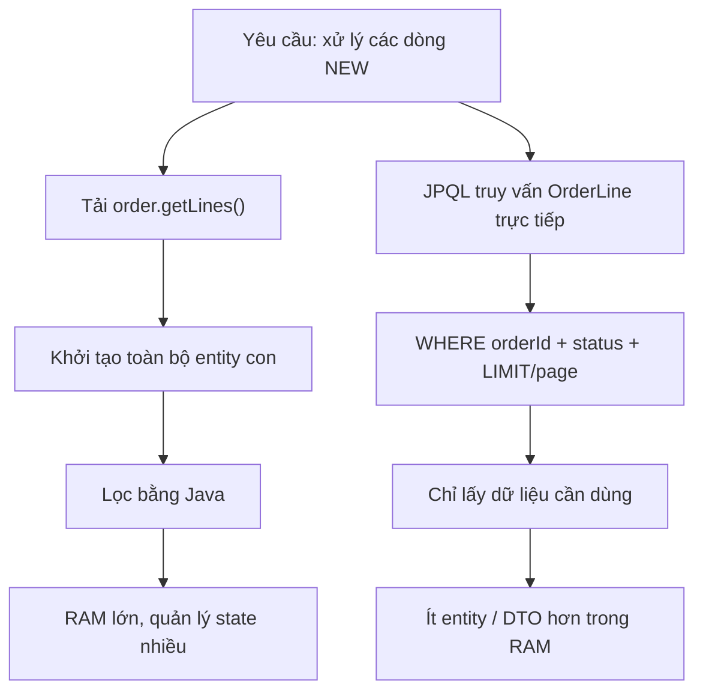

# Quản lý tập con lớn mà không tải toàn bộ vào bộ nhớ

Trong hệ thống sử dụng JPA, quan hệ một-nhiều (`@OneToMany`) giúp diễn tả một entity cha sở hữu hoặc liên kết tới nhiều entity con: `PurchaseOrder` có nhiều `OrderLine`, `Customer` có nhiều `ActivityLog`, `Project` có nhiều `Task`. Cách ánh xạ này rất thuận tiện khi số phần tử nhỏ, nhưng trở thành vấn đề khi một cha có **hàng chục nghìn, hàng trăm nghìn hoặc hàng triệu bản ghi con**.

Ví dụ, nghiệp vụ chỉ muốn hiển thị 30 dòng hàng mới nhất, đếm số dòng đang chờ xử lý hoặc hủy các dòng đã hết hạn. Nếu ta gọi `order.getLines()` rồi lặp qua toàn bộ collection bằng Java, provider có thể phải đọc lượng lớn dữ liệu từ cơ sở dữ liệu, khởi tạo hàng loạt entity và giữ chúng trong persistence context. Kết quả là tăng RAM, chi phí truy vấn, thời gian phản hồi và rủi ro `OutOfMemoryError`.

**Nguyên tắc trung tâm của bài:** Khi tập con rất lớn, hãy coi association một-nhiều là một **mối liên hệ trong mô hình dữ liệu**, không phải yêu cầu phải đưa toàn bộ collection vào Java. Nhiều thao tác nên được thực hiện bằng **truy vấn có điều kiện, phân trang, projection, cập nhật/xóa theo lô hoặc xử lý theo từng phần nhỏ ở phía database**.

Bài học trình bày cách thiết kế quan hệ, đọc theo trang, đếm/kiểm tra tồn tại, thêm/sửa/xóa bản ghi con, làm việc với transaction và persistence context, cùng các đánh đổi về tính nhất quán, cascade, orphan removal và hiệu năng.

## 1. Bài toán: một cha có tập con cực lớn

Giả sử một `PurchaseOrder` có hàng trăm nghìn `OrderLine` do dữ liệu nhập từ hệ thống đối tác. Một endpoint quản trị cần:

1. Lấy 50 dòng đầu tiên còn trạng thái `NEW` để duyệt.
2. Kiểm tra đơn có còn dòng chưa xử lý hay không.
3. Cập nhật trạng thái của những dòng thỏa điều kiện.
4. Xóa các dòng `CANCELLED` cũ theo chính sách lưu trữ.
5. Nhập thêm một lượng lớn dòng từ file.

Nếu triển khai kiểu “tải tất cả rồi xử lý”:

```java
PurchaseOrder order = em.find(PurchaseOrder.class, orderId);

for (OrderLine line : order.getLines()) {
    if (line.getStatus() == LineStatus.NEW) {
        // Xử lý từng dòng...
    }
}
```

Provider có thể cần nạp **toàn bộ collection** trước khi vòng lặp có dữ liệu. Nếu có 500.000 dòng, chi phí không chỉ là đọc 500.000 hàng SQL: còn là cấp phát object Java, trạng thái entity managed, snapshot/dirty checking, có thể là các association khác và việc giữ đối tượng trong bộ nhớ cho tới khi persistence context được giải phóng.

Trong khi đó, câu hỏi nghiệp vụ chỉ cần một tập nhỏ hoặc một phép tính tổng hợp.

### So sánh hai hướng xử lý



Hướng phía dưới thường phù hợp hơn khi số lượng entity con lớn: **đẩy điều kiện lọc và giới hạn kết quả xuống database**.

## 2. Thiết kế mapping hỗ trợ truy vấn trực tiếp từ phía con

Trong quan hệ một-nhiều hai hướng, phía `@ManyToOne` thường là **owning side** của foreign key. Điều này rất hữu ích: ta có thể tìm các bản ghi con theo ID của cha mà **không cần tải collection của cha**.

### 2.1. Entity cha

```java
package example.domain;

import jakarta.persistence.Column;
import jakarta.persistence.Entity;
import jakarta.persistence.GeneratedValue;
import jakarta.persistence.GenerationType;
import jakarta.persistence.Id;
import jakarta.persistence.Table;

@Entity
@Table(name = "purchase_orders")
public class PurchaseOrder {
    @Id
    @GeneratedValue(strategy = GenerationType.SEQUENCE)
    private Long id;

    @Column(name = "order_code", nullable = false, unique = true)
    private String orderCode;

    protected PurchaseOrder() {
    }

    public PurchaseOrder(String orderCode) {
        if (orderCode == null || orderCode.isBlank()) {
            throw new IllegalArgumentException("orderCode is required");
        }
        this.orderCode = orderCode;
    }

    public Long getId() {
        return id;
    }
}
```

Ở ví dụ này, **`PurchaseOrder` không khai báo field `List<OrderLine>`**. Đây là lựa chọn có chủ đích. JPA không yêu cầu quan hệ phải có điều hướng hai chiều: chỉ riêng `OrderLine.purchaseOrder` với `@ManyToOne` đã đủ để biểu diễn foreign key và truy vấn các dòng theo cha.

Nếu nghiệp vụ cần điều hướng từ cha sang con trong một số trường hợp, ta có thể khai báo thêm `@OneToMany`. Nhưng với collection cực lớn, **không có getter `getLines()`** đôi khi là API an toàn hơn: code khác không vô tình gọi một phương thức có thể kích hoạt việc nạp hàng trăm nghìn entity.

### 2.2. Entity con

```java
package example.domain;

import jakarta.persistence.Column;
import jakarta.persistence.Entity;
import jakarta.persistence.EnumType;
import jakarta.persistence.Enumerated;
import jakarta.persistence.FetchType;
import jakarta.persistence.GeneratedValue;
import jakarta.persistence.GenerationType;
import jakarta.persistence.Id;
import jakarta.persistence.JoinColumn;
import jakarta.persistence.ManyToOne;
import jakarta.persistence.Table;
import jakarta.persistence.Version;

@Entity
@Table(name = "order_lines")
public class OrderLine {
    @Id
    @GeneratedValue(strategy = GenerationType.SEQUENCE)
    private Long id;

    @ManyToOne(fetch = FetchType.LAZY, optional = false)
    @JoinColumn(name = "order_id", nullable = false)
    private PurchaseOrder purchaseOrder;

    @Column(name = "sku", nullable = false, length = 100)
    private String sku;

    @Enumerated(EnumType.STRING)
    @Column(name = "status", nullable = false, length = 20)
    private LineStatus status;

    @Column(name = "quantity", nullable = false)
    private int quantity;

    @Version
    private long version;

    protected OrderLine() {
    }

    public OrderLine(PurchaseOrder purchaseOrder, String sku, int quantity) {
        if (purchaseOrder == null || sku == null || sku.isBlank()
                || quantity <= 0) {
            throw new IllegalArgumentException("Invalid order line");
        }
        this.purchaseOrder = purchaseOrder;
        this.sku = sku;
        this.quantity = quantity;
        this.status = LineStatus.NEW;
    }

    public Long getId() {
        return id;
    }

    public String getSku() {
        return sku;
    }

    public LineStatus getStatus() {
        return status;
    }

    public int getQuantity() {
        return quantity;
    }

    public void markPacked() {
        if (status != LineStatus.NEW) {
            throw new IllegalStateException("Only NEW lines can be packed");
        }
        status = LineStatus.PACKED;
    }
}
```

Enum:

```java
package example.domain;

public enum LineStatus {
    NEW,
    PACKED,
    CANCELLED
}
```

Sơ đồ quan hệ:

```text
purchase_orders                 order_lines
+--------------+               +------------------------------+
| id (PK)      |<--------------| order_id (FK, indexed)       |
| order_code   |               | id (PK)                      |
+--------------+               | sku                          |
                               | status                       |
                               | quantity                     |
                               | version                      |
                               +------------------------------+

Một PurchaseOrder: 0..N OrderLine.
Mỗi OrderLine: đúng một PurchaseOrder.
```

Trong mô hình này, `OrderLine.purchaseOrder` là nguồn giá trị khóa ngoại `order_lines.order_id`. Có thể truy vấn trực tiếp bảng `order_lines` theo `purchaseOrder.id` mà không lấy toàn bộ các dòng vào bộ nhớ.

### 2.3. Có thể giữ `@OneToMany` ở cha không?

Có. Nếu cần API điều hướng cho tập nhỏ hoặc nghiệp vụ aggregate:

```java
@OneToMany(mappedBy = "purchaseOrder", fetch = FetchType.LAZY)
private List<OrderLine> lines = new ArrayList<>();
```

Trong đó:

- `mappedBy = "purchaseOrder"` trỏ tới tên thuộc tính Java ở entity con.
- `OrderLine.purchaseOrder` vẫn là **owning side** của foreign key.
- `FetchType.LAZY` là chiến lược mặc định của `@OneToMany` theo JPA, nhưng viết rõ giúp truyền đạt ý đồ.
- Annotation không làm cho một danh sách hàng triệu phần tử trở nên rẻ khi thực sự truy cập hoặc duyệt nó.

Đối với tập rất lớn, nên **hạn chế công khai collection**, hoặc không khai báo chiều từ cha đến con nếu không cần. Phần lớn thao tác có thể được đặt trong repository/service truy vấn trực tiếp `OrderLine`.

## 3. Vì sao `LAZY` chưa đủ để xử lý collection lớn?

`FetchType.LAZY` nghĩa là provider có thể trì hoãn tải dữ liệu quan hệ đến khi cần. Nó không có nghĩa rằng collection sẽ tự phân trang, và cũng không có nghĩa chỉ những phần tử lọc bằng Java mới được đọc.

Ví dụ:

```java
PurchaseOrder order = em.find(PurchaseOrder.class, orderId);
List<OrderLine> lines = order.getLines();

for (OrderLine line : lines) {
    // Duyệt dữ liệu. Collection có thể bị khởi tạo toàn bộ.
}
```

Ngay cả khi khởi tạo `order` chỉ tốn một truy vấn, vòng lặp có thể khiến provider tải **tất cả** các dòng của order. Các phép toán tưởng đơn giản cũng cần thận trọng:

```java
int total = order.getLines().size();
boolean hasAny = !order.getLines().isEmpty();
OrderLine first = order.getLines().get(0);
```

Với một collection JPA thông thường, các thao tác này có thể kích hoạt initialization. Một số provider hỗ trợ cơ chế **extra-lazy** để thực hiện `size()` hoặc kiểm tra phần tử bằng SQL riêng, nhưng đó là tối ưu **provider-specific** và không phải hợp đồng portable của JPA cho mọi collection.

Nếu chỉ cần số lượng hoặc một phần tử, hãy viết **truy vấn count/existence/limited result**. Không dựa vào hành vi ngầm của collection wrapper.

### LAZY có ngăn lỗi nạp dữ liệu ngoài transaction không?

Không. Lazy association cần persistence context/session có khả năng tải dữ liệu. Nếu entity đã detached và collection chưa được khởi tạo, truy cập nó có thể thất bại (ví dụ `LazyInitializationException` trong Hibernate).

Không nên giải quyết lỗi bằng cách chuyển collection rất lớn thành `EAGER`. Làm vậy có thể khiến mỗi lần tải entity cha vô tình kéo theo toàn bộ tập con và làm vấn đề hiệu năng nghiêm trọng hơn.

## 4. Truy vấn trực tiếp các bản ghi con, không đi qua collection

Giả sử ứng dụng cần lấy các dòng trạng thái `NEW` của một order, sắp theo ID.

```java
List<OrderLine> lines = em.createQuery(
        "select l from OrderLine l " +
        "where l.purchaseOrder.id = :orderId " +
        "and l.status = :status " +
        "order by l.id",
        OrderLine.class
    )
    .setParameter("orderId", orderId)
    .setParameter("status", LineStatus.NEW)
    .setMaxResults(50)
    .getResultList();
```

Lợi ích:

1. `WHERE` giới hạn đúng một owner và trạng thái cần xem.
2. `ORDER BY` thiết lập thứ tự xác định.
3. `setMaxResults(50)` giới hạn số entity được đưa về cho mỗi yêu cầu.
4. Không phải thực thi `order.getLines()`.
5. Database có thể sử dụng index trên `(order_id, status, id)`.

JPA provider sẽ sinh SQL phù hợp với database. Với chỉ số thích hợp, database có thể tìm trực tiếp tập con cần thiết thay vì trả toàn bộ các dòng.

### 4.1. Truy vấn theo ID cha có làm JPA tải cha không?

Thông thường không cần tải entity `PurchaseOrder` để truy vấn các dòng:

```java
where l.purchaseOrder.id = :orderId
```

Đây là đường dẫn JPQL từ association tới ID. Provider có thể sử dụng foreign key hoặc tạo SQL phù hợp từ mapping. SQL cụ thể phụ thuộc provider, nhưng **mã không gọi `em.find(PurchaseOrder.class, orderId)` chỉ để lấy collection**.

Ta cũng có thể truyền entity tham chiếu:

```java
PurchaseOrder ref = em.getReference(PurchaseOrder.class, orderId);

List<OrderLine> lines = em.createQuery(
        "select l from OrderLine l " +
        "where l.purchaseOrder = :order " +
        "order by l.id",
        OrderLine.class
    )
    .setParameter("order", ref)
    .setMaxResults(50)
    .getResultList();
```

`getReference` thường cho phép lấy reference dựa trên ID mà chưa cần tải toàn bộ dữ liệu của cha; provider có thể trì hoãn việc truy cập DB. Nếu ID không tồn tại, hành vi báo lỗi có thể xuất hiện khi tham chiếu được sử dụng theo quy tắc JPA. Với API chỉ cần lọc theo khóa, cách truyền `orderId` thường đơn giản hơn.

### 4.2. Đừng lọc bằng Java sau khi tải toàn bộ

Không nên:

```java
List<OrderLine> selected = order.getLines().stream()
    .filter(line -> line.getStatus() == LineStatus.NEW)
    .limit(50)
    .toList();
```

`limit(50)` trong Java Stream chạy **sau khi collection cung cấp phần tử**. Nó không buộc JPA chỉ đọc 50 row từ database. Cách này vừa có nguy cơ khởi tạo toàn bộ collection, vừa làm mất khả năng dùng index và optimizer SQL để lọc.

Trong JPA, hãy đưa `status` và giới hạn kết quả vào JPQL trước khi thực thi truy vấn.

## 5. Phân trang bằng `setFirstResult` và `setMaxResults`

Đối với trang danh sách quản trị, ta thường cần page number và page size.

```java
public List<OrderLine> findPage(
        EntityManager em,
        long orderId,
        LineStatus status,
        int page,
        int pageSize) {

    if (page < 0 || pageSize <= 0 || pageSize > 200) {
        throw new IllegalArgumentException("Invalid pagination");
    }

    long offset = (long) page * pageSize;
    if (offset > Integer.MAX_VALUE) {
        throw new IllegalArgumentException("Offset exceeds JPA int range");
    }

    return em.createQuery(
            "select l from OrderLine l " +
            "where l.purchaseOrder.id = :orderId " +
            "and l.status = :status " +
            "order by l.id",
            OrderLine.class
        )
        .setParameter("orderId", orderId)
        .setParameter("status", status)
        .setFirstResult((int) offset)
        .setMaxResults(pageSize)
        .getResultList();
}
```

**Lưu ý về thứ tự:** Phân trang cần một `ORDER BY` ổn định. Nếu chỉ sort theo `status` hay `createdAt` mà nhiều dòng có cùng giá trị, kết quả giữa các trang có thể không nhất quán. Nên bổ sung một khóa phân biệt duy nhất, ví dụ `order by l.createdAt, l.id`.

### 5.1. Ưu điểm của offset pagination

- Dễ hiểu: trang 0, trang 1, trang 2.
- Dễ tích hợp với bảng dữ liệu có nút chuyển trang.
- JPA cung cấp API chuẩn, không phụ thuộc SQL `LIMIT`/`OFFSET` riêng từng database.
- Phù hợp khi truy cập các trang đầu và số lượng dữ liệu chưa quá lớn.

### 5.2. Hạn chế khi trang rất sâu

Nếu người dùng yêu cầu offset 400.000 và lấy 50 dòng, database có thể phải duyệt hoặc sắp xếp một lượng lớn row trước khi bỏ qua 400.000 dòng đầu. `setMaxResults(50)` giới hạn **dữ liệu trả về**, không bảo đảm chi phí tìm trang thứ 8.001 chỉ bằng chi phí tìm 50 bản ghi.

Ngoài ra, khi có bản ghi được chèn/xóa trước offset giữa hai lần truy vấn, các trang có thể trùng hoặc bỏ sót dữ liệu:

```text
Lúc T1: trang 1 = IDs 1 .. 50
Giữa T1 và T2: có bản ghi mới được chèn trước vị trí 50
Lúc T2: trang 2 bắt đầu từ offset 50
           -> có thể lặp lại ID đã ở trang 1
```

Đối với luồng **xử lý tuần tự một tập cực lớn**, phân trang theo khóa (keyset/cursor pagination) thường phù hợp hơn.

## 6. Keyset pagination: tiếp tục sau khóa cuối cùng

Thay vì nói “bỏ qua 100.000 dòng”, keyset pagination nói “lấy những dòng có ID lớn hơn ID cuối đã xử lý”.

Trang đầu:

```java
List<OrderLine> page = em.createQuery(
        "select l from OrderLine l " +
        "where l.purchaseOrder.id = :orderId " +
        "and l.status = :status " +
        "order by l.id",
        OrderLine.class
    )
    .setParameter("orderId", orderId)
    .setParameter("status", LineStatus.NEW)
    .setMaxResults(100)
    .getResultList();
```

Trang kế tiếp:

```java
Long lastSeenId = page.get(page.size() - 1).getId();

List<OrderLine> nextPage = em.createQuery(
        "select l from OrderLine l " +
        "where l.purchaseOrder.id = :orderId " +
        "and l.status = :status " +
        "and l.id > :afterId " +
        "order by l.id",
        OrderLine.class
    )
    .setParameter("orderId", orderId)
    .setParameter("status", LineStatus.NEW)
    .setParameter("afterId", lastSeenId)
    .setMaxResults(100)
    .getResultList();
```

Trong code production, chỉ đọc `page.get(page.size() - 1)` khi list không rỗng. Khi kết quả rỗng, vòng xử lý kết thúc.

### 6.1. Lặp qua các trang theo khóa

Ví dụ:

```java
long cursor = 0L; // Ví dụ này giả định các ID dương.
final int pageSize = 100;

while (true) {
    List<Long> ids = em.createQuery(
            "select l.id from OrderLine l " +
            "where l.purchaseOrder.id = :orderId " +
            "and l.status = :status " +
            "and l.id > :cursor " +
            "order by l.id",
            Long.class
        )
        .setParameter("orderId", orderId)
        .setParameter("status", LineStatus.NEW)
        .setParameter("cursor", cursor)
        .setMaxResults(pageSize)
        .getResultList();

    if (ids.isEmpty()) {
        break;
    }

    // Chuyển danh sách ID của trang tới một nghiệp vụ xử lý phù hợp.
    processIds(ids);

    cursor = ids.get(ids.size() - 1);
}
```

`processIds` ở đây là hàm nghiệp vụ cần được định nghĩa theo bài toán. Ví dụ chỉ minh họa **đọc từng tập ID**, không mặc định hàm này có transaction, idempotency hoặc chính sách retry. Trong hệ thống thực, cần giới hạn transaction, quản lý checkpoint và trạng thái xử lý giữa các batch.

Lợi thế của keyset:

- Database có thể dùng index để tìm row có `id > cursor`.
- Không cần bỏ qua hàng trăm nghìn row để đến trang rất sâu.
- Tránh nhiều vấn đề trùng/bỏ sót do thay đổi vị trí offset.
- Cursor có thể lưu làm checkpoint sau khi xử lý thành công.

Nhưng keyset **không tự tạo snapshot bất biến**. Nếu bản ghi được thêm với khóa nhỏ hơn cursor, nó sẽ không xuất hiện trong lượt quét hiện tại. Nếu trường lọc `status` thay đổi khi xử lý, tập được quét cũng có thể thay đổi. Cần xác định ngữ nghĩa “quét mọi hàng tồn tại tại thời điểm bắt đầu” hay “quét mọi hàng khớp điều kiện vào thời điểm từng trang” để chọn transaction isolation/snapshot/checkpoint phù hợp.

### 6.2. Keyset khi sắp theo nhiều cột

Nếu sort theo `createdAt ASC, id ASC`, chỉ lưu `lastId` là không đủ. Cursor phải chứa **cả hai giá trị**:

```java
List<OrderLine> page = em.createQuery(
        "select l from OrderLine l " +
        "where l.purchaseOrder.id = :orderId " +
        "and (l.createdAt > :lastCreatedAt " +
        "or (l.createdAt = :lastCreatedAt " +
        "and l.id > :lastId)) " +
        "order by l.createdAt, l.id",
        OrderLine.class
    )
    .setParameter("orderId", orderId)
    .setParameter("lastCreatedAt", lastCreatedAt)
    .setParameter("lastId", lastId)
    .setMaxResults(100)
    .getResultList();
```

Đoạn này giả định entity có thuộc tính `createdAt` và cursor đến từ phần tử cuối của trang trước. Khi bắt đầu, có thể dùng truy vấn không có điều kiện cursor. Thứ tự `(createdAt, id)` cần ổn định, các giá trị nullable phải có chính sách sắp xếp rõ ràng, và index tương ứng có thể rất hữu ích.

## 7. Chỉ lấy dữ liệu cần hiển thị bằng DTO projection

Ngay cả khi phân trang 50 dòng, truy vấn `select l from OrderLine l` vẫn tạo ra các entity managed. Nếu endpoint chỉ cần hiển thị ID, SKU, số lượng và trạng thái, ta có thể dùng **constructor projection**.

DTO immutable:

```java
package example.api;

import example.domain.LineStatus;

public record OrderLineRow(
    Long id,
    String sku,
    int quantity,
    LineStatus status
) {}
```

Truy vấn:

```java
List<OrderLineRow> rows = em.createQuery(
        "select new example.api.OrderLineRow(" +
        "l.id, l.sku, l.quantity, l.status) " +
        "from OrderLine l " +
        "where l.purchaseOrder.id = :orderId " +
        "order by l.id",
        OrderLineRow.class
    )
    .setParameter("orderId", orderId)
    .setMaxResults(50)
    .getResultList();
```

Lợi ích:

- Chỉ các thuộc tính cần hiển thị được đưa vào constructor DTO.
- Không tạo managed `OrderLine` cho mỗi kết quả; persistence context không phải theo dõi thay đổi của các DTO này.
- Không vô tình truy cập association lazy trong tầng serializer.
- Kết quả phù hợp để trả qua REST API hoặc hiển thị bảng dữ liệu.

DTO không có identity/lifecycle JPA và việc sửa DTO **không** làm database cập nhật. Khi cần thay đổi một dòng, hãy gọi một command/service riêng nhận ID và các dữ liệu cần thiết.

Nếu cần trả dữ liệu tổng hợp, hãy dùng phép tính ở DB:

```java
List<Object[]> totals = em.createQuery(
        "select l.status, count(l) " +
        "from OrderLine l " +
        "where l.purchaseOrder.id = :orderId " +
        "group by l.status",
        Object[].class
    )
    .setParameter("orderId", orderId)
    .getResultList();
```

Không cần tải hàng trăm nghìn dòng chỉ để tính nhóm trạng thái.

## 8. Đếm phần tử bằng `COUNT`, không dùng `collection.size()`

Muốn biết đơn có bao nhiêu dòng:

```java
Long count = em.createQuery(
        "select count(l) from OrderLine l " +
        "where l.purchaseOrder.id = :orderId",
        Long.class
    )
    .setParameter("orderId", orderId)
    .getSingleResult();
```

Muốn đếm riêng các dòng đang chờ:

```java
Long pending = em.createQuery(
        "select count(l) from OrderLine l " +
        "where l.purchaseOrder.id = :orderId " +
        "and l.status = :status",
        Long.class
    )
    .setParameter("orderId", orderId)
    .setParameter("status", LineStatus.NEW)
    .getSingleResult();
```

Với dữ liệu lớn, kết quả `COUNT` vẫn có chi phí database: tùy điều kiện và hệ quản trị, nó có thể phải quét nhiều index entries hoặc hàng. Nhưng nó thường tiết kiệm hơn nhiều so với việc tải toàn bộ entity về Java rồi gọi `size()`.

**Phân biệt “đếm chính xác” và “cần biết có ít nhất một phần tử”:** nếu chỉ cần kiểm tra tồn tại, không nhất thiết trả giá cho việc đếm toàn bộ.

### 8.1. Kiểm tra tồn tại bằng truy vấn giới hạn một kết quả

```java
boolean hasNewLine = !em.createQuery(
        "select l.id from OrderLine l " +
        "where l.purchaseOrder.id = :orderId " +
        "and l.status = :status",
        Long.class
    )
    .setParameter("orderId", orderId)
    .setParameter("status", LineStatus.NEW)
    .setMaxResults(1)
    .getResultList()
    .isEmpty();
```

Cách này trả về tối đa một ID, không tải collection và không bắt buộc database hoàn tất phép đếm tất cả phần tử khớp điều kiện.

Trong JPQL có toán tử `EXISTS` cho subquery, cũng hữu ích khi kiểm tra một điều kiện tồn tại phức tạp liên quan đến entity khác. Nhưng đối với câu hỏi đơn giản “có ít nhất một child không?”, truy vấn giới hạn một kết quả là phương án dễ đọc.

### 8.2. Phân trang có cần `COUNT` mỗi lần không?

UI có thể muốn hiển thị “trang 3 trên tổng 11.242 trang”, khi đó phải có tổng số lượng chính xác hoặc ước lượng. Nhưng một danh sách kiểu “Load more” thường chỉ cần biết **có trang tiếp theo không**.

Ví dụ, muốn hiển thị 50 phần tử, truy vấn 51:

```java
List<OrderLineRow> fetched = query
    .setMaxResults(51)
    .getResultList();

boolean hasNext = fetched.size() > 50;
List<OrderLineRow> visible = fetched.subList(
    0, Math.min(50, fetched.size())
);
```

Trong ví dụ này, `query` đã được tạo từ câu JPQL projection có điều kiện/sort thích hợp. Cách lấy **pageSize + 1** giúp biết còn hàng tiếp theo trong thời điểm truy vấn mà không cần `COUNT(*)` trên toàn tập. Tính nhất quán giữa các lần gọi vẫn phụ thuộc biến động dữ liệu.

## 9. Cập nhật một phần tử: tìm trực tiếp theo khóa con

Nếu người dùng muốn đánh dấu một dòng đã đóng gói, không cần lấy `PurchaseOrder` và duyệt `order.getLines()` để tìm ID tương ứng.

```java
OrderLine line = em.find(OrderLine.class, lineId);

if (line == null) {
    throw new IllegalArgumentException("OrderLine not found");
}

if (!line.getPurchaseOrder().getId().equals(orderId)) {
    throw new IllegalArgumentException("Line does not belong to order");
}

line.markPacked();
```

Đoạn này giả định entity có getter `getPurchaseOrder()`; getter đó có thể được thêm vào `OrderLine` như một method chỉ đọc. Khi thao tác bên trong transaction và entity đang managed, provider phát hiện thay đổi ở `status` và cập nhật theo cơ chế dirty checking.

Nếu chính sách phân quyền, tenant hoặc ownership quan trọng, kiểm tra `line.purchaseOrder.id == orderId` phải được thực hiện đáng tin cậy ở tầng nghiệp vụ, không chỉ ở giao diện.

### 9.1. Truy vấn child có điều kiện owner giúp tránh tải nhầm

Có thể lấy đúng một dòng ngay từ JPQL:

```java
List<OrderLine> found = em.createQuery(
        "select l from OrderLine l " +
        "where l.id = :lineId " +
        "and l.purchaseOrder.id = :orderId",
        OrderLine.class
    )
    .setParameter("lineId", lineId)
    .setParameter("orderId", orderId)
    .setMaxResults(1)
    .getResultList();

if (found.isEmpty()) {
    throw new IllegalArgumentException("Line not found in this order");
}

found.get(0).markPacked();
```

Cách này đưa điều kiện thuộc về đơn hàng xuống truy vấn và lấy tối đa một entity, rất phù hợp với command thao tác riêng lẻ.

### 9.2. Optimistic locking

`OrderLine` ví dụ có field:

```java
@Version
private long version;
```

Với cập nhật qua managed entity thông thường, provider có thể dùng version trong điều kiện `UPDATE` để phát hiện cập nhật đồng thời và báo lỗi optimistic locking theo ngữ nghĩa JPA.

Ví dụ:

```text
T1 tải OrderLine #500, version=3
T2 tải OrderLine #500, version=3
T1 sửa status và commit -> version=4
T2 commit thay đổi dựa trên version=3
  -> provider có thể báo OptimisticLockException
```

Đây là lợi thế của việc sửa một entity managed có transaction, nhưng chiến lược cập nhật theo lô ở phần tiếp theo có semantics khác.

## 10. Cập nhật hàng loạt bằng JPQL bulk `UPDATE`

Nếu muốn đổi trạng thái **50.000 dòng** từ `NEW` sang `CANCELLED`, ta không nhất thiết phải tải 50.000 `OrderLine` vào persistence context rồi gọi setter trên từng dòng.

JPQL hỗ trợ **bulk update**:

```java
int affected = em.createQuery(
        "update OrderLine l " +
        "set l.status = :newStatus " +
        "where l.purchaseOrder.id = :orderId " +
        "and l.status = :oldStatus"
    )
    .setParameter("newStatus", LineStatus.CANCELLED)
    .setParameter("orderId", orderId)
    .setParameter("oldStatus", LineStatus.NEW)
    .executeUpdate();

System.out.println("Updated rows: " + affected);
```

Phải gọi trong **transaction** thích hợp. `executeUpdate()` trả về số entity bị tác động theo semantics của JPA; đây không phải danh sách entity managed.

Ưu điểm của bulk update:

- Database thực hiện thay đổi bằng SQL thay vì ứng dụng đọc và sửa từng object.
- Không cần khởi tạo một Java entity cho mỗi row.
- Có thể áp dụng điều kiện WHERE hiệu quả với index phù hợp.
- Giảm đáng kể chi phí Java heap và dirty checking.

Nhưng đây là lựa chọn có **đánh đổi về vòng đời entity**.

### 10.1. Bulk update bỏ qua persistence context

Giả sử trong cùng `EntityManager`:

```java
OrderLine managed = em.find(OrderLine.class, lineId);

em.createQuery(
        "update OrderLine l set l.status = :cancelled " +
        "where l.id = :id"
    )
    .setParameter("cancelled", LineStatus.CANCELLED)
    .setParameter("id", lineId)
    .executeUpdate();

// managed.getStatus() có thể vẫn là giá trị cũ trong RAM.
```

Bulk JPQL đi trực tiếp tới database và **không đồng bộ các instance đã managed** trong persistence context. Vì vậy, sau khi bulk update, Java object đang giữ có thể trở nên **stale**. Nếu sau đó code tiếp tục sửa entity stale, còn có nguy cơ ghi đè kết quả bulk update.

Một số cách tổ chức:

1. Thực hiện bulk update trong transaction/persistence context riêng, không trộn với thao tác trên các entity đang managed liên quan.
2. Nếu context hiện tại có thay đổi chưa flush, cân nhắc `flush()` **trước** bulk operation.
3. Sau bulk operation, nếu cần làm việc với dữ liệu mới, dùng `clear()` hoặc `refresh(entity)` thích hợp; `clear()` detach **mọi** entity đang managed, không chỉ những dòng vừa update.
4. Khi dùng shared second-level cache/query cache, hiểu cơ chế invalidation của provider; không giả định bulk operation làm mọi cache của ứng dụng tự đồng bộ tức thời.

Một quy trình có chủ đích:

```java
em.flush(); // Hoàn tất các thay đổi đang chờ cần giữ.

int count = em.createQuery(
        "update OrderLine l " +
        "set l.status = :status " +
        "where l.purchaseOrder.id = :orderId"
    )
    .setParameter("status", LineStatus.CANCELLED)
    .setParameter("orderId", orderId)
    .executeUpdate();

em.clear(); // Mọi managed entity đều detached; đọc lại khi cần.
```

Không nên chèn `clear()` vào một service dài mà các bước sau vẫn kỳ vọng các reference entity đang managed; hãy thiết kế transaction boundary và trạng thái đối tượng tương ứng.

### 10.2. Bulk update không tự áp dụng version checking

Khác với cập nhật qua dirty checking của managed entity, JPQL bulk update **không tự sử dụng cơ chế optimistic locking version của từng entity** theo cách cập nhật từng object bình thường.

Nếu logic cần kiểm soát cạnh tranh theo version, hãy:

- Dùng cập nhật managed entity với `@Version` cho số lượng nhỏ hoặc khi bắt buộc chạy business method.
- Thiết kế bulk update có điều kiện đủ chặt, có thể bao gồm version/điều kiện trạng thái nếu thích hợp.
- Xem xét cách cập nhật version một cách có chủ đích để các transaction dùng managed entity phát hiện thay đổi.
- Kiểm tra số row bị ảnh hưởng và có chính sách retry/báo xung đột.

Không dùng bulk update để bỏ qua những invariant quan trọng nằm trong Java business method.

### 10.3. Bulk update không tự kích hoạt entity callbacks như cập nhật từng entity

JPQL bulk `UPDATE` không thực hiện vòng đời entity theo kiểu load rồi sửa, nên các callback như `@PreUpdate` và logic dirty checking trên từng instance không được áp dụng như một thay đổi entity bình thường. Nếu nghiệp vụ cần tạo audit log, phát event hoặc cập nhật bảng khác cho từng dòng, hãy thiết kế cơ chế tương ứng ở database/batch workflow thay vì giả định callbacks sẽ chạy.

## 11. Xóa hàng loạt bằng JPQL bulk `DELETE`

Muốn xóa các dòng `CANCELLED` thuộc một đơn hàng mà không tải collection:

```java
int deleted = em.createQuery(
        "delete from OrderLine l " +
        "where l.purchaseOrder.id = :orderId " +
        "and l.status = :status"
    )
    .setParameter("orderId", orderId)
    .setParameter("status", LineStatus.CANCELLED)
    .executeUpdate();
```

JPQL bulk delete có khả năng xử lý nhiều row trong database mà không khởi tạo entity cho từng row. Tuy nhiên, **không thể coi nó tương đương `em.remove(line)` được gọi hàng nghìn lần**.

### 11.1. Khác biệt giữa bulk delete và remove entity

| Tính năng | `em.remove(line)` | JPQL `delete from OrderLine ...` |
|---|---|---|
| Cần entity managed | Có | Không |
| Có thể xóa trực tiếp nhiều row theo WHERE | Không trực tiếp | Có |
| Entity lifecycle callbacks `@PreRemove` | Theo vòng đời entity thông thường | Không chạy theo từng entity như `remove` |
| JPA cascade remove | Áp dụng theo association được cấu hình | Không tự cascade qua object graph |
| `orphanRemoval` | Có thể tham gia khi tháo liên kết phù hợp | Không tự chạy semantics orphan removal trên từng object |
| Persistence context | Cập nhật trạng thái managed entity | Các instance managed có thể trở nên stale |
| Chi phí Java object cho nhiều row | Có thể rất lớn | Thường thấp hơn |

Nếu `OrderLine` còn được bảng `shipment_items` hoặc `audit_entries` tham chiếu bằng foreign key, bulk delete có thể gặp **foreign-key constraint violation**. Cần xác định:

- Có phải xóa các hàng phụ thuộc trước không?
- Database có cơ chế `ON DELETE CASCADE` đã được thiết kế chủ đích không?
- Audit/history có được phép xóa hay phải lưu lại?
- Có cần callback hoặc domain event cho từng dòng không?

Đừng bật bulk delete chỉ vì nó nhanh, rồi vô tình bỏ qua quy tắc vòng đời dữ liệu.

### 11.2. Xóa toàn bộ tập con bằng cách `order.getLines().clear()`

Không nên coi đây là cách xóa tối ưu khi collection có hàng triệu phần tử:

```java
PurchaseOrder order = em.find(PurchaseOrder.class, orderId);
order.getLines().clear();
```

Nếu mapping có `orphanRemoval = true`, provider có thể phải xử lý rất nhiều entity và thay đổi collection; chi phí có thể lớn và phụ thuộc provider. Nếu không có orphan removal/cascade thích hợp, việc chỉ làm trống collection inverse còn có thể **không xóa các child rows** vì foreign key được quản lý ở phía `@ManyToOne`.

Với tác vụ xóa hàng loạt có điều kiện rõ, hãy cân nhắc bulk delete hoặc quy trình xóa thành nhiều batch nhỏ, dựa trên những quy tắc dữ liệu bắt buộc phải giữ.

### 11.3. Xóa theo từng batch giới hạn

Một lệnh `DELETE` ảnh hưởng vài triệu hàng có thể làm transaction dài, giữ khóa lâu, tạo lượng log lớn và gây áp lực lên database. Thay vì chạy tất cả trong một transaction khổng lồ, có thể **chọn tối đa N ID rồi xóa các ID đó** trong một transaction ngắn.

Ví dụ service EJB; mỗi lời gọi vào business method đi qua container có transaction thích hợp:

```java
package example.service;

import example.domain.LineStatus;
import jakarta.ejb.Stateless;
import jakarta.persistence.EntityManager;
import jakarta.persistence.PersistenceContext;
import java.util.List;

@Stateless
public class LineCleanupService {
    @PersistenceContext(unitName = "shopPU")
    private EntityManager em;

    public int deleteNextCancelledBatch(long orderId, int maxRows) {
        if (maxRows <= 0 || maxRows > 1000) {
            throw new IllegalArgumentException("Invalid batch size");
        }

        List<Long> ids = em.createQuery(
                "select l.id from OrderLine l " +
                "where l.purchaseOrder.id = :orderId " +
                "and l.status = :status " +
                "order by l.id",
                Long.class
            )
            .setParameter("orderId", orderId)
            .setParameter("status", LineStatus.CANCELLED)
            .setMaxResults(maxRows)
            .getResultList();

        if (ids.isEmpty()) {
            return 0;
        }

        return em.createQuery(
                "delete from OrderLine l where l.id in :ids"
            )
            .setParameter("ids", ids)
            .executeUpdate();
    }
}
```

Ở ví dụ này `OrderLine` cần import từ `example.domain.OrderLine` nếu được tham chiếu trực tiếp trong code Java; JPQL dùng tên entity `OrderLine` nên service có thể chỉ cần các import đã nêu. Service giả định JTA persistence unit `shopPU` và transaction mặc định của stateless EJB.

Client hoặc tác vụ nền **đi qua container** gọi `deleteNextCancelledBatch(...)` nhiều lần cho tới khi trả 0, với mỗi lời gọi là một transaction riêng phù hợp. Không nên gộp vòng lặp gọi nhiều lần vào một transaction bao ngoài nếu mục tiêu là chia nhỏ transaction.

Ưu điểm: mỗi transaction chọn và xóa tối đa một tập nhỏ ID, không tải managed entity. Đánh đổi: có thể phải truy vấn nhiều lần; cần xử lý trường hợp nhiều worker cùng chọn ID, retry khi tranh chấp và idempotency theo thiết kế. Nếu cần xử lý đúng một lần và lưu checkpoint lâu dài, bổ sung cơ chế claim/job queue hoặc phân chia phạm vi ID.

## 12. Thêm hàng loạt con mà không duy trì collection khổng lồ

Đối với chức năng import 100.000 dòng vào một order, không cần:

```java
PurchaseOrder order = em.find(PurchaseOrder.class, orderId);

for (ImportRow row : allRows) {
    order.getLines().add(new OrderLine(order, row.sku(), row.quantity()));
}
```

Ở đây, `allRows` có thể đã là một list rất lớn, và collection `order.getLines()` có thể bị khởi tạo hoặc phát triển lớn trong RAM. Nếu mapping có cascade, provider còn phải quản lý nhiều entity qua object graph.

### 12.1. Persist từng child với reference tới cha

```java
PurchaseOrder orderRef =
    em.getReference(PurchaseOrder.class, orderId);

for (ImportRow row : importRows) {
    OrderLine line = new OrderLine(
        orderRef, row.sku(), row.quantity()
    );
    em.persist(line);
}
```

Trong đó `ImportRow` là DTO của dữ liệu nhập, có thể khai báo như:

```java
public record ImportRow(String sku, int quantity) {}
```

`importRows` nên là nguồn đọc theo luồng hoặc iterator/page có kích thước giới hạn, không nhất thiết là một `List` chứa tất cả dữ liệu import. `getReference` giúp biểu diễn quan hệ khóa ngoại tới cha mà không cần tải collection của cha.

### 12.2. `flush()` và `clear()` theo lô

Ngay cả khi không tải collection của cha, mỗi lần `em.persist(line)` vẫn đưa một entity mới vào persistence context. Nếu cứ persist hàng trăm nghìn dòng trong một transaction mà không giải phóng context, heap vẫn có thể tăng lớn.

Ví dụ logic batch:

```java
int batchSize = 500;
int processed = 0;

PurchaseOrder orderRef =
    em.getReference(PurchaseOrder.class, orderId);

for (ImportRow row : importRows) {
    em.persist(new OrderLine(
        orderRef, row.sku(), row.quantity()
    ));
    processed++;

    if (processed % batchSize == 0) {
        em.flush();
        em.clear();

        // clear() đã detach cả orderRef.
        orderRef = em.getReference(PurchaseOrder.class, orderId);
    }
}

em.flush(); // Đồng bộ phần batch cuối còn trong context.
```

Giải thích:

- `flush()` yêu cầu provider gửi các thao tác pending đến database trong transaction.
- `clear()` detach tất cả managed entity trong persistence context, giảm lượng state mà provider cần theo dõi.
- Sau `clear()`, cả reference tới order cũng không còn managed; lấy reference mới giúp các batch tiếp theo sử dụng association trong context hiện tại.
- `flush()` **không phải commit**. Nếu toàn bộ đoạn code nằm trong một transaction duy nhất, transaction đó vẫn có thể rất dài, giữ nhiều khóa hoặc transaction log dù Java heap đã giảm.

Với khối lượng cực lớn, nên cân nhắc **nhiều transaction nhỏ**: mỗi transaction đọc N bản ghi import, persist N entity, commit rồi xử lý batch tiếp theo. Cách này đòi hỏi chính sách lỗi từng batch, trạng thái tiến độ và khả năng chạy lại sau khi dừng. Nếu cần tính nguyên tử “hoặc toàn bộ import thành công, hoặc không gì được lưu”, chia transaction sẽ thay đổi semantics nghiệp vụ; phải thiết kế staging table hoặc cơ chế bù phù hợp.

### 12.3. Chú ý `GenerationType.IDENTITY` và JDBC batching

Kỹ thuật persist theo batch có lợi cho memory, nhưng không có nghĩa provider chắc chắn gửi `INSERT` dạng JDBC batch. Khi khóa chính dùng `GenerationType.IDENTITY`, provider có thể cần thực hiện từng `INSERT` sớm để lấy ID từ database, làm giảm khả năng batch insert.

Với database hỗ trợ sequence, `GenerationType.SEQUENCE` kết hợp cơ chế allocation/optimizer thích hợp có thể hỗ trợ throughput tốt hơn. Cấu hình như `hibernate.jdbc.batch_size` hoặc `hibernate.order_inserts` là **tính năng riêng Hibernate**, không phải annotation chuẩn JPA, và hiệu quả thực tế phụ thuộc provider/driver/database.

Nếu tốc độ import rất cao là yêu cầu chủ đạo, bulk insert bằng SQL/JDBC hoặc staging table có thể phù hợp hơn ORM từng entity. Khi đó ứng dụng phải tự bảo đảm constraints, transaction, audit và tính nhất quán với persistence context.

## 13. Streaming kết quả: có chắc tiết kiệm bộ nhớ không?

JPA cung cấp `Query.getResultStream()`, vì vậy ta có thể gặp mã:

```java
try (var stream = em.createQuery(
        "select l from OrderLine l " +
        "where l.purchaseOrder.id = :orderId " +
        "order by l.id",
        OrderLine.class
    )
    .setParameter("orderId", orderId)
    .getResultStream()) {

    stream.forEach(line -> process(line));
}
```

Tuy nhiên, **`getResultStream()` không phải lời hứa portable rằng database sẽ cấp một cursor đọc dần với lượng RAM cố định**. Tùy provider, driver và cấu hình fetch size, truy vấn có thể đã materialize phần lớn kết quả; và dù JDBC đọc theo cursor, mỗi entity `OrderLine` được quản lý vẫn có thể tích lũy trong persistence context.

Để streaming thực sự hiệu quả, cần xét:

- Provider có trả kết quả bằng JDBC cursor/scrollable result hay không.
- JDBC driver và database hỗ trợ fetch size/cursor như thế nào.
- Transaction, connection và resource còn mở bao lâu.
- Cách đóng stream/result/connection khi kết thúc hoặc lỗi.
- Persistence context có được giải phóng hợp lý hay cứ giữ mọi entity managed.
- Truy vấn có đòi hỏi sort rất lớn ở database không.

**Phương án portable, dễ kiểm soát hơn:** truy vấn từng trang bằng `setMaxResults`, xử lý xong trang rồi kết thúc transaction/`clear()` đúng cách, tiếp tục bằng keyset cursor. Nếu cần scroll cursor cho tập cực lớn với hiệu năng cao, có thể dùng API riêng provider hoặc JDBC và kiểm chứng vòng đời tài nguyên, không mặc định dựa vào JPA Stream là đủ.

### Không nên giữ HTTP request mở để đọc hàng triệu entity

Một request đồng bộ kéo dài nhiều phút vừa giữ connection/transaction lâu, vừa khó retry khi client ngắt kết nối. Đối với export hoặc xử lý khối lượng lớn, có thể dùng job được quản lý, batch processing, phân trang và checkpoint. Mục tiêu không chỉ là tránh `OutOfMemoryError` mà còn là giới hạn thời gian giữ tài nguyên CSDL.

## 14. Tránh `JOIN FETCH` collection khi phân trang cha

JPA cho phép fetch join để tải quan hệ trong một truy vấn:

```java
List<PurchaseOrder> orders = em.createQuery(
        "select distinct o from PurchaseOrder o " +
        "left join fetch o.lines " +
        "order by o.id",
        PurchaseOrder.class
    )
    .setMaxResults(20)
    .getResultList();
```

Đoạn này giả định `PurchaseOrder` có `@OneToMany List<OrderLine> lines`. Nó có thể **không phù hợp** để phân trang 20 order khi mỗi order có hàng trăm nghìn dòng:

- SQL join nhân bản row cha theo số row con.
- Giới hạn 20 SQL rows không nhất thiết bằng 20 entity cha đầy đủ.
- Provider có thể phải phân trang trong bộ nhớ, phát cảnh báo hoặc từ chối cách dùng, tùy phiên bản/cấu hình.
- Có thể kéo rất nhiều dòng con vào persistence context chỉ để xem danh sách cha.

Khi cần trang cha, nên **phân trang cha trước**:

```java
List<PurchaseOrder> orders = em.createQuery(
        "select o from PurchaseOrder o order by o.id",
        PurchaseOrder.class
    )
    .setMaxResults(20)
    .getResultList();
```

Sau đó chỉ tải **tập con thực sự cần thiết** cho các cha được chọn, có thể bằng truy vấn child riêng, projection hoặc tập hợp các ID cha:

```java
List<Long> orderIds = orders.stream()
    .map(PurchaseOrder::getId)
    .toList();

if (!orderIds.isEmpty()) {
    List<OrderLineRow> lines = em.createQuery(
            "select new example.api.OrderLineRow(" +
            "l.id, l.sku, l.quantity, l.status) " +
            "from OrderLine l " +
            "where l.purchaseOrder.id in :orderIds " +
            "order by l.purchaseOrder.id, l.id",
            OrderLineRow.class
        )
        .setParameter("orderIds", orderIds)
        .getResultList();
}
```

**Cảnh báo:** truy vấn cuối vẫn có thể trả về *tất cả* child thuộc 20 cha. Nếu mỗi cha có rất nhiều child, phải thêm **giới hạn theo từng cha** hoặc chỉ truy vấn aggregate/preview theo yêu cầu. `setMaxResults(50)` trên một truy vấn chung chỉ giới hạn 50 row của **toàn bộ nhóm cha**, không phải 50 row **cho mỗi cha**.

Muốn “50 dòng mới nhất của mỗi trong 20 order”, thường cần thiết kế truy vấn dùng window function (`ROW_NUMBER() OVER (PARTITION BY order_id ...)`), lateral join hoặc cơ chế phù hợp từng database, hay tạo 20 truy vấn có giới hạn tùy quy mô và caching. Không giả định JPQL thuần hỗ trợ cú pháp window function giống nhau trên mọi phiên bản/provider.

## 15. Mapping collection với `@OrderBy` và `@OrderColumn`

Ở tập con rất lớn, cách định nghĩa thứ tự cũng ảnh hưởng hiệu năng.

### `@OrderBy`: sắp xếp khi tải

```java
@OneToMany(mappedBy = "purchaseOrder")
@OrderBy("id ASC")
private List<OrderLine> lines;
```

`@OrderBy` yêu cầu kết quả collection được sắp xếp theo thuộc tính entity khi collection được tải. Nó **không cung cấp phân trang cho collection**. Khi gọi `getLines()`, collection vẫn có thể phải tải toàn bộ với `ORDER BY`.

### `@OrderColumn`: lưu chỉ số vị trí

```java
@OneToMany
@JoinColumn(name = "order_id")
@OrderColumn(name = "position")
private List<OrderLine> lines;
```

`@OrderColumn` lưu thứ tự phần tử trong một cột của bảng quan hệ. Thay đổi vị trí, thêm/xóa ở giữa một danh sách rất lớn có thể đòi hỏi cập nhật nhiều chỉ số vị trí. Với các tập con cực lớn, lựa chọn `@OrderColumn` cần cân nhắc chi phí reorder và concurrency.

Nếu nghiệp vụ cần sắp xếp dòng hàng, có thể mô hình hóa `displayPosition` như một thuộc tính thường và truy vấn có điều kiện, thay vì buộc JPA duy trì toàn bộ list index qua collection Java. Tuy nhiên, việc bảo đảm thứ tự duy nhất/tránh va chạm khi chèn đồng thời vẫn cần thiết kế DB và transaction.

## 16. Cascade và orphan removal khi số lượng con lớn

Một mapping aggregate phổ biến:

```java
@OneToMany(
    mappedBy = "purchaseOrder",
    cascade = CascadeType.ALL,
    orphanRemoval = true
)
private List<OrderLine> lines = new ArrayList<>();
```

Khi số child nhỏ và có vòng đời phụ thuộc chặt chẽ, cấu hình này rất tiện. Nhưng với hàng trăm nghìn child, cần hiểu các thao tác sau **có thể rất đắt**:

```java
em.remove(order);
order.getLines().clear();
order.getLines().remove(line);
```

Lý do:

- `CascadeType.REMOVE` có thể buộc provider xử lý trạng thái và việc xóa của nhiều entity con.
- `orphanRemoval` diễn đạt lifecycle semantics cho phần tử bị tách khỏi quan hệ; provider cần biết những phần tử bị loại bỏ.
- Xóa parent khi child còn tồn tại có thể liên quan nhiều statement, callback, locking và kiểm tra FK.
- Dù provider có tối ưu, không nên dựa vào đó như một phép xóa nhiều triệu hàng với chi phí O(1).

### 16.1. Lựa chọn phù hợp theo nghiệp vụ

| Nhu cầu | Hướng xử lý thường phù hợp |
|---|---|
| Aggregate có vài dòng con, cần invariant khi sửa | Collection + cascade/orphanRemoval có kiểm soát |
| Owner có hàng trăm nghìn child, chủ yếu tìm kiếm theo điều kiện | Child repository truy vấn trực tiếp, association `@ManyToOne` |
| Xóa một child cụ thể và phải chạy lifecycle callback | Tìm child theo ID rồi `em.remove(child)` trong transaction |
| Xóa nhiều child và callbacks không bắt buộc | JPQL bulk delete hoặc SQL batch có điều kiện |
| Xóa parent với nhiều child và muốn DB thực hiện cascade | Thiết kế FK `ON DELETE CASCADE` theo DB, hiểu khác biệt với JPA persistence context |
| Xóa theo chính sách lưu trữ/audit | Job theo batch, checkpoint và cơ chế lưu lịch sử |

Không nên mặc định rằng “xóa cha thì xóa con” đồng nghĩa nên bật `CascadeType.REMOVE` trên collection khổng lồ. Nếu đây là nghiệp vụ lưu trữ và dọn dẹp dữ liệu, có thể tách thành workflow cleanup có kiểm soát.

### 16.2. Xóa cha có cần dọn con trước?

Nếu bảng `order_lines` có FK tới `purchase_orders` và không có `ON DELETE CASCADE`, database thường không cho xóa một order còn child rows.

Một thiết kế workflow:

1. Đánh dấu order ở trạng thái `DELETING` hoặc đóng nhận dòng mới.
2. Dừng hoặc điều phối các luồng đang thêm child.
3. Xóa child theo batch/điều kiện.
4. Kiểm tra còn child và các bảng phụ thuộc khác hay không.
5. Xóa parent trong transaction cuối thích hợp.

Với nhiều transaction, có thời điểm parent vẫn tồn tại nhưng một phần child đã bị xóa. Nghiệp vụ phải cho phép trạng thái trung gian đó hoặc dùng cơ chế khác (partition/drop, database cascade trong một transaction, staging/archive).

## 17. Batch processing và giới hạn persistence context

Quản lý một tập lớn thường đòi hỏi **hai giới hạn độc lập**:

1. **Giới hạn số bản ghi trong Java/persistence context:** page size, projection, `flush()/clear()`.
2. **Giới hạn transaction và khóa database:** commit theo batch, thời gian timeout, retry, độ lớn transaction log.

Chỉ giảm một trong hai chưa đủ.

### 17.1. Vì sao `clear()` cần cân nhắc?

`em.clear()` detach mọi entity trong persistence context, gồm parent và những entity khác không liên quan:

```java
em.flush();
em.clear();
```

Nếu trước đó có một entity `Customer` đang managed và sau `clear` code tiếp tục gán thuộc tính lên nó, provider sẽ không tự dirty-check entity đó nữa. Vì vậy, phương án an toàn là thiết kế **mỗi batch có EntityManager/transaction riêng** hoặc bảo đảm code không giữ tham chiếu managed qua `clear`.

### 17.2. Checkpoint cho job dài

Giả sử job cần xử lý 3 triệu dòng trong nhiều giờ. Thay vì “đang ở trang offset 52.000”, có thể lưu:

```text
job_id       = cleanup-2026-11
order_id     = 42
last_seen_id = 9138421
state        = RUNNING
updated_at   = 2026-11-15T09:00:00Z
```

Mỗi transaction xử lý tối đa N ID, commit dữ liệu và checkpoint theo cách bảo đảm nhất quán. Sau sự cố, job tiếp tục theo `last_seen_id`. Nếu thao tác có thể thực thi lại, thiết kế nên **idempotent**: chạy lại một batch không tạo tác dụng phụ hai lần.

Không chỉ ghi checkpoint vào RAM hoặc log console nếu cần khôi phục sau crash. Ngoài ra, nếu cập nhật trạng thái của child khiến nó không còn khớp điều kiện query, hãy xét cách đó tương tác với cursor và điều kiện phân trang.

### 17.3. Không chạy nhiều worker trên cùng tập mà không phối hợp

Nếu hai worker đều lấy “100 dòng `NEW` đầu tiên” rồi xử lý, chúng có thể cùng nhận cùng ID. Khi cần song song hóa:

- Chia phạm vi ID hoặc phân vùng theo một khóa ổn định.
- Có cơ chế claim/lease/status chuyển đổi trong transaction.
- Dùng optimistic/pessimistic locking, điều kiện update hoặc chiến lược queue phù hợp.
- Kiểm tra affected row count trước khi coi một bản ghi đã được nhận xử lý.

Các tính năng SQL như `FOR UPDATE SKIP LOCKED` có thể hữu ích trên một số database, nhưng không phải một cú pháp JPQL portable cho mọi provider.

## 18. Index, execution plan và cách chọn kích thước trang

Muốn truy vấn:

```sql
SELECT id, sku, quantity, status
FROM order_lines
WHERE order_id = ?
  AND status = ?
  AND id > ?
ORDER BY id
FETCH FIRST 100 ROWS ONLY;
```

Đây là SQL **minh họa**; cú pháp giới hạn số row thay đổi theo database. Một index có thể phù hợp:

```sql
CREATE INDEX idx_order_lines_order_status_id
    ON order_lines(order_id, status, id);
```

Index này hỗ trợ điều kiện bằng nhau trên `order_id`, `status` và tìm tiếp theo `id > cursor`. Một truy vấn khác như “50 dòng gần nhất theo `created_at`” có thể cần index `(order_id, created_at, id)`.

### 18.1. Không có index nào tối ưu mọi truy vấn

Việc dùng index phụ thuộc:

- Mức chọn lọc của `order_id` và `status`.
- Thứ tự cột trong index.
- Thứ tự sắp xếp và điều kiện keyset.
- Tỷ lệ đọc/ghi, chi phí cập nhật index mỗi lần INSERT/UPDATE/DELETE.
- Execution plan, thống kê và cơ chế lưu trữ của database.

Ví dụ, một index chỉ trên `status` thường không giúp nhiều nếu phần lớn dòng cùng có trạng thái `NEW`. Nhưng index kết hợp `order_id` và `id` có thể hiệu quả khi truy vấn một owner trong tập dữ liệu nhiều owner.

### 18.2. Chọn page size

`pageSize = 10` làm phát sinh nhiều round trip; `pageSize = 10000` có thể đưa quá nhiều dữ liệu vào heap hoặc kéo dài transaction. Kích thước thích hợp phụ thuộc kích thước mỗi row, số quan hệ, latency DB, throughput, thời gian xử lý một phần tử và yêu cầu UI.

Điều quan trọng hơn con số cố định:

- Đặt **giới hạn trên** ở API để client không yêu cầu một trang vài triệu phần tử.
- Dùng projection khi không cần entity managed.
- Đo latency, số lượng SQL, số row thực sự đọc và heap.
- Với batch job, tách page size khỏi kích thước transaction nếu cần.

## 19. Spring Data JPA: `Page`, `Slice` và method query

Nếu ứng dụng dùng Spring Data JPA, có thể diễn đạt truy vấn tập con dưới dạng repository method.

```java
public interface OrderLineRepository
        extends JpaRepository<OrderLine, Long> {

    Page<OrderLine> findByPurchaseOrderIdAndStatus(
        Long orderId,
        LineStatus status,
        Pageable pageable
    );

    Slice<OrderLine> findByPurchaseOrderId(
        Long orderId,
        Pageable pageable
    );

    long countByPurchaseOrderIdAndStatus(
        Long orderId,
        LineStatus status
    );

    boolean existsByPurchaseOrderIdAndStatus(
        Long orderId,
        LineStatus status
    );
}
```

Ví dụ:

```java
Pageable pageable = PageRequest.of(
    0, 50, Sort.by(Sort.Direction.ASC, "id")
);

Slice<OrderLine> slice =
    repository.findByPurchaseOrderId(orderId, pageable);
```

**Khác biệt cần biết:**

- `Page<T>` thường cung cấp tổng số phần tử/trang, nên có thể phát sinh một **count query** bổ sung khi framework cần tổng số.
- `Slice<T>` chủ yếu quan tâm còn trang tiếp theo hay không; thường phù hợp với UX “load more” và có thể tránh phép đếm tổng.
- Derived query method, paging và count/exists chỉ là API thuận tiện; database vẫn cần index và query plan phù hợp.
- Spring Data `Pageable` mặc định thường dựa trên offset; không vì dùng `Slice` mà tự động trở thành keyset pagination.

Muốn dùng keyset hoặc projection chuyên biệt, có thể viết JPQL repository method, sử dụng các API phù hợp với phiên bản Spring Data hoặc tự quản lý cursor.

### Spring Data bulk update

Một repository có thể dùng:

```java
@Modifying
@Query("""
    update OrderLine l
       set l.status = :newStatus
     where l.purchaseOrder.id = :orderId
       and l.status = :oldStatus
    """)
int updateStatus(
    @Param("orderId") Long orderId,
    @Param("oldStatus") LineStatus oldStatus,
    @Param("newStatus") LineStatus newStatus
);
```

Phương thức cần được gọi trong transaction phù hợp, ví dụ từ service `@Transactional`. Các tùy chọn `flushAutomatically`/`clearAutomatically` của `@Modifying` có thể giúp xử lý persistence context, nhưng phải hiểu rằng clear detach cả các entity đang được theo dõi. Đây là cơ chế **Spring Data**, không phải annotation chuẩn JPA.

## 20. Khi nào phải xử lý từng entity, dù tập rất lớn?

Bulk SQL/JPQL rất mạnh nhưng không thay thế mọi nghiệp vụ. Có trường hợp bắt buộc chạy qua từng entity:

- Mỗi lần đổi trạng thái phải kiểm tra invariant phức tạp bằng business method.
- Mỗi entity cần phát domain event hoặc audit theo vòng đời.
- Cần optimistic locking trên từng row.
- Mỗi item có thao tác với dịch vụ ngoài database.
- Phụ thuộc cascade/orphanRemoval/callback mà bulk update/delete không thực thi.

Khi đó, nên xử lý **theo trang nhỏ hoặc theo ID**, với transaction/EntityManager scope được giới hạn:

```text
Lấy tối đa 200 ID
      |
      v
Mở transaction cho batch
      |
      v
Tải lần lượt entity cần xử lý
      |
      v
Gọi business method + kiểm tra version
      |
      v
Flush / commit batch
      |
      v
Ghi checkpoint, tiếp tục batch sau
```

Nếu cần gọi dịch vụ mạng bên ngoài, không nên giữ DB transaction mở trong khi chờ mọi request HTTP. Có thể dùng outbox/event queue hoặc quy trình đồng bộ có retry, đặt checkpoint và trạng thái xử lý ở database.

### Tránh quy trình “load ID một lần rồi giữ cả triệu ID”

Ngay cả truy vấn `select l.id` cũng có thể chiếm bộ nhớ lớn nếu trả về 5 triệu `Long` cùng lúc. Khi muốn giới hạn memory, **trang hóa cả truy vấn ID**, không chỉ trang hóa truy vấn entity.

### Tránh xử lý qua collection trên entity cha

Một phương thức:

```java
for (OrderLine line : order.getLines()) {
    line.markPacked();
}
```

có thể phù hợp nếu số dòng của mỗi đơn được giới hạn chặt (ví dụ 10–50). Nhưng khi một owner có thể có hàng trăm nghìn dòng, không nên dùng nó như API mặc định cho “xử lý tất cả”; cần thiết kế batch job hoặc bulk update rõ ràng.

## 21. Tính nhất quán của màn hình và báo cáo khi dữ liệu thay đổi

Khi tập con lớn, việc người dùng xem từng trang diễn ra qua **nhiều transaction hoặc nhiều HTTP request**. Giữa hai trang, dữ liệu có thể thay đổi:

```text
Request 1: xem các dòng NEW, ID 1..50
Trong khi đó: worker chuyển một số dòng NEW -> PACKED
Request 2: xem trang tiếp
```

Nếu dùng offset, những dòng vừa rời khỏi điều kiện `NEW` làm thay đổi vị trí các bản ghi còn lại. Nếu dùng keyset, có thể tránh việc lặp lại ID đã qua cursor, nhưng không bảo đảm nhìn thấy một ảnh chụp thống nhất ở một thời điểm.

### Các lựa chọn nhất quán

| Nhu cầu | Cách tiếp cận |
|---|---|
| Danh sách UI có thể thay đổi liên tục | Chấp nhận eventual consistency giữa các trang, dùng keyset cursor |
| Báo cáo phải phản ánh đúng một thời điểm | Cân nhắc transaction isolation/snapshot hoặc xuất báo cáo từ bản snapshot dữ liệu |
| Job cần xử lý mỗi row tối đa một lần | Claim trạng thái, checkpoint và cơ chế idempotency |
| Cần đảm bảo không mất nhiệm vụ khi crash | Ghi trạng thái job trong database/queue có giao dịch phù hợp |
| Cần duy trì thứ tự nghiệp vụ | Dùng khóa/sort ổn định và quy tắc xử lý đồng thời rõ ràng |

Nếu transaction chạy quá lâu để giữ snapshot, database có thể chịu áp lực MVCC/undo/locking. Cần cân nhắc giữa tính nhất quán mạnh, thời gian chạy và khả năng chia nhỏ công việc.

## 22. Tình huống end-to-end: trang quản trị dòng đơn hàng lớn

Giả sử mỗi `PurchaseOrder` có thể chứa 200.000 `OrderLine`. Màn hình quản trị có ba chức năng: xem dòng đang chờ, đếm số dòng chờ và đánh dấu tất cả dòng chờ thành đã hủy.

### 22.1. Xem 50 dòng đầu tiên

Service trả **DTO**:

```java
public List<OrderLineRow> findNewLines(long orderId, long afterId) {
    return em.createQuery(
            "select new example.api.OrderLineRow(" +
            "l.id, l.sku, l.quantity, l.status) " +
            "from OrderLine l " +
            "where l.purchaseOrder.id = :orderId " +
            "and l.status = :status " +
            "and l.id > :afterId " +
            "order by l.id",
            OrderLineRow.class
        )
        .setParameter("orderId", orderId)
        .setParameter("status", LineStatus.NEW)
        .setParameter("afterId", afterId)
        .setMaxResults(50)
        .getResultList();
}
```

Ví dụ này giả định ID dương và `afterId = 0` cho trang đầu. API thực tế có thể dùng cursor tùy chọn, không nên buộc mọi loại ID phải bắt đầu từ 0.

### 22.2. Đếm số dòng đang chờ

```java
public long countNewLines(long orderId) {
    return em.createQuery(
            "select count(l) from OrderLine l " +
            "where l.purchaseOrder.id = :orderId " +
            "and l.status = :status",
            Long.class
        )
        .setParameter("orderId", orderId)
        .setParameter("status", LineStatus.NEW)
        .getSingleResult();
}
```

### 22.3. Đánh dấu tất cả dòng chờ là hủy

```java
public int cancelAllNewLines(long orderId) {
    return em.createQuery(
            "update OrderLine l " +
            "set l.status = :cancelled " +
            "where l.purchaseOrder.id = :orderId " +
            "and l.status = :pending"
        )
        .setParameter("cancelled", LineStatus.CANCELLED)
        .setParameter("pending", LineStatus.NEW)
        .setParameter("orderId", orderId)
        .executeUpdate();
}
```

Đoạn này cần transaction. Nếu nghiệp vụ yêu cầu audit từng dòng, optimistic locking hoặc phát event, bulk update đơn thuần **không tương đương** với việc gọi `line.markCancelled()` cho từng managed entity; nên dùng workflow batch có giới hạn hoặc SQL/audit mechanism tương ứng.

### 22.4. Index hỗ trợ các truy vấn

```sql
CREATE INDEX idx_order_lines_order_status_id
ON order_lines(order_id, status, id);
```

Index này được chọn theo điều kiện lọc và thứ tự trong các truy vấn phía trên. Cần xác nhận bằng execution plan của database và cân nhắc chi phí duy trì index khi status thay đổi thường xuyên.

### 22.5. Điều không xuất hiện trong thiết kế

Cả ba chức năng không gọi `order.getLines()`. Việc bảng có 200.000, 2 triệu hoặc 20 triệu dòng con thay đổi áp lực lên database và index, nhưng không buộc Java heap phải chứa tất cả 20 triệu entity để xử lý một yêu cầu nhỏ.

## 23. Lỗi thường gặp

| Hiện tượng | Nguyên nhân khả dĩ | Cách xử lý |
|---|---|---|
| RAM tăng mạnh khi mở trang chi tiết cha | Serializer hoặc service truy cập `getLines()` | Trả DTO, query child theo page; tránh serialize entity graph trực tiếp |
| `OutOfMemoryError` khi import | Persist quá nhiều entity trong một context hoặc input đã được đọc hết vào list | Đọc đầu vào theo luồng, flush/clear theo batch, chia transaction |
| Query có `LAZY` nhưng vẫn nạp hàng nghìn child | Code đã duyệt hoặc khởi tạo collection | Truy vấn trực tiếp entity con bằng JPQL |
| `getLines().size()` rất chậm | Collection bị khởi tạo hoặc phải đọc rất nhiều row | `COUNT` JPQL; nếu chỉ cần tồn tại dùng `setMaxResults(1)` |
| Trang càng sâu càng chậm | Offset pagination phải bỏ qua nhiều hàng | Keyset pagination và index thích hợp |
| Trang có dòng trùng/bị bỏ sót | Dữ liệu thay đổi giữa các request, offset thay đổi | Dùng cursor/keyset hoặc snapshot semantics |
| `JOIN FETCH` + pagination trả sai/kém hiệu năng | SQL join nhân bản row cha hoặc provider phân trang trong RAM | Trang hóa cha trước, lấy child giới hạn riêng |
| Bulk update xong đọc entity thấy trạng thái cũ | Bulk operation bỏ qua persistence context | Quản lý flush/clear/refresh và transaction scope |
| Bulk delete gặp lỗi foreign key | Có bảng khác tham chiếu child, JPA cascade không chạy | Thiết kế thứ tự xóa/DB cascade phù hợp |
| Xóa cha mất nhiều thời gian | Cascade remove qua collection cực lớn | Đánh giá workflow cleanup hoặc database strategy |
| `@OrderColumn` reorder quá chậm | Chèn/xóa phần tử ở giữa list kéo theo cập nhật vị trí | Mô hình thứ tự/ID độc lập và thao tác theo DB |
| `getResultStream()` vẫn tốn nhiều RAM | Driver/provider materialize kết quả hoặc context tích lũy entity | Pagination/keyset, DTO hoặc streaming API đã kiểm chứng |
| Worker xử lý cùng một child nhiều lần | Không có claim/lock/checkpoint | Chia partition hoặc claim theo transaction, retry/idempotency |
| Cập nhật theo bulk không kiểm tra version | Bulk update không tự áp dụng `@Version` từng row | Thiết kế cơ chế concurrency riêng hoặc xử lý entity theo batch |
| Câu `COUNT(*)` gây chậm | Dữ liệu rất lớn hoặc thiếu index phù hợp | Kiểm tra plan, chỉ count khi cần, cân nhắc thống kê/counter do ứng dụng duy trì |

### 23.1. Sai: giới hạn Java Stream tưởng như giới hạn SQL

```java
order.getLines().stream()
    .filter(l -> l.getStatus() == LineStatus.NEW)
    .limit(50)
    .toList();
```

Điều kiện lọc và giới hạn phải nằm trong **truy vấn database**, không nằm sau khi collection đã cung cấp phần tử.

### 23.2. Sai: trả thẳng entity cha chứa collection cho REST API

```java
@GET
public PurchaseOrder getOrder(long orderId) {
    return em.find(PurchaseOrder.class, orderId);
}
```

Serializer có thể đi qua getter collection, kích hoạt lazy loading, lặp tham chiếu hai chiều hoặc gây lỗi khi persistence context đã đóng. Trả DTO của cha, cùng một endpoint phân trang child riêng khi cần.

### 23.3. Sai: giữ mọi entity managed dù đã phân trang

```java
for (int page = 0; page < 10000; page++) {
    List<OrderLine> batch = findPage(page, 100);
    process(batch);
}
```

Nếu mọi trang dùng **cùng một persistence context dài hạn** và không có chiến lược giải phóng, số managed entity có thể vẫn tăng theo tổng số trang đã tải. Dùng transaction/context theo batch hoặc `clear` có chủ đích; nếu chỉ đọc, DTO projection thường giảm áp lực hơn.

### 23.4. Sai: xóa child trực tiếp rồi kỳ vọng inverse collection đã cập nhật

Nếu trong cùng persistence context đã khởi tạo `order.getLines()`, sau `em.remove(line)` hoặc bulk delete, danh sách Java đang giữ **không nhất thiết tự khớp ngay với database**. Khi cần nhất quán trong memory, duy trì association đúng hướng hoặc đọc lại sau khi giải phóng/refresh context phù hợp. Không dùng một collection đã tải từ trước làm nguồn sự thật sau bulk operation.

## 24. Lựa chọn nhanh theo nhu cầu

| Nhu cầu | Phương án ưu tiên | Lưu ý |
|---|---|---|
| Hiển thị 20–100 child của một parent | JPQL truy vấn child + `setMaxResults` + DTO | Index theo FK/sort |
| Chuyển trang đầu, giữa danh sách | Offset pagination | Nên có tie-breaker ID |
| Quét hàng triệu child tuần tự | Keyset pagination | Cursor, checkpoint, biến động dữ liệu |
| Hiển thị tổng số child | JPQL `COUNT` | Có thể tốn DB scan, tránh gọi vô cớ |
| Chỉ kiểm tra có child không | Truy vấn ID giới hạn một row | Tránh tải collection/`COUNT` toàn bộ |
| Sửa một child cần invariant/version | `find` theo child ID + business method | Transaction, `@Version` |
| Đổi trạng thái nhiều child đơn giản | JPQL bulk `UPDATE` | Bỏ qua lifecycle callbacks/context/version mặc định |
| Xóa nhiều child | JPQL bulk `DELETE` hoặc batch ID | FK, audit, transaction size |
| Import lượng lớn child | `persist` child + `flush/clear` theo batch | Context, generator, JDBC batching |
| Xóa parent có nhiều con | Workflow hoặc DB strategy theo nghiệp vụ | Cascade/orphan removal và FK |
| Đọc stream cực lớn | Pagination/keyset, hoặc cursor đã kiểm chứng | Provider/driver/resource scope |
| Tải cha + vài con của mỗi cha | Query chuyên biệt theo owner và giới hạn từng nhóm | Không fetch join collection vô hạn |

## 25. Câu hỏi tự kiểm tra

**1. `FetchType.LAZY` có bảo đảm `order.getLines().size()` không tải toàn bộ collection?**

Không. Lazy trì hoãn tải, không tự chuyển các phép toán trên collection thành những truy vấn tổng hợp tối ưu theo hợp đồng portable của JPA. Dùng JPQL `COUNT` khi cần số lượng.

**2. Có bắt buộc entity cha phải có `@OneToMany List<OrderLine>` không?**

Không. Chỉ cần phía `OrderLine.purchaseOrder` với `@ManyToOne` và FK tương ứng cũng đủ để JPA biểu diễn association và query child trực tiếp. Chiều từ cha sang con là tùy nhu cầu mô hình.

**3. Vì sao dùng Java Stream với `filter` và `limit` chưa giải quyết được tải tập con lớn?**

Vì điều kiện chạy ở Java sau khi collection đưa ra các phần tử; provider vẫn có thể phải khởi tạo toàn bộ collection.

**4. `setMaxResults(50)` có giới hạn số row database phải kiểm tra không?**

Nó giới hạn số kết quả trả về, nhưng database có thể vẫn cần quét/sắp xếp nhiều row nếu thiếu index hoặc truy vấn sử dụng offset rất sâu.

**5. Keyset pagination khác offset pagination thế nào?**

Keyset dựa trên khóa cuối đã xem, ví dụ `id > :cursor`. Offset yêu cầu bỏ qua N bản ghi trước trang, thường tốn hơn cho trang sâu và dễ gặp dịch chuyển vị trí khi dữ liệu thay đổi.

**6. Khi nào nên dùng DTO projection?**

Khi chỉ đọc một số cột để hiển thị/tra cứu và không cần entity managed. DTO giúp tránh chi phí theo dõi trạng thái và nhiều sự cố khi serialize entity graph.

**7. JPQL bulk `UPDATE` có gọi `@PreUpdate` cho từng entity không?**

Không theo semantics cập nhật từng managed entity. Bulk update đi trực tiếp tới database và bỏ qua đồng bộ từng entity trong persistence context.

**8. Sau JPQL bulk `DELETE`, các object `OrderLine` đã managed có còn nhất quán không?**

Không nhất thiết. Bulk delete không cập nhật trạng thái mọi managed instance; cần quản lý context và đọc lại khi cần.

**9. Vì sao `em.flush(); em.clear();` hữu ích khi import nhiều child?**

`flush` đồng bộ pending operations trong transaction, `clear` detach managed entities giúp giới hạn state trong persistence context. Nó không tự chia transaction hoặc commit.

**10. `getResultStream()` có bảo đảm memory cố định không?**

Không. Khả năng đọc dần phụ thuộc provider, JDBC driver, fetch size và vòng đời persistence context. Pagination/keyset thường dễ kiểm soát hơn.

**11. Vì sao không nên phân trang parent cùng `JOIN FETCH` một collection rất lớn?**

Join nhân bản row parent theo số child; provider có thể phân trang trong bộ nhớ hoặc làm sai kỳ vọng về số parent mỗi trang. Nên phân trang parent riêng rồi truy vấn child cần thiết.

**12. Nếu entity con cần `@PreRemove` để ghi audit, có thể thay hoàn toàn `em.remove` bằng bulk delete không?**

Không. Bulk delete không chạy lifecycle callback của từng entity như remove thông thường; phải dùng workflow đáp ứng yêu cầu audit hoặc cơ chế database/event riêng.

**13. Vì sao bảng `order_lines` nên có index `(order_id, status, id)` trong ví dụ?**

Nó phù hợp với các query lọc `order_id`, `status` và tiếp tục theo `id` có thứ tự. Nhưng vẫn phải xem execution plan thực tế và chi phí ghi.

**14. `orphanRemoval = true` có đồng nghĩa xóa một triệu child luôn rẻ không?**

Không. Nó diễn đạt vòng đời phụ thuộc, không phải bảo đảm về chi phí hoặc SQL bulk. Trường hợp khối lượng lớn cần kế hoạch xóa chuyên biệt.

## 26. Kết luận

Một quan hệ **`@OneToMany` có rất nhiều bản ghi con** không buộc ứng dụng phải giữ một Java collection tương ứng trong bộ nhớ. Trong JPA, cách tổ chức bền vững là để database xử lý phần việc nó làm tốt: **lọc, đếm, sắp xếp, giới hạn, cập nhật và xóa theo điều kiện**; ứng dụng chỉ nhận lượng dữ liệu đủ cho một bước nghiệp vụ.

Các nguyên tắc áp dụng:

1. **Truy vấn trực tiếp phía con** theo foreign key; không bắt đầu từ `order.getLines()` cho mọi nhu cầu.
2. **Phân trang và giới hạn kết quả** ở database; dùng keyset/cursor khi phải quét nhiều trang sâu.
3. **Dùng DTO projection** khi chỉ đọc; dùng entity managed khi cần business method, dirty checking hoặc optimistic locking.
4. **Dùng bulk update/delete có chủ đích**, nhớ rằng chúng không áp dụng đầy đủ lifecycle callback, cascade và synchronization của managed entity.
5. **Giới hạn cả persistence context và transaction**, qua `flush/clear`, commit theo batch, checkpoint và idempotency.
6. **Thiết kế index, cardinality và ràng buộc database** đúng với các truy vấn và hành vi xóa thực tế.
7. **Đo SQL và tài nguyên** khi tối ưu: `LAZY` hoặc `getResultStream()` một mình không phải cơ chế bảo đảm tiết kiệm bộ nhớ.

Khi phân biệt rõ **mối quan hệ dữ liệu** với **collection Java được nạp vào RAM**, JPA có thể xử lý những tập con rất lớn mà vẫn giữ code nghiệp vụ rõ ràng, có khả năng mở rộng và dễ kiểm soát chi phí vận hành.
