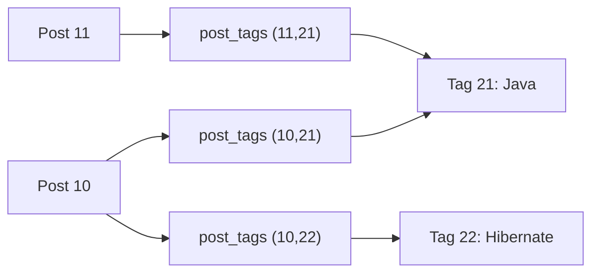
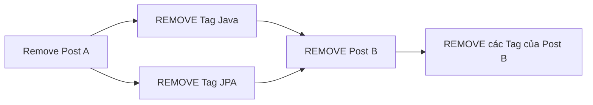
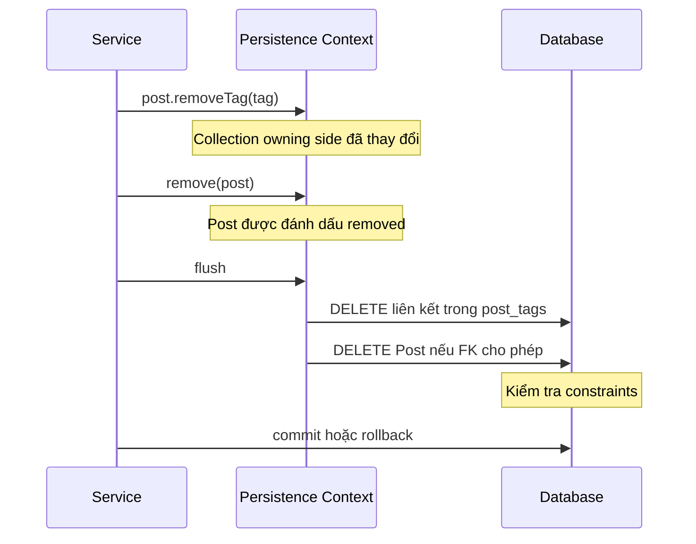

# Đánh giá rủi ro lan truyền REMOVE trong quan hệ nhiều-nhiều của JPA

Quan hệ nhiều-nhiều (*many-to-many*) thường xuất hiện khi nhiều bản ghi ở một phía có thể liên kết với nhiều bản ghi ở phía còn lại: bài viết–thẻ, sinh viên–khóa học, người dùng–vai trò, sản phẩm–danh mục. Với JPA, ánh xạ `@ManyToMany` giúp thao tác qua collection khá thuận tiện. Nhưng khi bước sang thao tác **xóa**, sự tiện lợi đó có một ranh giới quan trọng: **xóa mối liên kết không có nghĩa xóa entity được liên kết**.

Ví dụ, bài viết A và bài viết B đều có thẻ `Java`. Khi xóa bài viết A, ta thường muốn:

- Xóa hàng của bài viết A trong `posts`.
- Xóa các hàng bảng nối `post_tags` liên quan bài viết A.
- **Giữ nguyên thẻ `Java` trong `tags`**, vì bài viết B còn đang sử dụng thẻ này.

Nếu cấu hình:

```java
@ManyToMany(cascade = CascadeType.REMOVE)
private Set<Tag> tags = new HashSet<>();
```

JPA được yêu cầu **lan truyền thao tác remove từ `Post` đến những `Tag` đang liên kết**. Đây là hành động nguy hiểm khi `Tag` được nhiều bài viết chia sẻ. `CascadeType.ALL` cũng nguy hiểm trong ngữ cảnh đó vì nó bao gồm `REMOVE`.

> **Nguyên tắc cốt lõi:** Với một quan hệ nhiều-nhiều mà entity ở hai phía có thể tồn tại và được tham chiếu độc lập, thông thường **không cấu hình `CascadeType.REMOVE` hoặc `CascadeType.ALL` trên `@ManyToMany`**. Hãy xóa **hàng liên kết** khi muốn bỏ quan hệ; chỉ xóa **entity đích** khi nghiệp vụ thực sự yêu cầu xóa chính entity đó.

Bài học tập trung vào lý do, đường đi của thao tác xóa, trường hợp rủi ro, các biện pháp phòng ngừa và cách thiết kế thay thế trong Jakarta Persistence (JPA), Hibernate/Spring Data JPA.

## 1. Hiểu cấu trúc database của many-to-many

Giả sử một bài viết có nhiều thẻ; một thẻ cũng được gắn cho nhiều bài viết. Database quan hệ thường không lưu toàn bộ danh sách Tag trong một ô của Post, mà dùng **bảng nối**:

```sql
CREATE TABLE posts (
    id BIGINT PRIMARY KEY,
    title VARCHAR(200) NOT NULL
);

CREATE TABLE tags (
    id BIGINT PRIMARY KEY,
    name VARCHAR(80) NOT NULL UNIQUE
);

CREATE TABLE post_tags (
    post_id BIGINT NOT NULL,
    tag_id BIGINT NOT NULL,
    PRIMARY KEY (post_id, tag_id),
    CONSTRAINT fk_post_tags_post
        FOREIGN KEY (post_id) REFERENCES posts(id),
    CONSTRAINT fk_post_tags_tag
        FOREIGN KEY (tag_id) REFERENCES tags(id)
);
```

Ba bảng đóng vai trò khác nhau:

| Bảng | Đối tượng mà hàng biểu diễn | Ý nghĩa khi xóa |
|---|---|---|
| `posts` | Một bài viết có ID | Bài viết không còn tồn tại. |
| `tags` | Một thẻ có ID, dùng lại được | Thẻ không còn tồn tại cho mọi nơi sử dụng. |
| `post_tags` | Một liên kết giữa Post và Tag | Chỉ cặp gắn thẻ cụ thể không còn tồn tại. |

Ví dụ dữ liệu:

```text
posts                         tags
+----+--------------+         +----+-----------+
| id | title        |         | id | name      |
+----+--------------+         +----+-----------+
| 10 | JPA Basics   |         | 21 | Java      |
| 11 | ORM Pitfalls |         | 22 | Hibernate |
+----+--------------+         +----+-----------+

post_tags
+---------+--------+
| post_id | tag_id |
+---------+--------+
| 10      | 21     |
| 10      | 22     |
| 11      | 21     |
+---------+--------+
```

Thẻ 21 (Java) đang được **hai** bài viết 10 và 11 sử dụng. Xóa liên kết `(10, 21)` là một thay đổi nhỏ:

```sql
DELETE FROM post_tags
WHERE post_id = 10 AND tag_id = 21;
```

Nhưng xóa entity Tag 21 là thay đổi có phạm vi lớn hơn nhiều:

```sql
DELETE FROM tags
WHERE id = 21;
```

Câu SQL thứ hai có thể bị foreign key từ `post_tags` từ chối, hoặc nếu database có cascade xóa từ Tag sang bảng nối, nó có thể khiến **cả các bài viết khác mất liên kết với Tag 21**. Đó không phải tác dụng của việc “gỡ thẻ khỏi bài viết 10”.

### Sơ đồ chia sẻ



Khi Post 10 bị xóa, liên kết của Post 11 tới Tag 21 thường **không được đụng tới**. Nếu một cascade trên entity khiến Tag 21 bị xóa, thao tác đã vượt ra ngoài phạm vi mà người dùng thường mong muốn.

## 2. Cấu hình `@ManyToMany` bình thường

Phía `Post` định nghĩa bảng nối:

```java
import jakarta.persistence.*;
import java.util.HashSet;
import java.util.Set;

@Entity
@Table(name = "posts")
public class Post {

    @Id
    private Long id;

    @Column(name = "title", nullable = false, length = 200)
    private String title;

    @ManyToMany
    @JoinTable(
        name = "post_tags",
        joinColumns = @JoinColumn(name = "post_id"),
        inverseJoinColumns = @JoinColumn(name = "tag_id")
    )
    private Set<Tag> tags = new HashSet<>();

    protected Post() {}

    public Set<Tag> getTags() {
        return tags;
    }
}
```

Entity đích có thể chỉ khai chính nó, nếu không cần truy cập ngược:

```java
@Entity
@Table(name = "tags")
public class Tag {

    @Id
    private Long id;

    @Column(name = "name", nullable = false, length = 80, unique = true)
    private String name;

    protected Tag() {}

    public Long getId() { return id; }
    public String getName() { return name; }
}
```

Quan hệ trên là **một chiều** từ Post sang Tag. Điều kiện để SQL liên kết tồn tại là các entity được persist đúng cách, giá trị khóa hợp lệ và collection ở owning side được cập nhật.

Nếu cần đi từ Tag tới bài viết, có thể thêm:

```java
// Trong Tag.java
@ManyToMany(mappedBy = "tags")
private Set<Post> posts = new HashSet<>();
```

Ở đây:

- `Post.tags` là **owning side**, định nghĩa bảng nối `post_tags`.
- `Tag.posts` là **inverse side** vì có `mappedBy = "tags"`.
- `mappedBy` nhận **tên thuộc tính Java** ở phía kia, không phải tên bảng `post_tags`.
- Hai phía biểu diễn **cùng một quan hệ**, không phải hai quan hệ độc lập.

Mặc định cascade ở `@ManyToMany` là **không có thao tác cascade**. Đây thường là điểm xuất phát phù hợp cho quan hệ giữa những entity được chia sẻ.

## 3. Phân biệt ba hành động rất dễ bị gọi chung là “xóa”

| Hành động | Đối tượng cần xóa | Ví dụ |
|---|---|---|
| Gỡ Tag khỏi Post | **Hàng bảng nối** `post_tags` | `DELETE FROM post_tags WHERE post_id = 10 AND tag_id = 21` |
| Xóa Post | **Entity Post** và các liên kết liên quan tới Post | Xóa các liên kết `post_id = 10` rồi xóa Post 10 |
| Xóa Tag | **Entity Tag** và xử lý mọi liên kết tới Tag | Xóa Tag 21 theo chính sách riêng của danh mục thẻ |

Chúng có thể xảy ra trong cùng một workflow, nhưng mang ý nghĩa rất khác:

- **Gỡ liên kết:** hai entity vẫn tồn tại; chỉ quan hệ giữa chúng biến mất.
- **Xóa owner:** một entity biến mất; database không được để lại bản ghi nối trỏ tới owner đã xóa.
- **Xóa target:** một entity chia sẻ biến mất; mọi bản ghi nối trỏ tới target phải được xử lý theo constraint và nghiệp vụ.

Trong JPA, việc gọi:

```java
post.getTags().remove(tag);
```

là thay đổi **collection liên kết** ở owning side; provider có thể xóa hàng trong `post_tags` khi flush. Nó không mặc nhiên có nghĩa `entityManager.remove(tag)`.

Ngược lại:

```java
entityManager.remove(post);
```

yêu cầu **xóa entity Post**. Nếu Post có cascade REMOVE tới Tag, thao tác xóa có thể tiếp tục được lan truyền sang **chính các Tag liên kết**.

Chỉ một chữ `REMOVE` xuất hiện trong cascade đã làm thay đổi phạm vi thao tác.

## 4. `CascadeType.REMOVE` thực sự làm gì?

Các cascade type của JPA là chỉ dẫn để lan truyền **thao tác vòng đời** từ entity nguồn tới các entity liên kết. Với `REMOVE`:

```java
@ManyToMany(cascade = CascadeType.REMOVE)
private Set<Tag> tags;
```

khi thao tác remove được thực hiện trên một `Post` managed, provider được yêu cầu lan truyền remove tới các `Tag` được liên kết theo mapping.

Diễn giải:

```text
remove(Post 10)
  |
  +-- Remove Post 10
  |
  +-- Cascade REMOVE đến các Tag liên kết
          |
          +-- Remove Tag 21
          +-- Remove Tag 22
```

Trong database, nếu Tag 21 còn thuộc Post 11, có thể xảy ra:

1. SQL xóa Tag 21 bị foreign key trong `post_tags` từ chối.
2. Nếu cơ chế xử lý association/DB cascade cho phép, Tag 21 bị xóa và liên kết của Post 11 tới Tag 21 cũng mất.
3. Nếu có cascade REMOVE theo những cạnh quan hệ khác, phạm vi xóa tiếp tục mở rộng.
4. Transaction lỗi và rollback; hành vi/điểm thất bại cụ thể phụ thuộc provider, thứ tự SQL và constraint.

**Không nên coi một lỗi foreign key là lớp bảo vệ nghiệp vụ chính.** Hôm nay schema có thể chặn xóa Tag, nhưng một thay đổi constraint, cấu hình `ON DELETE` hoặc thứ tự cleanup trong tương lai có thể làm hệ thống chuyển từ “bị lỗi” sang “xóa thành công nhưng sai dữ liệu”.

### `CascadeType.ALL` nguy hiểm tương tự

```java
@ManyToMany(cascade = CascadeType.ALL)
private Set<Tag> tags;
```

`ALL` bao gồm các thao tác chuẩn như `PERSIST`, `MERGE`, `REMOVE`, `REFRESH` và `DETACH`. Vì có `REMOVE`, cấu hình `ALL` trên quan hệ many-to-many giữa các entity chia sẻ cũng mang rủi ro xóa target.

Đừng hiểu `ALL` là “JPA tự quản lý mọi thứ an toàn”; nó có nghĩa **lan truyền mọi loại thao tác thuộc tập cascade**, kể cả loại phá hủy.

## 5. Ví dụ sai: xóa Post kéo theo xóa Tag chung

Giả sử:

```java
@Entity
public class Post {

    @Id
    private Long id;

    @ManyToMany(cascade = CascadeType.ALL)
    @JoinTable(
        name = "post_tags",
        joinColumns = @JoinColumn(name = "post_id"),
        inverseJoinColumns = @JoinColumn(name = "tag_id")
    )
    private Set<Tag> tags = new HashSet<>();
}
```

Ở service:

```java
@Transactional
public void deletePost(Long postId) {
    Post post = entityManager.find(Post.class, postId);
    if (post == null) {
        return;
    }
    entityManager.remove(post);
}
```

Kỳ vọng thường thấy:

```text
Xóa Post 10
Xóa liên kết (10,21), (10,22)
Giữ Tag 21, Tag 22
Giữ Post 11 và liên kết (11,21)
```

Nhưng vì `CascadeType.ALL` chứa `REMOVE`, JPA còn nhận yêu cầu remove Tag 21 và Tag 22. Điều đó có thể dẫn đến lỗi constraint hoặc hủy các Tag dùng chung.

Đây là **sai lầm về mô hình sở hữu dữ liệu**, không đơn thuần là lỗi kỹ thuật của Hibernate. Bài viết sở hữu việc **gắn thẻ** của chính nó, chứ thông thường không sở hữu **sự tồn tại** của một thẻ trong hệ thống.

### Cách an toàn hơn

```java
@ManyToMany
@JoinTable(
    name = "post_tags",
    joinColumns = @JoinColumn(name = "post_id"),
    inverseJoinColumns = @JoinColumn(name = "tag_id")
)
private Set<Tag> tags = new HashSet<>();
```

Không khai `cascade = REMOVE` hoặc `ALL`.

Khi cần xóa Post, xử lý việc xóa entity và những liên kết của nó. Provider có thể phát sinh xóa hàng bảng nối theo mapping; với quan hệ hai chiều hoặc schema đặc biệt, cần đồng bộ owning side, cleanup phù hợp và kiểm chứng constraint. Các Tag vẫn phải có đời sống độc lập.

## 6. Nếu cả hai phía cùng cascade REMOVE, rủi ro lan đến đâu?

Xét cấu hình không nên áp dụng:

```java
// Post.java
@ManyToMany(cascade = CascadeType.REMOVE)
private Set<Tag> tags;

 // Tag.java
@ManyToMany(mappedBy = "tags", cascade = CascadeType.REMOVE)
private Set<Post> posts;
```

Đồ thị quan hệ:

```text
Post A ---- Tag Java ---- Post B
   |                         |
   +------ Tag JPA ---------+
```

Khi xóa Post A:

1. Cấu hình Post → Tag yêu cầu xóa Tag Java và Tag JPA.
2. Cấu hình Tag → Post có thể tiếp tục yêu cầu xóa những Post đang liên kết, gồm Post B.
3. Những Post mới được đánh dấu remove lại có thể lan tới các Tag của chúng.
4. Phạm vi yêu cầu xóa có thể bao phủ nhiều thành phần kết nối trong đồ thị.



Không phải mọi provider sẽ thực hiện một chuỗi câu SQL giống sơ đồ. Persistence context có thể tránh xử lý lặp một entity, database có thể chặn bởi foreign key, và transaction có thể rollback. Nhưng **phạm vi cascade đã đi xa hơn thực thể ban đầu**. Đây là đặc điểm nguy hiểm của việc lan truyền remove trên đồ thị nhiều-nhiều.

Đặc biệt với `User ↔ Role`:

- Xóa User A.
- Cascade REMOVE làm Role `ADMIN` bị remove.
- Role `ADMIN` đang dùng bởi User B, C.
- Database có thể từ chối, hoặc cấu hình nguy hiểm có thể làm nhiều liên kết bị mất.

Một quyền dùng chung không được xóa chỉ vì một user bị xóa.

## 7. Vì sao many-to-many khác one-to-many có ownership rõ?

Một số quan hệ cha–con phù hợp với cascade remove. Ví dụ một đơn hàng sở hữu các dòng đơn hàng riêng:

```java
@OneToMany(
    mappedBy = "order",
    cascade = CascadeType.ALL,
    orphanRemoval = true
)
private List<OrderLine> lines = new ArrayList<>();
```

Nếu `OrderLine` không thể tồn tại độc lập với `PurchaseOrder`, xóa order rồi xóa các dòng của nó thường phù hợp với nghiệp vụ. Mỗi dòng thường chỉ thuộc một order tại một thời điểm, nên owner có thể kiểm soát vòng đời child.

Ngược lại:

```java
@ManyToMany
private Set<Tag> tags;
```

một Tag có thể thuộc nhiều Post. Post không độc quyền sở hữu sự tồn tại của Tag.

| Đặc điểm | One-to-many giữa owner và child phụ thuộc | Many-to-many giữa entity chia sẻ |
|---|---|---|
| Child/target được nhiều owner tham chiếu? | Thường không, theo ranh giới aggregate | Có, đây là ý nghĩa cốt lõi |
| Xóa owner có nên xóa target? | Có thể, nếu chính sách miền cho phép | Thường không |
| Bỏ một liên kết có đồng nghĩa xóa target? | Có thể dùng `orphanRemoval` nếu target phụ thuộc | Không; thường chỉ xóa bản ghi nối |
| `CascadeType.REMOVE` | Có thể phù hợp trên collection owner | Rủi ro xóa dữ liệu chung |
| Đơn vị sở hữu thực tế | Owner có thể sở hữu entity child | Mỗi owner sở hữu *việc liên kết* với target, không sở hữu target |

**Không suy luận cascade chỉ từ việc entity A “có collection” của entity B.** Cần hỏi B có danh tính và vòng đời độc lập không; có được entity khác tham chiếu không.

## 8. `orphanRemoval` không phải công cụ của `@ManyToMany`

Ở JPA chuẩn, `@ManyToMany` **không có thuộc tính `orphanRemoval`**:

```java
@ManyToMany(orphanRemoval = true) // Không hợp lệ với API JPA
private Set<Tag> tags;
```

`orphanRemoval` được hỗ trợ cho `@OneToOne` và `@OneToMany` theo các điều kiện của JPA. Nó dành cho quan hệ sở hữu vòng đời phù hợp: khi một child bị gỡ khỏi parent, child có thể bị remove.

Với many-to-many, một Tag bị gỡ khỏi Post A **không phải Tag “mồ côi”** vì có thể vẫn thuộc Post B hoặc tồn tại như một từ khóa danh mục chưa dùng đến.

Ngay cả khi đã kiểm tra Tag hiện không gắn với Post nào, đó vẫn không tự động là quyền xóa Tag; Tag có thể nằm trong taxonomy được quản lý độc lập hoặc sẽ được dùng lại.

## 9. Rủi ro không chỉ là mất dữ liệu: còn lỗi transaction

Cấu hình cascade REMOVE sai có thể khiến nghiệp vụ xóa bình thường bị lỗi:

```text
Request: Delete Post 10
    |
    v
JPA: remove Post 10
    |
    v
Cascade: remove Tag 21
    |
    v
Database: Tag 21 còn được Post 11 tham chiếu
    |
    v
Foreign key violation
    |
    v
Transaction rollback / API trả lỗi
```

Ở đây có thể không mất Tag nhờ FK, nhưng yêu cầu xóa Post lại **không hoàn thành**. Người dùng nhìn thấy lỗi cho một hành động lẽ ra an toàn. Nghiêm trọng hơn, thao tác hỏng có thể xuất hiện muộn lúc flush hoặc commit, không xuất hiện ngay tại dòng `remove(post)`.

Một vài hậu quả vận hành:

- **Khó dự đoán phạm vi xóa:** người gọi tưởng xóa một bài viết nhưng provider phải xử lý nhiều entity.
- **Lỗi khóa ngoại:** những Tag dùng chung ngăn toàn bộ transaction.
- **Tốn SQL và thời gian:** cascade phải xử lý tập target lớn, có thể cần tải association.
- **Tăng tranh chấp:** nhiều hàng được đánh dấu xóa, tăng khả năng lock conflict/deadlock tùy database.
- **Độ ổn định API giảm:** thành công/thất bại của việc xóa một Post phụ thuộc các Post khác đang dùng cùng Tag.
- **Rủi ro integrity khi schema yếu:** nếu FK thiếu hoặc có cascade database không đúng, dữ liệu liên quan có thể bị xóa ngoài phạm vi dự định.

Đây là lý do nên coi thiết kế cascade như một phần của **quy tắc sở hữu dữ liệu**, không chỉ là một lựa chọn để giảm số lời gọi repository.

## 10. Phân biệt `CascadeType.REMOVE`, xóa collection link và SQL `ON DELETE CASCADE`

Ba khái niệm dùng chữ “cascade” hoặc “delete” nhưng thuộc các tầng khác nhau.

| Cơ chế | Tầng | Ý nghĩa điển hình |
|---|---|---|
| `entityManager.remove(post)` | JPA entity lifecycle | Xóa entity Post. |
| `post.tags.remove(tag)` | JPA collection mapping | Gỡ liên kết Post–Tag; provider xử lý bảng nối khi flush. |
| `@ManyToMany(cascade = REMOVE)` | JPA lifecycle cascade | Yêu cầu remove **các entity Tag** được liên kết khi remove Post. |
| `ON DELETE CASCADE` trên FK `post_tags.post_id` | Database FK action | Khi Post bị xóa, database xóa **các hàng post_tags** tham chiếu Post. |
| `ON DELETE CASCADE` trên FK `post_tags.tag_id` | Database FK action | Khi Tag bị xóa, database xóa **các hàng post_tags** tham chiếu Tag. |

**`ON DELETE CASCADE` từ bảng nối tới entity cha không đồng nghĩa với JPA `CascadeType.REMOVE` từ Post sang Tag.**

Ví dụ:

```sql
CREATE TABLE post_tags (
    post_id BIGINT NOT NULL
        REFERENCES posts(id) ON DELETE CASCADE,
    tag_id BIGINT NOT NULL
        REFERENCES tags(id) ON DELETE CASCADE,
    PRIMARY KEY (post_id, tag_id)
);
```

Nếu xóa `posts.id = 10` bằng SQL, database sẽ xóa các hàng `post_tags` có `post_id = 10` theo FK action. **Nó không tự xóa bản ghi trong `tags`.**

Nếu xóa `tags.id = 21` bằng SQL, database sẽ xóa các hàng `post_tags` có `tag_id = 21`; các Post vẫn tồn tại. Dù thế, những liên kết tới Tag 21 bị mất, nên việc xóa Tag vẫn là hành động cần quyền và chính sách riêng.

Trong JPA, có provider-specific mapping liên quan database cascade như Hibernate `@OnDelete`, nhưng không được nhầm nó với `CascadeType.REMOVE`. Cần hiểu annotation được đặt ở đâu, FK nào thực sự có `ON DELETE` và persistence context có đang giữ dữ liệu đã trở nên cũ sau thao tác database-level hay không.

## 11. Quyền sở hữu association không phải quyền sở hữu target entity

Trong quan hệ hai chiều:

```java
// Post.java
@ManyToMany
@JoinTable(
    name = "post_tags",
    joinColumns = @JoinColumn(name = "post_id"),
    inverseJoinColumns = @JoinColumn(name = "tag_id")
)
private Set<Tag> tags = new HashSet<>();
```

```java
// Tag.java
@ManyToMany(mappedBy = "tags")
private Set<Post> posts = new HashSet<>();
```

Ta gọi Post là **owning side**, nhưng cần hiểu chính xác:

- **Owning side của association**: phía định nghĩa việc ghi hàng trong bảng nối.
- **Owner vòng đời của entity**: đối tượng nào chịu trách nhiệm tạo/xóa sự tồn tại của entity khác theo nghiệp vụ.

Hai khái niệm **khác nhau**.

Post sở hữu việc thêm/gỡ Tag **khỏi Post này**, nhưng Tag là entity được các Post khác chia sẻ. Do đó “Post là owning side” **không** phải lý do để khai `CascadeType.REMOVE` đối với Tag.

Điểm này giải thích một sai lầm thường gặp: người mới thấy “owning side” rồi tưởng phải dùng `cascade = ALL` để JPA “sở hữu luôn Tag”. Thực tế ownership của FK/join table không quyết định việc entity đích nên bị xóa.

## 12. Cách gỡ một Tag an toàn với collection

Với quan hệ một chiều Post → Tags, trong transaction:

```java
@Transactional
public void removeTagFromPost(Long postId, Long tagId) {
    Post post = entityManager.find(Post.class, postId);
    Tag tag = entityManager.find(Tag.class, tagId);

    if (post == null || tag == null) {
        throw new IllegalArgumentException("Post or Tag not found");
    }

    post.getTags().remove(tag);
    // Không gọi entityManager.remove(tag).
}
```

Về ý nghĩa, thay đổi cần lưu:

```sql
DELETE FROM post_tags
WHERE post_id = ? AND tag_id = ?;
```

SQL chính xác provider tạo phụ thuộc collection type và mapping. Ví dụ, với một số kiểu `List`/bag trong Hibernate, thay đổi collection có thể dẫn tới xóa/chèn lại nhiều hàng bảng nối; không hứa nó luôn là đúng một câu DELETE. Nhưng **đối tượng nghiệp vụ cần thay đổi vẫn là liên kết**, không phải hàng Tag.

### Dùng helper methods để bảo vệ ý nghĩa nghiệp vụ

Thay vì trả collection mutable cho mọi nơi:

```java
public void addTag(Tag tag) {
    Objects.requireNonNull(tag);
    tags.add(tag);
}

public void removeTag(Tag tag) {
    Objects.requireNonNull(tag);
    tags.remove(tag);
}
```

Ở đây `Objects` thuộc `java.util.Objects`. Với quan hệ hai chiều, helper nên đồng bộ collection ở cả hai phía trong memory (phần tiếp theo). Tránh method mang tên `deleteTag` khi thực ra chỉ gỡ liên kết; tên `removeTagFromPost` hoặc `unlinkTag` làm rõ phạm vi thay đổi.

### Cẩn thận với `Set` và equality

`Set<Tag>` dùng `equals`/`hashCode` của Tag. Nếu entity dùng ID được database sinh và `hashCode` thay đổi sau khi persist, việc thêm/xóa khỏi HashSet có thể gặp vấn đề. Cần có chiến lược equality ổn định phù hợp với entity/proxy, hoặc dùng cách quản lý collection và truy vấn theo ID hợp lý.

Không nên giải quyết vấn đề `remove` không tìm thấy phần tử bằng cách thêm `CascadeType.REMOVE`; đó là hai cơ chế hoàn toàn khác nhau.

## 13. Đồng bộ hai phía trong quan hệ hai chiều

Nếu Tag có collection `posts`:

```java
// Post.java
@ManyToMany
@JoinTable(
    name = "post_tags",
    joinColumns = @JoinColumn(name = "post_id"),
    inverseJoinColumns = @JoinColumn(name = "tag_id")
)
private Set<Tag> tags = new HashSet<>();

public void addTag(Tag tag) {
    if (tags.add(tag)) {
        tag.addPostInternal(this);
    }
}

public void removeTag(Tag tag) {
    if (tags.remove(tag)) {
        tag.removePostInternal(this);
    }
}
```

```java
// Tag.java
@ManyToMany(mappedBy = "tags")
private Set<Post> posts = new HashSet<>();

void addPostInternal(Post post) {
    posts.add(post);
}

void removePostInternal(Post post) {
    posts.remove(post);
}
```

Hai helper nội bộ trên Tag **không gọi ngược** `post.addTag`/`post.removeTag` nên tránh vòng lặp đệ quy. Chúng dùng cùng các entity trong một mô hình hai chiều; ví dụ code được lược bớt `@Id`, constructor và import để tập trung vào đồng bộ liên kết.

Khi muốn gỡ tag:

```java
post.removeTag(tag);
```

điều này:

1. Gỡ Tag khỏi `post.tags` ở owning side, giúp JPA có metadata để đồng bộ join table.
2. Gỡ Post khỏi `tag.posts` ở inverse side, giúp object graph trong memory nhất quán.
3. **Không** đánh dấu Post hoặc Tag bị xóa.

Chỉ sửa `tag.posts.remove(post)` trên inverse side có thể không cập nhật bảng nối như mong đợi, vì owning side là `Post.tags`. Một hệ thống nên thống nhất cách gọi helper để tránh các đoạn code sửa collection tùy ý.

## 14. Xóa toàn bộ Post mà vẫn giữ Tag

Đây là thao tác phức tạp hơn gỡ một Tag, vì Post biến mất. Mục tiêu vẫn là: xóa các liên kết của Post, rồi xóa Post; giữ các Tag.

Một service có thể diễn đạt:

```java
@Transactional
public void deletePost(Long postId) {
    Post post = entityManager.find(Post.class, postId);
    if (post == null) {
        return;
    }

    // Không có cascade REMOVE từ Post sang Tag.
    // Với mapping hai chiều, có thể dùng helper để đồng bộ bộ nhớ.
    for (Tag tag : new HashSet<>(post.getTags())) {
        post.removeTag(tag);
    }

    entityManager.remove(post);
}
```

Trong ví dụ này, giả định `Post.removeTag` đồng bộ cả hai phía như phần trên, và `Post`/`Tag` dùng mapping không có `CascadeType.REMOVE`. Nếu chỉ dùng quan hệ một chiều, có thể xóa liên kết từ owning collection mà không cần cập nhật `tag.posts`.

Về ý nghĩa SQL:

```sql
DELETE FROM post_tags
WHERE post_id = :postId;

DELETE FROM posts
WHERE id = :postId;
```

JPA provider có thể quản lý việc xóa hàng nối khi entity nguồn bị remove; thao tác clear collection tường minh không phải yêu cầu bất biến với mọi mapping. Ở mô hình hai chiều, đồng bộ collection giúp tránh trạng thái Java stale; khi cần bảo đảm delete hoạt động với schema cụ thể và khối lượng lớn, hãy thiết kế thao tác cleanup đúng owning side và kiểm chứng ràng buộc FK ở môi trường thực tế.

Điểm không đổi là **không xóa Tag chỉ vì xóa Post**.

### Vì sao dùng bản sao của collection trong vòng lặp?

```java
for (Tag tag : new HashSet<>(post.getTags())) {
    post.removeTag(tag);
}
```

Helper `removeTag` thay đổi chính `post.tags`. Nếu đang lặp trực tiếp trên collection đó rồi xóa phần tử, Java có thể phát sinh `ConcurrentModificationException`. Tạo bản sao giúp duyệt an toàn khi xóa liên kết thông qua helper.

Nếu collection có hàng trăm nghìn phần tử, tải toàn bộ để vòng lặp có thể không hiệu quả. Lúc đó cần chiến lược bulk cleanup tại database hoặc thiết kế bảng liên kết thành entity riêng, kèm quản lý persistence context phù hợp.

## 15. Khi nào thực sự được xóa Tag?

Tag là một entity độc lập, vì vậy xóa Tag nên là một **use case riêng** có chính sách rõ ràng. Ví dụ:

- Chỉ admin quản lý taxonomy mới có quyền xóa Tag.
- Không cho xóa Tag nếu còn Post tham chiếu.
- Hoặc cho phép xóa Tag và chủ động gỡ tất cả liên kết khỏi Post.
- Cần log/audit riêng về việc xóa Tag.
- Có thể dùng trạng thái `active=false` để không cho gắn mới mà giữ lịch sử.

Ví dụ chặn xóa nếu còn Post tham chiếu:

```java
@Transactional
public void deleteUnusedTag(Long tagId) {
    Tag tag = entityManager.find(Tag.class, tagId);
    if (tag == null) {
        return;
    }

    Long refs = entityManager.createQuery(
        "select count(p) from Post p join p.tags t where t.id = :tagId",
        Long.class
    )
    .setParameter("tagId", tagId)
    .getSingleResult();

    if (refs > 0L) {
        throw new IllegalStateException("Tag is still in use");
    }

    entityManager.remove(tag);
}
```

Truy vấn kiểm tra ở trên **không tự chống race condition**: một transaction khác có thể liên kết Tag ngay sau khi kiểm tra. Ràng buộc foreign key không cascade, transaction isolation/lock và chiến lược xử lý vi phạm constraint vẫn cần được xem xét theo ứng dụng.

Với trường hợp có chính sách cho phép xóa tag đang dùng, thao tác phải chủ động làm rõ tác động đến **tất cả** Post tham chiếu và update chúng đúng cách, không lợi dụng cascade REMOVE từ một Post bất kỳ.

## 16. Nguy cơ đặc biệt trong `User ↔ Role`

Ánh xạ many-to-many quyền thường gặp:

```java
@Entity
@Table(name = "users")
public class User {

    @Id
    private Long id;

    @ManyToMany(fetch = FetchType.LAZY)
    @JoinTable(
        name = "user_roles",
        joinColumns = @JoinColumn(name = "user_id"),
        inverseJoinColumns = @JoinColumn(name = "role_id")
    )
    private Set<Role> roles = new HashSet<>();
}
```

```java
@Entity
@Table(name = "roles")
public class Role {

    @Id
    private Long id;

    @Column(name = "role_name", nullable = false, unique = true)
    private String name;
}
```

Khi xóa User:

- Xóa hàng `users` của user.
- Xóa liên kết trong `user_roles` của user.
- Giữ nguyên các Role `ADMIN`, `EDITOR`, `VIEWER` vì các role là danh mục toàn hệ thống.

Nếu dùng `@ManyToMany(cascade = CascadeType.ALL)`, thao tác xóa một User có thể cố xóa Role; những User khác đang giữ Role đó sẽ bị ảnh hưởng hoặc transaction lỗi.

Vì đây là dữ liệu **phân quyền**, ảnh hưởng có thể nghiêm trọng hơn mất tag hiển thị: làm sai hệ thống quyền hoặc khiến nghiệp vụ quản lý user không hoạt động.

**Không dùng cascade remove cho Role dùng chung.** Hãy xem Role là entity do một luồng quản trị riêng quản lý. Việc thu hồi Role của User chỉ là gỡ một hàng trong `user_roles`.

## 17. Rủi ro với Student–Course và Product–Category

### Student–Course

Một sinh viên đăng ký nhiều khóa học; một khóa học có nhiều sinh viên.

```java
@ManyToMany
@JoinTable(
    name = "student_courses",
    joinColumns = @JoinColumn(name = "student_id"),
    inverseJoinColumns = @JoinColumn(name = "course_id")
)
private Set<Course> courses = new HashSet<>();
```

Xóa Student chỉ nên xóa enrollment/link của student theo chính sách lưu trữ. Nó **không** được xóa Course vì Course còn phục vụ nhiều Student khác.

Nếu enrollment có `enrolledAt`, `grade` hoặc `status`, nên cân nhắc entity liên kết riêng (phần sau), vì quan hệ cần vòng đời và dữ liệu nghiệp vụ riêng.

### Product–Category

Một sản phẩm thuộc nhiều danh mục; một danh mục chứa nhiều sản phẩm. Xóa Product không nên xóa Category `Laptops`, vì danh mục này được nhiều sản phẩm dùng.

Một rủi ro ngược cũng tồn tại: xóa Category mà cấu hình cascade remove tới Product có thể cố xóa **mọi sản phẩm trong danh mục**. Điều này có thể gây thiệt hại rất lớn nếu Category có số lượng sản phẩm lớn.

Những ví dụ trên cho thấy hai phía many-to-many thường đều **độc lập về danh tính và vòng đời**. Đó là lý do `REMOVE` thường không phù hợp.

## 18. `CascadeType.PERSIST` hoặc `MERGE` có thể dùng không?

Không phải tất cả cascade type đều nguy hiểm như `REMOVE`. Ví dụ:

```java
@ManyToMany(cascade = {CascadeType.PERSIST, CascadeType.MERGE})
private Set<Tag> tags = new HashSet<>();
```

Cấu hình trên **không chứa REMOVE**, nên khi remove Post, JPA không được yêu cầu cascade thao tác remove tới Tag chỉ vì cấu hình này.

Nhưng vẫn cần đánh giá:

- `PERSIST` có thể hợp lý khi entity nguồn và entity đích luôn được tạo mới cùng nhau trong một workflow. Với **Tag dùng chung** đã tồn tại hoặc detached, cascade persist có thể gây lỗi về trạng thái entity hoặc tạo trùng danh mục nếu code không lookup target trước.
- `MERGE` có thể lan truyền merge vào trạng thái của các Tag được tham chiếu. Nếu mục tiêu chỉ là gắn Tag có sẵn mà không sửa Tag, lan truyền merge có thể gây tác động không mong muốn, nhất là với graph detached hoặc dữ liệu stale.
- `REFRESH` hoặc `DETACH` cũng có thể có chi phí/tác động vòng đời ngoài ý đồ.
- `ALL` gom tất cả những hành vi trên, **bao gồm REMOVE**.

Với Post–Tag dùng chung, một phương án dễ hiểu là **không cascade gì cả**, tìm hoặc quản lý Tag riêng rồi gắn nó vào Post. Khi nghiệp vụ có lý do rõ để cascade `PERSIST`/`MERGE`, cấu hình nên chỉ gồm đúng những loại được phép.

Không có nguyên tắc “mọi many-to-many đều phải có PERSIST” hay “mọi many-to-many đều cấm MERGE”. Quyết định phải xuất phát từ vòng đời của entity đích, trạng thái managed/detached và quy tắc cập nhật nghiệp vụ.

## 19. Vì sao `CascadeType.ALL` thường bị thêm nhầm?

Có ba động cơ hay gặp:

**Lý do 1: Muốn lưu Post và Tag bằng một lời gọi.**

```java
post.getTags().add(new Tag("Java"));
postRepository.save(post);
```

Lập trình viên thêm `ALL` để “lưu cả Tag”. Nhưng Tag thường là danh mục dùng chung, cần tìm theo khóa duy nhất trước khi tạo. Sau đó code giữ lại `ALL` và quên rằng delete Post cũng cascade REMOVE.

**Lý do 2: Sao chép cấu hình từ `@OneToMany`.**

Một Order sở hữu OrderLine có thể phù hợp với `cascade = ALL, orphanRemoval = true`. Sao chép tư duy đó sang Post–Tag là đánh đồng **child thuộc sở hữu riêng** với **target dùng chung**.

**Lý do 3: Gặp lỗi join table khi xóa.**

Thay vì xác định owning side, sync collection và foreign key, lập trình viên thử `cascade = ALL` như một cách “để JPA dọn hết”. Điều này có thể che triệu chứng trước mắt nhưng mở ra nguy cơ xóa entity chia sẻ.

Biện pháp tốt hơn là xác định **chính xác hàng nào cần xóa** và **ai có quyền xóa nó** trước khi đặt cascade.

## 20. Xóa entity đích và dữ liệu bảng nối: chọn chính sách

Khi một người quản trị muốn xóa Tag 21, có ít nhất ba chính sách:

### Chính sách A: cấm xóa Tag đang sử dụng

Giữ foreign key không cascade và kiểm tra số Post tham chiếu. Nếu còn liên kết, trả lỗi nghiệp vụ. Với constraint FK, database sẽ bảo vệ trường hợp kiểm tra bị race.

Đây thường là chính sách đơn giản, an toàn cho danh mục quan trọng.

### Chính sách B: cho xóa Tag sau khi gỡ mọi liên kết

Service chủ động gỡ Tag khỏi các Post ở owning side, rồi remove Tag:

```java
@Transactional
public void deleteTagEverywhere(Long tagId) {
    Tag tag = entityManager.find(Tag.class, tagId);
    if (tag == null) {
        return;
    }

    List<Post> posts = entityManager.createQuery(
        "select distinct p from Post p join p.tags t where t.id = :tagId",
        Post.class
    )
    .setParameter("tagId", tagId)
    .getResultList();

    for (Post post : posts) {
        post.removeTag(tag);
    }

    entityManager.remove(tag);
}
```

Cách này minh họa ý nghĩa nghiệp vụ, nhưng có thể tải rất nhiều Post, sinh nhiều SQL và cần xử lý concurrency. Với dữ liệu lớn, một chiến lược bulk cleanup phù hợp có thể tốt hơn. Nếu dùng bidirectional helper, phải đảm bảo `post.removeTag` đồng bộ hai phía như đã thiết kế.

### Chính sách C: không xóa vật lý, chỉ ngừng sử dụng Tag

```java
@Column(name = "active", nullable = false)
private boolean active = true;
```

Khi người quản trị vô hiệu hóa Tag, dữ liệu liên kết lịch sử vẫn tồn tại. Cần bảo đảm nghiệp vụ tạo liên kết mới không dùng Tag inactive và truy vấn hiển thị lọc đúng.

Soft delete có nhược điểm riêng: unique constraints, truy vấn mặc định và chính sách lưu trữ lịch sử. Nhưng nó có thể phù hợp với hệ thống cần bảo toàn lịch sử sử dụng danh mục.

## 21. Lưu ý về JPQL bulk DELETE và native SQL

Một đoạn code có thể cố xóa hàng trực tiếp:

```java
entityManager.createQuery(
    "delete from Tag t where t.id = :id"
)
.setParameter("id", tagId)
.executeUpdate();
```

**Bulk JPQL DELETE không thực thi theo cùng cơ chế `EntityManager.remove` từng entity**, thường bỏ qua lifecycle callback/cascade của entity và không tự đồng bộ toàn bộ trạng thái các managed instance đã có. Nếu bảng nối còn FK tham chiếu Tag, thao tác có thể bị database từ chối.

Đặc biệt, JPQL bulk delete chuẩn áp dụng trên entity, không phải một câu SQL tùy ý cho bảng nối `post_tags` không được ánh xạ thành entity. Nếu cần xóa bản ghi join table bằng native SQL:

```java
entityManager.createNativeQuery(
    "delete from post_tags where tag_id = :id"
)
.setParameter("id", tagId)
.executeUpdate();
```

cần tự kiểm soát:

- Transaction boundary và thứ tự xóa liên kết/entity.
- Quyền xóa tất cả liên kết đang sử dụng Tag.
- Persistence context: những collection `Post.tags` đã được tải có thể bị **stale** sau native SQL.
- Cache cấp hai và chiến lược invalidation nếu ứng dụng có cấu hình cache.
- Concurrency và ràng buộc foreign key.

Có thể cần `flush()` trước thao tác bulk để đồng bộ các thay đổi đang pending, sau đó `clear()` hoặc reload những entity bị ảnh hưởng. Tuy nhiên `clear()` sẽ detach tất cả managed entities trong context; không sử dụng tùy tiện nếu cùng transaction vẫn cần thao tác trên chúng.

**Không dùng bulk DELETE chỉ để tránh nghĩ về cascade.** Bulk DML là công cụ hiệu năng và xử lý dữ liệu; nó mang nghĩa vụ bảo toàn consistency ở tầng ứng dụng.

## 22. Khi quan hệ có thuộc tính riêng: tạo entity bảng nối

Một bảng nối ban đầu đơn giản:

```text
student_courses(student_id, course_id)
```

sau đó cần thêm:

- Ngày ghi danh `enrolled_at`.
- Trạng thái `ACTIVE` / `CANCELLED`.
- Người phê duyệt và điểm số.
- Lịch sử thay đổi quyền đăng ký.
- Khả năng truy cập từng lần ghi danh qua API.

Lúc này quan hệ không còn chỉ là một cặp ID không có hành vi. Có thể mô hình hóa bằng **association entity** `Enrollment`:

```sql
CREATE TABLE enrollments (
    id BIGINT PRIMARY KEY,
    student_id BIGINT NOT NULL REFERENCES students(id),
    course_id BIGINT NOT NULL REFERENCES courses(id),
    enrolled_at TIMESTAMP NOT NULL,
    status VARCHAR(20) NOT NULL,
    CONSTRAINT uk_enrollment_student_course UNIQUE (student_id, course_id)
);
```

Nếu cho phép một sinh viên ghi danh nhiều lần vào cùng khóa học, phải thay quy tắc uniqueness theo từng lần/đợt; ở đây giả định chỉ có một bản ghi enrollment cho mỗi cặp.

Mapping:

```java
@Entity
@Table(name = "enrollments",
    uniqueConstraints = @UniqueConstraint(
        name = "uk_enrollment_student_course",
        columnNames = {"student_id", "course_id"}
    )
)
public class Enrollment {

    @Id
    private Long id;

    @ManyToOne(fetch = FetchType.LAZY, optional = false)
    @JoinColumn(name = "student_id", nullable = false)
    private Student student;

    @ManyToOne(fetch = FetchType.LAZY, optional = false)
    @JoinColumn(name = "course_id", nullable = false)
    private Course course;

    @Column(name = "enrolled_at", nullable = false)
    private java.time.Instant enrolledAt;

    @Column(name = "status", nullable = false, length = 20)
    private String status;

    protected Enrollment() {}

    public Enrollment(
            Long id, Student student, Course course,
            java.time.Instant enrolledAt) {
        this.id = id;
        this.student = java.util.Objects.requireNonNull(student);
        this.course = java.util.Objects.requireNonNull(course);
        this.enrolledAt = java.util.Objects.requireNonNull(enrolledAt);
        this.status = "ACTIVE";
    }
}
```

Bây giờ việc xóa Enrollment có nghĩa **xóa một bản ghi tham gia khóa học**, không xóa Student hay Course. Không cấu hình `CascadeType.REMOVE` trên `Enrollment.student` hoặc `Enrollment.course` khi hai entity kia sống độc lập.

### Xóa association entity

```java
@Transactional
public void cancelEnrollment(Long enrollmentId) {
    Enrollment enrollment =
        entityManager.find(Enrollment.class, enrollmentId);

    if (enrollment == null) {
        return;
    }

    entityManager.remove(enrollment);
}
```

Chỉ hàng `enrollments` tương ứng bị đánh dấu xóa; Student và Course vẫn tồn tại.

### Cascade từ owner tới link entity có thể hợp lý

Nếu nghiệp vụ cho phép một `Student` sở hữu các bản ghi enrollment của chính mình, có thể cân nhắc:

```java
@OneToMany(
    mappedBy = "student",
    cascade = CascadeType.REMOVE
)
private List<Enrollment> enrollments = new ArrayList<>();
```

Tuy nhiên `Enrollment` có liên kết với Course; khi xóa Student, cascade REMOVE chỉ phải đi từ Student tới **Enrollment**, không từ Enrollment tới Course. Việc cho phép xóa toàn bộ Enrollment khi xóa Student cần được xác định từ nghiệp vụ (ví dụ lưu lịch sử học tập có thể không cho xóa).

Thiết kế **hai quan hệ many-to-one tới link entity** làm ranh giới vòng đời rõ hơn nhiều so với cascade REMOVE trực tiếp trên `@ManyToMany Student.courses`.

## 23. Bảng nối có khóa ghép: giữ riêng danh tính liên kết

Association entity không bắt buộc có surrogate ID. Nếu một cặp `(student_id, course_id)` chính là identity ổn định, có thể dùng composite PK:

```java
@Embeddable
public class EnrollmentId implements java.io.Serializable {
    private Long studentId;
    private Long courseId;

    protected EnrollmentId() {}

    public EnrollmentId(Long studentId, Long courseId) {
        this.studentId = studentId;
        this.courseId = courseId;
    }

    @Override
    public boolean equals(Object other) {
        if (this == other) return true;
        if (!(other instanceof EnrollmentId that)) return false;
        return java.util.Objects.equals(studentId, that.studentId)
            && java.util.Objects.equals(courseId, that.courseId);
    }

    @Override
    public int hashCode() {
        return java.util.Objects.hash(studentId, courseId);
    }
}
```

Và:

```java
@Entity
@Table(name = "enrollments")
public class Enrollment {

    @EmbeddedId
    private EnrollmentId id;

    @MapsId("studentId")
    @ManyToOne(fetch = FetchType.LAZY)
    @JoinColumn(name = "student_id", nullable = false)
    private Student student;

    @MapsId("courseId")
    @ManyToOne(fetch = FetchType.LAZY)
    @JoinColumn(name = "course_id", nullable = false)
    private Course course;

    protected Enrollment() {}
}
```

Đây là **biến thể thay thế** cho `Enrollment` với surrogate ID ở phần trước; không đưa cả hai class trùng tên vào cùng một package. Với phiên bản composite PK, cần khai báo đúng các cột và constraint ở schema, và ID thường được lấy từ các entity đích đã có định danh. `@MapsId` giúp đồng bộ phần khóa ghép với quan hệ tương ứng.

Điểm rút ra: dù dùng một hay nhiều cột để định danh **liên kết**, việc xóa Enrollment vẫn không nên xóa Student hoặc Course.

## 24. Rủi ro dữ liệu lớn: tải và xóa hàng loạt

Giả sử một Tag được gắn cho 500.000 Post. Khi xóa Tag, phương án gọi:

```java
for (Post post : tag.getPosts()) {
    post.removeTag(tag);
}
```

có thể buộc ORM khởi tạo một collection rất lớn, giữ nhiều entity trong persistence context, sinh nhiều thao tác và làm tăng thời gian transaction. Cấu hình cascade REMOVE sai còn nguy hiểm hơn: nó có thể lan tới các Post khác và cả nhiều tầng Tag khác trong đồ thị.

Nên phân biệt các mục tiêu:

| Mục tiêu | Hướng giải quyết |
|---|---|
| Gỡ Tag khỏi một Post | Thay collection ở owning side trong transaction. |
| Xóa một Post cùng vài liên kết | Dùng entity remove, cleanup quan hệ cần thiết; không REMOVE Tag. |
| Xóa Tag có ít liên kết, đã được phép | Gỡ liên kết một cách có kiểm soát, rồi xóa Tag. |
| Xóa Tag có số lượng liên kết rất lớn | Xem xét bulk cleanup và quản lý context/cache, index và lock phù hợp. |
| Tắt Tag khỏi danh mục nhưng giữ lịch sử | Xem xét soft delete/inactive trạng thái. |

Cần đánh giá chi phí của SQL, chỉ số FK, lock, transaction length, audit và yêu cầu người dùng. Không dùng cascade REMOVE như công cụ xóa hàng loạt khi phạm vi dữ liệu cần xóa chưa được xác định rõ.

### `Set`, `List` và đặc tính SQL

Với JPA/Hibernate, collection kiểu `Set` có thể giúp xác định phần tử cần thêm/bỏ, nếu equality/hash phù hợp. Một `List` không được index hoặc được ánh xạ theo bag có thể khiến provider chọn chiến lược xóa/chèn lại hàng liên kết trong một số trường hợp.

Nhưng **loại collection không thay đổi an toàn của `CascadeType.REMOVE`**: dù là `Set`, `List` hay collection khác, cascade remove vẫn hướng tới entity đích, không chỉ bản ghi nối.

## 25. Optimistic locking và tính nhất quán khi sửa association

Một Tag có thể được gắn hoặc gỡ bởi nhiều transaction đồng thời. JPA quản lý nhiều collection qua persistence context và dirty checking, nhưng mức độ phát hiện xung đột tùy mapping và provider. Không nên giả định `@Version` trên Post hay Tag luôn phát hiện chính xác mọi thay đổi association ở mọi provider/config.

Ví dụ hai request:

1. T1 đọc Post 10 với Tags {Java}.
2. T2 thêm Tag `Hibernate` vào Post 10 và commit.
3. T1 bỏ Tag `Java` theo snapshot cũ.
4. Hai transaction cùng flush.

Tùy SQL collection update và optimistic locking, có thể xảy ra xung đột hoặc trạng thái khác với dự định. Nếu quy tắc “chỉ được gắn Tag khi…” quan trọng, cần thiết kế transaction/isolation và constraints phù hợp.

Bảng nối thường có:

```sql
PRIMARY KEY (post_id, tag_id)
```

để ngăn cặp trùng. Cặp này không thay thế cơ chế kiểm soát xung đột khi hai transaction cập nhật **các liên kết khác nhau** của cùng Post.

Khi quyết định xóa Tag chỉ nếu nó không còn được tham chiếu, kiểm tra `count(*) = 0` và xóa trong transaction cũng cần bảo vệ race condition. Foreign key không cascade, các mức lock phù hợp và chính sách retry/error handling là những thành phần của giải pháp.

## 26. Chú ý transaction và flush khi xóa

Một thao tác:

```java
post.getTags().remove(tag);
entityManager.remove(post);
```

không nhất thiết lập tức tạo SQL. Provider có thể hoãn thay đổi collection và entity removal đến flush. Thứ tự câu lệnh có thể bị ảnh hưởng bởi action queue/batching và dependency FK.



Sơ đồ chỉ biểu diễn **thứ tự logic cần đạt** để bảo toàn khóa ngoại, không bảo đảm SQL của từng provider luôn giống hệt. Một số schema dùng `ON DELETE CASCADE` cho join table, làm database tự xóa hàng nối khi Post bị xóa. Một số provider có thể dọn association bằng SQL riêng.

Điểm quan trọng:

- `flush()` gửi thao tác xuống database, **không tự commit**.
- Nếu lỗi FK hoặc lỗi cascade remove xảy ra khi flush, transaction thường phải rollback theo cơ chế quản lý giao dịch.
- Nếu transaction rollback, các DELETE chưa commit được hoàn tác ở database, nhưng object Java trong persistence context không mặc nhiên quay về mọi trạng thái trước đó.
- Nếu delete xảy ra thông qua native SQL hay database FK action, persistence context/cache có thể cần được đồng bộ lại.

## 27. Đừng dùng một repository delete để che giấu phạm vi xóa

Ví dụ:

```java
postRepository.deleteById(postId);
```

Nhìn từ tầng service, đây là một dòng code đơn giản. Nhưng nó có thể dẫn tới thao tác xóa entity và cascade được khai trên mapping. Nếu collection chứa `CascadeType.REMOVE`, một lệnh delete Post có thể gây remove những Tag liên quan.

Vì vậy, trước khi cho phép một repository/service xóa entity:

1. Xem tất cả association và cascade cấu hình trên entity đó.
2. Tìm những target được nhiều owner tham chiếu.
3. Kiểm tra có `CascadeType.ALL` hoặc `REMOVE` đi qua relation chia sẻ không.
4. Kiểm tra DDL thật của join table, đặc biệt các FK và `ON DELETE`.
5. Xác nhận yêu cầu nghiệp vụ thực sự là **xóa entity này** hay chỉ **gỡ liên kết**.
6. Đảm bảo API chỉ cho phép đúng đối tượng/người dùng khởi tạo thao tác.
7. Quan sát SQL trong môi trường kiểm thử phù hợp khi cần phân tích phạm vi thực thi.

Lớp repository không thể tự hiểu “Tag này là danh mục dùng chung” nếu annotation lại yêu cầu cascade REMOVE. Phải mô hình hóa quyền sở hữu dữ liệu ở thiết kế entity và service.

## 28. Điều gì xảy ra khi còn liên kết ở inverse side?

Giả sử Tag có:

```java
@ManyToMany(mappedBy = "tags")
private Set<Post> posts;
```

và code thực hiện:

```java
tag.getPosts().remove(post);
```

Mặc dù collection Tag.posts trong memory đã bớt phần tử, phía sở hữu của association vẫn là `Post.tags`. Nếu không cập nhật `Post.tags` tương ứng, provider có thể không sinh thao tác xóa join table như mong muốn.

Đây là lỗi **relationship ownership**, khác với lỗi **cascade REMOVE**. Thêm cascade REMOVE không giải quyết việc sửa sai phía sở hữu; trái lại còn tăng phạm vi xóa.

Nên dùng helper từ owning side:

```java
post.removeTag(tag);
```

để cập nhật cả hai phía. Nếu đang xóa Tag, cần tìm và cập nhật mọi owning-side collection liên quan, hoặc có một chiến lược DB cleanup rõ ràng.

## 29. Dữ liệu tham chiếu dùng chung và “orphan” không đơn giản

Có vẻ hợp lý khi viết:

> “Nếu xóa Post và Tag không còn Post nào, vậy xóa luôn Tag để dọn rác.”

Nhưng một Tag không còn được gắn có thể vẫn có giá trị:

- Một tag được quản trị trước khi bài viết sử dụng.
- Một danh mục chờ phê duyệt.
- Một chủ đề có metadata, URL slug và lịch sử riêng.
- Một quyền (Role) được định nghĩa nhưng tạm thời không được cấp cho user nào.
- Một Course chưa có Student nhưng vẫn cần được mở đăng ký.

Do đó **“không còn liên kết” không đồng nghĩa với “nên bị xóa”**. Nếu nghiệp vụ muốn dọn Tag không được sử dụng, đó phải là một chính sách riêng: điều kiện, thời gian chờ, quyền thực hiện, audit, concurrency, soft delete hoặc hard delete.

Việc thực hiện chính sách đó dưới dạng cascade REMOVE từ Post là thiếu minh bạch và không cho phép đánh giá riêng tác động lên Tag.

## 30. Những kịch bản kiểm thử cần nghĩ tới khi thiết kế

Các bài kiểm thử tích hợp với database có thể giúp phát hiện cascade nguy hiểm. Dưới đây là những kịch bản minh họa ý định cần bảo vệ; việc chạy QA thuộc quy trình kiểm thử riêng.

| Kịch bản | Dữ liệu ban đầu | Hành vi đúng |
|---|---|---|
| Gỡ Tag khỏi Post A | A–T, B–T | Chỉ xóa A–T; Tag T và B–T còn. |
| Xóa Post A | A–T, B–T | Post A mất; Tag T và Post B còn; B–T còn. |
| Xóa Post không có Tag | A không liên kết gì | Chỉ xóa A. |
| Xóa Tag còn được sử dụng | A–T, B–T | Bị chặn hoặc được xử lý theo use case xóa Tag riêng. |
| Xóa Tag không sử dụng | T không có liên kết | Xóa T nếu quyền và chính sách cho phép. |
| Xóa User mang Role ADMIN | A–ADMIN, B–ADMIN | User A mất; Role ADMIN và B–ADMIN còn. |
| Xóa một Enrollment | Enrollment E tới Student/Course | Chỉ E mất; Student/Course vẫn tồn tại. |
| Hai request gắn/gỡ cùng Tag | Cập nhật đồng thời collection | Không tạo cặp trùng và không mất liên kết ngoài ý đồ. |

### Mã kiểm thử tích hợp minh họa

```java
@Test
void deletingOnePostMustNotDeleteSharedTag() {
    // Given: Post 10 và Post 11 cùng tham chiếu Tag 21.
    // Setup dữ liệu được thực hiện trong một transaction riêng
    // đã commit trước khi chạy thao tác delete.

    postService.deletePost(10L);

    // Sau khi service commit, kiểm tra ở một persistence context mới:
    assertNotNull(entityManager.find(Tag.class, 21L));
    assertNotNull(entityManager.find(Post.class, 11L));
    assertNull(entityManager.find(Post.class, 10L));
    // Đồng thời kiểm tra row (11,21) trong post_tags vẫn còn.
}
```

Đoạn trên là **khung ý tưởng** chứ không phải test có thể chạy độc lập: phải chuẩn bị dữ liệu, lifecycle EntityManager/transaction, dependency và import assertion phù hợp. Việc kiểm tra ở persistence context mới tránh tình huống cache cấp một che giấu trạng thái database thực. Một test chỉ assert `deletePost()` không ném exception là chưa đủ; cần xác nhận **những entity chia sẻ không bị xóa**.

## 31. Checklist đánh giá rủi ro khi thấy `cascade = REMOVE`

| Câu hỏi | Nếu câu trả lời là “Có” | Hướng hành động |
|---|---|---|
| Entity đích có thể được nhiều nguồn tham chiếu? | Có nguy cơ xóa dữ liệu chia sẻ | Bỏ `REMOVE`/`ALL`, thao tác trên join table. |
| Quan hệ là `@ManyToMany` giữa hai entity có vòng đời riêng? | Cascade remove thường sai về miền | Xóa link thay vì xóa target. |
| Có `CascadeType.ALL` trên many-to-many? | `ALL` chứa `REMOVE` | Thay bằng tập cascade tối thiểu hoặc không cascade. |
| Cascade được cấu hình ở cả hai phía? | Nguy cơ lan qua nhiều đỉnh đồ thị | Loại bỏ đường xóa lan giữa các entity độc lập. |
| FK join table có `ON DELETE CASCADE`? | DB có thể tự dọn link khi parent bị xóa | Xác định chính xác FK action, không nhầm với JPA REMOVE. |
| Xóa Post cần giữ Tag dùng chung? | Ngăn xóa target | Thiết kế service chỉ xóa Post/link. |
| Xóa Tag cần tác động mọi Post? | Phạm vi toàn hệ thống | Xây dựng use case riêng, xác thực quyền và hậu quả. |
| Quan hệ có metadata riêng? | Link có vòng đời và thuộc tính | Xem xét association entity. |
| Số lượng liên kết lớn? | Có thể gây tải graph và SQL lớn | Cân nhắc bulk cleanup có kiểm soát. |
| Có batch/native deletes? | Context/cache có thể stale | Xử lý flush/clear và consistency thích hợp. |
| Dùng EntityManager.remove trên target? | Có thể lan cascade tiếp | Kiểm tra toàn đồ thị cascade, không chỉ một field. |

## 32. Mẫu thiết kế nên ưu tiên

### Mẫu 1: Many-to-many giữa hai thực thể độc lập

```java
@ManyToMany(fetch = FetchType.LAZY)
@JoinTable(
    name = "post_tags",
    joinColumns = @JoinColumn(name = "post_id"),
    inverseJoinColumns = @JoinColumn(name = "tag_id")
)
private Set<Tag> tags = new HashSet<>();
```

**Không có cascade REMOVE.** Dùng helper để add/remove associations. Khi xóa Post, xử lý link và entity Post, giữ Tag.

### Mẫu 2: Entity đích dùng chung nhưng có luồng tạo mới riêng

```java
Tag tag = tagRepository.findByName("Java")
    .orElseGet(() -> tagRepository.save(new Tag("Java")));

post.addTag(tag);
```

Đây là minh họa repository; phải có unique constraint trên tên Tag và xử lý tình huống hai transaction cùng tạo Tag tên `Java`. Nếu có concurrency, `findByName` rồi `save` không tự bảo đảm không trùng nếu thiếu unique constraint. Dù Tag mới được tạo trong cùng transaction, điều đó **không** làm Post trở thành owner vòng đời của Tag.

### Mẫu 3: Liên kết có nghiệp vụ riêng

```java
@Entity
public class Enrollment {
    @ManyToOne(fetch = FetchType.LAZY)
    private Student student;

    @ManyToOne(fetch = FetchType.LAZY)
    private Course course;
}
```

Kèm khóa chính, cột và constraint phù hợp. Xóa Enrollment độc lập; không cascade REMOVE tới Student/Course.

### Mẫu 4: Dữ liệu có quyền sở hữu riêng thật sự

Nếu một child chỉ tồn tại cùng parent và **không được chia sẻ**, `@OneToMany` với cascade thích hợp có thể đúng hơn quan hệ many-to-many. Khi đó phải kiểm tra yêu cầu nghiệp vụ và cấu trúc database, không đổi annotation chỉ để hợp thức hóa cascade.

## 33. Lỗi thường gặp và cách xác định nguyên nhân

| Hiện tượng | Nguyên nhân khả dĩ | Hướng điều tra |
|---|---|---|
| Xóa một Post làm Tag cũng biến mất | `CascadeType.REMOVE` hoặc `ALL` trên `Post.tags` | Kiểm tra cascade, vòng đời Tag và FK. |
| Xóa Post bị lỗi foreign key từ `post_tags` | Join rows chưa được dọn hoặc có mapping/schema không phù hợp | Kiểm tra owning side, cleanup và FK action. |
| Xóa Post bị lỗi vì Tag vẫn được Post khác dùng | REMOVE cascade đã cố xóa Tag dùng chung | Bỏ cascade REMOVE; chỉ dọn liên kết của Post. |
| Xóa User làm hỏng Role dùng chung | Cascade REMOVE qua User.roles | Role cần lifecycle quản trị riêng. |
| Gỡ tag không ra SQL | Chỉ sửa inverse side `Tag.posts` | Sửa owning side `Post.tags`. |
| Xóa Tag làm mất liên kết của nhiều Post | Database `ON DELETE CASCADE` ở FK tag_id hoặc cleanup toàn cục | Đây là hành vi của use case xóa Tag, phải được cho phép riêng. |
| Hai phía cùng `ALL` gây phạm vi xóa rất lớn | Cascade lan qua đồ thị nhiều-nhiều | Loại bỏ REMOVE và tránh cascade vòng. |
| Xóa Tag bằng bulk JPQL gặp lỗi FK | Bulk delete bỏ qua cleanup association của entity | Cleanup link tường minh hoặc thiết kế entity link, đồng bộ context. |
| Join table bị xóa/chèn lại nhiều hàng | Mapping collection kiểu List/bag hoặc chiến lược provider | Đọc SQL, xem cấu trúc collection và index. |
| Lỗi khi xóa phần tử Set | Equality/hashCode entity không ổn định | Thiết kế equality và collection management nhất quán. |
| Cache còn Tag/Post liên kết sau native delete | Persistence context/cache chưa được đồng bộ | Flush/clear/reload và cache invalidation. |
| Gọi delete nhưng exception xuất hiện lúc commit | ORM trì hoãn SQL đến flush/commit | Xem transaction và root JDBC constraint exception. |

Khi debug, có thể bật SQL logging trong môi trường phát triển (tùy Hibernate version và cấu hình):

```yaml
logging:
  level:
    org.hibernate.SQL: DEBUG
    org.hibernate.orm.jdbc.bind: TRACE
```

Không bật bind logging chứa dữ liệu nhạy cảm một cách tùy tiện ở môi trường production. SQL log giúp thấy các câu `DELETE` thực sự được gửi, nhưng phải xem commit/rollback để biết dữ liệu được lưu thế nào sau transaction.

## 34. Một tình huống sản xuất: xóa một bài viết được gắn thẻ phổ biến

Giả sử:

- Tag 21 = `Java`, gắn cho 50.000 Post.
- Post 10 có Tag 21 và Tag 22.
- Admin xóa Post 10 do nội dung không hợp lệ.
- Hệ thống phải giữ nội dung và tag của những Post khác.

Nếu `Post.tags` dùng `cascade = CascadeType.ALL`, việc xóa Post 10 có thể kéo theo remove Tag 21. Đó là phạm vi xóa ảnh hưởng tới 50.000 Post, hoàn toàn không liên quan mục tiêu xóa nội dung Post 10.

Quy trình hợp lý hơn:

1. Xác thực người dùng có quyền xóa Post 10.
2. Xác định các dữ liệu thật sự thuộc quyền sở hữu của Post 10 (ví dụ attachments hoặc content revision riêng).
3. Gỡ hoặc xóa các **liên kết** `post_tags` của Post 10 theo transaction/constraint.
4. Xóa Post 10.
5. **Không đánh dấu remove Tag 21/22**. Chúng còn được dùng hoặc quản trị riêng.
6. Ghi audit/xử lý cache/event theo yêu cầu hệ thống.
7. Nếu có job dọn Tag không được dùng, xử lý như use case độc lập với điều kiện và quyền rõ ràng.

Điểm có tính quyết định không phải cú pháp `DELETE` dài bao nhiêu, mà là **độ rộng của đối tượng bị xóa**. Mô hình cascade chính xác phải giữ phạm vi đó tương ứng với yêu cầu nghiệp vụ.

## 35. Các câu hỏi thường gặp

### `@ManyToMany` có tự xóa bảng nối khi xóa entity không?

Provider thường xử lý các hàng liên kết được quản lý phù hợp với mapping khi entity bị remove, hoặc database có thể có FK `ON DELETE CASCADE` để dọn link. Nhưng cách cleanup, owning/inverse side và thứ tự SQL tùy provider/schema. Không nên suy ra cứ có `@ManyToMany` là có thể xóa tùy ý ở mọi phía mà không cần xem FK và mapping thực tế.

### Có nên thêm `CascadeType.REMOVE` để JPA dọn join table không?

**Không.** `REMOVE` trên association yêu cầu xóa **entity đích**, không phải chỉ chỉ định dọn bảng nối. Việc quản lý join rows thuộc cơ chế collection mapping và database FK.

### `CascadeType.ALL` có an toàn nếu xóa Post ít khi xảy ra?

Không. Việc hiếm xóa không làm thay đổi ý nghĩa cascade. Một thao tác xóa bất ngờ hoặc tự động vẫn có thể lan tới Tag/Role/Course dùng chung.

### `ON DELETE CASCADE` ở bảng nối có xóa Tag khi xóa Post không?

Nếu FK `post_tags.post_id REFERENCES posts(id) ON DELETE CASCADE`, xóa Post làm database xóa **hàng bảng nối** tham chiếu Post. Nó **không** tự xóa bản ghi Tag ở bảng `tags`. Nhưng nếu code JPA cũng cascade REMOVE từ Post tới Tag, vẫn có rủi ro remove entity Tag ở tầng ORM.

### Nếu Tag hiện chỉ thuộc một Post thì có thể cascade REMOVE không?

Việc hiện tại chỉ có một liên kết không chứng minh Tag thuộc sở hữu vòng đời của Post. Ngày mai Tag có thể được dùng chung; ngay cả Tag chưa dùng cũng có thể là danh mục có giá trị. Nếu target không bao giờ được chia sẻ và chỉ sống cùng owner theo nghiệp vụ, nên cân nhắc một mô hình ownership rõ hơn, thường là one-to-many, thay vì dùng many-to-many với REMOVE.

### Có dùng `orphanRemoval = true` cho many-to-many được không?

Không. `@ManyToMany` theo JPA chuẩn không có tham số `orphanRemoval`. Gỡ phần tử khỏi collection thường chỉ là xóa **liên kết**. Với entity link riêng, có thể xem xét orphan removal từ owner tới **entity link** nếu lifecycle thực sự phụ thuộc.

### Xóa Tag đang được nhiều Post dùng có bao giờ đúng không?

Có thể, nếu đó là use case quản trị được phép, đã hiểu rõ mọi liên kết sẽ mất và có giải pháp cleanup/constraint, audit, transaction, quyền truy cập. Nó không nên xảy ra **ngầm** chỉ vì xóa một Post bất kỳ.

### Một bên giữ bảng nối có nghĩa sở hữu target không?

Không. Owning side của JPA quyết định **ai ghi association row**; ownership vòng đời entity là quy tắc nghiệp vụ khác. Post ghi `post_tags` nhưng không vì thế sở hữu vòng đời Tag.

### Tại sao foreign key violation xuất hiện muộn?

JPA có thể trì hoãn DELETE đến flush hoặc transaction commit. Provider có thể phát hiện lỗi sớm hơn trong một số trường hợp, nhưng không nên dựa vào thời điểm exception cụ thể. Cần xem SQL và exception gốc.

### Chỉ bỏ `CascadeType.REMOVE` là đã đủ an toàn?

Đó là một bước rất quan trọng, nhưng còn cần xem cascade ở **các association khác**, SQL `ON DELETE`, bulk native operations, khả năng xóa từ inverse side, quy tắc đồng bộ collection và quyền nghiệp vụ. Phạm vi xóa phải được xác định xuyên suốt cả ORM lẫn database.

## 36. Kết luận

Khi gặp `@ManyToMany`, cần đặt hai câu hỏi tách biệt:

1. **Tôi đang muốn xóa một liên kết, hay xóa chính entity?**
2. **Entity ở đầu kia có được nhiều đối tượng chia sẻ và có vòng đời độc lập không?**

Với phần lớn quan hệ Post–Tag, User–Role, Student–Course hay Product–Category, câu trả lời là: target có định danh và vòng đời riêng, có thể được nhiều nguồn dùng chung. Do đó:

- **Không cascade `REMOVE` hoặc `ALL` qua quan hệ nhiều-nhiều chia sẻ.**
- Gỡ liên kết bằng thay đổi owning collection hoặc cleanup bảng nối được kiểm soát.
- Xóa entity nguồn thì chỉ dọn các liên kết của nó; giữ entity đích.
- Xóa entity đích phải là use case riêng với chính sách, quyền, transaction và FK rõ ràng.
- Nếu bản thân liên kết có metadata/vòng đời, cân nhắc tạo association entity.
- Phân biệt cascade JPA với `ON DELETE CASCADE` của database để không nhầm hàng nối với entity đích.

**Rủi ro lớn nhất của `CascadeType.REMOVE` trong many-to-many không nằm ở một câu SQL sai, mà ở việc biến hành động xóa cục bộ thành lệnh xóa lan sang các thực thể được chia sẻ.** Khi mô hình hóa đúng ranh giới sở hữu vòng đời, thao tác xóa sẽ rõ nghĩa, dễ kiểm soát và ít nguy cơ gây mất dữ liệu ngoài ý muốn.
