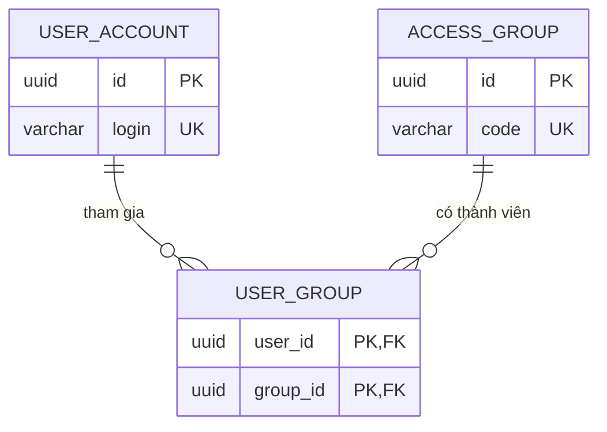
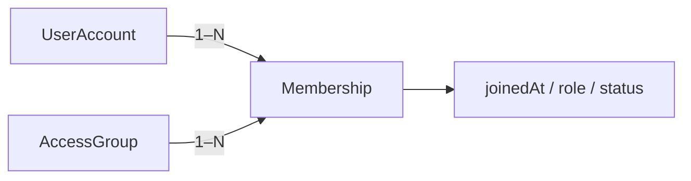

# Đánh giá chi phí tải và cập nhật tập liên kết lớn

Trong JPA, quan hệ **nhiều-nhiều** (*many-to-many*) cho phép hai entity liên kết qua bảng trung gian. Ví dụ: một tài khoản có thể tham gia nhiều nhóm quyền, và mỗi nhóm quyền có thể có nhiều tài khoản. Với vài phần tử, ánh xạ `@ManyToMany` và một `Set` thường rất thuận tiện. Nhưng nếu một tài khoản tham gia hàng chục nghìn nhóm, hoặc mỗi nhóm có hàng trăm nghìn thành viên, **thao tác tưởng như đơn giản trên collection có thể trở thành một nghiệp vụ tải và cập nhật dữ liệu lớn**.

Bài học thuộc chương **Quan hệ nhiều-nhiều** tập trung vào cách **đánh giá chi phí tải và cập nhật tập liên kết lớn**: nhận diện các truy vấn ngầm, ước lượng dữ liệu và số thao tác SQL, hiểu dirty checking, chọn cách truy vấn đúng nhu cầu, dùng `@ManyToMany` khi hợp lý và chuyển sang entity liên kết hoặc SQL trực tiếp khi quan hệ đã trở thành dữ liệu cần quản lý độc lập.

## 1. Mô hình và bài toán hiệu năng

Giả sử ứng dụng quản lý quyền truy cập gồm:

- `UserAccount`: người dùng.
- `AccessGroup`: nhóm phân quyền.
- `user_group`: bảng liên kết giữa người dùng và nhóm.

Một người dùng có thể ở nhiều nhóm; mỗi nhóm có thể có nhiều người dùng.



Schema minh họa trên PostgreSQL:

```sql
CREATE TABLE user_account (
    id UUID PRIMARY KEY,
    login VARCHAR(120) NOT NULL UNIQUE
);

CREATE TABLE access_group (
    id UUID PRIMARY KEY,
    code VARCHAR(100) NOT NULL UNIQUE
);

CREATE TABLE user_group (
    user_id UUID NOT NULL REFERENCES user_account(id),
    group_id UUID NOT NULL REFERENCES access_group(id),
    PRIMARY KEY (user_id, group_id)
);

-- Thêm chỉ mục khi truy vấn theo group_id cũng thường xuyên.
CREATE INDEX idx_user_group_group_user
    ON user_group(group_id, user_id);
```

Khóa chính ghép của bảng nối ngăn ghi hai liên kết giống nhau. Index `(user_id, group_id)` phục vụ tìm nhóm của một người dùng; index `(group_id, user_id)` phục vụ tìm thành viên của một nhóm. Cả hai hướng truy cập đều đáng xem xét vì quan hệ nhiều-nhiều có thể được duyệt từ hai phía.

### Ba tình huống có chi phí rất khác nhau

| Nhu cầu | Dữ liệu cần thiết | Nguy cơ khi làm qua collection |
|---|---|---|
| Hiển thị 20 nhóm đầu tiên của một người dùng | 20 kết quả, có phân trang | Tải toàn bộ 80.000 nhóm rồi lấy 20 |
| Kiểm tra người dùng có thuộc một nhóm không | Một kết quả boolean | Khởi tạo toàn bộ `user.groups` để gọi `contains` |
| Thêm một người dùng vào nhóm | Một liên kết cần chèn | Tải cả `user.groups` và `group.members` để đồng bộ hai collection |

Trong hệ thống nhỏ, chênh lệch có thể không đáng kể. Với tập liên kết lớn, nó có thể quyết định latency, lượng cấp phát object, số connection bị giữ, thời gian transaction và khả năng xử lý đồng thời.

**Nguyên tắc khởi đầu:** đánh giá theo **số liên kết được xử lý**, số bản ghi entity được materialize, số câu SQL, lượng dữ liệu trả về và lượng thay đổi cần ghi; không kết luận hiệu năng chỉ từ tên annotation.

## 2. Ánh xạ @ManyToMany hai chiều thường gặp

Ví dụ dưới đây dùng Jakarta Persistence và UUID do ứng dụng cấp trước khi persist. UUID đã ổn định từ lúc khởi tạo giúp tránh ví dụ equality phụ thuộc ID do database sinh.

File `UserAccount.java`:

```java
package demo;

import jakarta.persistence.*;
import java.util.Collections;
import java.util.HashSet;
import java.util.Objects;
import java.util.Set;
import java.util.UUID;

@Entity
@Table(name = "user_account")
public class UserAccount {

    @Id
    @Column(name = "id", nullable = false, updatable = false)
    private UUID id;

    @Column(name = "login", nullable = false, unique = true, length = 120)
    private String login;

    @ManyToMany(fetch = FetchType.LAZY)
    @JoinTable(
        name = "user_group",
        joinColumns = @JoinColumn(name = "user_id"),
        inverseJoinColumns = @JoinColumn(name = "group_id"),
        uniqueConstraints = @UniqueConstraint(
            name = "uk_user_group",
            columnNames = {"user_id", "group_id"}
        )
    )
    private Set<AccessGroup> groups = new HashSet<>();

    protected UserAccount() {}

    public UserAccount(UUID id, String login) {
        this.id = Objects.requireNonNull(id);
        this.login = Objects.requireNonNull(login);
    }

    public UUID getId() {
        return id;
    }

    public String getLogin() {
        return login;
    }

    public Set<AccessGroup> getGroups() {
        return Collections.unmodifiableSet(groups);
    }

    // Chỉ thích hợp khi collection liên kết có kích thước kiểm soát được.
    public void addGroup(AccessGroup group) {
        Objects.requireNonNull(group);
        if (groups.add(group)) {
            group.addMemberInverse(this);
        }
    }

    public void removeGroup(AccessGroup group) {
        Objects.requireNonNull(group);
        if (groups.remove(group)) {
            group.removeMemberInverse(this);
        }
    }
}
```

File `AccessGroup.java`:

```java
package demo;

import jakarta.persistence.*;
import java.util.Collections;
import java.util.HashSet;
import java.util.Objects;
import java.util.Set;
import java.util.UUID;

@Entity
@Table(name = "access_group")
public class AccessGroup {

    @Id
    @Column(name = "id", nullable = false, updatable = false)
    private UUID id;

    @Column(name = "code", nullable = false, unique = true, length = 100)
    private String code;

    @ManyToMany(mappedBy = "groups", fetch = FetchType.LAZY)
    private Set<UserAccount> members = new HashSet<>();

    protected AccessGroup() {}

    public AccessGroup(UUID id, String code) {
        this.id = Objects.requireNonNull(id);
        this.code = Objects.requireNonNull(code);
    }

    public UUID getId() {
        return id;
    }

    public String getCode() {
        return code;
    }

    public Set<UserAccount> getMembers() {
        return Collections.unmodifiableSet(members);
    }

    void addMemberInverse(UserAccount user) {
        members.add(user);
    }

    void removeMemberInverse(UserAccount user) {
        members.remove(user);
    }
}
```

Để giữ ví dụ tập trung vào hiệu năng, hai entity trên dùng phương thức `equals/hashCode` mặc định theo identity của object. Do đó, helper hai chiều này thích hợp khi thao tác với **cùng instance managed trong một persistence context**, nhưng không nên coi nó là giải pháp tổng quát cho mọi trường hợp detached/proxy và tái tạo object. Nếu chọn `Set` dựa trên equality theo ID, cần triển khai một chính sách equality ổn định, đúng với vòng đời ID và proxy của provider.

### Phía sở hữu và phía nghịch đảo

Trong ánh xạ này:

- `UserAccount.groups` có `@JoinTable`: **owning side**, quyết định thay đổi liên kết trong bảng `user_group`.
- `AccessGroup.members` có `mappedBy = "groups"`: **inverse side**, biểu diễn chiều ngược trong object model.
- `mappedBy` chỉ **tên thuộc tính Java** của phía sở hữu, không phải tên bảng SQL.

Nếu chỉ sửa `group.getMembers()` mà không sửa `user.groups`, provider không nhất thiết tạo hoặc xóa liên kết SQL. Khi dùng hai chiều, các helper có thể giữ nhất quán object model, nhưng sẽ phát sinh vấn đề hiệu năng nếu cả hai collection đều rất lớn.

**Điểm quan trọng:** một đối tượng cha và một đối tượng con không tồn tại trong nhiều-nhiều theo nghĩa sở hữu vòng đời; cả `UserAccount` và `AccessGroup` đều là entity độc lập. Không bật `CascadeType.REMOVE` chỉ vì hai entity có quan hệ nhiều-nhiều: xóa một user không có nghĩa nên xóa luôn các nhóm dùng chung.

## 3. Collection LAZY không đồng nghĩa truy cập rẻ

Theo Jakarta Persistence, `@ManyToMany` mặc định là `LAZY`; ta khai báo tường minh để nhắc về ý định. Với LAZY, khi tải `UserAccount` bằng `find`, provider thường chưa tải toàn bộ `groups` ngay.

```java
UserAccount user = em.find(UserAccount.class, userId);
// Ở đây chưa cần truy cập các phần tử group.

for (AccessGroup group : user.getGroups()) {
    System.out.println(group.getCode());
}
```

Vòng lặp có thể **khởi tạo collection**, tức tải các liên kết và các entity liên quan theo chiến lược provider. Khi collection có 50.000 phần tử, ứng dụng có thể phải phân bổ 50.000 phần tử/đại diện và metadata để sử dụng một vòng lặp.

Các thao tác sau đều đáng xem SQL thực tế:

```java
user.getGroups().size();
user.getGroups().isEmpty();
user.getGroups().contains(group);
user.getGroups().iterator();
new ArrayList<>(user.getGroups());
```

Không mặc định rằng `size()` chỉ chạy `SELECT COUNT(*)` hoặc `contains()` chỉ chạy `EXISTS`. Chúng có thể khiến provider khởi tạo cả collection. Hibernate có một số khả năng tối ưu riêng cho collection, tùy version/mapping/API, nhưng đó không phải cam kết portable của JPA. Đối với tập rất lớn, hãy viết query **theo đúng câu hỏi cần trả lời**.

### LazyInitializationException cũng là tín hiệu về ranh giới công việc

Khi đóng `EntityManager` rồi mới gọi một lazy collection chưa được khởi tạo, Hibernate có thể ném `LazyInitializationException`. Cách sửa không phải luôn chuyển mọi collection sang `EAGER`. Tốt hơn là xác định use case cần dữ liệu gì và lấy dữ liệu đó bằng query có kiểm soát trong transaction/persistence context phù hợp.

## 4. Phân rã chi phí tải tập liên kết lớn

Một lần tải collection có thể bao gồm:

1. **Chi phí phía DB:** tìm bản ghi bảng nối, join sang entity đích, đọc index/trang dữ liệu, sắp xếp nếu cần.
2. **Chi phí truyền dữ liệu:** gửi hàng/cột từ DB tới ứng dụng qua JDBC và network.
3. **Chi phí ánh xạ:** tạo hoặc lấy lại entity/proxy, điền field, quản lý identity map.
4. **Chi phí collection:** thêm phần tử vào `Set`/`List` và giữ snapshot để phát hiện thay đổi.
5. **Chi phí xử lý ứng dụng:** chuyển DTO, serialize JSON, lọc/sắp xếp bằng Java.
6. **Chi phí transaction và tài nguyên:** giữ connection, bộ nhớ và khóa lâu hơn khi công việc nặng.

Đặt:

- `N` = số liên kết cần tải;
- `B` = số byte dữ liệu thực tế trung bình truyền cho một hàng;
- `R` = số lần round trip tới DB;
- `O` = chi phí Java object, collection và persistence context trên mỗi phần tử (phụ thuộc JVM/provider).

Chi phí truyền dữ liệu có thể ước lượng thô theo `N × B`, còn bộ nhớ Java có thể tăng theo `N × O`. Đây **không phải công thức dự đoán latency chính xác**, vì query plan, cache, mạng, độ rộng hàng và kiểu ánh xạ đều ảnh hưởng.

Ví dụ **giả định**, nếu cần tải 60.000 hàng và mỗi hàng trả về trung bình 64 byte dữ liệu, phần dữ liệu trả về đã khoảng:

```text
60.000 × 64 = 3.840.000 byte ≈ 3,84 MB
```

Đó mới là payload minh họa, **chưa** gồm protocol/JDBC, object Java, collection backing structure, persistence context snapshot và dữ liệu các entity liên quan. Một endpoint chỉ hiển thị 20 kết quả sẽ lãng phí nếu kéo toàn bộ 60.000 liên kết chỉ để lấy 20 phần tử đầu tiên.

### Một query lớn có phải tốt hơn nhiều query nhỏ?

Không phải lúc nào cũng vậy. Một query trả 200.000 hàng có thể tốn nhiều RAM, I/O và thời gian truyền. Nhưng 200.000 câu query đơn lẻ sẽ rất tệ vì round trip và overhead. Cần giảm cả **số lần truy vấn không cần thiết** lẫn **số hàng/byte không cần tải**, thay vì chỉ tối thiểu hóa số câu SQL.

## 5. N+1 khi truy cập nhiều tập liên kết

Giả sử trang admin hiển thị 100 người dùng cùng nhóm của họ:

```java
List<UserAccount> users = em.createQuery(
        "SELECT u FROM UserAccount u ORDER BY u.login",
        UserAccount.class
    )
    .setMaxResults(100)
    .getResultList();

for (UserAccount user : users) {
    System.out.println(user.getGroups().size());
}
```

Nếu provider khởi tạo collection cho từng user, có thể phát một query lấy 100 user, rồi thêm nhiều query lấy collection của từng user: kiểu vấn đề **N+1**.

Các hướng giải quyết phải dựa vào nhu cầu:

- Nếu chỉ cần số nhóm: query tổng hợp `COUNT` và `GROUP BY`, trả DTO.
- Nếu cần tên một số nhóm: query projection có giới hạn, hoặc thiết kế endpoint riêng theo user.
- Nếu cần toàn bộ các liên kết nhưng số lượng nhỏ/đã giới hạn: cân nhắc batch fetching hoặc fetch join có chủ đích.
- Nếu cần tải đầy đủ hàng chục nghìn nhóm cho hàng trăm user: hãy xem lại use case; batch vẫn có thể tải khối dữ liệu quá lớn.

Hibernate hỗ trợ cấu hình batch fetching (`@BatchSize` hoặc `hibernate.default_batch_fetch_size`) để giảm round trip trong một số trường hợp, nhưng đó là **cơ chế đặc thù provider**, không làm biến mất tổng số hàng được tải.

## 6. Fetch join không phải phương thuốc cho mọi tập lớn

JPQL cho phép chủ động fetch một collection:

```java
List<UserAccount> users = em.createQuery(
        """
        SELECT DISTINCT u
        FROM UserAccount u
        LEFT JOIN FETCH u.groups
        WHERE u.id = :id
        """,
        UserAccount.class
    )
    .setParameter("id", userId)
    .getResultList();
```

Fetch join hữu ích khi biết collection đủ nhỏ và use case thực sự cần đầy đủ nhóm. Với một user có 80.000 nhóm, truy vấn SQL vẫn có thể trả hàng chục nghìn hàng; `DISTINCT` trong JPQL không có nghĩa DB chắc chắn chỉ phải đọc một hàng, vì quan hệ cần được dựng từ các hàng join.

### Đừng áp dụng phân trang trực tiếp lên collection fetch join

Ví dụ dễ gây hiểu nhầm:

```java
em.createQuery(
        """
        SELECT u
        FROM UserAccount u
        JOIN FETCH u.groups
        ORDER BY u.login
        """,
        UserAccount.class
    )
    .setMaxResults(20)
    .getResultList();
```

Một user có nhiều group sẽ xuất hiện trên nhiều hàng join. Giới hạn hàng SQL không tương đương giới hạn **20 user đầy đủ collection**. Một số provider có thể đưa việc phân trang về xử lý trong bộ nhớ hoặc cảnh báo/lỗi, dẫn tới tải nhiều hơn mong đợi.

Nếu cần phân trang user, hãy phân trang **ID của user** trước, rồi mới fetch những quan hệ thật sự cần cho nhóm user đã chọn, hoặc lấy DTO theo truy vấn riêng. Nếu cần phân trang **các group của một user**, đừng fetch nguyên collection rồi cắt bằng `subList`.

### Hai collection lớn có thể nhân số hàng

Nếu query fetch join đồng thời `u.groups` và `u.roles`, một user có 1.000 group và 200 role có thể tạo dạng tích Cartesian gồm rất nhiều hàng trung gian. Một số mapping Hibernate còn có giới hạn fetch nhiều bag đồng thời. Tránh xây đồ thị object khổng lồ bằng nhiều collection fetch join; dùng các query vừa đủ và DTO phù hợp.

## 7. Đọc đúng dữ liệu cần thiết bằng JPQL

### 7.1. Đếm số nhóm mà không tải collection

```java
Long count = em.createQuery(
        """
        SELECT COUNT(g)
        FROM UserAccount u
        JOIN u.groups g
        WHERE u.id = :userId
        """,
        Long.class
    )
    .setParameter("userId", userId)
    .getSingleResult();
```

Query này yêu cầu DB trả về số lượng, thay vì ứng dụng phải materialize toàn bộ tập nhóm để gọi `size()`. DB vẫn cần quét/phân tích các mục index phù hợp; count không đồng nghĩa chi phí bằng không.

### 7.2. Kiểm tra thành viên đã thuộc nhóm chưa

```java
Long matches = em.createQuery(
        """
        SELECT COUNT(g)
        FROM UserAccount u
        JOIN u.groups g
        WHERE u.id = :userId AND g.id = :groupId
        """,
        Long.class
    )
    .setParameter("userId", userId)
    .setParameter("groupId", groupId)
    .getSingleResult();

boolean belongsToGroup = matches > 0;
```

Trong nhiều ứng dụng, một query `EXISTS` hoặc tra index khóa chính của bảng nối có thể hiệu quả hơn việc phải đếm một tập lớn; bản query trên dễ viết bằng JPQL chuẩn vì bảng nối được ánh xạ ẩn. Kiểm tra execution plan để lựa chọn khi truy vấn xảy ra rất thường xuyên.

### 7.3. Phân trang group theo user

```java
List<UUID> groupIds = em.createQuery(
        """
        SELECT g.id
        FROM UserAccount u
        JOIN u.groups g
        WHERE u.id = :userId
        ORDER BY g.id
        """,
        UUID.class
    )
    .setParameter("userId", userId)
    .setFirstResult(pageIndex * pageSize)
    .setMaxResults(pageSize)
    .getResultList();
```

Đoạn này chỉ trả **ID** của một page, không yêu cầu khởi tạo collection `user.groups`. Nếu cần thêm `code` để hiển thị, có thể lấy DTO projection trực tiếp:

```java
public record GroupSummary(UUID id, String code) {}
```

```java
List<GroupSummary> summaries = em.createQuery(
        """
        SELECT new demo.GroupSummary(g.id, g.code)
        FROM UserAccount u
        JOIN u.groups g
        WHERE u.id = :userId
        ORDER BY g.code, g.id
        """,
        GroupSummary.class
    )
    .setParameter("userId", userId)
    .setFirstResult(0)
    .setMaxResults(20)
    .getResultList();
```

`demo.GroupSummary` là lớp record đặt trong package `demo` theo cú pháp constructor expression. Với các page rất sâu, offset pagination có thể kém hiệu quả vì DB phải bỏ qua nhiều hàng. Khi cần duyệt liên tục các nhóm lớn, cân nhắc **keyset pagination** theo thứ tự ổn định và khóa phụ, cùng index phù hợp.

### 7.4. Chỉ trả dữ liệu hiển thị

Khi endpoint chỉ hiển thị tên nhóm, tạo `DTO` gồm `id` và `code`. Không cần tải entity managed chỉ để serialize ngay thành JSON. Tránh serialize trực tiếp một entity với quan hệ hai chiều vì dễ kích hoạt lazy loading, tạo graph lớn hoặc vòng lặp serialization.

## 8. Đọc trực tiếp từ bảng nối qua SQL/JDBC

Khi dùng `@ManyToMany` thuần túy, bảng `user_group` không phải entity JPA riêng. Nếu chỉ cần truy vấn tồn tại hoặc batch xử lý ID, SQL trực tiếp có thể làm rõ mức dữ liệu cần dùng.

Ví dụ PostgreSQL:

```sql
-- Kiểm tra tồn tại bằng đúng hai khóa.
SELECT EXISTS (
    SELECT 1
    FROM user_group
    WHERE user_id = :user_id AND group_id = :group_id
);

-- Đếm số liên kết của user.
SELECT COUNT(*)
FROM user_group
WHERE user_id = :user_id;

-- Lấy một trang liên kết theo thứ tự ổn định.
SELECT group_id
FROM user_group
WHERE user_id = :user_id
ORDER BY group_id
LIMIT :page_size OFFSET :offset;
```

Cú pháp `:user_id` mô tả **named parameter** thường thấy ở `NamedParameterJdbcTemplate` hoặc thư viện query, không phải cú pháp placeholder chạy trực tiếp trong PostgreSQL console. Với JDBC thuần, dùng `?` và `PreparedStatement`. Lưu ý SQL của một DB không nhất thiết portable sang DB khác.

Các câu query này có thể dùng index `PRIMARY KEY(user_id, group_id)`. Nhưng nếu cần lọc theo `group_id` để tìm tất cả thành viên, cần đánh giá index theo chiều ngược. **Đừng kết luận cần thêm index chỉ từ cú pháp truy vấn**: hãy kiểm tra tần suất đọc/ghi và kế hoạch thực thi.

## 9. Chi phí cập nhật khi thêm hoặc bỏ liên kết

Với tập liên kết nhỏ, code nghiệp vụ có thể làm:

```java
UserAccount user = em.find(UserAccount.class, userId);
AccessGroup group = em.find(AccessGroup.class, groupId);

user.addGroup(group);
// Flush/commit có thể sinh INSERT vào user_group.
```

Hoặc:

```java
user.removeGroup(group);
// Flush/commit có thể sinh DELETE khỏi user_group.
```

Nhìn ở DB, thêm một liên kết chỉ cần một hàng trong bảng nối; bỏ một liên kết chỉ cần xóa một hàng. Nhưng ở tầng ORM, thao tác `Set.add` hoặc `Set.remove` trên collection lazy có thể kích hoạt **khởi tạo collection trước khi thao tác**, vì provider cần xác định trạng thái hiện tại, chụp snapshot, kiểm soát trùng phần tử và đồng bộ dirty checking.

Với helper hai chiều trong phần 2, còn có chi phí cập nhật collection nghịch đảo `group.members`; nếu nhóm có hàng trăm nghìn thành viên, **một thao tác gắn thành viên có thể chạm tới một tập cực lớn trong bộ nhớ**.

### Không suy diễn SQL từ một dòng Java

```java
user.getGroups().add(group);
```

Không có bảo đảm portable rằng provider sẽ sinh **đúng một `INSERT`** và không thực thi `SELECT` trước đó. Hành vi phụ thuộc mapping, collection type, cách provider tracking snapshot, entity state và transaction.

Với Hibernate, `Set` có identity ổn định và mapping phù hợp thường giúp provider xác định những hàng cần thêm/bỏ chính xác hơn so với một số mapping bag. Một số cách dùng `List` không có chỉ số và không có định danh của hàng liên kết có thể khiến provider xóa/tạo lại nhiều hàng của bảng nối. **Đây là hành vi có điều kiện theo provider và mapping**, cần quan sát SQL thực tế, không phải quy tắc “`List` luôn xóa hết” hoặc “`Set` luôn tối ưu”.

## 10. Set, List, Bag và chi phí dirty checking

### Set

`Set` biểu diễn không trùng phần tử theo `equals/hashCode`. Với entity có ID sinh sau khi persist, triển khai `hashCode` thay đổi khi ID được gán có thể khiến collection hash hoạt động sai. Với entity có ID được cấp từ lúc tạo, equality dựa trên ID bất biến dễ thiết kế hơn, nhưng vẫn cần kiểm tra proxy/provider.

Ưu điểm của `Set` trong một số ORM là dễ mô tả chênh lệch liên kết theo phần tử. Mặt trái: phép `add`/`contains` trên collection lazy có thể phải đọc tập lớn; vì thế `Set` không biến thao tác thêm vào một collection 100.000 phần tử thành O(1) ở mọi tầng.

### List không có thứ tự quan hệ

`List` không tự động có nghĩa bảng nối lưu thứ tự. Nếu không dùng `@OrderColumn`, thứ tự của collection sau reload không nhất thiết phản ánh một chỉ số vị trí cố định. Trong Hibernate, một số ánh xạ `List` được xử lý với semantics của bag; cách xử lý update/delete khác `Set`.

### List có @OrderColumn

Nếu thứ tự phần tử là một phần dữ liệu nghiệp vụ, `@OrderColumn` yêu cầu lưu vị trí. Thêm hoặc xóa ở đầu danh sách lớn có thể khiến nhiều hàng phải cập nhật index, nên chi phí phụ thuộc **vị trí thay đổi**, không chỉ số phần tử thêm/bớt.

**Lựa chọn:** dùng `Set` khi ý nghĩa là tập không trùng và không cần thứ tự; dùng mô hình có cột vị trí khi thứ tự thực sự là dữ liệu quan trọng. Đừng thay collection type chỉ để hy vọng nhanh hơn mà không kiểm tra SQL và equality.

### Snapshot và persistence context

Provider có thể giữ snapshot của collection để so sánh với trạng thái mới khi flush. Với hàng chục nghìn phần tử, chi phí memory và so sánh tăng theo kích thước tập. Một transaction dài giữ nhiều collection lớn có thể chiếm đáng kể bộ nhớ và làm tăng thời gian GC. Việc `clear()` có thể giải phóng entity managed, nhưng phải hiểu rằng thay đổi chưa flush có thể bị mất và object trở thành detached; không dùng `clear()` như một mẹo chữa mọi vấn đề.

## 11. Cập nhật hàng loạt: vì sao không nên gọi add() trong vòng lặp khổng lồ?

Giả sử muốn cấp quyền cho 50.000 tài khoản vào một nhóm:

```java
for (UUID userId : userIds) {
    UserAccount user = em.find(UserAccount.class, userId);
    AccessGroup group = em.getReference(
            AccessGroup.class, groupId);

    user.addGroup(group);
}
```

Những chi phí có thể xuất hiện:

- 50.000 lần tìm user nếu không batch hoặc có cache.
- Khởi tạo/tạo snapshot của nhiều collection `user.groups`.
- Chạm vào tập `group.members` rất lớn khi đồng bộ hai chiều.
- Giữ nhiều entity trong persistence context và dùng nhiều bộ nhớ.
- Phát nhiều lệnh SQL riêng lẻ, dù JDBC batching có thể giảm round trip.
- Transaction dài, có thể gặp lock contention hoặc rollback tốn kém khi thất bại giữa chừng.

Không phải cứ có `hibernate.jdbc.batch_size` là giải quyết hết: batching giảm chi phí gửi các statement tương tự, **không loại bỏ chi phí tải collection, tracking entity và validation nghiệp vụ**.

Có thể cần xử lý theo lô nhỏ và transaction có giới hạn. Tuy vậy, phương án phổ biến hơn với liên kết rất lớn là **mô hình hóa hàng liên kết thành entity riêng** hoặc sử dụng **bulk SQL/JDBC** khi quy tắc nghiệp vụ cho phép.

## 12. Mô hình hóa bảng liên kết thành entity riêng

Khi bảng nối có hàng triệu liên kết, bản thân liên kết thường là một khái niệm nghiệp vụ: membership có `joinedAt`, `role`, `status`, `source` hoặc quyền được cấp bởi ai. Lúc này, một **association entity** như `Membership` phù hợp hơn `@ManyToMany` trực tiếp.



Ví dụ entity:

```java
package demo;

import jakarta.persistence.*;
import java.time.Instant;
import java.util.Objects;
import java.util.UUID;

@Entity
@Table(
    name = "membership",
    uniqueConstraints = @UniqueConstraint(
        name = "uk_membership_user_group",
        columnNames = {"user_id", "group_id"}
    ),
    indexes = {
        @Index(name = "idx_membership_group_user",
               columnList = "group_id,user_id")
    }
)
public class Membership {

    @Id
    @Column(name = "id", nullable = false, updatable = false)
    private UUID id;

    @ManyToOne(fetch = FetchType.LAZY, optional = false)
    @JoinColumn(name = "user_id", nullable = false, updatable = false)
    private UserAccount user;

    @ManyToOne(fetch = FetchType.LAZY, optional = false)
    @JoinColumn(name = "group_id", nullable = false, updatable = false)
    private AccessGroup group;

    @Column(name = "joined_at", nullable = false, updatable = false)
    private Instant joinedAt;

    protected Membership() {}

    public Membership(UserAccount user, AccessGroup group, Instant joinedAt) {
        this.id = UUID.randomUUID();
        this.user = Objects.requireNonNull(user);
        this.group = Objects.requireNonNull(group);
        this.joinedAt = Objects.requireNonNull(joinedAt);
    }

    public UUID getId() {
        return id;
    }

    public Instant getJoinedAt() {
        return joinedAt;
    }
}
```

Ở đây hai entity `UserAccount` và `AccessGroup` được tái sử dụng làm loại tham chiếu, nhưng **khi chuyển sang mô hình `Membership`, phải loại bỏ hoặc chuyển thành read-only ánh xạ `@ManyToMany` cũ nếu nó trỏ tới cùng bảng liên kết**. Không để hai cơ chế cùng ghi những hàng membership mà không có quy tắc sở hữu rõ ràng.

Một cách tối giản trong mô hình mới là `UserAccount` và `AccessGroup` không chứa collection liên kết lớn; chỉ `Membership` giữ hai `@ManyToOne`. Ta query membership như entity bình thường, có ID riêng, khóa unique cho cặp user/group và các trường nghiệp vụ bổ sung.

### Vì sao association entity giúp kiểm soát hơn?

- Thêm một membership bằng `em.persist(membership)`, không cần materialize collection lớn ở hai đầu.
- Xóa membership theo ID hoặc bulk query.
- Lấy page các membership bằng query giới hạn số hàng.
- Lưu metadata của quan hệ như thời gian tham gia hoặc trạng thái.
- Áp dụng optimistic locking/validation ở cấp membership khi thực sự cần.
- Dễ viết repository, index, lọc và theo dõi lịch sử theo từng hàng liên kết.

Ví dụ thêm một liên kết:

```java
UserAccount user = em.getReference(UserAccount.class, userId);
AccessGroup group = em.getReference(AccessGroup.class, groupId);

Membership membership = new Membership(
        user, group, Instant.now());

em.persist(membership);
```

`getReference` có thể tạo tham chiếu mà chưa cần tải đủ thuộc tính của entity, nhưng **không thay thế kiểm tra tồn tại/quyền**; khóa ngoại DB và validation nghiệp vụ vẫn phải được thực thi. Hành vi kiểm tra không tồn tại có thể ném exception tại thời điểm truy cập hoặc flush/commit, tùy provider.

### Repository truy vấn membership theo từng page

```java
List<Membership> memberships = em.createQuery(
        """
        SELECT m
        FROM Membership m
        WHERE m.user.id = :userId
        ORDER BY m.joinedAt, m.id
        """,
        Membership.class
    )
    .setParameter("userId", userId)
    .setFirstResult(0)
    .setMaxResults(100)
    .getResultList();
```

Đối với danh sách chỉ cần group code, dùng projection tương ứng thay vì tải toàn bộ membership và truy cập lazy group từng dòng. Ví dụ:

```java
public record GroupMembershipView(
        UUID groupId, String groupCode, Instant joinedAt) {}
```

```java
List<GroupMembershipView> page = em.createQuery(
        """
        SELECT new demo.GroupMembershipView(
            m.group.id, m.group.code, m.joinedAt)
        FROM Membership m
        WHERE m.user.id = :userId
        ORDER BY m.joinedAt, m.id
        """,
        GroupMembershipView.class
    )
    .setParameter("userId", userId)
    .setMaxResults(100)
    .getResultList();
```

Khi đây là hot path, cần index tương thích với `WHERE user_id` và `ORDER BY joined_at, id`, ngoài unique index trên cặp user/group.

## 13. Bulk INSERT/DELETE khi nghiệp vụ chỉ cần thay bảng nối

Nếu thao tác chủ yếu là cấp quyền hàng loạt hoặc xóa nhiều liên kết, có thể dùng SQL/JDBC trực tiếp. Ví dụ PostgreSQL cho bảng `membership` có ID UUID được ứng dụng cấp:

```sql
INSERT INTO membership (id, user_id, group_id, joined_at)
VALUES (:id, :user_id, :group_id, :joined_at)
ON CONFLICT (user_id, group_id) DO NOTHING;
```

`ON CONFLICT` là cú pháp **PostgreSQL**, không portable sang mọi DB. Đặt unique constraint `(user_id, group_id)` để hai transaction cùng chèn không tạo bản ghi trùng. `DO NOTHING` giúp thao tác idempotent về mặt hàng liên kết, nhưng có thể che lỗi dữ liệu nếu hệ thống cần thông báo rằng liên kết đã tồn tại; quyết định này thuộc yêu cầu nghiệp vụ.

Ví dụ xóa hàng loạt liên kết của một nhóm:

```sql
DELETE FROM membership
WHERE group_id = :group_id
  AND user_id IN (:user_ids);
```

`:user_ids` ở trên là ký hiệu danh sách bind do thư viện như `NamedParameterJdbcTemplate` mở rộng; không truyền raw string do người dùng nối vào SQL. Đối với tập ID rất lớn, tách batch theo giới hạn tham số của driver/DB hoặc dùng staging table và lệnh SQL theo tập.

### Những điều bulk SQL bỏ qua

Một câu SQL trực tiếp có thể hiệu quả vì không dựng hàng nghìn entity, nhưng cũng **bỏ qua** một số cơ chế JPA như:

- Dirty checking của entity đã managed.
- Lifecycle callback `@PreRemove`, `@PostRemove` trên entity không được ORM thao tác từng hàng.
- Kiểm tra nghiệp vụ đang nằm trong helper hoặc service nếu gọi SQL độc lập.
- Optimistic locking `@Version` nếu câu SQL không thực hiện điều kiện version tương ứng.
- Đồng bộ trạng thái collection đã load trong persistence context hiện tại.

Nếu đã tải `user.groups` bằng JPA rồi dùng JDBC chèn/xóa trong cùng transaction, collection đang managed có thể **lỗi thời**. Thiết kế tốt là tách rõ đường bulk và đường ORM trong các transaction/đơn vị công việc thích hợp; khi buộc phối hợp, chủ động `flush` thay đổi JPA chưa gửi, rồi `clear` hoặc tải lại khi cần. `clear()` detach **toàn bộ** entity managed; không gọi một cách vô thức sau khi có các thay đổi chưa flush.

## 14. Bulk JPQL khi đã có entity Membership

Với `Membership` là entity, có thể dùng bulk JPQL:

```java
int removed = em.createQuery(
        """
        DELETE FROM Membership m
        WHERE m.id IN :ids
        """
    )
    .setParameter("ids", membershipIds)
    .executeUpdate();
```

Phải thực hiện trong transaction. Tùy lượng ID và DB, chia danh sách thành các batch có kích thước phù hợp. Trước bulk delete, cần tính đến các thay đổi JPA đang chờ và trạng thái managed còn tồn tại. Bulk JPQL không chạy đầy đủ lifecycle và version checking như `em.remove(entity)` từng đối tượng; **trạng thái entity đã được tải có thể cũ sau bulk operation**.

Ngược lại, với ánh xạ `@ManyToMany` thuần túy, bảng nối **không phải entity** nên không thể viết JPQL `DELETE FROM user_group` như thể `user_group` là tên entity. Muốn thao tác trực tiếp bảng nối thì cần native SQL/JDBC hoặc chuyển sang association entity.

## 15. Index, query plan và giới hạn ghi

Đánh giá hiệu năng quan hệ nhiều-nhiều phải xét cả đọc và ghi:

| Yêu cầu | Index/thiết kế gợi ý | Chi phí hoặc đánh đổi |
|---|---|---|
| Kiểm tra `(user_id, group_id)` | PK/UNIQUE `(user_id, group_id)` | Bảo vệ trùng, hỗ trợ exact lookup |
| Lấy nhóm của một user | Index bắt đầu bằng `user_id` | Hỗ trợ lọc; tải bao nhiêu hàng vẫn phụ thuộc page |
| Lấy thành viên của một group | Index bắt đầu bằng `group_id` | Thêm index tăng chi phí ghi và dung lượng |
| Page theo `joined_at` | Index `(user_id, joined_at, id)` cho bảng membership | Cần duy trì khi INSERT/DELETE |
| Xóa một nhóm rất lớn | Batch DELETE, kiểm tra FK và lock | Một transaction khổng lồ có thể giữ khóa lâu |
| Tạo hàng loạt liên kết | JDBC batch, staging/merge/upsert tùy DB | Cần bảo vệ uniqueness và idempotency |

**Index không miễn phí**: mỗi INSERT/DELETE vào bảng nối phải cập nhật các index liên quan. Thêm index chỉ khi có workload đọc tương ứng và hiệu quả đã được kiểm tra bằng `EXPLAIN`/`EXPLAIN ANALYZE` và thống kê DB.

### Cảnh giác với một transaction quá lớn

Xóa 500.000 liên kết trong một transaction có thể tạo lượng log/undo lớn, giữ khóa lâu và làm chậm các tác vụ khác. Có thể cân nhắc chia lô, nhưng chia transaction làm thay đổi tính nguyên tử: hệ thống có thể quan sát trạng thái **đã xử lý một phần**. Cần định nghĩa rõ điều kiện hoàn thành, cơ chế retry và dữ liệu được phép hiển thị trong lúc xử lý.

Ví dụ xóa hàng loạt theo khóa ID hoặc theo dải ID ổn định, mỗi batch trong transaction riêng, rồi đánh dấu job hoàn tất. Cách này phù hợp với tác vụ nền có thể tiếp tục sau lỗi; với nghiệp vụ đòi hỏi tất cả hoặc không gì cả, phải dùng chiến lược khác và chấp nhận chi phí transaction.

## 16. Transaction, cạnh tranh ghi và tính nhất quán

Giả sử hai request cùng thêm một user vào một group:

1. Request A kiểm tra chưa có liên kết.
2. Request B cũng kiểm tra chưa có liên kết.
3. Cả hai cùng thử INSERT.

Kiểm tra tồn tại trong Java không giải quyết được race condition. **Unique constraint** trên `(user_id, group_id)` là hàng rào cuối cùng bảo vệ dữ liệu. Sau khi một transaction bị lỗi unique, thông thường cần rollback rồi xử lý retry/response trong transaction mới nếu nghiệp vụ cho phép.

### Optimistic locking của entity cha có đủ không?

`@Version` ở `UserAccount` không tự bảo đảm mọi thay đổi của bảng nối đều tăng version trong mọi provider, mapping hoặc con đường SQL. Khi giao dịch cấp quyền có quy tắc chặt chẽ, cần đánh giá chính sách cạnh tranh trực tiếp: unique constraint, row locking, version của membership, hoặc khóa/lệnh điều kiện ở DB phù hợp.

### Xóa entity UserAccount hoặc AccessGroup

Bảng nối có FK nên xóa một user/group phải xử lý các hàng liên kết trước hoặc có `ON DELETE CASCADE` phù hợp. Cần phân biệt **xóa liên kết** với **xóa entity đích**: với nhiều-nhiều, nhóm quyền có thể đang được hàng nghìn user sử dụng. Không cascade remove từ một user tới các group dùng chung.

### Inverse collection có thể lỗi thời sau SQL trực tiếp

Sau một bulk change, `group.members` hoặc `user.groups` đã khởi tạo có thể không phản ánh DB cho đến khi context được reset/tải lại. Đừng serialize hay kiểm tra các collection cũ rồi kết luận giao dịch bulk đã sai; đồng thời cũng đừng bỏ qua việc refresh khi cần trả về dữ liệu mới nhất.

## 17. Cách đo hiệu năng có hệ thống

Thay vì mặc định chuyển mọi `@ManyToMany` sang JDBC, hãy xác định tác vụ nào thực sự chậm và đo cả hai hướng:

1. **Lượng liên kết:** phân phối số group/user, mức trung bình, p95/p99, số cực lớn; tránh chỉ test với 5–10 phần tử.
2. **Số câu SQL:** theo dõi N+1, các SELECT khởi tạo collection, INSERT/DELETE phát ra khi sửa collection.
3. **Số hàng và cột trả về:** xem query có tải cả entity khi chỉ cần ID hay không.
4. **SQL execution plan:** kiểm tra scan, join, sort, index bằng công cụ phù hợp của DB.
5. **Tài nguyên JVM:** heap, allocation rate, GC, thời gian giữ persistence context và số entity managed.
6. **Transaction:** thời gian, lock wait, deadlock, rollback và xung đột unique.
7. **Endpoint/job:** p50/p95/p99 latency, throughput, số lượng liên kết xử lý mỗi giây và lỗi dưới tải.
8. **Tính đúng đắn:** kết quả sau commit có đúng số liên kết, không trùng, không còn stale collection trong dữ liệu trả về?

Ví dụ một kịch bản so sánh có cơ sở:

| Cách thực hiện | Tác vụ | Cần theo dõi |
|---|---|---|
| `user.getGroups().contains(group)` | Kiểm tra membership | SQL và số hàng được khởi tạo |
| JPQL `COUNT` theo hai ID | Kiểm tra membership | Query plan, index và latency |
| `user.addGroup(group)` | Thêm một liên kết | SQL đọc trước/ghi sau, heap, snapshot |
| `em.persist(new Membership(...))` | Thêm một liên kết | Số query, việc kiểm tra FK/unique |
| JDBC batch insert | Thêm nhiều liên kết | Throughput, lock, round trip, lỗi duplicate |
| Dùng `JOIN FETCH` trên list user | Hiển thị nhiều nhóm | Số hàng join, memory, pagination |

Chạy trên **cùng database engine, dữ liệu có kích thước và phân phối gần production, cùng ranh giới transaction, cùng connection pool và tải tương đương**. Bảng trên là **kế hoạch đo**, không phải khẳng định số đo hay thứ hạng hiệu năng.

### Công cụ quan sát

Trong môi trường học và phát triển, bật log SQL của JPA provider kèm bind parameter khi phù hợp nhưng tránh ghi dữ liệu nhạy cảm. Có thể dùng Hibernate statistics, datasource proxy, APM, metric JDBC và công cụ query plan của DB. Hibernate SQL log cho thấy câu lệnh; **không tự đo được toàn bộ chi phí mạng, CPU/GC, lock và việc serialize**.

## 18. Ma trận lựa chọn phương án

| Quy mô và nhu cầu | Phương án nên cân nhắc | Lý do |
|---|---|---|
| Tập liên kết nhỏ, thao tác qua domain object thường xuyên | `@ManyToMany` với `Set` và helper hai chiều | Dễ diễn đạt mô hình, mã ít |
| Chỉ cần đọc số lượng/trạng thái tồn tại | JPQL count/projection hoặc SQL `EXISTS` | Tránh materialize toàn bộ collection |
| Hiển thị danh sách lớn có phân trang | DTO query theo liên kết và index phù hợp | Giới hạn hàng và cột trả về |
| Liên kết có metadata, trạng thái hoặc vòng đời riêng | `Membership` association entity | Quản lý từng hàng liên kết như dữ liệu độc lập |
| Thêm/xóa hàng chục nghìn liên kết theo lô | JDBC batch/native SQL, hoặc entity liên kết với batch có kiểm soát | Giảm overhead collection tracking |
| Cần thay đổi theo luật nghiệp vụ phức tạp của từng membership | Association entity và service có transaction | Giữ validation, event, audit rõ ràng |
| Cần di chuyển hàng loạt liên kết nhưng ứng dụng vẫn tải graph JPA | Tách đường bulk và quy tắc refresh/clear | Tránh state của persistence context lỗi thời |

**Không tồn tại một ngưỡng cố định như “trên 1.000 liên kết thì luôn bỏ `@ManyToMany`”.** Quyết định phụ thuộc phân phối dữ liệu, tần suất thao tác, cách ORM mapping, yêu cầu nhất quán và kết quả đo thực tế.

## 19. Các hiểu nhầm thường gặp

**“`LAZY` đảm bảo collection không bao giờ bị tải quá nhiều.”** Không. LAZY chỉ trì hoãn việc tải; một lần truy cập có thể khởi tạo toàn bộ tập lớn.

**“`Set.add` có độ phức tạp O(1), nên thêm quan hệ cũng O(1).”** Không thể suy diễn chi phí ORM/DB từ `HashSet` trong bộ nhớ. Có thể phải tải collection, lấy snapshot và ghi SQL.

**“`JOIN FETCH` luôn xử lý N+1 tốt nhất.”** Nó có thể giảm round trip nhưng vẫn tạo số hàng join rất lớn và gây khó phân trang collection.

**“Bảng nối không có field khác thì không cần entity riêng.”** Với bulk update hoặc truy vấn bảng nối độc lập ở quy mô lớn, association entity vẫn có thể có ích dù không có metadata nghiệp vụ.

**“Bật batch size là đủ.”** Batch chỉ cải thiện một phần round trip; không giải quyết sai phạm vi dữ liệu, collection lớn hoặc transaction thiếu kiểm soát.

**“Xóa khỏi inverse collection là JPA sẽ xóa hàng liên kết.”** Với `mappedBy`, thay đổi owning side mới là cơ sở ánh xạ liên kết; nên giữ hai phía nhất quán nếu dùng model hai chiều.

**“CascadeType.REMOVE giúp dọn mọi liên kết an toàn.”** Cascade remove sang entity đích trong nhiều-nhiều có thể xóa dữ liệu được nhiều nơi dùng chung. Xóa liên kết khác với xóa group.

**“Kiểm tra có link trước khi insert ngăn được trùng.”** Không hoàn toàn khi có transaction đồng thời; cần unique constraint và chính sách xử lý lỗi.

## 20. Bài tập thực hành

### Bài 1 — Đo số truy vấn khi tải collection

Tạo 100 user, mỗi user có 1.000 group trong môi trường thử nghiệm. Viết hai cách lấy số group:

- Cách A: tải user và gọi `user.getGroups().size()`.
- Cách B: dùng JPQL `COUNT(g)`.

Quan sát số SELECT, số hàng được đọc, thời gian và lượng object được khởi tạo. Giải thích vì sao không nên chỉ nhìn vào số câu SQL.

### Bài 2 — Tìm nguyên nhân của N+1

Tạo trang hiển thị 50 user cùng số nhóm. So sánh việc lặp qua `getGroups().size()` với query DTO tổng hợp theo user ID. Dùng SQL log hoặc thống kê query để xác định round trip và hàng trả về.

### Bài 3 — Tránh fetch join sai khi phân trang

Viết một query `JOIN FETCH u.groups` kèm `setMaxResults(20)`. Giải thích vì sao 20 hàng SQL không tương đương 20 user với collection đầy đủ. Thiết kế lại bằng page user ID và truy vấn dữ liệu nhóm cần thiết.

### Bài 4 — Quan sát INSERT/DELETE của Set và List

Dùng cùng schema nhưng thử mapping `Set` và một kiểu `List` phù hợp với provider. Thêm/bỏ đúng một phần tử, bật SQL log và ghi số SELECT/INSERT/DELETE/UPDATE. Không suy diễn kết quả trước khi chạy; chú thích version provider và mapping.

### Bài 5 — Chuyển sang association entity

Tạo entity `Membership` với `joinedAt` và unique constraint `(user_id, group_id)`. Viết service thêm membership, query 100 membership đầu tiên của một user và xóa membership theo ID. Giải thích ưu điểm khi collection có hàng trăm nghìn phần tử.

### Bài 6 — Bulk link và idempotency

Cho một danh sách 20.000 user cần vào group mới. Thiết kế batch insert vào bảng membership, chia lô phù hợp với DB, dùng unique constraint và xử lý retry. Thử gửi lại cùng batch để kiểm tra số liên kết không tăng thêm.

### Bài 7 — Kiểm tra state cũ sau bulk SQL

Tải `user.groups` trong một persistence context. Sau đó thực hiện SQL trực tiếp thêm hoặc xóa liên kết bằng JDBC cùng transaction. Quan sát collection trong Java trước và sau khi làm mới context. Giải thích vai trò của `flush`, `clear` và transaction.

### Bài 8 — Thiết kế index hai chiều

Với bảng `user_group` có PK `(user_id, group_id)`, phân tích query lấy tất cả user của một group. Đề xuất index mới, xem `EXPLAIN` và đánh giá lợi ích truy vấn so với chi phí duy trì index khi ghi.

## 21. Câu hỏi tự kiểm tra

1. **Vì sao một `@ManyToMany(fetch = LAZY)` vẫn có thể tốn nhiều RAM?** Vì khi khởi tạo, collection có thể tải toàn bộ liên kết và entity liên quan vào persistence context.
2. **Có nên gọi `size()` trên collection 100.000 phần tử để lấy số lượng?** Nên ưu tiên query count rõ ràng, vì việc gọi `size()` không portable về tối ưu SQL.
3. **Owning side của ví dụ là phía nào?** `UserAccount.groups` có `@JoinTable`; `AccessGroup.members` là inverse side với `mappedBy`.
4. **Vì sao fetch join collection cùng pagination nguy hiểm?** Một entity gốc có thể tạo nhiều hàng SQL, khiến giới hạn hàng không phản ánh số entity/collection đầy đủ.
5. **Nếu thêm một liên kết, có chắc chỉ một INSERT không?** Không. Có thể phát SELECT để khởi tạo collection hoặc thao tác tracking bổ sung tùy provider/mapping.
6. **Khi nào association entity `Membership` hợp lý?** Khi cần xử lý độc lập từng hàng liên kết, có metadata, truy vấn phân trang, batch hoặc quyền/vòng đời riêng.
7. **SQL bulk có tự đồng bộ collection JPA đã khởi tạo không?** Không. Persistence context có thể giữ trạng thái cũ; cần chiến lược đồng bộ/đổi transaction rõ ràng.
8. **Unique constraint dùng để làm gì khi batch insert?** Ngăn hai transaction cùng tạo một cặp liên kết trùng, dù Java đã có kiểm tra tồn tại.
9. **Thêm index luôn làm hệ thống nhanh hơn?** Không. Index có chi phí lưu trữ và cập nhật; cần đo dựa trên workload.
10. **Có một ngưỡng số lượng liên kết cố định để bỏ `@ManyToMany` không?** Không. Cần đo kích thước tập, mô hình truy cập, SQL và tài nguyên thực tế.

**Ghi nhớ:** Chi phí của quan hệ nhiều-nhiều lớn đến từ **số liên kết bị tải**, **đồ thị entity và collection phải theo dõi**, **số câu SQL/round trip** và **mức thay đổi được ghi xuống bảng nối**. `@ManyToMany` rất hữu ích khi thao tác trên tập có kích thước kiểm soát được. Khi chỉ cần đếm, kiểm tra tồn tại hoặc lấy một trang dữ liệu, hãy truy vấn trực tiếp nhu cầu đó. Với liên kết rất lớn, cập nhật hàng loạt hay quan hệ có metadata riêng, cân nhắc **association entity `Membership`**, JDBC/bulk SQL, index phù hợp và ranh giới transaction được thiết kế rõ ràng.
