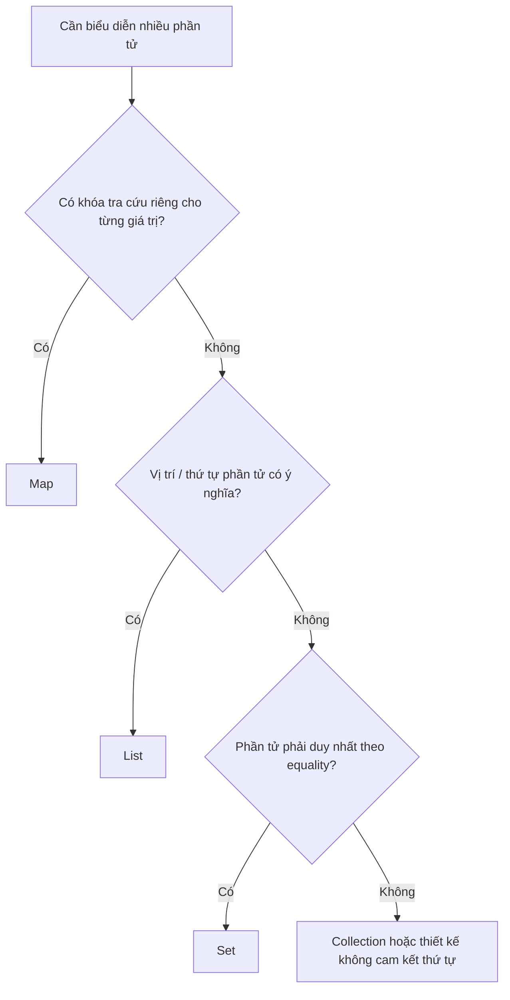

# Lựa chọn `List`, `Set`, `Collection` và `Map` theo ngữ nghĩa dữ liệu

Trong JPA, một entity có thể chứa nhiều giá trị hoặc liên kết với nhiều entity khác thông qua các thuộc tính kiểu `java.util.List`, `Set`, `Collection` và `Map`. Chúng đều giúp biểu diễn *tập hợp* dữ liệu, nhưng không có cùng ý nghĩa. Chọn sai kiểu collection có thể khiến ứng dụng vô tình làm mất thứ tự, chấp nhận phần tử trùng, loại bỏ dữ liệu hợp lệ, làm sai khóa tra cứu hoặc phải thực hiện quá nhiều câu lệnh SQL khi cập nhật.

Ví dụ, danh sách bài hát của một playlist cần có **thứ tự do người dùng sắp xếp**; tập thẻ của một bài viết cần **không trùng lặp**; nhóm ghi nhận sự kiện có thể chỉ cần **nhiều phần tử nhưng không quan tâm thứ tự hay tính duy nhất**; còn cấu hình của tài khoản thường cần truy cập bằng **khóa tên cấu hình**. Chúng lần lượt gợi ý `List`, `Set`, `Collection` và `Map`.

JPA cung cấp các annotation để ánh xạ ý nghĩa đó xuống cơ sở dữ liệu quan hệ: `@OneToMany`, `@ManyToMany`, `@ElementCollection`, `@OrderBy`, `@OrderColumn`, `@MapKey`, `@MapKeyColumn` và nhiều annotation liên quan. Điều quan trọng là **ngữ nghĩa của collection trong Java và cấu trúc lưu trữ trong database phải tương ứng với nhau**.

Bài học này giải thích khi nào nên chọn từng kiểu, cách cấu hình mapping, cách đối phó với `equals()/hashCode()`, thứ tự, trùng lặp, vòng đời, chi phí SQL và các tình huống thường gặp trong hệ thống thực tế.

## 1. Bắt đầu từ câu hỏi nghiệp vụ, không bắt đầu từ annotation

Khi thiết kế một thuộc tính tập hợp, hãy hỏi:

1. **Thứ tự có ý nghĩa nghiệp vụ không?** Ví dụ một danh sách ưu tiên hoặc thứ tự các bước thao tác.
2. **Có được phép trùng phần tử không?** Một bài hát có thể xuất hiện hai lần trong playlist, nhưng một thẻ gắn cho bài viết thường không nên lặp.
3. **Có khóa tra cứu tự nhiên không?** Ví dụ `languageCode → Translation` hoặc `settingName → settingValue`.
4. **Phần tử là giá trị hay entity có định danh riêng?** Ví dụ `String`, `Money`, `Address` là giá trị; `Tag`, `OrderLine`, `Employee` có thể là entity.
5. **Số phần tử có thể lớn đến đâu?** Một collection vài phần tử và một collection hàng triệu phần tử đòi hỏi API truy cập khác nhau.
6. **Thay đổi collection có ý nghĩa gì?** Thêm/xóa một phần tử, thay vị trí, đổi khóa map hay xóa luôn entity con?

Một bảng quyết định ban đầu:

| Kiểu Java | Ngữ nghĩa chính | Có thứ tự bằng vị trí? | Có cho trùng phần tử? | Tình huống phù hợp |
|---|---|---|---|---|
| `List<E>` | Chuỗi phần tử có thứ tự và chỉ số | Có trong Java; muốn **lưu thứ tự**, cần mapping phù hợp | Có | Playlist, các bước xử lý, danh sách có sắp xếp |
| `Set<E>` | Tập các phần tử phân biệt theo equality | Không bảo đảm thứ tự ở mức `Set` | Không, theo `equals/hashCode` | Tags, quyền, membership |
| `Collection<E>` | Tập hợp tổng quát, không cam kết list/set semantics qua interface | Không | Không do chính interface cam kết; tùy implementation/mapping | Nhóm phần tử chỉ cần duyệt/thêm/xóa, không định nghĩa thứ tự/khóa |
| `Map<K,V>` | Ánh xạ từ khóa duy nhất sang giá trị | Không bảo đảm thứ tự key ở `Map` chung | Không được trùng key; value có thể trùng | Cấu hình theo tên, bản dịch theo mã ngôn ngữ, giá trị theo mã |

**Chú ý:** “Có thứ tự trong Java” không đồng nghĩa “JPA sẽ giữ nguyên thứ tự sau khi reload”. `List` có vị trí trong bộ nhớ, nhưng nếu mapping không lưu thứ tự theo cách được chuẩn hóa, thứ tự đọc lại từ database không nên được xem là bất biến nghiệp vụ.

### Sơ đồ lựa chọn



Sơ đồ chỉ giải quyết **ngữ nghĩa API Java**. Sau đó còn phải quyết định các phần tử là `@ElementCollection` hay association tới entity, bên nào sở hữu quan hệ và có cần phân trang, cascade hoặc ràng buộc database.

## 2. Hai nhóm mapping: collection giá trị và collection entity

Trước khi xét `List`/`Set`/`Map`, cần phân biệt **phần tử** mà collection chứa.

### 2.1. Collection of basic/embeddable values

```java
@ElementCollection
private Set<String> tags = new HashSet<>();
```

`@ElementCollection` thường dùng cho:

- Kiểu basic như `String`, `Integer`, `BigDecimal`, enum hoặc các kiểu được JPA hỗ trợ.
- Value object được khai báo `@Embeddable`, ví dụ `Address`.
- Collection có vòng đời phụ thuộc entity chứa nó.

Các phần tử **không có persistence identity độc lập**. Provider thường lưu chúng trong **collection table** qua `@CollectionTable`. Không gọi `em.persist(tag)` với `String` hoặc `em.find(Address.class, id)` với embeddable thuần giá trị.

### 2.2. Collection of entity associations

```java
@OneToMany(mappedBy = "order")
private List<OrderLine> lines = new ArrayList<>();
```

`OrderLine` là entity có `@Id` và bảng riêng. Collection chỉ biểu diễn quan hệ giữa entity chủ và những entity con. Quy tắc về foreign key, owning side, cascade và `orphanRemoval` được xác định bởi mapping association.

Sự khác biệt này quan trọng đối với việc xóa:

- Bỏ một phần tử khỏi `@ElementCollection` là thay đổi giá trị thuộc entity owner.
- Bỏ entity con khỏi `@OneToMany` **không đương nhiên có nghĩa** xóa entity con khỏi database; cần xét owning side, `orphanRemoval` và cách cập nhật quan hệ.
- Bỏ một entity khỏi `@ManyToMany` thông thường là xóa **hàng liên kết**, không tự xóa bản ghi entity ở bảng đối diện.

## 3. `List<E>`: khi vị trí hoặc thứ tự thực sự có ý nghĩa

`List` cho phép truy cập phần tử theo chỉ số `0, 1, 2, ...`; có thể chứa phần tử lặp; có các thao tác như `add(index, element)`, `remove(index)` và `get(index)`.

### Ví dụ nghiệp vụ

Một playlist chứa các URI bài nhạc:

```text
Playlist "Morning"
  0. track-A
  1. track-B
  2. track-A
  3. track-C
```

Ở đây, `track-A` xuất hiện hai lần là **hợp lệ**, và việc đổi chỗ hai mục thay đổi kết quả phát. `Set` không đáp ứng vì nó loại trùng; `Collection` không diễn đạt vị trí. `List` là lựa chọn tự nhiên.

### 3.1. Mapping `List` bằng `@ElementCollection` và `@OrderColumn`

```java
package example.domain;

import jakarta.persistence.CollectionTable;
import jakarta.persistence.Column;
import jakarta.persistence.ElementCollection;
import jakarta.persistence.Entity;
import jakarta.persistence.FetchType;
import jakarta.persistence.GeneratedValue;
import jakarta.persistence.GenerationType;
import jakarta.persistence.Id;
import jakarta.persistence.JoinColumn;
import jakarta.persistence.OrderColumn;
import jakarta.persistence.Table;
import java.util.ArrayList;
import java.util.List;

@Entity
@Table(name = "playlists")
public class Playlist {
    @Id
    @GeneratedValue(strategy = GenerationType.IDENTITY)
    private Long id;

    private String name;

    @ElementCollection(fetch = FetchType.LAZY)
    @CollectionTable(
        name = "playlist_tracks",
        joinColumns = @JoinColumn(name = "playlist_id")
    )
    @OrderColumn(name = "position_index")
    @Column(name = "track_uri", nullable = false)
    private List<String> trackUris = new ArrayList<>();

    protected Playlist() {}

    public Playlist(String name) {
        this.name = name;
    }

    public void appendTrack(String uri) {
        if (uri == null || uri.isBlank()) {
            throw new IllegalArgumentException("Track URI required");
        }
        trackUris.add(uri);
    }

    public void moveTrack(int from, int to) {
        if (from == to) {
            return;
        }
        String uri = trackUris.remove(from);
        trackUris.add(to, uri);
    }

    public List<String> getTrackUris() {
        return List.copyOf(trackUris);
    }
}
```

Trong ví dụ này:

1. `@ElementCollection` nói rằng collection chứa giá trị `String`, không phải entity bài hát.
2. `@CollectionTable` chọn bảng lưu các mục, có foreign key `playlist_id` tham chiếu owner.
3. `@Column(name = "track_uri")` chọn cột lưu giá trị chuỗi.
4. **`@OrderColumn(name = "position_index")`** tạo một cột giữ **vị trí của phần tử trong `List`**. Provider quản lý chỉ số này khi collection thay đổi.
5. `getTrackUris()` trả một bản sao danh sách không sửa được từ bên ngoài; thay đổi cần đi qua business method của `Playlist`.

Lược đồ mang tính minh họa:

```sql
CREATE TABLE playlists (
    id   BIGINT PRIMARY KEY,
    name VARCHAR(255)
);

CREATE TABLE playlist_tracks (
    playlist_id   BIGINT NOT NULL,
    position_index INTEGER NOT NULL,
    track_uri     VARCHAR(255) NOT NULL,
    PRIMARY KEY (playlist_id, position_index),
    FOREIGN KEY (playlist_id) REFERENCES playlists(id)
);
```

`(playlist_id, position_index)` xác định **một vị trí**. Không có unique constraint trên `track_uri`, nên cùng URI có thể xuất hiện ở nhiều vị trí. Cú pháp định nghĩa khóa sinh tự động của `playlists.id` cần được bổ sung theo database và `GenerationType.IDENTITY` tương ứng nếu thực thi DDL thật.

### 3.2. Ý nghĩa của `@OrderColumn`

JPA lưu thứ tự một cách tường minh bằng một cột chỉ số. Với danh sách ba phần tử, các vị trí thông thường là:

```text
position_index: 0   1   2
track_uri:      A   B   C
```

Nếu đưa C lên đầu:

```text
position_index: 0   1   2
track_uri:      C   A   B
```

Provider phải duy trì biểu diễn thứ tự sau khi có thao tác chèn, xóa hoặc reorder. Việc chèn ở đầu/middle có thể khiến **nhiều hàng phải cập nhật chỉ số**, ngay cả khi nghiệp vụ chỉ di chuyển một phần tử. SQL cụ thể còn phụ thuộc provider và mapping.

### 3.3. `List` không khai báo `@OrderColumn` có giữ vị trí không?

Không nên xem việc Java field có kiểu `List` là cam kết rằng vị trí được lưu bền vững. Nếu không có cơ chế lưu thứ tự, database **không có thứ tự hàng mặc định**. Provider có thể trả phần tử theo một thứ tự tình cờ nào đó; thứ tự ấy có thể thay đổi khi kế hoạch truy vấn, dữ liệu hoặc phiên bản provider thay đổi.

Ví dụ:

```java
@OneToMany(mappedBy = "order")
private List<OrderLine> lines = new ArrayList<>();
```

Mapping này có thể hữu ích để duyệt danh sách nhưng **không tự diễn đạt** quy tắc “vị trí do người dùng kéo thả phải được lưu lâu dài”. Muốn lưu vị trí có thể dùng `@OrderColumn` hoặc thiết kế thuộc tính thứ tự nghiệp vụ riêng. Lựa chọn phụ thuộc việc ai chịu trách nhiệm quản lý thứ tự và mô hình quan hệ.

## 4. `@OrderBy` khác `@OrderColumn` như thế nào?

Hai annotation có tên giống nhau nhưng giải quyết hai yêu cầu khác:

| Tiêu chí | `@OrderBy` | `@OrderColumn` |
|---|---|---|
| Mục đích | Sắp xếp collection khi lấy dữ liệu | Lưu **thứ tự theo vị trí** của `List` |
| Căn cứ thứ tự | Một hay nhiều thuộc tính entity/embeddable | Một cột chỉ số do provider quản lý |
| Có tạo cột vị trí mới? | Không | Có hoặc dùng cột vị trí được chỉ định |
| Có phản ánh thao tác kéo-thả `list.add(index, ...)` bằng chỉ số? | Không phải mục tiêu | Có, theo ngữ nghĩa ordered list |
| Có phù hợp sắp theo thời gian tạo? | Thường có | Chỉ khi muốn quản lý vị trí độc lập |
| Hành vi đổi vị trí | Không bền nếu không đổi giá trị field được sort | Provider cập nhật dữ liệu vị trí |

### 4.1. `@OrderBy` khi thứ tự được tính từ dữ liệu

Ví dụ một order hiển thị các dòng theo ngày tạo:

```java
@OneToMany(mappedBy = "order", fetch = FetchType.LAZY)
@OrderBy("createdAt DESC, id ASC")
private List<OrderLine> lines = new ArrayList<>();
```

JPA dựa trên thuộc tính `createdAt` và `id` để sắp xếp khi tải collection. `createdAt` phải là một thuộc tính persistent trong `OrderLine`. Dùng `id` làm tie-breaker giúp việc sắp xếp xác định hơn khi nhiều dòng có cùng thời điểm.

Nếu cập nhật `createdAt` (khi nghiệp vụ cho phép), kết quả sắp xếp có thể đổi. Việc gọi `lines.add(0, line)` **không tự thay `createdAt`** và không định nghĩa lại thứ tự theo cách bền vững.

### 4.2. `@OrderColumn` khi thứ tự là dữ liệu riêng

Một quy trình gồm các bước do người dùng sắp xếp có yêu cầu như:

```text
1. Kiểm tra hồ sơ
2. Phê duyệt
3. Phát hành
```

Nếu người dùng chuyển “Phát hành” lên trước “Phê duyệt”, cần lưu **vị trí** của mỗi bước, không phải chỉ lấy thứ tự theo `id` hay `createdAt`. `@OrderColumn` hoặc một cột `displayPosition` được quản lý rõ ràng sẽ phù hợp hơn.

Đừng kết hợp `@OrderBy` và `@OrderColumn` một cách tùy ý trên cùng collection rồi tạo ra hai nguồn sự thật cho thứ tự. Hãy chọn semantics cần bảo toàn.

## 5. `Set<E>`: khi phần tử phải duy nhất theo giá trị hoặc identity được chọn

`Set` biểu diễn một nhóm phần tử **không trùng nhau** theo quy tắc `equals()` và `hashCode()` của Java. Không có khái niệm “phần tử thứ ba” theo API `Set` thông thường.

### Ví dụ nghiệp vụ

Một bài viết có các thẻ:

```text
Article 25
  tags = {"java", "jpa", "database"}
```

Việc thêm `"jpa"` lần thứ hai không có ý nghĩa. `Set<String>` phù hợp vì `String` có value equality và hash code ổn định.

### 5.1. Mapping `Set` các giá trị cơ bản

```java
package example.domain;

import jakarta.persistence.CollectionTable;
import jakarta.persistence.Column;
import jakarta.persistence.ElementCollection;
import jakarta.persistence.Entity;
import jakarta.persistence.GeneratedValue;
import jakarta.persistence.GenerationType;
import jakarta.persistence.Id;
import jakarta.persistence.JoinColumn;
import jakarta.persistence.Table;
import java.util.Collections;
import java.util.HashSet;
import java.util.Set;

@Entity
@Table(name = "articles")
public class Article {
    @Id
    @GeneratedValue(strategy = GenerationType.IDENTITY)
    private Long id;

    private String title;

    @ElementCollection
    @CollectionTable(
        name = "article_tags",
        joinColumns = @JoinColumn(name = "article_id")
    )
    @Column(name = "tag", nullable = false, length = 80)
    private Set<String> tags = new HashSet<>();

    protected Article() {}

    public Article(String title) {
        this.title = title;
    }

    public void addTag(String tag) {
        if (tag == null || tag.isBlank()) {
            throw new IllegalArgumentException("Tag required");
        }
        tags.add(tag);
    }

    public void removeTag(String tag) {
        tags.remove(tag);
    }

    public Set<String> getTags() {
        return Collections.unmodifiableSet(tags);
    }
}
```

Lược đồ phù hợp:

```sql
CREATE TABLE article_tags (
    article_id BIGINT NOT NULL,
    tag        VARCHAR(80) NOT NULL,
    PRIMARY KEY (article_id, tag),
    FOREIGN KEY (article_id) REFERENCES articles(id)
);
```

Ràng buộc `PRIMARY KEY(article_id, tag)` bảo đảm cùng một bài viết không có hai hàng với cùng thẻ, kể cả khi có một tiến trình khác ghi trực tiếp vào database. JPA `Set` áp dụng semantics không trùng **trong Java**, còn unique/primary-key constraint mới là lớp bảo vệ **ở database**.

**Không có thứ tự hiển thị bền vững** chỉ vì khởi tạo bằng `LinkedHashSet`, hay vì hôm nay provider tình cờ trả các thẻ theo thứ tự INSERT. Nếu UI cần hiển thị tag theo alphabet, hãy sort khi truy vấn/DTO hoặc trình bày, nhưng không đánh đồng đó với vị trí do người dùng sắp xếp.

### 5.2. `Set<Entity>` phụ thuộc rất nhiều vào `equals()/hashCode()`

Với `Set<String>`, equality của `String` rõ ràng. Với `Set<Tag>` hoặc `Set<User>`, bản thân entity có vòng đời:

```text
transient (chưa có ID)
    -> managed (có thể được cấp ID)
    -> detached
    -> managed lại qua lần tải/merge thích hợp
```

Giả sử `Tag` có khóa sinh tự động:

```java
@Entity
public class Tag {
    @Id
    @GeneratedValue(strategy = GenerationType.IDENTITY)
    private Long id;

    private String code;

    protected Tag() {}
}
```

Nếu `hashCode()` chỉ dựa trên `id`, hash code của object có thể thay đổi từ trạng thái `id == null` sang `id != null` sau `persist`. Nếu entity đã được thêm vào `HashSet` trước khi ID xuất hiện, việc đổi hash có thể khiến `contains()` hoặc `remove()` hoạt động sai. Đây là lỗi nghiêm trọng vì collection của JPA còn dùng cơ chế theo dõi phần tử để xác định thay đổi.

Một hướng thiết kế là dùng **natural key duy nhất và ổn định**:

```java
@Entity
@Table(
    name = "tags",
    uniqueConstraints = @UniqueConstraint(
        name = "uq_tags_code",
        columnNames = "code"
    )
)
public class Tag {
    @Id
    @GeneratedValue(strategy = GenerationType.IDENTITY)
    private Long id;

    @Column(nullable = false, updatable = false)
    private String code;

    protected Tag() {}

    public Tag(String code) {
        if (code == null || code.isBlank()) {
            throw new IllegalArgumentException("Code required");
        }
        this.code = code;
    }

    @Override
    public boolean equals(Object other) {
        if (this == other) return true;
        if (!(other instanceof Tag that)) return false;
        return code != null && code.equals(that.code);
    }

    @Override
    public int hashCode() {
        return code.hashCode();
    }
}
```

Ví dụ này chỉ minh họa một chính sách equality: `code` được xem là định danh nghiệp vụ không đổi. Nó phù hợp khi hệ thống bảo đảm `code` duy nhất, không bị sửa và luôn có giá trị ở các object được đưa vào Set. Nếu code có thể đổi, hoặc các entity được tạo/khởi tạo theo cách khác, cần chọn chiến lược equality khác.

**Không có một công thức `equals/hashCode` duy nhất đúng cho mọi entity JPA.** Khi dùng generated ID, còn phải cân nhắc proxy của provider, các entity detached và identity giữa các persistence context. Điều bắt buộc khi dùng hash-based collection là **các giá trị tham gia equality/hash code phải ổn định khi object nằm trong Set**.

### 5.3. `Set` không thay thế unique constraint

Giả sử hai request đồng thời cùng thêm tag `"jpa"` vào một bài viết, mỗi request tải collection ở hai transaction khác nhau. `Set` trong từng transaction không nhìn thấy thay đổi chưa commit của transaction còn lại. Chỉ riêng API Java không thể bảo vệ uniqueness toàn hệ thống.

Nếu nghiệp vụ yêu cầu không trùng ở mức lưu trữ, nên đặt `UNIQUE(article_id, tag)` hoặc khóa chính tương đương, rồi xử lý lỗi đồng thời hoặc retry theo transaction policy. Mapping `Set` và database unique constraint bổ sung cho nhau.

## 6. `Collection<E>`: giao diện tổng quát khi không cần index hay lookup key

`java.util.Collection<E>` là interface cha của nhiều loại collection. Nó cho phép duyệt, thêm, xóa, kiểm tra phần tử mà không buộc API phải công khai chỉ số như `List` hoặc các thao tác set algebra như `Set`.

Ví dụ một entity lưu các chuỗi ghi chú độc lập, **không có ý nghĩa thứ tự** và đôi khi có cùng nội dung:

```java
@Entity
public class Inspection {
    @Id
    @GeneratedValue
    private Long id;

    @ElementCollection
    @CollectionTable(
        name = "inspection_notes",
        joinColumns = @JoinColumn(name = "inspection_id")
    )
    @Column(name = "note_text")
    private Collection<String> notes = new ArrayList<>();

    protected Inspection() {}

    public void addNote(String text) {
        notes.add(text);
    }
}
```

Kiểu khai báo `Collection<String>` diễn đạt rằng code sử dụng **không được dựa vào vị trí**. Implementation `ArrayList` ở đây có thể chứa giá trị lặp trong Java, nhưng bản thân interface `Collection` không bảo đảm semantics của List hay Set. Provider có thể sử dụng một persistent collection implementation riêng.

Trong tài liệu về Hibernate, đôi khi có thuật ngữ **bag**: tập hợp có thể chứa phần tử trùng và không có thứ tự persistent. Đây là cách mô tả hữu ích, nhưng **bag không phải một kiểu `java.util.Bag` trong API collection chuẩn của Java**, và không nên mặc định mọi provider diễn giải mọi `Collection` như nhau trong mọi mapping.

### 6.1. Vì sao không nên dùng `Collection` cho dữ liệu cần có thứ tự?

Vì người gọi chỉ thấy API tổng quát; không thể nói “đổi phần tử thứ hai lên đầu” mà không chuyển đổi/tạo một cấu trúc có chỉ số. Hơn nữa, mapping không diễn đạt việc phải lưu thứ tự theo vị trí.

Nếu thứ tự là invariant nghiệp vụ, hãy chọn `List` và có chiến lược lưu thứ tự phù hợp, thay vì ngầm dựa vào thứ tự tình cờ của một `Collection`.

### 6.2. Vì sao không nên dùng `Collection` cho dữ liệu bắt buộc unique?

Vì `Collection.add(x)` không có ngữ nghĩa chống trùng của `Set.add(x)`. Muốn uniqueness, dùng `Set` (với equality ổn định) và ràng buộc database.

### 6.3. Khi nào `Collection` hữu ích?

- API chỉ cần duyệt và thêm/xóa, không muốn lộ chi tiết `List`/`Set`.
- Ngữ nghĩa của các phần tử không yêu cầu chỉ số hoặc key.
- Hệ thống có mapping đơn giản hoặc cần giữ tương thích với API cũ.

Dù vậy, **khai báo một interface tổng quát không tự giải quyết mọi chi phí persistence**. Với collection rất lớn, hãy truy vấn trực tiếp phía con theo điều kiện thay vì đưa toàn bộ tập vào RAM.

## 7. `Map<K,V>`: khi mỗi phần tử được truy cập bằng khóa nghiệp vụ

`Map` diễn đạt một phép ánh xạ từ **key** sang **value**:

```text
"theme"       -> "dark"
"language"    -> "vi"
"itemsPerPage" -> "50"
```

`Map` phù hợp khi người sử dụng hỏi “giá trị của `theme` là gì?” thay vì “phần tử thứ năm là gì?” hay “tập hợp có chứa giá trị X không?”.

Các quy tắc:

- Mỗi key chỉ có một value tại một thời điểm theo semantics `Map`.
- Nhiều key **có thể** dẫn tới cùng value.
- `HashMap` không có thứ tự key; `LinkedHashMap` giữ thứ tự insert trong Java nhưng JPA không tự bảo đảm thứ tự đó tồn tại sau khi reload.
- Key nên có `equals/hashCode` ổn định khi đang nằm trong map.
- Cách lưu **key** phụ thuộc loại map: basic key riêng trong collection table, key lấy từ thuộc tính của entity value, hoặc key là một entity liên kết.

### 7.1. `Map<String, String>` dưới dạng `@ElementCollection`

Ví dụ cấu hình của tài khoản:

```java
package example.domain;

import jakarta.persistence.CollectionTable;
import jakarta.persistence.Column;
import jakarta.persistence.ElementCollection;
import jakarta.persistence.Entity;
import jakarta.persistence.GeneratedValue;
import jakarta.persistence.GenerationType;
import jakarta.persistence.Id;
import jakarta.persistence.JoinColumn;
import jakarta.persistence.MapKeyColumn;
import jakarta.persistence.Table;
import java.util.HashMap;
import java.util.Map;

@Entity
@Table(name = "user_accounts")
public class UserAccount {
    @Id
    @GeneratedValue(strategy = GenerationType.IDENTITY)
    private Long id;

    @ElementCollection
    @CollectionTable(
        name = "user_settings",
        joinColumns = @JoinColumn(name = "user_id")
    )
    @MapKeyColumn(name = "setting_key", nullable = false, length = 80)
    @Column(name = "setting_value", length = 500)
    private Map<String, String> settings = new HashMap<>();

    protected UserAccount() {}

    public String setting(String key) {
        return settings.get(key);
    }

    public void putSetting(String key, String value) {
        if (key == null || key.isBlank()) {
            throw new IllegalArgumentException("Setting key required");
        }
        settings.put(key, value);
    }

    public void removeSetting(String key) {
        settings.remove(key);
    }

    public Map<String, String> getSettings() {
        return Map.copyOf(settings);
    }
}
```

Ở đây:

- `@ElementCollection` ánh xạ map chứa những giá trị basic.
- `@CollectionTable` chỉ định bảng có FK tới owner `user_accounts`.
- **`@MapKeyColumn(name = "setting_key")`** định nghĩa cột chứa key của map.
- `@Column(name = "setting_value")` định nghĩa cột chứa value.
- `settings.put("theme", "dark")` thay hoặc tạo giá trị ứng với key `theme`.

Lược đồ minh họa:

```sql
CREATE TABLE user_settings (
    user_id       BIGINT NOT NULL,
    setting_key   VARCHAR(80) NOT NULL,
    setting_value VARCHAR(500),
    PRIMARY KEY (user_id, setting_key),
    FOREIGN KEY (user_id) REFERENCES user_accounts(id)
);
```

`PRIMARY KEY(user_id, setting_key)` thể hiện **key duy nhất trong phạm vi một user**. Hai user đều có key `theme` là bình thường, nhưng một user không có hai hàng `theme` khác nhau tại cùng thời điểm.

**Chú ý:** `Map.copyOf(settings)` không cho phép key/value `null`. Trong ví dụ này `putSetting` kiểm tra key nhưng chưa cấm value `null`; muốn giữ API get hoạt động cho mọi giá trị, cần hoặc cấm null value trong `putSetting`, hoặc dùng `Collections.unmodifiableMap(new HashMap<>(settings))` cho bản sao có thể chứa null. Với các setting cần nhất quán, cấm null value và dùng thao tác `removeSetting` để biểu diễn xóa key thường rõ hơn.

### 7.2. Truy vấn map bằng JPQL `KEY` và `VALUE`

JPA có các hàm/biểu thức phục vụ map trong JPQL:

```java
List<UserAccount> users = em.createQuery(
        "select distinct u from UserAccount u " +
        "join u.settings setting " +
        "where key(setting) = :key " +
        "and value(setting) = :value",
        UserAccount.class
    )
    .setParameter("key", "theme")
    .setParameter("value", "dark")
    .getResultList();
```

`KEY(setting)` là key, `VALUE(setting)` là value của map entry được join. Provider ánh xạ thành cột `setting_key` và `setting_value`. Chúng không phải tên cột hardcode trong JPQL.

Nếu mục tiêu là kiểm tra cấu hình của một user mà không cần tải toàn bộ map, có thể dùng truy vấn tương tự kèm điều kiện `u.id = :userId`.

## 8. `@MapKey(name = "...")`: key lấy từ thuộc tính của entity value

`Map` không chỉ dùng với `@ElementCollection`. Ta có thể ánh xạ entity relationship thành map, trong đó **key lấy từ một thuộc tính của entity value**.

Ví dụ một `Department` có nhân viên được tra cứu theo `employeeCode`:

```java
@Entity
public class Department {
    @Id
    private Long id;

    @OneToMany(mappedBy = "department")
    @MapKey(name = "employeeCode")
    private Map<String, Employee> employeesByCode = new HashMap<>();

    protected Department() {}
}
```

Entity con:

```java
@Entity
@Table(
    name = "employees",
    uniqueConstraints = @UniqueConstraint(
        name = "uq_employees_department_code",
        columnNames = {"department_id", "employee_code"}
    )
)
public class Employee {
    @Id
    @GeneratedValue
    private Long id;

    @ManyToOne(fetch = FetchType.LAZY, optional = false)
    @JoinColumn(name = "department_id", nullable = false)
    private Department department;

    @Column(name = "employee_code", nullable = false, updatable = false)
    private String employeeCode;

    protected Employee() {}
}
```

Giải thích:

- `@MapKey(name = "employeeCode")` chỉ tới **thuộc tính Java `Employee.employeeCode`**.
- Không tự tạo thêm một cột key map độc lập: key map được rút ra từ **cột `employee_code` đã thuộc entity `Employee`**.
- Khóa tra cứu mang ý nghĩa “mã nhân viên trong một phòng ban”.
- `UNIQUE(department_id, employee_code)` cần được bảo đảm trên database nếu mã phải duy nhất trong từng phòng ban.
- `mappedBy = "department"` cho biết phía `Employee.department` sở hữu foreign key `department_id`.

### 8.1. Rủi ro khi thay thuộc tính dùng làm map key

Giả sử `employeesByCode` đã được tải trong persistence context:

```java
Employee employee = department.getEmployeesByCode().get("E001");
// Nếu employeeCode có thể đổi thành "E002" mà không thao tác map:
// key trong Map Java hiện tại có thể vẫn là "E001".
```

JPA **không bảo đảm tự động cập nhật các key của map trong bộ nhớ** chỉ vì thuộc tính entity được `@MapKey` tham chiếu thay đổi. Đó là lý do key dựa trên thuộc tính **ổn định** là lựa chọn an toàn. Nếu mã nhân viên thực sự có thể đổi, có thể phải duy trì map thủ công, reload trong context mới, hoặc chọn kiểu collection/mapping khác.

Không nên mặc định `@MapKey(name = "employeeCode")` và `@MapKeyColumn(name = "employee_code")` là hai cách viết thay thế trực tiếp. Chúng mô hình hóa **hai nguồn key khác nhau**:

| Annotation | Nguồn key |
|---|---|
| `@MapKey(name = "employeeCode")` | Key lấy từ một thuộc tính có sẵn của entity value |
| `@MapKeyColumn(name = "setting_key")` | Key được lưu trong một cột riêng thuộc bảng lưu map/collection |
| `@MapKeyJoinColumn` | Key là một entity được tham chiếu qua join column |

### 8.2. Khi key của map là entity

Một số mô hình có key là entity có identity, chẳng hạn map một phân công theo `Role`:

```java
Map<Role, Assignment> assignmentsByRole;
```

Trong mapping phù hợp, `@MapKeyJoinColumn` cho phép xác định foreign key dùng cho **entity key**. Đây là bài toán khác với `@MapKeyColumn` cho basic key `String` hay `Integer`. Với entity key, cần cân nhắc equality, lifecycle, persistence context và tính ổn định của identifier.

Nếu mapping trở nên quá phức tạp hoặc bản ghi liên kết có thêm trạng thái nghiệp vụ, một entity liên kết (`Assignment` có khóa riêng hoặc composite ID) thường dễ bảo trì hơn một map trực tiếp.

## 9. `Map` không phải lời hứa có thứ tự

`HashMap` không có thứ tự key. `LinkedHashMap` trong Java giữ thứ tự thêm phần tử, còn `TreeMap` có thứ tự do comparator/`Comparable` cung cấp. Nhưng khi JPA tải map từ database, **không nên coi implementation Java được chọn là cơ chế tự lưu thứ tự**.

Ví dụ:

```java
private Map<String, String> settings = new LinkedHashMap<>();
```

Khi `settings` được provider thay bằng một persistent map implementation hoặc khi dữ liệu được tải lại, thứ tự duyệt không phải một invariant của `Map`. Nếu nghiệp vụ cần hiển thị settings theo alphabet, có thể tạo một danh sách DTO đã sort:

```java
List<Map.Entry<String, String>> sorted = settings.entrySet()
    .stream()
    .sorted(Map.Entry.comparingByKey())
    .toList();
```

Đây là **sắp xếp để hiển thị**, không phải lưu thứ tự bằng JPA. Nếu thứ tự do người dùng thiết lập cần được lưu, một entity `SettingEntry` có `position` hoặc một `List` được ánh xạ có vị trí sẽ rõ nghĩa hơn.

## 10. Sự khác nhau giữa uniqueness trong Java và trong database

Tưởng tượng một bảng `article_tags` có hai hàng:

```text
article_id = 10, tag = "jpa"
article_id = 10, tag = "jpa"
```

Khi JPA nạp dữ liệu vào `Set<String>`, phía Java chỉ có một giá trị `"jpa"`. Nhưng hai hàng vẫn tồn tại trong database nếu schema không chặn. Bản chất `Set` là **cấu trúc in-memory**; database chỉ biết các constraint đã khai báo và thực thi.

Tương tự, `Map<String, String>` có key `theme` duy nhất ở Java, nhưng nếu table cho phép hai hàng `(user_id = 10, setting_key = 'theme')`, mapping và kết quả tải có thể không còn khớp semantics của Map.

**Quy tắc thực hành:**

1. Chọn `Set`/`Map` theo nghĩa nghiệp vụ.
2. Kiểm tra tính ổn định của `equals()/hashCode()` hoặc key.
3. Đặt `UNIQUE`/`PRIMARY KEY` phù hợp trong database.
4. Định nghĩa chính sách xử lý khi request đồng thời gây vi phạm uniqueness.
5. Không coi việc entity Java được xây bằng `HashSet` hoặc `HashMap` là đủ để bảo vệ dữ liệu ở mọi đường ghi.

### Nếu cần trùng lặp, đừng cưỡng ép Set

Một `PurchaseOrder` có thể có hai dòng hàng cùng `sku` nhưng khác khuyến mãi hoặc vị trí dòng. Nếu equality của `OrderLine` chỉ dựa trên `sku`, đưa các dòng này vào `Set<OrderLine>` có thể **vô tình loại mất một dòng hợp lệ**.

Khi sự lặp lại là hợp lệ, hãy mô hình hóa mỗi dòng bằng entity có identity riêng; dùng `List` hoặc truy vấn trực tiếp entity con thay vì Set theo mã sản phẩm.

## 11. Quan hệ một-nhiều: tác động của kiểu collection đến owning side

Giả sử `PurchaseOrder` và `OrderLine`:

```java
@Entity
public class PurchaseOrder {
    @Id
    @GeneratedValue
    private Long id;

    @OneToMany(mappedBy = "order", cascade = CascadeType.ALL,
               orphanRemoval = true)
    private List<OrderLine> lines = new ArrayList<>();

    protected PurchaseOrder() {}
}
```

```java
@Entity
public class OrderLine {
    @Id
    @GeneratedValue
    private Long id;

    @ManyToOne(fetch = FetchType.LAZY, optional = false)
    @JoinColumn(name = "order_id", nullable = false)
    private PurchaseOrder order;

    protected OrderLine() {}
}
```

Đây là association hai hướng:

- `OrderLine.order` là **owning side** vì quản lý foreign key `order_lines.order_id`.
- `PurchaseOrder.lines` là phía inverse với `mappedBy = "order"`.
- Việc thuộc tính ở cha là `List` hay `Set` **không tự thay đổi phía sở hữu foreign key**.
- `cascade` và `orphanRemoval` điều khiển vòng đời; chúng **không phải** cơ chế xác định `List` hay `Set`.

Muốn quan hệ Java nhất quán khi thêm dòng:

```java
public void addLine(OrderLine line) {
    if (line == null) {
        throw new IllegalArgumentException("Line required");
    }
    lines.add(line);
    line.attachTo(this); // Helper đặt phía owning.
}
```

`attachTo` cần được định nghĩa trên `OrderLine` để thiết lập `order`, kiểm tra không gắn một line vào hai đơn và giữ invariant. **Đừng chỉ gọi `lines.add(line)` rồi bỏ qua `line.order`**, vì phía owning mới là nguồn dữ liệu dùng để lưu foreign key.

### 11.1. Khi nào dùng `List<OrderLine>`?

- Thứ tự dòng có ý nghĩa (vị trí trên chứng từ, thứ tự được người dùng sắp xếp).
- Cần cho phép hai dòng có thuộc tính giống nhau nhưng vẫn là hai dòng riêng.
- Cần API thao tác bằng index.

Nếu thứ tự phải lưu, cần thêm `@OrderColumn` hoặc thuộc tính vị trí rõ ràng. Nếu chỉ cần hiển thị theo `lineNo`, `@OrderBy("lineNo ASC")` có thể phù hợp, nhưng cần ràng buộc duy nhất `(order_id, line_no)` nếu line number là một phần nghĩa nghiệp vụ.

### 11.2. Khi nào dùng `Set<OrderLine>`?

- Thành viên của tập cần unique theo một chính sách equality ổn định.
- Không có nhu cầu thao tác theo vị trí.
- Quy tắc nghiệp vụ không cho trùng entity/thành viên trong collection.

Phải suy nghĩ kỹ `equals/hashCode`, đặc biệt nếu `OrderLine` có `@GeneratedValue` và được thêm vào `Set` trước khi ID được cấp.

### 11.3. Khi nào chỉ dùng `Collection<OrderLine>`?

Khi API không cần index/uniqueness và không muốn ràng buộc cách duyệt. Nhưng nếu semantics thực sự là danh sách có thứ tự hoặc tập không trùng, nên khai báo rõ bằng `List`/`Set` thay vì che giấu yêu cầu.

### 11.4. Khi nào dùng `Map<Integer, OrderLine>`?

Khi mỗi dòng có key ổn định như `lineNo` và nghiệp vụ cần tra cứu theo số dòng. Có thể dùng `@MapKey(name = "lineNo")` trên collection entity, nhưng phải bảo đảm `lineNo` unique trong phạm vi order và không đổi tùy tiện.

Nếu số dòng chỉ là **vị trí có thể kéo thả** và thay đổi liên tục, không nên coi nó là key bất biến; `List` với order column hoặc cột vị trí được quản lý rõ ràng có thể phù hợp hơn.

## 12. `@ManyToMany`: `Set` thường trực quan nhưng không phải quy tắc bắt buộc

Ví dụ người dùng và nhóm:

```java
@ManyToMany
@JoinTable(
    name = "user_groups",
    joinColumns = @JoinColumn(name = "user_id"),
    inverseJoinColumns = @JoinColumn(name = "group_id")
)
private Set<Group> groups = new HashSet<>();
```

Ngữ nghĩa “mỗi người là thành viên của một nhóm tối đa một lần” gợi ý `Set<Group>`. Ở database cần:

```sql
CREATE TABLE user_groups (
    user_id BIGINT NOT NULL,
    group_id BIGINT NOT NULL,
    PRIMARY KEY (user_id, group_id),
    FOREIGN KEY (user_id) REFERENCES users(id),
    FOREIGN KEY (group_id) REFERENCES groups(id)
);
```

Ở đây `Set` phản ánh yêu cầu không trùng membership, còn khóa chính ghép trên join table thực thi uniqueness.

Tuy nhiên, nếu một membership có **vai trò, trạng thái, ngày bắt đầu, người phê duyệt** hoặc nhiều bản ghi theo thời gian, nhiều-nhiều thuần túy có thể không đủ. Nên dùng entity liên kết `Membership` với khóa/identity riêng thay vì cố nhét metadata vào một `Set<Group>`.

Không coi `Set` luôn nhanh hơn `List` trong mọi tình huống. Chi phí thực tế phụ thuộc loại association, SQL do provider sinh, index, batching, việc xóa phần tử và cơ chế xác định thay đổi.

## 13. Tập giá trị, tập entity và khả năng xóa phần tử

### `@ElementCollection`

```java
@ElementCollection
private Set<String> tags;
```

Một tag giá trị bị gỡ khỏi Set tương ứng với việc thay đổi trạng thái persistent của owner, thường là xóa/sửa hàng phù hợp trong collection table. Vì value không có entity identity riêng, provider có thể dùng các chiến lược xóa/chèn lại khác nhau tùy mapping.

### `@OneToMany`

```java
@OneToMany(mappedBy = "order", orphanRemoval = true)
private List<OrderLine> lines;
```

Khi `orphanRemoval = true` và phần tử bị tách khỏi quan hệ theo semantics JPA, provider có thể xóa entity con ở flush. Nếu không có orphan removal, chỉ xóa reference khỏi phía inverse không bảo đảm entity con bị xóa khỏi database; phải duy trì owning side và quan hệ FK đúng.

### `@ManyToMany`

```java
@ManyToMany
private Set<Group> groups;
```

Gỡ một nhóm khỏi membership thường xóa **row join table**; `Group` vẫn có thể thuộc những người dùng khác, nên không muốn cascade `REMOVE` sang entity `Group` chỉ vì gỡ liên kết.

| Mapping | Khi bỏ một phần tử | Cần quan tâm |
|---|---|---|
| `@ElementCollection` | Bỏ một giá trị thuộc owner | Collection table, giá trị trùng, SQL update/delete |
| `@OneToMany` | Thay đổi liên kết hoặc xóa entity phụ thuộc theo cấu hình | Owning side, cascade, orphanRemoval, FK |
| `@ManyToMany` | Thay đổi hàng trong join table | Không xóa entity dùng chung ngoài ý muốn |

## 14. Chi phí thay đổi `List`, `Set` và `Map`

Chọn kiểu collection còn ảnh hưởng **mẫu SQL** mà provider có thể thực hiện khi collection bị thay đổi.

### 14.1. `List` có `@OrderColumn`: chèn ở đầu có thể cập nhật nhiều vị trí

Giả sử một playlist có 10.000 mục và chèn một bài vào vị trí 0. Provider có thể phải thay đổi chỉ số của nhiều mục phía sau để giữ `position_index` liên tục. Nếu user thường kéo thả cả danh sách lớn, chi phí reorder cần được đo và có thể phải thiết kế cột thứ tự nghiệp vụ theo chiến lược khác.

Không dùng `@OrderColumn` chỉ vì UI cần *hiển thị* theo ngày tạo. `@OrderBy` có thể đáp ứng yêu cầu đó mà không buộc provider duy trì các vị trí index.

### 14.2. `Set`: điều kiện cần là equality ổn định

`Set` giúp tránh trùng theo Java equality, nhưng muốn xác định phần tử vừa thêm/xóa, provider có thể dựa trên snapshot và chính sách nhận diện phần tử. Nếu `hashCode` thay đổi sau khi thêm entity vào Set, chi phí không chỉ là lỗi Java collection mà còn có thể làm phát sinh cập nhật association không như kỳ vọng.

### 14.3. `Map`: đổi key có thể giống xóa và thêm entry

Với `Map<String, String>` lưu qua `@MapKeyColumn`:

```java
String old = settings.remove("theme");
settings.put("ui.theme", old);
```

Đổi key từ `theme` thành `ui.theme` không phải đổi một attribute độc lập của entry entity, bởi entry là cấu trúc key-value trong collection. Provider có thể diễn giải như **xóa row cũ và thêm row mới** hoặc thực hiện cập nhật tương ứng. Chi tiết SQL phụ thuộc provider và cấu trúc khóa.

Với `@MapKey(name = "employeeCode")`, đổi thuộc tính `employeeCode` trên entity value còn phải xét việc Java map hiện tại có đang chứa key cũ hay không. Đừng nhầm với trường hợp map key nằm ở cột riêng.

### 14.4. Thay toàn bộ collection instance có thể gây tác dụng phụ

Giả sử entity đã managed:

```java
order.setLines(new ArrayList<>(incomingLines));
```

Nếu thay persistent collection wrapper bằng một collection mới, provider có thể không phân tích được thay đổi như mong muốn hoặc thực hiện nhiều thao tác xóa/chèn lại. Khi collection có `orphanRemoval`, một số provider còn báo lỗi nếu wrapper đang được quản lý bị thay reference.

Thay vì phơi `setLines`, nên dùng business methods `addLine`/`removeLine`/`moveLine` giữ invariant và association hai chiều nhất quán. Nhưng **không áp dụng `clear()/addAll()` lên collection rất lớn một cách mù quáng**, vì các thao tác này có thể nạp mọi phần tử và gây hàng loạt SQL. Với tập cực lớn, thao tác theo điều kiện ở phía entity con hoặc batch job thường thích hợp hơn.

## 15. Collection lớn: tránh giả định việc khai báo `LAZY` đã đủ

`@OneToMany` và `@ElementCollection` mặc định có `FetchType.LAZY` theo JPA; `LAZY` thường trì hoãn việc tải collection đến lúc truy cập. Nhưng truy cập:

```java
order.getLines().size();
order.getLines().stream().filter(...).toList();
order.getLines().clear();
```

có thể khiến provider phải khởi tạo **toàn bộ collection**, kể cả khi code chỉ muốn đếm, tìm vài dòng hoặc xóa một tập theo điều kiện.

Đối với một-một, nhiều-một hoặc entity nhỏ, việc đi qua object graph có thể rất thuận tiện. Đối với quan hệ một-nhiều lớn, nên:

1. Truy vấn entity con trực tiếp theo `parent.id` và điều kiện cần.
2. Dùng `setMaxResults`, phân trang offset hoặc keyset khi hiển thị/tác nghiệp từng phần.
3. Dùng JPQL `COUNT` khi chỉ cần số lượng.
4. Dùng DTO projection khi không cần entity managed.
5. Cân nhắc JPQL bulk update/delete với hiểu biết về lifecycle callback, cascade và persistence context.
6. Giới hạn transaction và số managed entity khi import hoặc xử lý hàng loạt.

Ví dụ:

```java
List<OrderLine> page = em.createQuery(
        "select l from OrderLine l " +
        "where l.order.id = :orderId " +
        "order by l.id",
        OrderLine.class
    )
    .setParameter("orderId", orderId)
    .setMaxResults(50)
    .getResultList();
```

Cách truy vấn này không phụ thuộc vào việc owner có khai báo `List<OrderLine>`, `Set<OrderLine>` hay không có field collection nào. **Mối quan hệ dữ liệu vẫn tồn tại nhờ foreign key**; Java collection chỉ là một API để điều hướng khi cần.

## 16. Truy vấn các kiểu collection trong JPQL

JPA hỗ trợ điều hướng collection và các biểu thức khác nhau tùy kiểu.

### 16.1. `JOIN` trên collection

Ví dụ tìm bài viết có thẻ `jpa`:

```java
List<Article> articles = em.createQuery(
        "select distinct a from Article a " +
        "join a.tags tag " +
        "where tag = :tag",
        Article.class
    )
    .setParameter("tag", "jpa")
    .getResultList();
```

Ở đây `tags` là `Set<String>`, nhưng JPQL join làm việc với các giá trị persistent ở collection table. Khi kết quả có thể lặp entity cha do nhiều phần tử khớp, `DISTINCT` hữu ích theo yêu cầu truy vấn.

### 16.2. `MEMBER OF` với collection giá trị hoặc entity

Ví dụ:

```java
List<Article> articles = em.createQuery(
        "select a from Article a " +
        "where :tag member of a.tags",
        Article.class
    )
    .setParameter("tag", "jpa")
    .getResultList();
```

`MEMBER OF` kiểm tra một phần tử thuộc collection. Không nên bắt buộc tải collection về Java chỉ để kiểm tra membership.

### 16.3. `KEY` và `VALUE` với Map

```java
List<UserAccount> users = em.createQuery(
        "select distinct u from UserAccount u " +
        "join u.settings entry " +
        "where key(entry) = :settingKey " +
        "and value(entry) = :settingValue",
        UserAccount.class
    )
    .setParameter("settingKey", "theme")
    .setParameter("settingValue", "dark")
    .getResultList();
```

`KEY(entry)` và `VALUE(entry)` có ý nghĩa vì đường join `u.settings` là một map. Với `List`/`Set`, không có map key theo cách này.

### 16.4. `INDEX` khi có list order column

JPA hỗ trợ biểu thức `INDEX` cho phần tử list có order column thích hợp. Ví dụ lấy phần tử ở vị trí 0 của `Playlist.trackUris`:

```java
List<String> firstTracks = em.createQuery(
        "select track from Playlist p " +
        "join p.trackUris track " +
        "where p.id = :playlistId " +
        "and index(track) = 0",
        String.class
    )
    .setParameter("playlistId", playlistId)
    .getResultList();
```

Biểu thức `INDEX(track)` có ý nghĩa khi thứ tự của list thực sự được ánh xạ bằng cột vị trí. Không dùng nó để giả định mọi `List` không có order column cũng có chỉ số SQL ổn định.

## 17. Tại sao `Set` không mặc nhiên có hiệu năng tốt hơn `List`?

Một ý kiến thường gặp là `Set` luôn nhanh hơn `List` vì `HashSet.contains` có độ phức tạp trung bình tốt hơn `ArrayList.contains`. Điều đó có thể đúng với thao tác Java thuần trên dữ liệu **đã ở RAM**, nhưng không đủ để quyết định JPA mapping.

Chi phí của JPA collection phụ thuộc:

- Số bản ghi phải tải và kích thước mỗi entity.
- `LAZY`/`EAGER`, join fetch, batch fetching và query plan.
- Có order column, join table, collection table hoặc foreign key trực tiếp hay không.
- Provider dùng snapshot/dirty checking và SQL diff ra sao.
- Các phần tử là basic/embeddable hay entity có ID.
- Index, uniqueness constraint và mức cạnh tranh ghi ở database.
- Số node/transaction cùng sửa collection.

Với một association nhỏ, khác biệt Java `List.contains` và `Set.contains` có thể không đáng kể. Với collection cực lớn, **không nên tải cả List lẫn Set** chỉ để kiểm tra một record có tồn tại; hãy truy vấn database theo ID/key và index phù hợp.

Vì thế, lựa chọn **ngữ nghĩa trước, hiệu năng sau**: chọn kiểu diễn đạt đúng nghiệp vụ, rồi tối ưu access pattern, SQL và schema.

## 18. Ràng buộc về `null` và tính nhất quán khi dùng Map/Set

Java `HashMap` cho phép `null` key/value, và `HashSet` cho phép một `null` phần tử. Nhưng database và JPA mapping có thể có constraint hoặc quy tắc khác.

Ví dụ:

```java
@MapKeyColumn(name = "setting_key", nullable = false)
@Column(name = "setting_value", nullable = false)
private Map<String, String> settings;
```

Nếu app gọi `settings.put(null, "dark")` hoặc `settings.put("theme", null)`, schema `NOT NULL` có thể từ chối khi flush. Không nên xem khả năng chứa null của implementation Java là quyền được lưu null theo mapping.

Một chính sách rõ ràng là:

- Key của Map phải có giá trị hợp lệ, không null và ổn định.
- Nếu value “không được thiết lập”, dùng `remove(key)` thay vì lưu null, trừ khi business domain có ba trạng thái khác nhau.
- Nếu Set đại diện cho tags hoặc permissions, không chấp nhận phần tử null.
- Dùng Bean Validation và database constraint khi thích hợp, không chỉ kiểm tra trong UI.

Trong collection entity, tránh đưa cùng một entity vào Set dưới nhiều Java instance với equality không nhất quán; hãy cân nhắc hành vi qua các persistence context, proxy và entity detached.

## 19. Quy tắc API và encapsulation

Kiểu collection được khai báo trên entity cũng là một phần API của mô hình miền. Trả reference mutable trực tiếp:

```java
public List<OrderLine> getLines() {
    return lines;
}
```

cho phép caller làm:

```java
order.getLines().clear();
order.getLines().add(lineFromOtherOrder);
```

Những thao tác này có thể phá vỡ invariant của aggregate và gây thay đổi database khó lường khi transaction flush.

Một cách thiết kế tốt hơn cho collection vừa/nhỏ là:

```java
public List<OrderLine> getLines() {
    return Collections.unmodifiableList(lines);
}

public void addLine(OrderLine line) {
    // Kiểm tra business rule.
    // Thêm vào lines và cập nhật line.order.
}

public void removeLine(OrderLine line) {
    // Tháo quan hệ theo cả hai hướng nếu được phép.
}
```

**Lưu ý:** wrapper unmodifiable ngăn caller sửa qua reference trả về, nhưng việc tạo bản sao `List.copyOf` hoặc duyệt toàn bộ collection có thể khiến lazy collection bị tải. Với collection hàng triệu phần tử, đừng công khai getter trả cả tập; tạo API truy vấn phân trang ở service/repository và chỉ trả DTO cần thiết.

Đối với Map, thay vì trả `settings` mutable, cung cấp:

```java
public String getSetting(String key) { return settings.get(key); }
public void putSetting(String key, String value) { /* validate + put */ }
public void removeSetting(String key) { settings.remove(key); }
```

Nếu cần một snapshot không sửa được, có thể tạo bản sao vào DTO, đồng thời hiểu rằng sao chép một map lớn vẫn tốn bộ nhớ.

## 20. Bốn mô hình mẫu theo ngữ nghĩa dữ liệu

### 20.1. Playlist: `List<String>` với thứ tự bền vững

**Yêu cầu:** một track được phép xuất hiện nhiều lần và vị trí do người dùng sắp xếp.

```java
@ElementCollection
@CollectionTable(name = "playlist_tracks",
                 joinColumns = @JoinColumn(name = "playlist_id"))
@OrderColumn(name = "position_index")
@Column(name = "track_uri")
private List<String> trackUris = new ArrayList<>();
```

**Vì sao:** List giữ index và cho phép trùng; order column làm vị trí được lưu trong database.

### 20.2. Article tags: `Set<String>` với uniqueness

**Yêu cầu:** một bài viết không được có hai thẻ trùng nội dung.

```java
@ElementCollection
@CollectionTable(name = "article_tags",
                 joinColumns = @JoinColumn(name = "article_id"))
@Column(name = "tag")
private Set<String> tags = new HashSet<>();
```

**Vì sao:** Set diễn đạt membership; constraint `UNIQUE(article_id, tag)` bảo vệ uniqueness ở database.

### 20.3. Inspection notes: `Collection<String>` khi không có thứ tự hay key

**Yêu cầu:** ghi nhận nhiều dòng mô tả; hai dòng có thể có nội dung giống nhau, thứ tự không phải invariant nghiệp vụ.

```java
@ElementCollection
@CollectionTable(name = "inspection_notes",
                 joinColumns = @JoinColumn(name = "inspection_id"))
@Column(name = "note_text")
private Collection<String> notes = new ArrayList<>();
```

**Vì sao:** API không cam kết index/unique. Nếu sau này mỗi ghi chú cần người tạo, thời gian tạo, chỉnh sửa hoặc identity độc lập, nên chuyển thành entity `InspectionNote` thay vì tiếp tục dùng value collection.

### 20.4. User settings: `Map<String,String>`

**Yêu cầu:** tìm giá trị theo tên thiết lập, mỗi tên có tối đa một giá trị trên mỗi user.

```java
@ElementCollection
@CollectionTable(name = "user_settings",
                 joinColumns = @JoinColumn(name = "user_id"))
@MapKeyColumn(name = "setting_key")
@Column(name = "setting_value")
private Map<String, String> settings = new HashMap<>();
```

**Vì sao:** Map thể hiện lookup theo key; uniqueness `(user_id, setting_key)` cần được ràng buộc ở database.

## 21. Thiết kế khi có yêu cầu thay đổi trong tương lai

Không phải mô hình collection nào cũng ổn định mãi mãi:

- Hôm nay mỗi bài viết có một Set tag; ngày mai cần giữ **thứ tự ưu tiên tag** trên bài viết. Khi đó phải thêm metadata vị trí, dùng association entity với cột position hoặc cấu trúc ordered list phù hợp.
- Hôm nay playlist chỉ chứa URI; ngày mai mỗi mục cần **thời điểm bắt đầu, ghi chú riêng, lượt phát và identity**. Khi ấy một entity `PlaylistItem` có ID và vị trí thường rõ hơn `List<String>`.
- Hôm nay settings có value string; ngày mai value cần **kiểu dữ liệu, version, lịch sử, quyền sửa**. Có thể phải đổi sang entity `SettingEntry` thay vì một map giá trị đơn giản.
- Hôm nay một department có map nhân viên theo mã; ngày mai mã nhân viên được phép thay đổi. Khi ấy map keyed by code có thể tạo rủi ro stale key, nên cân nhắc lookup query hoặc key ổn định khác.
- Hôm nay ghi chú inspection là Collection string; ngày mai phải phân biệt hai ghi chú giống nhau do **hai người khác nhau** tạo. Cần entity có identity hoặc nhiều metadata, không nên dùng `Set<String>` chỉ vì “không muốn trùng”.

**Nguyên tắc:** chọn cấu trúc dữ liệu từ *identity, ordering, multiplicity, lookup* của miền nghiệp vụ. Annotation JPA chỉ hiện thực những lựa chọn ấy trên schema quan hệ.

## 22. Những lỗi thường gặp và cách xử lý

| Hiện tượng | Nguyên nhân điển hình | Hướng xử lý |
|---|---|---|
| `List` tải lại không giữ vị trí do người dùng sắp xếp | Không có cơ chế lưu thứ tự | Dùng `@OrderColumn` hoặc cột vị trí nghiệp vụ |
| Thứ tự đổi khi thêm/xóa bản ghi | Đang dựa vào thứ tự SQL không có `ORDER BY` | Xác định thứ tự và ánh xạ/truy vấn rõ ràng |
| `Set` mất một entity hợp lệ | `equals` coi hai entity khác nhau là một | Thiết kế equality theo identity/natural key đúng |
| `HashSet.contains` trả sai sau persist | `hashCode` đổi khi generated ID xuất hiện | Tránh hash dựa trên giá trị thay đổi khi object nằm trong Set |
| DB có phần tử trùng dù Java dùng `Set` | Thiếu unique constraint hoặc ghi đồng thời | Thêm ràng buộc DB và chính sách xử lý xung đột |
| Map nạp thiếu/ghi đè entry do key trùng | Key không unique trong phạm vi owner | Unique/PK trên owner FK + map key |
| Thay entity property nhưng Map key vẫn cũ | `@MapKey(name="...")` lấy từ property thay đổi | Dùng key ổn định hoặc đồng bộ/reload map |
| Nhầm `@MapKey` với `@MapKeyColumn` | Chọn sai nguồn key | Phân biệt key từ entity value với key lưu ở cột riêng |
| `@OneToMany` thêm phần tử nhưng FK không đúng | Chỉ cập nhật inverse collection | Cập nhật phía owning `@ManyToOne` |
| Gỡ một phần tử gây xóa entity dùng chung | Cascade/orphan policy không phù hợp | Xem lại vòng đời; tránh cascade remove trên many-to-many dùng chung |
| `List` reorder tạo nhiều SQL | Cột `@OrderColumn` phải cập nhật nhiều index | Đo chi phí, cân nhắc position model khác |
| Collection bị tải toàn bộ khi chỉ cần vài phần tử | Gọi `size/stream/clear` trên lazy collection | Truy vấn trực tiếp với giới hạn, count hoặc DTO |
| Lỗi lazy loading ngoài transaction | Collection chưa nạp nhưng owner đã detached | Trả DTO, truy vấn trong transaction phù hợp |
| Thay reference collection gây xóa/chèn lại hoặc lỗi | Provider cần giữ persistent wrapper/orphan semantics | Dùng helper thay đổi có kiểm soát |
| Hai giá trị có cùng URI bị gộp | Dùng `Set` cho playlist cho phép lặp | Dùng `List` có order column |
| Cấu trúc `Map` không đủ lưu lịch sử thay đổi | Chỉ có key/value, không có entity identity/time | Dùng entity riêng cho bản ghi có lifecycle |

### Sai 1: dùng `Set` để biểu diễn thứ tự phát

```java
@ElementCollection
private Set<String> playlistTracks;
```

Set loại bỏ track trùng, không có chỉ số. Nếu vị trí và tính lặp lại có ý nghĩa, dùng `List` với chiến lược lưu thứ tự.

### Sai 2: cho rằng `@OrderBy` lưu thao tác kéo-thả

```java
@OneToMany(mappedBy = "playlist")
@OrderBy("createdAt ASC")
private List<PlaylistItem> items;
```

Đây là thứ tự theo `createdAt`. `items.add(0, existingItem)` không thay `createdAt`. Muốn lưu vị trí riêng, dùng order column hoặc thuộc tính position có logic quản lý.

### Sai 3: dùng `Map` với key biến đổi thường xuyên

```java
@OneToMany(mappedBy = "department")
@MapKey(name = "employeeCode")
private Map<String, Employee> byCode;
```

Nếu `employeeCode` được phép đổi, map trong memory có thể không tự đổi key ngay. Cân nhắc key bất biến hoặc tìm nhân viên trực tiếp theo query.

### Sai 4: xóa mọi phần tử bằng `collection.clear()` khi có hàng triệu con

```java
order.getLines().clear();
```

Với một collection JPA rất lớn, việc này có thể buộc tải và xử lý quá nhiều entity; semantics xóa thật còn phụ thuộc owning side và orphan removal. Dùng quy trình bulk/batch theo database khi phù hợp, đồng thời giữ các yêu cầu audit/cascade.

## 23. Bài tập thực hành

### Bài A — Chọn kiểu cho lịch xử lý

Một workflow có các bước `CHECK`, `APPROVE`, `PUBLISH`; admin được đổi vị trí, và một loại bước có thể xuất hiện hai lần.

**Câu hỏi:** chọn List hay Set? Dùng `@OrderBy` hay `@OrderColumn`?

**Gợi ý:** dùng `List`, lưu vị trí bằng `@OrderColumn` hoặc field vị trí nghiệp vụ nếu mỗi bước là entity; Set không giữ được phần tử lặp, `@OrderBy` theo một thuộc tính cố định không tự lưu thứ tự kéo-thả.

### Bài B — Quyền truy cập của user

Một user chỉ được có một membership với mỗi group; thứ tự group không quan trọng. Group là entity dùng chung.

**Gợi ý:** `Set<Group>` với `@ManyToMany` hoặc entity `Membership` nếu quan hệ có metadata; đặt unique/PK trên `(user_id, group_id)`, xem xét `equals/hashCode` của `Group` và tránh cascade remove vào group.

### Bài C — Giá theo đơn vị tiền tệ

Một sản phẩm có giá bằng các currency code như `VND`, `USD`; mỗi currency có một mức giá tại một thời điểm. Không cần lưu thứ tự.

**Gợi ý:** `Map<String, BigDecimal>` với `@ElementCollection`, `@MapKeyColumn(name="currency_code")`, `@Column(name="price_amount")`; tạo unique key `(product_id, currency_code)`. Nếu cần lịch sử giá theo thời gian, chuyển sang entity `PriceRecord` có identity/time.

### Bài D — Nhận diện lỗi `HashSet`

Một `OrderLine` mới có `id == null` và được thêm vào `Set<OrderLine>` trước khi persist. `hashCode()` dùng `Objects.hash(id)`, sau `persist` ID được cấp.

**Câu hỏi:** điều gì có thể xảy ra khi gọi `set.remove(line)`?

**Gợi ý:** hash code thay đổi trong lúc object đang nằm trong hash table, dẫn tới tìm sai bucket. Cần một chiến lược equality/hash ổn định hoặc chọn collection khác theo đúng semantics.

### Bài E — Map key từ entity value

`Department.employeesByCode` dùng `@MapKey(name="employeeCode")`. Code của nhân viên có thể đổi sau khi thăng chức.

**Câu hỏi:** thay code có làm key Map đang giữ tự đổi không?

**Gợi ý:** không được giả định như vậy. Cần cập nhật map, reload hoặc thiết kế key bất biến; xét tính duy nhất theo department ở database.

## 24. Câu hỏi tự kiểm tra

**1. Nếu tập hợp có phần tử trùng hợp lệ và vị trí có ý nghĩa, chọn kiểu nào?**

`List`. Nếu thứ tự phải tồn tại sau khi reload, dùng mapping lưu thứ tự như `@OrderColumn` hoặc mô hình vị trí rõ ràng.

**2. Vì sao `Set` không tự bảo đảm uniqueness trong database?**

Vì Set chỉ loại trùng ở Java theo `equals/hashCode`; database còn cần unique constraint/primary key và xử lý cạnh tranh transaction.

**3. `Collection` có tự mang semantics của bag trong mọi JPA provider không?**

Không. Đây là interface tổng quát của Java; cách biểu diễn persistent collection phụ thuộc mapping/provider. Nó không cam kết thứ tự hoặc uniqueness qua chính interface.

**4. Khác biệt trọng tâm giữa `@OrderBy` và `@OrderColumn` là gì?**

`@OrderBy` sắp xếp khi tải dựa trên thuộc tính; `@OrderColumn` lưu và duy trì vị trí phần tử của List.

**5. Khi map key được lưu ở cột riêng, dùng annotation nào?**

`@MapKeyColumn`, ví dụ key `setting_key` trong collection table.

**6. Khi map key lấy từ thuộc tính của entity value, dùng annotation nào?**

`@MapKey(name = "employeeCode")`, trong đó tên là thuộc tính Java của entity value.

**7. Tại sao `Map<String, Employee>` có thể bị stale key?**

Nếu key đến từ thuộc tính có thể đổi của `Employee`, JPA không bắt buộc tự cập nhật các key trong Map Java đã tải khi field đó thay đổi.

**8. Tại sao generated ID nguy hiểm khi dùng trong `hashCode()` cho Set?**

ID có thể đổi từ null sang giá trị thật sau khi persist, làm thay đổi hash code khi object đã nằm trong hash collection.

**9. `List` có `@OrderColumn` có thể chèn cùng value hai lần không?**

Có về mặt semantics List; mỗi lần xuất hiện có vị trí riêng. Database schema phải không cấm trùng value nếu nghiệp vụ cho phép.

**10. `CascadeType.REMOVE` có nên dùng mặc định cho `@ManyToMany Set<Group>`?**

Không. Group là entity có thể được nhiều user chia sẻ; gỡ membership thông thường chỉ nên xóa hàng join, không xóa group.

**11. Nếu chỉ cần 30 dòng con đầu tiên của một parent có 500.000 dòng, gọi `parent.getChildren()` có phù hợp không?**

Không phải phương án mặc định. Nên truy vấn child trực tiếp có `WHERE parent.id`, `ORDER BY` và `setMaxResults(30)`, hoặc dùng projection.

**12. Vì sao `List.copyOf(entity.getLines())` có thể gây tốn RAM?**

Vì nó phải duyệt và sao chép các phần tử; với lazy collection lớn, hành động này có thể làm nạp toàn bộ collection trước khi tạo bản sao.

**13. Khi nào cần entity liên kết thay cho `Map` hoặc `@ManyToMany` đơn giản?**

Khi chính bản ghi liên kết có identity, vòng đời, metadata nghiệp vụ, lịch sử, trạng thái hoặc cần được quản lý/truy vấn độc lập.

**14. `@MapKeyColumn` có dùng để tham chiếu key là một entity không?**

Không phải trường hợp thông thường; với entity-valued map key, JPA có `@MapKeyJoinColumn` để mô tả foreign-key mapping.

**15. Thứ tự duyệt của `LinkedHashSet` có phải là thứ tự được lưu do JPA bảo đảm không?**

Không. Thứ tự của implementation Java không tự trở thành ordering metadata bền vững trong database.

## 25. Tổng kết

Việc lựa chọn `List`, `Set`, `Collection` và `Map` trong JPA nên được quyết định bởi **ý nghĩa của dữ liệu**:

- **`List`** phù hợp với chuỗi có vị trí và cho phép phần tử trùng. Khi cần lưu thứ tự do người dùng sắp xếp, dùng `@OrderColumn` hoặc mô hình vị trí nghiệp vụ; `@OrderBy` chỉ cung cấp thứ tự dựa trên thuộc tính khi tải.
- **`Set`** phù hợp với membership không trùng, với điều kiện `equals/hashCode` ổn định và database có constraint phù hợp.
- **`Collection`** là giao diện tổng quát khi không muốn cam kết index, uniqueness hay key lookup; đừng dùng nó để che giấu invariant nghiệp vụ.
- **`Map`** phù hợp với truy cập theo key: `@MapKeyColumn` lưu key riêng, `@MapKey(name=...)` lấy key từ thuộc tính entity value, còn `@MapKeyJoinColumn` dành cho key là entity trong mapping thích hợp.

Sau khi chọn Java type, cần tiếp tục xác định phần tử là **giá trị hay entity**, bảng/khóa ngoại nào được sử dụng, mapping có cần **order/unique constraint**, quan hệ thuộc **owning side** nào, và khi xóa/thêm phần tử có cần **cascade/orphanRemoval** hay không. Cuối cùng, phải lưu ý rằng collection JPA có thể chứa nhiều phần tử và trở nên rất đắt khi khởi tạo: dùng truy vấn có điều kiện, phân trang và DTO khi tập dữ liệu lớn.

**Một collection tốt không chỉ khiến code dễ thao tác; nó nói đúng điều nghiệp vụ cho phép và điều database phải bảo vệ.**
