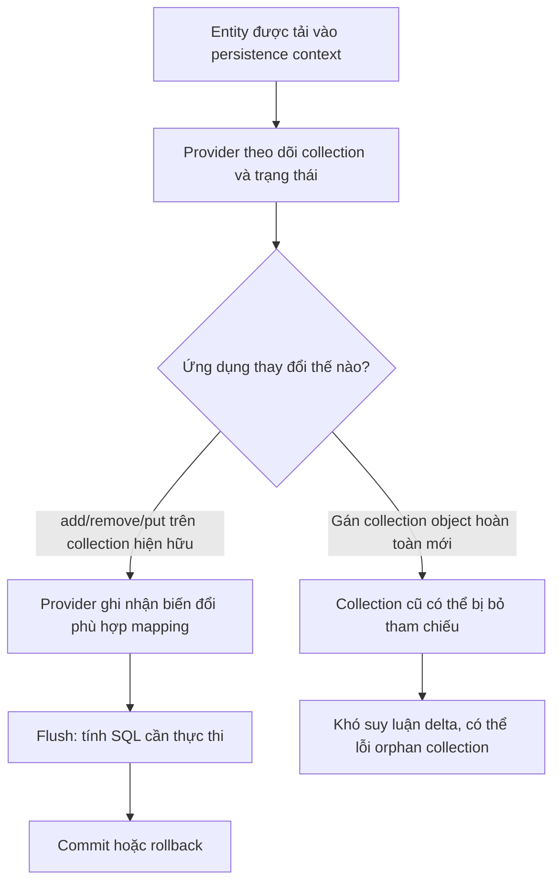
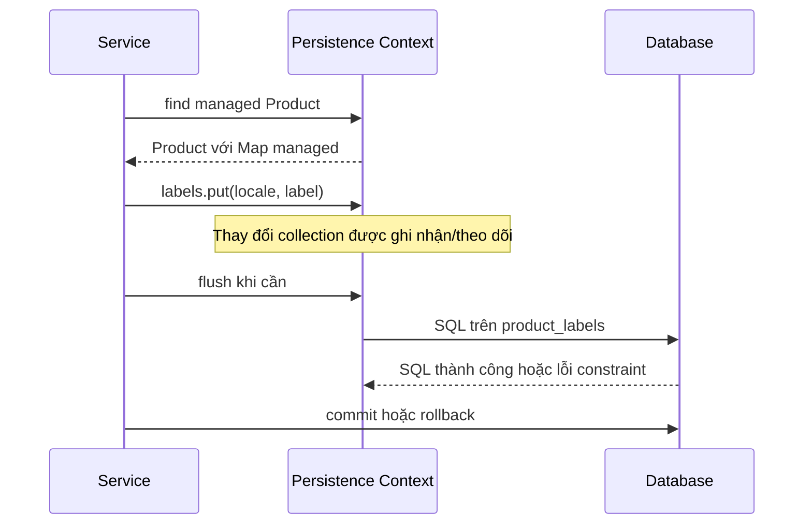

# Giữ quyền quản lý tập hợp khi entity đang được theo dõi trong JPA

Trong JPA, một entity được **managed** (đang được theo dõi trong *persistence context*) có thể chứa `List`, `Set` hoặc `Map` ánh xạ xuống database. Khi entity đang managed, các collection này không chỉ là “một biến Java chứa dữ liệu”: JPA provider có thể dùng chúng để **theo dõi thay đổi, lưu snapshot, tải lười (*lazy loading*) và quyết định SQL cần ghi khi flush**.

Vì vậy, thao tác sau tuy hợp lệ về cú pháp Java nhưng có thể gây lỗi hoặc hành vi khó dự đoán trong ORM:

```java
order.setLines(new ArrayList<>(incomingLines));
```

Trong nhiều mapping, đặc biệt với Hibernate và `orphanRemoval = true`, việc **thay thế hẳn object collection** của entity đang managed có thể làm mất tham chiếu đến collection mà provider đang theo dõi. Cách tiếp cận phù hợp hơn thường là **giữ nguyên đối tượng collection của entity và thay đổi nội dung thông qua các phương thức có kiểm soát**.

> **Nguyên tắc trung tâm:** Khi entity đã managed, hãy để ORM tiếp tục quản lý collection được ánh xạ. Thêm, sửa, xóa phần tử trên collection hiện hữu; hạn chế gán một collection mới vào field. Với quan hệ hai chiều, phải cập nhật đúng owning side; với `orphanRemoval`, phải phân biệt “gỡ liên kết” và “xóa entity con”.

Bài học tập trung vào điều đó trong chương **Tập hợp và Map** của ORM/JPA: cơ chế managed collection, khác biệt giữa collection entity và collection giá trị, API bảo vệ bất biến, tình huống merge/detached, `Map`, hiệu năng SQL và cách xử lý lỗi thường gặp. Các ví dụ sử dụng API `jakarta.persistence` và một số hành vi đặc trưng của Hibernate; khi chi tiết phụ thuộc provider, bài sẽ nêu rõ.

## 1. Một entity chứa collection được JPA quản lý như thế nào?

Giả sử một đơn hàng có nhiều dòng sản phẩm:

```java
@Entity
@Table(name = "purchase_orders")
public class PurchaseOrder {
    @Id
    private Long id;

    @OneToMany(mappedBy = "order")
    private List<OrderLine> lines = new ArrayList<>();

    protected PurchaseOrder() {}
}
```

Về mặt Java, `lines` có kiểu giao diện `List<OrderLine>`. Nhưng sau khi JPA tải `PurchaseOrder` từ database, Hibernate có thể sử dụng một loại collection riêng như `PersistentBag`, `PersistentList` hoặc các wrapper khác tùy mapping. Với `Set` hoặc `Map`, provider có thể sử dụng những wrapper tương ứng.

Ý nghĩa:

- Một collection có thể **chưa được tải dữ liệu đầy đủ** nếu mapping là LAZY.
- Provider có thể lưu **snapshot** để biết những phần tử nào đã thêm, xóa hoặc thay đổi.
- Một thao tác như `add`, `remove`, `put` hoặc `clear` có thể được provider ghi nhận để đồng bộ tại `flush`.
- Provider quyết định cách sinh `INSERT`, `DELETE`, `UPDATE` cho bảng liên quan dựa trên mapping, trạng thái entity và cách thay đổi.
- Cách triển khai cụ thể của wrapper là chi tiết ORM; ứng dụng nên lập trình theo hợp đồng JPA/collection thay vì phụ thuộc trực tiếp vào tên class của Hibernate.

### Ba trạng thái cần phân biệt

| Trạng thái owner | Collection trong bộ nhớ | Điều gì xảy ra khi sửa? |
|---|---|---|
| **New/transient** | Thường là `ArrayList`, `HashSet`, `HashMap` do code khởi tạo | Chỉ thay đổi trạng thái object; cần persist owner và mapping/cascade phù hợp để lưu. |
| **Managed** | Provider có thể gắn wrapper và snapshot vào persistence context | Các thay đổi phù hợp với mapping có thể được phát hiện và ghi lúc flush. |
| **Detached** | Object không còn được context hiện tại theo dõi | Sửa collection không tự phát SQL; cần làm việc với managed instance hoặc merge đúng cách. |

Khi code viết:

```java
PurchaseOrder order = entityManager.find(PurchaseOrder.class, 100L);
List<OrderLine> lines = order.getLines();
```

cần xem `lines` là **collection persistent thuộc trạng thái của managed order**. Đây là ý “giữ quyền quản lý tập hợp”: code nghiệp vụ sử dụng collection, còn ORM tiếp tục sở hữu việc theo dõi và đồng bộ nó.

## 2. Phân biệt thay đổi nội dung và thay thế object collection

Hai đoạn code dưới đây rất khác nhau trong bối cảnh managed entity.

**Cập nhật nội dung collection hiện có:**

```java
PurchaseOrder order = entityManager.find(PurchaseOrder.class, orderId);

order.getLines().add(newLine);
order.getLines().remove(oldLine);
```

**Thay thế toàn bộ reference của field:**

```java
PurchaseOrder order = entityManager.find(PurchaseOrder.class, orderId);

order.setLines(new ArrayList<>(requestLines));
```

Đoạn đầu sử dụng collection đang gắn với entity và cho provider cơ hội theo dõi thao tác. Đoạn sau trỏ field `lines` sang một object Java khác. Điều này có thể:

1. Khiến wrapper/snapshot cũ không còn được tham chiếu từ entity.
2. Làm provider phải suy luận lại chênh lệch toàn bộ collection.
3. Gây lỗi đặc thù Hibernate nếu collection cũ có `orphanRemoval = true` hoặc chiến lược xóa orphan tương ứng.
4. Không cập nhật owning side trong quan hệ hai chiều nếu phần tử mới chưa được gán parent.
5. Gây nhiều `DELETE`/`INSERT` hơn mong muốn, đặc biệt với element collection hoặc một số loại list/bag.
6. Làm mất các object con đã managed và trạng thái đang được theo dõi nếu đầu vào chứa những entity detached hoặc object chưa được persist.

**Cẩn trọng với phát biểu tuyệt đối:** JPA không định nghĩa một quy tắc chung “mọi phép gán collection mới đều bất hợp lệ”. Một số provider hoặc mapping có thể xử lý thay thế tham chiếu trong những trường hợp nhất định. Tuy nhiên, với mã nghiệp vụ muốn chạy ổn định trên managed entity, **mutate collection hiện hữu và sử dụng API domain** là lựa chọn dễ kiểm soát hơn.

### Một hình dung về vòng đời collection



## 3. Ví dụ đầy đủ: `PurchaseOrder` quản lý các `OrderLine`

Giả sử nghiệp vụ yêu cầu:

- Một `OrderLine` chỉ thuộc một `PurchaseOrder`.
- Xóa một dòng khỏi đơn hàng nghĩa là **xóa dòng đó khỏi database**.
- Mỗi dòng có ID và có thể cập nhật số lượng riêng.
- Không cho code bên ngoài thay trực tiếp object `List<OrderLine>` của owner.

Đây là một thiết kế có thể dùng `@OneToMany(mappedBy = "order", cascade = ALL, orphanRemoval = true)`.

### 3.1. Entity phía owner aggregate

```java
import jakarta.persistence.*;
import java.util.ArrayList;
import java.util.Collections;
import java.util.List;
import java.util.Objects;

@Entity
@Table(name = "purchase_orders")
public class PurchaseOrder {

    @Id
    @GeneratedValue(strategy = GenerationType.IDENTITY)
    private Long id;

    @Version
    private Long version;

    @OneToMany(
        mappedBy = "order",
        cascade = CascadeType.ALL,
        orphanRemoval = true
    )
    private List<OrderLine> lines = new ArrayList<>();

    protected PurchaseOrder() {}

    public Long getId() {
        return id;
    }

    public List<OrderLine> getLines() {
        return Collections.unmodifiableList(lines);
    }

    public void addLine(OrderLine line) {
        Objects.requireNonNull(line, "line");
        if (line.getOrder() != null && line.getOrder() != this) {
            throw new IllegalStateException("Line belongs to another order");
        }
        if (!lines.contains(line)) {
            lines.add(line);
        }
        line.attachTo(this);
    }

    public void removeLine(OrderLine line) {
        Objects.requireNonNull(line, "line");
        if (lines.remove(line)) {
            line.attachTo(null);
        }
    }
}
```

Ở đây:

- Field collection được **khởi tạo một lần** khi entity mới được tạo.
- Không có public setter `setLines(List<OrderLine>)`.
- Getter trả về view không cho bên ngoài trực tiếp sửa collection; các thay đổi đi qua `addLine`/`removeLine`.
- Các method thao tác **trên chính `lines` hiện hữu**, không dùng `this.lines = new ArrayList<>(...)`.
- Khi thêm/xóa, helper cập nhật cả field owning `OrderLine.order`.
- `orphanRemoval = true` có ý nghĩa **xóa entity con** khi nó bị loại khỏi quan hệ sở hữu, không chỉ đặt FK thành `NULL`.

Một entity con tối giản:

```java
import jakarta.persistence.*;
import java.util.Objects;

@Entity
@Table(name = "order_lines")
public class OrderLine {

    @Id
    @GeneratedValue(strategy = GenerationType.IDENTITY)
    private Long id;

    @ManyToOne(fetch = FetchType.LAZY, optional = false)
    @JoinColumn(name = "order_id", nullable = false)
    private PurchaseOrder order;

    @Column(name = "sku", nullable = false, length = 50)
    private String sku;

    @Column(name = "quantity", nullable = false)
    private int quantity;

    protected OrderLine() {}

    public OrderLine(String sku, int quantity) {
        this.sku = Objects.requireNonNull(sku);
        changeQuantity(quantity);
    }

    public Long getId() { return id; }
    public PurchaseOrder getOrder() { return order; }
    public String getSku() { return sku; }
    public int getQuantity() { return quantity; }

    void attachTo(PurchaseOrder parent) {
        this.order = parent;
    }

    public void changeQuantity(int newQuantity) {
        if (newQuantity <= 0) {
            throw new IllegalArgumentException("Quantity must be positive");
        }
        this.quantity = newQuantity;
    }
}
```

Hai class trên giả định mỗi OrderLine chỉ có một owner tại một thời điểm và bị xóa khi gỡ khỏi order. Với `orphanRemoval = true`, **không nên chuyển một OrderLine đang được theo dõi từ order cũ sang order mới** bằng cách remove khỏi collection cũ rồi add vào collection mới nếu nghiệp vụ thật sự muốn giữ cùng hàng; một thao tác loại khỏi owner có thể khiến entity bị lên lịch xóa. Nếu nghiệp vụ cần chuyển con giữa nhiều parent, cân nhắc mô hình **không dùng orphan removal** và một API chuyển owner phù hợp.

### 3.2. Tạo order cùng các dòng mới

```java
@Transactional
public void createOrder(EntityManager em) {
    PurchaseOrder order = new PurchaseOrder();

    order.addLine(new OrderLine("SKU-A", 2));
    order.addLine(new OrderLine("SKU-B", 1));

    em.persist(order);
}
```

Vì `cascade = CascadeType.ALL` bao gồm `PERSIST`, khi persist order, các dòng đã được thêm vào collection có thể được persist theo. Cột `order_id` trong `order_lines` được xác định bởi owning side `OrderLine.order`, đã được helper thiết lập.

SQL minh họa:

```sql
INSERT INTO purchase_orders (version) VALUES (?);

INSERT INTO order_lines (order_id, sku, quantity)
VALUES (?, 'SKU-A', 2);

INSERT INTO order_lines (order_id, sku, quantity)
VALUES (?, 'SKU-B', 1);
```

Đây là SQL minh họa không phản ánh chính xác mọi câu lệnh, tên cột hoặc thứ tự của provider. Với `IDENTITY`, SQL có thể cần chạy sớm để sinh ID.

### 3.3. Thêm dòng khi order đã managed

```java
@Transactional
public void addItem(EntityManager em, Long orderId) {
    PurchaseOrder order = em.find(PurchaseOrder.class, orderId);

    if (order == null) {
        throw new IllegalArgumentException("Order not found");
    }

    order.addLine(new OrderLine("SKU-C", 3));
    // Không gọi order.setLines(...).
    // Cascade PERSIST và transaction giúp đồng bộ entity con.
}
```

Sau khi collection và owning side được cập nhật, JPA có thể insert dòng mới khi flush.

### 3.4. Xóa dòng khi order đã managed

```java
@Transactional
public void removeItem(EntityManager em, Long orderId, Long lineId) {
    PurchaseOrder order = em.find(PurchaseOrder.class, orderId);

    if (order == null) {
        throw new IllegalArgumentException("Order not found");
    }

    OrderLine found = order.getLines().stream()
        .filter(line -> lineId.equals(line.getId()))
        .findFirst()
        .orElseThrow(() ->
            new IllegalArgumentException("Line not in order")
        );

    order.removeLine(found);
    // orphanRemoval = true -> xóa OrderLine khỏi database khi flush.
}
```

Nếu một dòng được loại khỏi collection với `orphanRemoval = true`, provider có thể tạo:

```sql
DELETE FROM order_lines WHERE id = ?;
```

Không cần thay collection thành list mới để biểu diễn “không còn dòng đó”. Xóa đúng **phần tử** và để collection managed tiếp tục được theo dõi.

## 4. Vì sao helper methods lại quan trọng?

Trong quan hệ hai chiều:

```java
@OneToMany(mappedBy = "order")
private List<OrderLine> lines;

@ManyToOne
@JoinColumn(name = "order_id")
private PurchaseOrder order;
```

**Phía owning** là `OrderLine.order`. Nếu thêm child vào collection inverse nhưng không gán parent:

```java
order.getLines().add(newLine);
// newLine.getOrder() vẫn null
```

thì object graph không nhất quán và foreign key có thể không được ghi đúng.

Ngược lại, nếu chỉ:

```java
newLine.attachTo(order);
```

thì owning side đã có giá trị, nhưng `order.lines` hiện tại có thể chưa chứa dòng mới, gây hành vi khó hiểu khi code duyệt collection ngay sau đó.

Một helper tốt đáp ứng cả hai điều:

1. **Giữ nguyên collection** đang được quản lý.
2. **Cập nhật đúng owning side** của quan hệ.

Với quan hệ một chiều, không nhất thiết có hai phía để đồng bộ. Với quan hệ nhiều-nhiều hai chiều, cũng phải xác định owning side và thiết kế helper phù hợp thay vì mặc định bên nào gọi `add` cũng sinh SQL.

## 5. Lỗi Hibernate: collection bị bỏ tham chiếu khi `orphanRemoval`

Một biểu hiện thường gặp khi code thay reference collection trên managed owner là thông báo có dạng:

```text
A collection with cascade="all-delete-orphan"
was no longer referenced by the owning entity instance
```

Thông báo này thuộc **Hibernate**, không phải tên exception chuẩn mà JPA bắt buộc mọi provider phải phát ra. Nó thường xuất hiện khi Hibernate từng quản lý một collection có orphan-removal, sau đó field của owner được gán sang object collection mới khiến wrapper cũ không còn được owner tham chiếu theo cách mong đợi.

Ví dụ không nên áp dụng trực tiếp cho managed entity:

```java
@Entity
public class PurchaseOrder {

    @OneToMany(
        mappedBy = "order",
        cascade = CascadeType.ALL,
        orphanRemoval = true
    )
    private List<OrderLine> lines = new ArrayList<>();

    public void setLines(List<OrderLine> incoming) {
        this.lines = incoming; // Rủi ro với managed collection.
    }
}
```

Thao tác có vẻ “thay nội dung”, nhưng về Java nó **thay object field**:

```text
Trước:  order.lines ---> Hibernate persistent collection wrapper
Sau:    order.lines ---> new ArrayList<...>
                         |
                         +-- wrapper cũ không còn ở field
```

Provider có thể không còn xử lý sự thay đổi như một phép cập nhật bình thường của collection mà nó đang theo dõi.

### Mẫu thay thế an toàn hơn

Không cung cấp setter toàn bộ collection:

```java
public void addLine(OrderLine line) { /* cập nhật trên lines */ }

public void removeLine(OrderLine line) { /* cập nhật trên lines */ }
```

Nếu nghiệp vụ thật sự muốn **thay toàn bộ nội dung**, cần định nghĩa ý nghĩa từng phần tử:

- Phần tử nào giữ nguyên ID và chỉ cập nhật field?
- Phần tử nào là mới?
- Phần tử nào bị xóa?
- Có phần tử nào được phép chuyển sang owner khác không?
- Collection dùng `List` có thứ tự có ý nghĩa hay không?
- Có cascade và orphan removal không?

Đừng mặc định `clear(); addAll(incoming);` luôn đúng. Với entity collection và orphan removal, nó có thể tạo xóa/hủy những phần tử vốn cần được giữ lại, hoặc đụng trạng thái entity đã bị lên lịch xóa.

## 6. `clear()`, `addAll()` và đồng bộ theo chênh lệch

Khi nói “không thay reference collection”, nhiều người thay bằng:

```java
this.lines.clear();
this.lines.addAll(incoming);
```

Về mặt reference, cách này vẫn giữ object collection hiện hữu. Tuy nhiên **giữ reference là điều kiện kỹ thuật, chưa đủ để bảo đảm đúng nghiệp vụ**.

### Với `@ElementCollection`

Ví dụ danh sách các mã nhãn thuần giá trị:

```java
@ElementCollection
@CollectionTable(
    name = "product_labels",
    joinColumns = @JoinColumn(name = "product_id")
)
@Column(name = "label", nullable = false)
private Set<String> labels = new HashSet<>();
```

Nếu yêu cầu “thay toàn bộ bộ nhãn”, có thể:

```java
public void replaceLabels(Collection<String> newLabels) {
    Objects.requireNonNull(newLabels);

    labels.clear();
    for (String label : newLabels) {
        labels.add(Objects.requireNonNull(label));
    }
}
```

Đây là **collection của giá trị**, không phải entity độc lập có ID. Provider có thể xóa/chèn lại một hoặc nhiều hàng của collection table, tùy mapping và cách theo dõi.

Với set lớn, nếu chỉ khác một vài phần tử, có thể thao tác theo chênh lệch để giảm thay đổi:

```java
public void synchronizeLabels(Set<String> wanted) {
    Objects.requireNonNull(wanted);

    labels.removeIf(existing -> !wanted.contains(existing));
    for (String value : wanted) {
        labels.add(Objects.requireNonNull(value));
    }
}
```

Phép này vẫn có thể kích hoạt tải collection và SQL tùy provider. “Ít thao tác Java” không đồng nghĩa “ít SQL” trong mọi mapping.

### Với entity collection và orphan removal

Giả sử request chứa ID của các OrderLine cũ cùng dữ liệu của các dòng mới. Nếu dùng `clear()`, những OrderLine đang managed có thể bị xóa bởi orphan removal trước khi ứng dụng cố thêm lại.

Thay vì vậy, **đồng bộ theo ID**:

1. Xác định những ID hiện có cần giữ.
2. Với dòng giữ lại, cập nhật field trên **entity đang managed**, không thay bằng một object khác có cùng ID.
3. Với dòng thật sự bị gỡ, gọi `removeLine` để orphan removal xử lý.
4. Với dòng mới chưa có ID, gọi `addLine(new OrderLine(...))`.
5. Duy trì đúng owning side và các bất biến như số lượng dương.

Một skeleton minh họa:

```java
public void applyChanges(
        Map<Long, Integer> quantitiesByExistingLineId,
        List<NewLineCommand> newLines) {

    Set<Long> wantedIds = quantitiesByExistingLineId.keySet();

    List<OrderLine> obsolete = lines.stream()
        .filter(line -> line.getId() != null)
        .filter(line -> !wantedIds.contains(line.getId()))
        .toList();

    for (OrderLine line : obsolete) {
        removeLine(line);
    }

    for (OrderLine line : lines) {
        Long id = line.getId();
        if (id != null && quantitiesByExistingLineId.containsKey(id)) {
            line.changeQuantity(quantitiesByExistingLineId.get(id));
        }
    }

    for (NewLineCommand input : newLines) {
        addLine(new OrderLine(input.sku(), input.quantity()));
    }
}
```

Giả sử `NewLineCommand` là một DTO với `sku()` và `quantity()`. Đoạn này biểu diễn **ngữ nghĩa “danh sách ID cũ gửi lên là danh sách muốn giữ”**, không phải một API universal; cần xác thực ID thuộc order, dữ liệu trùng, version/authorization và thứ tự theo nghiệp vụ. Đặc biệt, một PATCH request chỉ sửa một dòng **không nên** bị hiểu là thay toàn bộ collection khiến các dòng còn lại bị xóa.

## 7. Khi nào collection có thể được tạo hoặc gán mới?

Có ba tình huống khác nhau.

### 7.1. Entity mới, chưa managed

```java
public PurchaseOrder() {
    this.lines = new ArrayList<>();
}
```

Khởi tạo collection cho một entity mới là bình thường. Trong constructor/factory có thể tạo nội dung ban đầu miễn sao giữ đúng quan hệ và invariants. Trước khi JPA tiếp nhận, provider chưa có wrapper của chính entity đó để theo dõi.

Tuy nhiên, vẫn nên tránh public setter nhận list tùy ý nếu class dùng lâu dài sau khi entity được load. Một public setter dễ bị gọi lại khi entity đã managed.

### 7.2. Entity đang managed

```java
PurchaseOrder order = em.find(PurchaseOrder.class, id);
order.addLine(new OrderLine("X", 1));
```

Ưu tiên giữ collection hiện có. Đây là trường hợp trọng tâm của bài.

### 7.3. Entity detached

```java
PurchaseOrder detached = loadAndCloseContext();
detached.addLine(new OrderLine("X", 1));
```

Các thao tác chỉ thay object detached. Khi muốn lưu, không nên dựa vào việc `detached` đã sửa là database tự cập nhật. Có thể làm việc trong transaction mới, tải lại managed owner và áp lệnh nghiệp vụ; hoặc sử dụng `merge` đúng ngữ nghĩa nếu phù hợp.

Trong Hibernate, một collection wrapper gắn với session cũ có thể không được tự do sử dụng như một list thông thường ở mọi thời điểm, nhất là nếu chưa được khởi tạo và session đã đóng. Sửa dữ liệu detached cùng object graph lớn cần kế hoạch rõ ràng.

## 8. `EntityManager.merge()` không biến detached instance thành managed

Một sai lầm phổ biến:

```java
PurchaseOrder detached = ...; // đã tách khỏi persistence context
entityManager.merge(detached);

detached.getLines().add(new OrderLine("SKU-Z", 2));
```

Theo JPA, `merge` **trả về một managed instance** và sao chép trạng thái theo các quy tắc của merge. Nó không bảo đảm đối tượng `detached` ban đầu trở thành managed. Thay đổi `detached` sau `merge` không mặc nhiên được theo dõi.

Đúng hơn:

```java
PurchaseOrder managed = entityManager.merge(detached);
managed.addLine(new OrderLine("SKU-Z", 2));
```

Nhưng ngay cả như vậy, merge một object graph detached với collection không đầy đủ hoặc chứa các entity khác trạng thái có thể gây cập nhật/xóa ngoài ý định, đặc biệt khi mapping có cascade MERGE và orphan removal.

### Cách thường rõ nghĩa hơn cho API cập nhật

Thay vì deserialize toàn bộ entity từ request rồi merge:

```java
@Transactional
public void updateQuantity(Long orderId, Long lineId, int quantity) {
    PurchaseOrder order = entityManager.find(
        PurchaseOrder.class, orderId);

    if (order == null) {
        throw new IllegalArgumentException("Order not found");
    }

    OrderLine line = order.getLines().stream()
        .filter(candidate -> lineId.equals(candidate.getId()))
        .findFirst()
        .orElseThrow(() ->
            new IllegalArgumentException("Line not found in order")
        );

    line.changeQuantity(quantity);
}
```

Ta tải **managed aggregate**, xác thực quyền sở hữu rồi thao tác trên entity/collection hiện có. API không cần gửi một `List<OrderLine>` hoàn chỉnh chỉ để sửa số lượng của một dòng.

## 9. `@ElementCollection`: collection giá trị cũng được theo dõi

Ngoài quan hệ với entity khác, JPA hỗ trợ collection chứa scalar hoặc `@Embeddable` qua `@ElementCollection`.

Ví dụ email phụ của một khách hàng:

```java
@Entity
@Table(name = "customers")
public class Customer {
    @Id
    private Long id;

    @ElementCollection
    @CollectionTable(
        name = "customer_emails",
        joinColumns = @JoinColumn(name = "customer_id")
    )
    @Column(name = "email_address", nullable = false, length = 254)
    private Set<String> alternateEmails = new HashSet<>();

    protected Customer() {}

    public void addAlternateEmail(String email) {
        if (email == null || email.isBlank()) {
            throw new IllegalArgumentException("Email required");
        }
        alternateEmails.add(email.trim());
    }

    public void removeAlternateEmail(String email) {
        alternateEmails.remove(email);
    }

    public Set<String> getAlternateEmails() {
        return Collections.unmodifiableSet(alternateEmails);
    }
}
```

Schema minh họa:

```sql
CREATE TABLE customer_emails (
    customer_id BIGINT NOT NULL,
    email_address VARCHAR(254) NOT NULL,
    PRIMARY KEY (customer_id, email_address),
    FOREIGN KEY (customer_id) REFERENCES customers(id)
);
```

Ở đây mỗi email là **giá trị thuộc Customer**, không phải entity có ID riêng. Khi xóa một email khỏi collection, có thể xóa một hàng khỏi collection table; khi xóa Customer, các giá trị collection thường được xóa theo lifecycle của owner.

Một `@ElementCollection` có thể dùng bảng phụ nhưng **các phần tử vẫn không phải entity có lifecycle riêng**. Không gọi `entityManager.remove(email)` để xóa một chuỗi; hãy sửa collection owner.

### Vì sao vẫn cần giữ collection wrapper?

Vì provider cũng theo dõi thay đổi các phần tử giá trị. Dù dùng `Set<String>` hay `List<SomeEmbeddable>`, việc thay toàn bộ object collection trong field managed có thể dẫn đến việc ORM phải xử lý lại mapping và snapshots. Thao tác trên instance hiện tại và giữ API rõ nghĩa thường dễ bảo trì hơn.

## 10. `List`, `Set` và `Map`: cấu trúc Java ảnh hưởng ánh xạ

| Kiểu | Ý nghĩa trong Java | Điểm lưu ý với JPA |
|---|---|---|
| `List<E>` | Có thứ tự truy cập, cho phép phần tử trùng theo hợp đồng List | Muốn lưu **thứ tự bền vững**, cân nhắc `@OrderColumn` hoặc phương án khác; hành vi SQL phụ thuộc mapping. |
| `Set<E>` | Không có phần tử trùng theo `equals`/`hashCode` | Equality ổn định là rất quan trọng, nhất là entity có ID được sinh sau persist. |
| `Map<K,V>` | Truy cập phần tử theo key, mỗi key duy nhất | Phải xác định key lưu ở đâu: thuộc tính entity, cột key riêng, hay một entity key. |
| `Collection<E>` | Khái quát thao tác thêm/xóa/duyệt | Khả năng đặt hàng, trùng lặp và cách ORM theo dõi tùy mapping cụ thể. |

Việc đổi `List` sang `Set` không chỉ là “tối ưu code”:

- `Set` đòi chiến lược `equals/hashCode` phù hợp.
- `List` có thể cần thứ tự ổn định theo nghiệp vụ, khác với thứ tự không được bảo đảm từ SQL.
- `Map` đòi quy tắc xác định key ổn định.
- Mapping và SQL khi insert/remove/reorder có thể khác nhau đáng kể.

Hãy chọn loại collection theo ngữ nghĩa nghiệp vụ trước rồi mới cân nhắc hiệu năng và cấu hình provider.

## 11. `List` có thứ tự: `@OrderBy` khác `@OrderColumn`

Một `List<OrderLine>` không tự đảm bảo database luôn trả về cùng thứ tự nếu mapping không có chiến lược đặt hàng. Có hai cơ chế dễ nhầm:

**Sắp xếp khi đọc theo thuộc tính:**

```java
@OneToMany(mappedBy = "order")
@OrderBy("lineNumber ASC")
private List<OrderLine> lines = new ArrayList<>();
```

`@OrderBy` sắp xếp dựa trên giá trị thuộc tính trong entity/embeddable và không mặc nhiên tạo một cột để JPA lưu các vị trí trong `List`.

**Lưu vị trí collection trong cột:**

```java
@OneToMany
@JoinColumn(name = "order_id")
@OrderColumn(name = "display_position")
private List<OrderLine> lines = new ArrayList<>();
```

Đây là một **biến thể mapping một chiều** minh họa cách dùng `@OrderColumn`; nó không phải cấu hình thay thế trực tiếp cần sao chép vào mapping `mappedBy` phía trên. Khi `@OrderColumn` được dùng, JPA quản lý các giá trị vị trí trên bảng phù hợp, và reorder có thể dẫn đến nhiều câu `UPDATE`.

**Bài học liên quan:** giữ nguyên collection instance khi reorder không có nghĩa reorder miễn phí. Các thao tác `remove(index)`, `add(index, value)` có thể đòi cập nhật các vị trí khác. Nếu vị trí hiển thị có ý nghĩa nghiệp vụ, cần xem dữ liệu và SQL thực tế.

## 12. `Set`, entity equality và ID sinh tự động

Ví dụ:

```java
@OneToMany(mappedBy = "order")
private Set<OrderLine> lines = new HashSet<>();
```

Một `HashSet` xác định trùng lặp qua `equals` và `hashCode`. Nếu entity có ID được sinh sau persist, cách viết:

```java
@Override
public int hashCode() {
    return Objects.hash(id); // id từ null thành giá trị sau persist
}
```

có thể gây vấn đề nếu hash code thay đổi **sau khi phần tử đã nằm trong Set**. Khi đó việc `remove`/`contains` có thể không hoạt động như người viết dự kiến, dẫn đến trạng thái collection khó đồng bộ.

Không có một công thức `equals/hashCode` tuyệt đối phù hợp mọi entity JPA, nhất là khi xét proxy, ID sinh và business keys. Cần chọn chiến lược nhất quán, tránh tính hash từ các field thay đổi sau khi thêm vào Set, và hiểu tình trạng ID trước/sau persist.

Với `@ElementCollection Set<String>`, chuỗi là giá trị bất biến nên bài toán dễ hơn. Với `Set<Embeddable>` mutable, việc sửa các field tham gia `hashCode` trong khi object ở Set cũng có thể phá lookup.

### Không dùng `equals` để so ID nghiệp vụ một cách tùy tiện

Nếu API muốn xóa OrderLine ID 12, cách an toàn là tìm theo ID:

```java
OrderLine target = lines.stream()
    .filter(line -> Long.valueOf(12L).equals(line.getId()))
    .findFirst()
    .orElseThrow();

removeLine(target);
```

Không nên tạo `new OrderLine(...)` rồi `remove` và hy vọng collection sẽ coi object mới là cùng một entity, trừ khi chiến lược equality được thiết kế chính xác cho mục tiêu đó.

## 13. `Map` trong JPA: hai cách hiểu về khóa

Trong Java:

```java
Map<String, String> translations = new HashMap<>();
translations.put("vi", "Bàn phím");
translations.put("en", "Keyboard");
```

Khi map được lưu bằng JPA, cần phân biệt:

1. **Key là dữ liệu độc lập của collection table**, ví dụ cột `locale` cùng cột `label`. Phù hợp với `@ElementCollection Map<String,String>`.
2. **Key lấy từ một thuộc tính của entity value**, ví dụ `ProductTranslation.locale`. Phù hợp với `@MapKey(name = "locale")` trong entity association.

Hai cách có ý nghĩa cập nhật khác nhau. Việc thay `Map` instance ở managed entity vẫn có các rủi ro chung như `List`/`Set`; thêm vào đó còn cần bảo đảm key ổn định và đồng bộ với đối tượng mà nó biểu diễn.

## 14. Ví dụ `@ElementCollection Map<String, String>`

Một sản phẩm lưu tên hiển thị theo ngôn ngữ, không cần tạo entity riêng cho từng bản dịch:

```java
import jakarta.persistence.*;
import java.util.Collections;
import java.util.HashMap;
import java.util.Map;
import java.util.Objects;

@Entity
@Table(name = "products")
public class Product {

    @Id
    private Long id;

    @ElementCollection
    @CollectionTable(
        name = "product_labels",
        joinColumns = @JoinColumn(name = "product_id")
    )
    @MapKeyColumn(name = "locale_code", length = 10)
    @Column(name = "label_text", nullable = false, length = 200)
    private Map<String, String> labels = new HashMap<>();

    protected Product() {}

    public void putLabel(String locale, String text) {
        if (locale == null || locale.isBlank()) {
            throw new IllegalArgumentException("Locale required");
        }
        if (text == null || text.isBlank()) {
            throw new IllegalArgumentException("Label required");
        }
        labels.put(locale, text); // Cập nhật map hiện có.
    }

    public void removeLabel(String locale) {
        labels.remove(locale);
    }

    public Map<String, String> getLabels() {
        return Collections.unmodifiableMap(labels);
    }
}
```

DDL minh họa:

```sql
CREATE TABLE product_labels (
    product_id BIGINT NOT NULL,
    locale_code VARCHAR(10) NOT NULL,
    label_text VARCHAR(200) NOT NULL,
    PRIMARY KEY (product_id, locale_code),
    FOREIGN KEY (product_id) REFERENCES products(id)
);
```

Điểm quan trọng:

- `@ElementCollection` cho biết các phần tử là **giá trị thuộc Product**.
- `@CollectionTable` chọn bảng của collection.
- `@MapKeyColumn` mô tả cột lưu **key của map**.
- `@Column` mô tả cột lưu **value** (ở đây là `String`).
- `labels.put("vi", "...")` thay đổi một entry trong **map hiện hữu**; provider đồng bộ bảng collection khi flush.
- `labels = new HashMap<>(requestLabels)` thay thế map đang managed, nên không phải lựa chọn mặc định cho cập nhật.

### Thay toàn bộ nội dung map giá trị

Khi muốn đổi toàn bộ bộ nhãn, có thể chọn chính sách replace giá trị:

```java
public void replaceLabels(Map<String, String> incoming) {
    Objects.requireNonNull(incoming);

    Map<String, String> clean = new HashMap<>();
    for (var entry : incoming.entrySet()) {
        String locale = Objects.requireNonNull(entry.getKey());
        String text = Objects.requireNonNull(entry.getValue());
        if (locale.isBlank() || text.isBlank()) {
            throw new IllegalArgumentException("Blank key/value");
        }
        clean.put(locale, text);
    }

    labels.clear();
    labels.putAll(clean);
}
```

Đây là **cập nhật collection giá trị** theo semantics “thay tất cả”. Nếu số entries rất lớn hoặc chỉ thay một vài key, một phương thức đồng bộ theo chênh lệch sẽ hợp lý hơn.

```java
public void synchronizeLabels(Map<String, String> wanted) {
    Objects.requireNonNull(wanted);

    labels.keySet().removeIf(key -> !wanted.containsKey(key));

    for (var entry : wanted.entrySet()) {
        putLabel(entry.getKey(), entry.getValue());
    }
}
```

Vẫn giữ nguyên map instance và có thể giảm số thao tác xóa/thêm. Tuy nhiên SQL thực tế còn tùy Hibernate/JPA provider, mapping, batching và cơ chế snapshot; không thể cam kết đúng một `UPDATE` cho mỗi `put`.

## 15. `@MapKey(name = "...")` khi value là entity

Giả sử mỗi bản dịch có ID, trạng thái kiểm duyệt và lịch sử riêng. Khi đó các bản dịch có thể là entity:

```java
@Entity
@Table(name = "product_translations")
public class ProductTranslation {

    @Id
    @GeneratedValue(strategy = GenerationType.IDENTITY)
    private Long id;

    @ManyToOne(fetch = FetchType.LAZY, optional = false)
    @JoinColumn(name = "product_id", nullable = false)
    private ProductCatalog product;

    @Column(name = "locale_code", nullable = false, length = 10)
    private String locale;

    @Column(name = "label_text", nullable = false, length = 200)
    private String label;

    protected ProductTranslation() {}

    public ProductTranslation(String locale, String label) {
        this.locale = Objects.requireNonNull(locale);
        this.label = Objects.requireNonNull(label);
    }

    public String getLocale() { return locale; }
    public ProductCatalog getProduct() { return product; }

    void attachTo(ProductCatalog product) {
        this.product = product;
    }

    public void rename(String newLabel) {
        this.label = Objects.requireNonNull(newLabel);
    }
}
```

Owner aggregate ánh xạ map:

```java
@Entity
@Table(name = "product_catalog")
public class ProductCatalog {

    @Id
    private Long id;

    @OneToMany(
        mappedBy = "product",
        cascade = CascadeType.ALL,
        orphanRemoval = true
    )
    @MapKey(name = "locale")
    private Map<String, ProductTranslation> translations = new HashMap<>();

    protected ProductCatalog() {}

    public void addTranslation(ProductTranslation translation) {
        Objects.requireNonNull(translation);
        String locale = translation.getLocale();

        if (translations.containsKey(locale)) {
            throw new IllegalArgumentException("Locale already exists");
        }
        if (translation.getProduct() != null
                && translation.getProduct() != this) {
            throw new IllegalStateException("Translation belongs elsewhere");
        }

        translations.put(locale, translation);
        translation.attachTo(this);
    }

    public void removeTranslation(String locale) {
        ProductTranslation removed = translations.remove(locale);
        if (removed != null) {
            removed.attachTo(null);
        }
    }

    public Map<String, ProductTranslation> getTranslations() {
        return Collections.unmodifiableMap(translations);
    }
}
```

Các class trong ví dụ sử dụng imports chuẩn của Jakarta Persistence, `Map`, `HashMap`, `Collections` và `Objects`.

Chú ý:

- `@MapKey(name = "locale")` dùng **tên thuộc tính Java của ProductTranslation** để xác định key.
- Nó không giống `@MapKeyColumn` trên element collection key/value thuần.
- Field `ProductTranslation.product` giữ FK `product_id` và là owning side của association.
- `Map` ở `ProductCatalog` là inverse side; helper phải cập nhật cả map lẫn owning reference.
- `orphanRemoval = true` sẽ coi phần tử bị gỡ là orphan trong vòng đời collection.

### Map key lấy từ thuộc tính entity phải ổn định

Nếu một `ProductTranslation` đang ở map với key `"vi"` mà code đổi `translation.locale` thành `"vi-VN"`, map Java **không được bảo đảm tự động đổi key**. Provider có thể không đồng bộ cấu trúc map trong bộ nhớ chỉ vì thuộc tính dùng làm key đã đổi.

Do đó, với map có `@MapKey(name = "locale")`:

- Nên xem `locale` là **khóa ổn định** trong vòng đời phần tử, hoặc
- Thiết kế thao tác đổi key có kiểm soát, gỡ entry cũ, cập nhật thuộc tính và thêm lại đúng cách, đồng thời hiểu rủi ro orphan removal/constraint.
- Nếu key thực sự có thể đổi thường xuyên, cân nhắc dùng ID riêng, không gắn lifecycle của entity với việc thay key, hoặc chọn mapping đơn giản hơn.

Trong ví dụ này, cố ý **không cung cấp setter cho `locale`**; đổi ngôn ngữ nên là một quyết định nghiệp vụ tách biệt, có thể xem như thay bản dịch cũ bằng bản dịch mới.

## 16. `Map.remove(key)` có đồng nghĩa `DELETE` không?

Phải đọc mapping.

| Mapping | `map.remove(key)` thường có ý nghĩa |
|---|---|
| `@ElementCollection Map<K,V>` | Gỡ giá trị khỏi collection thuộc owner; provider có thể xóa hàng collection table tương ứng. |
| `@OneToMany(mappedBy = ..., orphanRemoval = true) Map<K,Entity>` | Entity bị gỡ khỏi collection sở hữu có thể bị xóa khỏi database. |
| `@OneToMany` không orphan removal | Gỡ khỏi map inverse **không tự thay FK** nếu owning side không cập nhật. |
| `@ManyToMany Map<K,Entity>` | Gỡ liên kết trong join table theo owning mapping; không mặc nhiên xóa entity đích. |

Đừng viết helper Map chỉ có:

```java
translations.remove(locale);
```

rồi mặc định foreign key hoặc row entity tự xử lý đúng trong mọi trường hợp. Với quan hệ hai chiều, helper cần cập nhật owning side nếu ngữ nghĩa của thao tác là gỡ quan hệ.

Ngược lại, nếu remove khỏi `@ElementCollection`, phần tử không có entity ID riêng nên collection owner chính là nguồn thông tin về những giá trị hiện tồn tại.

## 17. `Map` với key từ entity khác: tránh nhầm `@MapKeyJoinColumn`

JPA hỗ trợ các kiểu map phức tạp hơn, như key là một entity thay vì `String` hoặc `Long`. Khi key là entity được lưu qua khóa ngoại, `@MapKeyJoinColumn` có thể dùng để ánh xạ cột join cho key trong mapping tương ứng.

Không nên dùng `@MapKeyColumn` một cách máy móc cho entity key. Khác biệt ý nghĩa:

- `@MapKeyColumn` thường mô tả **basic map key** được lưu như một cột dữ liệu.
- `@MapKey(name = "...")` lấy key từ **thuộc tính của value entity**.
- `@MapKeyJoinColumn` ánh xạ **foreign key tham chiếu entity dùng làm map key**.

Đối với đa số use case như nhãn theo locale hoặc dòng sản phẩm theo mã SKU, map key scalar ổn định đơn giản hơn, dễ hiểu và dễ kiểm soát dirty checking.

## 18. Khi `Map` hoặc `Set` có key mutable

Ví dụ:

```java
Map<String, ProductTranslation> byLocale = ...;
ProductTranslation translation = byLocale.get("vi");
```

Nếu code sửa thuộc tính `translation.locale` thành `"en"` mà không cập nhật map, vẫn có thể xảy ra:

```text
byLocale.get("vi") -> translation(locale="en")
byLocale.get("en") -> null
```

Đó là **lỗi nhất quán trong object graph Java** trước cả khi xét SQL. Trong JPA managed collection, provider còn phải giải quyết ảnh hưởng tới snapshot và key columns. Tránh các thao tác này bằng quy tắc bất biến của key hoặc method thay key có kiểm soát.

Với `Set<Entity>`, thay field được sử dụng bởi `equals`/`hashCode` sau khi thêm vào set gây vấn đề tương tự: entity vẫn nằm trong backing collection nhưng `contains`/`remove` có thể không tìm đúng vị trí.

**Thiết kế key ổn định thường quan trọng hơn việc chọn HashMap hay TreeMap**. Nếu cần thứ tự có ý nghĩa trong Map, điều đó là một yêu cầu mapping/đọc riêng; không nên mặc định cách sắp xếp của Java Map được lưu xuống database.

## 19. Lazy loading và thời điểm thao tác trên managed collection

Thông thường `@OneToMany` và `@ElementCollection` có mặc định `LAZY`. Khi lấy owner:

```java
PurchaseOrder order = entityManager.find(
    PurchaseOrder.class, orderId);
```

collection `order.lines` có thể chưa được tải. Khi code gọi:

```java
order.getLines().size();
```

provider có thể thực hiện SELECT để tải collection hoặc thực thi chiến lược khác tùy phiên bản/optimization. Dù không truy cập từng phần tử, các thao tác `clear`, `removeIf`, `putAll` cũng có thể khiến ORM cần tải hoặc kiểm tra trạng thái hiện hữu để tính delta.

Một lỗi phổ biến:

```java
PurchaseOrder detached = service.loadOrder(); // transaction đã đóng
detached.getLines().size(); // có thể gặp lỗi lazy
```

Trong Hibernate, thao tác với collection LAZY chưa khởi tạo sau khi session đóng có thể ném `LazyInitializationException`. Giải pháp không phải thay wrapper bằng `new ArrayList<>()` cho khỏi lỗi, vì như vậy lại làm mất dữ liệu hoặc làm sai trạng thái collection.

Giải pháp phù hợp hơn là:

1. Thực hiện thao tác nghiệp vụ trong transaction với managed entity.
2. Tải trước collection cần thiết qua `JOIN FETCH` hoặc entity graph khi use case yêu cầu.
3. Trả DTO ra API thay vì serialize trực tiếp object graph lớn và dựa vào lazy loading ngoài transaction.
4. Dùng truy vấn chuyên biệt nếu chỉ cần đếm hoặc cập nhật một phần tử, thay vì luôn tải toàn collection.

### Ví dụ fetch join

```java
PurchaseOrder order = entityManager.createQuery(
    "select distinct o from PurchaseOrder o " +
    "left join fetch o.lines where o.id = :id",
    PurchaseOrder.class
)
.setParameter("id", orderId)
.getSingleResult();
```

Cách fetch phù hợp phụ thuộc kích thước collection; fetch join một tập hợp lớn hoặc nhiều collection cùng lúc có thể tạo số hàng SQL lớn và tác động tới phân trang. Không dùng fetch join bừa bãi chỉ để tránh việc xác định ranh giới transaction.

## 20. Trạng thái collection và transaction: thay đổi chưa phải đã lưu

Xét service:

```java
@Transactional
public void addLabel(Long productId, String locale, String label) {
    Product product = entityManager.find(Product.class, productId);
    product.putLabel(locale, label);
    // Method kết thúc, transaction manager xử lý flush/commit.
}
```

Luồng thông thường:



**Đưa một phần tử vào map trong Java không đồng nghĩa nó đã xuất hiện bền vững trong database**. Provider có thể trì hoãn câu SQL cho tới flush. SQL đã gửi vẫn có thể rollback.

Nếu transaction thất bại, trạng thái Java trong những entity còn giữ reference không được đảm bảo tự quay về giá trị trước khi thao tác; sau rollback nên kết thúc/loại bỏ persistence context không còn phù hợp và tải lại dữ liệu nếu cần.

## 21. Phân biệt entity collection và value collection về vòng đời

Hai ví dụ dưới đây có vẻ giống nhau trong Java:

```java
List<OrderLine> lines;
Set<String> labels;
```

nhưng chúng là hai mapping rất khác nhau.

| Đặc điểm | `@OneToMany List<OrderLine>` | `@ElementCollection Set<String>` |
|---|---|---|
| Phần tử | Entity có ID riêng | Basic value, không có entity ID |
| Có thể `find` phần tử theo ID? | Có, nếu entity được ánh xạ và có ID | Không |
| Persistence lifecycle | Entity có thể new, managed, detached, removed | Giá trị đi theo collection của owner |
| Gỡ phần tử | Có thể chỉ gỡ liên kết hoặc xóa entity, tùy orphan removal/owning side | Thay đổi tập giá trị owner, thường xóa hàng collection tương ứng |
| Có owning side quan hệ entity? | Có, với `mappedBy` thường là field `@ManyToOne` ở child | Collection owner quản lý giá trị; không có association entity khác |
| Đồng bộ toàn bộ từ request | Cần so theo ID, giữ entity managed, xử lý orphan | Thường có thể clear/addAll theo ý nghĩa replace, nhưng cân nhắc SQL |
| Có key/equals phức tạp? | Có thể có ID sinh, proxy, equality | Chuỗi/số thường có equality ổn định hơn |

Vì vậy không nên mang nguyên một API `replaceChildren(List<Child>)` từ element collection sang entity collection mà không phân tích semantics.

## 22. Tránh Lombok setter hoặc builder thay thế collection ngoài ý muốn

Các công cụ sinh code như Lombok giúp giảm boilerplate nhưng có thể tạo API quá rộng cho entity:

```java
@Data
@Entity
public class PurchaseOrder {
    @OneToMany(mappedBy = "order", orphanRemoval = true)
    private List<OrderLine> lines = new ArrayList<>();
}
```

`@Data` có thể sinh setter cho `lines` cùng `equals/hashCode/toString` dựa trên fields. Với entity JPA có quan hệ hai chiều hoặc LAZY, những method này có thể dẫn tới:

- Vô tình thay wrapper bằng một list mới.
- So sánh hoặc in log làm kích hoạt lazy loading và duyệt object graph.
- Vòng tham chiếu trong `toString` giữa parent và child.
- Vấn đề equality với entity ID được sinh và collection có cấu trúc thay đổi.

Không có nghĩa mọi annotation Lombok đều không dùng được với entity. Nhưng nên chọn có chủ đích:

```java
@Getter
@NoArgsConstructor(access = AccessLevel.PROTECTED)
@Entity
public class PurchaseOrder {
    @OneToMany(mappedBy = "order", orphanRemoval = true)
    private List<OrderLine> lines = new ArrayList<>();

    // Không sinh @Setter cho lines.
    // Dùng addLine/removeLine có kiểm soát.
}
```

Với `@Builder`, cần để ý field default collection có thể không được giữ nếu builder không thiết lập mặc định theo cách thư viện yêu cầu (chẳng hạn `@Builder.Default` trong Lombok). Constructor của JPA và builder cũng cần tương thích. Đây là vấn đề về cách sinh code, không phải yêu cầu riêng của JPA; vẫn cần đảm bảo entity mới có collection được khởi tạo hợp lệ.

## 23. Getter có nên trả collection mutable trực tiếp?

Có hai chiến lược thường gặp.

**Chiến lược A – Getter cho phép mutate:**

```java
public List<OrderLine> getLines() {
    return lines;
}
```

Ưu điểm: đơn giản, có thể gọi `getLines().add(...)`. Nhược điểm: mọi caller có thể bỏ qua helper, làm quan hệ hai chiều không nhất quán hoặc xóa phần tử trái nghiệp vụ.

**Chiến lược B – Getter chỉ đọc và API domain:**

```java
public List<OrderLine> getLines() {
    return Collections.unmodifiableList(lines);
}

public void addLine(OrderLine line) { /* ... */ }
public void removeLine(OrderLine line) { /* ... */ }
```

Ưu điểm: giới hạn đường cập nhật, dễ bảo vệ owning side/invariants. Nhược điểm: phải viết thêm method cho từng thao tác nghiệp vụ và hiểu cách JPA truy cập field.

**Cần phân biệt:** `Collections.unmodifiableList(lines)` là một **view**, không phải một bản sao độc lập. Khi `lines` thay đổi qua API domain, view phản ánh nội dung mới. Nó không làm database trở thành read-only; nó chỉ chặn caller sửa collection qua view.

Không nên trả `new ArrayList<>(lines)` rồi để caller tưởng việc sửa bản sao đó sẽ được JPA lưu. Bản sao độc lập không phải collection managed. Nếu trả bản sao vì muốn bảo vệ encapsulation, nên đặt tên hoặc tài liệu API thể hiện rõ đó chỉ là snapshot.

## 24. API nhận toàn bộ collection từ DTO: đừng gán vào entity

Tình huống REST:

```json
{
  "orderId": 100,
  "lines": [
    { "id": 301, "sku": "SKU-A", "quantity": 5 },
    { "id": null, "sku": "SKU-C", "quantity": 2 }
  ]
}
```

Không nên viết:

```java
@Transactional
public void updateOrder(UpdateOrderRequest request) {
    PurchaseOrder managed = entityManager.find(
        PurchaseOrder.class, request.orderId());

    managed.setLines(mapToEntities(request.lines())); // Rủi ro.
}
```

Có nhiều câu hỏi phải xử lý:

- ID 301 có thuộc order 100 không?
- Những ID cũ **không xuất hiện** trong request có bị xóa không, hay request chỉ cập nhật một phần?
- ID null có nghĩa tạo dòng mới không?
- Request có chứa ID của order khác nhằm chuyển/quyền truy cập sai không?
- Nếu entity có `@Version`, request đang sửa phiên bản nào?
- Các dòng mới có SKU hợp lệ và số lượng dương không?
- Có được đổi thứ tự hay không?

Cách rõ ràng hơn là một service áp dụng command lên **managed aggregate**:

```java
@Transactional
public void updateOrder(UpdateOrderRequest request) {
    PurchaseOrder order = entityManager.find(
        PurchaseOrder.class, request.orderId());

    if (order == null) {
        throw new IllegalArgumentException("Order not found");
    }

    // Xác thực quyền, ID con, phiên bản và semantics của request.
    // Gọi order.updateQuantity(...), order.addLine(...),
    // order.removeLine(...) trên những phần tử thực sự thay đổi.
}
```

Nếu API là PATCH, thường cần sửa đúng phần tử yêu cầu. Nếu API là PUT toàn bộ collection, cần đồng bộ chênh lệch với semantics “phần tử vắng mặt bị xóa”, và phải làm rõ ràng điều đó trong hợp đồng API.

## 25. SQL có thể khác nhau dù Java chỉ gọi `add`/`remove`

Giả sử gọi:

```java
product.putLabel("vi", "Bàn phím cơ");
```

hoặc:

```java
order.removeLine(line);
```

Không thể suy ra mỗi thao tác Java tương ứng chính xác một câu SQL. SQL tùy:

- Collection là `@OneToMany`, `@ManyToMany` hay `@ElementCollection`.
- Collection là `List`, `Set` hay `Map`.
- Có ID riêng, khóa collection, order column và unique constraints hay không.
- Có orphan removal/cascade không.
- Entity con managed hay new/detached.
- Provider có batching và cách diff snapshot thế nào.
- Transaction flush khi nào.

Một provider có thể dùng `DELETE` và `INSERT` cho các giá trị element collection; với entity có ID, nó có thể cập nhật hoặc xóa đúng hàng; với thứ tự list, có thể phải cập nhật nhiều vị trí. **Giữ wrapper giúp ORM theo dõi tốt hơn, nhưng không bảo đảm SQL tối thiểu cho mọi loại collection.**

Muốn điều chỉnh hiệu năng, cần quan sát SQL trong tình huống thật thay vì đoán từ số lần gọi `add`/`remove`.

## 26. Một số lỗi thường gặp và nguyên nhân

| Biểu hiện | Nguyên nhân thường gặp | Hướng xử lý |
|---|---|---|
| Hibernate báo collection with `all-delete-orphan` no longer referenced | Thay field collection managed bằng instance mới | Không gán list/map mới; cập nhật nội dung collection hiện có qua helper. |
| Thêm child vào parent collection nhưng FK không cập nhật | Parent collection là inverse, chưa gán owning `child.parent` | Helper cập nhật hai phía; xác định owning side. |
| `remove(child)` không xóa row | Mapping không `orphanRemoval` hoặc child không thực sự bị loại khỏi relation | Chọn chính sách lifecycle; cập nhật owning side/collection. |
| Xóa một child nhưng lại xóa cả parent | Cascade REMOVE trên `@ManyToOne` tham chiếu dùng chung | Bỏ cascade xóa không phù hợp. |
| `clear(); addAll()` làm mất những child cần giữ | Orphan removal xóa các entity cũ | Đồng bộ theo ID, update managed child thay vì tạo object mới. |
| `Set.remove(entity)` không tìm ra phần tử | `hashCode` thay đổi khi ID/field đổi | Thiết kế equality/hash ổn định, tìm theo ID khi thích hợp. |
| `Map.get(newKey)` trả null sau khi sửa property làm key | Key Map không tự đổi theo property mutable | Duy trì key bất biến hoặc cập nhật map theo domain method. |
| `@MapKey(name)` không tìm thấy property | Dùng tên cột SQL thay vì tên thuộc tính Java | Dùng đúng property ở value entity. |
| `@MapKeyColumn` dùng sai cho entity key | Nhầm basic key với foreign-key key | Xác định đúng kiểu key và mapping liên quan. |
| Sửa detached collection nhưng database không đổi | Owner không còn managed trong context hiện tại | Tải managed entity rồi apply command, hoặc merge đúng cách. |
| Sau `merge(detached)`, sửa `detached` không được lưu | `merge` trả về object managed khác | Dùng giá trị trả về từ `merge` hoặc managed aggregate. |
| Truy cập collection ngoài transaction báo lazy error | Collection chưa khởi tạo sau khi context đóng | Fetch dữ liệu trong transaction/DTO. |
| Thay `List` gây quá nhiều `DELETE/INSERT` | Mapping diff/snapshot và replace semantics | Xác định cách cập nhật theo chênh lệch; đo SQL thực tế. |
| JSON serializer truy cập mọi collection gây N+1 | Trả entity graph trực tiếp qua API | DTO/projection, fetch plan có kiểm soát. |
| Collection `null` khi tạo entity bằng builder | Builder không áp dụng field initializer | Cấu hình default hoặc constructor/factory đúng. |
| Runtime lặp vô hạn trong `toString` | Entity quan hệ hai chiều được in tự động | Không đưa association vào `toString` tùy tiện. |

## 27. Quan sát SQL khi chỉnh sửa collection

Trong ứng dụng Hibernate 6/Spring Boot, có thể bật log SQL ở môi trường phát triển:

```yaml
logging:
  level:
    org.hibernate.SQL: DEBUG
    org.hibernate.orm.jdbc.bind: TRACE
```

Cần tránh bật logging bind parameter chứa dữ liệu khách hàng hoặc thông tin nhạy cảm ở production không được kiểm soát.

Một thử nghiệm hành vi khi phát triển có thể lần lượt:

1. Tải managed owner và quan sát SELECT (nếu có).
2. Thêm một phần tử qua helper.
3. Flush trong transaction.
4. Quan sát các `INSERT`/`UPDATE`/`DELETE` lên bảng collection/child.
5. Rollback hoặc commit theo mục tiêu test.
6. Tải lại ở persistence context mới để xem dữ liệu cuối cùng.

Đây là kỹ thuật hiểu ORM khi xây ứng dụng. Không nên chỉ nhìn SQL mà bỏ qua ràng buộc dữ liệu và trạng thái transaction. Việc gọi `flush` là đồng bộ xuống database, không phải commit.

Với Hibernate, một số class name như `PersistentBag` có thể xuất hiện khi debug. Không nên ép kiểu:

```java
PersistentBag bag = (PersistentBag) order.getLines();
```

vì ứng dụng sẽ phụ thuộc cụ thể vào Hibernate và loại wrapper mà mapping chọn. Chỉ sử dụng giao diện `List`/`Set`/`Map` và các API JPA phù hợp nếu không có yêu cầu đặc biệt.

## 28. Transaction, đồng thời và mất cập nhật

Giữ collection managed **không tự giải quyết** mọi xung đột đồng thời.

Giả sử hai transaction cùng tải Product với map nhãn:

- T1 đổi nhãn tiếng Việt.
- T2 xóa nhãn tiếng Anh.
- Mỗi transaction sửa collection hiện có của instance riêng trong persistence context riêng.

Database và provider quyết định khả năng nhận diện xung đột, thứ tự SQL và kết quả cuối cùng theo isolation, locking và mapping. Với owner có `@Version`, mức độ tăng version khi collection thay đổi có thể phụ thuộc loại association, bên sở hữu và provider; **không mặc định mọi thay đổi collection inverse sẽ làm tăng version owner**.

Nếu bài toán đòi ngăn lost update giữa những lần sửa collection, cần đánh giá:

- `@Version` ở entity nào?
- Mapping collection thuộc owner và SQL được cập nhật ra sao?
- Unique constraints/foreign keys bảo vệ tình huống nào?
- Có cần optimistic/pessimistic locking ở aggregate root không?
- API có gửi version/precondition hay không?
- Chính sách retry/idempotency khi gặp tranh chấp?

Một collection wrapper giúp theo dõi thay đổi **trong một persistence context**; nó không phải cơ chế tự động hợp nhất mọi thao tác từ nhiều transaction.

## 29. Quy tắc khi làm việc với collection trong entity

Khi đọc một class JPA có field:

```java
@OneToMany(mappedBy = "parent")
private List<Child> children = new ArrayList<>();
```

hãy trả lời lần lượt:

1. **Collection đang ở trạng thái gì?** Entity mới, managed hay detached?
2. **Nó lưu entity hay value?** `@OneToMany` hay `@ElementCollection`?
3. **Có orphan removal không?** Gỡ phần tử có thể làm xóa hẳn child không?
4. **Phía nào sở hữu liên kết?** `mappedBy` thường chỉ inverse; cần gán owning side ở child.
5. **Có key/thứ tự quan trọng không?** `Set`, `List`, `Map` có ngữ nghĩa khác nhau.
6. **API muốn thay toàn bộ hay sửa một phần?** Đừng hiểu PATCH như full replace.
7. **Đang thao tác trên managed child hay một bản sao detached?** Giữ identity của entity đã load.
8. **Có cần fetch trước không?** Collection LAZY có thể gây SELECT hoặc lỗi ngoài transaction.
9. **Code có đang gán list/map mới không?** Tránh bỏ tham chiếu collection đang được provider theo dõi.
10. **Dữ liệu có bất biến nghiệp vụ và concurrency không?** Transaction, validation, version và constraint cần đi cùng mapping.

## 30. Tóm lược bằng hai mô hình cập nhật

### Mô hình không nên mặc định dùng

```java
@Transactional
public void replaceAll(Long id, List<OrderLine> fromRequest) {
    PurchaseOrder order = entityManager.find(PurchaseOrder.class, id);
    order.setLines(new ArrayList<>(fromRequest));
}
```

Nhược điểm: thay reference collection đang managed, không rõ semantics xóa/giữ child, dễ bỏ qua owning side và trạng thái entity; có thể gặp lỗi Hibernate với orphan removal.

### Mô hình có chủ đích

```java
@Transactional
public void addLine(Long orderId, String sku, int quantity) {
    PurchaseOrder order = entityManager.find(
        PurchaseOrder.class, orderId);

    if (order == null) {
        throw new IllegalArgumentException("Order not found");
    }

    order.addLine(new OrderLine(sku, quantity));
}
```

Điểm mạnh: dùng managed owner, sửa collection hiện có thông qua API domain, đồng bộ owning side và làm rõ ý nghĩa nghiệp vụ của thao tác. Nếu cần replace toàn bộ, viết logic diff theo identity thay vì thay list reference; nếu là `@ElementCollection Map` thuần giá trị, có thể `clear/putAll` trên map managed với quy tắc kiểm tra đầu vào.

## 31. Ghi nhớ cốt lõi

Trong JPA, `List`, `Set` và `Map` được ánh xạ không chỉ biểu diễn dữ liệu Java mà còn là một phần cơ chế **persistence tracking**. Khi entity trở thành managed, provider có thể giữ wrapper và snapshot để nhận biết các thay đổi. Vì vậy:

- **Giữ reference collection hiện có** và cập nhật các phần tử qua method phù hợp; tránh public setter thay toàn bộ collection của managed entity.
- **Phân biệt thay giá trị với xóa entity con**: `@ElementCollection` khác `@OneToMany`; `orphanRemoval = true` có tác động vòng đời thật.
- **Đồng bộ owning side trong quan hệ hai chiều**: collection ở parent dùng `mappedBy` thường không phải phía quyết định FK.
- **Với `Map`, bảo vệ key và hiểu cách key được ánh xạ**: `@MapKeyColumn`, `@MapKey(name)` và entity key không đồng nghĩa.
- **Đừng dùng merge hoặc full replacement để che sự khác nhau giữa managed và detached**; tải managed aggregate và áp dụng command thường rõ ràng hơn.
- **Xem SQL và transaction thực tế** nếu cần đánh giá hiệu năng, orphan removal, thứ tự hay concurrency; collection wrapper không thay thế domain invariants.

**“Giữ quyền quản lý tập hợp khi entity đang được theo dõi”** nghĩa là để ORM tiếp tục quản lý collection persistent và chỉ thay đổi nội dung theo ngữ nghĩa nghiệp vụ. Đó là nền tảng để dirty checking, cascade, orphan removal, ánh xạ collection và Map hoạt động đúng như mong đợi trong ứng dụng JPA.
