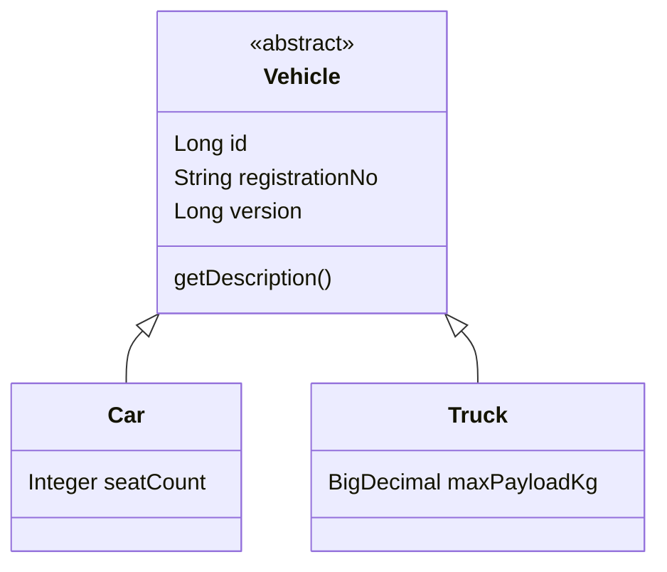

# Ánh xạ hệ phân cấp bằng SINGLE_TABLE

Trong lập trình hướng đối tượng, kế thừa cho phép nhiều lớp con dùng chung thuộc tính và hành vi của lớp cha. Ví dụ, hệ thống quản lý phương tiện có `Vehicle`, `Car` và `Truck`: mọi phương tiện đều có biển đăng ký, nhưng ô tô con có số ghế, còn xe tải có tải trọng. Khi lưu các đối tượng này vào cơ sở dữ liệu quan hệ bằng JPA, ta cần chọn **chiến lược ánh xạ kế thừa**.

`InheritanceType.SINGLE_TABLE` là chiến lược lưu **toàn bộ các entity thuộc cùng một hệ phân cấp vào một bảng vật lý**. Mỗi hàng chứa những cột chung, những cột dành riêng cho từng kiểu con và một cột **discriminator** để JPA biết hàng đó tương ứng với lớp Java nào.

Bài học thuộc chương **Kế thừa** của chủ đề *Data Persistence Relational Access ORM JPA* hướng dẫn cách khai báo `@Inheritance(strategy = InheritanceType.SINGLE_TABLE)`, dùng `@DiscriminatorColumn` và `@DiscriminatorValue`, ghi/đọc đa hình, xây schema nhất quán, kiểm soát ràng buộc dữ liệu và đánh giá khi nào một bảng chung là lựa chọn hợp lý.

## 1. Vì sao cần ánh xạ kế thừa?

Xét hệ phân cấp Java:



Trong Java, `Car` và `Truck` đều **là** `Vehicle`, nên có thể khai báo:

```java
List<Vehicle> vehicles = List.of(
    new Car("CAR-001", 5),
    new Truck("TRUCK-001", new BigDecimal("3500.00"))
);
```

Khi làm việc với JPA, ta muốn lưu được cả hai kiểu đối tượng, sau đó truy vấn `Vehicle` mà vẫn thu được object đúng kiểu con. Tuy nhiên, database quan hệ không có trực tiếp khái niệm kế thừa class. Vì vậy JPA cung cấp các chiến lược ánh xạ; `SINGLE_TABLE` chọn cách gộp dữ liệu thành một bảng.

Một bảng chung có thể hình dung:

| id | vehicle_type | registration_no | version | seat_count | max_payload_kg |
|---:|---|---|---:|---:|---:|
| 1 | CAR | CAR-001 | 0 | 5 | NULL |
| 2 | TRUCK | TRUCK-001 | 0 | NULL | 3500.00 |
| 3 | CAR | CAR-002 | 0 | 7 | NULL |

Điểm đáng chú ý:

- Hai kiểu entity có **cùng bảng** và **chung không gian ID**.
- Cột `vehicle_type` cho biết hàng là `CAR` hay `TRUCK`.
- Cột `seat_count` có nghĩa với `Car` nhưng không có nghĩa với `Truck`.
- Cột `max_payload_kg` có nghĩa với `Truck` nhưng không có nghĩa với `Car`.
- Những cột chỉ thuộc một lớp con thường phải cho phép `NULL` ở cấp bảng, vì các hàng của lớp con khác không dùng cột đó.

## 2. Ba annotation chính của SINGLE_TABLE

Cú pháp cốt lõi dùng Jakarta Persistence:

```java
@Entity
@Table(name = "fleet_vehicle")
@Inheritance(strategy = InheritanceType.SINGLE_TABLE)
@DiscriminatorColumn(
    name = "vehicle_type",
    discriminatorType = DiscriminatorType.STRING,
    length = 24
)
public abstract class Vehicle {
    @Id
    @GeneratedValue(strategy = GenerationType.IDENTITY)
    private Long id;
}
```

Lớp con:

```java
@Entity
@DiscriminatorValue("CAR")
public class Car extends Vehicle {
    @Column(name = "seat_count")
    private Integer seatCount;
}
```

Vai trò từng annotation:

| Annotation / thuộc tính | Chức năng |
|---|---|
| `@Entity` trên lớp gốc | Đưa lớp gốc vào hierarchy entity JPA, kể cả khi lớp là `abstract`. |
| `@Table(name = "fleet_vehicle")` | Chỉ định bảng vật lý chung của hierarchy. |
| `@Inheritance(strategy = InheritanceType.SINGLE_TABLE)` | Ánh xạ các entity trong hierarchy vào cùng một bảng. |
| `@DiscriminatorColumn(name = "vehicle_type")` | Cấu hình cột phân biệt kiểu thực của hàng dữ liệu. |
| `discriminatorType = DiscriminatorType.STRING` | Giá trị discriminator là chuỗi, thay vì kiểu `CHAR` hoặc `INTEGER`. |
| `@DiscriminatorValue("CAR")` | Chỉ định giá trị của cột discriminator cho một lớp con. |
| `@Column(name = "seat_count")` | Ánh xạ thuộc tính riêng của lớp con vào **cột trong cùng bảng**. |

Khi không khai báo `@Inheritance` trên root entity, chiến lược kế thừa entity mặc định theo JPA là `SINGLE_TABLE`. Tuy nhiên, **khai báo tường minh** giúp người đọc biết lựa chọn kiến trúc là có chủ đích.

Khi không cấu hình discriminator, provider có quy tắc mặc định riêng theo đặc tả, thường là cột tên `DTYPE` với discriminator kiểu chuỗi. Đặt tên và giá trị rõ ràng như `vehicle_type`, `CAR`, `TRUCK` giúp schema dễ hiểu và giảm rủi ro khi đổi tên class.

## 3. Ví dụ đầy đủ: một bảng cho Vehicle, Car và Truck

Ví dụ sử dụng Java 17+, Jakarta Persistence 3.1 và một provider JPA tương thích như Hibernate ORM 6.x. Thư mục Java:

```text
single-table-demo/
├── pom.xml
└── src/
    └── main/
        ├── java/
        │   └── demo/
        │       ├── Vehicle.java
        │       ├── Car.java
        │       ├── Truck.java
        │       └── Main.java
        └── resources/
            └── META-INF/
                └── persistence.xml
```

### 3.1. Lớp gốc Vehicle

Tạo `src/main/java/demo/Vehicle.java`:

```java
package demo;

import jakarta.persistence.Column;
import jakarta.persistence.DiscriminatorColumn;
import jakarta.persistence.DiscriminatorType;
import jakarta.persistence.Entity;
import jakarta.persistence.GeneratedValue;
import jakarta.persistence.GenerationType;
import jakarta.persistence.Id;
import jakarta.persistence.Inheritance;
import jakarta.persistence.InheritanceType;
import jakarta.persistence.Table;
import jakarta.persistence.Version;

import java.util.Objects;

@Entity
@Table(name = "fleet_vehicle")
@Inheritance(strategy = InheritanceType.SINGLE_TABLE)
@DiscriminatorColumn(
    name = "vehicle_type",
    discriminatorType = DiscriminatorType.STRING,
    length = 24
)
public abstract class Vehicle {

    @Id
    @GeneratedValue(strategy = GenerationType.IDENTITY)
    private Long id;

    @Column(name = "registration_no",
            nullable = false, unique = true, length = 64)
    private String registrationNo;

    @Version
    @Column(name = "version", nullable = false)
    private Long version;

    protected Vehicle() {
        // Constructor không tham số theo yêu cầu JPA.
    }

    protected Vehicle(String registrationNo) {
        Objects.requireNonNull(registrationNo, "registrationNo");
        if (registrationNo.isBlank()) {
            throw new IllegalArgumentException(
                "registrationNo must not be blank");
        }
        this.registrationNo = registrationNo;
    }

    public Long getId() {
        return id;
    }

    public String getRegistrationNo() {
        return registrationNo;
    }

    public abstract String getDescription();
}
```

Giải thích:

- `Vehicle` là `abstract`: không tạo đối tượng `new Vehicle()`, nhưng JPA vẫn nhận đây là root entity của hệ phân cấp.
- `@Id` và `@GeneratedValue` nằm trên root entity; **các lớp con kế thừa ID**, không khai báo lại `@Id`.
- `@Version` cũng được kế thừa và phục vụ optimistic locking cho entity thuộc hierarchy.
- `registrationNo` là cột chung, có giá trị với mọi loại phương tiện.
- `getDescription()` là hành vi đa hình trong Java; JPA không biến phương thức này thành một cột trừ khi có ánh xạ phù hợp.

Không khai báo `@Table` riêng trên `Car` hoặc `Truck` trong ánh xạ `SINGLE_TABLE`. Toàn bộ dữ liệu của các lớp này nằm trong bảng `fleet_vehicle`.

### 3.2. Lớp con Car

Tạo `src/main/java/demo/Car.java`:

```java
package demo;

import jakarta.persistence.Column;
import jakarta.persistence.DiscriminatorValue;
import jakarta.persistence.Entity;

@Entity
@DiscriminatorValue("CAR")
public class Car extends Vehicle {

    @Column(name = "seat_count")
    private Integer seatCount;

    protected Car() {
        // Constructor JPA.
    }

    public Car(String registrationNo, int seatCount) {
        super(registrationNo);
        if (seatCount <= 0) {
            throw new IllegalArgumentException(
                "seatCount must be positive");
        }
        this.seatCount = seatCount;
    }

    public Integer getSeatCount() {
        return seatCount;
    }

    public void changeSeatCount(int value) {
        if (value <= 0) {
            throw new IllegalArgumentException(
                "seatCount must be positive");
        }
        this.seatCount = value;
    }

    @Override
    public String getDescription() {
        return "Car " + getRegistrationNo()
            + " with " + seatCount + " seats";
    }
}
```

`@DiscriminatorValue("CAR")` quy định: những hàng có discriminator `CAR` tương ứng với lớp Java `Car`. Provider đọc các cột chung và `seat_count` để dựng object `Car`.

Trường `seatCount` dùng `Integer`, vì một hàng `TRUCK` không có giá trị ở cột `seat_count`. Việc class `Car` yêu cầu số ghế lớn hơn 0 được thực thi qua constructor/method, còn schema phải dùng ràng buộc phù hợp nếu muốn DB tự kiểm soát giá trị.

### 3.3. Lớp con Truck

Tạo `src/main/java/demo/Truck.java`:

```java
package demo;

import jakarta.persistence.Column;
import jakarta.persistence.DiscriminatorValue;
import jakarta.persistence.Entity;

import java.math.BigDecimal;
import java.util.Objects;

@Entity
@DiscriminatorValue("TRUCK")
public class Truck extends Vehicle {

    @Column(name = "max_payload_kg",
            precision = 12, scale = 2)
    private BigDecimal maxPayloadKg;

    protected Truck() {
        // Constructor JPA.
    }

    public Truck(
            String registrationNo,
            BigDecimal maxPayloadKg) {
        super(registrationNo);
        Objects.requireNonNull(maxPayloadKg, "maxPayloadKg");
        if (maxPayloadKg.signum() <= 0) {
            throw new IllegalArgumentException(
                "maxPayloadKg must be positive");
        }
        this.maxPayloadKg = maxPayloadKg;
    }

    public BigDecimal getMaxPayloadKg() {
        return maxPayloadKg;
    }

    public void changeMaxPayloadKg(BigDecimal value) {
        Objects.requireNonNull(value, "value");
        if (value.signum() <= 0) {
            throw new IllegalArgumentException(
                "maxPayloadKg must be positive");
        }
        this.maxPayloadKg = value;
    }

    @Override
    public String getDescription() {
        return "Truck " + getRegistrationNo()
            + " carrying up to " + maxPayloadKg + " kg";
    }
}
```

`Truck` có thuộc tính riêng `maxPayloadKg`. Cột vật lý `max_payload_kg` vẫn thuộc bảng `fleet_vehicle`, chứ không phải một bảng `truck`.

## 4. Khởi tạo persistence unit trong Java SE

Ứng dụng dùng Java SE có thể khai báo persistence unit trong `src/main/resources/META-INF/persistence.xml`:

```xml
<?xml version="1.0" encoding="UTF-8"?>
<persistence xmlns="https://jakarta.ee/xml/ns/persistence"
             xmlns:xsi="http://www.w3.org/2001/XMLSchema-instance"
             xsi:schemaLocation="
               https://jakarta.ee/xml/ns/persistence
               https://jakarta.ee/xml/ns/persistence/persistence_3_1.xsd"
             version="3.1">

    <persistence-unit name="fleetPU" transaction-type="RESOURCE_LOCAL">
        <provider>org.hibernate.jpa.HibernatePersistenceProvider</provider>

        <class>demo.Vehicle</class>
        <class>demo.Car</class>
        <class>demo.Truck</class>
        <exclude-unlisted-classes>true</exclude-unlisted-classes>

        <properties>
            <property name="jakarta.persistence.jdbc.driver"
                      value="org.h2.Driver"/>
            <property name="jakarta.persistence.jdbc.url"
                      value="jdbc:h2:mem:fleetdb;DB_CLOSE_DELAY=-1"/>
            <property name="jakarta.persistence.jdbc.user" value="sa"/>
            <property name="jakarta.persistence.jdbc.password" value=""/>

            <property name="jakarta.persistence.schema-generation.database.action"
                      value="drop-and-create"/>
        </properties>
    </persistence-unit>
</persistence>
```

`<class>` khai báo các entity của hệ phân cấp một cách tường minh. `drop-and-create` chỉ dùng trong ví dụ học/test vì **có thể xóa dữ liệu** mỗi khi khởi tạo persistence unit. Với hệ thống thật, dùng migration và kiểm tra schema trước khi cho ứng dụng ghi dữ liệu.

Một `pom.xml` minh họa:

```xml
<project xmlns="http://maven.apache.org/POM/4.0.0"
         xmlns:xsi="http://www.w3.org/2001/XMLSchema-instance"
         xsi:schemaLocation="http://maven.apache.org/POM/4.0.0
                             https://maven.apache.org/xsd/maven-4.0.0.xsd">
    <modelVersion>4.0.0</modelVersion>

    <groupId>demo</groupId>
    <artifactId>single-table-demo</artifactId>
    <version>1.0-SNAPSHOT</version>

    <properties>
        <maven.compiler.release>17</maven.compiler.release>
        <project.build.sourceEncoding>UTF-8</project.build.sourceEncoding>
    </properties>

    <dependencies>
        <dependency>
            <groupId>jakarta.persistence</groupId>
            <artifactId>jakarta.persistence-api</artifactId>
            <version>3.1.0</version>
        </dependency>
        <dependency>
            <groupId>org.hibernate.orm</groupId>
            <artifactId>hibernate-core</artifactId>
            <version>6.6.4.Final</version>
        </dependency>
        <dependency>
            <groupId>com.h2database</groupId>
            <artifactId>h2</artifactId>
            <version>2.3.232</version>
        </dependency>
    </dependencies>

    <build>
        <plugins>
            <plugin>
                <groupId>org.apache.maven.plugins</groupId>
                <artifactId>maven-compiler-plugin</artifactId>
                <version>3.13.0</version>
            </plugin>
            <plugin>
                <groupId>org.codehaus.mojo</groupId>
                <artifactId>exec-maven-plugin</artifactId>
                <version>3.4.1</version>
                <configuration>
                    <mainClass>demo.Main</mainClass>
                </configuration>
            </plugin>
        </plugins>
    </build>
</project>
```

Các phiên bản là một bộ ví dụ minh họa cho Java 17 và Jakarta Persistence 3.1; không mang ý nghĩa khẳng định là bản phát hành mới nhất. Hibernate đóng vai trò JPA provider, H2 cung cấp cơ sở dữ liệu và JDBC driver.

## 5. Lưu và tải đối tượng đa hình

Tạo `src/main/java/demo/Main.java`:

```java
package demo;

import jakarta.persistence.EntityManager;
import jakarta.persistence.EntityManagerFactory;
import jakarta.persistence.EntityTransaction;
import jakarta.persistence.Persistence;

import java.math.BigDecimal;
import java.util.List;

public class Main {

    public static void main(String[] args) {
        EntityManagerFactory emf =
                Persistence.createEntityManagerFactory("fleetPU");

        try {
            createVehicles(emf);
            printAllVehicles(emf);
            printOnlyCars(emf);
        } finally {
            emf.close();
        }
    }

    private static void createVehicles(EntityManagerFactory emf) {
        EntityManager em = emf.createEntityManager();

        try {
            EntityTransaction tx = em.getTransaction();

            try {
                tx.begin();

                em.persist(new Car("CAR-001", 5));
                em.persist(new Truck(
                    "TRUCK-001", new BigDecimal("3500.00")));
                em.persist(new Car("CAR-002", 7));

                tx.commit();
            } catch (RuntimeException ex) {
                if (tx.isActive()) {
                    tx.rollback();
                }
                throw ex;
            }
        } finally {
            em.close();
        }
    }

    private static void printAllVehicles(
            EntityManagerFactory emf) {
        EntityManager em = emf.createEntityManager();

        try {
            List<Vehicle> vehicles = em.createQuery(
                "SELECT v FROM Vehicle v ORDER BY v.id",
                Vehicle.class
            ).getResultList();

            for (Vehicle vehicle : vehicles) {
                System.out.println(vehicle.getDescription());
            }
        } finally {
            em.close();
        }
    }

    private static void printOnlyCars(
            EntityManagerFactory emf) {
        EntityManager em = emf.createEntityManager();

        try {
            List<Car> cars = em.createQuery(
                """
                SELECT c
                FROM Car c
                WHERE c.seatCount >= :minimum
                ORDER BY c.id
                """,
                Car.class
            )
            .setParameter("minimum", 5)
            .getResultList();

            System.out.println(
                "Cars with at least 5 seats: " + cars.size());
        } finally {
            em.close();
        }
    }
}
```

Chạy:

```bash
mvn compile exec:java
```

Trong một lần chạy ví dụ thành công, kết quả chính có thể là:

```text
Car CAR-001 with 5 seats
Truck TRUCK-001 carrying up to 3500.00 kg
Car CAR-002 with 7 seats
Cars with at least 5 seats: 2
```

Log từ Hibernate/H2 có thể xuất hiện thêm. Các giá trị ID do database cấp có thể thay đổi theo trạng thái DB, còn SQL tạo bảng và chèn dữ liệu phụ thuộc cấu hình provider.

### Tại sao query Vehicle trả về cả Car và Truck?

Trong JPQL:

```java
List<Vehicle> list = em.createQuery(
    "SELECT v FROM Vehicle v",
    Vehicle.class
).getResultList();
```

Truy vấn trên root entity mặc định là **đa hình** (*polymorphic*): nó tìm các entity thuộc kiểu `Vehicle` **và những entity lớp con** của nó. JPA đọc giá trị discriminator ở mỗi hàng để dựng đúng Java class.

Vì vậy:

```java
for (Vehicle v : list) {
    if (v instanceof Car car) {
        System.out.println("Seats: " + car.getSeatCount());
    } else if (v instanceof Truck truck) {
        System.out.println("Payload: " + truck.getMaxPayloadKg());
    }
}
```

`getDescription()` cũng thực hiện đa hình thông thường của Java: object `Car` gọi triển khai trong `Car`, object `Truck` gọi triển khai trong `Truck`.

## 6. SQL và cột discriminator hoạt động ra sao?

Với `SINGLE_TABLE`, provider ánh xạ toàn bộ hierarchy vào **một bảng**. Một schema SQL khái niệm tương đương:

```sql
CREATE TABLE fleet_vehicle (
    id BIGINT GENERATED BY DEFAULT AS IDENTITY PRIMARY KEY,
    vehicle_type VARCHAR(24) NOT NULL,
    registration_no VARCHAR(64) NOT NULL UNIQUE,
    version BIGINT NOT NULL,
    seat_count INTEGER,
    max_payload_kg DECIMAL(12, 2)
);
```

Các hàng được chèn có thể tương đương:

```sql
INSERT INTO fleet_vehicle (
    vehicle_type, registration_no, version, seat_count, max_payload_kg
) VALUES ('CAR', 'CAR-001', 0, 5, NULL);

INSERT INTO fleet_vehicle (
    vehicle_type, registration_no, version, seat_count, max_payload_kg
) VALUES ('TRUCK', 'TRUCK-001', 0, NULL, 3500.00);
```

Đây là SQL **minh họa ý nghĩa mapping**, không phải bản chụp SQL chính xác của Hibernate. Với chiến lược IDENTITY, DB/provider có thể có cách lấy khóa khác nhau; tên constraint, thứ tự cột và giá trị version cũng phụ thuộc quá trình sinh schema và provider.

Một query tìm tất cả `Vehicle` về mặt SQL có thể giống:

```sql
SELECT id,
       vehicle_type,
       registration_no,
       version,
       seat_count,
       max_payload_kg
FROM fleet_vehicle
ORDER BY id;
```

Provider đọc `vehicle_type` rồi chọn class phù hợp. Query riêng lớp `Car` thường có điều kiện giới hạn discriminator:

```sql
SELECT *
FROM fleet_vehicle
WHERE vehicle_type = 'CAR'
  AND seat_count >= ?;
```

Cách tổ chức SQL là lợi thế nổi bật của `SINGLE_TABLE`: **không cần JOIN giữa các bảng của những mức kế thừa** để dựng một entity. Tuy nhiên, query có thể vẫn cần JOIN vì **quan hệ giữa entity** hoặc điều kiện nghiệp vụ; “SINGLE_TABLE không cần join” chỉ đúng với việc lưu cấu trúc **kế thừa**.

## 7. Discriminator không phải field nghiệp vụ thông thường

Một nhầm lẫn thường gặp là muốn truy cập `vehicle_type` như thuộc tính Java:

```java
// Không bắt buộc có field sau trong Vehicle:
private String vehicleType;
```

Trong ví dụ, `@DiscriminatorColumn` bảo provider dùng cột đó để xác định subtype. JPA quản lý discriminator qua mapping kế thừa; ứng dụng không nhất thiết khai báo một thuộc tính persistent có thể sửa.

**Không dùng setter nghiệp vụ để chuyển trực tiếp `vehicle_type` từ `CAR` sang `TRUCK`** trên cùng một entity đang managed. Identity và Java class của object đang tồn tại không tự biến từ `Car` thành `Truck`. Việc “đổi loại” thường cần mô hình nghiệp vụ/migration thích hợp, hoặc tạo entity đúng loại và chuyển dữ liệu theo transaction được thiết kế rõ.

### Lựa chọn giá trị discriminator

Nên định nghĩa giá trị rõ và bền vững:

```java
@DiscriminatorValue("CAR")
public class Car extends Vehicle { ... }

@DiscriminatorValue("TRUCK")
public class Truck extends Vehicle { ... }
```

Nếu không đặt `@DiscriminatorValue`, provider có thể dùng tên entity hoặc giá trị mặc định tùy cấu hình/kiểu. Khi đổi tên class, entity name hoặc refactor package, mặc định có thể khiến dữ liệu cũ không còn khớp nếu chưa migration. Giá trị rõ ràng như `CAR`/`TRUCK` tách biệt thông điệp schema khỏi tên class Java.

### STRING, CHAR và INTEGER

`@DiscriminatorColumn` hỗ trợ các kiểu discriminator được định nghĩa trong `DiscriminatorType`. Dùng `STRING` thường rõ khi đọc dữ liệu và ổn định khi thêm loại mới; `INTEGER` có thể gọn nhưng phải quản lý ý nghĩa của mã số; `CHAR` giới hạn giá trị đơn ký tự. Chọn theo yêu cầu schema và migration, không chỉ theo số byte lưu.

## 8. Truy vấn phân biệt subtype bằng TYPE và TREAT

JPA cung cấp cơ chế làm việc với hierarchy trong JPQL mà không cần trực tiếp nhắc cột discriminator.

### 8.1. Truy vấn mọi subtype

```jpql
SELECT v
FROM Vehicle v
ORDER BY v.registrationNo
```

Kết quả có thể chứa cả `Car` và `Truck` dưới kiểu trả về `Vehicle`.

### 8.2. Truy vấn trực tiếp subclass

```jpql
SELECT c
FROM Car c
WHERE c.seatCount >= :minSeats
```

`Car` là entity class, nên JPQL có thể tham chiếu trực tiếp nó. Provider giới hạn kết quả theo loại entity phù hợp.

### 8.3. Lọc theo kiểu với TYPE

```jpql
SELECT v
FROM Vehicle v
WHERE TYPE(v) = Car
```

`TYPE(v)` là biểu thức chỉ kiểu entity trong JPQL. So sánh với `Car` cho phép lọc loại cụ thể mà không gắn query với chuỗi discriminator `'CAR'` của database.

Trong ứng dụng, query này có thể dùng:

```java
List<Vehicle> carsAsVehicles = em.createQuery(
    "SELECT v FROM Vehicle v WHERE TYPE(v) = Car",
    Vehicle.class
).getResultList();
```

Nếu logic chỉ cần `Car` và các field của nó, truy vấn trực tiếp `FROM Car` thường dễ đọc hơn.

### 8.4. TREAT để truy cập thuộc tính lớp con

`TREAT` cho phép dùng đường dẫn của một entity root như một subtype khi cần:

```jpql
SELECT v
FROM Vehicle v
WHERE TREAT(v AS Car).seatCount >= :minSeats
```

Ví dụ này có nghĩa: trong các `Vehicle`, xét như `Car` rồi lọc theo `seatCount`. Trong truy vấn có nhiều association và điều kiện polymorphic phức tạp, `TREAT` có ích; với query chỉ lấy ô tô, `SELECT c FROM Car c` đơn giản hơn.

Ngữ nghĩa của `TREAT` được JPA định nghĩa, nhưng SQL cụ thể và mức hỗ trợ các dạng biểu thức phức tạp còn tùy provider/version. Khi tối ưu, hãy xem SQL sinh ra và kế hoạch thực thi.

## 9. Vì sao cột riêng của subtype thường phải nullable?

Đây là đánh đổi dữ liệu quan trọng nhất của `SINGLE_TABLE`.

Nếu đặt `seat_count NOT NULL` ở bảng `fleet_vehicle`, hàng `TRUCK` (không có số ghế trong mô hình) sẽ không chèn được. Nếu đặt `max_payload_kg NOT NULL`, hàng `CAR` lại không thể chèn.

Do đó:

```sql
seat_count INTEGER NULL,
max_payload_kg DECIMAL(12,2) NULL
```

Tuy nhiên, ta vẫn muốn quy tắc nghiệp vụ:

- Mọi hàng `CAR` phải có `seat_count > 0`.
- Mọi hàng `TRUCK` phải có `max_payload_kg > 0`.
- Hàng `CAR` không được dùng `max_payload_kg`.
- Hàng `TRUCK` không được dùng `seat_count`.

### Dùng CHECK constraint phụ thuộc discriminator

Ví dụ một ràng buộc minh họa trên DB hỗ trợ `CHECK` tương ứng:

```sql
ALTER TABLE fleet_vehicle
ADD CONSTRAINT ck_vehicle_type_fields
CHECK (
    (
        vehicle_type = 'CAR'
        AND seat_count IS NOT NULL
        AND seat_count > 0
        AND max_payload_kg IS NULL
    )
    OR
    (
        vehicle_type = 'TRUCK'
        AND max_payload_kg IS NOT NULL
        AND max_payload_kg > 0
        AND seat_count IS NULL
    )
);
```

Ràng buộc này bảo vệ **bất biến ở database**, kể cả khi có JDBC, batch job hoặc công cụ ngoài JPA ghi bảng. Các kiểu con thêm sau này phải được bổ sung vào quy tắc `CHECK` bằng migration trước khi ghi dữ liệu mới.

Cách khai báo:

```java
@Column(name = "seat_count")
private Integer seatCount;
```

không đặt `nullable = false` ở field riêng của subclass vì khi schema được gộp, `NOT NULL` trên cột toàn bảng sẽ xung đột với các subtype khác. Validation trong constructor/method đảm bảo trong mã ứng dụng, còn constraint theo discriminator hỗ trợ kiểm soát dữ liệu ở DB.

**Lưu ý:** `@NotNull` của Bean Validation trên field subtype có thể hữu ích nếu tích hợp validation provider, nhưng không tự thay thế constraint SQL phù hợp và cần kiểm tra lúc nào validation được gọi. Không dựa vào nó để giả định cột toàn bảng có thể `NOT NULL`.

### NULL cho subtype khác có phải lỗi không?

Không. Những giá trị `NULL` ở cột không liên quan là **hệ quả thiết kế dự kiến** của single-table inheritance. Vấn đề chỉ xuất hiện khi NULL vi phạm quy tắc của **chính subtype** hoặc khi có quá nhiều cột thưa làm table trở nên khó quản lý.

## 10. Hiệu năng của SINGLE_TABLE

### 10.1. Điểm mạnh: query polymorphic ít JOIN vì kế thừa

Với hierarchy `Vehicle → Car / Truck`, thông tin để dựng mọi entity đều nằm trên `fleet_vehicle`. Query root có thể lấy cả hierarchy qua một bảng, giảm JOIN giữa các tầng kế thừa so với `JOINED`.

Điều này đặc biệt có ích khi thường xuyên:

- Lấy danh sách hỗn hợp nhiều loại entity.
- Phân trang các đối tượng theo thuộc tính chung.
- Tìm theo primary key bất kể subtype.
- Truy vấn báo cáo đơn giản dùng các cột chung.

Nhưng ít JOIN hơn **không tự động đồng nghĩa nhanh hơn trong mọi workload**. Bảng chung lớn, nhiều cột thưa và index không phù hợp vẫn có thể tạo truy vấn chậm.

### 10.2. Điểm yếu: một bảng tăng chiều rộng và khối lượng

Giả sử hierarchy có 30 subtype, mỗi subtype thêm 15 field riêng. Bảng chung có thể có hàng trăm cột, trong đó phần lớn `NULL` ở hầu hết các hàng.

Hệ quả tùy DB engine:

- Metadata/schema và migration phức tạp.
- Bảng và index có thể khó tối ưu cho từng subtype.
- Query toàn bảng có thể phải xử lý nhiều cột hoặc bản ghi rộng.
- Các nhóm nghiệp vụ khác nhau dùng chung một bảng vật lý, tăng mức tranh chấp tài nguyên trên bảng/index chung.
- DDL thay đổi cho subtype có thể ảnh hưởng vận hành của toàn hierarchy.

Giá trị `NULL` không nhất thiết chiếm đúng kích thước của một giá trị đầy đủ trên mọi database; chi phí thực tế phải được đánh giá theo engine, kiểu cột và workload.

### 10.3. Index theo discriminator và thuộc tính subtype

Với query thường xuyên:

```sql
SELECT id, registration_no, seat_count
FROM fleet_vehicle
WHERE vehicle_type = 'CAR'
  AND seat_count >= 5
ORDER BY id;
```

Có thể cân nhắc index:

```sql
CREATE INDEX idx_vehicle_type_seats
    ON fleet_vehicle(vehicle_type, seat_count);
```

Trên PostgreSQL, còn có ví dụ **partial index** đặc thù:

```sql
CREATE INDEX idx_car_seats
    ON fleet_vehicle(seat_count)
    WHERE vehicle_type = 'CAR';
```

Partial index chỉ chứa các hàng loại `CAR`, có thể hữu ích khi dữ liệu nhiều và query theo subtype lặp thường xuyên. Nhưng không phải DB nào cũng hỗ trợ cú pháp này; và thêm index làm tăng chi phí ghi dữ liệu. Sử dụng `EXPLAIN`/`EXPLAIN ANALYZE` để kiểm chứng lựa chọn trên dữ liệu gần thực tế.

### 10.4. Query DTO thay vì tải mọi thuộc tính

Nếu endpoint chỉ hiển thị biển số, loại và ID, không nhất thiết tải đầy đủ managed entity cùng mọi field subtype. Ví dụ JPQL lấy thuộc tính chung:

```java
public record VehicleSummary(Long id, String registrationNo) {}
```

```java
List<VehicleSummary> result = em.createQuery(
    """
    SELECT new demo.VehicleSummary(v.id, v.registrationNo)
    FROM Vehicle v
    ORDER BY v.id
    """,
    VehicleSummary.class
)
.setMaxResults(50)
.getResultList();
```

Projection giúp lấy đúng cột cần dùng, giảm số object entity được tạo trong persistence context. Nếu UI cần loại cụ thể, có thể cân nhắc dùng `TYPE(v)` trong truy vấn hoặc xây DTO chuyên biệt; cần kiểm tra provider mapping khi chuyển kiểu entity sang một giá trị biểu diễn trong API.

## 11. Ràng buộc khóa chính và quan hệ tham chiếu

### Khóa chính thống nhất toàn hierarchy

`Car` và `Truck` dùng chung cột `fleet_vehicle.id`. Hai entity của hai subtype khác nhau **không thể** có cùng ID trong bảng này nếu constraint PK hoạt động đúng.

Điều này có nghĩa:

- Không cần tạo một sequence/identity riêng cho mỗi subtype khi dùng một PK chung.
- `em.find(Vehicle.class, id)` có thể trả về subtype đúng.
- `em.find(Car.class, id)` chỉ phù hợp nếu ID thực sự thuộc loại `Car`; nếu hàng có discriminator `TRUCK`, không thể diễn giải nó thành một `Car` hợp lệ.
- Các foreign key tới `Vehicle` có thể tham chiếu cùng bảng `fleet_vehicle`, không cần phân biệt trước loại con ở mức cấu trúc FK.

### Quan hệ đến root entity

Ví dụ entity `MaintenanceRecord` tham chiếu bất kỳ phương tiện nào:

```java
@Entity
@Table(name = "maintenance_record")
public class MaintenanceRecord {
    @Id
    @GeneratedValue(strategy = GenerationType.IDENTITY)
    private Long id;

    @ManyToOne(fetch = FetchType.LAZY, optional = false)
    @JoinColumn(name = "vehicle_id", nullable = false)
    private Vehicle vehicle;

    @Column(name = "notes", nullable = false)
    private String notes;

    protected MaintenanceRecord() {}
}
```

Đây là snippet tập trung vào relationship, chưa có constructor/method đầy đủ. Cột `maintenance_record.vehicle_id` trỏ đến `fleet_vehicle.id`; record có thể tham chiếu xe ô tô hoặc xe tải. Provider dựng đúng subclass khi truy cập `vehicle` theo discriminator.

Nếu nghiệp vụ **chỉ cho tham chiếu `Car`**, việc dùng mapping Java tới `Car` không tự khiến FK của DB kiểm tra discriminator. FK thông thường chỉ biết bảng/khóa, không biết subtype; cần thêm constraint/triggers, quy trình service hoặc cấu trúc dữ liệu khác nếu DB phải thực thi giới hạn subtype.

## 12. Cập nhật và xóa entity trong SINGLE_TABLE

Ví dụ tải `Car` rồi cập nhật số ghế:

```java
EntityTransaction tx = em.getTransaction();

try {
    tx.begin();

    Car car = em.find(Car.class, carId);
    if (car == null) {
        throw new IllegalArgumentException("Car not found");
    }

    car.changeSeatCount(7);
    tx.commit();
} catch (RuntimeException ex) {
    if (tx.isActive()) {
        tx.rollback();
    }
    throw ex;
}
```

Provider theo dõi trạng thái managed entity rồi phát `UPDATE` vào `fleet_vehicle`, không có bảng riêng `car` cần update. `@Version` trên root cho phép kiểm soát optimistic locking của entity được quản lý khi thực hiện cập nhật theo JPA.

Với `em.remove(car)`, provider xóa hàng tương ứng khỏi cùng bảng `fleet_vehicle`. Trong một hierarchy đa hình, cascade remove của những **quan hệ entity khác** vẫn phụ thuộc mapping riêng, không được suy ra chỉ vì các subtype nằm trong cùng bảng.

### Không thay đổi loại bằng cách sửa discriminator SQL tùy tiện

Giả sử có hàng `CAR` với `seat_count=5`. SQL:

```sql
UPDATE fleet_vehicle
SET vehicle_type = 'TRUCK'
WHERE id = ?;
```

có thể khiến dữ liệu trở nên không hợp lệ vì `max_payload_kg` chưa có, rồi cũng làm cho một object `Car` đang managed không đồng bộ với hình dạng hàng mới. Ngay cả khi cập nhật thêm field đúng, việc chuyển kiểu thực là **thao tác migration hoặc nghiệp vụ riêng**, không phải đổi thuộc tính Java thông thường.

Nếu hệ thống thường xuyên cần đổi loại phương tiện, cân nhắc liệu phân cấp class cố định có đúng mô hình hay không; có thể một trường trạng thái/loại trong **cùng entity không kế thừa** phù hợp hơn.

## 13. SINGLE_TABLE so với các chiến lược khác

JPA có ba chiến lược kế thừa entity cơ bản: `SINGLE_TABLE`, `JOINED` và `TABLE_PER_CLASS`. Ngoài ra, `@MappedSuperclass` là cách tái sử dụng mapping, nhưng lớp được đánh dấu không phải một root entity có thể truy vấn đa hình độc lập.

| Tiêu chí | SINGLE_TABLE | JOINED | TABLE_PER_CLASS |
|---|---|---|---|
| Schema | Một bảng cho cả hierarchy | Bảng root và các bảng con nối bằng PK | Mỗi lớp entity concrete có bảng riêng |
| Cột đặc thù subtype | Cùng bảng, thường nullable cho subtype khác | Ở bảng riêng của subtype | Nằm trong từng bảng concrete |
| Query đa hình | Thường đọc từ một bảng | Thường cần JOIN giữa các tầng | Có thể cần UNION giữa các bảng concrete |
| Query một subtype | Lọc discriminator | Đọc/join bảng lớp tương ứng | Đọc bảng của subtype |
| Ràng buộc NOT NULL riêng subtype | Cần CHECK theo discriminator hoặc giải pháp khác | Dễ đặt trên bảng subtype | Dễ đặt ở bảng concrete |
| Khả năng thêm subtype | Thêm discriminator + cột vào bảng chung | Thường thêm bảng subtype | Thêm bảng concrete |
| Khóa chính | Chung trong một bảng | Các bảng con dùng PK liên kết root | Quản lý identity xuyên các bảng phức tạp hơn |
| Khi phù hợp | Hierarchy vừa phải, đọc đa hình thường xuyên, muốn query ít JOIN | Muốn schema chuẩn hóa và ràng buộc riêng subtype | Các subtype độc lập mạnh, ít query polymorphic |

### Ví dụ JOINED khác gì?

Với `JOINED`, `vehicle` giữ ID và biển số, `car` giữ `id` + số ghế, `truck` giữ `id` + tải trọng. Đọc toàn bộ `Vehicle` có thể cần nhiều JOIN để dựng subtype. Với `SINGLE_TABLE`, mọi thông tin cùng ở `fleet_vehicle`.

### TABLE_PER_CLASS khác gì?

Với `TABLE_PER_CLASS`, mỗi concrete class có bảng chứa cả thuộc tính chung và riêng. Query root đa hình có thể cần `UNION` trên nhiều bảng. Việc quản lý sinh ID và hiệu quả query đa hình phụ thuộc provider và database.

### MAPPED_SUPERCLASS khác gì?

`@MappedSuperclass` cho phép các entity con thừa hưởng metadata như `@Id` và cột chung, nhưng bản thân lớp mapped superclass **không là entity**: không thể mong đợi `SELECT v FROM Vehicle v` trả mọi subtype nếu `Vehicle` chỉ là `@MappedSuperclass`. Khi cần truy vấn root đa hình, hãy sử dụng entity inheritance phù hợp.

## 14. Khi nào SINGLE_TABLE là lựa chọn tốt?

Nên cân nhắc khi:

1. **Các subtype chia sẻ phần lớn thuộc tính** và chỉ có một số cột riêng.
2. **Truy vấn đa hình thường xuyên**: ứng dụng hay lấy danh sách hỗn hợp subtype theo thuộc tính chung.
3. **Quan hệ tới root entity nhiều**: muốn một bảng/khóa để foreign key tham chiếu.
4. **Hierarchy không quá rộng**, số subtype và cột riêng có thể quản lý ổn định.
5. **Đọc nhanh các thuộc tính chung quan trọng**, và thiết kế index không quá phức tạp.
6. **Không cần nhiều ràng buộc NOT NULL riêng subtype** đến mức CHECK và migration trở nên khó duy trì.

Cân nhắc `JOINED`, các entity độc lập hoặc thiết kế khác nếu:

- Mỗi subtype có rất nhiều field riêng, khiến bảng chung quá rộng và nhiều cột thưa.
- Các subtype có lịch phát triển/schema rất khác nhau.
- Ràng buộc dữ liệu riêng loại cần được bảo đảm bằng cấu trúc bảng tách biệt.
- Các thao tác cập nhật/truy vấn chủ yếu chỉ nhắm vào subtype riêng và ít khi cần query đa hình.
- Số subtype tăng nhanh cùng nghiệp vụ, làm mọi thay đổi đều phải sửa bảng chung.

Không có chiến lược nào luôn nhanh hơn. Nên so sánh schema, mẫu query, index, thống kê dữ liệu và chi phí migration theo nhu cầu thực.

## 15. Những lỗi thường gặp

### Lỗi 1: Khai báo @Table riêng trên lớp con

```java
@Entity
@Table(name = "car")
@DiscriminatorValue("CAR")
public class Car extends Vehicle { ... }
```

Trong `SINGLE_TABLE`, lớp con phải dùng **bảng của root**. Khai báo bảng riêng có thể bị provider bỏ qua hoặc gây lỗi metadata tùy implementation, và khiến người đọc hiểu sai schema. Nếu muốn mỗi subtype có bảng riêng, cần chọn chiến lược tương ứng thay vì thay `@Table` trên subclass.

### Lỗi 2: Quên đăng ký subtype với persistence unit

Nếu cấu hình Java SE tắt class scanning và chỉ liệt kê `demo.Vehicle` nhưng bỏ `demo.Car`, provider có thể không quản lý `Car`. Hãy đăng ký đầy đủ các concrete entity của hierarchy hoặc cấu hình entity scanning có kiểm soát.

### Lỗi 3: Cột riêng subtype bị NOT NULL trên toàn bảng

```sql
seat_count INTEGER NOT NULL
```

Hàng `TRUCK` thường không có `seat_count` nên sẽ vi phạm. Dùng nullable ở cột chung và `CHECK` dựa trên discriminator nếu cần bắt buộc cho riêng `CAR`.

### Lỗi 4: Discriminator trùng hoặc không khớp dữ liệu

Hai subclass cùng `@DiscriminatorValue("CAR")` sẽ gây mâu thuẫn metadata. Dữ liệu có discriminator `CAR_OLD` nhưng code chỉ nhận `CAR` cũng có thể làm quá trình tải entity thất bại hoặc không dựng đúng kiểu. Duy trì mapping giá trị discriminator và migration đồng bộ.

### Lỗi 5: Chỉ đọc từ subtype mà tưởng đã đọc toàn hierarchy

```jpql
SELECT c FROM Car c
```

Truy vấn trên chỉ lấy đối tượng `Car` (và các subtype của `Car` nếu tồn tại), không lấy `Truck`. Muốn đọc cả hierarchy, dùng `FROM Vehicle`.

### Lỗi 6: Tưởng SINGLE_TABLE tự động chống dữ liệu sai subtype

`@DiscriminatorColumn` không tự thay thế mọi quy tắc `CHECK` ở DB. Nếu một hàng có `vehicle_type='TRUCK'` và `max_payload_kg=NULL`, ứng dụng có thể gặp object không hợp lệ trừ khi ràng buộc/validation ngăn được.

### Lỗi 7: Thêm @GeneratedValue riêng trên lớp con

Trong hệ phân cấp entity, định danh được định nghĩa từ root. Khai báo một `@Id`/`@GeneratedValue` riêng cho `Car` dễ tạo mapping mâu thuẫn và không phù hợp với cách dùng chung một bảng/PK. Cấu hình identity ở root entity.

### Lỗi 8: Mặc định đổi subtype là phép cập nhật

Không tự chuyển `Car` thành `Truck` chỉ bằng sửa discriminator hay ép kiểu Java. Nếu “loại” thay đổi thường xuyên, xem lại domain model.

### Lỗi 9: Chạy drop-and-create trên database production

Chế độ này có thể xóa dữ liệu thật. Chuyển sang migration (Flyway/Liquibase hoặc cơ chế tương đương), kiểm tra DDL/index/constraint và tách cấu hình môi trường.

### Lỗi 10: Tin rằng bảng chung luôn nhỏ và query luôn nhanh

Khi tăng số subtype và field, bảng có thể rộng, chứa nhiều NULL, chịu nhiều thay đổi DDL. Tối ưu bằng projection, phân trang, index, query plan; đánh giá lại chiến lược nếu schema đã vượt khỏi mục tiêu ban đầu.

## 16. Migration khi thêm một subtype mới

Giả sử sau này hệ thống bổ sung `Motorbike`, có thuộc tính `engineCc`. Quy trình ở mức ý tưởng:

1. Thêm cột `engine_cc` vào `fleet_vehicle` (cho phép `NULL` đối với hàng khác loại).
2. Bổ sung discriminator `MOTORBIKE` vào constraint và các cơ chế phân loại của DB.
3. Triển khai `@Entity @DiscriminatorValue("MOTORBIKE") class Motorbike extends Vehicle`.
4. Bảo đảm persistence unit/entity scanning nhận ra subclass mới.
5. Cập nhật query, index và validation liên quan nếu có.
6. Chạy migration trước khi code mới ghi discriminator mới, theo chiến lược deploy phù hợp.

Một lớp con minh họa:

```java
@Entity
@DiscriminatorValue("MOTORBIKE")
public class Motorbike extends Vehicle {

    @Column(name = "engine_cc")
    private Integer engineCc;

    protected Motorbike() {}

    public Motorbike(String registrationNo, int engineCc) {
        super(registrationNo);
        if (engineCc <= 0) {
            throw new IllegalArgumentException(
                "engineCc must be positive");
        }
        this.engineCc = engineCc;
    }

    public Integer getEngineCc() {
        return engineCc;
    }

    @Override
    public String getDescription() {
        return "Motorbike " + getRegistrationNo();
    }
}
```

Cần các import Jakarta Persistence tương ứng. Phần này chỉ minh họa subclass mới, không thay thế mã mẫu đầy đủ ở phần 3.

Trong giai đoạn deploy cuốn chiếu, các bản ứng dụng **cũ** có thể chưa hiểu discriminator `MOTORBIKE` nếu đọc chung bảng sau khi bản mới bắt đầu ghi. Vì vậy migration schema và deployment code phải tính đến tương thích giữa các phiên bản ứng dụng. Giá trị discriminator trở thành một phần của **hợp đồng dữ liệu** giữa code và DB.

## 17. Bài tập thực hành

### Bài 1 — Quan sát một bảng duy nhất

Chạy ví dụ `Vehicle`–`Car`–`Truck` với H2 và `SINGLE_TABLE`. Dùng công cụ truy vấn DB để kiểm tra những cột, những hàng và giá trị `vehicle_type` được tạo. Giải thích vì sao không có bảng riêng cho `Car` hoặc `Truck`.

### Bài 2 — Query đa hình

Persist hai `Car` và một `Truck`. So sánh kết quả:

```jpql
SELECT v FROM Vehicle v
```

với:

```jpql
SELECT c FROM Car c
```

Dùng `instanceof` hoặc phương thức đa hình `getDescription()` để giải thích kiểu object thực được trả về.

### Bài 3 — Lọc theo discriminator mà không viết SQL cột type

Viết JPQL `SELECT v FROM Vehicle v WHERE TYPE(v) = Truck`, quan sát danh sách kết quả và SQL provider sinh ra. Giải thích vì sao viết `TYPE(v)` giúp query không phụ thuộc tên cột `vehicle_type`.

### Bài 4 — Áp đặt bất biến dữ liệu riêng subtype

Thêm `CHECK` trong H2 hoặc database test để ngăn hàng `CAR` có `seat_count <= 0` hoặc hàng `TRUCK` không có tải trọng. Thử chèn SQL sai; xác định constraint nào từ chối.

### Bài 5 — Thêm một subtype

Tạo `Motorbike` có `engineCc`, discriminator `MOTORBIKE`. Cập nhật schema và query. Kiểm tra `FROM Vehicle` trả thêm motorbike trong khi `FROM Car` không trả loại này.

### Bài 6 — Đo truy vấn phân trang

Tạo nhiều hàng thuộc nhiều subtype, chạy page query lấy các thuộc tính chung. Dùng `EXPLAIN` và log SQL để xem cách index `registration_no` hoặc `vehicle_type` được dùng. So sánh entity query với DTO projection cùng điều kiện và page size.

### Bài 7 — Đánh giá đổi chiến lược

Giả sử hệ phân cấp mở rộng lên 25 subtype, mỗi subtype có 30 field riêng. Lập bảng đánh đổi giữa `SINGLE_TABLE` và `JOINED` về số cột thưa, join của query đa hình, ràng buộc NOT NULL và độ phức tạp migration; giải thích lựa chọn phù hợp theo hai workload khác nhau.

## 18. Câu hỏi tự kiểm tra

1. **`SINGLE_TABLE` lưu dữ liệu của toàn hierarchy vào mấy bảng?** Một bảng chung cho các entity trong hierarchy.
2. **Cột discriminator dùng để làm gì?** Xác định subtype Java phù hợp với mỗi hàng.
3. **Có cần khai báo `@Table` riêng cho mỗi subclass không?** Không. Subclass dùng bảng được định nghĩa ở root entity.
4. **`FROM Vehicle` có trả về `Car` và `Truck` không?** Có, vì truy vấn root entity trong JPA là đa hình.
5. **Vì sao field riêng của `Car` thường phải nullable ở DB?** Vì hàng `Truck` nằm cùng bảng nhưng không có giá trị cho field đó.
6. **Làm sao bắt buộc `seat_count > 0` chỉ đối với `CAR`?** Kết hợp validation nghiệp vụ với constraint phụ thuộc discriminator ở DB.
7. **Discriminator có nên phụ thuộc tên class Java khi dữ liệu cần tồn tại lâu dài?** Thường nên dùng giá trị `@DiscriminatorValue` rõ và ổn định để giảm rủi ro refactor.
8. **SINGLE_TABLE có luôn tránh mọi JOIN không?** Không. Nó tránh join giữa các tầng kế thừa nhưng query vẫn có thể join tới những entity liên quan.
9. **Nếu muốn mỗi subtype có bảng riêng, nên làm gì?** Xem xét `JOINED` hoặc `TABLE_PER_CLASS` theo yêu cầu, thay vì thêm `@Table` vào subclass của SINGLE_TABLE.
10. **Có thể chuyển `Car` thành `Truck` bằng cách sửa một field subtype không?** Không; kiểu entity do class và discriminator xác định, chuyển loại cần thiết kế nghiệp vụ/migration tương ứng.

**Ghi nhớ:** `@Inheritance(strategy = InheritanceType.SINGLE_TABLE)` lưu cả một hệ phân cấp entity vào **một bảng**, dùng **discriminator** để xác định loại thật của từng hàng. Chiến lược này đơn giản hóa query đa hình và foreign key tới root entity, nhưng đánh đổi bằng cột riêng subtype thường nullable, schema chung có thể rộng và ràng buộc dữ liệu riêng loại phải được thiết kế cẩn thận. Hãy dùng `@DiscriminatorColumn` và `@DiscriminatorValue` rõ ràng, giữ discriminator ổn định qua migration, rồi chọn `SINGLE_TABLE` dựa trên mô hình domain và workload thực.
