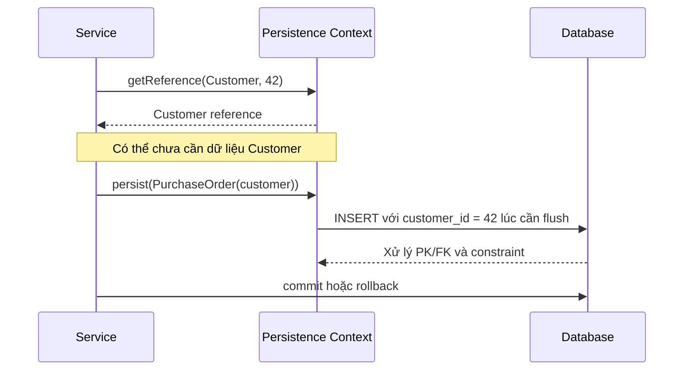
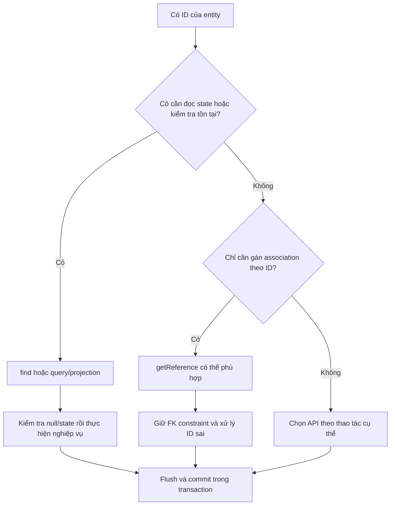

# Lấy tham chiếu bằng getReference và thời điểm cần truy cập dữ liệu trong JPA

Trong ứng dụng JPA, đôi khi ta **chỉ cần biết một entity nào đó có ID gì** để thiết lập quan hệ, nhưng cũng có lúc phải **đọc dữ liệu thực của entity** để kiểm tra nghiệp vụ hoặc trả về kết quả. Hai nhu cầu này trông giống nhau vì đều bắt đầu từ một ID, song cách dùng persistence context và thời điểm phát sinh SQL có thể rất khác.

Ví dụ, khi tạo đơn hàng cho khách hàng ID 42, thao tác thực chất cần ghi `purchase_orders.customer_id = 42`. Nếu không cần đọc tên, trạng thái hay hạn mức của khách hàng, việc truy vấn đầy đủ khách hàng trước khi ghi có thể là công việc thừa. JPA cung cấp:

```java
Customer customer = entityManager.getReference(Customer.class, 42L);
```

để lấy một **tham chiếu tới entity theo ID**, không nhất thiết phải tải ngay toàn bộ trạng thái từ database. Ngược lại:

```java
Customer customer = entityManager.find(Customer.class, 42L);
```

thường được dùng khi cần thực sự tìm và đọc entity, hoặc cần biết entity đó có tồn tại tại thời điểm truy vấn.

Tuy nhiên, **`getReference()` không có nghĩa “không bao giờ SELECT”, không bảo đảm ID hợp lệ, và không phải cách kiểm tra sự tồn tại**. Việc dữ liệu được tải lúc nào phụ thuộc persistence context, provider, mapping, proxy/bytecode enhancement, thao tác tiếp theo và ranh giới transaction.

Bài học đi từ cơ chế persistence context đến ví dụ SQL, quan hệ `@ManyToOne`, Spring Data JPA và các tình huống lỗi, để trả lời chính xác: **khi nào chỉ cần một tham chiếu, khi nào cần đọc trạng thái entity, và lúc nào truy vấn có thể xảy ra?**

## 1. Persistence context là gì trong bài toán này?

Persistence context là phạm vi JPA theo dõi các entity managed: ánh xạ mỗi định danh entity tới một biểu diễn managed tương ứng, ghi nhận trạng thái và đồng bộ thay đổi khi flush.

Đơn giản hóa một persistence context:

```text
Persistence Context
│
├── Customer, id=42  → managed Customer hoặc tham chiếu đại diện
├── Customer, id=73  → managed Customer hoặc tham chiếu đại diện
└── PurchaseOrder, id=9001 → managed PurchaseOrder
```

Định danh thường được hiểu là **loại entity + giá trị ID**, không chỉ là một số nguyên. `Customer(42)` và `Product(42)` là hai entity khác nhau.

Những đặc điểm liên quan:

1. Một entity đã được managed có thể được lấy lại từ persistence context mà không cần SQL `SELECT` mới.
2. Persistence context duy trì *identity* ở phạm vi của nó: cùng loại entity và ID thường được biểu diễn bởi một managed identity nhất quán.
3. Khi entity được lấy theo tham chiếu, provider có thể dùng proxy hoặc phương pháp khác để trì hoãn việc tải thuộc tính.
4. Mỗi lời gọi `find()` hoặc `getReference()` phải được hiểu cùng **trạng thái hiện có trong persistence context**, không thể suy ra một truy vấn chỉ từ tên method.
5. Khi entity detached hoặc persistence context đóng, quan hệ với cơ chế tải lười thay đổi đáng kể.

Trong Hibernate, một proxy hay wrapper thường khiến lập trình viên thấy một object Java “giống entity” dù trạng thái của entity đích chưa được tải đầy đủ. Đây là cơ chế triển khai phổ biến; chuẩn JPA chủ yếu mô tả hợp đồng của API, không buộc mọi provider sử dụng cùng một loại proxy.

## 2. Hai phương thức nền tảng: `find()` và `getReference()`

API JPA:

```java
Customer customer = entityManager.find(Customer.class, 42L);

Customer reference =
    entityManager.getReference(Customer.class, 42L);
```

### `find()`: tìm entity để làm việc với trạng thái của nó

`find(EntityClass.class, id)` trả về managed entity nếu tìm được, hoặc `null` nếu không có hàng tương ứng theo các điều kiện gọi thông thường.

Trong trường hợp entity chưa có trong persistence context và không được đáp ứng từ cache theo cấu hình, provider thường cần truy vấn database:

```sql
SELECT id, full_name, status
FROM customers
WHERE id = 42;
```

Sau khi nhận entity, code có thể đọc các thuộc tính được tải mà không phải đến lúc đó mới kích hoạt việc tìm entity lần đầu. Các association lazy khác của entity vẫn có thể chưa được tải.

Nếu entity đã hiện diện trong persistence context, `find()` có thể dùng luôn trạng thái đang managed mà không `SELECT` mới. Vì vậy **không thể nói mọi `find()` đều chắc chắn phát SQL**.

### `getReference()`: lấy tham chiếu theo định danh

`getReference(EntityClass.class, id)` trả về một tham chiếu được provider quản lý, cho phép biểu diễn “entity loại này có ID như vậy”. Provider **được phép trì hoãn** việc lấy trạng thái cho đến khi code thực sự truy cập.

Trong Hibernate, trường hợp entity chưa được tải thường được minh họa bằng một proxy:

```text
Customer proxy
  - entity type: Customer
  - identifier: 42
  - entity state: chưa tải đầy đủ
```

Khi code cần một thuộc tính dữ liệu, proxy có thể được khởi tạo:

```java
Customer ref = entityManager.getReference(Customer.class, 42L);

// Tùy provider, có thể chưa có SELECT ở đây.
String name = ref.getFullName();
// Lúc này có thể cần SELECT để tải trạng thái Customer.
```

Chuẩn JPA cho phép provider báo lỗi entity không tồn tại ngay tại lời gọi `getReference()` hoặc hoãn lỗi đến khi trạng thái được truy cập. **Không được giả định getReference luôn trả về proxy thành công mà không chạm database.**

### Bảng so sánh

| Khía cạnh | `find()` | `getReference()` |
|---|---|---|
| Mục đích phổ biến | Lấy entity để đọc/kiểm tra/làm việc với trạng thái | Có tham chiếu entity theo ID, có thể chưa cần tải trạng thái |
| Nếu đã managed trong context | Có thể lấy lại từ context | Có thể tận dụng biểu diễn đã managed |
| Có bảo đảm `SELECT`? | Không; có context/cache | Không; provider có thể trì hoãn hoặc cần tải |
| ID không tồn tại | Thông thường trả `null` | Có thể báo `EntityNotFoundException` ngay hoặc khi truy cập trạng thái |
| Có phù hợp để kiểm tra tồn tại? | Phù hợp khi cần lấy entity và kiểm tra `null` | **Không** nên dùng như phép kiểm tra tồn tại |
| Có thể gán vào `@ManyToOne`? | Có | Có, nếu chỉ cần một reference có định danh |
| Đọc non-ID field | Thường trạng thái đã được tải ở entity chính | Có thể kích hoạt việc tải nếu là reference chưa khởi tạo |
| Trạng thái managed | Kết quả là managed entity | Tham chiếu thuộc cơ chế quản lý của persistence context |
| Hành vi sau detach/đóng context | Dữ liệu đã tải có thể vẫn dùng; lazy association còn lại có thể lỗi | Reference chưa khởi tạo có thể không tải được nữa |

Lựa chọn dựa trên **dữ liệu thực sự cần dùng**, không phải quan niệm “một phương thức luôn nhanh hơn phương thức kia”.

## 3. Mô hình xuyên suốt: Customer và PurchaseOrder

Một đơn hàng luôn thuộc về một khách hàng.

```sql
CREATE TABLE customers (
    id BIGINT PRIMARY KEY,
    full_name VARCHAR(150) NOT NULL,
    status VARCHAR(20) NOT NULL
);

CREATE TABLE purchase_orders (
    id BIGINT GENERATED BY DEFAULT AS IDENTITY PRIMARY KEY,
    customer_id BIGINT NOT NULL,
    order_code VARCHAR(50) NOT NULL,
    CONSTRAINT fk_purchase_order_customer
        FOREIGN KEY (customer_id) REFERENCES customers(id)
);
```

Entity khách hàng:

```java
import jakarta.persistence.*;

@Entity
@Table(name = "customers")
public class Customer {

    @Id
    private Long id;

    @Column(name = "full_name", nullable = false, length = 150)
    private String fullName;

    @Column(name = "status", nullable = false, length = 20)
    private String status;

    protected Customer() {}

    public Long getId() { return id; }
    public String getFullName() { return fullName; }
    public String getStatus() { return status; }
}
```

Entity đơn hàng:

```java
import jakarta.persistence.*;

@Entity
@Table(name = "purchase_orders")
public class PurchaseOrder {

    @Id
    @GeneratedValue(strategy = GenerationType.IDENTITY)
    private Long id;

    @Column(name = "order_code", nullable = false, length = 50)
    private String orderCode;

    @ManyToOne(fetch = FetchType.LAZY, optional = false)
    @JoinColumn(name = "customer_id", nullable = false)
    private Customer customer;

    protected PurchaseOrder() {}

    public PurchaseOrder(String orderCode, Customer customer) {
        if (orderCode == null || orderCode.isBlank()) {
            throw new IllegalArgumentException("Order code required");
        }
        if (customer == null) {
            throw new IllegalArgumentException("Customer required");
        }
        this.orderCode = orderCode;
        this.customer = customer;
    }

    public Long getId() { return id; }
    public String getOrderCode() { return orderCode; }
    public Customer getCustomer() { return customer; }
}
```

Khi persist order, giá trị cần cho khóa ngoại là **ID của Customer**, chứ không phải toàn bộ thuộc tính tên/trạng thái. Đây là nền tảng cho use case `getReference()`.

## 4. Use case điển hình: tạo quan hệ chỉ bằng ID

Một request gửi:

```json
{
  "customerId": 42,
  "orderCode": "PO-9001"
}
```

Nếu yêu cầu nghiệp vụ chỉ là “gắn đơn hàng mới với Customer có ID đã được chấp nhận”, service có thể viết:

```java
import jakarta.persistence.EntityManager;
import jakarta.persistence.PersistenceContext;
import org.springframework.stereotype.Service;
import org.springframework.transaction.annotation.Transactional;

@Service
public class OrderService {

    @PersistenceContext
    private EntityManager em;

    @Transactional
    public void createOrder(Long customerId, String orderCode) {
        if (customerId == null) {
            throw new IllegalArgumentException("Customer ID required");
        }

        Customer customer =
            em.getReference(Customer.class, customerId);

        PurchaseOrder order =
            new PurchaseOrder(orderCode, customer);

        em.persist(order);
    }
}
```

Trong trường hợp Hibernate có thể dùng tham chiếu chưa khởi tạo, SQL có thể chỉ gồm:

```sql
INSERT INTO purchase_orders (order_code, customer_id)
VALUES ('PO-9001', 42);
```

Mục tiêu tối ưu là **không tải Customer đầy đủ chỉ để lấy ID đưa vào FK**. Nhưng cần nhớ:

- Không bảo đảm mọi provider đều bỏ `SELECT` ở lời gọi `getReference()`.
- Nếu Customer 42 đã managed, tham chiếu có thể được phục vụ từ persistence context.
- Nếu cơ chế sinh ID cho order hoặc flush yêu cầu, `INSERT` có thể chạy sớm hơn commit.
- Nếu Customer 42 **không tồn tại**, tham chiếu không tự biến ID 42 thành hợp lệ; foreign key sẽ chặn `INSERT` trong schema có FK thật.

### Luồng thời điểm



Sơ đồ thể hiện đường đi có thể tối ưu hóa. Provider có quyền truy vấn sớm trong một số tình huống, nên không coi sơ đồ là cam kết cố định về số lần SELECT.

## 5. Trường hợp ngược lại: cần đọc trạng thái khách hàng

Nếu nghiệp vụ nói “chỉ khách hàng ACTIVE được đặt hàng”, ta **phải biết trạng thái thực**:

```java
@Transactional
public void createOrderForActiveCustomer(
        Long customerId, String orderCode) {

    Customer customer = em.find(Customer.class, customerId);
    if (customer == null) {
        throw new IllegalArgumentException("Customer not found");
    }

    if (!"ACTIVE".equals(customer.getStatus())) {
        throw new IllegalStateException("Customer is not active");
    }

    em.persist(new PurchaseOrder(orderCode, customer));
}
```

Ở đây, `find()` diễn đạt rõ yêu cầu:

1. Lấy Customer.
2. Phát hiện không tồn tại theo kết quả trả về.
3. Kiểm tra thuộc tính `status`.
4. Sử dụng chính entity managed đó để gán quan hệ.

Vẫn có thể gọi `getReference()` rồi `getStatus()`:

```java
Customer customer = em.getReference(Customer.class, customerId);
if (!"ACTIVE".equals(customer.getStatus())) {
    throw new IllegalStateException("Customer not active");
}
```

Nhưng việc đọc `getStatus()` có thể kích hoạt tải Customer, và lỗi ID không tồn tại có thể xuất hiện qua exception thay vì `null`. Khi cần kiểm tra dữ liệu, cách này **không có lợi ích “không đọc dữ liệu”** như use case chỉ gán FK.

**Quy tắc lựa chọn:** Khi nghiệp vụ cần thuộc tính của entity, hãy thiết kế luồng đọc một cách rõ ràng; không sử dụng `getReference()` chỉ vì nghĩ nó luôn tránh được SQL.

## 6. “Truy cập dữ liệu” nghĩa là những thao tác nào?

Sau khi lấy reference:

```java
Customer ref = em.getReference(Customer.class, 42L);
```

Có hai loại thao tác cần phân biệt.

**Làm việc với reference như một liên kết có ID:**

```java
PurchaseOrder order = new PurchaseOrder("PO-9001", ref);
em.persist(order);
```

Provider thường có thể lưu foreign key từ ID mà không cần đọc mọi cột của Customer.

**Đọc nội dung của Customer:**

```java
String name = ref.getFullName();
String status = ref.getStatus();
```

Nếu reference chưa được khởi tạo, những lời gọi này thường kích hoạt tải entity:

```sql
SELECT id, full_name, status
FROM customers
WHERE id = 42;
```

Các thao tác khác như `toString()`, `equals()`, `hashCode()`, logger, JSON serialization, debugger hoặc mapper tự động **có thể truy cập thuộc tính** và kích hoạt việc tải không chủ ý, tùy code và cách provider triển khai.

Không phải cứ “không trực tiếp gọi getter trong service” là dữ liệu không bị đọc; những thư viện ở tầng sau cũng có thể đi qua object graph.

### Ma trận tác động thường gặp

| Thao tác trên reference | Có cần tải state Customer không? |
|---|---|
| Gán vào quan hệ `@ManyToOne` để ghi FK | Thường không cần tải đầy đủ state trong Hibernate, nếu mapping và tình huống cho phép |
| Gọi `getId()` | Nhiều proxy Hibernate có thể trả ID mà không khởi tạo; **không phải bảo đảm JPA tổng quát** |
| Gọi `getFullName()` | Có thể cần tải state nếu chưa được khởi tạo |
| Gọi `getStatus()` | Có thể cần tải state nếu chưa được khởi tạo |
| Gọi `toString()` | Phụ thuộc cách implement và provider; có thể khởi tạo |
| Serializing thành JSON entity đầy đủ | Thường đi qua nhiều getter, có thể sinh SELECT hoặc lỗi lazy |
| So sánh `==` với một object khác | Không đọc state chỉ vì toán tử, nhưng không phải cách so identity giữa contexts |
| Gọi `em.contains(ref)` | Hỏi managed status; không nhằm đọc nội dung entity |
| Gọi `em.lock(ref, ...)` | Phụ thuộc lock mode/provider, có thể cần tương tác database |

Đừng thiết kế logic dựa trên dự đoán chính xác “method nào chắc chắn không sinh SELECT” nếu dự đoán đó chỉ đúng cho một phiên bản Hibernate cụ thể.

## 7. Một chi tiết dễ nhầm: gọi `getId()` trên proxy

Rất nhiều ví dụ Hibernate mô tả:

```java
Customer ref = em.getReference(Customer.class, 42L);
Long id = ref.getId(); // Có thể không khởi tạo proxy.
```

Điều này thường đúng với proxy Hibernate thông dụng: proxy đã biết ID nên có thể trả ID mà không cần dữ liệu từ database. Nhưng có các yếu tố làm kết luận bớt tuyệt đối:

- Provider có thể dùng chiến lược khác proxy subclass thông thường.
- Mapping dùng field access/property access hoặc ID dạng phức hợp có thể tạo khác biệt.
- Bytecode enhancement hoặc cách triển khai getter có thể ảnh hưởng việc khởi tạo.
- Chuẩn JPA không hứa mọi lời gọi getter ID trên reference sẽ có cùng hành vi SQL.
- Nếu code gọi thêm `equals`, `toString` hay getter khác khi ghi log ID, chúng có thể tải dữ liệu.

Nếu ứng dụng **đã có `customerId`**, không cần gọi `ref.getId()` để đọc lại một giá trị mà đầu vào đã cung cấp. Giữ ID scalar cho response/DTO khi có thể cũng giảm phụ thuộc vào chi tiết proxy.

## 8. Khi entity đã tồn tại trong persistence context

Xét:

```java
Customer a = em.find(Customer.class, 42L);
Customer b = em.getReference(Customer.class, 42L);
```

Nếu `a` là entity managed trong cùng persistence context, provider thường tái sử dụng biểu diễn managed đã có, và không cần tải lại mọi thuộc tính từ database chỉ để cung cấp reference.

Tương tự:

```java
Customer a = em.getReference(Customer.class, 42L);
Customer b = em.find(Customer.class, 42L);
```

`find()` cần bảo đảm hành vi truy tìm entity; nếu `a` đang là proxy chưa khởi tạo, provider có thể khởi tạo nó để đáp ứng yêu cầu đọc trạng thái. Nhưng **thứ tự và số SELECT chính xác tùy cách triển khai**, không phải cứ gọi hai method là hai SELECT.

Điều cần hiểu ở tầng thiết kế:

- Persistence context quản lý **identity của entity**.
- `getReference()` và `find()` không tạo hai hàng database khác nhau.
- Khi cùng một entity đã được managed, provider có thể chia sẻ lại trạng thái và tham chiếu.
- Không dùng `==` giữa hai object lấy ở **hai persistence context khác nhau** để kết luận có cùng danh tính nghiệp vụ hay không.

Trong Hibernate, identity map và proxy còn có những quy tắc đặc biệt khi sử dụng inheritance hoặc enhancement. Không nên viết logic nghiệp vụ phụ thuộc vào class proxy cụ thể.

## 9. Nếu ID không tồn tại thì sao?

Đây là khác biệt có ảnh hưởng lớn đến độ đúng của ứng dụng.

### Với `find()`

```java
Customer customer = em.find(Customer.class, 9999L);

if (customer == null) {
    // Không tìm được Customer theo ID này.
}
```

Thông thường kết quả là `null` nếu entity không tồn tại. Nó rất phù hợp với luồng cần thông báo “không tìm thấy khách hàng”.

### Với `getReference()`

```java
Customer ref = em.getReference(Customer.class, 9999L);
```

Provider có thể tạo tham chiếu mà chưa xác minh ID trong database. Theo hợp đồng JPA, nếu entity không tồn tại, `EntityNotFoundException` có thể xuất hiện **khi truy cập trạng thái của reference**, và provider cũng được phép phát hiện/báo lỗi ngay ở `getReference()`.

Ví dụ:

```java
Customer ref = em.getReference(Customer.class, 9999L);
String name = ref.getFullName(); // Có thể báo EntityNotFoundException.
```

Ngược lại, nếu chỉ gán vào quan hệ:

```java
Customer ref = em.getReference(Customer.class, 9999L);
em.persist(new PurchaseOrder("PO-X", ref));
```

thì lỗi có thể xuất hiện khi insert order do **vi phạm FOREIGN KEY** ở database, thay vì tại lời gọi getReference.

### Một lỗi phổ biến

```java
Customer customer = em.getReference(Customer.class, customerId);

if (customer != null) {
    // KHÔNG chứng minh Customer có thật.
}
```

Reference khác `null` **không phải bằng chứng hàng database tồn tại**. Không xây dựng nghiệp vụ yêu cầu xác minh target trên điều kiện này.

### Ràng buộc database mới bảo vệ cuối cùng

Có foreign key thật:

```sql
FOREIGN KEY (customer_id) REFERENCES customers(id)
```

thì dù ứng dụng chỉ dùng reference theo ID, database vẫn chặn một `customer_id` không hợp lệ. Không có FK, dữ liệu mồ côi có thể bị ghi dù Java object trông giống một reference hợp lệ.

**`getReference` không thay thế khóa ngoại, và `FOREIGN KEY` không thay thế thông báo nghiệp vụ rõ ràng.** Hai thứ giải quyết những mục tiêu khác nhau.

## 10. Khi nào cần kiểm tra existence trước khi lưu?

Có hai lớp nhu cầu.

**Trường hợp A: mục tiêu là ghi nhanh một liên kết đã tin cậy, database bảo vệ FK.**

Ví dụ trong một luồng nội bộ, ID đã được xác định theo quy trình đáng tin cậy, ứng dụng có thể lấy reference và để constraint database làm tuyến bảo vệ cuối cùng.

```java
Customer customer = em.getReference(Customer.class, customerId);
em.persist(new PurchaseOrder(orderCode, customer));
```

Nếu ID không hợp lệ, transaction có thể thất bại ở flush/commit. Cần có cơ chế ánh xạ database exception thành thông báo/response phù hợp, không để lỗi lan ra một cách khó hiểu.

**Trường hợp B: cần kiểm tra tồn tại hoặc trạng thái để ra quyết định nghiệp vụ.**

```java
Customer customer = em.find(Customer.class, customerId);

if (customer == null) {
    throw new CustomerNotFoundException(customerId);
}

if (!customer.isAllowedToOrder()) {
    throw new CustomerCannotOrderException(customerId);
}
```

Đoạn trên giả định entity có phương thức `isAllowedToOrder()` và các exception nghiệp vụ được ứng dụng định nghĩa. Nhu cầu thật ở đây là **đọc trạng thái**, nên `find()` hợp lý hơn.

### Có nên gọi `existsById()` rồi `getReferenceById()`?

Một chuỗi kiểu:

```java
if (!customerRepository.existsById(customerId)) {
    throw new CustomerNotFoundException(customerId);
}

Customer customer = customerRepository.getReferenceById(customerId);
```

có thể hữu ích nếu chỉ cần xác minh existence mà không cần tải state, nhưng sẽ phát sinh công việc truy vấn và vẫn có race condition:

1. Request A kiểm tra Customer tồn tại.
2. Request B xóa Customer trong transaction khác.
3. Request A insert order tham chiếu Customer vừa bị xóa.

Do vậy, kiểm tra tồn tại trước **không thể thay thế FK**. Nếu cần trạng thái chi tiết để kiểm tra quy tắc, thường gọi `findById()` một lần rõ ràng hơn. Với xử lý đồng thời phức tạp, cần xem isolation, locking và quy tắc xóa parent.

## 11. Vì sao không nên dùng `getReference()` để viết mã “đọc để hiển thị”?

Ví dụ không cần thiết:

```java
@Transactional(readOnly = true)
public String getCustomerName(Long id) {
    return em.getReference(Customer.class, id).getFullName();
}
```

Đoạn này có thể chạy, nhưng về ngữ nghĩa yêu cầu là **đọc tên khách hàng**. Phương thức `getReference()` không giúp tránh đọc dữ liệu; getter `getFullName()` có thể kích hoạt query.

Rõ ràng hơn:

```java
@Transactional(readOnly = true)
public String getCustomerName(Long id) {
    Customer customer = em.find(Customer.class, id);

    if (customer == null) {
        throw new IllegalArgumentException("Customer not found");
    }
    return customer.getFullName();
}
```

Nếu chỉ cần một trường, có thể dùng JPQL projection:

```java
List<String> names = em.createQuery(
    "select c.fullName from Customer c where c.id = :id",
    String.class
)
.setParameter("id", id)
.getResultList();
```

Sự lựa chọn giữa `find` và projection còn phụ thuộc caching, số trường cần, DTO và query plan. Nhưng cả hai đều mô tả **mong muốn đọc dữ liệu**, không che nó sau một lazy reference.

## 12. `getReference()` và `LAZY @ManyToOne` có giống nhau không?

Hai khái niệm liên quan nhưng không đồng nghĩa.

**Lấy tham chiếu chủ động:**

```java
Customer ref = em.getReference(Customer.class, 42L);
```

Ta biết ID và yêu cầu JPA cung cấp một reference tới Customer.

**Tải một entity có quan hệ lazy:**

```java
@ManyToOne(fetch = FetchType.LAZY)
@JoinColumn(name = "customer_id")
private Customer customer;
```

Khi đọc PurchaseOrder, provider biết `customer_id` từ bảng order và có thể tạo proxy/reference cho Customer tương ứng mà chưa cần tải toàn bộ Customer.

Ví dụ:

```java
PurchaseOrder order = em.find(PurchaseOrder.class, orderId);
Customer customer = order.getCustomer();
```

Trong Hibernate, `customer` có thể là reference chưa được khởi tạo. Khi đọc:

```java
String name = customer.getFullName();
```

provider có thể truy vấn bảng `customers`.

Cần phân biệt:

- `getReference()` là **lời gọi API trực tiếp theo ID**.
- `FetchType.LAZY` là **chiến lược tải quan hệ** trong mapping/query.
- Cả hai có thể sử dụng proxy hoặc lazy-loading mechanism.
- Không phải cứ lấy reference là association của mọi entity khác tự đổi sang LAZY.
- JPA mô tả LAZY cho một số loại association như **gợi ý**; provider có quyền tải sớm trong các trường hợp cần thiết.

### Mặc định `@ManyToOne` là EAGER

Theo JPA, `@ManyToOne` mặc định `fetch = FetchType.EAGER`. Một ứng dụng thường chọn khai tường minh:

```java
@ManyToOne(fetch = FetchType.LAZY, optional = false)
@JoinColumn(name = "customer_id", nullable = false)
private Customer customer;
```

để giảm nhu cầu tải target không cần thiết. Nhưng fetch mode không thay thế sự hiểu biết về `getReference()`. Nếu service đọc `order.getCustomer().getFullName()` trong vòng lặp, vẫn có thể phát sinh N+1 SELECT.

## 13. Persistence context đóng: vì sao reference có thể không đọc được?

Giả sử code chạy trong service:

```java
public Customer loadReference(Long id) {
    return em.getReference(Customer.class, id);
}
```

Nếu method kết thúc và persistence context thật sự đóng, một reference chưa được khởi tạo có thể không còn đường truy vấn database để lấy thuộc tính:

```java
Customer ref = service.loadReference(42L);
String name = ref.getFullName(); // Có thể lỗi lazy initialization.
```

Với Hibernate, lỗi thường gặp là `LazyInitializationException`. Đây là exception đặc trưng Hibernate, không phải tên lỗi chuẩn bắt buộc mọi JPA provider dùng.

### Ba tình huống cần phân biệt

| Tình huống | Khả năng đọc state khi gọi getter |
|---|---|
| Reference còn gắn persistence context có thể truy vấn | Provider có thể khởi tạo/tải state |
| Reference đã khởi tạo đầy đủ trước khi detach | Những field đã tải có thể đọc được từ object |
| Reference chưa khởi tạo và context đóng/detached | Có thể không khởi tạo được, phát sinh lazy-loading exception |

Không phải **mọi** lần kết thúc một method `@Transactional` đều tương đương “EntityManager đã đóng” trong mọi cấu hình Spring; ví dụ nếu có Open Session in View hoặc transaction/context khác kéo dài hơn, thời điểm đóng có thể khác. Tuy nhiên, dựa vào cấu hình như vậy để tải ngầm từ tầng web thường khiến SQL khó kiểm soát.

Thiết kế rõ ràng hơn là lấy đúng dữ liệu **trong ranh giới transaction và service** cần dùng, rồi trả DTO.

## 14. Trả entity reference ra API có vấn đề gì?

Ví dụ:

```java
@GetMapping("/customers/{id}")
public Customer getCustomer(@PathVariable Long id) {
    return entityManager.getReference(Customer.class, id);
}
```

Đoạn minh họa bỏ qua các yêu cầu controller/service cụ thể, nhưng giúp thấy vấn đề:

1. JSON serializer có thể gọi getter `fullName`, `status` và kích hoạt SELECT lúc response được tạo.
2. Khi persistence context đóng, reference chưa khởi tạo có thể báo lỗi lazy.
3. Nếu entity không tồn tại, lỗi có thể xuất hiện muộn khi serialize chứ không phải ở controller.
4. Nếu entity có quan hệ hai chiều, serializer có thể duyệt vòng và tải thêm nhiều entity.
5. API vô tình phơi toàn bộ entity nội bộ thay vì hợp đồng dữ liệu rõ ràng.

Một DTO thường phù hợp hơn:

```java
public record CustomerResponse(
    Long id,
    String fullName,
    String status
) {}
```

Service:

```java
@Transactional(readOnly = true)
public CustomerResponse getCustomerResponse(Long customerId) {
    Customer customer = em.find(Customer.class, customerId);

    if (customer == null) {
        throw new IllegalArgumentException("Customer not found");
    }

    return new CustomerResponse(
        customer.getId(),
        customer.getFullName(),
        customer.getStatus()
    );
}
```

Vì mục tiêu là trả dữ liệu đầy đủ, đọc trạng thái trong service là chính đáng. Không cần giữ reference lazy cho tầng trình bày nếu tầng đó sẽ đọc các thuộc tính.

## 15. Spring Data JPA: `getReferenceById()` và `findById()`

Nếu dự án sử dụng Spring Data JPA:

```java
import org.springframework.data.jpa.repository.JpaRepository;

public interface CustomerRepository
        extends JpaRepository<Customer, Long> {}
```

Có hai cách gọi phổ biến:

```java
Optional<Customer> customer =
    customerRepository.findById(42L);

Customer reference =
    customerRepository.getReferenceById(42L);
```

Khác biệt cốt lõi:

- `findById(id)`: hợp đồng trả `Optional<Customer>`, thích hợp khi cần biết có tìm được hay không và cần dữ liệu.
- `getReferenceById(id)`: trả về reference theo ID theo semantics của JPA `getReference`; không phải phép xác minh tồn tại.
- Lỗi của reference không tồn tại có thể xảy ra muộn khi truy cập hoặc được provider phát hiện sớm.
- Nên dùng trong transaction với persistence context còn hiệu lực nếu sau đó cần truy cập state.

Ví dụ tạo order với Spring Data:

```java
@Service
public class CheckoutService {

    private final CustomerRepository customers;
    private final PurchaseOrderRepository orders;

    public CheckoutService(
            CustomerRepository customers,
            PurchaseOrderRepository orders) {
        this.customers = customers;
        this.orders = orders;
    }

    @Transactional
    public void createOrder(Long customerId, String code) {
        Customer customer =
            customers.getReferenceById(customerId);

        PurchaseOrder order = new PurchaseOrder(code, customer);
        orders.save(order);
    }
}
```

Ví dụ giả định `PurchaseOrderRepository extends JpaRepository<PurchaseOrder, Long>` và mapping như phần trước.

### `getOne()` / `getById()` trong code cũ

Trong nhiều phiên bản Spring Data JPA trước đây, bạn có thể gặp tên `getOne(id)` hoặc `getById(id)`. Những API này đã được đánh dấu deprecated theo hướng chuyển sang `getReferenceById(id)` ở các phiên bản Spring Data JPA mới. Khi nâng cấp ứng dụng, nên xem tài liệu đúng phiên bản framework và dùng tên API hiện hành.

**Đừng đồng nhất `getReferenceById` với `getById` của các API repository tùy biến khác** chỉ vì tên giống nhau. Ý nghĩa được quyết định bởi framework và hợp đồng method thực tế.

## 16. Có thể dùng reference để xóa entity không?

Một trường hợp đáng cân nhắc:

```java
@Transactional
public void deleteCustomer(Long id) {
    Customer ref = em.getReference(Customer.class, id);
    em.remove(ref);
}
```

Ý định là xóa Customer theo ID mà không cần đọc toàn bộ thuộc tính. Trong một số mapping/provider, có thể tối ưu việc lấy reference rồi remove, nhưng **không bảo đảm không có SELECT**:

- Provider có thể phải kiểm tra entity tồn tại.
- Có callback như `@PreRemove` hoặc logic phụ thuộc dữ liệu.
- Có cascade remove và association cần giải quyết.
- Có optimistic locking/version hoặc ràng buộc cần đọc state.
- Khi chưa có hàng, thời điểm lỗi có thể khác nhau giữa provider.

Nếu mục tiêu là xóa một hàng theo ID bằng JPQL bulk delete:

```java
int affected = em.createQuery(
    "delete from Customer c where c.id = :id"
)
.setParameter("id", id)
.executeUpdate();
```

có thể tránh tải entity, nhưng có khác biệt rất quan trọng: **bulk JPQL delete không áp dụng lifecycle entity và cascade JPA như `em.remove` thông thường**, và persistence context hiện có có thể bị lệch trạng thái với database. Ngoài ra foreign keys vẫn có thể chặn delete.

Vì vậy, không chọn bulk delete hoặc `getReference + remove` chỉ vì nghĩ “ít SQL hơn” mà bỏ qua quy tắc nghiệp vụ, audit callbacks và cascade.

## 17. Reference không giúp tạo entity đích mới

Đoạn này:

```java
Customer ref = em.getReference(Customer.class, 42L);
```

**không tạo một hàng Customer 42 trong database**. Nó chỉ biểu diễn một tham chiếu theo ID. Nếu chưa tồn tại Customer 42, `persist(order)` liên kết với ref không tự insert Customer.

Để tạo mới Customer, phải tạo entity mới và persist theo lifecycle:

```java
Customer customer = new Customer(/* dữ liệu hợp lệ */);
em.persist(customer);
```

Đoạn trên là pseudocode về ý nghĩa vì class Customer ở phần 3 chỉ có constructor cho JPA; cần cung cấp constructor/factory hợp lệ khi triển khai thực tế.

Tương tự, khi association có cascade `PERSIST`, không nên dựa vào cascade để “làm cho reference của ID không tồn tại trở thành entity thật”. Cascade xử lý các entity object theo trạng thái và quan hệ, không phải cơ chế tự dựng bản ghi đích từ một proxy giả định.

### Reference và object tự gán ID không tương đương

Không nên làm:

```java
Customer fake = new Customer();
fake.setId(42L); // API giả định; không phải cách tốt để gán FK.
order.setCustomer(fake);
```

Một object Java do ứng dụng tự tạo với ID 42 chưa chắc được JPA coi là managed entity hợp lệ. Trạng thái transient/detached và cascade có thể dẫn tới lỗi. Nếu chỉ cần liên kết theo ID đã biết, `getReference()` diễn đạt đúng mục đích hơn.

## 18. Truy cập reference bên ngoài transaction và Open Session in View

Một lỗi kiến trúc thường gặp:

```java
Customer reference = orderService.getCustomerReference(42L);
String name = reference.getFullName();
```

Nếu service kết thúc transaction và context đóng, getter có thể thất bại. Một số ứng dụng Spring web bật **Open Session in View (OSIV)** để giữ session/persistence context phục vụ trình bày; điều này có thể khiến getter vẫn tải được dữ liệu khi render response. Nhưng:

- Query có thể phát sinh ở controller, template hoặc JSON serialization.
- Transaction nghiệp vụ có thể đã kết thúc khi data được tải.
- Khó kiểm soát N+1 và thời điểm sử dụng connection.
- Việc hoạt động trong môi trường OSIV bật không bảo đảm chạy tương tự ở batch jobs, message consumers hoặc cấu hình OSIV tắt.

Thiết kế đáng tin cậy hơn là trả DTO hoặc dữ liệu đã xác định rõ từ service. Nếu cần entity state, đọc state ở nơi còn transaction/persistence context phù hợp.

## 19. Proxy và vấn đề `getClass()`, `equals()`, `hashCode()`

Trong Hibernate, một reference có thể là proxy subclass của entity. Vì vậy:

```java
Customer ref = em.getReference(Customer.class, 42L);
Class<?> actual = ref.getClass();
```

có thể trả một class proxy thay vì `Customer.class`. Việc dùng `ref.getClass() == Customer.class` để quyết định nghiệp vụ có thể sai trong môi trường proxy.

Tương tự, `equals` hoặc `hashCode` của entity có thể bị gọi bởi `HashSet`, `Map`, logging hoặc framework. Nếu chúng:

- đọc các lazy association,
- đệ quy qua collection quan hệ hai chiều,
- dùng các field mutable,
- dựa hoàn toàn vào `getClass()` một cách không tương thích proxy,

thì có thể gây tải dữ liệu bất ngờ, recursion hoặc lỗi identity.

Không có một công thức equality đúng cho mọi entity, nhất là khi ID được sinh sau persist. Cần thiết kế theo danh tính và vòng đời thực tế. Một số tiện ích của Hibernate giúp truy vấn class thực của proxy hoặc trạng thái khởi tạo, nhưng đó là **API đặc thù provider**, không phải API JPA portable.

### Tránh dùng `toString()` để ghi toàn bộ entity

Một method:

```java
@Override
public String toString() {
    return "Customer{name='" + getFullName() + "'}";
}
```

có thể kích hoạt tải Customer khi logging một reference. Nếu log chỉ cần ID, nên log ID đã có từ tham số hoặc dùng biểu diễn được kiểm soát thay vì tự động duyệt toàn bộ object graph.

## 20. Kiểm tra trạng thái đã tải hay chưa

JPA có API kiểm tra trạng thái tải của entity/attribute thông qua `PersistenceUnitUtil`:

```java
PersistenceUnitUtil util =
    entityManager.getEntityManagerFactory()
                 .getPersistenceUnitUtil();

Customer ref = entityManager.getReference(Customer.class, 42L);

boolean loaded = util.isLoaded(ref);
```

API này có thể giúp kiểm tra tình trạng đã tải trong những use case cụ thể. Tuy nhiên, câu trả lời phải được hiểu theo hợp đồng của JPA/provider và trạng thái đang quản lý; nó không nói “lời gọi getReference chắc chắn không có SQL trước đó”.

Hibernate cũng có tiện ích như:

```java
org.hibernate.Hibernate.isInitialized(ref);
```

nhưng đây là API riêng của Hibernate. Nếu cần ứng dụng portable giữa JPA providers, ưu tiên API chuẩn và không phụ thuộc vào loại class của proxy.

### `EntityManager.contains()` không phải kiểm tra existence

```java
boolean managed = em.contains(ref);
```

`contains` trả lời liệu object là một managed entity trong persistence context hiện tại hay không. Nó **không** phải lời xác nhận rằng hàng tương ứng hiện có trong database và vẫn hợp lệ ở thời điểm kiểm tra.

Một reference có thể thuộc context nhưng target chưa được xác minh do chưa cần tải state.

## 21. Reference và cache cấp một/cấp hai

### Cache cấp một: persistence context

Mỗi persistence context có cơ chế identity map của managed entities. Nếu đã tải Customer 42, gọi lại `find(Customer.class, 42L)` trong cùng context thường không cần truy vấn lại database để lấy chính state đó.

Với `getReference()`, provider có thể trả về managed representation sẵn có. Vì vậy lựa chọn giữa find và getReference không thể chỉ đo qua một lệnh đơn lẻ khi context đã ấm.

### Cache cấp hai

Nếu cấu hình second-level cache, một số dữ liệu có thể lấy từ cache thay vì SQL SELECT. Nhưng cache cấp hai:

- không phải tính năng mà mọi ứng dụng JPA đều bật,
- có vùng cache và chính sách nhất quán cụ thể,
- không biến `getReference` thành lệnh existence check,
- không loại bỏ nhu cầu quản lý transaction và constraint database.

Cũng cần phân biệt một object đang managed trong context với entity state được lấy từ second-level cache. Hai khái niệm không hoàn toàn giống nhau.

### Tại sao benchmark dễ sai?

Nếu kiểm tra:

```java
em.find(Customer.class, 42L);
em.getReference(Customer.class, 42L);
```

rồi kết luận `getReference` không SELECT, có thể chỉ vì Customer đã được tải bởi lời gọi đầu tiên. Muốn hiểu hành vi, phải ghi rõ trạng thái persistence context, cache, flush mode và thao tác tiếp theo.

## 22. Dùng reference trong vòng lặp: tối ưu khi chỉ cần FK

Giả sử nhập hàng trăm đơn hàng, mỗi đơn chỉ có `customerId` và dữ liệu đơn:

```java
@Transactional
public void importOrders(List<CreateOrderCommand> commands) {
    for (CreateOrderCommand command : commands) {
        Customer customer = em.getReference(
            Customer.class, command.customerId());

        PurchaseOrder order = new PurchaseOrder(
            command.orderCode(), customer);

        em.persist(order);
    }
}
```

`CreateOrderCommand` là DTO có `customerId()` và `orderCode()`. Nếu mỗi đơn chỉ cần FK, dùng reference có thể tránh hàng loạt SELECT Customer không cần thiết.

Nhưng cần lưu ý:

- ID có thể lặp giữa nhiều command; persistence context có thể tái sử dụng representation.
- Nếu một ID không tồn tại, FK ở database có thể làm cả transaction thất bại.
- Nếu `@ManyToOne` hoặc cascade/callback khiến provider đọc dữ liệu, số SELECT có thể khác dự kiến.
- Nếu entity order dùng `IDENTITY`, insert batching có thể bị hạn chế ở một số provider/chiến lược.
- Nếu import số lượng rất lớn, persistence context có thể giữ nhiều managed entities; cần chiến lược batch, flush/clear có kiểm soát, nhưng **không clear khi còn cần dùng các reference managed mà không hiểu trạng thái**.

Khi cần kiểm tra quy tắc nghiệp vụ đối với từng Customer (ví dụ trạng thái ACTIVE), không nên tối ưu bằng cách “không đọc bất kỳ Customer nào”. Có thể dùng truy vấn theo lô lấy ID và trạng thái cần thiết, hoặc một chiến lược kiểm tra hợp lệ, sau đó gán quan hệ phù hợp.

## 23. `getReference()` với composite primary key

Nếu entity có khóa ghép:

```java
@Embeddable
public class ProductStockId implements Serializable {
    private Long warehouseId;
    private String sku;

    protected ProductStockId() {}

    public ProductStockId(Long warehouseId, String sku) {
        this.warehouseId = warehouseId;
        this.sku = sku;
    }

    @Override
    public boolean equals(Object o) {
        if (this == o) return true;
        if (!(o instanceof ProductStockId that)) return false;
        return Objects.equals(warehouseId, that.warehouseId)
            && Objects.equals(sku, that.sku);
    }

    @Override
    public int hashCode() {
        return Objects.hash(warehouseId, sku);
    }
}
```

và:

```java
@Entity
public class ProductStock {
    @EmbeddedId
    private ProductStockId id;
}
```

thì lời gọi:

```java
ProductStockId key = new ProductStockId(7L, "SKU-123");

ProductStock ref =
    em.getReference(ProductStock.class, key);
```

vẫn mang ý nghĩa lấy reference tới entity theo ID; ở đây ID là **một object khóa ghép**. Nếu chỉ dùng reference để tạo association, provider có thể không cần tải ngay state ProductStock, nhưng cần biết đầy đủ thành phần khóa để tạo FK tương ứng.

ID object cần đáp ứng quy tắc JPA cho composite ID, bao gồm `Serializable`, equality/hash thích hợp và constructor tương ứng. Không sửa các thành phần ID sau khi entity đã có danh tính persistent.

Ví dụ code lược imports và các thành phần entity không liên quan; trước khi dùng cần khai báo đầy đủ kiểu, getter, equals và mapping bảng/cột khớp schema thực tế.

## 24. getReference không khóa dữ liệu và không giải quyết concurrency

Khi gọi:

```java
Customer ref = em.getReference(Customer.class, 42L);
```

không nên hiểu rằng:

- Customer 42 chắc chắn đang tồn tại.
- Customer 42 không thể bị xóa sau đó.
- Provider đã giữ khóa hàng database.
- Customer 42 không thể thay đổi trạng thái trước khi order được ghi.
- Transaction hiện tại đã kiểm tra version của Customer.

`getReference()` không mặc định yêu cầu pessimistic lock hoặc optimistic lock. Nếu cần khóa, xác minh trạng thái hay phát hiện thay đổi đồng thời, phải dùng chiến lược transaction/locking phù hợp.

Ví dụ luồng:

1. Transaction A tạo reference Customer 42.
2. Transaction B xóa Customer 42 (nếu ràng buộc/trình tự cho phép).
3. Transaction A insert order với `customer_id = 42`.

Nếu database có foreign key, cơ chế khóa và isolation sẽ giải quyết xung đột theo quy tắc của database; insert có thể bị từ chối. Reference không thay thế FK.

Nếu nghiệp vụ cần kiểm tra `status = ACTIVE` tại thời điểm đặt hàng và giữ bất biến chống race condition, chỉ kiểm tra ACTIVE trước đó có thể chưa đủ; cần xem thiết kế transaction, locking hoặc cập nhật có điều kiện. Không lạm dụng `getReference` như một cơ chế “đọc mà không kiểm tra” cho các quy tắc có tính an toàn dữ liệu.

## 25. `getReference()` và `merge()` là hai vấn đề khác

Một người mới học JPA đôi khi nhầm:

- `getReference`: “tạo entity với ID để lưu”.
- `merge`: “biến mọi object thành managed ngay tại chỗ”.

Cả hai đều không đúng theo nghĩa đó.

```java
Customer ref = em.getReference(Customer.class, 42L);
```

lấy một reference theo định danh trong context. Nó không tạo Customer mới và không tự đọc state.

```java
Customer managed = em.merge(detachedCustomer);
```

sao chép state của detached object theo semantics `merge` vào một managed representation và trả về managed instance. Chính object detached truyền vào **không tự biến thành managed**.

Không dùng `merge` chỉ để “gắn FK theo ID”. Nếu chỉ có Customer ID, dùng reference rõ nghĩa hơn, và tránh gửi vào `merge` một Customer object thiếu phần lớn thuộc tính rồi vô tình ghi đè state với giá trị null.

### Khác với `persist`

```java
em.persist(newCustomer);
```

dành cho một entity mới theo vòng đời JPA. Nếu chỉ muốn association tới Customer đã có, không được `persist` một entity giả với ID giống target.

## 26. Lỗi thường gặp và thời điểm xuất hiện

| Tình huống | Nguyên nhân | Hướng xử lý |
|---|---|---|
| `getReference` trả object nhưng sau đó `getName()` báo `EntityNotFoundException` | ID không tồn tại; provider hoãn kiểm tra | Dùng `find` nếu cần xác minh; giữ FK database. |
| Gán reference vào order, lỗi xuất hiện khi `flush` | `customer_id` không tồn tại trong bảng đích hoặc vi phạm constraint khác | Kiểm tra FK, ID nguồn, transaction và dữ liệu. |
| Lấy reference xong trả ra controller, truy cập getter báo lazy error | Reference chưa khởi tạo và context đã đóng | Đọc state trong service hoặc trả DTO. |
| Tưởng `getReference` luôn không SELECT | Provider/callback/accessor cần tải hoặc entity đã có trạng thái khác | Quan sát SQL trong tình huống cụ thể; không dựa vào lời hứa không có query. |
| Gọi `ref.getId()` rồi khẳng định không có SELECT mọi provider | Hành vi proxy là đặc thù cài đặt | Giữ ID input khi chỉ cần ID; test trong môi trường cụ thể. |
| `ref != null` được coi là tồn tại | Reference khác null không xác minh DB row | Dùng `find`/truy vấn phù hợp hoặc dựa vào FK cho ghi. |
| `findById` trả empty nhưng getReferenceById không báo ngay | Hai API có hợp đồng khác nhau | Chọn API theo nhu cầu existence vs reference. |
| Gắn object Java tự tạo với ID vào order dẫn đến lỗi trạng thái | Object không phải managed reference hợp lệ | Dùng `getReference` hoặc `find`. |
| Gọi `equals`/`toString` gây SQL bất ngờ | Method đọc thuộc tính lazy hoặc quan hệ | Thiết kế equality/logging phù hợp với proxy. |
| Serializing entity gây N+1 | Mapper/serializer đi qua lazy references | DTO, projection, fetch plan có chủ đích. |
| `em.contains(ref) == true` nhưng ID thực tế không tồn tại | contains chỉ kiểm tra managed status | Không dùng contains để check existence. |
| Xóa bằng reference vẫn có SELECT | Cascade, callback, version/nhu cầu provider | Đánh giá semantics remove, không kỳ vọng tối ưu tuyệt đối. |
| Sau `clear()`, reference không tải state được như trước | Entity bị detach khỏi persistence context | Tổ chức ranh giới context, tránh dùng reference như managed sau clear. |
| Kiểm tra tồn tại trước nhưng insert vẫn lỗi FK | Race condition giữa check và insert | Giữ FK constraint và xử lý transaction/exception. |
| Gắn reference vào relation với `cascade = ALL` gây hành vi lạ | Cascade không phù hợp cho entity đích dùng chung | Chọn cascade theo quyền sở hữu vòng đời, không dùng bừa bãi. |

## 27. Quan sát SQL đúng cách khi học `getReference()`

Để hiểu phương thức trong môi trường Hibernate cụ thể, hãy phân biệt **khi lấy reference** và **khi truy cập state**.

Một kịch bản đơn giản trong transaction và persistence context mới:

```java
@Transactional
public void observe(Long customerId) {
    Customer ref = em.getReference(Customer.class, customerId);

    // Quan sát số SELECT đến đây.

    String name = ref.getFullName();

    // Quan sát số SELECT sau khi truy cập non-ID field.
    System.out.println(name);
}
```

Trên Spring Boot với Hibernate 6 có thể cấu hình log SQL cho môi trường phát triển:

```yaml
logging:
  level:
    org.hibernate.SQL: DEBUG
    org.hibernate.orm.jdbc.bind: TRACE
```

Không bật bind logging tràn lan ở production, vì giá trị bind có thể chứa dữ liệu nhạy cảm. Những gì nên quan sát:

1. Có `SELECT` khi gọi `getReference` hay không?
2. Có `SELECT` khi gọi `getFullName()` hay không?
3. Trước đó Customer đã được managed chưa?
4. Second-level cache có được bật không?
5. Transaction/persistence context có còn hoạt động không?
6. SQL nào được gửi khi `persist(order)` và `flush`?
7. Điều gì xảy ra với ID không tồn tại?
8. Có callback, cascade, eager association hay serializer kích hoạt đọc dữ liệu ngoài dự kiến không?

**Quan sát SQL là cách tìm hiểu provider, không phải thay thế hợp đồng API JPA.** Không nên suy từ một lần chạy mà khẳng định mọi lần gọi getReference đều có chính xác zero SELECT.

## 28. Bài tập so sánh hai cách gán quan hệ

### Bài tập A: tạo đơn hàng khi chỉ biết Customer ID

Yêu cầu: Customer ID 42 đã được hệ thống upstream xác nhận. Order chỉ cần lưu mã đơn và FK.

Cách phù hợp:

```java
Customer ref = em.getReference(Customer.class, 42L);
em.persist(new PurchaseOrder("PO-A", ref));
```

Lý do: service chỉ cần tham chiếu theo ID. Nhưng FK database vẫn cần kiểm tra tính hợp lệ nếu ID upstream đã lỗi thời.

### Bài tập B: chỉ cho Customer ACTIVE mua hàng

Yêu cầu: phải xem trạng thái Customer.

Cách phù hợp:

```java
Customer customer = em.find(Customer.class, 42L);
if (customer == null) {
    throw new IllegalArgumentException("Missing customer");
}
if (!"ACTIVE".equals(customer.getStatus())) {
    throw new IllegalStateException("Inactive customer");
}
em.persist(new PurchaseOrder("PO-B", customer));
```

Lý do: cần đọc trạng thái nên lazy reference không loại bỏ nhu cầu SELECT. Với concurrency chặt, còn cần khóa/transaction phù hợp.

### Bài tập C: hiển thị tên Customer

Yêu cầu: GET API trả `fullName`.

Ưu tiên `find` hoặc projection DTO để đọc state rõ ràng, thay vì lấy reference rồi giao cho serializer tự khởi tạo.

### Bài tập D: đổi Customer của một Order

Nếu nghiệp vụ cho phép chuyển order sang Customer khác:

```java
PurchaseOrder order = em.find(PurchaseOrder.class, orderId);
Customer target = em.getReference(Customer.class, targetCustomerId);

order.changeCustomer(target); // Phương thức miền được định nghĩa phù hợp.
```

Điều này có thể dẫn tới `UPDATE purchase_orders SET customer_id = ?`; không cần đọc tên Customer nếu chỉ đổi FK. Tuy nhiên phải xác minh nghiệp vụ cho phép chuyển khách hàng, kiểm tra quyền và xử lý FK nếu target không tồn tại.

### Bài tập E: xóa Customer khi còn Order

Dùng `getReference + remove` không giải quyết chính sách xóa. Database FK có thể từ chối. Cần xác định bảo vệ lịch sử đơn hàng, cascade hoặc soft delete trước khi chọn thao tác xóa.

## 29. Cây quyết định chọn `getReference()` hay `find()`



Để đưa quyết định chính xác hơn, tự hỏi:

- ID đã được xác minh ở đâu, và có cần báo lỗi “không tồn tại” ngay không?
- Có cần thuộc tính của entity đích để kiểm tra nghiệp vụ không?
- Có cần đọc state sau khi transaction kết thúc không?
- Có đang lấy reference chỉ để gán FK, hay sẽ serialize object ra API?
- Provider đang dùng có proxy/enhancement và cache như thế nào?
- Có foreign key thực ở database, đủ để chặn ID sai không?
- Nếu tải nhiều đối tượng, use case có N+1 hoặc nhu cầu projection không?
- Có quyền truy cập hoặc quy tắc trạng thái cần kiểm tra riêng cho target không?

Đối với truy vấn đọc phức tạp, `find` không phải lựa chọn duy nhất: JPQL/Criteria query, fetch join, entity graph và projection DTO có thể phù hợp hơn.

## 30. Những quy tắc cần nhớ

1. **`getReference()` lấy tham chiếu theo ID, không có nhiệm vụ tải toàn bộ state ngay lập tức.** Provider có thể trì hoãn tải, nhưng được phép truy vấn hoặc phát hiện lỗi sớm.
2. **`find()` phù hợp khi cần đọc entity hoặc kiểm tra không tồn tại.** Kết quả có thể lấy từ persistence context/cache mà không nhất thiết SELECT mỗi lần.
3. **Truy cập non-ID field trên lazy reference có thể kích hoạt SELECT.** Việc lấy ID của proxy thường có tối ưu riêng trong Hibernate nhưng không nên coi là bảo đảm JPA portable.
4. **Reference không xác nhận hàng đích tồn tại.** Khi ID sai, có thể gặp `EntityNotFoundException` lúc đọc state hoặc lỗi foreign key khi flush.
5. **Gán reference vào `@ManyToOne` là use case điển hình.** Provider thường chỉ cần ID để ghi FK, nhưng database vẫn phải bảo vệ referential integrity.
6. **Không trả reference chưa tải ra khỏi ranh giới persistence context rồi kỳ vọng getter luôn hoạt động.** Đọc dữ liệu cần thiết trong service và dùng DTO cho API.
7. **Không dùng `getReference` để thay thế kiểm tra nghiệp vụ, locking hoặc transaction.** Nó không tự xác minh trạng thái ACTIVE, quyền truy cập hay sự tồn tại trong mọi thời điểm.
8. **Spring Data JPA `getReferenceById()` mang semantics tương tự `EntityManager.getReference()`**, còn `findById()` phù hợp luồng cần kết quả `Optional`.
9. **Quan sát SQL thực tế theo provider, cache và persistence context**, đồng thời phân biệt `persist`, `flush` và `commit`.

Điểm mấu chốt là **chọn thời điểm phải đọc dữ liệu theo đúng nhu cầu nghiệp vụ**. Khi chỉ cần tham chiếu cho một FK, `getReference()` giúp biểu đạt ý định và có thể tránh tải thừa. Khi phải đọc hoặc kiểm chứng trạng thái, hãy dùng `find()` hay truy vấn phù hợp. Hiểu hai con đường đó trong persistence context sẽ giúp ứng dụng ORM/JPA vừa rõ nghĩa, vừa tránh SELECT không cần thiết, vừa giữ tính toàn vẹn dữ liệu và hành vi transaction có thể dự đoán.
