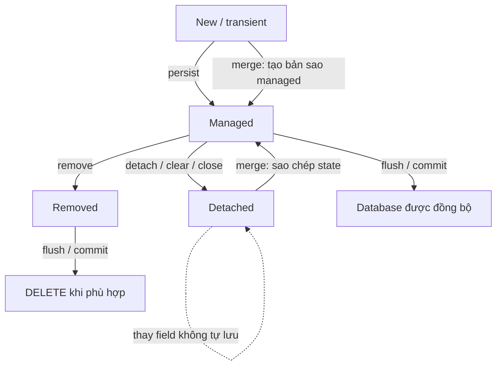
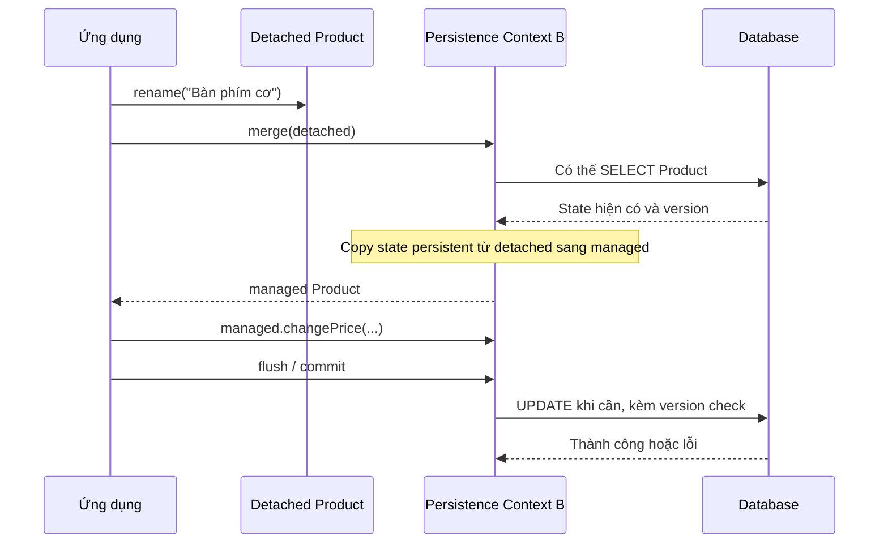
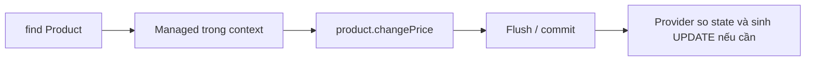

# Chuyển trạng thái từ detached bằng merge trong JPA

Trong JPA, một entity có thể đã được đọc từ database, được sửa trong Java, nhưng **không còn thuộc persistence context đang hoạt động**. Đó là trạng thái **detached**. Khi muốn áp dụng những thay đổi của đối tượng detached vào một transaction mới, JPA cung cấp `EntityManager.merge()`.

Điểm cốt lõi nhất là:

> **`merge(detached)` không chuyển chính đối tượng detached ban đầu thành managed. Nó sao chép trạng thái phù hợp sang một managed instance và trả về managed instance đó.**

Ví dụ:

```java
Product detached = ...; // Product đã ở trạng thái detached
detached.rename("Tên mới");

Product managed = entityManager.merge(detached);

// Thao tác tiếp theo nên thực hiện trên managed,
// không tiếp tục coi detached là entity đang được theo dõi.
managed.changePrice(new BigDecimal("199000.00"));
```

Nếu bỏ qua kết quả trả về và tiếp tục sửa `detached`, các thay đổi sau đó **không mặc nhiên được JPA dirty checking**. Đây là nguồn gốc của nhiều lỗi “gọi merge rồi nhưng sửa tiếp không lưu”, cũng như các vấn đề ghi đè dữ liệu cũ khi merge một object graph không đầy đủ.

Bài học thuộc chương **Vòng đời entity** trong module **Data Persistence Relational Access ORM JPA**, giải thích đầy đủ: detached là gì, cơ chế merge, sự khác nhau với persist/find/update, cascade MERGE, optimistic locking, association, collection, thời điểm phát sinh SQL và cách cập nhật an toàn trong ứng dụng thực tế.

## 1. Bốn trạng thái quan trọng của entity JPA

Một entity là đối tượng Java được ánh xạ tới bảng database. Trong JPA, việc nó có tồn tại trên database không đồng nghĩa với việc JPA đang theo dõi object đó.

| Trạng thái | Ý nghĩa | JPA tự theo dõi thay đổi field? |
|---|---|---|
| **New / transient** | Object vừa tạo bằng `new`, chưa được đưa vào persistence context | Không |
| **Managed / persistent** | Object thuộc persistence context hiện tại, có identity được quản lý | Có, theo mapping và transaction |
| **Detached** | Object từng là managed hoặc biểu diễn một entity đã tồn tại, nhưng không còn gắn với context hiện tại | Không |
| **Removed** | Một managed entity được đánh dấu xóa qua `remove`, chờ đồng bộ xuống database | Không theo nghĩa cập nhật thông thường; sẽ bị xóa |

Một sơ đồ khái quát:



Sơ đồ mô tả các đường đi điển hình. Có các trường hợp đặc biệt như `merge` với removed entity, rollback, cascade và context đang quản lý object có cùng ID. Không nên hiểu mọi mũi tên đều trả về cùng instance Java.

### Managed không đồng nghĩa “đã commit”

```java
entityManager.persist(product);
```

Sau `persist`, `product` thường đã managed. Nhưng row database có thể chưa được `INSERT` cho tới flush; dù SQL đã chạy, transaction vẫn có thể rollback.

Tương tự, `merge` trả về một managed object **không có nghĩa database đã được cập nhật ngay**. Provider thường thực hiện dirty checking và gửi SQL khi flush hoặc theo nhu cầu của chiến lược persistence.

## 2. Detached xuất hiện như thế nào?

Detached thường xảy ra khi:

- EntityManager hoặc persistence context từng quản lý entity đã **đóng**.
- Ứng dụng gọi `entityManager.detach(entity)`.
- Ứng dụng gọi `entityManager.clear()`, khiến các entity đang managed trong context bị detach.
- Entity được đưa qua một ranh giới nơi không còn persistence context cũ: ví dụ trả từ một service sau khi context thực sự kết thúc, giữ trong session khác, truyền sang tiến trình khác hoặc deserialize lại.
- Sau một số tình huống transaction rollback, context không còn thích hợp để tiếp tục sử dụng như trước; cách quản lý còn phụ thuộc framework.

Ví dụ gọi `detach` tường minh:

```java
Product product = entityManager.find(Product.class, 10L);

System.out.println(entityManager.contains(product)); // true

entityManager.detach(product);

System.out.println(entityManager.contains(product)); // false

product.rename("Đổi sau detach");
// Không tự sinh UPDATE chỉ vì đổi field của detached product.
```

`contains()` trả lời liệu **instance truyền vào** đang được quản lý bởi EntityManager hiện tại không. Nó không kiểm tra rằng row còn tồn tại trong database và cũng không khẳng định object có thuộc tính mới nhất.

### Một object Java có ID không đương nhiên là managed

```java
Product product = new Product();
product.setId(10L); // Ví dụ minh họa; không nên mở setter ID tùy ý.
```

Dù ID có giá trị, object này vẫn không tự trở thành managed trong persistence context. Việc gán ID thủ công, tạo DTO từ JSON hay copy object không phải là thao tác JPA `find` hoặc `merge`. Provider xử lý object new/detached có ID phụ thuộc chiến lược ID và quy tắc mapping; vì vậy cần phân biệt **danh tính dữ liệu** với **trạng thái lifecycle**.

## 3. Ví dụ entity xuyên suốt: Product

Bài sử dụng một entity có ID, giá, tên và cột version:

```java
import jakarta.persistence.*;
import java.math.BigDecimal;
import java.util.Objects;

@Entity
@Table(name = "products")
public class Product {

    @Id
    @GeneratedValue(strategy = GenerationType.IDENTITY)
    private Long id;

    @Version
    @Column(name = "version", nullable = false)
    private Long version;

    @Column(name = "name", nullable = false, length = 150)
    private String name;

    @Column(name = "price", nullable = false, precision = 19, scale = 2)
    private BigDecimal price;

    protected Product() {}

    public Product(String name, BigDecimal price) {
        rename(name);
        changePrice(price);
    }

    public Long getId() { return id; }
    public Long getVersion() { return version; }
    public String getName() { return name; }
    public BigDecimal getPrice() { return price; }

    public void rename(String value) {
        if (value == null || value.isBlank()) {
            throw new IllegalArgumentException("Product name required");
        }
        this.name = value;
    }

    public void changePrice(BigDecimal value) {
        Objects.requireNonNull(value);
        if (value.signum() < 0) {
            throw new IllegalArgumentException("Price must be nonnegative");
        }
        this.price = value;
    }
}
```

DDL minh họa theo PostgreSQL:

```sql
CREATE TABLE products (
    id BIGINT GENERATED BY DEFAULT AS IDENTITY PRIMARY KEY,
    version BIGINT NOT NULL,
    name VARCHAR(150) NOT NULL,
    price NUMERIC(19, 2) NOT NULL
);
```

`@Version` sẽ được dùng để phát hiện một số xung đột cập nhật đồng thời, quan trọng khi object detached có thể chứa dữ liệu cũ.

## 4. Kịch bản cơ bản: đọc ở context A, sửa detached, merge ở context B

Giả sử `Product#10` tồn tại. Ta đọc Product bằng EntityManager thứ nhất, đóng context, sửa trong Java, rồi dùng EntityManager thứ hai để merge:

```java
// Context A
EntityManager em1 = emf.createEntityManager();

Product detached;
try {
    detached = em1.find(Product.class, 10L);
    if (detached == null) {
        throw new IllegalArgumentException("Product not found");
    }
} finally {
    em1.close();
}

// em1 đã đóng; product này không còn managed trong em1.
detached.rename("Bàn phím cơ");

// Context B
EntityManager em2 = emf.createEntityManager();
EntityTransaction tx = em2.getTransaction();

try {
    tx.begin();

    Product managed = em2.merge(detached);

    managed.changePrice(new BigDecimal("990000.00"));

    tx.commit();
} catch (RuntimeException ex) {
    if (tx.isActive()) tx.rollback();
    throw ex;
} finally {
    em2.close();
}
```

Ví dụ dùng kiểu **application-managed EntityManager** để phơi rõ các ranh giới context. Trong ứng dụng Spring thông thường, service dùng EntityManager/container-managed transaction chứ không tự gọi `emf.createEntityManager()` và `em.getTransaction()` như thế này.

Điểm cần ghi nhớ:

1. `detached` là object Java đã được đọc ở context cũ.
2. Sau khi context A đóng, lời gọi `detached.rename(...)` chỉ đổi object trong bộ nhớ.
3. `em2.merge(detached)` sao chép state vào một **managed Product** thuộc context B.
4. Giá trị trả về `managed` là instance nên được sử dụng từ thời điểm đó.
5. Thay `managed.price` sẽ được dirty checking theo transaction B.
6. Commit có thể tạo SQL UPDATE. Nếu có optimistic-locking conflict hoặc constraint error, commit có thể thất bại.

### Hai tham chiếu không nhất thiết là một object

```java
Product managed = em2.merge(detached);

System.out.println(detached == managed); // Thường false trong ví dụ này.
System.out.println(em2.contains(detached)); // false
System.out.println(em2.contains(managed));  // true
```

Trong ví dụ detached từ context A và context B mới, sự khác nhau là trọng tâm. Ngược lại, khi gọi merge trên chính một managed instance thuộc context hiện tại, provider có thể trả lại instance đó; **không suy ra merge luôn phải tạo object mới**.

## 5. Cơ chế merge nhìn từ persistence context

Có thể hình dung thao tác merge của một detached object như sau:

```text
Object bên ngoài context B
  detached Product(id=10, name="Bàn phím cơ", price=500000, version=3)
           |
           | entityManager.merge(detached)
           v
Persistence Context B
  managed Product(id=10, name="Bàn phím cơ", price=500000, version=3)
           |
           | flush/commit theo transaction và rule version
           v
Database products
```

JPA có thể:

- Tìm managed instance có cùng entity identity trong context hiện tại.
- Nếu chưa có, tạo/lấy managed representation tương ứng, có thể cần đọc database.
- Sao chép trạng thái persistent phù hợp từ nguồn sang đích.
- Xử lý cascade MERGE cho các quan hệ được cấu hình tương ứng.
- Đồng bộ state của managed instance xuống database tại thời điểm flush/commit, nếu có thay đổi cần ghi.

Sơ đồ trình tự:



Không nên lấy sơ đồ làm cam kết rằng `merge()` luôn sinh đúng một `SELECT` hoặc chắc chắn một `UPDATE`. Số SQL chịu ảnh hưởng identity map, cache, version, mapping, callbacks và provider.

### Merge không “đính lại” object nguồn

Một quan niệm sai:

```java
em.merge(detached);

detached.rename("Tên đổi sau merge");
// Lỗi tư duy: nghĩ detached đã managed.
```

Trong khi đó, cách đúng:

```java
Product managed = em.merge(detached);

managed.rename("Tên đổi sau merge");
```

Một ví dụ rõ ràng hơn:

```java
Product managed = em.merge(detached);

// Hai thao tác Java sau có mục tiêu khác nhau.
detached.rename("Tên chỉ nằm ở detached");
managed.rename("Tên được context hiện tại theo dõi");
```

Nếu transaction chỉ flush thay đổi của managed entity, không có lý do để tự động lấy lần sửa mới nhất từ detached và ghi đè vào managed, trừ khi ứng dụng gọi lại merge hoặc chủ động sao chép trạng thái.

## 6. `merge()` khác `persist()` như thế nào?

| Câu hỏi | `persist(entity)` | `merge(entity)` |
|---|---|---|
| Mục đích chính | Làm entity mới trở thành managed để insert | Sao chép state từ entity new/detached sang managed representation |
| Object truyền vào | Trở thành managed trong trường hợp persist hợp lệ | Không bảo đảm trở thành managed; nhận instance trả về |
| Giá trị trả về | `void` | Entity instance managed |
| Dùng điển hình | Tạo entity mới | Áp dụng state detached hoặc một trường hợp new phù hợp |
| Nếu đã managed | Thường không cần thay đổi gì thêm; cascade persist có thể có tác động | Không cần để lưu field changes; merge có thể cascade |
| Nếu entity detached | `persist` có thể báo lỗi hoặc bị từ chối | `merge` là API dành cho việc sao chép state detached |
| SQL | Thường INSERT cho entity mới | Có thể SELECT rồi UPDATE hoặc INSERT, tùy trạng thái nguồn |
| Cascade | `CascadeType.PERSIST` | `CascadeType.MERGE` |

**Không thể nói `merge` chỉ dùng cho UPDATE.** Khi truyền new entity vào merge, JPA có thể tạo một managed copy mới và thực hiện INSERT vào database lúc flush. Nhưng điều đó không làm `merge` thành lựa chọn tối ưu mặc định cho mọi lần tạo entity.

### New entity truyền vào `merge()`

```java
Product newProduct = new Product(
    "Chuột không dây",
    new BigDecimal("250000.00")
);

Product managed = em.merge(newProduct);

// newProduct không nhất thiết trở thành managed.
System.out.println(em.contains(managed)); // true
```

Kết quả có thể là entity mới được insert tại flush, và managed copy nhận ID được sinh. Với use case tạo mới đơn giản, `em.persist(newProduct)` thường dễ hiểu hơn.

### Detached entity truyền vào `persist()`

```java
Product detached = ...; // Đã từng được lưu, có ID
em.persist(detached);   // Không phải thao tác reattach chuẩn.
```

JPA/provider có thể từ chối bằng các lỗi như `EntityExistsException` hoặc exception provider-specific; thời điểm phát hiện có thể ở persist, flush hoặc commit. Không dùng `persist` để “cập nhật object đã có ID”.

## 7. `merge()` không giống Hibernate `Session.update()`

Trong code Hibernate cũ, có thể gặp:

```java
session.update(detached);
```

API native Hibernate có semantics lịch sử về reattachment khác với `EntityManager.merge()` của JPA. Không suy luận hai lệnh này là bí danh nhau:

- JPA `merge` **sao chép state và trả về managed instance**.
- Hibernate `update` (nếu phiên bản còn hỗ trợ) là API native với semantics và điều kiện riêng, có thể cố reassociate object nguồn.
- Các bản Hibernate hiện đại thay đổi/giảm khuyến nghị sử dụng một số API reattachment cũ; nên đọc tài liệu phiên bản đang dùng trước khi chọn.

Trong ứng dụng JPA portable, viết code theo semantics của `EntityManager.merge()` và sử dụng giá trị trả về là thói quen bền vững hơn.

## 8. Thời điểm phát sinh SQL: merge không đồng nghĩa UPDATE ngay

Xét:

```java
Product managed = em.merge(detached);
```

Những tình huống có thể xảy ra:

1. Entity cùng ID đã managed trong context, provider sử dụng nó làm đích sao chép.
2. Entity chưa managed; provider có thể đọc dữ liệu hiện có để có bản managed và đối chiếu version.
3. Second-level cache có thể giảm nhu cầu SELECT trong vài tình huống.
4. State nguồn tương đương state hiện tại; provider có thể không cần UPDATE, tùy dirty tracking và cấu hình.
5. Provider có thể phát hiện optimistic-lock conflict khi merge, flush hoặc commit.
6. Với entity mới, có thể phát sinh INSERT thay vì UPDATE.

SQL minh họa với Product đã tồn tại:

```sql
SELECT id, name, price, version
FROM products
WHERE id = 10;

UPDATE products
SET name = ?, price = ?, version = ?
WHERE id = ? AND version = ?;
```

Đây là **SQL minh họa**, không phải cam kết số lượng và thứ tự câu lệnh của mọi provider. Provider có thể update tập cột khác, trì hoãn SQL, hoặc tối ưu khi không có thay đổi.

### `flush()` khác `commit()`

```java
Product managed = em.merge(detached);

em.flush(); // Đồng bộ các thay đổi pending xuống database.
```

`flush()` không tự commit transaction. Database vẫn có thể rollback nếu transaction không thành công. `merge` cũng không tự mở một transaction mới; trong ứng dụng thông thường cần transaction bao quanh thao tác ghi.

## 9. Merge khi entity cùng ID đã managed trong context

Giả sử trong cùng transaction:

```java
Product managed = em.find(Product.class, 10L);

// Một object detached khác biểu diễn cùng Product#10.
Product detached = ...;

Product result = em.merge(detached);
```

Trong tình huống này, persistence context đã có managed Product#10. JPA có thể sao chép state của detached **vào instance managed đang có**. Vì vậy:

- Không nên kỳ vọng provider tạo hai managed instance có cùng entity identity.
- Thứ tự thao tác quan trọng: merge state cũ có thể **ghi đè những thay đổi chưa flush** đang có trên managed entity.
- Kết quả merge là instance managed; nên tiếp tục thao tác trên `result`/`managed` theo chính sách rõ ràng.

Ví dụ:

```java
Product managed = em.find(Product.class, 10L);
managed.rename("Tên được sửa trong transaction");

Product staleDetached = ...; // Có name cũ từ màn hình trước đó.
em.merge(staleDetached);

// Tên cũ có thể được copy đè lên managed.name.
// Không dùng merge của snapshot cũ chỉ vì đã có object DTO/entity.
```

Đây là lý do không nên merge toàn bộ entity từ request một cách vô điều kiện trong mỗi luồng cập nhật.

## 10. “Cập nhật managed” thường không cần merge

Nếu entity đang được theo dõi:

```java
@Transactional
public void updatePrice(Long productId, BigDecimal newPrice) {
    Product product = em.find(Product.class, productId);

    if (product == null) {
        throw new IllegalArgumentException("Product not found");
    }

    product.changePrice(newPrice);
    // Không bắt buộc em.merge(product).
}
```

Provider dirty checking phát hiện thay đổi của managed entity khi flush. Gọi `merge(product)` chỉ để “ép cập nhật” thường thừa, và có thể khiến người mới hiểu sai vòng đời JPA.

### Cơ chế dirty checking



Managed entity đã là nguồn dữ liệu mà persistence context theo dõi. `merge` cần khi nguồn cập nhật là một object **không managed trong context hiện tại**, hoặc khi một API/framework dùng semantics merge có chủ đích.

## 11. Kịch bản web: entity detached giữa hai HTTP requests

Một luồng thường gặp:

```text
GET /products/10
    |
    v
Transaction A: load Product#10
    |
    v
Kết thúc context, client giữ thông tin
    |
    v
Người dùng đổi price trên giao diện
    |
    v
PUT /products/10
    |
    v
Transaction B: cập nhật Product#10
```

Nếu client gửi lại một entity-like JSON:

```json
{
  "id": 10,
  "name": "Bàn phím cơ",
  "price": 990000,
  "version": 3
}
```

rồi server deserialize thẳng thành `Product` và gọi `merge`, có thể áp dụng snapshot cũ vào database. Những field không có trong request có thể mang `null` hoặc giá trị mặc định Java, từ đó **ghi đè dữ liệu hiện tại**.

Thường nên dùng DTO/command với API cập nhật rõ ràng:

```java
public record ChangePriceRequest(
    BigDecimal price,
    Long expectedVersion
) {}
```

Trong service:

```java
@Transactional
public void changePrice(
        Long productId, ChangePriceRequest request) {

    Product product = em.find(Product.class, productId);

    if (product == null) {
        throw new IllegalArgumentException("Product not found");
    }

    if (!Objects.equals(product.getVersion(), request.expectedVersion())) {
        throw new IllegalStateException("Product was changed");
    }

    product.changePrice(request.price());
}
```

Ví dụ này thực hiện kiểm tra version ứng dụng để minh họa precondition; nó **không thay thế** kiểm tra optimistic lock của provider ở flush/commit. Với nhiều transaction đồng thời, `@Version` và điều kiện update version của provider vẫn cần thiết.

Lợi ích của cách “load managed rồi apply command”:

- Chỉ thay field nghiệp vụ thật sự được phép sửa.
- Không vô tình ghi đè tên, trạng thái hoặc quan hệ ngoài phạm vi request.
- Dễ kiểm tra quyền và business invariant.
- Không cần nhận và merge một object graph detached lớn.
- Cách thao tác đã nằm trong managed context nên dirty checking hoạt động tự nhiên.

`merge` vẫn hữu ích trong một số kiến trúc xử lý detached graph, nhưng không phải lựa chọn mặc định an toàn nhất cho mọi HTTP update.

## 12. “Missing field” trong DTO khác “unfetched lazy field” trong detached entity

Đây là sự phân biệt quan trọng khi merge.

**Trường hợp A: provider đã tải một entity, nhưng một thuộc tính LAZY chưa được fetch.**

Theo semantics JPA, provider không được merge các field được đánh dấu LAZY nhưng chưa được fetch. Điều này giúp tránh việc trạng thái “chưa tải” bị coi như dữ liệu có giá trị null cần ghi vào database.

**Trường hợp B: ứng dụng tự tạo một object mang ID và chỉ gán vài field.**

```java
Product incomplete = new Product();
incomplete.setId(10L);
incomplete.setName("Tên cập nhật");
// price là null vì app không gán, không phải vì JPA biết nó là unfetched.
em.merge(incomplete);
```

Đây là ví dụ pseudocode giả định có setter phù hợp; không khuyến nghị tạo entity thiếu dữ liệu theo cách này.

Một field `price = null` do deserialize hoặc dựng object thủ công **không phải cùng khái niệm** với một LAZY attribute được provider biết là chưa fetch. Nếu merge object thiếu dữ liệu, state null có thể bị sao chép và dẫn đến update sai hoặc constraint violation.

Vì vậy không nên giả định “gửi thiếu field thì merge giữ nguyên field cũ”. Với PATCH, hãy tải managed entity và áp đúng field có mặt trong command, hoặc dùng một cơ chế patch rõ ràng.

## 13. Merge có thể phát sinh truy vấn SELECT

Tại sao merge đôi khi cần đọc row hiện tại?

```java
Product managed = em.merge(detached);
```

Provider có thể cần managed target của cùng ID, bản snapshot hoặc thông tin version. Nếu context chưa quản lý entity, nó có thể tìm trong database:

```sql
SELECT id, name, price, version
FROM products
WHERE id = ?;
```

Nhưng không được kết luận mọi merge đều thực hiện SELECT. Nếu target đã managed hoặc cache đáp ứng, SQL có thể khác. Một số provider có chiến lược tối ưu hoặc behavior riêng cho version/ID mới.

Ngược lại, đừng suy diễn rằng `merge` “nhanh hơn `find() + update`” chỉ vì trông như một dòng code. Chi phí thực tế phụ thuộc dữ liệu cần tải, graph cascade, dirty checking, số statement và transaction.

Khi hiệu năng quan trọng, đo SQL trên use case cụ thể thay vì lấy số dòng Java làm chỉ số.

## 14. Cascade MERGE: sao chép trạng thái sang các entity liên quan

Giả sử đơn hàng có nhiều dòng. Trong JPA:

```java
@OneToMany(
    mappedBy = "order",
    cascade = {CascadeType.PERSIST, CascadeType.MERGE}
)
private List<OrderLine> lines = new ArrayList<>();
```

Với `CascadeType.MERGE`, khi merge `PurchaseOrder`, thao tác merge có thể được lan truyền tới các entity con đang tham gia quan hệ theo mapping và các quy tắc JPA.

Cần phân biệt:

- `CascadeType.PERSIST` áp dụng khi persist; **không tự động thay thế `MERGE`**.
- `CascadeType.MERGE` áp dụng khi merge; **không mặc nhiên có nghĩa xóa con**.
- `CascadeType.ALL` bao gồm PERSIST, MERGE, REMOVE, REFRESH, DETACH; dùng ALL phải hiểu cả tác động xóa và detach.
- Cascade là lựa chọn về **vòng đời entity**, không đồng nghĩa với phía sở hữu foreign key.
- Dù cascade MERGE được khai trên collection `@OneToMany(mappedBy = "order")`, FK vẫn thường do `OrderLine.order` ở phía `@ManyToOne` quyết định.

### Ví dụ cấu trúc hai chiều

```java
// PurchaseOrder.java
@Entity
@Table(name = "purchase_orders")
public class PurchaseOrder {

    @Id
    private Long id;

    @OneToMany(
        mappedBy = "order",
        cascade = {CascadeType.PERSIST, CascadeType.MERGE}
    )
    private List<OrderLine> lines = new ArrayList<>();

    protected PurchaseOrder() {}

    public void addLine(OrderLine line) {
        lines.add(line);
        line.assignOrder(this);
    }
}
```

```java
// OrderLine.java
@Entity
@Table(name = "order_lines")
public class OrderLine {

    @Id
    private Long id;

    @ManyToOne(fetch = FetchType.LAZY, optional = false)
    @JoinColumn(name = "order_id", nullable = false)
    private PurchaseOrder order;

    @Column(name = "quantity", nullable = false)
    private int quantity;

    protected OrderLine() {}

    void assignOrder(PurchaseOrder order) {
        this.order = order;
    }

    public void changeQuantity(int quantity) {
        if (quantity <= 0) throw new IllegalArgumentException();
        this.quantity = quantity;
    }
}
```

Các code block này tập trung vào mapping, lược import, constructor/getter và các field không liên quan. Khi dùng thực tế, cần cung cấp toàn bộ class hợp lệ và giữ collection hai chiều đồng bộ cả khi remove/chuyển dòng.

Nếu một detached `PurchaseOrder` có graph gồm nhiều detached `OrderLine` và mapping có cascade MERGE, provider có thể sao chép state các dòng liên quan sang managed instances. Điều này tiện, nhưng cũng tăng phạm vi cập nhật và rủi ro đưa dữ liệu cũ vào transaction mới.

## 15. Không bật cascade MERGE vô điều kiện từ con tới parent dùng chung

Trong ví dụ dòng đơn hàng:

```java
@ManyToOne(fetch = FetchType.LAZY)
@JoinColumn(name = "product_id")
private Product product;
```

Một OrderLine tham chiếu Product dùng chung. Nếu khai:

```java
@ManyToOne(cascade = CascadeType.ALL)
private Product product;
```

khi merge dòng đơn hàng, cascade có thể kéo theo merge Product đang detached trong graph. Nếu Product mang state cũ như tên/giá, ứng dụng có thể vô tình ghi đè thông tin sản phẩm chỉ vì cập nhật số lượng dòng.

Tương tự, `CascadeType.REMOVE` ở many-to-one có thể cố xóa Product/Department/Customer dùng chung khi xóa child: thường sai về mặt nghiệp vụ.

**Chỉ cascade merge khi parent thực sự sở hữu vòng đời hoặc việc sao chép state của target là một phần mong muốn của thao tác.** Với entity dùng chung, thường nên gán reference/managed target theo ID và cập nhật từng entity qua service riêng.

## 16. Detached graph và collection: nguy cơ thay cả danh sách

Giả sử request chỉ muốn sửa số lượng của một dòng, nhưng deserialize thành:

```java
PurchaseOrder detached = new PurchaseOrder();
detached.setId(orderId);
detached.setLines(List.of(oneChangedLine));
em.merge(detached);
```

Đây là pseudocode phản ánh một anti-pattern, không phải API nên viết nguyên xi.

Nguy cơ:

1. Object graph detached chỉ chứa **một dòng**, không nhất thiết biểu diễn toàn bộ collection.
2. Nếu mapping/provider xem collection này là trạng thái mới đầy đủ, những dòng khác có thể bị gỡ quan hệ hoặc xử lý như orphan.
3. Nếu `orphanRemoval = true`, việc thiếu dòng trong collection có thể dẫn tới DELETE ngoài ý muốn.
4. Các entity con mang ID nhưng là object khác instance managed; việc merge sâu có thể gây ghi đè field.
5. Nếu collection hai chiều không cập nhật `child.order`, có thể gặp FK null hoặc trạng thái không nhất quán.

Cách thường an toàn hơn cho yêu cầu sửa một dòng:

```java
@Transactional
public void changeLineQuantity(
        Long orderId, Long lineId, int quantity) {

    PurchaseOrder order = em.find(PurchaseOrder.class, orderId);

    if (order == null) {
        throw new IllegalArgumentException("Order not found");
    }

    OrderLine line = order.getLines().stream()
        .filter(item -> lineId.equals(item.getId()))
        .findFirst()
        .orElseThrow(() ->
            new IllegalArgumentException("Line not found in order")
        );

    line.changeQuantity(quantity);
}
```

Ví dụ giả định `PurchaseOrder.getLines()` và `OrderLine.getId()` tồn tại, và service đã kiểm tra quyền truy cập. Trong thực tế, nếu collection quá lớn, có thể truy vấn trực tiếp dòng theo cả `orderId` và `lineId` thay vì tải toàn collection.

**Không cần merge toàn bộ aggregate chỉ để cập nhật một thuộc tính của một entity con.**

## 17. `orphanRemoval = true` và merge cần đặc biệt thận trọng

Mapping:

```java
@OneToMany(
    mappedBy = "order",
    cascade = CascadeType.ALL,
    orphanRemoval = true
)
private List<OrderLine> lines = new ArrayList<>();
```

Biểu diễn một chính sách vòng đời mạnh: một OrderLine bị loại khỏi quan hệ sở hữu có thể bị xóa khỏi database. Nếu detached graph bị thiếu collection hoặc ứng dụng thay nội dung như full replacement mà không có chủ ý, merge có thể dẫn đến xóa dữ liệu.

Phải phân biệt:

- **Collection thật sự chưa được provider fetch (LAZY-unfetched)**: JPA có quy tắc không merge state chưa được tải.
- **Collection được load và chủ động xóa phần tử**: thể hiện thay đổi có thể được đồng bộ.
- **Collection do ứng dụng tự tạo mới, chỉ chứa vài phần tử từ request**: không nhất thiết là full snapshot; nhưng ORM không biết ngữ nghĩa PATCH mà application muốn.
- **Collection đã thay tham chiếu wrapper** trong entity managed: có thể gây lỗi riêng của Hibernate liên quan orphan collection.

Nếu muốn thay toàn bộ các dòng, nên định nghĩa rõ API kiểu PUT/replace:

1. Những line ID nào được giữ?
2. Những line ID nào bị xóa?
3. Những line nào mới?
4. Có được di chuyển line giữa orders không?
5. Có yêu cầu version, quyền sửa hay thứ tự không?
6. Chính sách orphan removal có phù hợp với ý nghĩa xóa không?

Với orphan removal, cách thường dễ dự đoán là **tải managed aggregate và đồng bộ theo ID** qua helper add/remove/update, thay vì merge một graph detached tự dựng từ JSON.

## 18. LAZY associations chưa tải: merge xử lý thế nào?

Giả sử một Product có relation LAZY:

```java
@OneToMany(mappedBy = "product", fetch = FetchType.LAZY)
private List<ProductImage> images = new ArrayList<>();
```

Khi entity được tải và context đóng mà `images` chưa được fetch, provider có thể giữ trạng thái **unfetched**. Theo quy tắc JPA, các field marked LAZY **chưa được fetched** không được provider merge như thể chúng là những giá trị mới.

Tuy nhiên, có hai lưu ý:

- Nếu code đã truy cập hoặc khởi tạo collection trước khi detach, lúc merge provider có thể thấy collection đó là **state đã fetch** và xem xét sao chép.
- Nếu ứng dụng tự tạo `new Product(...)` với `images = new ArrayList<>()`, đây là collection rỗng **do Java tạo**, không nhất thiết là LAZY-unfetched được ORM đánh dấu. Merge có thể khiến collection rỗng đó mang ý nghĩa xóa liên kết, tùy mapping.

Không viết logic giả định rằng “mọi field null hoặc collection rỗng trong detached graph đều được bỏ qua”. Quy tắc đặc biệt của **unfetched lazy state** không phải cơ chế patch tổng quát.

## 19. Optimistic locking với `@Version` khi merge dữ liệu cũ

Detached có thể tồn tại lâu: được đưa ra một form, sửa trong vài phút, sau đó gửi trở lại. Trong thời gian đó, người dùng khác có thể cập nhật cùng Product.

Ví dụ:

```text
Thời điểm T0: Product#10, price=100, version=5

Người A đọc → detached A (version=5)
Người B đọc → detached B (version=5)

Người B đổi price=120, commit → version=6
Người A merge detached A (price=110, version=5)
```

Nếu Product có `@Version`, provider sẽ kiểm tra version và có thể ném `OptimisticLockException` khi phát hiện detached state cũ, tại merge, flush hoặc commit tùy cơ chế.

SQL update minh họa:

```sql
UPDATE products
SET price = 110, version = 6
WHERE id = 10 AND version = 5;
```

Nếu row hiện có đã ở version 6, điều kiện version 5 không khớp và provider có thể kết luận có xung đột.

### Điều quan trọng về version

- `@Version` là cơ chế optimistic locking tiêu chuẩn cho entity có version.
- Không tự sửa version để “đi qua” conflict.
- Không xem việc gọi merge thành công trước flush là bằng chứng không còn xung đột.
- Với một số provider, kiểm tra version có thể xảy ra muộn; cần xử lý exception ở transaction boundary.
- Khi không có version, merge state cũ có thể dẫn tới lost update tùy isolation và logic cập nhật.
- Không tự dùng detached object sau rollback như thể đã được đồng bộ với database.

### Một cách xử lý conflict

Ở tầng API, có thể trả HTTP 409 Conflict hoặc một phản hồi precondition phù hợp, yêu cầu client tải dữ liệu mới và quyết định cách giải quyết. Không nên retry tự động một snapshot cũ vô hạn, vì lần retry có thể tiếp tục ghi đè dữ liệu của người khác.

## 20. Merge không đảm bảo entity ID vẫn tồn tại

Một detached Product có ID 10 nhưng row có thể đã bị xóa sau khi context cũ đóng.

```java
Product managed = em.merge(detached);
```

Không nên suy diễn rằng `merge` sẽ luôn update chính xác Product#10. Tùy ID generation, version, provider và mapping, việc row không tồn tại có thể gây lỗi, hoặc provider có thể xử lý object theo một trường hợp new/insert. Với entity có `@Version` và ID generated, provider thường có thêm dữ kiện để nhận diện deleted detached instance; cách báo lỗi và thời điểm vẫn phụ thuộc triển khai.

Điều này quan trọng vì **merge không phải lệnh “UPDATE WHERE id = X, nếu không có thì trả 404” theo hợp đồng SQL**. Nếu API yêu cầu row phải tồn tại trước khi chỉnh sửa, hãy thiết kế kiểm tra tồn tại/phiên bản và transaction phù hợp, hoặc dùng thao tác update có điều kiện rõ ràng.

Không dùng merge như một `upsert` phổ quát khi nghiệp vụ đòi ngăn việc “khôi phục” bản ghi đã xóa.

## 21. Merge một entity đã ở trạng thái removed

Entity được mark removed trong cùng context:

```java
Product product = em.find(Product.class, 10L);
em.remove(product);
```

Nó đang ở trạng thái removed, chờ DELETE tại flush.

Theo quy tắc JPA, gọi `merge` trên một entity removed không phải cách “hủy xóa”; có thể dẫn đến `IllegalArgumentException`. Không dùng:

```java
em.remove(product);
em.merge(product); // Không phải thao tác restore hợp lệ.
```

để phục hồi đối tượng.

Nếu nghiệp vụ cần hoàn tác một quyết định xóa, nên xác định cách quản lý trạng thái trong transaction trước khi flush, hoặc dùng một cơ chế **soft delete / restore** rõ ràng nếu dữ liệu cần tồn tại lâu dài. Đừng trộn logic removed state với detached state.

## 22. Cascade MERGE khi source và target là những object khác nhau

Giả sử detached aggregate:

```text
Detached PurchaseOrder(id=100)
  ├── detached OrderLine(id=201)
  └── detached OrderLine(id=202)
```

Trong persistence context mới có thể có:

```text
Managed PurchaseOrder(id=100)
  ├── managed OrderLine(id=201)
  └── managed OrderLine(id=202)
```

Khi `em.merge(detachedOrder)` với cascade MERGE thích hợp, provider có thể sao chép trạng thái từng detached child sang managed child cùng ID.

**Không coi object child nguồn và managed child đích là cùng một reference Java.**

Điều đó giải thích vì sao:

```java
PurchaseOrder managedOrder = em.merge(detachedOrder);

detachedOrder.getLines().get(0).changeQuantity(5);
// Thay đổi này nằm ở object detached, không tự đồng bộ.
```

Muốn tiếp tục thay đổi trong transaction hiện tại, hãy sử dụng `managedOrder` hoặc truy vấn managed child phù hợp. Không nên dựa vào vị trí index giữa hai collection như nhau trong ví dụ thực tế: thứ tự có thể thay đổi theo mapping.

### Cascade và identity map

Nếu một child cùng ID xuất hiện ở nhiều nhánh của detached object graph, provider phải giải quyết identity và merge graph theo semantics của nó. Một số trường hợp object graph có **nhiều bản detached khác nhau cùng entity ID** còn có thể gây exception hoặc chính sách ghi đè thứ tự-dependent ở provider, đặc biệt Hibernate với entity-copy handling.

Tránh tạo graph mà nhiều object nguồn mâu thuẫn đại diện cho cùng một row. Tốt hơn dùng DTO/commands có ID duy nhất và tải managed entity một lần trong transaction.

## 23. Cascade MERGE với quan hệ `@ManyToOne`

Ví dụ:

```java
@ManyToOne(fetch = FetchType.LAZY)
@JoinColumn(name = "category_id")
private Category category;
```

Nếu không khai cascade MERGE trên quan hệ này, khi merge Product detached, không có yêu cầu “merge toàn bộ state Category” chỉ vì Product tham chiếu Category. Provider vẫn phải duy trì mapping association phù hợp để Product trỏ tới đúng identity, nhưng **không cần tự ghi đè Category.name** từ một object Category detached nằm trong graph.

Nếu nghiệp vụ chỉ muốn đổi category của Product bằng ID:

```java
@Transactional
public void changeCategory(Long productId, Long categoryId) {
    Product product = em.find(Product.class, productId);
    Category category = em.getReference(Category.class, categoryId);

    product.changeCategory(category);
}
```

Đoạn trên giả định Product có method `changeCategory` và association mapping tương ứng. `getReference` giúp thể hiện mục đích liên kết theo ID mà không nhất thiết đọc toàn bộ Category; nhưng không xác nhận Category tồn tại. Database FK cần bảo vệ dữ liệu và service cần kiểm tra quyền/nghiệp vụ nếu cần.

Phương pháp này thường rõ ràng hơn merge một Product detached có `Category` object tự dựng hoặc chứa dữ liệu cũ.

## 24. Detached association không có cascade MERGE thì sao?

Với một detached Product có relation tới Category đã tồn tại, khi merge Product, provider có thể xây dựng managed association/reference cho entity đích theo định danh; **không nhất thiết phải merge state của Category** nếu không có cascade MERGE.

Sự khác nhau:

- **Sao chép liên kết**: Product managed cần có quan hệ đúng với Category theo identity.
- **Merge trạng thái Category**: việc ghi Category.name, description, status... là một hành động khác và chỉ nên xảy ra khi thật sự được phép.

Không nên đọc `cascade = MERGE` như một yêu cầu cần thiết cho mọi FK. Với many-to-one đến entity dùng chung, việc không cascade thường giúp tránh cập nhật ngoài phạm vi nghiệp vụ.

Nếu target là transient/new entity chưa persisted, chỉ có reference chưa có database row không đủ để thỏa FK. Cần persist target theo quy tắc vòng đời hoặc cấu hình cascade thích hợp nếu domain thực sự sở hữu việc tạo target.

## 25. `EntityManager.detach()` và `clear()` tác động khác nhau

Hai API:

```java
em.detach(product);
```

và:

```java
em.clear();
```

đều làm entity rời persistence context, nhưng phạm vi khác:

- `detach(product)`: chỉ detach entity đó; tác động cascade DETACH với các association nếu được cấu hình.
- `clear()`: detach toàn bộ managed entities khỏi persistence context hiện tại.

Ví dụ:

```java
Product a = em.find(Product.class, 10L);
Product b = em.find(Product.class, 11L);

em.detach(a);

System.out.println(em.contains(a)); // false
System.out.println(em.contains(b)); // true

em.clear();

System.out.println(em.contains(b)); // false
```

Một sai lầm là gọi `clear()` trước khi flush mà không nhận ra các thay đổi pending có thể bị bỏ mà không được đồng bộ. Nếu có những thay đổi cần ghi trước khi clear trong batch processing, phải chủ động quản lý `flush`/transaction theo thiết kế. `clear()` không phải cách thay thế commit.

Sau detach/clear, muốn lưu thay đổi, hãy dùng managed instance mới và cách merge/apply command phù hợp.

## 26. `refresh()` không phải thao tác ngược của merge

Có hai hướng dữ liệu khác nhau.

**`merge(detached)`**: sao chép persistent state **từ object nguồn** vào managed instance; sau đó có thể flush xuống database.

**`refresh(managed)`**: yêu cầu nạp lại trạng thái database **vào managed entity**, có thể ghi đè các thay đổi chưa flush trên entity đó.

Ví dụ:

```java
Product managed = em.find(Product.class, 10L);
managed.rename("Tên đang sửa");

em.refresh(managed);
// Tên trên managed được làm mới theo trạng thái database phù hợp.
```

Không dùng `refresh(detached)` như thao tác reattach detached thông thường. `refresh` yêu cầu entity trong trạng thái phù hợp với context, không phải API để nhập thay đổi từ một nguồn detached.

### So sánh hướng dữ liệu

```text
merge:
  Detached state  ──────────> Managed state ──flush──> Database

refresh:
  Database state  ──────────> Managed state
```

## 27. Xác nhận state: `contains()` và bản sao trả về

Với một detached object:

```java
Product detached = ...;
Product managed = em.merge(detached);
```

Ta có thể quan sát:

```java
boolean a = em.contains(detached);
boolean b = em.contains(managed);
```

Trong trường hợp detached thực sự đến từ context khác, kết quả điển hình là:

```text
a = false
b = true
```

`contains` chỉ trả lời **entity instance này có managed trong context hiện tại không**. Nó không bảo đảm row tồn tại mới nhất ở database và không khẳng định transaction đã commit.

Nếu `merge` ném exception, không có managed return value để dựa vào. Nếu context sau đó đóng, `managed` cũng có thể trở thành detached so với context cũ. Trạng thái là quan hệ giữa object và persistence context **tại một thời điểm**, không phải nhãn gắn vĩnh viễn trên object.

## 28. Spring Data JPA `save()` và merge

Trong Spring Data JPA, nhiều repository cung cấp:

```java
public interface ProductRepository
        extends JpaRepository<Product, Long> {}
```

Khi gọi:

```java
Product result = productRepository.save(product);
```

Spring Data JPA có thể quyết định dùng `EntityManager.persist` hay `EntityManager.merge` dựa trên cơ chế xác định entity mới (chẳng hạn version, ID, `Persistable` hoặc entity information tùy cấu hình).

Vì thế:

- **Không coi `save()` luôn là INSERT.**
- **Không coi `save()` luôn là UPDATE.**
- Với trường hợp `save()` dùng merge, object trả về là managed representation theo semantics merge trong transaction.
- Khi cần sửa tiếp, nên dùng **giá trị trả về của `save()`** nếu ứng dụng dự định làm việc với kết quả merge.

Ví dụ:

```java
@Transactional
public Product updateDetached(Product detached) {
    Product managed = repository.save(detached);

    managed.rename("Tên bổ sung");
    return managed;
}
```

Nhưng trả entity ra khỏi transaction không có nghĩa caller ở lớp ngoài sẽ tiếp tục có managed instance. Khi transaction/persistence context kết thúc, managed object có thể trở thành detached đối với caller.

Trong các service CRUD thông thường, cách load managed rồi gọi domain method thường dễ lý giải:

```java
@Transactional
public void changeName(Long id, String name) {
    Product product = repository.findById(id)
        .orElseThrow(() -> new IllegalArgumentException("Not found"));
    product.rename(name);
}
```

Một managed entity trong transaction có dirty checking; tùy thiết kế repository, không nhất thiết cần gọi `save` lần hai chỉ để ghi field changes.

## 29. Dữ liệu từ client: tránh mass assignment khi merge

Một DTO từ HTTP request khác với một JPA entity được kiểm soát đầy đủ.

Ví dụ request:

```json
{
  "id": 10,
  "name": "Bàn phím cơ",
  "price": 990000,
  "isAdminApproved": true,
  "ownerId": 999
}
```

Nếu application map mọi field sang entity và gọi `merge`, client có thể thay đổi những thuộc tính không được phép: chủ sở hữu, trạng thái duyệt, giá nội bộ hay quan hệ nhạy cảm.

Vì vậy, không để body từ client trực tiếp quyết định toàn bộ persistent state. Nên:

1. Xác định command/DTO chỉ gồm field được phép sửa.
2. Xác thực người dùng/quyền đối với target entity.
3. Tải managed instance theo ID trong transaction.
4. Áp field được phép theo phương thức nghiệp vụ.
5. Kiểm tra ràng buộc và version.
6. Để database bảo vệ NOT NULL, FK, UNIQUE và các constraint khác.

Merge graph detached có thể hợp lý ở nội bộ một hệ thống được kiểm soát, nhưng ở ranh giới API không đáng dùng làm thay thế cho authorization và input validation.

## 30. Update một phần: PATCH không nên được biểu diễn bằng “merge entity thiếu field”

Giả sử Product hiện có:

```text
id = 10
name = "Bàn phím A"
price = 500000
category = "Peripheral"
version = 3
```

Client chỉ muốn:

```json
{ "price": 550000 }
```

Nếu deserialize vào một Product mới rồi merge, các field name/category không có trong JSON có thể là null (hoặc object chưa được gán), gây overwrite.

Một command phù hợp:

```java
public record ChangeProductPriceCommand(BigDecimal price) {}

@Transactional
public void applyPricePatch(Long productId, ChangeProductPriceCommand cmd) {
    Product managed = em.find(Product.class, productId);
    if (managed == null) {
        throw new IllegalArgumentException("Product not found");
    }

    managed.changePrice(cmd.price());
}
```

Nếu API có nhu cầu phân biệt “không gửi field” với “gửi null để xóa field”, cần một DTO/patch format biểu diễn rõ hai trường hợp, ví dụ JSON Merge Patch/JSON Patch hoặc value wrapper có chỉ báo field hiện diện. Không dùng object entity với field null mơ hồ như hợp đồng PATCH.

## 31. Merge và xung đột cập nhật ở collection con

Giả sử hai người chỉnh sửa cùng đơn hàng:

- T1 xóa OrderLine#5.
- T2 đang giữ một detached PurchaseOrder graph cũ, vẫn chứa OrderLine#5.
- T2 gọi merge graph đó sau khi T1 đã commit.

Không thể giả định provider sẽ “tự hợp nhất thông minh” mọi thay đổi thành kết quả đúng nghiệp vụ. Có thể xảy ra xung đột version, lỗi entity không tồn tại, cố gắng insert/update hoặc hành vi khác tùy mapping và provider.

Vì vậy:

- Với aggregate chứa nhiều phần tử, cân nhắc versioning và ranh giới cập nhật rõ ràng.
- Với thao tác sửa một dòng, định danh dòng và cập nhật đúng dòng.
- Với thao tác replace collection, xác định semantics, validate đầy đủ và kiểm soát version.
- Không dùng list detached cũ làm nguồn chân lý tuyệt đối khi có người khác sửa concurrently.
- Xem cẩn thận cascade MERGE, `orphanRemoval`, FK, unique constraints và delete rules.

Một helper có thể cập nhật collection managed theo ID:

```java
public void updateQuantity(Long lineId, int newQuantity) {
    OrderLine target = lines.stream()
        .filter(line -> lineId.equals(line.getId()))
        .findFirst()
        .orElseThrow(() ->
            new IllegalArgumentException("Order line not found")
        );

    target.changeQuantity(newQuantity);
}
```

Đoạn minh họa giả định `lines` là collection thuộc managed order và các getter cần thiết tồn tại.

## 32. Khi nào merge một aggregate detached là lựa chọn hợp lý?

Một số ứng dụng có workflow “conversation dài” hoặc đồng bộ dữ liệu giữa những module nội bộ:

1. Tải một aggregate.
2. Tách nó khỏi context vì xử lý không cần giữ transaction/database connection lâu.
3. Thực hiện những chỉnh sửa nghiệp vụ trên graph đã tải đầy đủ.
4. Mở context mới và merge toàn bộ aggregate để lưu.

Mẫu này có thể hợp lý khi:

- Graph được quản lý bởi code nội bộ đáng tin cậy.
- Các quan hệ cần merge được cấu hình cascade đúng mục đích.
- Các lazy attributes cần dùng được fetch trước khi detach.
- Có chiến lược optimistic locking phù hợp.
- Collection có semantics replace rõ ràng.
- Không có object nguồn trùng identity mâu thuẫn.
- Kết quả trả về của merge được sử dụng đúng cách.
- Hiểu được chi phí SELECT/UPDATE/cascade.

Ví dụ:

```java
@Transactional
public void importDetachedAggregate(PurchaseOrder detachedOrder) {
    PurchaseOrder managed = em.merge(detachedOrder);

    // Nếu cần thực hiện thêm thay đổi, dùng managed.
    managed.recalculateTotals();
}
```

Đoạn trên là pseudocode; `recalculateTotals()` là phương thức nghiệp vụ cần được định nghĩa và bảo vệ các invariant. Không nên dùng mẫu này một cách cơ học cho mọi API HTTP.

## 33. Khi nào nên tránh merge?

Merge thường **không phải lựa chọn đầu tiên** nếu:

- Entity đã managed trong transaction hiện tại.
- Request chỉ cập nhật một hoặc hai field.
- Client gửi object không đầy đủ hoặc chứa thuộc tính không được phép sửa.
- Graph có nhiều entity dùng chung và cascade MERGE có nguy cơ ghi đè.
- Collection có orphan removal và dữ liệu từ request không phải full snapshot.
- Cần một câu update có điều kiện rất cụ thể (ví dụ tăng counter nguyên tử).
- Muốn cập nhật hàng loạt mà không cần lifecycle callbacks của từng entity.
- Cần phân biệt rõ 404 khi row không tồn tại, thay vì để provider quyết định xử lý một detached object có ID.
- Cần tránh tải một graph lớn hoặc có rủi ro N+1 qua cascade.

Ví dụ với phép tăng số lượng tồn kho, việc đọc, sửa và merge một Product detached có thể gây lost update. Tùy nghiệp vụ, có thể dùng update có điều kiện hoặc lock:

```java
int affected = em.createQuery(
    "update Inventory i set i.quantity = i.quantity + :delta " +
    "where i.id = :id"
)
.setParameter("delta", delta)
.setParameter("id", inventoryId)
.executeUpdate();
```

Đây là bulk JPQL update: nó **bỏ qua dirty checking và entity lifecycle bình thường cho từng instance**, và có thể không tự cập nhật version/managed state theo cách update entity thông thường. Vì vậy nó không phải cách thay merge vô điều kiện; phải hiểu các hệ quả về persistence context, version và cache.

## 34. Lỗi phổ biến khi dùng `merge()`

| Triệu chứng | Nguyên nhân thường gặp | Hướng xử lý |
|---|---|---|
| Gọi merge nhưng sửa tiếp object cũ không được lưu | Bỏ qua return value, tiếp tục sửa detached object | Sử dụng managed instance do merge trả về. |
| Merge gây thay đổi những field không muốn cập nhật | Source detached là snapshot cũ hoặc object dựng thiếu field | Tải managed entity rồi áp field được phép bằng command. |
| Merge báo optimistic lock conflict | Version của detached cũ hơn row hiện tại | Thông báo xung đột, tải dữ liệu mới, xử lý theo nghiệp vụ. |
| Merge rồi vẫn không có SQL UPDATE | State tương đương, flush chưa xảy ra hoặc transaction rollback | Phân biệt merge/flush/commit, quan sát SQL thích hợp. |
| Merge kéo theo update entity liên quan | Cascade MERGE quá rộng | Giới hạn cascade theo vòng đời thực sự. |
| Gọi persist trên detached bị lỗi | `persist` không phải API nhập state detached | Dùng merge đúng cách hoặc load managed entity. |
| Parent merge khiến child bị xóa | Collection source không đầy đủ và có orphan removal | Đồng bộ collection managed theo identity, xác định full replace/PATCH. |
| Merge source với quan hệ hai chiều nhưng FK không đổi | Chỉ đổi inverse collection, chưa đồng bộ owning side | Cập nhật cả hai phía, đặc biệt field `@ManyToOne`. |
| Nhiều object source cùng ID gây lỗi provider | Graph chứa bản sao detached mâu thuẫn | Chuẩn hóa graph, không nhân bản identity tùy tiện. |
| Truy cập lazy relation trên detached gây lỗi | Context đã đóng, relation chưa fetch | Fetch trước khi detach hoặc xử lý trong context còn hoạt động. |
| Merge hàng cũ đã bị xóa cho kết quả khó đoán | Entity ID không còn tồn tại, provider xử lý khác kỳ vọng | Kiểm tra tồn tại/version và không dùng merge như upsert mặc định. |
| Gọi merge trên removed entity bị lỗi | Removed không phải detached | Không dùng merge để restore entity đã remove. |
| Dùng DTO JSON như JPA entity | Dữ liệu không đầy đủ, mass assignment | DTO riêng, validation/authorization, managed update. |
| Có SQL nhưng database không giữ thay đổi | Transaction rollback hoặc chưa commit | Kiểm tra transaction boundary và exception. |
| Tưởng `repository.save` luôn gọi update | Spring Data quyết định persist/merge theo new detection | Hiểu semantics save và dùng instance trả về. |
| Bulk update xong managed entity còn giá trị cũ | Bulk JPQL bypass persistence context | Clear/refresh hoặc thiết kế context phù hợp. |

## 35. Quy trình kiểm tra một trường hợp merge thực tế

Khi gặp một bug “dữ liệu không lưu” hoặc “merge làm mất dữ liệu”, lần lượt xác định:

1. **Đối tượng nguồn đang ở trạng thái nào?** Managed, detached hay new?
2. **Persistence context nào đang hoạt động?** Source có thuộc context hiện tại không?
3. **Đã dùng đối tượng do merge trả về chưa?** Hay vẫn sửa source detached?
4. **Transaction có tồn tại và commit thành công không?** Có exception/rollback?
5. **Target cùng ID có đã managed trong context không?** Merge có thể ghi đè state đang sửa.
6. **Có version không?** Detached version có cũ không?
7. **Có cascade MERGE không?** Scope của graph được merge là gì?
8. **Có orphan removal không?** Collection source là full snapshot hay chỉ PATCH?
9. **Lazy attributes đã fetch chưa?** Có trạng thái LAZY-unfetched?
10. **Có entity đích được dùng chung không?** Cascade có ghi nhầm vào parent/lookup entity?
11. **Mapping owning side có được cập nhật không?** Đặc biệt các relation hai chiều.
12. **SQL nào thật sự chạy?** Kiểm tra SELECT/UPDATE/INSERT/DELETE và constraint.
13. **Có dữ liệu mới từ transaction khác?** Xem optimistic lock và isolation.
14. **API có gửi field không được phép?** Kiểm tra validation/authorization và mapping DTO.

Những câu hỏi này giúp khoanh vùng vấn đề kỹ thuật. Cách sửa cụ thể phải đi theo quy tắc nghiệp vụ thay vì chỉ thêm một lời gọi `merge` ở vị trí khác.

## 36. Quan sát hành vi merge với SQL log

Trong ứng dụng Hibernate 6/Spring Boot có thể bật SQL logging ở môi trường phát triển:

```yaml
logging:
  level:
    org.hibernate.SQL: DEBUG
    org.hibernate.orm.jdbc.bind: TRACE
```

Log bind parameters có thể chứa dữ liệu nhạy cảm, nên chỉ bật trong môi trường phù hợp.

Một kịch bản quan sát:

```java
@Transactional
public void observeMerge(Product detached) {
    Product managed = em.merge(detached);

    boolean sourceManaged = em.contains(detached);
    boolean targetManaged = em.contains(managed);

    System.out.println("source managed = " + sourceManaged);
    System.out.println("target managed = " + targetManaged);

    em.flush(); // Buộc đồng bộ thay đổi pending để quan sát SQL.
}
```

Trên một nguồn detached thật, kỳ vọng điển hình là source không managed, target managed. Khi so log, phân biệt:

- SELECT để lấy managed target hoặc dữ liệu phục vụ merge.
- UPDATE vì state có thay đổi.
- UPDATE không xảy ra khi state tương đương hoặc không có thay đổi cần ghi.
- INSERT nếu nguồn được coi là new theo semantics provider/JPA.
- DELETE liên quan đến orphan removal/cascade, nếu có.
- Exception do version/constraint.

**Không kiểm tra merge chỉ bằng việc println object sau lời gọi.** Một object có dữ liệu đúng trong Java chưa chứng minh transaction đã commit thành công.

## 37. Quy tắc chọn API theo mục tiêu

| Mục tiêu | API/hướng phù hợp |
|---|---|
| Tạo entity mới | `new` + `persist`, hoặc repository.save với new detection phù hợp |
| Đọc entity theo ID | `find` hoặc repository.findById |
| Sửa managed entity trong transaction | Thay field qua domain method, dựa vào dirty checking |
| Sao chép state của detached entity vào context mới | `merge`, **giữ return value** |
| Chỉ cần liên kết FK tới entity theo ID | `getReference`, kèm constraint/kiểm tra nghiệp vụ phù hợp |
| Tải lại state từ database vào managed entity | `refresh` |
| Ngừng theo dõi một managed entity | `detach` hoặc `clear` theo phạm vi |
| Xóa managed entity | `remove`, xem cascade và ràng buộc |
| PATCH một phần từ HTTP | Tải managed entity, áp field trong DTO |
| Đồng bộ detached aggregate nội bộ có phiên bản | Có thể merge với cascade/version/collection semantics rõ ràng |
| Cập nhật hàng loạt | Có thể bulk JPQL/SQL, nhưng phải quản lý persistence context/version |
| Phát hiện dữ liệu stale | `@Version` và xử lý `OptimisticLockException` |

## 38. Bài tập tình huống

### Tình huống A: sửa tên rồi merge

```java
Product detached = ...;
detached.rename("Bàn phím B");

Product managed = em.merge(detached);
managed.changePrice(new BigDecimal("850000.00"));
```

**Giải thích:** Name từ detached được copy sang managed, price được sửa trên managed. Khi flush, provider có thể đồng bộ state đã thay đổi.

### Tình huống B: sửa detached sau merge

```java
Product managed = em.merge(detached);
detached.rename("Bàn phím C");
```

**Giải thích:** Lần sửa thứ hai nằm trên source detached. Không tự được theo dõi. Nếu muốn ghi, sửa managed hoặc merge lại với sự hiểu biết về nguy cơ overwrite.

### Tình huống C: request chỉ gửi price

```json
{ "price": 850000 }
```

**Giải thích:** Không tạo Product(id, name=null, price=850000) rồi merge như một PATCH. Tải managed Product và gọi `changePrice`.

### Tình huống D: hai người sửa cùng Product

Detached A mang version 4, database hiện version 5.

**Giải thích:** Với `@Version`, merge/flush/commit có thể phát hiện optimistic-lock conflict. Không tự ghi đè mà không có chiến lược xử lý.

### Tình huống E: Order có collection line mới chỉ chứa một item

**Giải thích:** Nếu chỉ muốn sửa một dòng, không merge một Order graph chỉ chứa một item mà coi đó là toàn bộ collection. Dùng command để sửa đúng dòng managed; đặc biệt cẩn thận khi `orphanRemoval = true`.

### Tình huống F: entity mới được truyền cho merge

```java
Product transientProduct =
    new Product("Chuột C", new BigDecimal("150000.00"));

Product managed = em.merge(transientProduct);
```

**Giải thích:** Merge có thể tạo managed copy của new entity và INSERT sau đó. Nhưng `persist` thường là cách diễn đạt rõ ý nghĩa “tạo mới”.

### Tình huống G: chỉ có Category ID

```java
Category category = em.getReference(Category.class, categoryId);
managedProduct.changeCategory(category);
```

**Giải thích:** Nếu chỉ cần gán quan hệ, dùng reference theo ID có thể phù hợp hơn merge Category graph detached. Database FK/validation tiếp tục bảo vệ tính hợp lệ.

## 39. Tổng kết: hiểu merge như thao tác sao chép vào managed instance

Cách nhớ đơn giản nhất:

```text
Detached object  -- merge() -->  Managed object trong context mới
       |                                |
       |                                +-- Dirty checking
       |                                +-- Flush/commit
       |
       +-- Vẫn là detached object
           Không tự được theo dõi sau merge
```

Trong JPA, **merge không phải “đính lại nguyên object”** và cũng không phải “UPDATE ngay lập tức”. Nó là thao tác **sao chép persistent state từ một entity new/detached vào một managed representation**, xử lý cascade phù hợp và trả về managed instance. Thao tác ghi database xảy ra theo transaction/flush, với các ràng buộc như version và khóa ngoại.

Khi sử dụng merge, hãy luôn:

- **Dùng giá trị trả về** nếu cần sửa entity tiếp trong transaction.
- **Không merge object thiếu field từ request như một PATCH**.
- **Đánh giá cascade MERGE và collections**, đặc biệt `orphanRemoval`.
- **Dùng `@Version` hoặc cơ chế concurrency phù hợp** khi state detached có thể cũ.
- **Dựa vào dirty checking** nếu đã có managed entity, tránh gọi merge không cần thiết.
- **Phân biệt merge, persist, find, refresh, remove và getReference** theo mục tiêu.

Hiểu đúng chuyển trạng thái từ detached bằng merge giúp tránh mất dữ liệu do ghi đè trạng thái cũ, tránh nhầm instance Java, hạn chế cập nhật ngoài ý muốn trên object graph và thiết kế transaction ORM/JPA rõ ràng hơn.
