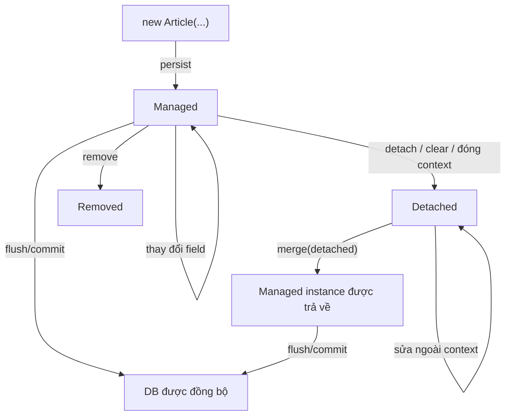
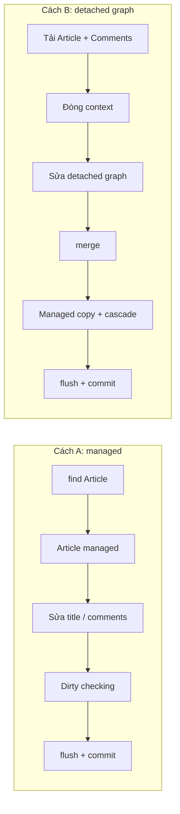
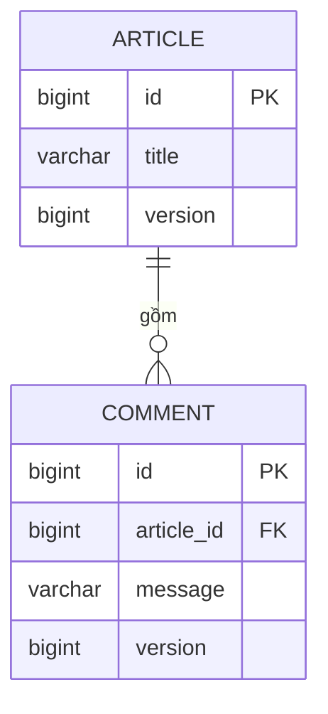
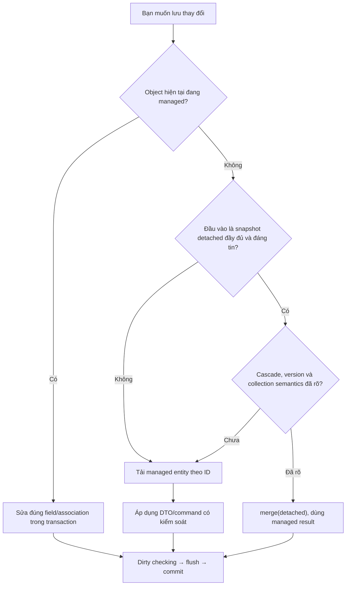

# Phân biệt cập nhật entity đang quản lý và hợp nhất đồ thị đã tách

Trong JPA, hai đoạn mã dưới đây **có thể cùng dẫn tới `UPDATE` ở database nhưng mang ý nghĩa vòng đời rất khác nhau**:

```java
// A. Sửa trực tiếp entity đang được quản lý.
Article managed = em.find(Article.class, articleId);
managed.changeTitle("Tiêu đề mới");
// Dirty checking sẽ xử lý khi flush/commit.

// B. Hợp nhất trạng thái của entity đã tách.
Article managedCopy = em.merge(detachedArticle);
// JPA sao chép trạng thái persistent sang managed instance.
```

Đoạn A thay đổi **chính managed instance** thuộc persistence context hiện tại. Đoạn B nhận một **đối tượng detached** đã được tải hoặc xử lý ngoài context, rồi yêu cầu JPA **sao chép trạng thái persistent** của đối tượng đó vào một managed instance tương ứng. Khi đối tượng gốc còn giữ nhiều quan hệ, B có thể trở thành thao tác **merge cả một đồ thị entity**, không chỉ cập nhật một cột.

Khác biệt này đặc biệt quan trọng khi một bài viết có nhiều bình luận, đơn hàng có nhiều dòng, hoặc hồ sơ có các entity liên kết. Nếu không phân biệt hai con đường, ứng dụng dễ gặp tình huống: gọi `save`/`merge` thừa, ghi đè dữ liệu bằng trường `null` từ DTO thiếu thông tin, xóa con do `orphanRemoval`, bỏ sót quan hệ chưa cascade hoặc gặp xung đột optimistic locking.

Bài học thuộc chương **Vòng đời entity** của chủ đề *Data Persistence Relational Access ORM JPA*. Mục tiêu là hiểu chính xác **cập nhật entity đang quản lý** và **hợp nhất đồ thị đã tách**, thực hành cả hai và lựa chọn hướng phù hợp với ranh giới transaction.

## 1. Nhắc lại trạng thái của entity trong JPA

Một đối tượng Java có annotation `@Entity` không phải lúc nào cũng được JPA theo dõi. Trạng thái của nó phụ thuộc persistence context và những thao tác đã diễn ra.

| Trạng thái | Ý nghĩa | Cách thường gặp |
|---|---|---|
| **New / transient** | Đối tượng mới, chưa được quản lý | `new Article(...)` |
| **Managed / persistent** | Nằm trong persistence context; JPA theo dõi thay đổi | Kết quả của `find`, query, `persist` hoặc `merge` trả về |
| **Detached** | Đã có identity hoặc từng được quản lý, nhưng hiện không thuộc persistence context đang xét | Sau `detach`, `clear`, đóng `EntityManager` hoặc qua ranh giới transaction |
| **Removed** | Entity managed đã được đánh dấu xóa | Sau `em.remove(entity)` trong context phù hợp |



**Quan trọng:** một entity có khóa chính khác `null` **không đủ** để biết nó đang managed. Một đối tượng vừa được ứng dụng cấp UUID có thể vẫn là new. Một đối tượng tải trong request trước có thể là detached.

Có thể kiểm tra chính xác với `EntityManager.contains(object)` đối với **persistence context hiện tại**:

```java
Article article = em.find(Article.class, id);
System.out.println(em.contains(article)); // true

em.detach(article);
System.out.println(em.contains(article)); // false
```

`contains` không phải phép kiểm tra hàng DB có tồn tại; nó chỉ kiểm tra object có thuộc context cụ thể hay không.

## 2. Hai con đường cập nhật nhìn từ một sơ đồ

Giả sử entity `Article` có quan hệ một-nhiều với `Comment`.



| Tiêu chí | Sửa entity **managed** | `merge` **detached graph** |
|---|---|---|
| Đối tượng được sửa | Entity đã thuộc context hiện tại | Object bên ngoài context, có thể mang cả graph |
| Cơ chế chính | Dirty checking của provider | Sao chép trạng thái persistent vào managed instance |
| Cần gọi `merge`? | **Không** | Có, nếu chọn cách merge detached state |
| Đối tượng sau thao tác | Vẫn là chính managed instance ban đầu | Đối số vẫn detached; **giá trị trả về** mới managed |
| Phạm vi thay đổi | Những field/association ứng dụng chủ động sửa | Toàn bộ trạng thái persistent được merge theo metadata/cascade |
| Quan hệ con | Có thể tải/sửa theo nhu cầu rõ ràng | Cần xem `cascade = MERGE` và trạng thái graph |
| Rủi ro từ DTO thiếu field | Thấp nếu chỉ cập nhật field được phép | Cao nếu dựng entity thiếu dữ liệu rồi merge |
| Xử lý xung đột | Có thể dùng `@Version`/khóa DB | `@Version` đặc biệt quan trọng với detached state cũ |
| Hướng thường phù hợp | Service transaction, PATCH một số field, cập nhật nghiệp vụ | Đồng bộ snapshot đầy đủ từ workflow offline/long-running với quy tắc rõ |

Không phải `merge` lúc nào cũng chậm hơn hay nguy hiểm hơn trong mọi tình huống. Nhưng nó có **semantics rộng hơn**, cần hiểu rõ graph và trạng thái của từng node.

## 3. Cập nhật entity managed bằng dirty checking

Đối với một entity managed, thay đổi thuộc tính persistent trong transaction thường đủ để JPA phát hiện và đồng bộ:

```java
EntityTransaction tx = em.getTransaction();

try {
    tx.begin();

    Article article = em.find(Article.class, articleId);
    if (article == null) {
        throw new IllegalArgumentException("Article not found");
    }

    article.changeTitle("JPA lifecycle trong thực tế");

    tx.commit(); // Provider flush các thay đổi cần ghi.
} catch (RuntimeException ex) {
    if (tx.isActive()) {
        tx.rollback();
    }
    throw ex;
}
```

Provider có thể phát SQL tương tự:

```sql
UPDATE article
SET title = ?, version = ?
WHERE id = ? AND version = ?;
```

SQL chỉ minh họa; danh sách cột, thời điểm `UPDATE` và cách provider quản lý version phụ thuộc mapping/configuration.

### Vì sao không gọi persist hoặc merge lần nữa?

- `persist` dùng để đưa **entity mới** vào trạng thái managed, không có nghĩa “lưu mọi entity bị sửa”.
- `merge` có thể nhận cả managed entity, nhưng trong use case này không cần thiết: đối tượng đã được context quản lý.
- Các thay đổi có thể đồng bộ lúc `flush` hoặc commit theo flush mode; gọi setter không bắt buộc tạo SQL ngay.
- `flush` đồng bộ SQL trong transaction nhưng **không phải commit**. Nếu transaction rollback, thay đổi đã flush cũng bị hủy theo quy tắc DB.

Nếu một method đã tải entity qua `find`/repository trong transaction và sửa đúng các field cần thiết, **dirty checking** thường là đường cập nhật rõ ràng nhất.

## 4. Detached entity là snapshot, không phải managed instance

Giả sử một `EntityManager` tải bài viết và đóng sau khi trả dữ liệu cho một quy trình khác:

```java
Article detached;

EntityManager reader = emf.createEntityManager();
try {
    detached = reader.find(Article.class, articleId);
} finally {
    reader.close();
}

detached.changeTitle("Tiêu đề sửa ngoài context");
```

Tại thời điểm `reader.close()`, `detached` không còn thuộc context của `reader`. Việc thay đổi title chỉ làm thay đổi object Java.

```java
System.out.println(detached.getId()); // ID vẫn còn.
```

Đừng nhầm một object có ID với một object đang được dirty-check. Ngay cả khi bạn mở một `EntityManager` mới, object cũ **không tự gắn lại**:

```java
EntityManager writer = emf.createEntityManager();

try {
    System.out.println(writer.contains(detached)); // false
} finally {
    writer.close();
}
```

Muốn lưu thay đổi theo lối JPA, có hai hướng phổ biến:

1. **Tải managed entity mới trong transaction**, rồi áp dụng chính xác dữ liệu thay đổi.
2. **Gọi `merge(detached)`** và dùng managed instance trả về.

Hai hướng có thể cho kết quả giống ở field đơn giản, nhưng với graph quan hệ chúng khác rõ về phạm vi và rủi ro.

## 5. merge không "gắn lại chính đối số"

Ngữ nghĩa cần nhớ:

```java
Article managedCopy = em.merge(detachedArticle);
```

JPA lấy trạng thái persistent của `detachedArticle` và hợp nhất vào **một managed instance** có cùng identity trong persistence context (hoặc tạo một instance managed theo quy tắc merge). Giá trị trả về là managed.

```java
Article detachedArticle = ...;

EntityTransaction tx = em.getTransaction();
tx.begin();

Article managedCopy = em.merge(detachedArticle);

System.out.println(em.contains(detachedArticle)); // false
System.out.println(em.contains(managedCopy));     // true

managedCopy.changeTitle("Đổi tiếp trên managed copy");
tx.commit();
```

**Đối tượng tham số không tự chuyển thành managed.**

Ví dụ sai:

```java
em.merge(detachedArticle);
detachedArticle.changeTitle("Sửa tiếp, nhưng vẫn detached");
```

Nếu muốn sửa sau merge, sử dụng object trả về:

```java
Article managed = em.merge(detachedArticle);
managed.changeTitle("Đổi tiếp trên managed instance");
```

### Merge có tự chọn INSERT hoặc UPDATE không?

Không nên coi `merge` là một phép **upsert phổ quát**. Provider cần xác định đối tượng đầu vào mang trạng thái mới hay detached, có thể truy vấn DB, dùng ID/version và phát sinh exception nếu nhận diện một detached entity đã bị xóa. Các phiên bản JPA/provider có thể khác nhau ở chi tiết xử lý. Với thao tác **tạo mới**, dùng `persist` theo ý định rõ ràng; với thao tác **cập nhật**, dùng managed entity hoặc merge detached state có hiểu biết về identity/version.

## 6. Một graph thực tế: Article có nhiều Comment

Ví dụ xuyên suốt bài học:

- `Article` là aggregate root.
- `Article` có nhiều `Comment`.
- Mỗi `Comment` có một `article_id` trỏ về Article.
- Bài viết và bình luận có thể được tải, sửa hoặc tách khỏi context.
- `@OneToMany` ở cha là **inverse side**, `@ManyToOne` ở con là **owning side**.
- Bình luận được xem là thành phần vòng đời của Article trong ví dụ, nên có `orphanRemoval = true`.



DDL khái niệm:

```sql
CREATE TABLE article (
    id BIGINT GENERATED BY DEFAULT AS IDENTITY PRIMARY KEY,
    title VARCHAR(255) NOT NULL,
    version BIGINT NOT NULL
);

CREATE TABLE comment (
    id BIGINT GENERATED BY DEFAULT AS IDENTITY PRIMARY KEY,
    article_id BIGINT NOT NULL,
    message VARCHAR(1000) NOT NULL,
    version BIGINT NOT NULL,
    CONSTRAINT fk_comment_article
        FOREIGN KEY (article_id) REFERENCES article(id)
);
```

Lược đồ trên minh họa cấu trúc dữ liệu; tên bảng/cột và kiểu SQL thực tế phụ thuộc database và provider. Ví dụ sử dụng Java 17, Jakarta Persistence 3.1 và Hibernate ORM 6.x để thấy trọn vẹn cách làm.

## 7. Định nghĩa Article: root, cascade và helper hai chiều

Tệp `src/main/java/demo/Article.java`:

```java
package demo;

import jakarta.persistence.CascadeType;
import jakarta.persistence.Column;
import jakarta.persistence.Entity;
import jakarta.persistence.GeneratedValue;
import jakarta.persistence.GenerationType;
import jakarta.persistence.Id;
import jakarta.persistence.OneToMany;
import jakarta.persistence.Table;
import jakarta.persistence.Version;

import java.util.ArrayList;
import java.util.Collections;
import java.util.Iterator;
import java.util.List;
import java.util.Objects;

@Entity
@Table(name = "article")
public class Article {

    @Id
    @GeneratedValue(strategy = GenerationType.IDENTITY)
    private Long id;

    @Column(name = "title", nullable = false, length = 255)
    private String title;

    @Version
    @Column(name = "version", nullable = false)
    private Long version;

    @OneToMany(
        mappedBy = "article",
        cascade = CascadeType.ALL,
        orphanRemoval = true
    )
    private List<Comment> comments = new ArrayList<>();

    protected Article() {
        // Constructor cho JPA.
    }

    public Article(String title) {
        changeTitle(title);
    }

    public Long getId() {
        return id;
    }

    public Long getVersion() {
        return version;
    }

    public String getTitle() {
        return title;
    }

    public List<Comment> getComments() {
        return Collections.unmodifiableList(comments);
    }

    public void changeTitle(String value) {
        Objects.requireNonNull(value, "title");
        if (value.isBlank()) {
            throw new IllegalArgumentException("title is required");
        }
        title = value;
    }

    public void addComment(Comment comment) {
        Objects.requireNonNull(comment, "comment");

        if (comment.getArticle() != null
                && comment.getArticle() != this) {
            throw new IllegalArgumentException(
                "Comment belongs to another article");
        }

        for (Comment current : comments) {
            if (current == comment) {
                comment.linkTo(this);
                return;
            }
        }

        comments.add(comment);
        comment.linkTo(this);
    }

    public void removeComment(Comment comment) {
        Objects.requireNonNull(comment, "comment");

        Iterator<Comment> iterator = comments.iterator();
        while (iterator.hasNext()) {
            if (iterator.next() == comment) {
                iterator.remove();
                if (comment.getArticle() == this) {
                    comment.linkTo(null);
                }
                return;
            }
        }
    }
}
```

Giải thích thiết kế:

- `@Version` trên Article phục vụ optimistic locking khi Article được cập nhật theo cơ chế của provider.
- `cascade = CascadeType.ALL` bao gồm `PERSIST` và `MERGE`, cho phép thao tác phù hợp lan từ Article đến các Comment. Cấu hình này chỉ đúng khi các Comment có vòng đời phụ thuộc Article.
- `orphanRemoval = true` có nghĩa một Comment được bỏ khỏi quan hệ khi managed state được đồng bộ có thể bị xóa khỏi DB.
- Getter trả view không sửa được để mã bên ngoài không lén thay `comments` mà quên cập nhật phía owning.
- `addComment` và `removeComment` đồng bộ **cả collection cha và tham chiếu của con**.
- Ví dụ chọn so sánh **cùng reference** trong helper vì các Comment mới có thể chưa có ID; tránh phụ thuộc vào `equals/hashCode` của entity khi đang học vòng đời.

Trong ứng dụng cho phép chuyển Comment giữa các Article, `orphanRemoval = true` thường không thích hợp vì thao tác bỏ khỏi cha cũ có thể khiến Comment bị đánh dấu xóa. Khi đó phải thiết kế lại chính sách sở hữu.

## 8. Định nghĩa Comment: owning side, version và cập nhật nội dung

Tệp `src/main/java/demo/Comment.java`:

```java
package demo;

import jakarta.persistence.Column;
import jakarta.persistence.Entity;
import jakarta.persistence.FetchType;
import jakarta.persistence.GeneratedValue;
import jakarta.persistence.GenerationType;
import jakarta.persistence.Id;
import jakarta.persistence.JoinColumn;
import jakarta.persistence.ManyToOne;
import jakarta.persistence.Table;
import jakarta.persistence.Version;

import java.util.Objects;

@Entity
@Table(name = "comment")
public class Comment {

    @Id
    @GeneratedValue(strategy = GenerationType.IDENTITY)
    private Long id;

    @Column(name = "message", nullable = false, length = 1000)
    private String message;

    @Version
    @Column(name = "version", nullable = false)
    private Long version;

    @ManyToOne(fetch = FetchType.LAZY, optional = false)
    @JoinColumn(name = "article_id", nullable = false)
    private Article article;

    protected Comment() {
        // Constructor cho JPA.
    }

    public Comment(String message) {
        changeMessage(message);
    }

    public Long getId() {
        return id;
    }

    public Long getVersion() {
        return version;
    }

    public String getMessage() {
        return message;
    }

    public Article getArticle() {
        return article;
    }

    void linkTo(Article next) {
        article = next;
    }

    public void changeMessage(String value) {
        Objects.requireNonNull(value, "message");
        if (value.isBlank()) {
            throw new IllegalArgumentException("message is required");
        }
        message = value;
    }
}
```

`Comment.article` là **owning side**, vì cột khóa ngoại `article_id` nằm ở bảng `comment`. Nếu ứng dụng chỉ thêm một Comment vào `Article.comments` mà không gán `Comment.article`, khóa ngoại có thể không được cập nhật đúng.

`@Version` trên Comment hữu ích khi việc sửa một bình luận cần phát hiện xung đột riêng. Version của Article **không nên được mặc định** là bảo vệ mọi thay đổi của từng Comment trong mọi provider/mapping; khi yêu cầu nhất quán cao, áp dụng version ở đúng entity và đo/kiểm tra behavior.

## 9. Cấu hình chạy ví dụ trong Java SE

Cấu trúc dự án:

```text
managed-vs-merge/
├── pom.xml
└── src/main/
    ├── java/demo/
    │   ├── Article.java
    │   ├── Comment.java
    │   └── Main.java
    └── resources/META-INF/
        └── persistence.xml
```

Một `pom.xml` minh họa:

```xml
<project xmlns="http://maven.apache.org/POM/4.0.0"
         xmlns:xsi="http://www.w3.org/2001/XMLSchema-instance"
         xsi:schemaLocation="http://maven.apache.org/POM/4.0.0
                             https://maven.apache.org/xsd/maven-4.0.0.xsd">
    <modelVersion>4.0.0</modelVersion>

    <groupId>demo</groupId>
    <artifactId>managed-vs-merge</artifactId>
    <version>1.0-SNAPSHOT</version>

    <properties>
        <maven.compiler.release>17</maven.compiler.release>
        <project.build.sourceEncoding>UTF-8</project.build.sourceEncoding>
    </properties>

    <dependencies>
        <dependency>
            <groupId>jakarta.persistence</groupId>
            <artifactId>jakarta.persistence-api</artifactId>
            <version>3.1.0</version>
        </dependency>
        <dependency>
            <groupId>org.hibernate.orm</groupId>
            <artifactId>hibernate-core</artifactId>
            <version>6.6.4.Final</version>
        </dependency>
        <dependency>
            <groupId>com.h2database</groupId>
            <artifactId>h2</artifactId>
            <version>2.3.232</version>
        </dependency>
    </dependencies>

    <build>
        <plugins>
            <plugin>
                <groupId>org.apache.maven.plugins</groupId>
                <artifactId>maven-compiler-plugin</artifactId>
                <version>3.13.0</version>
            </plugin>
            <plugin>
                <groupId>org.codehaus.mojo</groupId>
                <artifactId>exec-maven-plugin</artifactId>
                <version>3.4.1</version>
                <configuration>
                    <mainClass>demo.Main</mainClass>
                </configuration>
            </plugin>
        </plugins>
    </build>
</project>
```

Tệp `src/main/resources/META-INF/persistence.xml`:

```xml
<?xml version="1.0" encoding="UTF-8"?>
<persistence xmlns="https://jakarta.ee/xml/ns/persistence"
             xmlns:xsi="http://www.w3.org/2001/XMLSchema-instance"
             xsi:schemaLocation="
                https://jakarta.ee/xml/ns/persistence
                https://jakarta.ee/xml/ns/persistence/persistence_3_1.xsd"
             version="3.1">

    <persistence-unit name="articlePU" transaction-type="RESOURCE_LOCAL">
        <provider>org.hibernate.jpa.HibernatePersistenceProvider</provider>
        <class>demo.Article</class>
        <class>demo.Comment</class>
        <exclude-unlisted-classes>true</exclude-unlisted-classes>

        <properties>
            <property name="jakarta.persistence.jdbc.driver"
                      value="org.h2.Driver"/>
            <property name="jakarta.persistence.jdbc.url"
                      value="jdbc:h2:mem:articlesdb;DB_CLOSE_DELAY=-1"/>
            <property name="jakarta.persistence.jdbc.user"
                      value="sa"/>
            <property name="jakarta.persistence.jdbc.password"
                      value=""/>
            <property name="jakarta.persistence.schema-generation.database.action"
                      value="drop-and-create"/>
        </properties>
    </persistence-unit>
</persistence>
```

`drop-and-create` chỉ thích hợp cho demo/test vì có thể **xóa dữ liệu**. Production nên quản lý schema bằng migration và bảo đảm ràng buộc FK/unique/version phù hợp. Các phiên bản dependency chỉ là ví dụ đồng thế hệ, không khẳng định là phiên bản mới nhất.

## 10. Chương trình hoàn chỉnh: managed update và detached graph merge

Tệp `src/main/java/demo/Main.java`:

```java
package demo;

import jakarta.persistence.EntityManager;
import jakarta.persistence.EntityManagerFactory;
import jakarta.persistence.EntityTransaction;
import jakarta.persistence.Persistence;

public class Main {

    public static void main(String[] args) {
        EntityManagerFactory emf =
                Persistence.createEntityManagerFactory("articlePU");

        try {
            Long id = seed(emf);
            updateManaged(emf, id);
            updateDetachedGraphWithMerge(emf, id);
            printCurrent(emf, id);
        } finally {
            emf.close();
        }
    }

    private static Long seed(EntityManagerFactory emf) {
        EntityManager em = emf.createEntityManager();
        try {
            EntityTransaction tx = em.getTransaction();
            try {
                tx.begin();

                Article article = new Article("Tiêu đề ban đầu");
                article.addComment(new Comment("Bình luận thứ nhất"));
                article.addComment(new Comment("Bình luận thứ hai"));

                // CascadeType.ALL bao gồm PERSIST.
                em.persist(article);

                tx.commit();
                return article.getId();
            } catch (RuntimeException ex) {
                if (tx.isActive()) tx.rollback();
                throw ex;
            }
        } finally {
            em.close();
        }
    }

    private static Article loadWithComments(
            EntityManager em, Long id) {

        return em.createQuery(
                """
                SELECT DISTINCT a
                FROM Article a
                LEFT JOIN FETCH a.comments
                WHERE a.id = :id
                """,
                Article.class
            )
            .setParameter("id", id)
            .getSingleResult();
    }

    private static void updateManaged(
            EntityManagerFactory emf, Long id) {

        EntityManager em = emf.createEntityManager();
        try {
            EntityTransaction tx = em.getTransaction();
            try {
                tx.begin();

                Article article = loadWithComments(em, id);

                article.changeTitle("Tiêu đề do managed sửa");
                article.getComments().get(0)
                    .changeMessage("Managed sửa bình luận 1");

                // Không cần gọi merge(article).
                tx.commit();
            } catch (RuntimeException ex) {
                if (tx.isActive()) tx.rollback();
                throw ex;
            }
        } finally {
            em.close();
        }
    }

    private static void updateDetachedGraphWithMerge(
            EntityManagerFactory emf, Long id) {

        // Giai đoạn 1: tải graph đầy đủ rồi đóng EntityManager.
        EntityManager reader = emf.createEntityManager();
        Article detached;
        try {
            detached = loadWithComments(reader, id);

            // comments đã được khởi tạo bởi JOIN FETCH,
            // có thể truy cập sau khi reader.close().
            System.out.println(
                "Loaded comments: " + detached.getComments().size());
        } finally {
            reader.close();
        }

        // Giai đoạn 2: sửa graph không còn managed.
        detached.changeTitle("Tiêu đề do detached sửa");
        detached.getComments().get(0)
                .changeMessage("Detached sửa bình luận 1");

        // Giai đoạn 3: mở context mới và merge.
        EntityManager writer = emf.createEntityManager();
        try {
            EntityTransaction tx = writer.getTransaction();
            try {
                tx.begin();

                Article managedCopy = writer.merge(detached);

                System.out.println("Detached is managed? "
                    + writer.contains(detached));   // false
                System.out.println("Copy is managed? "
                    + writer.contains(managedCopy)); // true

                managedCopy.changeTitle(
                    "Tiêu đề sau khi sửa trên managed copy");

                tx.commit();
            } catch (RuntimeException ex) {
                if (tx.isActive()) tx.rollback();
                throw ex;
            }
        } finally {
            writer.close();
        }
    }

    private static void printCurrent(
            EntityManagerFactory emf, Long id) {

        EntityManager em = emf.createEntityManager();
        try {
            Article article = loadWithComments(em, id);

            System.out.println("Article: " + article.getTitle());

            for (Comment c : article.getComments()) {
                System.out.println("  Comment: " + c.getMessage());
            }
        } finally {
            em.close();
        }
    }
}
```

Chạy:

```bash
mvn compile exec:java
```

Một lần chạy thành công có thể in các dòng mang ý nghĩa:

```text
Loaded comments: 2
Detached is managed? false
Copy is managed? true
Article: Tiêu đề sau khi sửa trên managed copy
  Comment: Detached sửa bình luận 1
  Comment: Bình luận thứ hai
```

**Không phụ thuộc vào thứ tự Comment trong một `List` không có `@OrderBy`/`@OrderColumn`.** Nếu yêu cầu thứ tự ổn định khi đọc lại, hãy thêm trường thứ tự hoặc `ORDER BY` thích hợp; kết quả mẫu giả định Comment đầu tiên là bình luận đã được chọn để sửa. SQL, thời điểm lấy ID và log provider cũng phụ thuộc database và cấu hình.

Mục đích của đoạn code:

1. Tạo Article với hai Comment bằng cascade persist.
2. Sửa một managed Article và một managed Comment, **không merge**.
3. Tải graph bằng `LEFT JOIN FETCH`, đóng `EntityManager` để tạo graph detached có các Comment đã khởi tạo.
4. Sửa tiêu đề và nội dung Comment trên detached graph.
5. Gọi `merge` trong transaction/context mới và lấy **managedCopy**.
6. Chỉnh sửa tiếp chính managedCopy; commit và tải lại.

Ví dụ này có chủ đích **không bỏ Comment hoặc thêm Comment ở giai đoạn detached**, để phân tách khái niệm merge trạng thái khỏi các quy tắc xóa orphan và nhận biết entity mới.

## 11. Vì sao cascade MERGE quyết định phạm vi đồ thị?

Một graph Java thường có dạng:

```text
Article (root)
  |
  +-- Comment #1
  |
  +-- Comment #2
```

Khi gọi:

```java
Article managed = em.merge(detachedArticle);
```

JPA không có nghĩa vụ sao chép trạng thái của **mọi object có thể đi đến qua bất kỳ reference nào**. Nó dựa vào metadata association và quy tắc **cascade**.

Ví dụ:

```java
@OneToMany(mappedBy = "article", cascade = CascadeType.MERGE)
private List<Comment> comments;
```

và:

```java
@OneToMany(mappedBy = "article", cascade = CascadeType.ALL)
private List<Comment> comments;
```

đều cho phép cascade thao tác merge từ Article đến Comment. `ALL` bao gồm MERGE cùng các cascade type khác. Nếu chỉ cấu hình:

```java
@OneToMany(mappedBy = "article", cascade = CascadeType.PERSIST)
private List<Comment> comments;
```

thì **PERSIST không tự biến thành MERGE**. Khi merge một Article detached, không được mặc định mọi thay đổi trên các Comment detached cũng sẽ được sao chép. Tham chiếu quan hệ tới managed entity liên quan có thể vẫn được giữ theo ngữ nghĩa merge, nhưng **trạng thái bên trong Comment không được đảm bảo cascade merge nếu thiếu MERGE**.

### Cascade khác với fetch

| Cơ chế | Quyết định điều gì? |
|---|---|
| `fetch = LAZY / EAGER` | Khi nào/how state của association được tải theo semantics JPA |
| `cascade = MERGE` | Thao tác merge có lan sang entity liên quan hay không |
| `cascade = PERSIST` | Thao tác persist có lan sang entity liên quan hay không |
| `cascade = REMOVE` | Thao tác remove có lan sang entity liên quan hay không |
| `orphanRemoval = true` | Entity con bị tách khỏi quan hệ có thuộc vòng đời xóa hay không |

**LAZY không đồng nghĩa không cascade MERGE.** Một quan hệ lazy đã được tải vẫn có thể được cascade merge theo mapping. Ngược lại, `fetch = EAGER` không có nghĩa mọi quan hệ đó sẽ tự được merge nếu không cấu hình cascade tương ứng.

### Không lạm dụng CascadeType.ALL

Với Article–Comment, Comment có thể phụ thuộc hoàn toàn vào Article, nên `ALL` hợp lý cho ví dụ. Với quan hệ dùng chung như Order–Product hoặc Student–Course, không bật `REMOVE`/`ALL` bừa bãi: xóa entity gốc có thể dẫn đến xóa cả entity được nhiều nơi sử dụng.

## 12. Owning side vẫn quan trọng khi merge graph

Giả sử có quan hệ hai chiều:

```java
// Article - inverse side.
@OneToMany(mappedBy = "article")
private List<Comment> comments;

// Comment - owning side.
@ManyToOne
@JoinColumn(name = "article_id")
private Article article;
```

Nếu graph bị chỉnh sửa thiếu nhất quán:

```java
// Chỉ làm thay đổi collection Java phía inverse.
article.getComments().add(comment);

// comment.article vẫn null hoặc trỏ sai Article.
```

thì lúc merge provider không thể suy ra mọi liên kết mới chỉ bằng ý định nghiệp vụ. Phía `@ManyToOne` nắm khóa ngoại `article_id`; vì vậy **phải đồng bộ cả hai phía**.

Phương thức helper mẫu:

```java
article.addComment(comment);
```

đảm bảo:

```text
article.comments chứa comment
comment.article == article
```

Tương tự, khi bỏ Comment:

```java
article.removeComment(comment);
```

helper xóa khỏi collection và ngắt tham chiếu cha của con. Trong mapping `orphanRemoval=true`, thao tác này có ý nghĩa **xóa con** khi trạng thái managed được đồng bộ; không phải chỉ đổi FK thành null.

### Gắn lại Comment vào cha khác có giống merge không?

Không. `merge` quyết định hợp nhất trạng thái, không tự định nghĩa luật chuyển owner. Nếu Comment được phép đổi Article, cần một method domain bảo đảm bỏ khỏi collection cũ, thêm vào collection mới và thay đổi owning side; phải cân nhắc bỏ `orphanRemoval=true` nếu con được chuyển thay vì xóa.

## 13. Một nguy cơ của merge graph: xóa nhầm orphan

Giả sử Article đã lưu ba Comment:

```text
Article #10
  - Comment #101
  - Comment #102
  - Comment #103
```

Một API nhận bản cập nhật chỉ gồm các Comment `#101` và `#102`. Lập trình viên dựng một `Article` detached với collection chứa đúng hai object và gọi `merge`:

```java
Article managed = em.merge(partialArticle);
```

Nếu collection được xem là **tập trạng thái đầy đủ** và mapping có `orphanRemoval=true`, Comment `#103` có thể bị coi là con đã được loại khỏi quan hệ và bị xóa trong quá trình đồng bộ. Những chi tiết chính xác phụ thuộc mapping, tình trạng tải graph và provider, nhưng đây là **rủi ro thiết kế cốt lõi**.

**Thiếu phần tử trong request không nhất thiết có nghĩa yêu cầu xóa phần tử đó.**

### Phân biệt hai kiểu API

| Loại cập nhật | Ví dụ payload | Ý nghĩa đối với collection |
|---|---|---|
| **PATCH một vài field** | `{ "title": "Tên mới" }` | Không nhắc Comment → giữ nguyên Comment |
| **PATCH một Comment** | `{ "commentId": 102, "message": "..." }` | Chỉ sửa Comment #102 |
| **PUT thay toàn bộ tập** | `{ "comments": [ ... ] }` | Có thể định nghĩa danh sách là trạng thái đầy đủ, phần tử vắng mặt bị bỏ |
| **Delete một Comment** | `DELETE /articles/10/comments/103` | Xóa chính xác Comment #103 |

Nếu API là partial update, không nên biến dữ liệu thiếu thành `null`/collection rỗng trong entity detached rồi merge toàn bộ. Dùng managed update theo từng trường, hoặc thuật toán reconciliation có phân biệt “không gửi” và “gửi danh sách rỗng”.

### Không thay collection reference tùy tiện

Với entity managed, provider có thể theo dõi một collection wrapper. Thay nó bằng một `ArrayList` mới để "đồng bộ cả graph" có thể làm mất cơ chế tracking hoặc tạo nhiều DELETE/INSERT ngoài ý muốn:

```java
// Tránh cách cập nhật managed collection kiểu này:
article.comments = incomingComments;
```

Dùng helper và xác định tập chênh lệch sẽ biểu đạt rõ từng nghiệp vụ thêm/bỏ.

## 14. Managed update từ DTO: lựa chọn an toàn cho PATCH

Giả sử request chỉ cho đổi tiêu đề và nội dung một Comment. DTO được dùng để **diễn đạt yêu cầu** chứ không làm entity JPA bị thiếu field.

```java
public record EditCommentRequest(
        Long commentId,
        String message
) {}

public record EditArticleRequest(
        String newTitle,
        EditCommentRequest comment
) {}
```

Trong service có transaction, tải entity managed rồi áp dụng field được yêu cầu:

```java
@Transactional
public void editArticle(Long articleId, EditArticleRequest request) {
    Article article = em.find(Article.class, articleId);

    if (article == null) {
        throw new IllegalArgumentException("Article not found");
    }

    // Quy ước: null nghĩa là không thay đổi title.
    if (request.newTitle() != null) {
        article.changeTitle(request.newTitle());
    }

    if (request.comment() != null) {
        Comment target = em.find(
            Comment.class, request.comment().commentId());

        if (target == null || target.getArticle().getId() == null
                || !target.getArticle().getId().equals(articleId)) {
            throw new IllegalArgumentException(
                "Comment does not belong to this article");
        }

        target.changeMessage(request.comment().message());
    }

    // Không cần merge managed entity.
    // Transaction commit kích hoạt flush của các thay đổi.
}
```

Đoạn này là **mẫu trong Spring**: cần import `@Transactional` phù hợp và `EntityManager em` được inject (ví dụ bằng `@PersistenceContext`); không nằm trong chương trình Java SE `Main` ở phần trước.

Ưu điểm:

- Chỉ những trường được API cho phép mới được thay đổi.
- Không vô tình ghi đè `version`, `articleId`, collection hoặc field bảo mật.
- Kiểm tra Comment thuộc Article trước khi sửa.
- Có chỗ xác thực người gọi có quyền sửa Article/Comment.
- Có thể áp dụng quy tắc nghiệp vụ ngay trên managed entity.

Trong thực tế, request cần phân biệt “không cung cấp field” và “cố ý gán null” nếu null là giá trị hợp lệ, bằng patch object/JSON Merge Patch/field-presence mechanism phù hợp. Ví dụ quy ước `null = không đổi` chỉ phục vụ minh họa.

## 15. Đồng bộ toàn bộ tập con: thiết kế reconciliation trên managed graph

Khi API **cố ý thay toàn bộ danh sách Comment**, có thể cập nhật managed graph theo chênh lệch, thay vì tạo một detached Article thiếu trạng thái rồi merge mù quáng.

Ví dụ DTO:

```java
public record CommentInput(Long id, String message) {}

public record ReplaceCommentsRequest(
        List<CommentInput> comments
) {}
```

Quy tắc:

- `id == null`: Comment mới.
- `id` đã có và thuộc Article: cập nhật Comment cũ.
- `id` cũ không còn trong danh sách **đầy đủ**: xóa bằng `removeComment` (vì đây là PUT/replace).
- `id` thuộc Article khác hoặc trùng trong request: từ chối.
- Chỉ tiến hành khi request được xác thực và có quyền.

Ví dụ minh họa thuật toán trong service:

```java
@Transactional
public void replaceComments(
        Long articleId, ReplaceCommentsRequest request) {

    Article article = em.createQuery(
            """
            SELECT DISTINCT a
            FROM Article a
            LEFT JOIN FETCH a.comments
            WHERE a.id = :id
            """,
            Article.class
        )
        .setParameter("id", articleId)
        .getSingleResult();

    Map<Long, Comment> existing = article.getComments().stream()
        .filter(c -> c.getId() != null)
        .collect(Collectors.toMap(Comment::getId, c -> c));

    Set<Long> retained = new HashSet<>();

    for (CommentInput input : request.comments()) {
        if (input.id() == null) {
            article.addComment(new Comment(input.message()));
            continue;
        }

        Comment current = existing.get(input.id());
        if (current == null) {
            throw new IllegalArgumentException(
                "Comment not found in this article: " + input.id());
        }
        if (!retained.add(input.id())) {
            throw new IllegalArgumentException("Duplicate comment ID");
        }

        current.changeMessage(input.message());
    }

    List<Comment> snapshot = new ArrayList<>(article.getComments());
    for (Comment current : snapshot) {
        if (current.getId() != null
                && !retained.contains(current.getId())) {
            article.removeComment(current);
        }
    }

    // Cascade PERSIST + orphanRemoval xử lý các thay đổi
    // trên collection của Article đang managed ở flush/commit.
}
```

Đây là snippet của một service đã được cấu hình Spring, với các import `Map`, `Set`, `List`, `HashMap`/`HashSet`, `ArrayList` và `Collectors` tương ứng. Khi số Comment rất lớn, truy vấn fetch toàn graph có thể tốn tài nguyên; cân nhắc phân trang, query theo ID, SQL trực tiếp hoặc association handling khác. Đoạn mã trình bày chính sách **replace toàn bộ collection**, không phải một chiến lược tối ưu mọi quy mô.

Đối với quy trình cực kỳ nghiêm ngặt, trước khi áp dụng cần xác thực **toàn bộ request** (ID trùng, quyền, quan hệ, số lượng tối đa) để không làm bẩn managed state rồi mới phát hiện lỗi; khi có lỗi phải rollback transaction. Kết hợp optimistic locking hoặc các điều kiện DB phù hợp để tránh lost update do hai request cùng thay danh sách.

## 16. Làm thế nào merge graph đã tách có thể phát SQL?

Một lời gọi `merge(detachedArticle)` có thể kích hoạt nhiều việc hơn một `UPDATE`:

1. Tìm hoặc lấy managed Article có cùng identity.
2. Sao chép những thuộc tính persistent được phép merge của Article.
3. Đi qua các association có cascade MERGE theo metadata.
4. Với từng Comment detached, tìm managed target tương ứng hoặc xử lý entity mới theo quy tắc merge.
5. Đồng bộ các thay đổi cần thiết của collection và quan hệ.
6. Tại flush/commit, sinh `UPDATE`, `INSERT` và có thể `DELETE` do orphanRemoval.

Ví dụ SQL **có thể** gồm:

```sql
SELECT * FROM article WHERE id = ?;
SELECT * FROM comment WHERE article_id = ?;

UPDATE article
SET title = ?, version = ?
WHERE id = ? AND version = ?;

UPDATE comment
SET message = ?, version = ?
WHERE id = ? AND version = ?;
```

Không coi SQL trên là cam kết: provider có thể đã có entity trong first-level cache, dùng second-level cache, batch, query fetch khác hoặc bỏ qua update nếu không có dirty state. SQL thực tế phụ thuộc trạng thái của context, loại ID, cascade, collection, versioning, DB dialect và provider.

Để đánh giá hiệu năng, đo:

- Số `SELECT` phát ra khi merge root và con.
- Số entity được dựng vào persistence context.
- Chi phí snapshot collection và dirty checking.
- Số `UPDATE/INSERT/DELETE` thật sự được phát.
- Độ dài transaction và lock wait.
- Độ rộng graph, khả năng lazy loading và N+1.

**Merge không phải công cụ tối ưu mặc định** chỉ vì code ngắn một dòng. Với use case cập nhật hai field, tải managed entity và thay đổi hai field thường dễ kiểm soát chi phí hơn.

## 17. Đồ thị đã tách, lazy attribute và phạm vi trạng thái

Một detached graph thường **không chứa đầy đủ mọi association**. Ví dụ Article đã tải nhưng `comments` vẫn LAZY chưa được khởi tạo khi đóng `EntityManager`.

```java
Article article = em.find(Article.class, articleId);
em.detach(article);

// Nếu comments chưa được khởi tạo, việc truy cập sau detach
// có thể dẫn tới LazyInitializationException ở Hibernate.
```

JPA quy định provider không được merge những field/association lazy **chưa được tải**. Tuy nhiên, đừng thiết kế API phụ thuộc vào cách provider đoán “không tải” cho các object được **tự dựng hoặc deserialize** rồi gán collection rỗng/null. Trạng thái **chưa fetch** và trạng thái **đã fetch, giá trị rỗng** có ý nghĩa khác nhau.

Phân biệt:

| Tình huống | Ý nghĩa và rủi ro |
|---|---|
| Entity detached được JPA tải, một lazy association vẫn **unfetched** | Provider phải tôn trọng semantics của thuộc tính chưa tải khi merge; không được coi tự động là yêu cầu xóa |
| Association đã fetch, người dùng cố ý xóa toàn bộ collection | Có thể là thay đổi quan hệ thực sự; orphanRemoval quan trọng |
| DTO chỉ có title, developer dựng `new Article` rồi tự điền ID và để comments trống | Không có bảo đảm “comments chưa gửi” sẽ được hiểu đúng như unfetched JPA state |
| Object JSON được deserialize thành entity với `comments = []` | Dữ liệu rỗng có thể được hiểu là trạng thái collection mong muốn, nguy cơ xóa con |
| Association chứa các entity detached nhưng thiếu cascade MERGE | Các thay đổi bên trong con không chắc được hợp nhất |

Do đó, khi merge graph cần quy định rõ **snapshot có đầy đủ không, association nào được phép cập nhật và ý nghĩa của collection rỗng**. Nếu payload không phải graph JPA thực sự được tải và giữ state từ provider, ưu tiên chuyển DTO sang thay đổi có kiểm soát trên managed entity.

## 18. Merge và quan hệ con mới

Một đồ thị detached có thể chứa **cả con đã tồn tại** và **con mới**:

```text
Article #10 (detached)
  - Comment #101 (detached)
  - Comment #102 (detached)
  - Comment mới (id = null)
```

Khi cascade MERGE đi qua graph, provider có thể xử lý các con theo trạng thái thích hợp và tạo managed copy cho con mới, nhưng cần tránh các giả định:

- Không mặc định object con mới được truyền vào trở thành managed.
- Không tự điền ID giả rồi coi đó là “entity đã có”.
- Không giả định thứ tự xử lý và SQL luôn giống `persist`.
- Bảo đảm owning side của Comment trỏ đúng Article.
- Nếu một entity mới cần được tạo rõ ràng trong transaction, managed update với `article.addComment(new Comment(...))` và cascade PERSIST thường dễ hiểu hơn.

Với entity sử dụng `@GeneratedValue`, ID mới có thể chưa có trước khi provider thực hiện thao tác sinh khóa. Các loại identifier/`@Version` ảnh hưởng cách provider nhận diện new/detached; không tự suy ra trạng thái chỉ bằng ID.

Một helper hai chiều như `Article.addComment` giúp giữ object graph nhất quán dù đang thao tác managed hay detached. Nhưng **đúng object model không tự thay thế** cấu hình cascade, ràng buộc FK hay transaction.

## 19. Xung đột đồng thời và @Version

Detached graph đặc biệt dễ trở thành **ảnh chụp dữ liệu cũ**.

Giả sử:

1. Request A đọc Article `id=10` với `version=3`, đóng context.
2. Request B tải Article đó, đổi tiêu đề và commit; version trở thành 4.
3. Request A thay đổi tiêu đề trên detached Article version 3.
4. Request A gọi `merge`.

Nếu Article dùng `@Version` đúng cách, JPA provider cần kiểm tra optimistic locking khi merge hoặc khi flush/commit. Khi phát hiện phiên bản không phù hợp, thao tác có thể dẫn đến `OptimisticLockException` hoặc exception tương ứng được bọc bởi framework và transaction phải được xử lý như thất bại.

```java
@Entity
public class Article {

    @Version
    private Long version;

    // ...
}
```

Bản chất `@Version` là ngăn một phiên làm việc cũ âm thầm ghi đè thay đổi mới hơn. Không bắt exception rồi retry bằng cách merge lại **chính snapshot cũ** vô hạn, vì như vậy có thể phá ý định bảo vệ xung đột.

### Xử lý conflict ở tầng ứng dụng

Một cách rõ ràng:

- Gửi version hiện tại hoặc ETag cùng dữ liệu người dùng đang sửa.
- Trước cập nhật, xác định version yêu cầu có còn hợp lệ.
- Nếu xung đột, trả trạng thái conflict thích hợp và cho người dùng làm mới/hoà giải thay đổi.
- Nếu cần retry tự động, tải trạng thái mới, áp dụng lại **ý định nghiệp vụ** thay vì ghi đè toàn bộ snapshot cũ.
- Với graph lớn, đánh giá version ở cả Article và những Comment cần sửa.

### Version của root có bao trùm mọi Comment?

Không nên mặc định. Thay đổi một Comment có thể chỉ tăng version của Comment, tùy mapping và provider; version của Article không đương nhiên là khóa chống mọi thay đổi con. Nếu nghiệp vụ đòi hỏi một đơn vị version cho cả aggregate, cần thiết kế concurrency ở service, khóa/version root hoặc điều kiện đồng bộ cụ thể rồi kiểm chứng bằng transaction cạnh tranh.

## 20. Merge không thay thế kiểm tra quyền

Một detached graph do client hoặc hệ thống ngoài gửi tới có thể chứa nhiều trường mà caller không được phép sửa:

```json
{
  "id": 10,
  "title": "Tiêu đề mới",
  "authorId": 7,
  "moderationStatus": "APPROVED",
  "comments": []
}
```

Nếu ứng dụng deserialize JSON trực tiếp thành entity và gọi `merge`, nó có thể vô tình cho phép cập nhật các trường ngoài ý định, xóa collection hoặc chuyển quan hệ. **JPA không tự biết trường nào client được quyền sửa**.

Hướng thiết kế:

1. Nhận DTO chỉ có các field API cho phép.
2. Xác định identity từ route hoặc context đáng tin, không chỉ từ client-provided entity.
3. Xác thực authentication/authorization ở service.
4. Tải managed Article và những Comment cần sửa.
5. Áp dụng lệnh thay đổi rõ ràng và kiểm tra invariant.
6. Để dirty checking + transaction đồng bộ dữ liệu.

Nếu thật sự dùng merge graph để đồng bộ dữ liệu tin cậy từ một workflow nội bộ, vẫn cần xác minh ownership và mức đầy đủ của graph trước khi merge. Không cho phép client “giành quyền” cập nhật một entity khác chỉ bằng đổi primary key trong payload.

## 21. persist, merge, remove, refresh và clear khác nhau thế nào?

| API | Ý nghĩa chính | Dùng khi |
|---|---|---|
| `em.persist(newEntity)` | Đưa entity mới vào managed state, lên lịch INSERT | Tạo entity mới |
| Sửa field managed | Dirty checking đối với trạng thái đã quản lý | Cập nhật một số field hoặc graph trong transaction |
| `em.merge(detached)` | Sao chép state của entity detached/new theo ngữ nghĩa merge vào managed instance, trả về instance đó | Đồng bộ snapshot detached có kiểm soát |
| `em.remove(managed)` | Đánh dấu entity managed cần xóa | Xóa entity |
| `em.refresh(managed)` | Đọc lại trạng thái DB vào entity managed, có thể bỏ thay đổi chưa flush | Cần làm mới snapshot managed |
| `em.detach(managed)` | Ngừng quản lý một entity, cùng cascade DETACH nếu có | Không muốn dirty-check entity đó nữa |
| `em.clear()` | Tách toàn bộ managed entity trong context | Dọn context sau batch/bulk SQL |
| `em.flush()` | Đồng bộ các thay đổi pending trong transaction | Cần phát SQL trước một bước tiếp theo |
| `em.find(Type, id)` | Tìm managed entity theo PK trong context | Bắt đầu cập nhật có kiểm soát |

**Không dùng `merge` chỉ vì “muốn lưu”.** Trước tiên hãy trả lời entity bạn đang cầm **managed hay detached** và dữ liệu đầu vào là **thay đổi từng trường** hay **snapshot đầy đủ**.

## 22. Ranh giới transaction trong Spring Data JPA

Trong Spring, repository trả entity thường được sử dụng trong một transaction do `@Transactional` quản lý:

```java
@Service
public class ArticleService {

    private final ArticleRepository repository;

    public ArticleService(ArticleRepository repository) {
        this.repository = repository;
    }

    @Transactional
    public void rename(Long id, String title) {
        Article article = repository.findById(id)
            .orElseThrow(() -> new IllegalArgumentException("Not found"));

        article.changeTitle(title);
        // Managed entity trong transaction.
        // Thường không cần repository.save(article).
    }
}
```

Đoạn này giả định `ArticleRepository extends JpaRepository<Article, Long>` và các import Spring tương ứng. Khi phương thức chạy trong transaction với persistence context phù hợp, `article` vẫn managed; dirty checking xử lý thay đổi.

### repository.save() không đồng nghĩa gọi UPDATE ngay

Spring Data JPA thường chọn `persist` cho entity được nhận diện **new**, hoặc `merge` cho entity được nhận diện **not new**, dựa trên cơ chế phát hiện trạng thái (ví dụ version/ID hoặc `Persistable`). Bởi vậy, một câu `repository.save(article)` không nói chính xác “đã ghi một UPDATE” và cũng không thay thế hiểu biết về managed/detached.

Với một entity managed đã tải và sửa trong transaction, việc gọi `save` cuối method thường không cần thiết. Ngược lại, nếu DTO được dựng thành entity mang ID rồi save, Spring có thể gọi `merge` với **state chưa đầy đủ**, kéo theo những rủi ro đã phân tích.

### Open EntityManager in View không phải lý do để nhầm state

Một số ứng dụng giữ persistence context lâu hơn phần transaction service nhằm hỗ trợ lazy loading ở tầng web. Điều này không biến serialization trực tiếp entity graph thành phương án an toàn. Ranh giới transaction, phạm vi quyền sửa và mức dữ liệu được fetch vẫn cần kiểm soát rõ. Tách DTO trong service thường dễ dự đoán hơn.

## 23. Vấn đề detached graph có nhiều instance trùng identity

Một graph phức tạp có thể chứa **hai object Java khác nhau nhưng mang cùng entity type + ID**, ví dụ:

```text
Article #10
  |
  +-- Comment object A: id = 101
  |
  +-- Comment object B: id = 101
```

Đối với persistence context, chỉ nên có một managed instance cho một identity. Khi merge graph có nhiều đại diện detached khác nhau cho cùng ID, provider có thể phát hiện xung đột, ném exception hoặc có chính sách xử lý riêng. Hibernate có cơ chế cấu hình liên quan tới entity copies, nhưng đó là **đặc thù provider** và không nên dùng để hợp thức hóa một graph nhập liệu mâu thuẫn.

Giải pháp thiết kế:

- DTO nhận một ID con tối đa một lần trong tập hoàn chỉnh, trừ khi nghiệp vụ cho phép tham chiếu lặp chứ không phải entity trùng.
- Không tạo lại entity mới cho cùng ID ở nhiều nơi chỉ để cập nhật từng field.
- Dùng một managed instance do `find`/repository trả về để nhận tất cả cập nhật của identity đó.
- Nếu graph được build từ nhiều nguồn, chuẩn hóa và phát hiện ID trùng trước khi merge.

### equals/hashCode của entity có giúp không?

`Set` có thể loại phần tử “trùng” theo `equals/hashCode`, nhưng việc equality của entity khi chưa có ID, khi proxy được tạo hoặc khi phiên bản thay đổi là bài toán khác. Không trông cậy vào `Set` để tự giải quyết xung đột semantic của graph. Cần thiết kế identity và đối chiếu ID rõ ràng ở service.

## 24. Bulk JPQL và dữ liệu managed/detached lỗi thời

Một câu bulk update như:

```java
em.createQuery(
    "UPDATE Article a SET a.title = :title WHERE a.id = :id"
)
.setParameter("title", "Updated by bulk query")
.setParameter("id", articleId)
.executeUpdate();
```

đi trực tiếp tới database mà không cập nhật tự động mọi managed instance đã tải trong persistence context. Nếu trước đó đã có `Article managed`, object có thể còn giữ title cũ. `merge` một detached snapshot cũ ngay sau bulk update có thể ghi đè giá trị bulk mới nếu không kiểm soát version/transaction.

Khi phải phối hợp bulk operation và ORM:

1. Đồng bộ các thay đổi managed đang chờ nếu cần bằng `flush`.
2. Thực thi bulk DML trong transaction.
3. Làm mới hoặc xóa context cũ bằng `refresh`/`clear` khi thích hợp.
4. Tải managed entity mới trước khi áp dụng các thay đổi tiếp theo.
5. Với concurrency nghiêm ngặt, kiểm soát `@Version` hoặc SQL điều kiện vì bulk DML không tự tuân thủ cùng quy tắc dirty checking/version như thao tác entity thông thường.

`clear` không commit, không rollback và không xóa second-level cache một cách phổ quát. Các reference Java cũ sau clear vẫn là detached snapshots.

## 25. Khi nào nên chọn phương án nào?

| Bối cảnh | Hướng ưu tiên | Lý do |
|---|---|---|
| PATCH tiêu đề hoặc giá trị đơn giản | Tải entity managed rồi sửa field | Phạm vi ghi rõ; ít nguy cơ ghi đè trường khác |
| Sửa một Comment trong Article | Tải Comment managed, kiểm tra thuộc Article và quyền, rồi sửa | Không cần merge toàn graph |
| Thêm/bỏ một con trong aggregate | Managed root + helper hai chiều | Kiểm soát cascade, owning side, orphanRemoval |
| Replace toàn bộ tập con | Managed graph + tính chênh lệch theo ID, version | Mỗi thêm/sửa/xóa có ý nghĩa rõ |
| Workflow offline trả về snapshot entity đầy đủ, đáng tin và version hợp lệ | Có thể dùng merge graph với cascade MERGE | Phù hợp khái niệm hợp nhất detached state |
| API nhận JSON một phần, nhiều trường không được phép sửa | DTO command + managed update | Tránh mass assignment và collection bị xóa nhầm |
| Đồ thị rất lớn, chỉ thay đổi vài entity | Query đúng entity cần sửa; tránh merge cả graph | Giảm SELECT/dirty checking |
| Import dữ liệu theo lô hoặc bulk SQL | Chiến lược batch, JDBC hoặc bulk JPQL có kiểm soát | Tránh entity graph nặng và stale context |

### Quy trình ra quyết định



Sơ đồ là hướng chọn thiết kế, không phải khẳng định chỉ một phương án được phép. Điều quan trọng là **chủ động xác định trạng thái entity và ý nghĩa của dữ liệu đầu vào** trước khi gọi API persistence.

## 26. Các lỗi thường gặp và hướng xử lý

### Lỗi 1: Gọi merge rồi tiếp tục sửa đối số

```java
em.merge(detached);
detached.changeTitle("Sửa tiếp");
```

Đối số vẫn detached. Dùng `Article managed = em.merge(detached)` rồi sửa managed.

### Lỗi 2: Cập nhật managed entity nhưng gọi persist lại

```java
Article article = em.find(Article.class, id);
article.changeTitle("Tên mới");
em.persist(article); // Không phải cách cập nhật cần thiết.
```

Thay bằng sửa field trong transaction và để dirty checking.

### Lỗi 3: Thấy entity có ID nên nghĩ nó managed

`id != null` không chứng minh state. Dùng `em.contains(entity)` để xác định managed đối với context hiện tại, đồng thời hiểu entity mới cũng có thể có ID do ứng dụng tự cấp.

### Lỗi 4: Merge một entity dựng từ DTO thiếu thông tin

```java
Article partial = new Article("Tên mới");
// Tự điền ID bằng reflection / setter rồi merge không phải
// phương án an toàn cho PATCH.
```

Hướng tốt là tải Article managed theo ID và sửa `title`, không đặt những field không gửi thành null/rỗng.

### Lỗi 5: Chỉ cascade PERSIST nhưng mong con được MERGE

`cascade = PERSIST` khác `cascade = MERGE`. Với detached graph, phải xác định association nào được phép cascade MERGE và field nào thực sự đã fetch.

### Lỗi 6: Không đồng bộ hai phía

Chỉ thay inverse collection mà bỏ qua `Comment.article` có thể gây sai khóa ngoại khi persist/merge. Dùng helper đồng bộ cả hai phía.

### Lỗi 7: OrphanRemoval xóa nhầm con

Payload thiếu Comment không nhất thiết yêu cầu xóa Comment. Chỉ thực hiện reconciliation/xóa khi request định nghĩa tập đầy đủ hoặc có lệnh xóa rõ ràng.

### Lỗi 8: Merge snapshot cũ không kiểm soát version

Hai người dùng cùng sửa một entity có thể gây lost update nếu không có `@Version` hoặc cơ chế cạnh tranh phù hợp. Phát hiện conflict rồi để nghiệp vụ quyết định hòa giải.

### Lỗi 9: Đóng EntityManager rồi cố truy cập lazy collection

Detached graph có thể giữ những phần chưa tải. Dùng DTO projection/fetch theo nhu cầu trong transaction, hoặc không đụng vào lazy field sau detach.

### Lỗi 10: Tin rằng merge chỉ chạy một UPDATE

Provider có thể cần SELECT root/con, cascade qua graph, tạo managed copies và xử lý INSERT/DELETE. Xem SQL thực tế và đo chi phí với graph lớn.

### Lỗi 11: Gọi clear rồi tiếp tục sửa reference cũ

Sau `em.clear()`, mọi reference cũ đều detached. Tải lại managed instance hoặc merge rõ ràng nếu muốn tiếp tục đồng bộ.

### Lỗi 12: Coi merge là kiểm tra quyền truy cập

Không có chuyện JPA tự xác thực caller được sửa entity mang ID nào. Authorization, allowed fields, tenant scope và ownership phải được thực hiện trước persistence operation.

## 27. Bài tập thực hành

### Bài 1 — Chứng minh dirty checking

Dùng ví dụ `Article`, tải trong transaction, gọi `changeTitle` và commit mà không gọi `merge`. Dùng `EntityManager` mới để đọc lại tiêu đề và quan sát SQL `UPDATE`.

### Bài 2 — Phân biệt đối số và kết quả merge

Tải Article, đóng `EntityManager`, thay đổi title rồi merge vào một context mới. In `em.contains(detached)` và `em.contains(managedCopy)`. Sau merge, sửa cả hai reference theo hai giá trị khác nhau và dự đoán dữ liệu commit.

### Bài 3 — Đánh giá cascade MERGE

Thử mapping Article–Comment lần lượt với `cascade = PERSIST` và `cascade = {PERSIST, MERGE}`. Tải graph, detach, đổi nội dung Comment rồi merge Article. Quan sát SQL và trạng thái DB; giải thích vai trò cascade.

### Bài 4 — Ghi đè do DTO không đầy đủ

Thiết kế một request chỉ có `title`. Phân tích rủi ro khi chuyển JSON trực tiếp thành một entity `Article` rồi merge. Viết service managed update chỉ sửa title, không ảnh hưởng Comments và các trường khác.

### Bài 5 — Xóa orphan theo ý nghĩa request

Tạo Article có ba Comment. Với PUT thay toàn bộ Comments, gửi danh sách chứa hai ID; dùng helper trên managed Article để loại đúng Comment không còn trong danh sách. So sánh với PATCH chỉ đổi một Comment mà không xóa hai Comment còn lại.

### Bài 6 — Tranh chấp optimistic locking

Hai EntityManager tải cùng Article version ban đầu. EM thứ nhất commit một thay đổi; EM thứ hai thử commit snapshot cũ hoặc merge graph cũ. Quan sát exception/transaction và xây cách trả lỗi conflict phù hợp.

### Bài 7 — Graph có lazy association

Tải Article mà không fetch Comments, đóng context, rồi thao tác lazy collection. Sau đó tải Article bằng `JOIN FETCH a.comments` và thử lại. Giải thích sự khác biệt giữa association **chưa fetch** và collection **rỗng có chủ đích** khi thiết kế merge.

### Bài 8 — Hiệu năng merge graph lớn

Tạo Article có hàng nghìn Comment. So sánh cập nhật một title bằng:

1. Tải managed Article và sửa title.
2. Tải đầy đủ graph, detach, sửa title rồi merge toàn graph.

Bật SQL log và đo số query, row, heap và thời gian. Ghi rõ provider/version và không suy ra kết quả từ số dòng Java.

### Bài 9 — Tái hiện lỗi owning side

Tạo Article và Comment mới, chỉ thêm Comment vào collection nhưng không gán `Comment.article`. Quan sát hành vi flush với FK `NOT NULL`. Sửa bằng `addComment` đồng bộ hai phía và chạy lại.

### Bài 10 — Chặn graph trùng identity

Tạo request có cùng Comment ID xuất hiện hai lần. Viết validation từ chối trước khi merge hoặc reconciliation và giải thích vì sao `Set`/`equals` không nên là lớp bảo vệ duy nhất.

## 28. Câu hỏi tự kiểm tra

1. **Sửa một entity đang managed có cần `merge` không?** Không. Dirty checking xử lý các thay đổi persistent trong transaction phù hợp.
2. **`merge(detached)` có biến chính đối số thành managed không?** Không. Instance trả về mới là managed.
3. **`merge` một Article có tự merge toàn bộ Comments không?** Chỉ theo semantics mapping/cascade như `MERGE` hoặc `ALL` và trạng thái graph.
4. **Phía nào giữ FK Article–Comment?** `Comment.article` với `@ManyToOne` là owning side; collection Article là inverse side.
5. **Vì sao DTO PATCH thiếu collection không nên biến thành detached entity rồi merge?** Có thể ghi đè field/collection bằng dữ liệu thiếu hoặc xóa orphan ngoài ý định.
6. **`orphanRemoval=true` có ý nghĩa gì khi bỏ con?** Con bị tách khỏi quan hệ theo vòng đời phụ thuộc có thể bị xóa khi provider đồng bộ.
7. **`@Version` có giúp gì với detached graph cũ?** Hỗ trợ phát hiện xung đột optimistic locking thay vì ghi đè âm thầm.
8. **Version root có tự bảo vệ mọi thay đổi Comment không?** Không được mặc định; cân nhắc version và policy ở entity/con đường ghi tương ứng.
9. **Có ID khác null nghĩa là managed không?** Không. Phải xét persistence context và entity state.
10. **Merge có đảm bảo chỉ một lệnh UPDATE?** Không. Có thể có SELECT/INSERT/UPDATE/DELETE theo graph và mapping.
11. **`@ManyToOne` và `@OneToMany(mappedBy=...)` cần đồng bộ thế nào?** Cập nhật cả tham chiếu con và collection cha qua helper.
12. **Sau `clear`, reference cũ có được dirty-check không?** Không. Nó đã detached.
13. **Khi nào nên ưu tiên managed update?** Khi chỉ cần sửa vài trường, thao tác có quyền/validation, hoặc graph lớn không cần hợp nhất toàn bộ.
14. **Khi nào merge graph là lựa chọn có thể cân nhắc?** Khi có snapshot detached đầy đủ, đáng tin, cascade/version và collection semantics rõ ràng.

**Ghi nhớ:** **Sửa entity managed** nghĩa là thay đổi đối tượng đang thuộc persistence context và để JPA **dirty-check rồi flush/commit**; không cần `merge`. **Hợp nhất đồ thị detached** bằng `merge` nghĩa là sao chép trạng thái persistent từ những object bên ngoài context sang **managed copy**, có thể lan qua các association có cascade MERGE, và **đối số vẫn detached**. Khi graph chứa collection và quan hệ, hãy kiểm soát owning side, orphanRemoval, lazy state, version, quyền cập nhật và sự khác biệt giữa **PATCH một phần** với **replace toàn bộ graph** để tránh thay đổi dữ liệu ngoài ý định.
