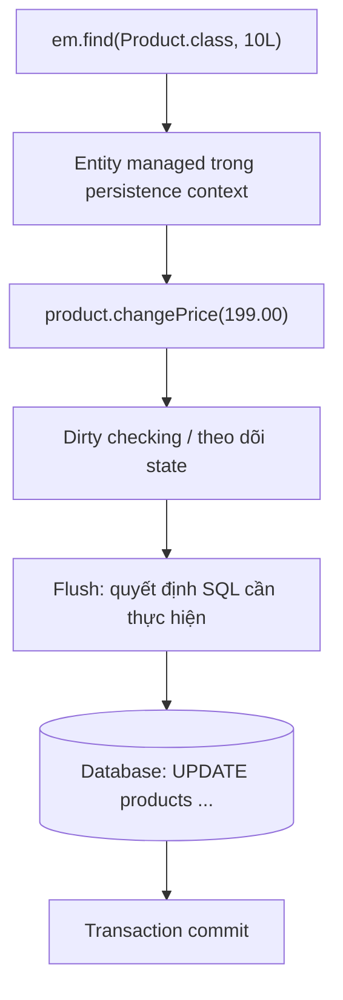
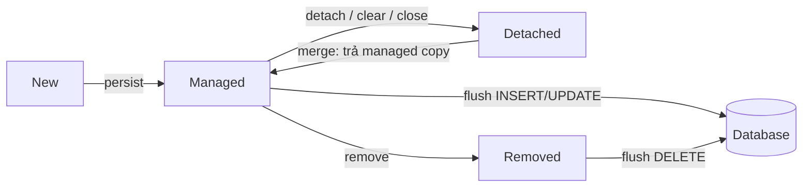
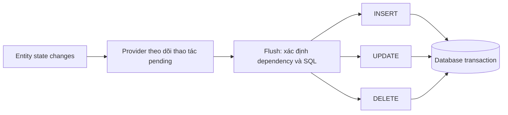

# Cơ chế phát hiện thay đổi và đồng bộ entity xuống cơ sở dữ liệu

Trong Java Persistence API (JPA), một trong những khác biệt lớn nhất so với việc tự viết JDBC là ứng dụng **không cần gọi lệnh `UPDATE` cho từng thuộc tính vừa thay đổi**. Khi một entity được quản lý bởi `EntityManager`, JPA provider có thể theo dõi trạng thái của nó. Nếu ta sửa các trường dữ liệu trong một transaction, provider sẽ phát hiện thay đổi và đồng bộ chúng xuống cơ sở dữ liệu vào thời điểm thích hợp.

Ví dụ:

```java
Product product = em.find(Product.class, 10L);
product.changePrice(new BigDecimal("199.00"));
// Không có em.update(product).
// Khi flush/commit, JPA provider có thể tạo câu UPDATE tương ứng.
```

Cơ chế này thường được gọi là **dirty checking** (phát hiện trạng thái đã thay đổi). Bước chuyển các thay đổi đang nằm trong persistence context thành SQL `INSERT`, `UPDATE` và `DELETE` được gọi là **flush**. Hai khái niệm liên quan chặt chẽ nhưng không đồng nhất:

- **Dirty checking:** so sánh hoặc theo dõi trạng thái entity để xác định phần nào bị thay đổi.
- **Flush:** thực hiện quá trình đồng bộ những thao tác persistence đang chờ với database.
- **Commit:** kết thúc và xác nhận transaction thành công; commit không đồng nghĩa với một phương thức `flush` đơn thuần.

Bài học này tập trung vào cách JPA phát hiện thay đổi, khi nào SQL được gửi, mối liên hệ giữa flush và transaction, tác động của quan hệ/collection, `@Version`, JPQL bulk update và các vấn đề hiệu năng. Các ví dụ sử dụng namespace `jakarta.persistence`; với JPA 2.x cũ, package tương ứng là `javax.persistence`.

## 1. Mô hình tư duy: persistence context là nơi theo dõi entity

**Persistence context** là môi trường quản lý một nhóm entity instance. `EntityManager` cung cấp API để tương tác với persistence context; một managed entity được gắn với định danh persistence cụ thể và được provider theo dõi trong phạm vi context.

Một ví dụ giao dịch:

```java
em.getTransaction().begin();

Product product = em.find(Product.class, 10L);
product.changePrice(new BigDecimal("199.00"));

em.getTransaction().commit();
```

Ta chỉ sửa một Java object; provider đảm nhiệm việc chuyển thay đổi thành hoạt động database theo quy tắc mapping và transaction.

Sơ đồ tổng quát:



Sơ đồ mô tả luồng thường gặp, **không khẳng định tất cả provider đều phải so sánh snapshot ngay trước mỗi SQL**. Provider có thể tối ưu, kiểm tra thay đổi tại một thời điểm khác, hoặc sử dụng bytecode enhancement để ghi nhận trường đã bị sửa. SQL cũng có thể được thực hiện sớm hơn commit.

### Các vai trò cần phân biệt

| Thành phần | Vai trò |
|---|---|
| `EntityManager` | API `persist`, `find`, `merge`, `remove`, `flush`, `clear`, `refresh` và truy vấn |
| Persistence context | Quản lý identity, lifecycle và trạng thái của các managed entity |
| JPA provider | Triển khai mapping, dirty checking, quản lý thao tác đang chờ và sinh SQL |
| JDBC / connection | Phương tiện provider thường dùng để gửi SQL tới database |
| Database | Thực thi câu lệnh, ràng buộc PK/FK/UNIQUE/CHECK, khóa và transaction |
| Transaction manager | Quản lý bắt đầu, commit, rollback và phạm vi transaction |

Không nên xem `EntityManager` là “một đối tượng Java gọi UPDATE ngay khi setter chạy”. Sửa setter thường chỉ thay **trạng thái trong bộ nhớ**; provider quyết định khi nào và bằng cách nào đồng bộ xuống database.

## 2. Điều kiện để JPA phát hiện và đồng bộ thay đổi

Một đoạn code thay đổi entity chỉ được JPA tự động đồng bộ khi có đủ các điều kiện liên quan:

1. Entity đang ở trạng thái **managed** trong một persistence context.
2. Thay đổi nằm trên **persistent state** được mapping, không phải field `@Transient` hoặc biến cục bộ.
3. Có transaction và điều kiện đồng bộ phù hợp để SQL ghi dữ liệu được thực thi.
4. Entity không bị detach/clear trước khi thay đổi được đồng bộ, hoặc không nằm trong trạng thái/provider mode bỏ qua thay đổi.
5. Những ràng buộc database và cơ chế locking cho phép thao tác được commit.

### Ví dụ: entity managed

```java
em.getTransaction().begin();

Product product = em.find(Product.class, productId); // managed
product.changeName("New name");                     // state thay đổi

em.getTransaction().commit();                       // flush trước khi commit
```

Nếu `product` thực sự được quản lý và mapping cho phép cập nhật thuộc tính `name`, ứng dụng **không cần** gọi `em.merge(product)` trong trường hợp này. Việc gọi merge trên managed entity không phải cơ chế cần thiết để “lưu” một thay đổi.

### Ví dụ: entity detached

```java
Product product = em.find(Product.class, productId);
em.detach(product);

product.changeName("Detached change");
// Không tự có SQL UPDATE cho thay đổi này.
```

`detach` loại instance khỏi persistence context. Sau đó provider không còn dirty-check instance này như một managed entity. Để lưu state của detached entity, cần một workflow như tải lại entity managed rồi sửa, hoặc `merge` có chủ đích trong transaction.

### Field không persistent

```java
@Entity
public class Product {
    @Id
    private Long id;

    private String name;

    @Transient
    private String displayLabelCache;
}
```

Nếu chỉ sửa `displayLabelCache`, JPA không cần cập nhật bảng `products`, vì `@Transient` loại field này khỏi persistent state. Tương tự, thay một giá trị chỉ dùng nội bộ Java mà không có mapping không tự tạo SQL.

## 3. Vòng đời entity và dirty checking

Một entity thường trải qua những trạng thái chính:

| Trạng thái | Ý nghĩa | Dirty checking có tự lưu thay đổi không? |
|---|---|---|
| **New / transient** | Object mới tạo bằng `new`, chưa gắn vào context | Không; phải `persist` hoặc cascade phù hợp |
| **Managed** | Object có mặt trong persistence context | Có thể, khi flush trong transaction phù hợp |
| **Detached** | Object từng persistent/managed nhưng không còn được context quản lý | Không tự động |
| **Removed** | Object managed đã được đánh dấu để xóa | Flush sẽ xử lý lệnh xóa theo quy tắc JPA |

Sơ đồ vòng đời rút gọn:



**Lưu ý về `merge`:** Arrow trong sơ đồ là về mặt trạng thái được hợp nhất; Java object detached ban đầu **không tự trở thành managed**. `merge` trả về một instance managed (có thể là instance đã tồn tại trong context); chính instance trả về mới được tiếp tục theo dõi.

### Bảng trách nhiệm của từng API

| API | Tác động lên persistence context | Tác động SQL điển hình |
|---|---|---|
| `persist(newEntity)` | Đưa entity mới vào managed state | Lên lịch `INSERT`; có thể sinh SQL sớm tùy ID strategy |
| `find(Entity.class, id)` | Trả entity managed hoặc `null` | Có thể `SELECT` nếu context/cache chưa có |
| Sửa field của managed entity | Thay state Java trong context | `UPDATE` có thể được tạo khi flush |
| `remove(managedEntity)` | Đánh dấu removed | `DELETE` khi flush |
| `flush()` | Đồng bộ state đang chờ với database | Có thể phát `INSERT`, `UPDATE`, `DELETE` |
| `clear()` | Detach tất cả managed entities | Không phải lệnh lưu; cần xử lý pending changes trước nếu muốn giữ |
| `detach(entity)` | Detach một entity | Không phải lệnh lưu |
| `refresh(entity)` | Nạp lại state từ DB cho managed entity | `SELECT`; có thể ghi đè state chưa lưu |
| `merge(detached)` | Sao chép state vào managed instance | SQL phát sinh theo state/flush, không nhất thiết ngay khi gọi merge |

Không dựa vào việc đặt tên API để suy ra SQL được thực thi tức thời. `persist` có thể phải tạo ID sớm trong một số chiến lược, còn `flush` có thể không có gì để cập nhật nếu không có thay đổi.

## 4. Ví dụ xuyên suốt: `Product` và thay đổi giá

Xây một entity để minh họa:

```java
package example.domain;

import jakarta.persistence.Column;
import jakarta.persistence.Entity;
import jakarta.persistence.GeneratedValue;
import jakarta.persistence.GenerationType;
import jakarta.persistence.Id;
import jakarta.persistence.Table;
import jakarta.persistence.Transient;
import jakarta.persistence.Version;
import java.math.BigDecimal;

@Entity
@Table(name = "products")
public class Product {
    @Id
    @GeneratedValue(strategy = GenerationType.SEQUENCE)
    private Long id;

    @Column(name = "name", nullable = false, length = 150)
    private String name;

    @Column(
        name = "unit_price",
        nullable = false,
        precision = 15,
        scale = 2
    )
    private BigDecimal unitPrice;

    @Column(name = "active", nullable = false)
    private boolean active;

    @Version
    private long version;

    @Transient
    private String formattedPriceCache;

    protected Product() {
    }

    public Product(String name, BigDecimal unitPrice) {
        changeName(name);
        changePrice(unitPrice);
        this.active = true;
    }

    public Long getId() {
        return id;
    }

    public String getName() {
        return name;
    }

    public BigDecimal getUnitPrice() {
        return unitPrice;
    }

    public long getVersion() {
        return version;
    }

    public void changeName(String newName) {
        if (newName == null || newName.isBlank()) {
            throw new IllegalArgumentException("Name is required");
        }
        this.name = newName;
    }

    public void changePrice(BigDecimal newPrice) {
        if (newPrice == null || newPrice.signum() < 0) {
            throw new IllegalArgumentException("Price cannot be negative");
        }
        this.unitPrice = newPrice;
        this.formattedPriceCache = null;
    }

    public void deactivate() {
        this.active = false;
    }
}
```

Tại đây:

- `id` là persistence identity.
- `name`, `unitPrice`, `active` và `version` là mapped state.
- `formattedPriceCache` là state chỉ dùng trong Java; `@Transient` không cho nó tham gia dirty checking theo mapping.
- `changePrice` thực hiện validation trong domain method, nhưng việc gọi method này không phải là một lệnh SQL.
- `@Version` được dùng để hỗ trợ **optimistic locking**, không phải đánh dấu một giá trị chỉ đọc.

Ví dụ transaction:

```java
EntityManager em = emf.createEntityManager();
try {
    em.getTransaction().begin();

    Product product = em.find(Product.class, productId);
    if (product == null) {
        throw new IllegalArgumentException("Product not found");
    }

    product.changePrice(new BigDecimal("149.90"));
    product.changeName("Updated product");

    em.getTransaction().commit();
} catch (RuntimeException ex) {
    if (em.getTransaction().isActive()) {
        em.getTransaction().rollback();
    }
    throw ex;
} finally {
    em.close();
}
```

Không có lời gọi `em.update(product)` hoặc `em.persist(product)` sau khi `find`. Một managed entity đã nằm trong context và đang được provider theo dõi.

## 5. Dirty checking hoạt động bằng cách nào?

Đặc tả JPA yêu cầu provider duy trì và đồng bộ state của managed entity theo semantics được quy định. **Cách triển khai phát hiện thay đổi** có thể khác nhau giữa các provider hoặc giữa các cấu hình của cùng provider.

Hai mô hình thường gặp để hiểu dirty checking là **snapshot comparison** và **bytecode-enhanced tracking**.

### 5.1. Mô hình snapshot comparison

Khi provider nạp entity vào persistence context, nó có thể ghi nhớ state ban đầu:

```text
Snapshot được ghi nhớ:
    name      = "Basic chair"
    unitPrice = 120.00
    active    = true

Managed Product hiện tại:
    name      = "Basic chair"
    unitPrice = 149.90
    active    = true

So sánh:
    name      -> không đổi
    unitPrice -> đã đổi
    active    -> không đổi
```

Khi đến thời điểm dirty checking/flush, provider xác định entity có thay đổi persistent state và chuẩn bị câu SQL tương ứng.

Mô hình này giải thích vì sao ứng dụng có thể gọi một business method bình thường mà JPA vẫn biết state thay đổi. Không cần setter được đánh dấu đặc biệt cho từng thuộc tính.

Tuy nhiên, chi tiết thực tế còn phức tạp:

- Có thể dùng snapshot của giá trị được nạp hoặc dữ liệu provider lưu trong cấu trúc internal.
- Provider có thể biết state đã dirty trước khi flush, không nhất thiết phải so sánh mọi field ở mọi lần.
- Cách kiểm tra thay đổi với mutable basic type, embeddable và collection có những quy tắc/optimizer riêng.
- Dữ liệu `@Version` có thể thay đổi cùng thao tác update để kiểm soát đồng thời.

**Snapshot là mô hình khái niệm hữu ích, không phải API chuẩn cho ứng dụng truy cập hay sửa trực tiếp.**

### 5.2. Bytecode enhancement hoặc instrumentation

Một số provider, tiêu biểu là những cấu hình của Hibernate, có thể tăng cường bytecode của entity để biết thuộc tính nào bị thay đổi khi nó được gán giá trị.

Ví dụ về mặt ý tưởng:

```text
product.unitPrice = 149.90
        |
        v
Generated/enhanced code ghi nhận thuộc tính unitPrice đã bị sửa
        |
        v
Khi flush provider xử lý các thay đổi cần đồng bộ
```

Điều này có thể giảm một phần chi phí so sánh snapshot trong một số tình huống, nhưng **không làm thay đổi quy tắc cốt lõi của JPA**: chỉ managed persistent state mới được tự đồng bộ; transaction và flush vẫn quyết định lúc ghi database.

Không nên viết code phụ thuộc việc một setter có được instrument hay không nếu mục tiêu là portable JPA. Khả năng enhancement, dirty-tracking kiểu inline, tối ưu collection và hỗ trợ mutable type phụ thuộc provider/version.

### 5.3. Thay đổi rồi trả về giá trị ban đầu

Ví dụ:

```java
Product product = em.find(Product.class, id);
BigDecimal original = product.getUnitPrice();
product.changePrice(new BigDecimal("300.00"));
product.changePrice(original);
```

Khi flush, state persistent cuối cùng có thể bằng state ban đầu. Provider dựa trên snapshot thường có thể nhận thấy không còn thay đổi thực chất. Provider dùng tracking hoặc chiến lược dirty checking khác có thể có cách xử lý riêng; không nên khẳng định **chắc chắn có** hay **chắc chắn không có** câu `UPDATE` trên mọi provider. Điều ứng dụng nên quan tâm là **trạng thái persistent đúng sau transaction**, không phải tận dụng việc đổi rồi hoàn tác để điều khiển SQL.

### 5.4. Gán lại đúng giá trị cũ có tạo SQL không?

```java
product.changeName(product.getName());
```

Một phương thức setter được gọi không đồng nghĩa database bắt buộc phải UPDATE. Dirty checking đánh giá thay đổi state theo semantics của provider. Nếu nghiệp vụ cần một thao tác audit rõ ràng “đã yêu cầu cập nhật dù giá trị không đổi”, nên mô hình hóa sự kiện đó riêng, không dựa vào việc gọi setter.

## 6. Mapping quyết định field nào được theo dõi

JPA có **field access** và **property access**.

### 6.1. Field access

```java
@Entity
@Access(AccessType.FIELD)
public class Product {
    @Id
    private Long id;

    private String name;

    protected Product() {}

    public void rename(String value) {
        this.name = value;
    }
}
```

Với field access, provider ánh xạ field trực tiếp. Application không cần public setter cho mọi thuộc tính. Thay đổi field persistent thông qua domain method vẫn có thể được dirty-check khi entity đang managed.

### 6.2. Property access

```java
@Entity
@Access(AccessType.PROPERTY)
public class Category {
    private Long id;
    private String name;

    protected Category() {}

    @Id
    public Long getId() {
        return id;
    }

    protected void setId(Long id) {
        this.id = id;
    }

    @Column(nullable = false)
    public String getName() {
        return name;
    }

    protected void setName(String name) {
        this.name = name;
    }
}
```

Với property access, provider sử dụng các persistent property và phương thức truy cập phù hợp. Một field có thể nằm trong class nhưng không tham gia mapping nếu không được xác định là persistent property. Cần tránh trộn annotation giữa field/getter một cách không nhất quán.

### 6.3. `@Column(updatable = false)` không giống immutable Java

```java
@Column(name = "created_by", updatable = false)
private String createdBy;
```

`updatable = false` nói với JPA rằng cột này không được đưa vào các câu `UPDATE` do mapping điều khiển. Nó **không làm field thành `final`**, không ngăn Java gán một giá trị khác trong RAM và không bảo vệ dữ liệu khỏi các lệnh SQL ngoài JPA.

Tương tự:

```java
@Column(name = "external_code", insertable = false)
private String externalCode;
```

`insertable = false` ảnh hưởng tới SQL `INSERT` do provider tạo, không đồng nghĩa với read-only object ở mọi tầng. Nếu database tự tạo giá trị bằng default/trigger/generated column, cần cấu hình chiến lược đọc lại phù hợp thay vì giả định Java field luôn được cập nhật tự động sau mọi flush.

## 7. Flush: đồng bộ thay đổi từ context sang database

`EntityManager.flush()` yêu cầu provider đồng bộ những thay đổi đang chờ của persistence context với database.

Ví dụ:

```java
em.getTransaction().begin();

Product product = em.find(Product.class, 10L);
product.changePrice(new BigDecimal("149.90"));

em.flush(); // Yêu cầu SQL đồng bộ được thực thi trong transaction hiện tại.

em.getTransaction().commit();
```

Điều `flush()` **có thể thực hiện**:

- Sinh hoặc thực thi `INSERT` cho entity mới đã `persist`.
- Thực thi `UPDATE` cho managed entity có persistent state thay đổi.
- Thực thi `DELETE` cho entity được đánh dấu removed.
- Đồng bộ join table, collection table, foreign key và ordered list.
- Thực thi các thao tác cần thiết cho relationship/cascade theo quy tắc lifecycle.
- Làm lộ lỗi constraint, optimistic locking hoặc lỗi SQL **trước commit**.

Điều `flush()` **không tự làm**:

- Không commit transaction.
- Không xóa toàn bộ persistence context.
- Không detach entity khỏi context.
- Không đồng bộ những thay đổi trên entity detached mà chưa được merge/chuyển thành managed.
- Không biến mọi câu query thành dữ liệu luôn nhất quán với những tiến trình khác bất kể isolation level.
- Không bảo đảm mỗi thay đổi Java có đúng một câu SQL tương ứng.

### Flush có phải là một `UPDATE`?

Không. Một lần flush có thể gửi **nhiều loại SQL** hoặc không gửi câu lệnh nào nếu không có thay đổi cần thực thi. Flush là **bước đồng bộ của cả persistence context**, không phải method dành riêng cho một entity.

```java
em.flush();
```

Không có đối số entity vì provider cần xem toàn bộ những thay đổi đang được quản lý và các dependency có liên quan, không chỉ “lưu đối tượng X”.

## 8. Flush và commit khác nhau thế nào?

Một transaction có thể có nhiều lần flush trước khi commit.

```text
BEGIN TRANSACTION
    |
    |-- find Product
    |-- sửa unitPrice
    |-- flush() -> SQL UPDATE trong transaction
    |-- sửa name
    |-- flush() -> có thể SQL UPDATE khác
    |
COMMIT -> xác nhận transaction
```

Nếu transaction bị rollback sau flush:

```java
em.getTransaction().begin();

Product product = em.find(Product.class, id);
product.changePrice(new BigDecimal("500.00"));
em.flush();

em.getTransaction().rollback();
```

SQL được gửi vào database khi flush nhưng **vẫn thuộc transaction chưa commit**. Rollback hủy tác động của những thao tác trong transaction theo cơ chế giao dịch của database. Thay đổi đã flush không đồng nghĩa trở thành thay đổi đã commit.

### Bảng so sánh

| Tiêu chí | Flush | Commit |
|---|---|---|
| Mục đích | Đồng bộ state pending xuống database | Xác nhận và kết thúc transaction |
| Có thể chạy nhiều lần trong một transaction? | Có | Một commit kết thúc transaction đó |
| SQL có thể được gửi? | Có | Thường buộc flush trước/như một phần commit khi cần |
| Làm dữ liệu tồn tại bền vững sau transaction? | Không, có thể rollback | Có, nếu commit thành công theo bảo đảm của DB |
| Phát sinh lỗi constraint/lock? | Có thể | Có thể; một số constraint được kiểm tra muộn |
| Tạo transaction mới? | Không | Không; commit kết thúc transaction hiện tại |

### Vì sao gọi flush sớm?

Có những lý do hợp lệ:

1. Cần kiểm tra một constraint đã được DB thực thi trước khi xử lý bước tiếp.
2. Cần đồng bộ SQL pending trước một truy vấn phụ thuộc tới dữ liệu mới.
3. Cần buộc provider phát hiện xung đột optimistic locking sớm.
4. Đang xử lý import theo batch và muốn `flush/clear` sau từng nhóm.
5. Cần bảo đảm việc xóa cũ được thực hiện trước khi chèn bản ghi thay thế khi có unique constraint.

Nhưng **flush thường xuyên không đồng nghĩa nhanh hơn**. Nhiều lần flush có thể chia nhỏ batch JDBC, tạo thêm SQL cập nhật trên cùng entity và làm tăng chi phí dirty checking.

## 9. Khi nào JPA tự flush?

JPA có cơ chế **flush mode** để quyết định mức tự động đồng bộ trạng thái pending trước các thao tác khác.

Hai giá trị portable của `FlushModeType`:

```java
FlushModeType.AUTO
FlushModeType.COMMIT
```

Đặt ở `EntityManager`:

```java
em.setFlushMode(FlushModeType.AUTO);
```

Hoặc trên một query:

```java
TypedQuery<Product> query = em.createQuery(
    "select p from Product p where p.active = true",
    Product.class
);
query.setFlushMode(FlushModeType.COMMIT);
```

### 9.1. `AUTO`: bảo đảm query phù hợp với thay đổi trong context

`FlushModeType.AUTO` là flush mode mặc định của JPA. Khi transaction đang hoạt động, provider có trách nhiệm đảm bảo những thay đổi pending có thể ảnh hưởng tới kết quả query được phản ánh theo semantics phù hợp. Provider **có thể** flush trước query, nhưng cũng có thể dùng cơ chế khác nếu vẫn đáp ứng yêu cầu.

Ví dụ:

```java
em.getTransaction().begin();

Product product = em.find(Product.class, productId);
product.changePrice(new BigDecimal("99.00"));

List<Product> results = em.createQuery(
        "select p from Product p where p.unitPrice < :maxPrice",
        Product.class
    )
    .setParameter("maxPrice", new BigDecimal("100.00"))
    .getResultList();

em.getTransaction().commit();
```

Thay đổi giá có thể ảnh hưởng việc `Product` đó có thuộc kết quả truy vấn hay không. Với `AUTO` trong transaction, provider phải xử lý để semantics của query nhất quán với thay đổi pending theo hợp đồng JPA. **Không nên hiểu rằng `AUTO` bắt buộc phát một lệnh SQL trước mọi `SELECT`.** Tối ưu flush phụ thuộc provider và loại truy vấn.

### 9.2. `COMMIT`: trì hoãn flush có thể quan sát khi query

`FlushModeType.COMMIT` cho phép provider tập trung đồng bộ khi commit. Theo đặc tả, **ảnh hưởng của pending updates lên kết quả query khi dùng `COMMIT` là không được xác định**. Điều này có nghĩa:

- Query trước commit có thể không phản ánh một số thay đổi chưa flush.
- Không được viết nghiệp vụ portable dựa trên việc query chắc chắn thấy hoặc chắc chắn không thấy dirty state.
- Commit vẫn phải giải quyết đồng bộ cần thiết khi transaction thành công.
- Có thể gọi `em.flush()` tường minh khi cần database phản ánh pending state trước bước tiếp theo.

Ví dụ:

```java
em.setFlushMode(FlushModeType.COMMIT);

em.getTransaction().begin();
Product product = em.find(Product.class, id);
product.changePrice(new BigDecimal("99.00"));

// Không dựa vào kết quả aggregate SQL này nếu cần bao gồm
// pending changes mà chưa flush trong mode COMMIT.
BigDecimal sum = em.createQuery(
        "select sum(p.unitPrice) from Product p",
        BigDecimal.class
    )
    .getSingleResult();

em.getTransaction().commit();
```

Nếu phép tính tổng phải có dữ liệu vừa sửa, dùng flush tường minh khi đúng về transaction, hoặc sắp xếp lại luồng nghiệp vụ. Với query đã trả entity đang nằm trong persistence context, còn có cơ chế identity riêng nên cần phân biệt **state của managed object** với **việc database đã chạy UPDATE hay chưa**.

### 9.3. Flush mode riêng của Hibernate

Hibernate có thêm những chế độ flush và API riêng theo phiên bản, ví dụ các chế độ tối ưu cho trường hợp read-only hoặc flush thủ công. Những lựa chọn này không phải tất cả đều thuộc `jakarta.persistence.FlushModeType`.

Nếu code cần portable giữa provider, nên bắt đầu với `AUTO`/`COMMIT` và hiểu semantics của JPA. Khi dùng mode riêng của provider, hãy xác định rõ nó tác động tới query, transaction, native SQL, performance và việc đồng bộ entity như thế nào.

## 10. Thứ tự thao tác SQL khi flush

Một transaction có thể:

```java
em.persist(newCustomer);
em.persist(newOrder);
oldOrder.cancel();
em.remove(expiredToken);
```

Provider cần tạo SQL phù hợp với:

- Primary key của entity mới.
- Foreign key từ entity con tới entity cha.
- Join table, collection table.
- Cascade persist/remove và orphan removal.
- Unique constraint và optimistic lock.

**Thứ tự SQL thực tế không nhất thiết trùng thứ tự các câu lệnh Java**. Provider có thể gom nhóm INSERT/UPDATE/DELETE, sử dụng action queue hoặc điều chỉnh thứ tự vì phụ thuộc FK và batching.

Sơ đồ khái niệm:



Việc provider nhóm thao tác khác nhau giúp batching, nhưng có thể khiến thao tác “xóa một hàng rồi tạo hàng khác có cùng business key” gặp unique constraint nếu INSERT chạy trước DELETE. Trường hợp cần kiểm soát thứ tự, có thể tách thành các bước có `flush()` tường minh trong cùng transaction, hoặc cập nhật hàng hiện có thay vì xóa/tạo mới.

### Không nên giả định mỗi setter tạo một UPDATE

```java
product.changeName("Name A");
product.changeName("Name B");
product.changeName("Name C");
```

Nếu ba thay đổi diễn ra trước một flush, provider thường có thể đồng bộ **state cuối cùng** `Name C` bằng một câu UPDATE, không cần ba câu tương ứng mỗi setter. Nếu giữa các lần sửa có flush, database có thể nhận nhiều update.

Ngược lại, provider có thể cập nhật nhiều cột hơn những cột đã thay đổi, tùy SQL generation strategy. JPA không yêu cầu mọi provider chỉ đưa “cột dirty” vào `SET`.

## 11. `INSERT` và thời điểm cấp khóa chính

Với entity mới:

```java
Product product = new Product("Keyboard", new BigDecimal("50.00"));
em.persist(product);
```

Sau `persist`, entity có trạng thái managed. Thao tác INSERT có thể được hoãn đến flush, nhưng **không phải mọi ID strategy đều cho phép hoãn giống nhau**.

| Strategy | Đặc điểm ảnh hưởng timing |
|---|---|
| `SEQUENCE` | Provider có thể lấy ID từ sequence trước khi thực hiện INSERT |
| `TABLE` | Provider có thể cấp ID qua generator table trước khi INSERT entity |
| `IDENTITY` | Database thường cấp ID khi INSERT, nên provider có thể cần INSERT sớm để biết ID |
| `AUTO` | Provider quyết định cách sinh ID phù hợp, tùy DB và cấu hình |

Ví dụ:

```java
@Id
@GeneratedValue(strategy = GenerationType.IDENTITY)
private Long id;
```

Provider thường cần chèn hàng để lấy ID do database sinh. Do đó, `persist` **không luôn chỉ lưu mọi thao tác trong RAM**. Một số SQL có thể đã xảy ra trước một lệnh `flush()` tường minh.

Điều luôn cần giữ trong tư duy: SQL INSERT được thực hiện trong transaction không phải là commit transaction. Thấy ID đã được sinh chưa chứng minh transaction đã thành công.

### Database default và generated values

Nếu một cột do database default/trigger tạo giá trị, JPA không tự đảm bảo Java field luôn nhìn thấy giá trị mới ngay sau mọi flush, trừ khi provider/mapping có cơ chế đọc lại thích hợp. Một số trường hợp cần `refresh(entity)` hoặc annotation provider-specific cho generated columns. Không xem `flush` là lời hứa sẽ đọc lại toàn bộ hàng và thay mọi giá trị Java bằng giá trị cuối ở database.

## 12. Dirty checking với `@Embeddable` và value object

Entity có thể nhúng value object:

```java
@Embeddable
public class Address {
    private String street;
    private String city;

    protected Address() {}

    public Address(String street, String city) {
        this.street = street;
        this.city = city;
    }
}
```

```java
@Entity
public class Customer {
    @Id
    private Long id;

    @Embedded
    private Address shippingAddress;

    protected Customer() {}

    public void changeShippingAddress(Address newAddress) {
        this.shippingAddress = newAddress;
    }
}
```

Khi managed `Customer` được gán một `Address` mới, thuộc tính embedded của nó là một phần persistent state. Provider có thể dirty-check state này và cập nhật những cột địa chỉ tương ứng khi flush.

```java
Customer customer = em.find(Customer.class, customerId);
customer.changeShippingAddress(
    new Address("12 Nguyen Hue", "Ho Chi Minh City")
);
```

**Điểm quan trọng:** `Address` không phải entity riêng nếu chỉ có `@Embeddable`. Không cần `em.persist(address)`; JPA đồng bộ giá trị của nó thông qua entity owner.

### Mutable embeddable có thể phát sinh thay đổi lồng bên trong

Nếu `Address` có setter:

```java
customer.getShippingAddress().setCity("Da Nang");
```

Provider phải xử lý semantics của persistent state được thay đổi theo cách mapping hỗ trợ, nhưng khả năng phát hiện cụ thể với những mutable custom types, bytecode enhancement và nested objects có thể khác. Khi muốn value object dễ suy luận, thường nên **tạo giá trị mới và thay reference trên entity** thay vì cho code ngoài sửa lắt nhắt từng thuộc tính.

Từ Jakarta Persistence 3.2, `record` được hỗ trợ làm embeddable theo đặc tả. Record bất biến có thể thuận tiện cho cách thay nguyên value object; nhưng chính entity owner vẫn phải là managed entity và giá trị record cần được ánh xạ bởi provider tương thích.

### Đối tượng mutable bên trong một basic field

Với kiểu như `Date` hoặc custom mutable object có `AttributeConverter`, việc sửa **nội bộ của cùng một object** có thể khó hơn việc gán một object mới, tùy kiểu dữ liệu và cơ chế snapshot/dirty tracking của provider.

Ví dụ:

```java
// Không nên mặc định provider nào cũng phát hiện đúng
// thay đổi nội bộ của mọi custom mutable type.
someMutableValue.setPart("new");
```

Để tránh vấn đề, ưu tiên các type bất biến như `String`, `BigDecimal`, `LocalDate` hoặc record/value object thích hợp và gán giá trị mới vào mapped attribute. Nếu bắt buộc có custom mutable type, cần xem cách provider định nghĩa mutability plan/snapshot/converter.

## 13. Dirty checking với quan hệ và collection

Quan hệ không chỉ là các field Java: chúng biểu diễn foreign key hoặc join table trong database. Vì vậy **chỉnh collection ở phía không sở hữu** chưa chắc tạo SQL đúng như mong muốn.

### 13.1. Quan hệ nhiều-một / một-nhiều

Giả sử:

```java
@Entity
public class PurchaseOrder {
    @Id
    private Long id;

    @OneToMany(
        mappedBy = "order",
        cascade = CascadeType.ALL,
        orphanRemoval = true
    )
    private List<OrderLine> lines = new ArrayList<>();

    protected PurchaseOrder() {}

    public void addLine(OrderLine line) {
        if (line == null) {
            throw new IllegalArgumentException("Line required");
        }
        lines.add(line);
        line.attachTo(this);
    }
}
```

```java
@Entity
public class OrderLine {
    @Id
    @GeneratedValue
    private Long id;

    @ManyToOne(optional = false, fetch = FetchType.LAZY)
    @JoinColumn(name = "order_id", nullable = false)
    private PurchaseOrder order;

    protected OrderLine() {}

    void attachTo(PurchaseOrder newOrder) {
        if (order != null && order != newOrder) {
            throw new IllegalStateException("Line already assigned");
        }
        order = newOrder;
    }
}
```

Trong mapping này:

- `OrderLine.order` là **owning side** và quản lý foreign key `order_lines.order_id`.
- `PurchaseOrder.lines` là inverse side vì có `mappedBy = "order"`.
- `PurchaseOrder.addLine` cập nhật **cả hai hướng** trong Java.
- Khi flush, provider đồng bộ entity/association dựa vào mapping ownership và cascade.

Nếu chỉ:

```java
order.getLines().add(line);
// line.order chưa trỏ tới order.
```

thì object graph đang không nhất quán. `@OneToMany(mappedBy="order")` không tự biến một thay đổi ở inverse list thành foreign key đúng nếu owning side chưa được thiết lập.

### 13.2. Quan hệ một-một hai hướng

```java
// Account: inverse
@OneToOne(mappedBy = "account")
private AccountProfile profile;

// AccountProfile: owning
@OneToOne
@JoinColumn(name = "account_id", unique = true)
private Account account;
```

Để thay association, code cần giữ `account.profile` và `profile.account` đồng nhất. Provider có thể dựa vào owning side để tạo SQL cập nhật cột `account_id`. Chỉ thay reference inverse chưa phải thao tác update FK đáng tin cậy.

### 13.3. `@ManyToMany` và join table

```java
@ManyToMany
@JoinTable(
    name = "user_groups",
    joinColumns = @JoinColumn(name = "user_id"),
    inverseJoinColumns = @JoinColumn(name = "group_id")
)
private Set<Group> groups = new HashSet<>();
```

Thêm hoặc xóa phần tử association có thể khiến provider INSERT/DELETE các hàng trong **join table** khi flush. Điều này khác với việc cập nhật một cột trong bảng `users` hay `groups`.

Nếu quan hệ hai chiều, chỉ phía mapping sở hữu join table nên là nguồn điều khiển thay đổi quan hệ; phía inverse dùng `mappedBy` để tham chiếu. Cần đồng bộ object graph trong Java bằng helper.

### 13.4. `@ElementCollection`

```java
@ElementCollection
@CollectionTable(
    name = "product_tags",
    joinColumns = @JoinColumn(name = "product_id")
)
@Column(name = "tag")
private Set<String> tags = new HashSet<>();
```

Khi thêm/xóa tag trên managed product, provider có thể đồng bộ các hàng trong collection table. Các phần tử `String` không phải entity riêng, nên không có entity lifecycle độc lập.

Với list có `@OrderColumn`, thay đổi vị trí có thể yêu cầu cập nhật nhiều order-index columns. Với bag/list thiếu định danh ổn định cho từng row, provider có thể chọn cách xóa rồi chèn lại một phần hoặc toàn bộ collection table; SQL chi tiết phụ thuộc mapping và provider.

## 14. Cascade và `orphanRemoval` không phải dirty checking của mọi object

`CascadeType.PERSIST`, `MERGE`, `REMOVE`... mô tả việc **lan truyền thao tác EntityManager** dọc theo association.

```java
@OneToMany(
    mappedBy = "order",
    cascade = CascadeType.ALL,
    orphanRemoval = true
)
private List<OrderLine> lines;
```

Hai cơ chế:

1. **Cascade:** ví dụ `em.persist(order)` có thể dẫn tới persist các dòng mới liên kết khi được cấu hình phù hợp.
2. **Orphan removal:** một entity con bị tháo khỏi quan hệ theo semantics của mapping có thể được đánh dấu xóa khi flush.

Dirty checking không có nghĩa mọi object trong Java heap đều được tự lưu. Nếu không có cascade và entity con vẫn transient, chỉ gán một reference từ cha đến con không đương nhiên biến nó thành managed.

### Xóa khỏi collection có nghĩa gì?

```java
order.getLines().remove(line);
```

Nếu `orphanRemoval = true` và quan hệ đã được đồng bộ đúng cả hai phía, provider có thể xử lý entity con bị orphan bằng DELETE khi flush. Nếu không có orphan removal, ứng dụng có thể chỉ đang thay association; với FK `NOT NULL`, “tách con nhưng vẫn giữ con tồn tại” có thể vi phạm constraint.

Không nên nhầm **xóa row join table của @ManyToMany** với **xóa entity Group dùng chung**. Hai thao tác có semantics và cascade khác nhau.

## 15. `@Version` và optimistic locking tại thời điểm flush

Khi nhiều transaction cùng sửa một hàng, dirty checking của từng persistence context không đủ để bảo đảm không ghi đè lẫn nhau. `@Version` cho phép provider phát hiện xung đột optimistic locking.

```java
@Version
private long version;
```

Một câu UPDATE minh họa:

```sql
UPDATE products
SET unit_price = ?, version = ?
WHERE id = ? AND version = ?;
```

Giả sử transaction A và B đều đọc `Product` version 7:

```text
T1: SELECT Product #10, version=7
T2: SELECT Product #10, version=7
T1: đổi giá, flush/commit -> UPDATE ... WHERE version=7
    thành công; version mới có thể là 8
T2: đổi tên, flush/commit -> UPDATE ... WHERE version=7
    không còn hàng thỏa -> optimistic lock conflict
```

Provider có thể báo `OptimisticLockException` khi flush hoặc commit, tùy lúc phát hiện xung đột. Với transaction đã lỗi, ứng dụng cần rollback và quyết định retry sau khi tải state mới, hoặc báo lỗi xung đột cho người dùng.

### Optimistic locking không phải “SQL UPDATE luôn xảy ra”

Một entity không dirty có thể không cần UPDATE, và việc increment version phụ thuộc vào kiểu thao tác/lock mode, provider và quy tắc JPA. Nếu ứng dụng muốn buộc version tăng dù không thay đổi thuộc tính, có thể xem xét `LockModeType.OPTIMISTIC_FORCE_INCREMENT` trong trường hợp phù hợp, thay vì gán lại giá trị cũ và hy vọng dirty checking tạo UPDATE.

### Bulk JPQL có tự kiểm tra version không?

Không theo cách cập nhật từng managed entity. JPQL bulk update/delete bypass lifecycle và cơ chế kiểm soát phiên bản tự động thông thường. Nếu bulk update tham gia bài toán có yêu cầu tránh ghi đè đồng thời, cần thiết kế điều kiện WHERE/version và cách quản lý số phiên bản có chủ đích.

## 16. Entity callback và Bean Validation trong quá trình đồng bộ

JPA có lifecycle callbacks:

```java
@PrePersist
void beforeInsert() {
    // Xử lý trước INSERT.
}

@PreUpdate
void beforeUpdate() {
    // Xử lý trước UPDATE.
}

@PreRemove
void beforeDelete() {
    // Xử lý trước DELETE.
}
```

Với managed entity dirty và có UPDATE, `@PreUpdate` có thể được gọi theo lifecycle. Nhưng **không được xem việc gọi setter là đủ để callback chắc chắn chạy**. Nếu không có SQL UPDATE cần thực hiện, callback `@PreUpdate` không phải một event tổng quát “đã gọi business method”.

Ví dụ audit timestamp:

```java
@Column(name = "updated_at")
private Instant updatedAt;

@PrePersist
void onCreate() {
    updatedAt = Instant.now();
}

@PreUpdate
void onUpdate() {
    updatedAt = Instant.now();
}
```

Mã minh họa nguyên tắc callback; nên có imports `jakarta.persistence.PrePersist`, `PreUpdate` và `java.time.Instant` tương ứng. Trong hệ thống có nhiều node, thời gian của application node có thể lệch nhau; nếu cần mốc thời gian chuẩn nhất quán, có thể dùng cơ chế database hoặc hạ tầng clock đồng bộ.

### Không nên thao tác EntityManager trong callback

Theo quy tắc của JPA, callback cần tránh truy cập `EntityManager`, thực hiện query và sửa relationship/entity khác. Callback nên giới hạn vào trạng thái đơn giản của entity hiện tại và những logic được đặc tả cho phép. Nếu cần xử lý workflow/audit phức tạp hoặc gọi dịch vụ ngoài, nên dùng service layer, transaction events hoặc outbox pattern thích hợp.

### Bean Validation

Nếu tích hợp Bean Validation:

```java
@NotBlank
@Column(name = "name", nullable = false)
private String name;
```

Các constraint có thể được kiểm tra trong lifecycle trước khi ghi dữ liệu theo integration được cấu hình. Nhưng **validation Java không thay thế database constraint**. SQL ngoài ứng dụng hoặc một tiến trình khác vẫn có thể đưa dữ liệu sai vào DB nếu schema không bảo vệ.

Và ngược lại, `flush()` có thể trả lỗi từ DB do `NOT NULL`, `UNIQUE`, FK, `CHECK` hoặc giới hạn kiểu dữ liệu, dù Java đã chạy validation.

## 17. Bulk JPQL `UPDATE`/`DELETE`: đường đi không qua dirty checking

JPA hỗ trợ JPQL bulk update:

```java
int updated = em.createQuery(
        "update Product p " +
        "set p.active = false " +
        "where p.active = true " +
        "and p.unitPrice = 0"
    )
    .executeUpdate();
```

Hoặc bulk delete:

```java
int deleted = em.createQuery(
        "delete from Product p " +
        "where p.active = false"
    )
    .executeUpdate();
```

Các thao tác này thực hiện điều kiện ở database và có thể tác động nhiều row **mà không tải từng entity managed vào persistence context**. Chúng phù hợp cho các tác vụ dữ liệu số lượng lớn, nhưng khác biệt đáng kể so với dirty checking:

| Khía cạnh | Managed entity + flush | JPQL bulk update/delete |
|---|---|---|
| Đường xử lý | State Java → provider dirty checking → SQL | Câu query DML → SQL |
| Có cần tải từng entity? | Có nếu sửa state từng managed instance | Không |
| Entity callbacks per-instance | Theo vòng đời thông thường | Không tự chạy cho từng row |
| JPA cascade/orphanRemoval | Áp dụng theo mapping và thao tác | Không tự áp dụng qua object graph |
| `@Version` tự kiểm tra từng row | Có theo optimistic locking | Không tự áp dụng kiểu thường |
| Đồng bộ managed instance trong context | Có qua thao tác state | Không; có thể tạo **stale objects** |
| Thích hợp xử lý nhiều row | Cần batch/giới hạn context | Thường hiệu quả khi chỉ cần DML theo điều kiện |

### 17.1. Vấn đề stale state

```java
em.getTransaction().begin();

Product product = em.find(Product.class, 10L);
System.out.println(product.getName()); // "Old"

em.createQuery(
        "update Product p set p.name = 'New' where p.id = :id"
    )
    .setParameter("id", 10L)
    .executeUpdate();

System.out.println(product.getName()); // Có thể vẫn là "Old".
em.getTransaction().commit();
```

Query bulk sửa database nhưng instance `product` trong persistence context **không được JPA tự cập nhật theo từng row bulk**. Nếu sau đó code tiếp tục sửa `product` và flush, provider có thể ghi dữ liệu từ object cũ xuống DB theo mapping/update strategy.

### 17.2. Cách phối hợp bulk với persistence context

Một quy trình có chủ đích:

```java
em.getTransaction().begin();

em.flush(); // Đồng bộ thay đổi đang chờ trước bulk operation.

int count = em.createQuery(
        "update Product p set p.active = false " +
        "where p.id in :ids"
    )
    .setParameter("ids", productIds)
    .executeUpdate();

em.clear(); // Tất cả entity managed bị detach.

// Nếu cần dữ liệu vừa cập nhật, truy vấn lại từ context mới.

em.getTransaction().commit();
```

`clear()` detach **mọi** managed entity trong context, không riêng những ID bị bulk update. Không gọi `clear` trong một service dài nếu những phần sau vẫn trông chờ các đối tượng managed cũ tự đồng bộ.

Nếu cần giữ một managed entity cụ thể và nạp lại state từ DB, `em.refresh(entity)` có thể là lựa chọn trong phạm vi được phép, nhưng phải hiểu rằng nó có thể ghi đè những thay đổi chưa lưu của entity đó.

### 17.3. Bulk delete và khóa ngoại

Bulk JPQL `DELETE` không tự đi qua toàn bộ graph cascade như `em.remove(entity)`. Nếu có những hàng con tham chiếu bằng foreign key, database có thể báo constraint violation. Cần:

- Xóa dữ liệu phụ thuộc theo thứ tự và transaction phù hợp.
- Cấu hình DB-level `ON DELETE CASCADE` khi đúng chính sách nghiệp vụ.
- Hoặc xử lý từng entity/aggregate qua JPA nếu callback, cascade và invariant là bắt buộc.

Đừng chọn bulk delete chỉ vì ít SQL mà bỏ qua yêu cầu audit hoặc logic dọn dẹp bên ngoài.

## 18. `merge` không phải tên khác của flush

Một lỗi thường gặp là gọi `em.merge(entity)` sau mọi setter vì nghĩ merge là thao tác bắt buộc để “save”.

### Managed entity: không cần merge

```java
Product product = em.find(Product.class, id);
product.changePrice(new BigDecimal("80.00"));

// product đang managed; provider sẽ dirty-check khi flush.
// em.merge(product) không cần thiết cho mục tiêu này.
```

### Detached entity: merge sao chép state vào instance managed

```java
Product detached = loadProductFromPreviousRequest();
detached.changePrice(new BigDecimal("80.00"));

em.getTransaction().begin();

Product managed = em.merge(detached);
// managed mới là đối tượng tiếp tục được persistence context theo dõi.

em.getTransaction().commit();
```

Ví dụ `loadProductFromPreviousRequest()` tượng trưng cho logic ứng dụng đã lấy được một detached entity từ phạm vi trước. Trong web application, không nên đưa entity nguyên bản qua request hoặc cho client quyết định mọi field của một detached graph mà không kiểm soát; rủi ro **overposting** và ghi đè dữ liệu là có thật.

Nếu object detached chứa state cũ, merge có thể ghi đè thay đổi mới hơn của transaction khác khi thiếu optimistic locking. Với ứng dụng web, một hướng an toàn thường là **tải entity managed theo ID trong transaction rồi áp dụng các trường được phép sửa từ DTO**, thay vì merge toàn bộ object graph nhận từ client.

### `refresh()` và `clear()` cũng khác flush

- `refresh(managedEntity)`: đọc lại state từ database, có thể xóa các thay đổi chưa đồng bộ trên instance.
- `clear()`: detach tất cả entity và có thể khiến các thay đổi chưa flush bị bỏ qua.
- `flush()`: cố gắng đồng bộ state pending vào database, nhưng vẫn giữ entity managed.
- `commit()`: xác nhận transaction; flush có thể xảy ra như một phần quá trình commit.

Không gọi những API này như các từ đồng nghĩa.

## 19. Transaction boundary: resource-local, JTA và Spring

### 19.1. Resource-local transaction

Trong Java SE, khi persistence unit dùng resource-local:

```java
EntityManager em = emf.createEntityManager();
try {
    em.getTransaction().begin();

    Product product = em.find(Product.class, id);
    product.changePrice(new BigDecimal("120.00"));

    em.flush();
    em.getTransaction().commit();
} catch (RuntimeException ex) {
    if (em.getTransaction().isActive()) {
        em.getTransaction().rollback();
    }
    throw ex;
} finally {
    em.close();
}
```

`flush()` tường minh không cần thiết nếu chỉ muốn lưu khi commit; nó được đặt ở đây để minh họa.

### 19.2. Container-managed JTA

Với Jakarta EE:

```java
@Stateless
public class ProductService {
    @PersistenceContext(unitName = "shopPU")
    private EntityManager em;

    public void changePrice(Long id, BigDecimal price) {
        Product product = em.find(Product.class, id);
        if (product == null) {
            throw new IllegalArgumentException("Product not found");
        }
        product.changePrice(price);
        // Container quản lý transaction và đồng bộ khi cần.
    }
}
```

Ví dụ giả định JTA persistence unit và EJB transaction mặc định. Không gọi `em.getTransaction().begin()` hoặc `em.close()` trên container-managed `EntityManager`. Nếu cần flush sớm vì lý do nghiệp vụ, có thể gọi `em.flush()` trong transaction đang hoạt động theo quy tắc của container.

### 19.3. Spring `@Transactional`

Với Spring ORM/Spring Data JPA:

```java
@Service
public class ProductApplicationService {
    @PersistenceContext
    private EntityManager em;

    @Transactional
    public void renameProduct(Long id, String newName) {
        Product product = em.find(Product.class, id);
        if (product == null) {
            throw new EntityNotFoundException("Product not found");
        }
        product.changeName(newName);
        // Managed entity sẽ được flush theo transaction.
    }
}
```

Trong Spring, `@Transactional` điều phối transaction qua framework; JPA vẫn thực hiện dirty checking/flush ở tầng persistence. Lưu ý các quy tắc của Spring transaction proxy: gọi một phương thức `@Transactional` từ chính object của nó (**self-invocation**) có thể không đi qua proxy, tùy cấu hình AOP. Ngoài ra, `@Transactional(readOnly = true)` là một hint/configuration của Spring; tùy provider, nó có thể ảnh hưởng flush mode hoặc dirty checking. Không viết logic cập nhật trong luồng read-only rồi kỳ vọng luôn được đồng bộ.

### 19.4. Flush bên ngoài transaction

JPA không cho phép tùy tiện flush các thay đổi ghi database khi không có transaction phù hợp. Với transaction-scoped persistence context và không có transaction đang hoạt động, gọi `flush()` có thể dẫn tới `TransactionRequiredException`. Các trường hợp extended persistence context/JTA có chi tiết riêng về việc lưu pending state và đồng bộ khi join transaction.

Quy tắc thực hành: **muốn ghi dữ liệu thì đặt logic vào transaction rõ ràng**. Đừng dựa vào một lần gọi setter hoặc flush bên ngoài phạm vi giao dịch để tạo cập nhật bền vững.

## 20. Đồng bộ trong transaction và transaction isolation

Một entity managed bị sửa trong Java không có nghĩa các connection/transaction khác đã thấy giá trị mới.

Ví dụ:

```text
T1 BEGIN
T1 find Product #10, giá=100
T1 đổi giá=80 trong memory
T1 flush -> UPDATE trong database transaction T1

T2 SELECT Product #10:
    thường chưa thấy giá 80 dưới READ COMMITTED
    vì T1 chưa commit

T1 COMMIT
T2 trong transaction/query tiếp theo có thể thấy giá 80,
    tùy isolation level và snapshot của T2.
```

**Flush không vượt qua cơ chế isolation của database.** Việc transaction khác nhìn thấy row đã flush hay chưa phụ thuộc isolation, locking và khi nào transaction ấy tạo snapshot; không đơn thuần phụ thuộc JPA provider.

Trong cùng persistence context, `em.find(Product.class, id)` có thể trả lại **cùng managed instance** đang được lưu trong identity map. Vì vậy, khi thấy `product.getUnitPrice()` trả giá mới, điều đó chỉ chứng minh Java object trong context có giá mới, không chứng minh SQL đã flush hoặc một transaction khác đã thấy thay đổi.

## 21. Hiệu năng dirty checking và flush

Dirty checking tự động giúp ứng dụng đơn giản hơn, nhưng có chi phí:

1. Provider lưu và quản lý trạng thái của managed entities.
2. Trong một số cơ chế, snapshot/dirty checking cần đọc/so sánh các thuộc tính.
3. Khi SQL được tạo, JDBC có chi phí network/statement/locking.
4. Persistence context có nhiều entity sẽ giữ memory lâu hơn và có thể tăng thời gian flush.
5. Những quan hệ/collection lớn có thể phát sinh nhiều thao tác đồng bộ hoặc truy vấn bổ sung.

### 21.1. Tránh giữ quá nhiều entity managed

Ví dụ xử lý 100.000 product trong một transaction:

```java
for (Product product : allProducts) {
    product.deactivate();
}
```

Nếu `allProducts` là danh sách entity managed đã tải hết, ứng dụng có thể giữ một lượng lớn state trong RAM và flush một lượng SQL lớn. Nếu chỉ cần đặt mọi product về inactive theo điều kiện đơn giản, JPQL bulk update có thể hiệu quả hơn.

Nếu nghiệp vụ bắt buộc gọi business method trên từng entity, dùng **đọc theo trang/chunk** và transaction/EntityManager scope có giới hạn.

### 21.2. `flush()` + `clear()` khi batch update

Một mẫu xử lý theo trang trong một transaction:

```java
int batchSize = 200;
int processed = 0;

for (Product product : productsFromCurrentBatch) {
    product.deactivate();
    processed++;

    if (processed % batchSize == 0) {
        em.flush();
        em.clear();
    }
}

em.flush();
```

Ví dụ giả định `productsFromCurrentBatch` là nguồn entity managed được tải từ context hiện tại và chỉ chứa một batch phù hợp. Sau `clear()`, mọi entity trước đó bị detach; nếu iterator vẫn giữ những entity chưa xử lý đến từ cùng context, cần đảm bảo cách tổ chức không khiến các phần tử tiếp theo là detached. Với import hoặc cập nhật khối lượng lớn, thiết kế **mỗi batch có transaction/persistence context riêng** thường dễ kiểm soát hơn.

### 21.3. JDBC batching

Provider có thể gom nhiều `INSERT` hoặc `UPDATE` thành JDBC batches. Đây là tối ưu liên quan SQL và driver, khác với việc “dirty checking có phát hiện thay đổi không”.

Với Hibernate, các thiết lập như `hibernate.jdbc.batch_size` và `hibernate.order_updates` là provider-specific. Các cơ chế sinh khóa như `GenerationType.IDENTITY` có thể hạn chế một số dạng insert batching vì database cần trả ID khi INSERT.

`flush()` quá thường xuyên có thể khiến các batch ngắn hơn và tăng round trips. Khi tối ưu, đo số SQL và thông số database thay vì chỉ thêm `flush` vào vòng lặp theo cảm tính.

### 21.4. Chỉ cập nhật cột dirty hay mọi cột updatable?

JPA không yêu cầu mọi câu `UPDATE` chỉ gồm các cột thay đổi. Một provider có thể cập nhật nhiều cột updatable của entity; provider khác hoặc một cấu hình như `@DynamicUpdate` trong Hibernate có thể chọn sinh SQL dựa trên các cột thực sự dirty.

Ví dụ:

```sql
-- Một cách UPDATE có thể gặp:
UPDATE products
SET name = ?, unit_price = ?, active = ?, version = ?
WHERE id = ? AND version = ?;

-- Một cách khác, nếu provider sinh SQL theo cột dirty:
UPDATE products
SET unit_price = ?, version = ?
WHERE id = ? AND version = ?;
```

Không thể suy ra dạng SQL chỉ từ Java setter. Việc chọn `@DynamicUpdate` hay enhancement có đánh đổi về caching câu SQL/prepared statement và throughput; cần xem provider/version và workload thực tế.

## 22. Khi nào flush có thể làm phát sinh exception?

Flush là thời điểm lỗi SQL/ràng buộc có thể xuất hiện, nhưng không phải thời điểm duy nhất. Một số lỗi chỉ lộ khi commit, đặc biệt với deferred constraints hoặc transaction-specific behavior.

| Lỗi có thể gặp | Ví dụ | Cách tư duy |
|---|---|---|
| `ConstraintViolationException` từ Bean Validation | `@NotBlank` thất bại | Kiểm tra input/domain trước khi ghi |
| DB unique constraint violation | Hai product có cùng SKU unique | Bảo vệ bằng unique DB, xử lý cạnh tranh |
| DB foreign key violation | Entity con tham chiếu cha không tồn tại | Persist/cascade và owning side đúng |
| DB `NOT NULL` / `CHECK` violation | Price âm hoặc thiếu name | Domain validation và DB constraint |
| `OptimisticLockException` | Version đã thay do transaction khác | Rollback, tải lại và retry có chủ đích |
| `TransactionRequiredException` | Flush ghi ngoài transaction phù hợp | Quản lý transaction boundary |
| Lock timeout/deadlock | Hai transaction tranh chấp những hàng tương ứng | Giảm lock duration, retry theo policy |
| JDBC/connection failure | Mạng/DB lỗi khi flush hoặc commit | Rollback, xử lý lỗi hạ tầng và idempotency |

**Sau lỗi persistence nghiêm trọng**, không nên tiếp tục sử dụng cùng transaction/context như thể chưa có chuyện gì. Transaction thường cần rollback; một số provider có thể đánh dấu context/transaction không còn dùng an toàn. Hãy giải phóng resources và thực hiện retry trong transaction/context mới khi hợp lệ.

### Exception ở flush không có nghĩa mọi constraint đã được kiểm tra

Một số database cho phép constraint được hoãn tới commit. Do đó, `em.flush()` thành công không phải chứng chỉ rằng `commit()` chắc chắn thành công. Các lỗi serialization, optimistic locking, deadlock hoặc constraint deferred vẫn có thể xuất hiện muộn.

## 23. Nhận biết SQL thực sự phát sinh

Để hiểu dirty checking và flush, không nên chỉ nhìn vào Java code rồi đoán SQL. Có thể quan sát:

- SQL logging của provider (ví dụ cấu hình Hibernate SQL logging).
- JDBC parameter binding nếu cần chẩn đoán theo môi trường an toàn.
- Metrics về statement count, batch size và time.
- Database execution plan, lock waits và transaction logs.
- Test integration trên database mục tiêu.

Một kịch bản cần quan sát:

```java
em.getTransaction().begin();

Product p = em.find(Product.class, 10L);
p.changeName("New name");

System.out.println("Before flush");
em.flush();
System.out.println("After flush");

em.getTransaction().rollback();
```

Khi xem log:

1. Có `SELECT` lúc `find` hay trả từ persistence context/cache?
2. Có `UPDATE` lúc flush không?
3. `WHERE` có bao gồm version nếu entity có `@Version`?
4. SQL UPDATE đưa những cột nào vào `SET`?
5. Rollback có hủy thay đổi ở database như kỳ vọng không?

Không đưa thông tin nhạy cảm từ giá trị bind parameter vào log production một cách không kiểm soát. Query log có thể chứa dữ liệu cá nhân hoặc business secrets.

## 24. Kịch bản thực tế: cập nhật giá, đọc tổng, rồi rollback

Giả sử service xử lý chính sách thay đổi giá:

```java
public void updateAndValidate(
        EntityManager em,
        Long productId,
        BigDecimal newPrice,
        BigDecimal limit) {

    Product product = em.find(Product.class, productId);
    if (product == null) {
        throw new IllegalArgumentException("Product not found");
    }

    product.changePrice(newPrice);
    em.flush();

    BigDecimal total = em.createQuery(
            "select sum(p.unitPrice) from Product p where p.active = true",
            BigDecimal.class
        )
        .getSingleResult();

    if (total != null && total.compareTo(limit) > 0) {
        throw new IllegalStateException("Price total exceeds limit");
    }
}
```

Phương thức giả định được gọi **bên trong transaction do caller quản lý**. Lệnh flush cho phép database nhận trạng thái pending trong transaction trước truy vấn aggregate. Nếu vượt giới hạn, exception khiến caller rollback; thay đổi giá đã flush vẫn bị hủy theo rollback.

Những lưu ý:

- Đây là ví dụ về **lý do flush trước query**, không phải thiết kế duy nhất của nghiệp vụ kiểm soát tổng giá.
- Nếu có nhiều transaction sửa giá song song, phép kiểm tra tổng riêng lẻ không tự bảo đảm invariant toàn hệ thống; cần xem transaction isolation, lock hoặc constraint/serialization phù hợp.
- Nếu dùng `FlushModeType.AUTO` và provider xử lý query overlap đúng semantics, có thể không cần flush tường minh; ở đây flush thể hiện ý đồ rõ ràng.
- `@Version` giúp phát hiện cập nhật đồng thời **trên cùng product**, nhưng không tự bảo vệ invariant tổng giá của nhiều product.

## 25. Phân biệt cập nhật state với thay đổi quan hệ

Một transaction có thể đồng thời:

```java
OrderLine line = em.find(OrderLine.class, lineId);
line.changeQuantity(5);
line.attachTo(newOrder);
```

Thay `quantity` là thay basic state. Thay `order` là thay association: provider có thể cần cập nhật foreign key `order_id` và có thể gây thay đổi những collection inverse tương ứng.

Nếu entity con có **khóa chính dẫn xuất** từ association bằng `@MapsId`, đổi parent sau khi đã persistent còn có thể đồng nghĩa đổi primary key, điều JPA không bảo đảm portable. Do đó, trong mô hình khóa ghép chứa FK, không nên xử lý “chuyển con sang cha khác” như một setter bình thường.

Dirty checking có thể phát hiện các loại thay đổi persistent state; nhưng **quy tắc entity identity và relationship ownership** quyết định thao tác có hợp lệ hay không.

### `@OneToOne` hai hướng

```java
account.setProfile(profile);
```

Nếu `Account.profile` là inverse side và `AccountProfile.account` là owning side, chỉ setter phía inverse có thể làm database không ghi liên kết đúng. Cần helper cập nhật cả hai hướng; provider dựa trên mapping ownership khi flush.

### `@OrderColumn` với List

```java
steps.add(0, newStep);
```

Nếu `steps` là List có order column, provider có thể phải cập nhật nhiều vị trí; một thay đổi Java đơn lẻ có thể tạo **nhiều SQL UPDATE**. Không suy luận “một lời gọi `add` tương đương một INSERT” với collection có thứ tự.

## 26. Chống nhầm lẫn giữa dirty checking và các cơ chế khác

| Khái niệm | Tác dụng | Không nên nhầm với |
|---|---|---|
| Dirty checking | Phát hiện thay đổi persistent state của managed entity | Validation, transaction commit |
| Flush | Đồng bộ pending state tới database trong transaction | Commit, clear |
| Commit | Xác nhận transaction | Flush đơn thuần |
| `merge` | Sao chép detached state vào managed instance | Ghi ngay một câu UPDATE |
| `refresh` | Nạp state từ database vào managed entity | Lưu state mới từ Java |
| `clear` | Detach mọi managed entity | Flush hoặc reset database |
| `@Version` | Hỗ trợ optimistic locking | Field Java immutable |
| `@Transient` | Loại thuộc tính khỏi persistence mapping | Lazy loading |
| `@Column(updatable=false)` | Không đưa cột vào SQL UPDATE do JPA quản lý | Chặn mọi thay đổi trong bộ nhớ/DB |
| JPQL bulk DML | Sửa dữ liệu trực tiếp theo điều kiện ở database | Vòng đời update/remove từng managed entity |
| Cascade | Lan truyền thao tác persistence qua association | Bật dirty checking cho mọi object transient |
| `orphanRemoval` | Xóa entity phụ thuộc bị tháo khỏi association thích hợp | Xóa mọi phần tử của mọi collection |

Nhìn đúng từng lớp trách nhiệm giúp tránh những lỗi như “đã gọi `merge` mà chưa thấy UPDATE”, “đã gọi `flush` nhưng transaction rollback”, hoặc “đã chạy bulk update nhưng entity managed vẫn trả giá trị cũ”.

## 27. Những lỗi thường gặp

### 27.1. Sửa entity sau khi `EntityManager` đã đóng

```java
Product product = em.find(Product.class, id);
em.close();

product.changeName("New");
// Không có context quản lý nên không tự UPDATE.
```

Giải pháp: sửa managed entity trong transaction/context còn hiệu lực, hoặc dùng một command service nhận ID và dữ liệu cần đổi để tải lại entity.

### 27.2. Gọi `persist` lại để “lưu” managed entity

```java
Product product = em.find(Product.class, id);
product.changeName("New");
em.persist(product); // Không cần cho dirty checking.
```

Với managed entity, thay đổi sẽ được đồng bộ theo flush. `persist` dành cho việc chuyển entity mới từ transient sang managed; gọi nó lại không phải là API cập nhật.

### 27.3. Gọi `flush` ngoài transaction

```java
Product product = em.find(Product.class, id);
product.changeName("New");
em.flush(); // Có thể lỗi TransactionRequiredException.
```

Muốn ghi database phải có transaction phù hợp; với container-managed context, để container/framework điều phối boundary.

### 27.4. Tưởng `flush()` đồng nghĩa `commit()`

```java
em.flush();
em.getTransaction().rollback();
```

Rollback hủy SQL chưa commit. Việc gọi flush trước rollback không khiến các thay đổi được xác nhận.

### 27.5. Chỉ sửa phía inverse của association

```java
order.getLines().add(line);
// line.order chưa được gán.
```

Khi mappedBy chỉ tới field phía con, cần cập nhật owning side. Dùng helper giữ object graph đồng nhất.

### 27.6. Bulk update rồi tiếp tục dùng managed entity cũ

```java
Product product = em.find(Product.class, id);
em.createQuery(
    "update Product p set p.active = false where p.id = :id"
).setParameter("id", id).executeUpdate();

// product có thể vẫn mang state cũ.
```

Quản lý flush/clear/refresh hoặc tách bulk operation vào context riêng.

### 27.7. Dùng `clear()` trước khi flush

```java
product.changeName("New");
em.clear();
// Thay đổi chưa được đồng bộ có thể bị bỏ qua vì product đã detached.
```

Nếu mục đích là bảo toàn thay đổi pending, cần `flush()` trước `clear()` trong transaction phù hợp; nhưng hãy hiểu tác động detach lên các object khác.

### 27.8. Kỳ vọng SQL chỉ cập nhật một cột

```java
product.changePrice(newPrice);
```

Provider có thể sinh UPDATE chứa nhiều cột updatable. Việc sinh SQL động chỉ cho cột dirty là tối ưu provider-specific, không phải điều nên kiểm tra bằng cách đếm số cột rồi coi khác biệt là lỗi JPA.

### 27.9. Kiểm tra dirty flag bằng một phương thức không portable

```java
// Một số API provider có thể có phương thức kiểm tra isDirty(),
// nhưng đó không phải API chung chuẩn của EntityManager.
```

Không nên giả định mọi JPA provider đều công khai danh sách dirty properties hoặc snapshot. Khi cần debug, dùng SQL logs/statistics và công cụ của provider; business code nên dựa trên semantics của managed state thay vì nội bộ dirty checking.

### 27.10. Cho rằng callback `@PreUpdate` chạy khi gọi setter

`@PreUpdate` gắn với vòng đời cập nhật, không phải Java method invocation. Nếu state cuối không dẫn tới UPDATE, callback không phải cơ chế ghi nhận mọi lần người dùng bấm “Save”. Muốn audit intent nên ghi event nghiệp vụ riêng.

## 28. Câu hỏi tự kiểm tra

**1. Vì sao sửa một managed entity không cần gọi `em.update(entity)`?**

Vì JPA provider theo dõi persistent state trong persistence context; dirty checking có thể phát hiện thay đổi và flush đồng bộ SQL.

**2. Dirty checking và flush có phải một thao tác không?**

Không. Dirty checking xác định state nào bị đổi; flush là bước đồng bộ các thao tác pending với database.

**3. Flush có xác nhận transaction không?**

Không. `commit` mới xác nhận; sau flush vẫn có thể rollback.

**4. `FlushModeType.AUTO` có bắt buộc chạy SQL trước mọi JPQL SELECT không?**

Không. Provider phải đảm bảo query semantics phù hợp với pending changes có thể ảnh hưởng kết quả trong transaction, nhưng có quyền tối ưu cách thực hiện.

**5. Khi dùng `FlushModeType.COMMIT`, query trước commit có chắc không nhìn thấy dirty state?**

Không có bảo đảm kiểu đó. Theo JPA, ảnh hưởng của pending changes lên query trong mode `COMMIT` là không được xác định; không dựa vào một kết quả cố định.

**6. Sửa entity detached có tự phát SQL UPDATE không?**

Không. Cần load lại managed entity hoặc `merge` có chủ đích trong transaction.

**7. `merge(detached)` có làm object detached ban đầu thành managed không?**

Không. Nó trả về managed instance chứa state đã được hợp nhất.

**8. Vì sao `clear()` có thể làm mất thay đổi chưa lưu?**

Vì nó detach mọi managed entity; state chưa flush có thể không còn được provider theo dõi để đồng bộ.

**9. Cập nhật collection `@ManyToMany` có thể tạo SQL gì?**

Có thể tạo INSERT/DELETE trên join table, không chỉ UPDATE của bảng entity.

**10. `@Version` hỗ trợ gì khi hai transaction cùng sửa một row?**

Optimistic locking: provider có thể phát hiện version đã thay và báo xung đột thay vì âm thầm ghi đè.

**11. Tại sao bulk JPQL update có thể làm entity managed bị stale?**

Vì bulk update tác động database trực tiếp nhưng không đồng bộ các Java instance đã managed trong persistence context.

**12. Khi nào nên gọi `flush()` tường minh?**

Khi cần SQL pending được đồng bộ trước bước tiếp theo, cần kiểm tra constraint/optimistic lock sớm, hoặc quản lý batch memory với quy trình flush/clear; không nên gọi sau mọi setter.

**13. Một lần flush có thể tạo 0 câu UPDATE không?**

Có. Nếu không có update pending, hoặc provider xác định không có persistent state thay đổi cần ghi, flush có thể không sinh UPDATE nào.

**14. Provider có bắt buộc chỉ cập nhật dirty columns không?**

Không. Cách chọn các cột trong SQL UPDATE là chi tiết triển khai/mapping; một số provider có tùy chọn sinh SQL động.

**15. Nếu database trigger đổi một cột khi UPDATE, Java field có tự đổi ngay sau flush không?**

Không phải bảo đảm chung. Cần mapping/generated-value integration hoặc đọc lại bằng `refresh` khi phù hợp.

**16. Entity callback `@PreUpdate` có thay thế domain event được không?**

Không. Nó gắn với lifecycle update và không phải event cho mọi yêu cầu người dùng, đặc biệt không áp dụng cho bulk JPQL theo kiểu từng entity.

## 29. Bài tập thực hành

### Bài 1 — Quan sát dirty checking với entity managed

Tạo entity `Product` có `id`, `name`, `unitPrice` và `@Version`. Trong một transaction:

1. Tải `Product` bằng `find`.
2. Gọi `changePrice` và `changeName`.
3. Bật SQL logging của provider.
4. Gọi `flush` rồi xem SQL UPDATE và điều kiện version.
5. Rollback, mở transaction/context mới và đọc lại dữ liệu.

**Mục tiêu:** phân biệt state Java, flush và commit.

### Bài 2 — So sánh `AUTO` và `COMMIT`

Trong transaction:

1. Tải Product A, đổi giá.
2. Chạy JPQL aggregate/filter phụ thuộc giá.
3. Thử flush mode `AUTO` và `COMMIT`.
4. Ghi nhận SQL thực tế trên provider đang dùng.

**Mục tiêu:** hiểu rằng AUTO có nghĩa vụ về query semantics, còn kết quả pending changes trong COMMIT không portable; quan sát một provider không trở thành quy tắc chung cho mọi provider.

### Bài 3 — Detached và merge

1. Tải `Product` rồi `detach`.
2. Thay `name` trên detached instance.
3. Xác nhận một flush không tự lưu thay đổi detached.
4. Gọi `Product managed = em.merge(detached)` trong transaction.
5. Tiếp tục sửa `managed`, commit và đọc lại.

**Mục tiêu:** hiểu rõ merge trả về managed copy, không chuyển trạng thái của object ban đầu.

### Bài 4 — Bulk update và stale context

1. Tải Product A thành managed entity.
2. Chạy JPQL bulk update thay `active` của Product A trong cùng transaction.
3. So sánh state của object đang giữ với giá trị database.
4. Thử `refresh` hoặc `clear` rồi tải lại.

**Mục tiêu:** phân biệt đường dirty checking với bulk DML và kiểm soát stale state.

### Bài 5 — Quan hệ một-nhiều và owning side

1. Tạo `PurchaseOrder` và `OrderLine` với `@OneToMany(mappedBy="order")`, `@ManyToOne`.
2. Chỉ thêm line vào collection của order mà chưa gán `line.order`, quan sát mapping/constraint.
3. Viết helper cập nhật hai phía và chạy lại.

**Mục tiêu:** nhận diện thay đổi association khác với thay basic field, và hiểu owning side quyết định foreign key.

### Bài 6 — Xung đột optimistic locking

Mở hai transaction/persistence context riêng, cùng tải một Product có `version = N`:

1. T1 thay price rồi commit.
2. T2 thay name dựa trên version cũ rồi commit.
3. Quan sát optimistic lock conflict và xử lý rollback.

**Mục tiêu:** thấy rõ dirty checking riêng lẻ không thay thế kiểm soát đồng thời giữa nhiều transaction.

## 30. Tổng kết

JPA **không ghi database ở mỗi lần setter được gọi**. Thay vào đó, persistence context theo dõi các **managed entities** và provider có thể phát hiện thay đổi persistent state bằng so sánh snapshot, bytecode enhancement hoặc một cơ chế triển khai khác. Khi **flush**, provider chuyển những thao tác đang chờ thành SQL phù hợp với mapping, identity, relationship, collection và constraints. Khi **commit**, transaction được xác nhận; trước đó các SQL đã flush vẫn có thể rollback.

Những nguyên tắc cần nhớ:

1. **Chỉ managed entity mới được dirty-check tự động.** Detached entity cần workflow hợp nhất/tải lại rõ ràng.
2. **Dirty checking khác flush; flush khác commit.** Không dùng các khái niệm như từ đồng nghĩa.
3. **`FlushModeType.AUTO` và `COMMIT` có semantics query khác nhau.** Với AUTO, provider bảo đảm query phù hợp với thay đổi có ảnh hưởng trong transaction; với COMMIT, tác động lên query trước commit không được xác định.
4. **Mapping và owning side quan trọng.** Thay basic field, foreign key, join table và collection có thể tạo những SQL rất khác nhau.
5. **`@Version` hỗ trợ optimistic locking**, nhưng không tự bảo vệ mọi invariant nhiều hàng hoặc mọi bulk operation.
6. **Bulk JPQL UPDATE/DELETE không đi qua dirty checking từng entity**, có thể bỏ qua callbacks/cascade/version checks và làm persistence context stale.
7. **Tối ưu theo workload:** giảm số managed entity, giới hạn transaction, chọn flush/clear và batching có chủ đích; quan sát SQL thay vì suy luận từ số lần gọi setter.

Hiểu đúng cơ chế phát hiện thay đổi và đồng bộ xuống cơ sở dữ liệu giúp người học JPA vừa viết code nghiệp vụ tự nhiên, vừa dự đoán được ranh giới transaction, hành vi truy vấn, xử lý đồng thời và chi phí khi ứng dụng mở rộng.
