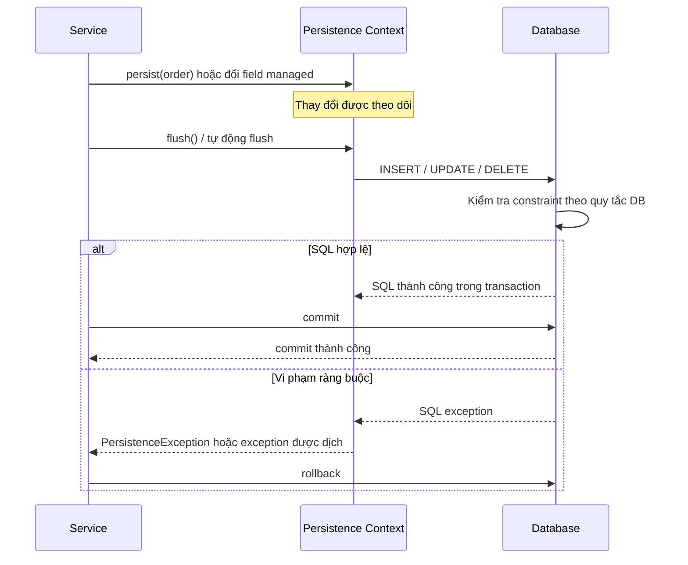
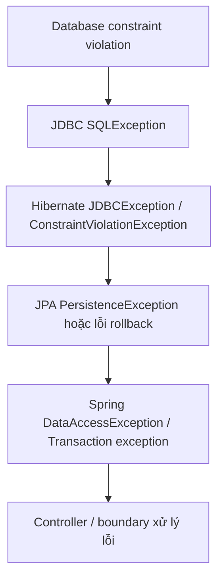
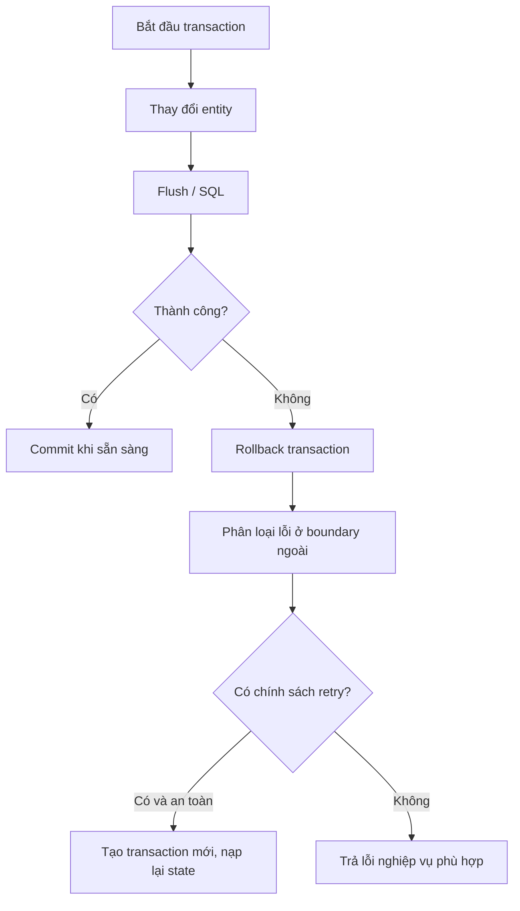
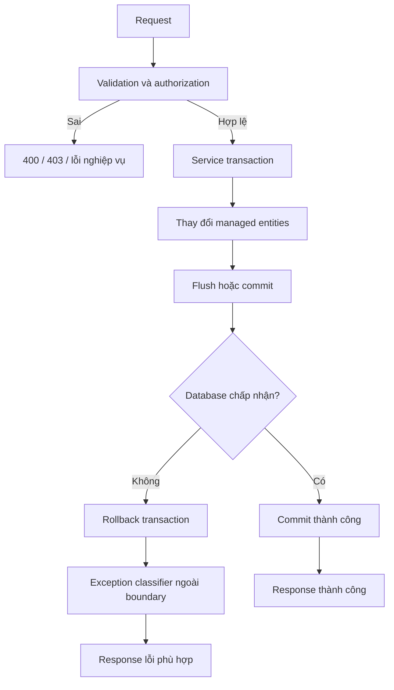

# Xử lý lỗi ràng buộc khi flush trong JPA

Trong ứng dụng JPA, có một tình huống rất phổ biến: code đã gọi `persist()` hoặc sửa một entity mà **chưa thấy lỗi**, nhưng khi JPA đồng bộ dữ liệu xuống database bằng `flush()` thì xuất hiện exception như *duplicate key*, *foreign key violation*, *not-null violation* hoặc *check constraint violation*.

Ví dụ:

```java
PurchaseOrder order = new PurchaseOrder("PO-1001", customer);
entityManager.persist(order); // Có thể chưa gửi INSERT.

entityManager.flush();        // Có thể phát sinh lỗi ràng buộc SQL.
```

Hiểu và xử lý đúng tình huống này là điều kiện quan trọng để bảo vệ tính toàn vẹn dữ liệu, trả thông báo lỗi nghiệp vụ hợp lý và tránh sử dụng một transaction đã không còn hợp lệ.

> **Nguyên tắc chính:** `persist()` không đồng nghĩa với `INSERT` đã hoàn tất, `flush()` không đồng nghĩa với `commit()`, và một lỗi SQL khi flush thường khiến transaction hiện tại **không thể tiếp tục như chưa có gì xảy ra**. Hãy rollback, phân loại lỗi ở ranh giới phù hợp và chỉ thử lại trong transaction mới khi nghiệp vụ cho phép.

Bài học này tập trung vào **“Xử lý lỗi ràng buộc khi flush”** thuộc chương **Đồng bộ và flush** trong module ORM/JPA. Các ví dụ sử dụng Jakarta Persistence, Spring Data JPA/Hibernate và PostgreSQL minh họa. Khi quy tắc phụ thuộc hệ quản trị hoặc provider, nội dung sẽ phân biệt rõ thay vì coi hành vi một công cụ là hợp đồng JPA chung.

## 1. Ba mốc thời gian: thay đổi entity, flush, commit

JPA quản lý một **persistence context** chứa các entity đang được theo dõi. Khi code gọi setter hoặc phương thức nghiệp vụ trên managed entity, giá trị Java thay đổi trước; SQL có thể được thực thi vào thời điểm khác.

Một luồng phổ biến:



### `persist()`

```java
entityManager.persist(order);
```

`persist` đưa một entity mới vào trạng thái managed và yêu cầu JPA quản lý việc lưu nó. Trong nhiều mapping, provider có thể **hoãn** câu `INSERT` đến flush. Nhưng **không có quy tắc “persist luôn không chạy SQL”**: chiến lược ID như `GenerationType.IDENTITY` có thể cần thực hiện INSERT sớm để lấy ID do database sinh.

### `flush()`

```java
entityManager.flush();
```

`flush` yêu cầu đồng bộ các thay đổi pending của persistence context với database trong transaction hiện tại. Provider có thể tạo `INSERT`, `UPDATE`, `DELETE` hoặc thao tác liên quan collection.

Khi database thực thi SQL, nhiều ràng buộc sẽ được kiểm tra và có thể trả lỗi ngay lúc này.

### `commit()`

Commit kết thúc transaction thành công và làm các thay đổi đã được thực thi trở thành bền vững theo quy tắc database. **Flush thành công không bảo đảm commit thành công**: database có thể có constraint được hoãn kiểm tra đến commit, có xung đột đồng thời, lỗi hệ thống hoặc điều kiện khác.

Tóm lại:

| Lệnh hoặc mốc | Mục đích | Có thể gặp constraint error? | Đã commit dữ liệu? |
|---|---|---|---|
| Thay property trên managed entity | Thay đổi trạng thái Java | Kiểm tra nghiệp vụ ở setter có thể lỗi | Chưa |
| `persist()` | Quản lý entity mới | Có thể, nếu provider gửi SQL sớm hoặc kiểm tra runtime | Không mặc nhiên |
| `flush()` | Đồng bộ pending SQL | **Có**, thường là nơi lỗi xuất hiện | Chưa |
| `commit()` | Kết thúc transaction | **Có**, kể cả lỗi được hoãn | Nếu commit thật sự thành công |
| `rollback()` | Hủy thay đổi transaction | Có thể báo vấn đề hệ thống riêng | Không |

**Lỗi xuất hiện ở flush không có nghĩa dữ liệu ban đầu được tạo sai chỉ ở thời điểm flush**. Giá trị không hợp lệ có thể đã được đặt vào object rất lâu trước đó.

## 2. Một mô hình đơn hàng để quan sát constraint

Giả sử hệ thống có:

- Khách hàng `Customer`.
- Đơn hàng `PurchaseOrder`.
- Mỗi đơn hàng có `order_code` duy nhất.
- Mỗi đơn hàng thuộc về một khách hàng có thật.
- Tổng tiền không âm.
- Một đơn hàng mới phải có mã và khách hàng.

PostgreSQL DDL minh họa:

```sql
CREATE TABLE customers (
    id BIGINT PRIMARY KEY,
    display_name VARCHAR(150) NOT NULL
);

CREATE TABLE purchase_orders (
    id BIGINT GENERATED BY DEFAULT AS IDENTITY PRIMARY KEY,
    order_code VARCHAR(50) NOT NULL,
    customer_id BIGINT NOT NULL,
    total_amount NUMERIC(19, 2) NOT NULL,
    status VARCHAR(20) NOT NULL,

    CONSTRAINT uk_purchase_orders_order_code
        UNIQUE (order_code),

    CONSTRAINT fk_purchase_orders_customer
        FOREIGN KEY (customer_id) REFERENCES customers(id),

    CONSTRAINT ck_purchase_orders_amount
        CHECK (total_amount >= 0),

    CONSTRAINT ck_purchase_orders_status
        CHECK (status IN ('NEW', 'PAID', 'CANCELLED'))
);
```

Entity JPA:

```java
import jakarta.persistence.*;
import java.math.BigDecimal;
import java.util.Objects;

@Entity
@Table(
    name = "purchase_orders",
    uniqueConstraints = @UniqueConstraint(
        name = "uk_purchase_orders_order_code",
        columnNames = "order_code"
    )
)
public class PurchaseOrder {

    @Id
    @GeneratedValue(strategy = GenerationType.IDENTITY)
    private Long id;

    @Column(name = "order_code", nullable = false, length = 50)
    private String orderCode;

    @ManyToOne(fetch = FetchType.LAZY, optional = false)
    @JoinColumn(name = "customer_id", nullable = false)
    private Customer customer;

    @Column(name = "total_amount",
            nullable = false, precision = 19, scale = 2)
    private BigDecimal totalAmount;

    @Enumerated(EnumType.STRING)
    @Column(name = "status", nullable = false, length = 20)
    private OrderStatus status;

    protected PurchaseOrder() {}

    public PurchaseOrder(
            String orderCode,
            Customer customer,
            BigDecimal totalAmount) {

        if (orderCode == null || orderCode.isBlank()) {
            throw new IllegalArgumentException("Order code required");
        }
        this.orderCode = orderCode;
        this.customer = Objects.requireNonNull(customer);
        changeTotal(totalAmount);
        this.status = OrderStatus.NEW;
    }

    public void changeTotal(BigDecimal amount) {
        Objects.requireNonNull(amount);
        if (amount.signum() < 0) {
            throw new IllegalArgumentException(
                "Total amount cannot be negative");
        }
        this.totalAmount = amount;
    }

    public Long getId() { return id; }
}
```

Với:

```java
public enum OrderStatus {
    NEW, PAID, CANCELLED
}
```

và `Customer` là một entity riêng có `@Id Long id`.

Trong ví dụ, constructor đã chặn vài lỗi đầu vào, nhưng database vẫn là tầng bảo vệ cuối cùng. Những ghi dữ liệu từ job batch, SQL trực tiếp, service khác hoặc race condition cũng phải tuân theo constraint.

## 3. Phân loại những lỗi ràng buộc thường xuất hiện khi flush

| Constraint database | Ví dụ vi phạm | Lỗi biểu hiện | Tác dụng |
|---|---|---|---|
| `NOT NULL` | `order_code = NULL` | Null value in non-null column | Cột bắt buộc có dữ liệu |
| `UNIQUE` | Hai order dùng `PO-1001` | Duplicate key | Không cho giá trị trùng |
| `PRIMARY KEY` | Hai hàng có cùng PK | Duplicate key trên PK | Bảo vệ định danh hàng |
| `FOREIGN KEY` | `customer_id = 999` nhưng không có Customer 999 | FK violation | Chặn tham chiếu không tồn tại |
| `CHECK` | `total_amount = -10` | Check constraint violation | Chặn giá trị trái biểu thức |
| `EXCLUSION` (PostgreSQL) | Hai khoảng đặt lịch chồng lấn theo cấu hình | Exclusion violation | Loại trừ tổ hợp dữ liệu không được cùng tồn tại |
| Một số constraint deferrable | Giá trị tạm vi phạm, không được sửa trước commit | Lỗi có thể xuất hiện khi commit | Kiểm tra theo thời điểm được định nghĩa |

Không nên gộp mọi lỗi vào thông báo “dữ liệu không hợp lệ” giống nhau. Mỗi constraint đại diện cho một bất biến khác, cần hành vi ứng dụng khác.

### Lỗi NOT NULL

Ví dụ:

```sql
INSERT INTO purchase_orders (
    order_code, customer_id, total_amount, status
)
VALUES (NULL, 10, 100, 'NEW');
```

Cột `order_code` không chấp nhận SQL `NULL`, nên database từ chối.

### Lỗi UNIQUE

```sql
INSERT INTO purchase_orders (
    order_code, customer_id, total_amount, status
)
VALUES ('PO-1001', 10, 100, 'NEW');

-- Nếu giao dịch trước đã commit, lệnh sau trùng:
INSERT INTO purchase_orders (
    order_code, customer_id, total_amount, status
)
VALUES ('PO-1001', 10, 200, 'NEW');
```

Constraint `uk_purchase_orders_order_code` bảo đảm không có hai hàng cùng mã.

### Lỗi FOREIGN KEY

```sql
INSERT INTO purchase_orders (
    order_code, customer_id, total_amount, status
)
VALUES ('PO-1002', 999, 100, 'NEW');
```

Nếu không có customer 999, FK từ chối. `customer_id` khác NULL vẫn không có nghĩa quan hệ hợp lệ.

### Lỗi CHECK

```sql
INSERT INTO purchase_orders (
    order_code, customer_id, total_amount, status
)
VALUES ('PO-1003', 10, -1, 'NEW');
```

Nếu `total_amount >= 0`, check constraint từ chối số âm.

## 4. Ràng buộc Java/JPA khác ràng buộc database

Có nhiều tầng cùng bảo vệ một quy tắc:

```java
@NotNull
@ManyToOne(optional = false)
@JoinColumn(name = "customer_id", nullable = false)
private Customer customer;
```

Ba khai báo có chức năng khác nhau.

| Khai báo | Tầng | Kiểm tra điều gì? |
|---|---|---|
| `@NotNull` từ Jakarta Validation | Bean Validation | Tham chiếu Java không được `null` khi validation chạy |
| `@ManyToOne(optional = false)` | JPA association | Quan hệ được mô hình là bắt buộc |
| `@JoinColumn(nullable = false)` | JPA column metadata | Cột liên kết dự kiến không nullable khi sinh/kiểm tra schema |
| `customer_id BIGINT NOT NULL` | Database | Bất kỳ SQL nào cũng không được ghi SQL NULL |
| `FOREIGN KEY (customer_id)` | Database | Giá trị khác NULL phải tham chiếu một khóa hợp lệ |

Nếu Bean Validation được kích hoạt trước khi provider gửi INSERT, ứng dụng có thể nhận **validation exception** ngay khi flush mà database chưa trả SQL lỗi nào. Nếu constraint database mạnh hơn mapping hoặc dữ liệu bị thay đổi đồng thời, database vẫn có thể là nơi phát hiện lỗi.

**Lỗi xảy ra tại flush không nhất thiết là lỗi do database phát ra.** Provider có thể kiểm tra nullability, transient references hoặc gọi Bean Validation ở giai đoạn lifecycle.

### Một lưu ý về CHECK với NULL

Trong SQL, một điều kiện `CHECK` thông thường chỉ từ chối khi biểu thức đánh giá thành **FALSE**. Khi biểu thức đánh giá thành UNKNOWN vì NULL, nhiều hệ quản trị (bao gồm PostgreSQL) coi constraint đạt. Ví dụ:

```sql
CHECK (total_amount >= 0)
```

không nên được coi là thay thế cho:

```sql
total_amount NUMERIC(19, 2) NOT NULL
```

nếu tổng tiền bắt buộc khác NULL. Cần kết hợp `NOT NULL` và `CHECK` theo yêu cầu.

## 5. Tại sao `persist()` chưa lỗi nhưng `flush()` mới lỗi?

Giả sử code:

```java
@Transactional
public void createOrder() {
    PurchaseOrder order = new PurchaseOrder(...);
    entityManager.persist(order);

    // Có thể chưa gửi INSERT cho tới flush/commit.
}
```

JPA có thể giữ entity mới và trì hoãn việc gửi SQL. Khi flush:

```java
entityManager.flush();
```

provider mới thực hiện INSERT và database mới kiểm tra constraints. Nếu `orderCode` trùng, sẽ gặp lỗi lúc flush.

**Ngoại lệ: cách sinh ID có thể làm SQL xảy ra sớm.** Với `GenerationType.IDENTITY`, Hibernate thường phải insert sớm để lấy khóa database sinh. Do đó một lỗi unique/FK có thể được ném ngay khi `persist`/repository `save` hoặc một thao tác liên quan ID, không nhất thiết chờ explicit flush.

Nếu muốn minh họa rõ thao tác pending đến flush, có thể dùng mapping với ID cấp trước (đã có ID hợp lệ) hoặc một chiến lược sequence phù hợp; ngay cả khi đó, thời điểm SQL chi tiết vẫn phụ thuộc provider và trạng thái context.

### Trên managed entity đang có

Một cách dễ thấy dirty checking:

```java
PurchaseOrder order = em.find(PurchaseOrder.class, orderId);

order.changeOrderCode("PO-1001"); // Giả sử method tồn tại.

em.flush(); // Có thể UPDATE và vi phạm UNIQUE.
```

Việc setter chạy thành công không chứng minh giá trị sẽ được database chấp nhận. Provider có thể gom nhiều thay đổi vào một UPDATE khi flush.

## 6. Flush tự động: không phải lúc nào code cũng gọi `flush()`

JPA có `FlushModeType.AUTO` và `FlushModeType.COMMIT`.

Ở chế độ `AUTO` mặc định, provider phải bảo đảm những thay đổi có thể ảnh hưởng kết quả query được phản ánh theo hợp đồng. Một cách thực hiện phổ biến là flush trước khi query thích hợp.

Ví dụ:

```java
em.persist(order);

long count = em.createQuery(
    "select count(o) from PurchaseOrder o", Long.class
).getSingleResult();
```

Tùy flush mode/provider/query, lệnh query có thể làm pending INSERT được đồng bộ trước, nên lỗi constraint xuất hiện **ở câu truy vấn COUNT**, dù người viết code tưởng lỗi chỉ có thể xảy ra ở commit.

Ở `FlushModeType.COMMIT`, provider có thể trì hoãn đồng bộ nhiều hơn; ảnh hưởng của thay đổi pending tới kết quả query trước commit có những quy tắc và giới hạn riêng. Không nên coi COMMIT mode là “vô hiệu hóa constraint” hoặc bảo đảm không flush sớm trong mọi tình huống.

### Query SQL native

Với native SQL, khả năng provider nhận diện bảng có liên quan và quyết định flush còn phụ thuộc cách tích hợp, cách gọi qua JPA hay API native. Không thể dự đoán thời điểm flush chỉ từ việc query là JPQL hay SQL.

**Khi chẩn đoán exception, hãy xem stack trace và các thao tác trước đó trong cùng persistence context, không chỉ dòng code nơi lỗi được ném.**

## 7. Flushing nhiều entity: lỗi thuộc hàng nào?

Xét transaction nhập nhiều đơn:

```java
for (CreateOrderCommand command : commands) {
    PurchaseOrder order = createOrder(command);
    em.persist(order);
}

em.flush();
```

Nếu có một order trùng mã, flush có thể thất bại. Provider có thể:

- sắp xếp các INSERT theo mapping và dependency;
- dùng JDBC batching;
- thực thi insert sớm nếu IDENTITY;
- phát exception thể hiện constraint vi phạm;
- không cung cấp trực tiếp object Java nào là nguồn của hàng lỗi.

Với JDBC batching, stack trace đôi khi chứa `BatchUpdateException` và thông tin SQL của một batch, không chỉ của một hàng cụ thể. Không mặc định phần tử cuối cùng được persist là nguyên nhân.

### Xử lý batch nhập dữ liệu

Với import lớn, có thể chia thành những transaction độc lập theo một đơn vị nghiệp vụ phù hợp:

```text
Batch 1 → transaction A → commit hoặc rollback A
Batch 2 → transaction B → commit hoặc rollback B
Batch 3 → transaction C → commit hoặc rollback C
```

Nếu từng bản ghi cần có kết quả độc lập, phải thiết kế ranh giới transaction độc lập tương ứng. Không nên cố “catch lỗi của một hàng rồi tiếp tục dùng cùng EntityManager/transaction” sau khi SQL đã thất bại.

Số lượng bản ghi trên batch và chính sách hoàn tác phụ thuộc tính nhất quán mong muốn: “tất cả hoặc không gì” hay “từng nhóm độc lập”.

## 8. Chuỗi exception từ JDBC đến JPA và Spring

Khi database báo lỗi, thông tin có thể đi qua nhiều lớp:



Sơ đồ chỉ minh họa đường bao bọc/dịch lỗi thường gặp. **Không phải mọi lỗi đều có đủ tất cả các lớp hoặc cùng thứ tự**, đặc biệt khi lỗi Bean Validation xuất hiện trước JDBC.

Ba loại exception rất dễ nhầm:

| Exception | Package thường gặp | Ý nghĩa |
|---|---|---|
| `ConstraintViolationException` | `jakarta.validation.ConstraintViolationException` | Bean Validation phát hiện vi phạm annotation như `@NotNull`, `@Size` |
| `ConstraintViolationException` | `org.hibernate.exception.ConstraintViolationException` | Hibernate nhận và xử lý thông tin lỗi constraint từ JDBC |
| `DataIntegrityViolationException` | `org.springframework.dao.DataIntegrityViolationException` | Spring dịch một nhóm lỗi toàn vẹn dữ liệu, không chỉ UNIQUE |

Cùng tên `ConstraintViolationException` nhưng **khác package và ngữ nghĩa**.

### Ví dụ Bean Validation exception

```java
import jakarta.validation.constraints.NotNull;

@NotNull
@Column(name = "order_code", nullable = false)
private String orderCode;
```

Nếu validation tích hợp được bật và orderCode null, provider có thể ném:

```text
jakarta.validation.ConstraintViolationException
```

Nó thường chứa danh sách `ConstraintViolation<?>` để ứng dụng biết property path và thông điệp validation. Đây không phải lỗi SQL unique/FK.

### Ví dụ Hibernate JDBC exception

Khi SQL `INSERT` vi phạm unique constraint, Hibernate có thể ném hoặc bọc:

```text
org.hibernate.exception.ConstraintViolationException
```

Nó có thể cung cấp `getConstraintName()` và `getSQLState()` tùy thông tin driver/provider. Giá trị constraint name **có thể null hoặc không đủ tin cậy** trong một số tình huống; cần fallback.

### Ví dụ Spring exception

Trong một đường gọi repository được Spring hỗ trợ exception translation:

```text
org.springframework.dao.DataIntegrityViolationException
```

Spring có thể dịch lỗi provider/JDBC sang nhóm `DataAccessException`. Tuy nhiên, nếu lỗi phát sinh khi transaction manager commit **sau khi method service trả về**, tầng exception có thể là một loại transaction-related exception hoặc có nested cause. Không nên xây dựng handler với giả định tất cả constraint errors đều chắc chắn thành một exception class duy nhất.

## 9. SQLSTATE: thông tin chẩn đoán, không phải hợp đồng portable

Với PostgreSQL, mã SQLSTATE cho các lỗi constraint thông dụng:

| SQLSTATE PostgreSQL | Ý nghĩa | Ví dụ |
|---|---|---|
| `23502` | `not_null_violation` | Thiếu `order_code` |
| `23503` | `foreign_key_violation` | Customer ID không tồn tại |
| `23505` | `unique_violation` | Trùng mã đơn hàng |
| `23514` | `check_violation` | Tổng tiền âm |
| `23P01` | `exclusion_violation` | Vi phạm exclusion constraint |

SQLSTATE nhóm `23` biểu diễn integrity constraint violation trong chuẩn/triển khai liên quan, nhưng **mã cụ thể, nội dung thông điệp và cách cung cấp constraint name** khác nhau theo database driver.

Không viết business logic phụ thuộc toàn bộ vào một đoạn tiếng Anh trong thông báo SQL:

```java
if (exception.getMessage().contains("duplicate key value")) {
    // Rất dễ hỏng khi nâng cấp driver/database hoặc đổi locale.
}
```

Khi phải phân loại chi tiết, ưu tiên dữ liệu có cấu trúc như SQLSTATE, vendor error code, constraint name **ở tầng thích hợp**, với fallback khi thông tin không có.

Không gửi nguyên SQLSTATE, SQL text, stack trace, bind parameters hay tên bảng nội bộ ra response công khai.

## 10. Quy tắc xử lý quan trọng nhất: rollback sau lỗi flush

Nếu một SQL statement thất bại khi flush, thường không thể tiếp tục transaction như chưa có lỗi.

Với PostgreSQL, sau một lỗi SQL thông thường trong transaction, transaction rơi vào **trạng thái aborted**, và các statement tiếp theo có thể bị từ chối cho tới khi rollback (hoặc phục hồi tới savepoint được thiết kế đúng).

Với Hibernate/JPA, một exception khi flush còn có thể khiến **persistence context không còn đáng tin để tiếp tục đồng bộ**; provider không cam kết rằng trạng thái object graph và hàng đợi SQL đã được phục hồi về đúng mốc trước lỗi.

### Anti-pattern: nuốt lỗi rồi tiếp tục

```java
@Transactional
public void createOrders() {
    em.persist(orderA);

    try {
        em.flush();
    } catch (PersistenceException ex) {
        log.warn("Bỏ qua lỗi, làm tiếp", ex);
    }

    em.persist(orderB); // Không an toàn để tiếp tục như bình thường.
}
```

Vấn đề:

- Transaction có thể đã bị đánh dấu rollback-only.
- Database có thể từ chối mọi SQL tiếp theo trong transaction đó.
- Persistence context có thể giữ những entity và snapshot không còn tương ứng với database.
- Commit cuối method có thể ném exception khác, thí dụ rollback-related exception.
- Dữ liệu có thể không được ghi như caller tưởng.

**Cách an toàn mặc định:** để exception đi ra ranh giới transaction, rollback transaction đó, kết thúc persistence context/đơn vị công việc bị lỗi và xử lý kết quả ở tầng ngoài.

### Flow đúng



## 11. Spring `@Transactional` và rollback-only

Với Spring transaction management:

```java
@Service
public class OrderService {

    @PersistenceContext
    private EntityManager em;

    @Transactional
    public Long placeOrder(PurchaseOrder order) {
        em.persist(order);
        em.flush();
        return order.getId();
    }
}
```

Nếu `em.flush()` ném unchecked exception và exception đi ra khỏi transactional method qua proxy, Spring mặc định rollback transaction (với những quy tắc cấu hình có thể điều chỉnh, chẳng hạn `rollbackFor`).

Không nên cố sửa bằng:

```java
@Transactional(noRollbackFor = DataIntegrityViolationException.class)
```

để ép “commit các thay đổi còn lại” sau một constraint violation. Quy tắc `noRollbackFor` ảnh hưởng quyết định rollback của interceptor nhưng **không làm database transaction hết aborted và không sửa consistency của persistence context**. Đó không phải giải pháp cho lỗi SQL.

### Khi exception đã bị catch bên trong transaction

Một điểm dễ nhầm là việc bắt unchecked exception **trong method** có thể làm transaction interceptor không nhìn thấy exception đó ở boundary. Tuy nhiên:

- Provider hoặc transaction có thể đã bị đánh dấu rollback-only.
- Driver/database có thể không cho phép SQL tiếp theo.
- Commit vẫn có thể thất bại.
- Nếu interceptor không tự đánh dấu rollback nhưng trạng thái đã sai, kết quả càng khó đoán.

Do đó, không dựa vào “catch rồi trả false” để xử lý lỗi flush. Nếu cần chuyển exception thành kết quả miền, thực hiện việc đó **sau khi transaction thất bại và được rollback**, thường ở caller, application boundary hoặc exception handler phía ngoài.

### `UnexpectedRollbackException`

Một tình huống điển hình:

1. Method inner tham gia transaction chung và gây lỗi.
2. Transaction bị đánh dấu rollback-only.
3. Caller bắt exception và tiếp tục như thể thành công.
4. Outer method kết thúc, Spring cố commit nhưng thực tế phải rollback.
5. Caller có thể nhận `UnexpectedRollbackException`.

Đây không phải một “lỗi phụ ngẫu nhiên”; nó báo rằng transaction đã bị rollback dù code phía ngoài từng nghĩ có thể commit.

## 12. Bắt lỗi ở đâu khi commit có thể ném exception sau service body?

Xét:

```java
@Transactional
public void createOrder(...) {
    orderRepository.save(order);
    // Không explicit flush.
}
```

SQL có thể chỉ được gửi khi transaction manager thực hiện flush/commit **sau khi method body kết thúc**, lúc proxy hoàn tất ranh giới transaction. Vì vậy:

```java
@Transactional
public void createOrder(...) {
    try {
        orderRepository.save(order);
    } catch (DataIntegrityViolationException ex) {
        // Có thể không bắt được lỗi xuất hiện sau khi method body đã trả về.
    }
}
```

Cách thiết kế chắc chắn hơn là để lỗi truyền qua transaction boundary và xử lý ở lớp gọi service hoặc lớp HTTP exception handler.

Ví dụ:

```java
@RestControllerAdvice
public class ApiErrorHandler {

    @ExceptionHandler(DataIntegrityViolationException.class)
    public ResponseEntity<ApiError> handleIntegrity(
            DataIntegrityViolationException ex) {

        // Không expose SQL/constraint internals.
        ApiError body = new ApiError(
            "DATA_CONFLICT",
            "Dữ liệu vi phạm một ràng buộc toàn vẹn");

        return ResponseEntity.status(409).body(body);
    }
}

public record ApiError(String code, String message) {}
```

Đây là handler tổng quát minh họa cách xử lý **sau khi exception ra khỏi service**; cần bổ sung xử lý exception wrapper/validation/transaction khác phù hợp stack công nghệ. Không phải mọi `DataIntegrityViolationException` đều đáng trả HTTP 409; phần phân loại chi tiết sẽ được trình bày sau.

## 13. Explicit `flush()` giúp kiểm soát thời điểm phát hiện, không phải khôi phục transaction

Có trường hợp muốn biết SQL có hợp lệ **trước khi tiếp tục làm các thao tác có chi phí ngoài database**:

```java
@Transactional
public Long createOrder(...) {
    PurchaseOrder order = new PurchaseOrder(...);

    em.persist(order);
    em.flush(); // Đưa lỗi SQL chưa deferred tới thời điểm này.

    return order.getId();
}
```

Ưu điểm:

- Lỗi nhiều constraint được đẩy về vị trí có ý nghĩa trong service.
- Có thể thấy rõ SQL đang bị lỗi hơn khi debug.
- Kiểm thử transaction có thể kích hoạt constraint thay vì chỉ xét object trong bộ nhớ.
- Có thể tránh thực hiện những bước tiếp theo trong cùng luồng nếu database đã từ chối ghi.

Giới hạn:

- `flush` không commit.
- Constraint deferred có thể chưa kiểm tra.
- Transaction vẫn có thể thất bại vì xung đột đồng thời hoặc lỗi khác tại commit.
- Mỗi flush không miễn phí; flush nhiều lần có thể tăng số round trip và phá cơ hội batching.
- Flush tác động **các thay đổi pending trong persistence context**, không chỉ một entity vừa được save.

**Đừng dùng explicit flush trong một method rồi catch exception để “đổi sang mã khác, thử tiếp trong cùng transaction”.** Nếu cần retry, xử lý ở một transaction mới.

## 14. `save()` và `saveAndFlush()` của Spring Data JPA

Với repository:

```java
public interface OrderRepository
        extends JpaRepository<PurchaseOrder, Long> {}
```

hai lệnh:

```java
orderRepository.save(order);
```

và:

```java
orderRepository.saveAndFlush(order);
```

có khác biệt chính:

- `save` quản lý việc persist/merge theo trạng thái entity; không bảo đảm mọi SQL được gửi ngay.
- `saveAndFlush` yêu cầu flush những thay đổi liên quan trong persistence context ngay tại thời điểm gọi, nên có thể làm lỗi constraint xuất hiện sớm.
- `saveAndFlush` **không commit transaction**.
- Nếu không có transaction ngoài, repository có thể tự mở transaction theo quy tắc repository methods; caller vẫn cần hiểu ranh giới thực sự.
- Nếu database dùng constraint deferred hoặc có lỗi commit khác, `saveAndFlush` thành công **không phải bằng chứng cuối cùng của commit**.

Không dùng `saveAndFlush` cho mọi save chỉ vì sợ bỏ sót lỗi; transaction manager bình thường sẽ flush khi cần. Dùng khi có lý do rõ ràng về thời điểm đồng bộ.

## 15. Ví dụ UNIQUE: mã đơn hàng đã tồn tại

Service nhận mã `PO-1001` nhưng database đã có order cùng mã. Dù code kiểm tra:

```java
if (orderRepository.existsByOrderCode(code)) {
    throw new DuplicateOrderCodeException(code);
}
```

thì vẫn có race condition:

```text
Transaction A: existsByOrderCode("PO-1001") -> false
Transaction B: existsByOrderCode("PO-1001") -> false
Transaction A: INSERT "PO-1001" -> thành công
Transaction B: INSERT "PO-1001" -> UNIQUE violation
```

Vì vậy:

1. Pre-check có thể giúp thông báo sớm.
2. **UNIQUE constraint thật** vẫn là nguồn bảo vệ cuối cùng.
3. Khi gặp duplicate, transaction ghi thất bại cần rollback.
4. Tầng ngoài chuyển lỗi thành thông báo phù hợp, chẳng hạn “Mã đơn hàng đã tồn tại”.
5. Không đơn giản đổi mã rồi tiếp tục dùng cùng failed transaction.

### Ngữ nghĩa API

Nếu client tạo resource bằng một business identifier cố định và mã đó đã tồn tại, HTTP `409 Conflict` thường phù hợp.

Tuy nhiên, nếu request là một phép gửi lại có **idempotency key** giống nhau, duplicate có thể có ngữ nghĩa “đã xử lý request trước”, không nhất thiết là lỗi cho client. Cần xác định:

- Cùng mã business nhưng payload khác → conflict.
- Cùng idempotency key và payload được xác minh giống nhau → có thể trả kết quả đã tạo trước đó.
- Cùng key nhưng payload không khớp → báo conflict.
- Cần tra bản ghi đã tồn tại trong **transaction mới, sau rollback** của thao tác insert thất bại.

Không suy ra idempotency chỉ từ việc gặp `UNIQUE violation` mà chưa đối chiếu đúng key/payload.

## 16. Ví dụ FOREIGN KEY: tham chiếu không tồn tại

Giả sử:

```java
Customer customer = em.getReference(Customer.class, 9999L);
PurchaseOrder order = new PurchaseOrder(
    "PO-2001", customer, BigDecimal.TEN);

em.persist(order);
em.flush();
```

`getReference` có thể cung cấp reference không cần SELECT đầy đủ Customer, nhưng **không xác nhận Customer#9999 tồn tại**. Nếu không có khách hàng đó và FK được khai báo trong database, INSERT có thể bị từ chối.

Có hai cách thiết kế:

**Nếu nghiệp vụ cần thông báo “Không tìm thấy khách hàng” sớm:**

```java
Customer customer = em.find(Customer.class, customerId);

if (customer == null) {
    throw new CustomerNotFoundException(customerId);
}
```

**Nếu chỉ cần gán FK theo ID:**

```java
Customer customer = em.getReference(Customer.class, customerId);
```

Khi đó phải chấp nhận khả năng lỗi FK xuất hiện ở flush và có cơ chế xử lý tại boundary.

Lưu ý: ngay cả khi `find` xác nhận Customer tồn tại, một transaction khác có thể xóa Customer trước khi order được ghi, tùy isolation và khóa. **Pre-check không thay thế FK database**.

### Lỗi FK khi xóa parent

Một nguồn lỗi khác:

```java
em.remove(customer);
em.flush();
```

Nếu còn order tham chiếu Customer và FK chặn việc xóa, database báo FK violation. Ý nghĩa không phải “customerId không tồn tại”, mà là **không được xóa parent đang được tham chiếu**.

Cùng SQLSTATE `23503` có thể đại diện hai tình huống nghiệp vụ khác nhau tùy statement và constraint. Khi trả API, phải hiểu ngữ cảnh create/update/delete.

## 17. Ví dụ NOT NULL: null ở Java, SQL hoặc mapping lệch schema

```java
@ManyToOne(optional = false)
@JoinColumn(name = "customer_id", nullable = false)
private Customer customer;
```

Nếu code vẫn tạo entity với `customer = null` bằng constructor khác, reflection, mapper hoặc dữ liệu cũ, lỗi có thể xuất hiện:

- tại domain method;
- tại Bean Validation;
- tại kiểm tra nullability của provider;
- tại database khi INSERT/UPDATE gửi FK NULL.

Không có một thời điểm duy nhất đúng cho mọi hệ thống.

### Mapping cho phép null nhưng schema không

```java
@JoinColumn(name = "customer_id", nullable = true)
```

không làm database tự đổi cột đang là `NOT NULL` nếu schema đã tồn tại và quản lý bằng migration. Database vẫn có thể từ chối.

### Mapping bắt buộc nhưng dữ liệu cũ có NULL

Ngược lại, `optional = false` trong Java không tự chữa các hàng cũ có NULL nếu database đang cho phép. Một query/migration có thể phát hiện dữ liệu cũ thiếu quan hệ.

**Giải pháp đúng phải đồng bộ nghiệp vụ, mapping, validation, migration và database constraint thực tế.**

## 18. Ví dụ CHECK: bất biến giá trị và trạng thái

Một trạng thái nghiệp vụ có thể yêu cầu:

```sql
CHECK (total_amount >= 0)
```

Nếu code cố lưu tổng tiền âm, database từ chối dù annotation `@Column(nullable = false)` không biết gì về điều kiện không âm.

Lớp miền nên chặn sớm:

```java
public void changeTotal(BigDecimal amount) {
    Objects.requireNonNull(amount);
    if (amount.signum() < 0) {
        throw new IllegalArgumentException(
            "Total amount must be nonnegative");
    }
    this.totalAmount = amount;
}
```

Database vẫn giữ CHECK để bảo vệ dữ liệu từ bất kỳ đường ghi nào.

Một ràng buộc theo trạng thái:

```sql
ALTER TABLE purchase_orders
ADD CONSTRAINT ck_paid_order_has_positive_total
CHECK (status <> 'PAID' OR total_amount > 0);
```

Nếu order trạng thái `PAID` nhưng total_amount = 0, constraint chặn. Tuy vậy một CHECK trên một hàng **không thể tự kiểm tra toàn bộ trạng thái hàng khác**, ví dụ “đã có payment thành công ở bảng payments”. Với bất biến nhiều bảng, cần thiết kế bổ sung (transaction, trigger hoặc thay schema).

Khi nhận lỗi CHECK ở flush, hãy sửa **nguyên nhân nghiệp vụ hoặc dữ liệu**, không tắt ràng buộc chỉ để transaction chạy qua.

## 19. Constraint deferred: vì sao flush thành công vẫn có thể commit lỗi?

Một số database (ví dụ PostgreSQL) hỗ trợ ràng buộc được trì hoãn kiểm tra, thường cho một số loại FOREIGN KEY, UNIQUE, PRIMARY KEY hoặc EXCLUDE theo quy tắc của database.

Ví dụ PostgreSQL:

```sql
ALTER TABLE purchase_orders
ADD CONSTRAINT fk_order_customer_deferred
FOREIGN KEY (customer_id)
REFERENCES customers(id)
DEFERRABLE INITIALLY DEFERRED;
```

Ví dụ DDL này giả định chưa có ràng buộc FK trùng tên/chức năng cần loại bỏ; không áp dụng trực tiếp nếu schema đã có FK tương đương mà không kiểm tra migration.

Với constraint deferred:

1. INSERT có thể tạm thời tạo quan hệ chưa hợp lệ trong transaction.
2. Flush có thể gửi SQL thành công.
3. Transaction phải đưa dữ liệu về trạng thái hợp lệ trước khi database kiểm tra constraint.
4. Nếu cuối transaction vẫn vi phạm, commit thất bại.

Ở PostgreSQL có thể dùng `SET CONSTRAINTS ... IMMEDIATE` trong transaction để yêu cầu kiểm tra constraint deferrable sớm hơn, nhưng đây là cơ chế database-specific và phải thiết kế có chủ đích.

**Không dùng `flush()` như một “validate all constraints before commit” tuyệt đối.** Nhiều lỗi được phát hiện ở flush, nhưng một số chỉ xuất hiện ở commit.

## 20. Constraint name như một khóa phân loại lỗi

Đặt tên rõ ràng cho constraint giúp application nhận biết quy tắc:

```sql
CONSTRAINT uk_purchase_orders_order_code UNIQUE (order_code)
CONSTRAINT fk_purchase_orders_customer FOREIGN KEY (...)
CONSTRAINT ck_purchase_orders_amount CHECK (...)
```

Trong Hibernate, một nested JDBC constraint exception có thể cung cấp:

```java
String constraintName = constraintViolation.getConstraintName();
```

Không nên coi tên trả về luôn có giá trị. Provider/driver có thể:

- không trích được constraint name;
- trả tên với schema prefix/quote/case khác;
- sử dụng tên do database tự sinh;
- bọc exception dưới nhiều tầng.

Vì vậy, khi xây lớp phân loại:

- Chỉ ánh xạ những constraint **đã biết và được kiểm soát bằng migration**.
- Có fallback chung khi không tìm thấy constraint.
- Không dựa trên đoạn message tiếng Anh để trích tên bằng substring tùy tiện.
- Giữ chính sách riêng cho unique conflict, invalid FK, check violation.
- Không expose constraint name ra client nếu nó chứa chi tiết schema nội bộ.

### Gợi ý phân loại ở tầng miền

| Constraint | Thông điệp nghiệp vụ có thể dùng | Mã lỗi công khai |
|---|---|---|
| `uk_purchase_orders_order_code` | “Mã đơn hàng đã được sử dụng” | `ORDER_CODE_ALREADY_EXISTS` |
| `fk_purchase_orders_customer` khi tạo order | “Khách hàng không tồn tại hoặc không thể tham chiếu” | `INVALID_CUSTOMER_REFERENCE` |
| `ck_purchase_orders_amount` | “Tổng tiền không hợp lệ” | `INVALID_ORDER_AMOUNT` |
| Constraint không xác định | “Không thể lưu dữ liệu do ràng buộc toàn vẹn” | `DATA_INTEGRITY_CONFLICT` |

HTTP status có thể là 400, 404, 409 hoặc 422 tùy contract API và ngữ cảnh. Không phải mọi lỗi FK đều là 404, mọi lỗi CHECK đều là 422 hay mọi DataIntegrityViolation đều là 409.

## 21. Tại sao không nên phân loại bằng tên exception bên ngoài duy nhất?

Trong Spring, `DataIntegrityViolationException` có thể bao bọc:

- `UNIQUE`;
- `NOT NULL`;
- `FOREIGN KEY`;
- `CHECK`;
- một số lỗi toàn vẹn dữ liệu khác tùy translator.

Vì thế:

```java
@ExceptionHandler(DataIntegrityViolationException.class)
public ResponseEntity<?> handle(DataIntegrityViolationException ex) {
    return ResponseEntity.status(409).build();
}
```

là một fallback khá thô. Nó có thể dùng cho ứng dụng nhỏ, nhưng không đủ nếu API cần báo chính xác “mã trùng”, “khách hàng không có” hoặc “không thể xóa parent”.

Nếu xây mapper chi tiết, phải truy tìm nguyên nhân **một cách có kiểm soát** trong cause chain, hiểu driver/provider được sử dụng và phân loại theo thông tin cấu trúc. Khi không phân biệt được, trả thông điệp chung là lựa chọn an toàn hơn việc đoán.

Không nên cho business layer phụ thuộc trực tiếp vào `org.postgresql.util.PSQLException` nếu ứng dụng cần thay database; có thể cô lập logic database-specific trong một adapter.

## 22. Ví dụ Spring: service, exception boundary và thông báo an toàn

Một service tạo order:

```java
@Service
public class CheckoutService {

    private final OrderRepository orders;
    private final CustomerRepository customers;

    public CheckoutService(
            OrderRepository orders,
            CustomerRepository customers) {
        this.orders = orders;
        this.customers = customers;
    }

    @Transactional
    public Long placeOrder(CreateOrderCommand cmd) {
        Customer customer = customers.findById(cmd.customerId())
            .orElseThrow(() ->
                new IllegalArgumentException("Customer not found")
            );

        PurchaseOrder order = new PurchaseOrder(
            cmd.orderCode(), customer, cmd.totalAmount());

        PurchaseOrder saved = orders.save(order);
        return saved.getId();
    }
}
```

Với:

```java
public record CreateOrderCommand(
    Long customerId,
    String orderCode,
    BigDecimal totalAmount
) {}
```

Bản ghi có thể vẫn gặp UNIQUE violation ngay cả sau các kiểm tra ứng dụng. Transaction sẽ rollback khi lỗi ghi đi ra qua boundary.

Một handler ngoài service:

```java
@RestControllerAdvice
public class OrderApiExceptionHandler {

    @ExceptionHandler(DataIntegrityViolationException.class)
    public ResponseEntity<ApiError> integrityError(
            DataIntegrityViolationException ex) {

        // Ví dụ fallback; hệ thống thực tế có thể phân loại
        // theo constraint name tại một adapter riêng.
        return ResponseEntity.status(409).body(
            new ApiError(
                "DATA_INTEGRITY_CONFLICT",
                "Không thể hoàn thành thao tác với dữ liệu hiện tại"
            )
        );
    }
}
```

Để code đầy đủ cần import Spring Web, Spring DAO và lớp `ApiError` tương ứng. Đoạn này tập trung vào vị trí xử lý, không phải contract HTTP hoàn chỉnh. Handler sẽ chỉ hoạt động khi Spring thực sự chuyển hoặc ném exception phù hợp; cần thêm xử lý những loại validation/transaction exception khác nếu stack sử dụng.

### Nếu cần lỗi có ngữ nghĩa nghiệp vụ chính xác

Có thể thiết kế một lớp `DatabaseConstraintClassifier` riêng, nhận exception sau rollback, đọc cause chain/constraint name hoặc SQLSTATE và trả một error code đã được kiểm soát. Điều này giữ controller độc lập với tên class Hibernate/PostgreSQL và có fallback khi provider thay đổi.

Điểm quan trọng nhất là **không đặt code “catch rồi cố ghi lại” trong cùng failed transaction**.

## 23. Xử lý lỗi ở service mà vẫn bảo đảm rollback

Đôi khi service muốn thêm thông tin ngữ cảnh, chẳng hạn order code nào gây trùng:

```java
@Transactional
public void placeOrder(CreateOrderCommand cmd) {
    try {
        PurchaseOrder order = buildOrder(cmd);
        em.persist(order);
        em.flush();
    } catch (PersistenceException ex) {
        // Có thể log thông tin nghiệp vụ an toàn.
        // Không cố sửa entity rồi flush lại trong transaction này.
        throw ex;
    }
}
```

Đây là cách bắt để **ghi log và rethrow**, không phải cơ chế recovery.

Nếu muốn chuyển exception thành một business exception mới trong method:

```java
catch (PersistenceException ex) {
    throw new OrderWriteFailedException("Could not save order", ex);
}
```

thì exception mới nên là unchecked và cấu hình transaction phải bảo đảm rollback. Nhưng chú ý:

- Exception có thể chỉ xuất hiện lúc commit sau khi method body trả về, nên catch ở đây vẫn không bao trùm mọi thời điểm.
- Tên lỗi nghiệp vụ chi tiết cần được phân loại bằng context/constraint cụ thể.
- Không ném một checked exception mà cấu hình rollback không tương thích rồi nghĩ database transaction vẫn ổn.

Trong nhiều hệ thống, để nguyên exception qua transaction boundary rồi chuyển đổi tại adapter/controller có thể đơn giản và đáng tin cậy hơn.

## 24. Một transaction thất bại không phải nơi để retry

Anti-pattern:

```java
@Transactional
public void reserveCode(String code) {
    try {
        em.persist(new Reservation(code));
        em.flush();
    } catch (PersistenceException ex) {
        em.persist(new Reservation(code + "-retry"));
        em.flush(); // Không an toàn sau lỗi flush trước đó.
    }
}
```

Ngay cả khi nguyên nhân ban đầu là UNIQUE và mã mới chắc chắn không trùng, **context/transaction đã lỗi** không phải môi trường an toàn để retry.

Cách đúng: kết thúc failed transaction bằng rollback, rồi mở **transaction mới** và tái tạo trạng thái cần thiết từ nguồn dữ liệu đáng tin.

Một policy retry khái quát:

```text
Transaction attempt #1
  -> insert
  -> constraint violation
  -> rollback

Decision outside transaction:
  -> có được phép retry không?
  -> nguồn lỗi là transient hay conflict bền vững?

Nếu retry được:
Transaction attempt #2
  -> load current state
  -> apply revised command
  -> commit hoặc rollback
```

Nếu mã business phải duy nhất và người dùng cố chọn một mã đã tồn tại, thường **không** nên retry cùng mã hàng chục lần: đó là conflict ổn định, cần phản hồi cho người dùng.

Nếu lỗi là một tình huống cạnh tranh có cơ chế retry hợp lệ (ví dụ tạo mã candidate mới từ một nguồn duy nhất), có thể thử lại trong transaction mới với giới hạn số lần và idempotency phù hợp.

## 25. Retry nào hợp lý, retry nào không?

| Nguyên nhân | Có nên retry tự động? | Lưu ý |
|---|---|---|
| Trùng mã do client cố ý chọn | Thường không | Trả conflict, yêu cầu mã khác |
| UNIQUE do sinh mã ứng viên ngẫu nhiên | Có thể, nếu có thiết kế regenerate | Transaction mới, giới hạn số lần |
| FK không tồn tại | Thường không | Dữ liệu reference sai hoặc bị xóa |
| NOT NULL | Không nên | Sửa input/mapping trước |
| CHECK | Không nên | Sửa quy tắc nghiệp vụ/dữ liệu |
| Deadlock / serialization failure | Có thể theo chính sách transaction retry | Đây không phải cùng loại constraint; transaction mới và idempotency |
| Network/database unavailable | Có thể, nhưng phải biết commit outcome | Có trường hợp client không biết request trước đã commit chưa |
| Optimistic-lock conflict | Có thể trong một số workflow | Đọc state mới, không retry snapshot cũ vô điều kiện |

Cần phân biệt **constraint violation** với **transient concurrency failure**. Retry logic dựa trên một handler “catch mọi RuntimeException rồi thử lại” có thể tạo duplicate side effects hoặc che lỗi lập trình.

## 26. Spring `REQUIRES_NEW` và bẫy self-invocation

Nếu muốn mỗi item import được xử lý trong một transaction riêng:

```java
@Service
public class ImportItemService {

    @Transactional(propagation = Propagation.REQUIRES_NEW)
    public void importOne(CreateOrderCommand command) {
        // Tải managed refs, persist order, flush nếu cần.
    }
}
```

Một orchestration service khác gọi qua Spring proxy:

```java
@Service
public class ImportCoordinator {

    private final ImportItemService itemService;

    public ImportCoordinator(ImportItemService itemService) {
        this.itemService = itemService;
    }

    public void importAll(List<CreateOrderCommand> commands) {
        for (CreateOrderCommand command : commands) {
            try {
                itemService.importOne(command);
            } catch (RuntimeException ex) {
                // Log một failure cụ thể; mỗi lời gọi đã ra khỏi
                // transaction độc lập của item khi exception trở về.
            }
        }
    }
}
```

Phương pháp này phù hợp nếu nghiệp vụ cho phép “một item thất bại nhưng item khác vẫn được ghi”.

Cần hiểu:

- `REQUIRES_NEW` tạo ranh giới transaction mới khi lời gọi đi qua transaction interceptor phù hợp.
- **Self-invocation** như `this.importOne(...)` trong cùng Spring bean thường không đi qua proxy, nên `@Transactional` có thể không được áp dụng như mong đợi.
- Khi caller đang có transaction, REQUIRES_NEW thường suspend transaction hiện tại; điều này tăng chi phí connection và ảnh hưởng concurrency.
- Không dùng REQUIRES_NEW như thủ thuật để cố lưu phần “tốt” của một aggregate vốn yêu cầu atomicity tất cả-hoặc-không-gì.

Nếu ngoại lệ xảy ra trong transaction item, rollback item và tiếp tục item khác bằng transaction mới là một chính sách hợp lệ **khi đã được doanh nghiệp chấp nhận**.

## 27. Savepoint có cứu được một transaction sau lỗi SQL không?

Một số database, đặc biệt PostgreSQL, hỗ trợ **SAVEPOINT** để rollback một phần transaction:

```sql
BEGIN;

SAVEPOINT before_item;

INSERT INTO purchase_orders (...); -- Có thể lỗi

ROLLBACK TO SAVEPOINT before_item;

-- Có thể tiếp tục SQL sau khi rollback về savepoint hợp lệ.
COMMIT;
```

Về mặt database, đây là một cơ chế phục hồi có điều kiện. Tuy nhiên **không nên tự suy rằng JPA persistence context sẽ đồng bộ lại snapshot/queue đúng sau khi JDBC rollback-to-savepoint**.

Các giới hạn:

- Provider ORM có thể giữ managed entities và action queue tương ứng những thao tác đã bị rollback ở database.
- Không phải mọi `JpaTransactionManager`/JPA provider đều hỗ trợ nested transaction savepoint theo cách tương thích với EntityManager state.
- Hibernate thường khuyến cáo không tiếp tục sử dụng cùng Session sau một lỗi JDBC/flush nghiêm trọng.
- Spring `Propagation.NESTED`, savepoint JDBC và JPA persistence context không phải lúc nào cũng phối hợp như kỳ vọng.

**Mặc định an toàn với JPA:** lỗi flush → rollback transaction và bỏ persistence context lỗi; không thiết kế recovery bằng savepoint nếu chưa có một hợp đồng tích hợp được kiểm chứng cụ thể cho stack và workload.

Nếu xử lý từng item phải tiếp tục độc lập, transaction riêng thường dễ giải thích và bảo trì hơn.

## 28. Chiến lược idempotency khi client gửi lại request

Một vấn đề phổ biến trong distributed systems là client không biết request trước đã commit chưa và gửi lại request tạo order.

Thiết kế đơn giản:

```sql
CREATE TABLE request_deduplication (
    request_key VARCHAR(100) PRIMARY KEY,
    payload_hash VARCHAR(64) NOT NULL,
    order_id BIGINT,
    FOREIGN KEY (order_id) REFERENCES purchase_orders(id)
);
```

Khi xử lý một request:

1. Nhận một idempotency key có phạm vi và TTL/chính sách quản lý rõ ràng.
2. Ghi claim có unique constraint để không có hai transaction xử lý cùng key.
3. Nếu claim mới được chấp nhận, thực hiện nghiệp vụ và ghi kết quả trong transaction phù hợp.
4. Nếu key đã có, sau rollback transaction thất bại cần đọc kết quả cũ trong transaction mới và đối chiếu payload.
5. Với cùng payload, có thể trả kết quả đã xử lý; với khác payload, trả conflict.

Đây là phác thảo kiến trúc; cần giải quyết trạng thái IN_PROGRESS, request đồng thời, timeout, kết quả chưa commit và cleanup. **UNIQUE constraint là công cụ chống tranh chấp**, còn idempotency hoàn chỉnh phải được định nghĩa ở tầng nghiệp vụ.

Không nên coi mọi unique violation trên `order_code` là một retry thành công; `order_code` có thể là business key chứ không phải idempotency key của cùng request.

## 29. Mối liên hệ giữa flush lỗi và optimistic locking

Một managed entity có `@Version`:

```java
@Version
@Column(name = "version", nullable = false)
private Long version;
```

Có thể phát sinh update dạng:

```sql
UPDATE products
SET price = ?, version = ?
WHERE id = ? AND version = ?;
```

Nếu version không khớp, provider có thể phát hiện optimistic-lock conflict và ném `OptimisticLockException` hoặc exception được dịch ở tầng Spring. Đây là một **xung đột đồng thời theo lifecycle/locking**, khác với database `UNIQUE`, `NOT NULL` hoặc `FOREIGN KEY`.

Nó cũng có thể xuất hiện tại flush hoặc commit và cần rollback transaction. Nhưng cách xử lý có thể khác:

- Với unique conflict: business key đang được sử dụng.
- Với optimistic lock: dữ liệu đã bị transaction khác thay đổi, cần nạp lại/giải quyết state.
- Với FK violation: tham chiếu hoặc chính sách xóa sai.
- Với NOT NULL/CHECK: giá trị không hợp lệ.

**Đừng biến mọi exception ở flush thành `DataIntegrityViolationException`**. Cần biết nhóm lỗi và hành động nghiệp vụ tương ứng.

## 30. Flush, delete và orphan removal

Lỗi ràng buộc không chỉ xảy ra khi INSERT. Một quan hệ:

```java
@OneToMany(
    mappedBy = "order",
    cascade = CascadeType.ALL,
    orphanRemoval = true
)
private List<OrderLine> lines = new ArrayList<>();
```

có thể dẫn đến DELETE `order_lines` khi child bị loại khỏi collection. Nếu bảng khác đang tham chiếu OrderLine với FK chặn xóa, lỗi có thể xuất hiện ở flush.

Tương tự, đổi quan hệ:

```java
orderLine.setOrder(null);
```

có thể dẫn đến `UPDATE order_lines SET order_id = NULL` nếu relation cho phép ghi kiểu đó. Nhưng nếu cột `order_id NOT NULL`, SQL thất bại.

Cần phân biệt:

- Gỡ liên kết bằng cách đặt FK NULL.
- Chuyển child sang parent khác.
- Xóa hẳn child với orphan removal.
- Cascade REMOVE từ parent xuống child.
- `ON DELETE CASCADE` hoặc `SET NULL` ở database.

Một thao tác Java `list.remove(child)` có thể có hệ quả khác nhau theo mapping và phía owning side; không nên suy rằng nó luôn tạo một DELETE hợp lệ.

### Xóa parent khi còn child

```sql
DELETE FROM customers WHERE id = 10;
```

có thể bị chặn do `purchase_orders.customer_id` đang tham chiếu. Nếu nghiệp vụ yêu cầu giữ lịch sử đơn hàng, giải pháp thường là không xóa Customer đang có order hoặc dùng chính sách deactivate/soft-delete, chứ không tắt FK.

## 31. Thứ tự SQL khi flush và vòng phụ thuộc FK

ORM có thể sắp xếp các thao tác để tối ưu batching hoặc xử lý quan hệ. Nhưng người viết code không nên giả định rằng thứ tự lời gọi:

```java
em.persist(child);
em.persist(parent);
```

sẽ luôn thành SQL INSERT child trước parent, hoặc tự động đúng trong mọi mapping.

Nếu child giữ FK tới parent mới, phải:

- Đặt đúng reference trên owning side.
- Persist parent và child đúng vòng đời, hoặc cấu hình cascade hợp lệ.
- Có transaction bao quanh các thao tác liên quan.
- Không tạo vòng tham chiếu bắt buộc mà database không thể insert theo constraint hiện hành.

Ví dụ schema:

```text
employee.department_id NOT NULL → departments.id
department.manager_id NOT NULL  → employees.id
```

có thể tạo vòng phụ thuộc khi tạo Department và manager đầu tiên. Chỉ đổi `FlushMode` không giải quyết thiết kế FK mâu thuẫn. Có thể cần điều chỉnh workflow tạo entity, nullable trong giai đoạn khởi tạo, hoặc deferrable constraint khi database hỗ trợ.

Một FK violation ở flush đôi khi phản ánh **lỗi thiết kế quan hệ/thứ tự lifecycle**, không phải chỉ sai ID đầu vào.

## 32. Composite foreign key và nullability

Giả sử order line tham chiếu một sản phẩm theo cặp `(tenant_id, product_code)`:

```sql
CREATE TABLE tenant_products (
    tenant_id BIGINT NOT NULL,
    product_code VARCHAR(30) NOT NULL,
    PRIMARY KEY (tenant_id, product_code)
);

CREATE TABLE order_lines (
    id BIGINT PRIMARY KEY,
    tenant_id BIGINT NOT NULL,
    product_code VARCHAR(30) NOT NULL,
    FOREIGN KEY (tenant_id, product_code)
        REFERENCES tenant_products(tenant_id, product_code)
);
```

JPA có thể dùng:

```java
@ManyToOne(fetch = FetchType.LAZY, optional = false)
@JoinColumns({
    @JoinColumn(
        name = "tenant_id",
        referencedColumnName = "tenant_id",
        nullable = false
    ),
    @JoinColumn(
        name = "product_code",
        referencedColumnName = "product_code",
        nullable = false
    )
})
private TenantProduct product;
```

Với composite FK, phải hiểu cơ chế NULL trên nhiều cột. Theo hành vi `MATCH SIMPLE` thông dụng, một thành phần NULL có thể khiến việc kiểm tra FK composite được bỏ qua ở hàng đó. Nếu nghiệp vụ cần liên kết luôn đầy đủ, `NOT NULL` trên từng thành phần có thể rất quan trọng.

Khi gặp FK violation ở flush trong multi-tenant, lỗi có thể là cặp khóa không tồn tại **trong đúng tenant**, dù product code có tồn tại ở tenant khác. Không nên tự tìm kiếm product theo code mà bỏ qua tenant để “sửa” lỗi.

## 33. Constraint name, migration và schema thực tế

Annotation:

```java
@Table(
    uniqueConstraints = @UniqueConstraint(
        name = "uk_purchase_orders_order_code",
        columnNames = "order_code"
    )
)
```

mô tả ý định mapping/DDL, nhưng khi database đã tồn tại và schema được quản lý bằng Flyway/Liquibase, annotation **không bảo đảm constraint thật đã được tạo**.

Một tình huống ngược lại:

- Code đã bỏ `unique = true`.
- Database production vẫn còn UNIQUE constraint cũ.
- Khi flush, insert vẫn bị database từ chối.

Giải pháp không phải bắt exception rồi bỏ qua, mà phải kiểm tra migration/schema và quyết định ràng buộc nào đúng theo nghiệp vụ.

Với PostgreSQL, có thể xem constraints:

```sql
SELECT
    conname,
    contype,
    pg_get_constraintdef(oid)
FROM pg_constraint
WHERE conrelid = 'purchase_orders'::regclass;
```

Query này đọc định nghĩa constraint của một bảng PostgreSQL. Các database khác có catalog hoặc `information_schema` tương ứng. Một số UNIQUE constraint được biểu diễn qua unique index theo cơ chế riêng; kiểm tra đầy đủ cần xem cả index khi cần.

Khi code phân loại lỗi theo tên constraint, **đổi tên trong migration có thể làm error mapper mất khả năng nhận diện**. Tên constraint là một phần giao tiếp giữa schema và adapter kỹ thuật; nên quản lý có chủ đích.

## 34. Phân biệt lỗi do ràng buộc với lỗi cấu hình và lỗi lập trình

Không phải mọi lỗi tại flush đều là integrity constraint violation.

| Nhóm lỗi | Ví dụ | Cách tiếp cận |
|---|---|---|
| Integrity constraint | Trùng UNIQUE, FK sai, NOT NULL, CHECK | Rollback, phân loại constraint, xử lý nghiệp vụ |
| Entity state | Transient association chưa persist; entity detached dùng sai API | Sửa lifecycle/cascade |
| Optimistic locking | Version mismatch | Reload/resolve conflict |
| Serialization/deadlock | Giao dịch cạnh tranh ở mức isolation/lock | Retry có kiểm soát trong transaction mới |
| Mapping error | Sai tên cột/bảng, duplicated column mapping | Sửa code/schema |
| SQL syntax/type | Query native sai, kiểu dữ liệu không phù hợp | Sửa truy vấn/migration |
| Connection/system | Database unavailable, timeout, failover | Theo dõi sự cố, retry có idempotency nếu hợp lý |
| Bean Validation | `@NotNull` / `@Size` thất bại | Trả validation error, sửa input |
| Business invariant | Domain method tự ném lỗi trước SQL | Xử lý lỗi nghiệp vụ; không coi là DB constraint |

Không nên dùng:

```java
catch (Exception ex) {
    return "Mã đã tồn tại";
}
```

vì điều đó che lỗi hệ thống, xung đột version, mất kết nối và bug không liên quan.

## 35. Quan sát SQL và thông tin lỗi một cách an toàn

Trong môi trường phát triển với Hibernate 6/Spring Boot, logging có thể cấu hình:

```yaml
logging:
  level:
    org.hibernate.SQL: DEBUG
    org.hibernate.orm.jdbc.bind: TRACE
```

Lưu ý:

- Bind parameters có thể chứa PII, token, địa chỉ, thông tin tài chính; không bật TRACE bừa bãi ở production.
- SQL được log không chứng minh transaction đã commit.
- Với batch, lỗi có thể phát sinh ở cuối batch chứ không trùng thứ tự method call.
- Provider có thể sinh tên constraint khác với annotation khi DDL/migration chưa đồng bộ.
- Root cause thường hữu ích hơn thông điệp wrapper chung.

Nên log **mã lỗi nội bộ, correlation/request ID, operation, constraint identifier đã chuẩn hóa, SQLSTATE nếu được phép**, cùng thông tin ngữ cảnh không nhạy cảm. Không log toàn bộ entity object graph hoặc request body chứa dữ liệu khách hàng chỉ để chẩn đoán duplicate.

### Phân loại nested cause

Một ứng dụng có thể có cause chain:

```text
DataIntegrityViolationException
  -> Hibernate ConstraintViolationException
      -> SQLException(SQLSTATE=23505)
```

Nhưng chuỗi thực tế có thể khác. Khi triển khai classifier, cần kiểm tra kiểu của từng nguyên nhân và giới hạn duyệt cause chain để tránh vòng/tình huống bất thường, có fallback khi không gặp loại exception mong muốn.

Không trả nguyên stack trace hoặc SQL text cho caller; thông tin chi tiết chỉ nên nằm trong logging vận hành có quyền truy cập phù hợp.

## 36. Có nên flush trước khi gọi dịch vụ bên ngoài không?

Một luồng:

```text
BEGIN
  INSERT order
  call payment gateway
COMMIT
```

có vấn đề dù gọi `flush()` trước gateway:

- Flush có thể phát hiện nhiều lỗi SQL trước khi gọi gateway.
- Nhưng transaction **chưa commit**.
- Gateway có thể thanh toán thành công trong khi commit cuối cùng thất bại.
- Giữ transaction mở qua network call làm tăng thời gian khóa/connection và độ phức tạp.

Một thiết kế an toàn hơn cho nhiều hệ thống là:

1. Ghi order cùng event/outbox record trong một transaction database.
2. Commit transaction.
3. Worker/process khác đọc outbox sau commit và gọi gateway với idempotency key.
4. Cập nhật trạng thái theo kết quả bằng transaction riêng.
5. Xử lý retry/compensation theo nghiệp vụ.

Đây là một ứng dụng của **transactional outbox pattern**. Nó không phải yêu cầu của mọi hệ thống, nhưng minh họa lý do không coi `flush()` là “đã commit nên an toàn để tạo side effect bên ngoài”.

Nếu không dùng outbox, vẫn phải có cơ chế bảo đảm không gửi side effect lặp hoặc mất đồng bộ khi database commit lỗi.

## 37. Trả HTTP error tương ứng với constraint

Một bảng tham khảo, không phải quy định cứng:

| Tình huống | HTTP status thường cân nhắc | Mã phản hồi |
|---|---|---|
| Input thiếu field hoặc vi phạm validation | 400 / 422 | `VALIDATION_ERROR` |
| Business code UNIQUE đã tồn tại | 409 | `ORDER_CODE_ALREADY_EXISTS` |
| FK target không tồn tại khi tạo relation | 400 / 404 / 422, tùy hợp đồng | `CUSTOMER_NOT_FOUND` |
| Không thể xóa resource còn được tham chiếu | 409 | `RESOURCE_IN_USE` |
| CHECK invariant bị vi phạm do request | 400 / 422 | `INVALID_ORDER_AMOUNT` |
| Optimistic version stale | 409 / 412 | `VERSION_CONFLICT` |
| Constraint lạ hoặc database error chưa phân loại | 409 hoặc lỗi server phù hợp | `DATA_INTEGRITY_CONFLICT` / `INTERNAL_ERROR` |

Một API response:

```json
{
  "code": "ORDER_CODE_ALREADY_EXISTS",
  "message": "Mã đơn hàng đã được sử dụng",
  "requestId": "req-7fa3"
}
```

`requestId` chỉ là ví dụ minh họa. Trên production, lấy correlation ID thật từ middleware/trace; không tự giả định tên hoặc giá trị.

Phân loại lỗi SQL thành “không tồn tại” cũng cần cẩn trọng để tránh lộ thông tin resource mà người dùng không có quyền biết. Kiểm tra authorization riêng trước khi trả thông báo tiết lộ dữ liệu.

## 38. Một quy trình xử lý lỗi theo tầng

Thiết kế có thể chia thành:

**Tầng request/validation:** kiểm tra cú pháp, field bắt buộc, quyền và quy tắc nghiệp vụ nhận biết sớm.

**Tầng service/transaction:** load các entity cần thiết, áp phương thức nghiệp vụ, persist/dirty-check, không tự ý tiếp tục sau lỗi flush.

**Tầng database:** áp `NOT NULL`, `UNIQUE`, `FOREIGN KEY`, `CHECK`, version/lock và constraint khác.

**Tầng error boundary:** sau rollback, phân loại exception theo context + thông tin có cấu trúc; trả mã lỗi ổn định cho caller.

Một sơ đồ:



Không chuyển lỗi database thành success chỉ vì code bắt được exception. Nếu transaction rollback, nghiệp vụ phải phản ánh việc không ghi được dữ liệu.

## 39. Bài tập tình huống

### Tình huống A: `persist` xong không lỗi, `flush` báo UNIQUE

```java
em.persist(newOrder);
em.flush();
```

**Giải thích:** database phát hiện mã trùng khi thực thi SQL. Rollback transaction, trả conflict; không thử sửa mã ngay trong cùng context bị lỗi.

### Tình huống B: `find(Customer)` trả về entity nhưng FK vẫn lỗi

**Giải thích:** có thể là race condition xóa parent, data/tenant mismatch hoặc constraint tham chiếu khác với điều code nghĩ. Kiểm tra FK thực và transaction; pre-check không đủ để bảo đảm dữ liệu không đổi.

### Tình huống C: `saveAndFlush` thành công, commit vẫn lỗi

**Giải thích:** có thể liên quan deferred constraint, lỗi transaction/concurrency hoặc vấn đề khác tại commit. Flush thành công không phải bằng chứng commit.

### Tình huống D: Catch trong `@Transactional`, gọi `flush` lần hai

**Giải thích:** không an toàn. Transaction/database và persistence context có thể đã hỏng trạng thái. Rollback và bắt đầu đơn vị transaction mới.

### Tình huống E: `@NotNull` phát `ConstraintViolationException`

**Giải thích:** phân biệt package `jakarta.validation` với `org.hibernate.exception`. Lỗi validation có thể xảy ra trước JDBC. Cần xử lý input/domain thay vì trích SQLSTATE.

### Tình huống F: Batch 100 dòng, một dòng sai

**Giải thích:** quyết định trước chính sách atomicity: rollback toàn batch hay mỗi item transaction riêng. Không cố commit 99 item trong cùng transaction đã lỗi chỉ bằng catch.

### Tình huống G: Unique check trước insert vẫn bị trùng

**Giải thích:** hai transaction cùng thấy mã chưa tồn tại; UNIQUE constraint trên database giải quyết tranh chấp. Ứng dụng xử lý conflict sau rollback.

### Tình huống H: Dùng `@Column(nullable=false)` nhưng production vẫn có NULL

**Giải thích:** annotation không chắc đã được áp thành constraint trên schema hiện hữu. Kiểm tra migration/data cũ và chính sách ghi từ các hệ thống khác.

### Tình huống I: Xóa Customer bị FK violation

**Giải thích:** không tự động có nghĩa “Customer không tồn tại”. Có thể vì Order đang tham chiếu Customer; trả conflict hoặc lựa chọn deactivation theo nghiệp vụ.

### Tình huống J: SQLSTATE 23514 nhưng `total_amount` không âm

**Giải thích:** có thể CHECK khác (status/combination) hoặc constraint mới được migration thêm. Đọc đúng constraint name và DDL thực tế, đừng đoán từ SQLSTATE chung.

## 40. Những sai lầm cần tránh

1. **Nhầm persist với commit.** JPA có thể trì hoãn SQL đến flush.
2. **Cho rằng mọi lỗi chỉ xuất hiện khi explicit flush.** SQL có thể chạy khi persist, query tự flush hoặc commit.
3. **Bắt lỗi rồi tiếp tục transaction.** Đây là anti-pattern nguy hiểm sau JDBC/ORM flush failure.
4. **Dùng `noRollbackFor` để “sửa” lỗi SQL.** Không phục hồi transaction đã aborted.
5. **Gán mọi lỗi integrity cho “duplicate key”.** FK, NULL, CHECK có ý nghĩa khác.
6. **Dựa vào string message của database** để kiểm tra lỗi nghiệp vụ.
7. **Bỏ constraint database vì đã có validation.** Race condition và đường ghi ngoài ứng dụng vẫn tồn tại.
8. **Tin `saveAndFlush` đã commit.** Flush vẫn chỉ nằm trong transaction.
9. **Retry cùng một failed EntityManager.** Muốn retry phải tạo đơn vị transaction mới với state phù hợp.
10. **Dùng `REQUIRES_NEW` không hiểu business atomicity.** Tách transaction có thể làm dữ liệu ghi từng phần.
11. **Bật SQL parameter logging không kiểm soát.** Có thể lộ dữ liệu nhạy cảm.
12. **Thực hiện side effect bên ngoài giữa flush và commit** mà không có idempotency/compensation.
13. **Quên SQL CHECK với NULL** và cho rằng CHECK tự thay NOT NULL.
14. **Quên constraint deferred**, rồi hứa flush thành công nghĩa không thể lỗi commit.
15. **Bỏ qua mismatch giữa annotation và migration**, dẫn tới lỗi chỉ xảy ra trên production.

## 41. Ghi nhớ

Khi một lỗi ràng buộc xuất hiện lúc JPA flush, hãy suy luận theo trình tự:

1. **Xác định SQL operation**: INSERT, UPDATE hay DELETE?
2. **Xác định loại vi phạm**: NOT NULL, UNIQUE, FOREIGN KEY, CHECK, hoặc một lỗi không phải constraint.
3. **Xác định thời điểm**: persist sớm, auto flush, explicit flush hay commit/deferred check?
4. **Rollback transaction thất bại**, không cố tiếp tục dùng cùng persistence context.
5. **Phân loại sau transaction boundary**, ưu tiên thông tin có cấu trúc và constraint name được quản lý; có fallback.
6. **Trả thông điệp nghiệp vụ an toàn**, không tiết lộ SQL, table/column internals hoặc dữ liệu nhạy cảm.
7. **Chỉ retry trong transaction mới** nếu nguyên nhân thực sự có thể phục hồi và business logic hỗ trợ idempotency.
8. **Giữ database constraints** làm tuyến bảo vệ cuối cùng, dù validation và pre-check đã có.

Sự khác nhau giữa `persist()`, `flush()` và `commit()` là nền tảng của toàn bộ bài toán. **Flush đưa SQL xuống database để được kiểm tra và thực thi trong transaction, nhưng chưa xác nhận commit.** Lỗi có thể được phát hiện ở flush hoặc muộn hơn; sau lỗi, cách xử lý an toàn là rollback, hiểu đúng nguyên nhân và thực hiện một hành động nghiệp vụ có chủ đích thay vì chỉ catch exception rồi tiếp tục.

Khi áp dụng nguyên tắc này, ứng dụng ORM/JPA có thể báo lỗi rõ ràng cho người dùng, tránh mất nhất quán dữ liệu, tránh retry sai và duy trì ranh giới transaction đáng tin cậy ngay cả khi nhiều request hoặc batch jobs cùng ghi vào database.
