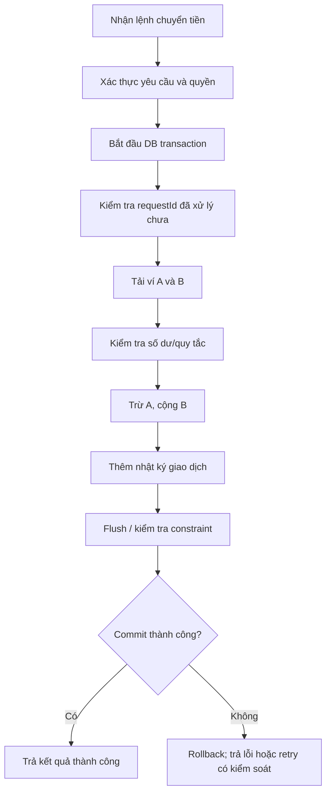
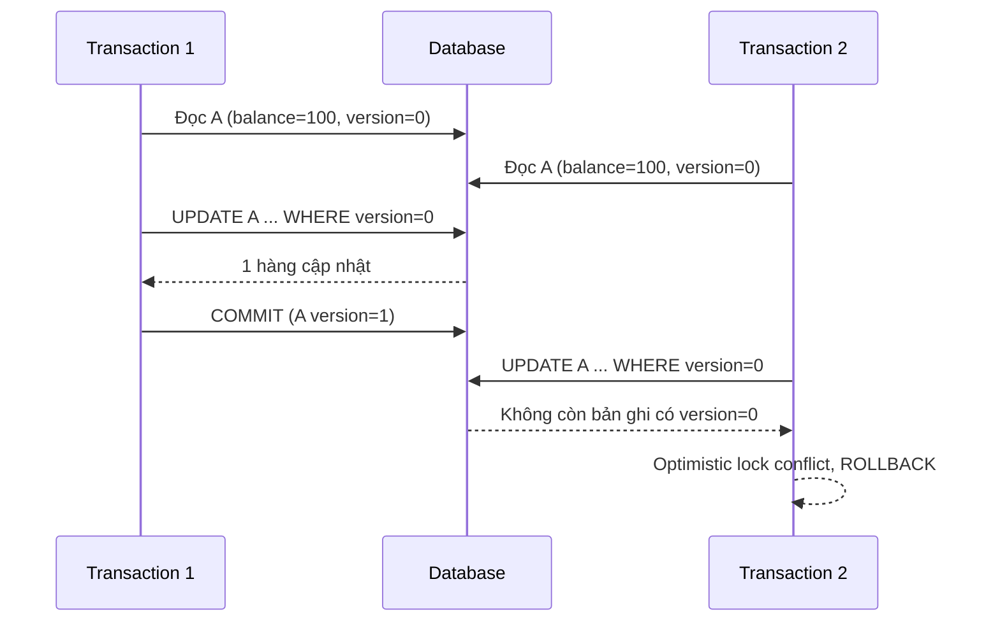
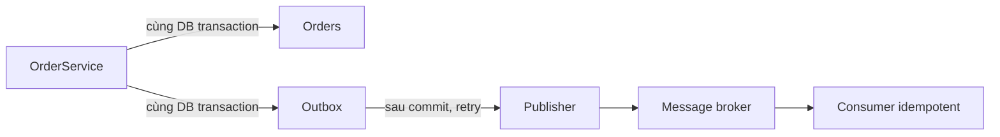

# Ranh giới giao dịch và tính đúng của thao tác nghiệp vụ

Một thao tác nghiệp vụ thường cần thay đổi **nhiều bản ghi liên quan**. Ví dụ chuyển 30.000 đồng từ ví A sang ví B không chỉ là chạy hai câu `UPDATE`: hệ thống còn phải kiểm tra số dư, ghi lại mã giao dịch để tránh xử lý trùng và bảo đảm **không có trạng thái “đã trừ A nhưng chưa cộng B”** sau khi xử lý thất bại.

Trong JPA, **ranh giới giao dịch** (*transaction boundary*) xác định những thao tác đọc/ghi nào cùng thuộc một đơn vị commit hoặc rollback. Ranh giới này ảnh hưởng trực tiếp đến tính đúng của nghiệp vụ: quy tắc kiểm tra, cơ chế chống cập nhật đồng thời, thời điểm phát SQL, ngoại lệ, khả năng retry và tương tác với hệ thống ngoài.

Bài học thuộc chương **Giao dịch** của chủ đề *Data Persistence Relational Access ORM JPA* trình bày cách chọn ranh giới transaction theo **use case**, không theo từng câu lệnh repository; phân biệt flush và commit; triển khai transaction trong Java SE và Spring; xử lý cạnh tranh cập nhật, idempotency, và tình huống phải phát sự kiện sau khi lưu dữ liệu.

## 1. Một thao tác nghiệp vụ có thể gồm nhiều thay đổi

Giả sử có hai tài khoản nội bộ:

| Ví | Số dư trước | Thao tác | Số dư sau |
|---|---:|---|---:|
| A | 100.000 | Trừ 30.000 | 70.000 |
| B | 50.000 | Cộng 30.000 | 80.000 |
| Tổng | 150.000 | Không tạo hoặc mất tiền | 150.000 |

Nếu nghiệp vụ còn yêu cầu nhật ký chuyển tiền, ta có thêm bản ghi `transfer_journal` với mã yêu cầu duy nhất.

Các điều kiện đúng (*invariants*) gồm:

1. **Không tạo tiền hoặc mất tiền:** với một lần chuyển nội bộ thành công, tổng số dư A + B không đổi.
2. **Không âm số dư** nếu sản phẩm không cho thấu chi.
3. **Không xử lý cùng yêu cầu hai lần:** một `requestId` chỉ tạo một giao dịch có hiệu lực.
4. **Chỉ báo thành công sau commit:** chưa thể kết luận thành công vì `persist` hoặc `flush` đã trả về.
5. **Cập nhật cạnh tranh không làm thất thoát thay đổi:** hai yêu cầu cùng trừ số dư phải được kiểm soát.

Một mã service tách ba thao tác thành ba transaction độc lập là thiết kế nguy hiểm:

```java
// Ví dụ thiết kế SAI nếu mỗi lời gọi tự commit riêng.
walletRepository.debitAndCommit(fromId, amount);
walletRepository.creditAndCommit(toId, amount);
journalRepository.saveAndCommit(requestId, fromId, toId, amount);
```

Nếu lệnh thứ hai hoặc thứ ba lỗi, lệnh thứ nhất đã commit thì không thể đơn giản rollback toàn bộ bằng JPA transaction mới.

**Ranh giới đúng thường bao trùm một lần thực hiện đầy đủ use case chuyển tiền**, miễn các thay đổi đó thuộc cùng database/resource transaction hỗ trợ cơ chế nguyên tử tương ứng.



Ở phía Java, nhiều bước có thể xuất hiện dưới dạng setter hoặc method domain; SQL thực tế thường được JPA phát khi flush/commit. Điều cốt lõi là các bước liên quan **cùng nằm trong transaction** và các bất biến phải được bảo vệ khi có concurrency.

## 2. Transaction và persistence context không phải một khái niệm

Trong một đơn vị làm việc JPA, có hai phạm vi thường bị nhầm:

- **Transaction:** ranh giới commit/rollback của các thay đổi; liên quan tính nguyên tử và khả năng cô lập khỏi transaction khác.
- **Persistence context:** tập entity instance được `EntityManager` quản lý, phục vụ identity map, dirty checking và đồng bộ entity state xuống DB.

Ví dụ trong transaction:

```java
WalletAccount from = em.find(WalletAccount.class, "A");
from.debit(amount);
// from là managed; provider theo dõi thay đổi.

em.flush();
// SQL có thể đã chạy nhưng transaction chưa commit.

tx.commit();
// Nếu thành công, thay đổi mới được commit.
```

Bảng ý nghĩa:

| Thao tác | Ảnh hưởng chính | Có bảo đảm nghiệp vụ đã commit? |
|---|---|---|
| `new WalletAccount(...)` | Tạo object Java | Không |
| `em.persist(entity)` | Đưa entity mới vào trạng thái managed | Không |
| Sửa field của managed entity | Đánh dấu hoặc tạo state để dirty checking | Không |
| `em.flush()` | Đồng bộ SQL đang chờ trong transaction | **Không** |
| `tx.commit()` | Kết thúc transaction theo hướng commit | Chỉ khi commit thật sự thành công |
| `tx.rollback()` | Hủy thay đổi của transaction | Không có nghiệp vụ thành công |
| `em.clear()` | Detach entity trong persistence context | **Không** commit/rollback |
| `em.close()` | Đóng EntityManager application-managed | **Không** thay thế commit |

Một `EntityManager` ứng dụng tự tạo trong Java SE có thể tồn tại qua nhiều transaction tùy thiết kế. Ngược lại, trong nhiều ứng dụng Spring/Jakarta EE, persistence context được gắn theo transaction hoặc môi trường container. **Không lấy vòng đời của một object Java để suy ra ranh giới transaction.**

## 3. ACID giúp gì cho tính đúng nghiệp vụ?

ACID thường được giải thích bằng bốn thuộc tính:

### Atomicity — nguyên tử

Những thay đổi trong một transaction được commit thành một đơn vị hoặc bị rollback. Với chuyển tiền, nếu cả hai update và nhật ký dùng **cùng transaction của một DB**, thất bại trước commit không được để lại “chỉ trừ A”.

Atomicity không tự bao trùm email, HTTP API, message broker hay một DB khác nếu chúng không tham gia cùng cơ chế transaction phân tán.

### Consistency — nhất quán

Các ràng buộc database và logic nghiệp vụ phải dẫn dữ liệu từ trạng thái hợp lệ này sang trạng thái hợp lệ khác. **DB transaction không tự viết quy tắc kinh doanh thay cho ứng dụng**: nếu code cho phép trừ âm hoặc cộng tiền sai ví, một transaction hoàn toàn atomic vẫn có thể commit một kết quả sai nghiệp vụ.

Cần phối hợp validation, business invariants, PK/FK/UNIQUE/CHECK và chính sách concurrent updates.

### Isolation — cô lập

Hai transaction đồng thời có thể tương tác qua dữ liệu đọc/ghi. Mức isolation của DB quyết định những hiện tượng nào được ngăn hoặc còn có thể xuất hiện. **Atomicity không đồng nghĩa không có lost update hoặc không có race condition**.

### Durability — bền vững

Khi commit thành công, hệ thống lưu trữ phải bảo đảm dữ liệu bền vững theo cam kết DB và cấu hình durability. Trong thực tế còn phải xem cơ chế replication, backup, failover và ranh giới xác nhận commit của hệ quản trị DB.

**Tóm lại:** ACID là nền tảng, nhưng tính đúng nghiệp vụ đòi hỏi **ranh giới phù hợp, ràng buộc đúng, xử lý đồng thời và phối hợp với hệ thống ngoài**.

## 4. Chọn ranh giới theo use case, không theo repository

Một service tạo đơn hàng có thể cần:

- Kiểm tra khách hàng và quyền.
- Xác định giá áp dụng.
- Tạo đơn và dòng hàng.
- Giữ chỗ tồn kho.
- Ghi bản ghi outbox để phát sự kiện sau commit.

Nếu tất cả thay đổi nội bộ nằm trong cùng database, ranh giới transaction thường bao quanh **toàn bộ phần thay đổi trạng thái cần atomic**.

```text
HTTP POST /orders
    |
    v
Kiểm tra cú pháp và xác thực người gọi
    |
    v
CheckoutService.placeOrder(command)   <--- Bắt đầu transaction
    |-- Tải product/inventory
    |-- Kiểm tra quy tắc và số lượng
    |-- Tạo order/order lines
    |-- Giảm hoặc giữ tồn kho
    |-- Lưu outbox event
    +-- Commit transaction         <--- Kết thúc transaction
    |
    v
Trả 201/response chứa orderId
```

Không nên tạo transaction cho **từng repository call** nếu các repository đó cùng tạo nên một thao tác nghiệp vụ bất khả phân. Mặt khác, cũng không nên giữ một transaction mở **suốt quá trình người dùng chỉnh form vài phút** hoặc suốt lúc gọi service ngoài chậm. Thường cần tách:

1. **Chuẩn bị ngoài transaction:** parse input, xác thực cơ bản, tính toán không phụ thuộc DB, gọi external service chỉ khi cần theo chính sách riêng.
2. **Đoạn DB transaction ngắn:** đọc/kiểm tra trạng thái cần nhất quán, ghi các thay đổi và commit.
3. **Hành động sau commit:** thông báo, cập nhật search index hoặc phát message qua cơ chế đáng tin.

Một yêu cầu HTTP có thể chứa nhiều use case, nhưng không có quy tắc máy móc “một HTTP request bằng một DB transaction”. Ranh giới hợp lý là **đơn vị thay đổi cần giữ các bất biến chung**.

## 5. Java SE: transaction RESOURCE_LOCAL trong JPA

Với `EntityManager` application-managed dùng `RESOURCE_LOCAL`, ứng dụng điều khiển transaction bằng `EntityTransaction`:

```java
EntityManager em = emf.createEntityManager();

try {
    EntityTransaction tx = em.getTransaction();

    try {
        tx.begin();

        // Tải và thay đổi các managed entity.
        // Persist thêm entity mới nếu cần.

        tx.commit();
    } catch (RuntimeException ex) {
        if (tx.isActive()) {
            tx.rollback();
        }
        throw ex;
    }
} finally {
    em.close();
}
```

Quy tắc quan trọng:

- Không giả định `persist` đã commit dữ liệu.
- `commit` có thể ném exception do lỗi constraint, lock, optimistic conflict hoặc sự cố DB.
- Khi lỗi, rollback transaction còn active và đóng EntityManager sau khi xử lý; thông thường không tiếp tục thao tác nghiệp vụ như thể transaction không bị ảnh hưởng.
- Không gọi `tx.begin()/commit()` thủ công trong một transaction do Spring/JTA/container quản lý; để transaction manager điều phối.
- Một transaction thành công không đồng nghĩa mọi tác vụ ngoài DB đã thành công.

Ở các phần tiếp theo, ta xây ví dụ chuyển tiền hoàn chỉnh để thấy rõ mối liên hệ giữa transaction, dirty checking và ràng buộc nghiệp vụ.

## 6. Ví dụ Java SE hoàn chỉnh: chuyển tiền giữa hai ví

Ta chọn ba entity/table:

- `WalletAccount` có khóa chuỗi `id`, số dư và `@Version`.
- `TransferJournal` có `requestId` làm khóa chính, ghi thông tin giao dịch đã được xử lý.
- `TransactionService` minh họa một lần chuyển tiền atomic bằng EntityManager.

Để đơn giản, ví dụ giả định các ví dùng **cùng một đơn vị tiền tệ**, không tính phí và không có giao dịch liên ngân hàng. Khi phát triển sản phẩm thật, cần thêm currency, sổ cái, đối soát, quyền chuyển, hạn mức và các yêu cầu pháp lý phù hợp.

### 6.1. Cấu trúc dự án

```text
transaction-boundary-demo/
├── pom.xml
└── src/main/
    ├── java/demo/
    │   ├── WalletAccount.java
    │   ├── TransferJournal.java
    │   └── Main.java
    └── resources/
        └── META-INF/
            └── persistence.xml
```

Ví dụ dùng Java 17, Jakarta Persistence 3.1, Hibernate ORM 6.x và H2. Các phiên bản ở `pom.xml` là một bộ minh họa cho cùng thế hệ API, không phải tuyên bố phiên bản mới nhất.

```xml
<project xmlns="http://maven.apache.org/POM/4.0.0"
         xmlns:xsi="http://www.w3.org/2001/XMLSchema-instance"
         xsi:schemaLocation="http://maven.apache.org/POM/4.0.0
                             https://maven.apache.org/xsd/maven-4.0.0.xsd">
    <modelVersion>4.0.0</modelVersion>
    <groupId>demo</groupId>
    <artifactId>transaction-boundary-demo</artifactId>
    <version>1.0-SNAPSHOT</version>

    <properties>
        <maven.compiler.release>17</maven.compiler.release>
        <project.build.sourceEncoding>UTF-8</project.build.sourceEncoding>
    </properties>

    <dependencies>
        <dependency>
            <groupId>jakarta.persistence</groupId>
            <artifactId>jakarta.persistence-api</artifactId>
            <version>3.1.0</version>
        </dependency>
        <dependency>
            <groupId>org.hibernate.orm</groupId>
            <artifactId>hibernate-core</artifactId>
            <version>6.6.4.Final</version>
        </dependency>
        <dependency>
            <groupId>com.h2database</groupId>
            <artifactId>h2</artifactId>
            <version>2.3.232</version>
        </dependency>
    </dependencies>

    <build>
        <plugins>
            <plugin>
                <groupId>org.apache.maven.plugins</groupId>
                <artifactId>maven-compiler-plugin</artifactId>
                <version>3.13.0</version>
            </plugin>
            <plugin>
                <groupId>org.codehaus.mojo</groupId>
                <artifactId>exec-maven-plugin</artifactId>
                <version>3.4.1</version>
                <configuration>
                    <mainClass>demo.Main</mainClass>
                </configuration>
            </plugin>
        </plugins>
    </build>
</project>
```

### 6.2. Entity WalletAccount

Tệp `src/main/java/demo/WalletAccount.java`:

```java
package demo;

import jakarta.persistence.Column;
import jakarta.persistence.Entity;
import jakarta.persistence.Id;
import jakarta.persistence.Table;
import jakarta.persistence.Version;

import java.math.BigDecimal;
import java.math.RoundingMode;
import java.util.Objects;

@Entity
@Table(name = "wallet_account")
public class WalletAccount {

    @Id
    @Column(name = "id", length = 64, updatable = false)
    private String id;

    @Column(name = "balance", nullable = false, precision = 19, scale = 2)
    private BigDecimal balance;

    @Version
    @Column(name = "version", nullable = false)
    private Long version;

    protected WalletAccount() {
        // Constructor không tham số cho JPA.
    }

    public WalletAccount(String id, BigDecimal initialBalance) {
        this.id = Objects.requireNonNull(id, "id");
        this.balance = normalize(initialBalance);
        if (balance.signum() < 0) {
            throw new IllegalArgumentException("Negative initial balance");
        }
    }

    public String getId() {
        return id;
    }

    public BigDecimal getBalance() {
        return balance;
    }

    public Long getVersion() {
        return version;
    }

    public void debit(BigDecimal amount) {
        BigDecimal value = positive(amount);
        if (balance.compareTo(value) < 0) {
            throw new IllegalStateException("Insufficient funds");
        }
        balance = balance.subtract(value);
    }

    public void credit(BigDecimal amount) {
        BigDecimal value = positive(amount);
        balance = balance.add(value);
    }

    private static BigDecimal positive(BigDecimal amount) {
        BigDecimal value = normalize(amount);
        if (value.signum() <= 0) {
            throw new IllegalArgumentException("Amount must be positive");
        }
        return value;
    }

    static BigDecimal normalize(BigDecimal amount) {
        Objects.requireNonNull(amount, "amount");
        return amount.setScale(2, RoundingMode.UNNECESSARY);
    }
}
```

Các đặc điểm:

- Khóa ví được ứng dụng cấp trước khi persist; ví dụ cố định ID `"A"` và `"B"`.
- Số tiền dùng `BigDecimal`, không dùng `double` để biểu diễn tài chính.
- `normalize` yêu cầu số tiền có thể biểu diễn với đúng hai chữ số thập phân mà không phải làm tròn; quy tắc rounding thực tế phải theo nghiệp vụ.
- `debit` kiểm tra số dư hiện tại và không cho âm.
- `@Version` giúp provider kiểm soát xung đột khi hai transaction cùng cập nhật một hàng ví.
- Constructor/setter nghiệp vụ chỉ bảo vệ quy tắc ở Java; database thật vẫn nên có `CHECK(balance >= 0)`, constraints và kiểm soát đồng thời.

### 6.3. Entity TransferJournal — mã yêu cầu chống xử lý trùng

Tệp `src/main/java/demo/TransferJournal.java`:

```java
package demo;

import jakarta.persistence.Column;
import jakarta.persistence.Entity;
import jakarta.persistence.Id;
import jakarta.persistence.Table;

import java.math.BigDecimal;
import java.util.Objects;

@Entity
@Table(name = "transfer_journal")
public class TransferJournal {

    @Id
    @Column(name = "request_id", length = 80, updatable = false)
    private String requestId;

    @Column(name = "from_wallet", length = 64, nullable = false,
            updatable = false)
    private String fromWallet;

    @Column(name = "to_wallet", length = 64, nullable = false,
            updatable = false)
    private String toWallet;

    @Column(name = "amount", precision = 19, scale = 2,
            nullable = false, updatable = false)
    private BigDecimal amount;

    protected TransferJournal() {
        // Constructor cho JPA.
    }

    public TransferJournal(
            String requestId,
            String fromWallet,
            String toWallet,
            BigDecimal amount) {

        this.requestId = Objects.requireNonNull(requestId);
        this.fromWallet = Objects.requireNonNull(fromWallet);
        this.toWallet = Objects.requireNonNull(toWallet);
        this.amount = WalletAccount.normalize(amount);
    }

    public boolean matches(
            String from, String to, BigDecimal requestedAmount) {

        return fromWallet.equals(from)
            && toWallet.equals(to)
            && amount.compareTo(
                    WalletAccount.normalize(requestedAmount)) == 0;
    }
}
```

`request_id` là primary key, nên database từ chối hai bản ghi nhật ký cùng mã yêu cầu. Ta cần **cả kiểm tra nghiệp vụ khi replay** và **constraint DB**: chỉ kiểm tra `find` trước khi chèn sẽ không loại trừ race condition giữa hai request đồng thời.

Trong dự án thật, nhật ký thường còn cần timestamp, trạng thái, actor, currency và khóa ngoại hoặc tham chiếu kế toán. Ví dụ cố tình tập trung vào transaction boundary.

### 6.4. persistence.xml

Tệp `src/main/resources/META-INF/persistence.xml`:

```xml
<?xml version="1.0" encoding="UTF-8"?>
<persistence xmlns="https://jakarta.ee/xml/ns/persistence"
             xmlns:xsi="http://www.w3.org/2001/XMLSchema-instance"
             xsi:schemaLocation="
                 https://jakarta.ee/xml/ns/persistence
                 https://jakarta.ee/xml/ns/persistence/persistence_3_1.xsd"
             version="3.1">

    <persistence-unit name="walletPU" transaction-type="RESOURCE_LOCAL">
        <provider>org.hibernate.jpa.HibernatePersistenceProvider</provider>

        <class>demo.WalletAccount</class>
        <class>demo.TransferJournal</class>
        <exclude-unlisted-classes>true</exclude-unlisted-classes>

        <properties>
            <property name="jakarta.persistence.jdbc.driver"
                      value="org.h2.Driver"/>
            <property name="jakarta.persistence.jdbc.url"
                      value="jdbc:h2:mem:walletdb;DB_CLOSE_DELAY=-1"/>
            <property name="jakarta.persistence.jdbc.user" value="sa"/>
            <property name="jakarta.persistence.jdbc.password" value=""/>

            <property name="jakarta.persistence.schema-generation.database.action"
                      value="drop-and-create"/>
        </properties>
    </persistence-unit>
</persistence>
```

`drop-and-create` xóa rồi tạo lại schema khi khởi tạo persistence unit, **chỉ dùng trong demo/test**. Ở production phải dùng migration/schema được quản lý và ràng buộc DB phù hợp.

### 6.5. Main — một transaction cho toàn bộ lần chuyển

Tệp `src/main/java/demo/Main.java`:

```java
package demo;

import jakarta.persistence.EntityManager;
import jakarta.persistence.EntityManagerFactory;
import jakarta.persistence.EntityTransaction;
import jakarta.persistence.Persistence;

import java.math.BigDecimal;
import java.util.Objects;
import java.util.UUID;

public class Main {

    public static void main(String[] args) {
        EntityManagerFactory emf =
                Persistence.createEntityManagerFactory("walletPU");

        try {
            seed(emf);

            String requestId = UUID.randomUUID().toString();

            boolean first = transfer(
                emf, requestId, "A", "B", new BigDecimal("30.00")
            );

            // Gửi lại đúng requestId: không chuyển tiền lần nữa.
            boolean replay = transfer(
                emf, requestId, "A", "B", new BigDecimal("30.00")
            );

            System.out.println("First transfer applied: " + first);
            System.out.println("Replay applied: " + replay);

            printBalances(emf);
        } finally {
            emf.close();
        }
    }

    private static void seed(EntityManagerFactory emf) {
        EntityManager em = emf.createEntityManager();
        try {
            EntityTransaction tx = em.getTransaction();
            try {
                tx.begin();
                em.persist(new WalletAccount(
                    "A", new BigDecimal("100.00")));
                em.persist(new WalletAccount(
                    "B", new BigDecimal("50.00")));
                tx.commit();
            } catch (RuntimeException ex) {
                if (tx.isActive()) tx.rollback();
                throw ex;
            }
        } finally {
            em.close();
        }
    }

    private static boolean transfer(
            EntityManagerFactory emf,
            String requestId,
            String fromId,
            String toId,
            BigDecimal amount) {

        Objects.requireNonNull(requestId, "requestId");
        Objects.requireNonNull(fromId, "fromId");
        Objects.requireNonNull(toId, "toId");

        if (fromId.equals(toId)) {
            throw new IllegalArgumentException(
                "Sender and receiver must differ");
        }

        BigDecimal normalized = WalletAccount.normalize(amount);
        if (normalized.signum() <= 0) {
            throw new IllegalArgumentException(
                "Transfer amount must be positive");
        }

        EntityManager em = emf.createEntityManager();

        try {
            EntityTransaction tx = em.getTransaction();
            try {
                tx.begin();

                TransferJournal previous =
                    em.find(TransferJournal.class, requestId);

                if (previous != null) {
                    if (!previous.matches(fromId, toId, normalized)) {
                        throw new IllegalArgumentException(
                            "Same requestId with different payload");
                    }

                    tx.commit();
                    return false;
                }

                WalletAccount from =
                    em.find(WalletAccount.class, fromId);
                WalletAccount to =
                    em.find(WalletAccount.class, toId);

                if (from == null || to == null) {
                    throw new IllegalArgumentException(
                        "Unknown wallet");
                }

                // Cả hai object đều managed trong cùng transaction.
                from.debit(normalized);
                to.credit(normalized);

                // Ghi nhận requestId cùng transaction với hai số dư.
                em.persist(new TransferJournal(
                    requestId, fromId, toId, normalized));

                // Không bắt buộc flush() thủ công:
                // commit sẽ đồng bộ các thay đổi cần ghi.
                tx.commit();
                return true;

            } catch (RuntimeException ex) {
                if (tx.isActive()) tx.rollback();
                throw ex;
            }
        } finally {
            em.close();
        }
    }

    private static void printBalances(EntityManagerFactory emf) {
        EntityManager em = emf.createEntityManager();
        try {
            WalletAccount a = em.find(WalletAccount.class, "A");
            WalletAccount b = em.find(WalletAccount.class, "B");

            System.out.println("Wallet A: " + a.getBalance());
            System.out.println("Wallet B: " + b.getBalance());
        } finally {
            em.close();
        }
    }
}
```

Chạy từ thư mục dự án:

```bash
mvn compile exec:java
```

Kết quả chính dự kiến ở lần chạy thành công:

```text
First transfer applied: true
Replay applied: false
Wallet A: 70.00
Wallet B: 80.00
```

Log provider có thể xuất hiện thêm. Mã `requestId` được tạo ngẫu nhiên mỗi lần chạy. Ví dụ được thiết kế cho **một DB transaction nội bộ**, không thay thế một hệ thống sổ cái production.

### Những điều đúng nhờ ranh giới

1. Hai ví và nhật ký cùng được cập nhật trong **một transaction**.
2. Nếu `from.debit` ném lỗi thiếu số dư, không có commit và ví B không nhận tiền.
3. Nếu thao tác ghi nhật ký trùng PK hoặc update phiên bản ví xung đột ở flush/commit, transaction bị rollback, không được để một phần update tồn tại.
4. Nếu gửi lại requestId sau khi lần đầu đã commit, code nhận diện đây là replay và không trừ/cộng lần nữa.
5. Nếu gửi lại requestId với payload khác, code từ chối thay vì giả định đó là cùng giao dịch.

**Giới hạn đồng thời:** hai request có cùng requestId nhưng chạy đồng thời đều có thể đọc `previous == null` trước khi bất kỳ transaction nào commit. Constraint primary key ngăn kết quả trùng cuối cùng, nhưng một request có thể nhận exception do vi phạm uniqueness hoặc optimistic lock. Muốn cung cấp API idempotent thân thiện, cần **rollback transaction thất bại rồi đọc lại kết quả bằng transaction mới** (hoặc dùng cơ chế insert/claim idempotency key phù hợp với DB). Không bắt lỗi rồi tiếp tục dùng transaction đã hỏng.

## 7. Transaction bảo vệ atomicity, nhưng số dư vẫn cần kiểm soát đồng thời

Giả sử có hai request khác nhau cùng chuyển 80.00 từ ví A (số dư 100.00):

```text
T1 đọc A = 100
T2 đọc A = 100

T1 kiểm tra đủ 80 -> true
T2 kiểm tra đủ 80 -> true

T1 dự kiến A = 20
T2 dự kiến A = 20
```

Nếu cả hai transaction không có cơ chế chống lost update, có thể xuất hiện trạng thái sai: cả hai ví nhận đều được cộng tiền nhưng ví nguồn chỉ bị trừ một lần, hoặc một transaction ghi đè kết quả của transaction kia. **Mỗi transaction atomic riêng không tự bảo đảm đúng khi cùng chạy**.

Ví dụ `WalletAccount` dùng `@Version`:

```java
@Version
private Long version;
```

Một provider có thể dùng SQL khái niệm:

```sql
UPDATE wallet_account
SET balance = ?, version = ?
WHERE id = ? AND version = ?;
```

Nếu transaction T1 đã cập nhật A từ version 0 sang 1, T2 không thể ghi từ snapshot version 0 như thể không có ai vừa thay đổi. Nó sẽ gặp lỗi optimistic locking ở một thời điểm phù hợp với provider (flush hoặc commit).

**Cách xử lý đúng:** rollback toàn bộ T2, nếu nghiệp vụ cho phép retry thì mở transaction mới, đọc số dư/version mới và **kiểm tra lại điều kiện đủ tiền** trước khi thử lần nữa. Không chỉ lặp lại câu `UPDATE` trên snapshot cũ.



Sơ đồ biểu diễn logic kiểm tra version; thời điểm thực thi và lock wait phụ thuộc database/provider. Trong ví dụ chuyển hai ví, code còn có thể cập nhật cả ví nhận và nhật ký; khi lỗi optimistic lock, **toàn transaction** phải rollback, kể cả những thay đổi khác đã flush trong transaction đó.

## 8. Optimistic locking, pessimistic locking và cập nhật có điều kiện

Ba hướng xử lý đồng thời thường gặp:

### 8.1. Optimistic locking bằng @Version

Dùng khi xung đột tương đối ít, transaction ngắn và có thể xử lý thất bại/retry.

```java
@Entity
public class InventoryItem {
    @Id
    private Long id;

    @Version
    private Long version;

    @Column(nullable = false)
    private long availableQuantity;

    // ...
}
```

Khi một transaction cập nhật `availableQuantity` trên managed entity, provider kiểm tra version. Điều kiện còn hàng phải được đánh giá trên state phù hợp và **kiểm tra lại trong lần retry**.

### 8.2. Pessimistic locking cho hàng cần bảo vệ

```java
WalletAccount account = em.find(
    WalletAccount.class, walletId,
    LockModeType.PESSIMISTIC_WRITE
);
```

Khóa ghi bi quan yêu cầu database hỗ trợ cơ chế khóa hàng tương ứng. Tùy DB và isolation, nó có thể làm transaction khác chờ hoặc thất bại do timeout/deadlock. Lựa chọn này hữu ích khi xung đột thường xuyên, nhưng làm tăng lock contention.

Với thao tác chuyển giữa hai ví, nếu khóa cả A và B, nên sử dụng **thứ tự khóa nhất quán** (ví dụ theo ID) để giảm nguy cơ deadlock:

```java
String firstId = fromId.compareTo(toId) < 0 ? fromId : toId;
String secondId = fromId.compareTo(toId) < 0 ? toId : fromId;

// Ví dụ ý tưởng: khóa firstId trước, secondId sau.
WalletAccount first = em.find(
    WalletAccount.class, firstId, LockModeType.PESSIMISTIC_WRITE);
WalletAccount second = em.find(
    WalletAccount.class, secondId, LockModeType.PESSIMISTIC_WRITE);
```

Thứ tự ổn định **giảm** chứ không loại bỏ hoàn toàn deadlock, vì transaction có thể giữ các khóa khác, index hoặc FK liên quan. Code vẫn cần chính sách xử lý deadlock/timeout và retry an toàn.

### 8.3. Conditional UPDATE trực tiếp

Đối với hot path tồn kho, SQL có thể biểu diễn quy tắc “chỉ trừ nếu còn đủ” một cách nguyên tử trên một hàng:

```sql
UPDATE inventory
SET available_quantity = available_quantity - :requested
WHERE id = :item_id
  AND available_quantity >= :requested;
```

Kiểm tra **số hàng được cập nhật**: 1 nghĩa là điều kiện còn đủ tại thời điểm statement phù hợp, 0 nghĩa là không tìm được hàng hoặc số lượng không đủ. Trong transaction, thao tác này có thể phối hợp các thay đổi khác.

Lưu ý khi dùng **bulk JPQL/native SQL** từ JPA:

- Nó có thể bỏ qua dirty checking và version handling thông thường của managed entity.
- Persistence context đã tải entity có thể trở nên lỗi thời.
- Nếu vẫn cần `@Version`, phải thiết kế điều kiện/version increment rõ ràng hoặc dùng đường managed update.
- Không trộn bulk SQL với các thay đổi managed chưa flush mà không có quy tắc `flush`/`clear`/refresh thích hợp.

Không tồn tại một chiến lược khóa luôn tốt nhất; lựa chọn theo mức xung đột, phân phối dữ liệu, DB isolation, chi phí retry và yêu cầu latency.

## 9. Isolation level ảnh hưởng tính đúng ra sao?

Một transaction có thể đọc và ghi nhiều hàng. Nếu chỉ chống lost update bằng version trên một hàng, chưa chắc đã bảo vệ mọi **bất biến liên quan nhiều hàng**.

Bảng khái niệm:

| Isolation level | Ý nghĩa khái quát | Cần cảnh giác |
|---|---|---|
| `READ_UNCOMMITTED` | Cho phép mức cô lập rất thấp theo đặc tả SQL | Dirty read ở một số DB; nhiều DB thực tế xử lý khác |
| `READ_COMMITTED` | Tránh đọc dữ liệu chưa commit | Non-repeatable read, phantom và race khi kiểm tra rồi ghi |
| `REPEATABLE_READ` | Duy trì một số bảo đảm đọc lặp lại theo DB | Hành vi phantom/write skew khác nhau theo DB |
| `SERIALIZABLE` | Hướng tới kết quả tương đương thực thi tuần tự các transaction | Có thể phát sinh serialization failure và cần retry |

Đây là mô tả khái quát; **hiện thực isolation khác nhau giữa PostgreSQL, MySQL/InnoDB, SQL Server, Oracle...**. Không suy ra chính xác behavior chỉ từ tên mức isolation. JPA bản thân không định nghĩa một API chuẩn để chỉnh mọi isolation level; thường cấu hình qua DataSource, transaction manager hoặc DB/JDBC.

### Ví dụ write skew

Một phòng trực cần luôn có **ít nhất một bác sĩ đang trực**. Hai transaction cùng đọc dữ liệu thấy cả bác sĩ A và B đang trực:

```text
T1 thấy A=true, B=true -> cho A nghỉ -> A=false
T2 thấy A=true, B=true -> cho B nghỉ -> B=false
```

Hai transaction cập nhật **hai hàng khác nhau**, nên `@Version` trên từng hàng không nhất thiết phát hiện xung đột. Sau commit có thể không còn ai trực, vi phạm bất biến “ít nhất một”.

Cách giải quyết có thể là `SERIALIZABLE` kèm retry khi DB báo conflict, một hàng tổng hợp/lock dùng chung, constraint hoặc thiết kế dữ liệu cho phép DB thực thi điều kiện đúng. **Không tăng isolation một cách mù quáng** mà chưa xác định anomalie cần ngăn và giới hạn của DB.

### Phantom trong kiểm tra số lượng

Nếu nghiệp vụ giới hạn một người chỉ có tối đa 3 đơn đặt chỗ:

```java
long count = ...; // COUNT bookings của user
if (count < 3) {
    // Tạo booking mới.
}
```

Hai transaction có thể cùng đếm 2 rồi cùng insert, cuối cùng có 4 booking. Chỉ có một transaction quanh count + insert **chưa chắc đủ** nếu isolation cho phép phantom; cần unique/constraint phù hợp, lock một entity đại diện, serializable hoặc cơ chế cấp slot có điều kiện.

## 10. Constraint database là tuyến phòng thủ cuối

Validation Java và transaction phải phối hợp với **ràng buộc DB**:

| Bất biến | Hình thức bảo vệ phổ biến |
|---|---|
| Một `requestId` chỉ có một giao dịch | Primary key/unique constraint |
| Ví chuyển và ví nhận phải tồn tại | Foreign key (nếu mô hình lưu quan hệ) hoặc quy tắc service cùng constraints phù hợp |
| Số dư không âm | `CHECK(balance >= 0)` nếu DB hỗ trợ và dữ liệu hợp lệ |
| Mã đơn duy nhất trong tenant | Unique constraint `(tenant_id, order_code)` |
| Quan hệ con–cha hợp lệ | Foreign key và nullability |
| Cập nhật entity không làm mất thay đổi đồng thời | `@Version` hoặc locking/conditional statement |
| Giới hạn tổng hợp nhiều hàng | Cơ chế DB/transaction/lock phù hợp, không chỉ constraint đơn hàng |

Ví dụ schema nâng cao cho ví trong một DB hỗ trợ CHECK:

```sql
CREATE TABLE wallet_account (
    id VARCHAR(64) PRIMARY KEY,
    balance DECIMAL(19, 2) NOT NULL,
    version BIGINT NOT NULL,
    CONSTRAINT ck_wallet_nonnegative CHECK (balance >= 0)
);
```

`@Column(nullable=false)` và `@Table(uniqueConstraints=...)` thể hiện metadata nhưng trong production hãy thực thi schema qua **migration**, không mặc định để provider tự dựng ràng buộc lúc chạy.

Constraint có thể báo lỗi **ở flush/commit**, không nhất thiết ngay tại dòng setter hoặc `persist`. Khi DB từ chối một statement trong transaction, không nên cố “sửa lỗi” rồi commit tiếp bằng cùng persistence context mà không hiểu trạng thái transaction; thường rollback và bắt đầu một đơn vị công việc mới.

## 11. Ranh giới Spring @Transactional

Trong Spring Data JPA, cách thông dụng là đặt `@Transactional` tại **service/use-case method**:

```java
@Service
public class TransferService {

    private final WalletRepository wallets;
    private final TransferJournalRepository journals;

    public TransferService(
            WalletRepository wallets,
            TransferJournalRepository journals) {
        this.wallets = wallets;
        this.journals = journals;
    }

    @Transactional
    public void transfer(
            String requestId,
            String fromId,
            String toId,
            BigDecimal amount) {

        // Check request idempotency theo chính sách nghiệp vụ.
        // Ví dụ dưới chỉ minh họa transaction scope;
        // cần phối hợp unique constraint và xử lý replay.

        WalletAccount from = wallets.findById(fromId)
            .orElseThrow(() -> new IllegalArgumentException("From missing"));

        WalletAccount to = wallets.findById(toId)
            .orElseThrow(() -> new IllegalArgumentException("To missing"));

        from.debit(amount);
        to.credit(amount);

        // Ghi journal trong cùng transaction bằng repository thích hợp.
        journals.save(
            new TransferJournal(requestId, fromId, toId, amount));

        // Entity from/to là managed; không cần save từng ví
        // chỉ để kích hoạt dirty checking.
    }
}
```

Đây là snippet dành cho Spring, cần các import của `@Service`, `@Transactional`, `BigDecimal` và repository tương ứng. Ví dụ Java SE ở phần 6 mới minh họa đầy đủ kiểm tra replay; snippet Spring này chỉ nhấn mạnh **ranh giới service** và không đủ cho API idempotency production.

**Tại sao không đặt transaction riêng ở `WalletRepository.debit` và `WalletRepository.credit`?** Vì nếu hai lời gọi commit độc lập, một lần chuyển tiền không còn nguyên tử. Đặt transaction ở service giúp các repository call tham gia cùng transaction theo cấu hình Spring mặc định khi propagation phù hợp.

### @Transactional hoạt động qua proxy/interceptor

Trong Spring proxy-based AOP thông dụng:

- Lời gọi từ bên ngoài qua Spring proxy tới method được cấu hình transactional mới được interceptor áp dụng.
- **Self-invocation** (method trong class tự gọi method `@Transactional` khác qua `this`) có thể **bỏ qua proxy**, khiến annotation trên method được gọi nội bộ không mở transaction như người viết tưởng.
- Một object tạo bằng `new TransferService(...)` thủ công không tự nhận quản lý transaction của Spring.
- Transaction context truyền thống gắn với thread thực thi; gọi async/new thread không mặc nhiên chia sẻ transaction hiện tại.
- Method có annotation là một phần của quy ước; hiệu lực phụ thuộc cách proxy/weaving và transaction manager được cấu hình.

Ví dụ dễ mắc:

```java
@Service
public class CheckoutService {

    public void checkout() {
        reserveInventory(); // Gọi nội bộ qua this.
    }

    @Transactional
    public void reserveInventory() {
        // Không được mặc định có transaction chỉ nhờ annotation
        // khi method được gọi nội bộ qua self-invocation.
    }
}
```

Hướng rõ ràng là đặt `@Transactional` trên **entry method được gọi qua Spring bean proxy** hoặc chuyển phần nghiệp vụ cần transaction sang một bean chuyên trách được inject đúng cách.

## 12. Rollback trong Spring: exception ảnh hưởng kết quả

Theo cấu hình mặc định phổ biến của Spring declarative transaction, phương thức `@Transactional` được rollback khi có **`RuntimeException` hoặc `Error`** thoát ra, nhưng **checked exception** không tự động dẫn tới rollback nếu chưa cấu hình thêm.

Ví dụ:

```java
@Transactional
public void createOrder() throws IOException {
    orderRepository.save(new Order(...));
    throw new IOException("External document unavailable");
}
```

Nếu một checked `IOException` thoát ra, mặc định transaction có thể vẫn **commit** thay đổi DB (tùy quy tắc rollback hiện hành) dù method kết thúc bằng exception. Nếu nghiệp vụ yêu cầu rollback khi có checked exception, có thể cấu hình:

```java
@Transactional(rollbackFor = IOException.class)
public void createOrder() throws IOException {
    // ...
}
```

Cần kiểm tra cấu hình Spring thực tế và các quy tắc rollback được tổ chức áp dụng; không xem ví dụ trên là mô tả không đổi của mọi phiên bản/nền tảng.

### Bắt exception bên trong transaction có thể khiến transaction commit

```java
@Transactional
public void incorrectTransfer() {
    from.debit(amount);

    try {
        riskyOperation();
    } catch (RuntimeException ex) {
        log.warn("Ignored", ex);
    }

    // Method kết thúc bình thường -> interceptor có thể thử commit.
}
```

Nếu lỗi có nghĩa nghiệp vụ phải thất bại, cần **ném lại exception** hoặc đánh dấu rollback-only bằng API transaction manager phù hợp. Nhưng nếu một JPA/DB exception đã xảy ra, transaction có thể đã ở trạng thái rollback-only; **không thể “cứ catch là cứu được transaction”**.

Trong hệ thống Spring, có thể gặp `UnexpectedRollbackException` khi một inner operation đã đánh dấu rollback-only nhưng outer method vẫn cố commit.

### Đừng che giấu lỗi khi rollback

Nếu dùng `EntityTransaction` thủ công, hãy rollback trong catch/finally hợp lý và bảo toàn exception gốc hoặc ghi nhận exception phát sinh lúc rollback. Không trả về “success” khi commit chưa được xác nhận.

## 13. Propagation: REQUIRED, REQUIRES_NEW và ranh giới bất ngờ

Spring hỗ trợ nhiều mức **transaction propagation**. Hai kiểu dễ ảnh hưởng tính đúng nghiệp vụ:

### REQUIRED — tham gia transaction đang có

`@Transactional` mặc định dùng `Propagation.REQUIRED`: nếu đã có transaction tương thích, method tham gia; nếu chưa có thì tạo transaction mới.

```java
@Transactional
public void placeOrder(Command cmd) {
    inventoryService.reserve(cmd); // REQUIRED: tham gia transaction hiện tại.
    orderService.create(cmd);       // REQUIRED: tham gia transaction hiện tại.
}
```

Các lời gọi được thực thi qua proxy/transaction manager phù hợp có thể cùng một transaction; nếu một bước thất bại dẫn tới rollback, những thay đổi DB khác trong transaction cũng bị hủy.

### REQUIRES_NEW — transaction riêng

`Propagation.REQUIRES_NEW` yêu cầu một transaction mới, tạm ngưng transaction đang hoạt động theo khả năng của transaction manager:

```java
@Transactional(propagation = Propagation.REQUIRES_NEW)
public void recordAuditIndependently(AuditEvent event) {
    auditRepository.save(event);
}
```

Điều này có thể hữu ích khi audit **phải lưu dù nghiệp vụ ngoài rollback**, nhưng nó **phá tính nguyên tử với transaction bên ngoài**. Nếu inner transaction commit rồi outer rollback, audit vẫn tồn tại; đó là semantics mong muốn hay một lỗi thiết kế tùy nghiệp vụ.

Đừng dùng `REQUIRES_NEW` để “chữa” một transaction đã đánh dấu rollback-only khi thực tế cần tất cả thay đổi commit/rollback cùng nhau. Nó còn có thể cần connection bổ sung và tạo deadlock/connection pool pressure nếu lạm dụng.

### readOnly không phải cơ chế bảo vệ bất biến

`@Transactional(readOnly = true)` thường là hint cho transaction/provider, có thể tối ưu flush hoặc cấu hình connection tùy Spring/DB. Nó **không phải hàng rào phân quyền** và không đảm bảo mọi câu DML bị cấm trong mọi môi trường.

### Isolation và timeout

`@Transactional(isolation = Isolation.SERIALIZABLE, timeout = 5)` biểu đạt mong muốn ở tầng Spring; hiệu lực thực phụ thuộc DataSource, transaction manager và DB. Với transaction đã tham gia (REQUIRED), thuộc tính isolation/timeout của lời gọi bên trong không nhất thiết tạo một transaction mới hay thay đổi isolation đã thiết lập.

**Không có annotation nào thay thế việc hiểu DB thực sự xử lý khóa, isolation và commit như thế nào.**

## 14. Không giữ DB transaction mở khi chờ hệ thống ngoài

Ví dụ một lần checkout gồm:

1. Ghi order nội bộ.
2. Gọi cổng thanh toán HTTP.
3. Gửi email xác nhận.

Nếu đặt cả HTTP call và email trong một DB transaction dài:

- DB connection/row lock có thể bị giữ trong lúc mạng chậm.
- HTTP/email không tự rollback nếu DB transaction rollback.
- Nếu email đã gửi nhưng commit DB thất bại, người dùng nhận thông báo cho một đơn hàng không tồn tại.
- Nếu DB đã commit nhưng chương trình crash trước khi gửi email, có thể mất thông báo.

Một DB transaction **không phân phối tính nguyên tử** tới HTTP API hoặc message broker chỉ bằng cách đặt lời gọi trong `@Transactional`.

### Transactional outbox: lưu dữ liệu và sự kiện cùng transaction

Thay vì gửi message trực tiếp giữa transaction, ghi **outbox record** trong cùng database với order:

```text
BEGIN DB TRANSACTION
  INSERT order
  UPDATE inventory
  INSERT outbox_event(status='PENDING', payload=...)
COMMIT

Sau commit:
  Outbox publisher đọc PENDING
  Gửi message
  Đánh dấu đã gửi / retry khi lỗi
```

Ưu điểm: khi transaction rollback, cả order và outbox event đều không tồn tại; khi commit, event chờ gửi **được lưu bền vững** cùng order. Tuy nhiên, publisher có thể gửi trùng nếu crash sau khi gửi nhưng trước khi đánh dấu đã gửi. Vì vậy consumer phải **idempotent** hoặc có deduplication phù hợp.



**Outbox không phải một transaction ACID xuyên hai hệ thống.** Nó biến nguy cơ mất sự kiện thành công việc phát sự kiện có thể retry, với ranh giới nhất quán rõ ràng.

### Saga cho quy trình nhiều dịch vụ

Khi thanh toán, kho và vận chuyển là các service/DB riêng, một use case có thể cần nhiều **local transaction** và các bước **bù trừ** (*compensation*) nếu bước sau thất bại. Đó là hướng Saga/workflow, không phải một transaction JPA đơn giản.

Ví dụ: giữ chỗ tồn kho → xác nhận thanh toán → tạo đơn vận chuyển; nếu thanh toán thất bại, thực hiện nghiệp vụ nhả tồn kho. Hành vi bù trừ không nhất thiết hoàn nguyên hoàn hảo mọi side effect; cần xác định trạng thái và thời hạn theo nghiệp vụ.

## 15. Idempotency và sự không chắc chắn của kết quả commit

Một API có thể đã commit DB nhưng response bị mất vì lỗi mạng. Client không biết lần gọi trước đã thành công hay chưa và thử lại.

```text
Client gửi requestId=X
      |
      v
Server commit thành công
      |
      v
Mạng đứt trước response
      |
      v
Client retry requestId=X
```

Nếu mỗi retry tạo giao dịch mới, người dùng có thể bị trừ tiền hai lần. **Idempotency key** giải quyết bằng cách định danh một yêu cầu nghiệp vụ và ghi kết quả đã xử lý trong transaction phù hợp.

Thiết kế cơ bản:

1. Client tạo một `requestId` bền vững cho cùng ý định.
2. Server kiểm tra requestId cùng payload/actor/scope tương ứng.
3. Khi thực hiện nghiệp vụ, ghi một bản ghi có unique constraint trên requestId **trong cùng transaction**.
4. Request replay đọc lại kết quả cũ; requestId trùng nhưng payload khác bị từ chối.
5. Nếu có race cùng requestId, constraint quyết định một kết quả duy nhất; request thất bại rollback và đọc lại ở transaction mới.
6. Thiết kế thời hạn lưu idempotency record, chính sách retry và bảo mật chống reuse key giữa tenant.

Dữ liệu “không có record” trong một transaction **không phải bằng chứng** rằng transaction khác không đang xử lý cùng request. Vì vậy `SELECT rồi INSERT` cần đi cùng unique constraint hoặc cơ chế claim có tính nguyên tử.

### Retry chỉ khi hiểu nguyên nhân

Có thể retry sau optimistic locking conflict, deadlock hoặc serialization failure, **nhưng** chỉ khi nghiệp vụ cho phép và retry chạy trong **transaction mới** với việc đọc lại trạng thái mới. Không retry tự động vô hạn hoặc gửi lại external side effect mà không có idempotency.

Khi kết quả commit không chắc chắn (ví dụ mất kết nối lúc commit), tránh khẳng định transaction chắc chắn rollback. Query trạng thái theo `requestId` hoặc cơ chế đối soát để xác định kết quả trước khi quyết định tạo giao dịch mới.

## 16. Thứ tự thao tác và thời điểm flush

JPA có thể trì hoãn INSERT/UPDATE/DELETE cho đến lúc flush. Vì vậy:

```java
tx.begin();

em.persist(new TransferJournal(...));
from.debit(amount);
to.credit(amount);

// SQL chưa nhất thiết được gửi theo thứ tự Java ở trên.
tx.commit();
```

Provider có thể tổ chức thứ tự SQL dựa trên dependency, batching và ID strategy. Nếu ứng dụng cần DB kiểm tra constraint trước khi tiếp tục một bước, có thể gọi `em.flush()` tại điểm phù hợp trong transaction.

```java
em.persist(entity);
em.flush(); // Có thể phát hiện lỗi constraint ở đây.
```

**Nhưng flush không hoàn tất nghiệp vụ.** Sau flush vẫn có thể xảy ra deadlock, optimistic conflict, lỗi commit hoặc rollback. Không trả success hoặc phát sự kiện bên ngoài chỉ vì `flush` đã trả thành công.

Một số DB hỗ trợ deferred constraints kiểm tra khi commit. Ngay cả khi explicit flush không ném lỗi, commit vẫn phải được coi là ranh giới xác nhận cuối.

## 17. Những lỗi thiết kế ranh giới thường gặp

### Lỗi 1: Đặt @Transactional quá thấp

```java
// Ví dụ sai về use case:
debitService.debitInOwnTransaction(...);
creditService.creditInOwnTransaction(...);
```

Mỗi bước commit riêng phá atomicity của chuyển tiền. Đặt transaction tại service điều phối nghiệp vụ.

### Lỗi 2: Đặt @Transactional quá rộng

Giữ một transaction mở khi tải file nhiều GB, gọi HTTP service chậm hoặc chờ người dùng nhập xác nhận tạo lock dài và chiếm connection. Rút ngắn transaction đến phần dữ liệu cần atomic, có quy trình nhiều giai đoạn nếu cần.

### Lỗi 3: Gọi em.flush() rồi kết luận đã commit

Flush mới đồng bộ SQL trong transaction; vẫn cần commit. Response thành công phải đi sau commit thành công hoặc sau khi trạng thái durable được bảo đảm theo giao ước khác.

### Lỗi 4: Catch mọi exception rồi trả success

Exception nghiệp vụ hoặc constraint bị bỏ qua khiến outer transaction có thể commit state dở dang, hoặc inner transaction đã rollback-only gây lỗi lúc cuối. Phải có chính sách rollback minh bạch.

### Lỗi 5: @Transactional không hiệu lực vì self-invocation

Method `this.innerTransactional()` trong cùng bean không đi qua proxy như tưởng. Đặt boundary ở entry method hoặc tổ chức bean phù hợp.

### Lỗi 6: Dùng REQUIRES_NEW vô tình phá atomicity

Một bước ghi journal commit độc lập với chuyển tiền có thể tồn tại khi chuyển tiền rollback. Chỉ dùng transaction riêng khi thật sự muốn semantics đó.

### Lỗi 7: Nghĩ READ_COMMITTED ngăn mọi race

Hai transaction có thể cùng đọc trạng thái hợp lệ rồi insert/update cạnh tranh. Cần unique constraint, version, lock hoặc isolation phù hợp với bất biến.

### Lỗi 8: Bỏ kiểm tra số hàng cập nhật

Một câu conditional `UPDATE` ảnh hưởng 0 hàng có thể mang ý nghĩa thiếu tồn kho hoặc version conflict. Không được trả “đã giữ chỗ” khi thực tế không cập nhật hàng nào.

### Lỗi 9: Retry trên snapshot cũ

Sau optimistic lock conflict, bắt exception và cập nhật lại giá trị cũ mà không reload có thể phá chính sách chống lost update. Rollback rồi đọc trạng thái mới.

### Lỗi 10: Nhầm rollback DB với rollback email/HTTP

Một email đã gửi không thể được JPA rollback. Dùng outbox, idempotency, Saga/compensation tùy hệ thống.

### Lỗi 11: Bỏ qua database constraints

`if (!exists) insert` không an toàn dưới concurrency nếu DB thiếu unique constraint. Validation và database protection phải cùng tồn tại.

### Lỗi 12: Giả định transaction tự truyền sang luồng khác

`CompletableFuture`, `@Async` hay tác vụ chạy trong thread khác không mặc định dùng cùng transaction context. Cần thiết kế ranh giới transaction riêng cho mỗi tác vụ.

### Lỗi 13: Bulk update rồi đọc managed entity cũ

JPQL bulk DML bỏ qua đồng bộ từng managed instance. Sau bulk, object đã tải có thể cũ; cần flush/clear/refresh và kiểm soát version phù hợp.

### Lỗi 14: Dùng entity detached để xác định trạng thái hiện tại

Một detached object có thể chứa snapshot cũ. Khi business invariant phụ thuộc dữ liệu mới nhất, tải managed state trong transaction hoặc sử dụng lock/conditional operation.

## 18. Quy trình thiết kế transaction cho một use case

Khi thiết kế một thao tác như “đặt hàng”, “giữ tồn kho”, “chuyển tiền” hoặc “đăng ký suất”, có thể đi qua những câu hỏi sau:

| Câu hỏi | Quyết định cần làm rõ |
|---|---|
| Use case kết thúc thành công khi nào? | Xác định commit và side effects đã được chấp nhận |
| Những hàng nào phải thay đổi cùng nhau? | Đặt trong một transaction nguyên tử nếu cùng resource |
| Những bất biến nào phải luôn đúng? | Validation, CHECK, UNIQUE, FK, version/locking |
| Có request chạy đồng thời trên cùng dữ liệu không? | Chọn cơ chế concurrent updates |
| Có dữ liệu phải đọc để quyết định ghi không? | Xem isolation, locking và race check-then-act |
| Có service bên ngoài hoặc broker không? | Outbox/Saga thay vì giả định DB transaction bao trùm |
| Có thể lặp lại request không? | Idempotency key, unique constraint và retry |
| Bước nào có thể rất chậm? | Đặt ngoài transaction hoặc chia workflow |
| Failure ở flush/commit phải xử lý thế nào? | Rollback, response, retry có kiểm soát |
| Có người dùng/tenant khác chia sẻ dữ liệu không? | Authorization, tenant scope, không tin ID do client gửi |
| Có bulk SQL lẫn JPA entity không? | Cơ chế flush/clear/refresh để tránh state cũ |
| Cần theo dõi gì khi production lỗi? | RequestId/correlation ID, log commit outcome, metrics và audit |

Một thiết kế tốt cố gắng giữ **transaction ngắn nhưng đủ bao trùm** tất cả các bước DB phải atomic. “Ngắn” không có nghĩa cắt một nghiệp vụ ra thành các commit rời rạc. “Đủ bao trùm” không có nghĩa ôm cả HTTP, email và các tác vụ dài vào một DB transaction.

## 19. Quan sát và chẩn đoán transaction

Khi một thao tác nghiệp vụ sai hoặc chậm, chỉ xem số câu SQL là chưa đủ. Nên kết hợp:

- **Correlation ID/requestId:** kết nối log của cùng yêu cầu qua service, repository và outbox.
- **Transaction outcome:** phân biệt bắt đầu, flush, commit thành công, rollback, exception và kết quả chưa xác định.
- **Lock wait/deadlock:** xem thống kê DB, deadlock report và thứ tự khóa.
- **Optimistic conflicts:** đếm `OptimisticLockException` hoặc exception được framework chuyển đổi tương ứng.
- **Constraint violation:** biết UNIQUE/FK/CHECK nào gây rollback.
- **Độ dài transaction:** p95/p99 latency và số connection đang bị giữ.
- **Retry:** số lần retry, nguyên nhân và tỷ lệ thành công.
- **Tính đúng:** đối soát tổng tiền/tồn kho, phát hiện requestId trùng hoặc giao dịch chưa đủ bước.

Khi bật SQL bind logging, tránh làm lộ dữ liệu cá nhân, token, mật khẩu hoặc thông tin thanh toán. Với tiền thật, tính đúng và audit trail quan trọng hơn việc tối ưu một câu query đơn lẻ.

## 20. Bài tập thực hành

### Bài 1 — Rollback toàn bộ chuyển tiền

Dùng ví dụ Java SE. Trong transaction chuyển 30.00 từ A sang B, cố ý ném `RuntimeException` ngay sau `from.debit` và trước `to.credit`. Sau rollback, dùng `EntityManager` mới kiểm tra số dư hai ví không đổi.

### Bài 2 — Phân biệt flush và commit

Trong một transaction, đổi số dư, gọi `em.flush()` rồi chủ động `tx.rollback()`. Đọc lại bằng transaction mới để chứng minh flush không đồng nghĩa commit. Giải thích vì sao không gửi email xác nhận sau flush.

### Bài 3 — Retry cùng requestId

Gửi một lần chuyển thành công, rồi gọi lại với cùng requestId và payload. Quan sát `transfer` trả `false` ở lần replay và không đổi số dư. Sau đó gửi lại cùng requestId nhưng khác amount; giải thích lý do từ chối.

### Bài 4 — Hai request cùng trừ tiền

Mở hai `EntityManager` và hai transaction đọc cùng số dư ví A, rồi thử thực hiện hai lần chuyển lớn. Quan sát hành vi của `@Version` và transaction bị rollback. Viết chính sách retry bằng cách đọc trạng thái mới trong transaction mới.

### Bài 5 — Kiểm tra race của tồn kho

Tạo product có `availableQuantity = 1`. Hai transaction cùng đọc và cố đặt một đơn. So sánh trường hợp chỉ check trong Java với cơ chế version/lock hoặc conditional update ảnh hưởng đúng một hàng.

### Bài 6 — Ranh giới giao dịch trong Spring

Viết `CheckoutService.placeOrder` dùng `@Transactional` gọi hai repository để giữ tồn và lưu order. Thử ném unchecked exception giữa hai bước và kiểm tra cùng rollback. Sau đó thử một helper `REQUIRES_NEW` và phân tích vì sao semantics thay đổi.

### Bài 7 — Checked exception và rollback rule

Viết method `@Transactional` có lưu dữ liệu rồi ném checked exception. Quan sát quy tắc rollback của cấu hình Spring hiện tại. Thêm `rollbackFor` hoặc quy tắc tương ứng và so sánh kết quả.

### Bài 8 — Thiết kế transactional outbox

Khi tạo order thành công, lưu một `OutboxEvent` cùng transaction. Giả lập publisher bị crash sau commit nhưng trước gửi; chứng minh event còn chờ. Giả lập crash sau gửi nhưng trước đánh dấu đã gửi, rồi nêu cách consumer chống message trùng.

### Bài 9 — Write skew

Thiết kế quy tắc “ít nhất một nhân viên trực” với hai hàng. Mô phỏng hai transaction tắt trạng thái hai người khác nhau, giải thích vì sao `@Version` trên từng hàng chưa đủ và đề xuất transaction/lock/constraint phù hợp.

### Bài 10 — Đo độ dài transaction

Tạo hai phiên bản service: một phiên bản gọi HTTP giả lập chậm **bên trong** transaction và phiên bản tổ chức workflow để phần chờ diễn ra ngoài transaction. So sánh lock wait, connection usage, timeout và các rủi ro về tính nhất quán.

## 21. Câu hỏi tự kiểm tra

1. **Ranh giới giao dịch nên theo một câu lệnh SQL hay một thao tác nghiệp vụ?** Thường theo đơn vị thay đổi nghiệp vụ cần commit/rollback cùng nhau.
2. **Một transaction atomic có tự ngăn lost update không?** Không. Cần cơ chế concurrency như `@Version`, lock, isolation hoặc conditional update.
3. **`em.flush()` khác `commit` thế nào?** Flush đồng bộ SQL trong transaction, commit mới kết thúc transaction thành công.
4. **Nếu trừ A đã commit nhưng cộng B chưa chạy, rollback transaction mới có hoàn nguyên được trừ A không?** Không. Đó là lỗi chia sai ranh giới.
5. **Vì sao CHECK/UNIQUE constraint vẫn cần khi Java đã validate?** Vì dữ liệu có thể được ghi đồng thời hoặc từ nguồn ngoài JPA.
6. **`@Transactional` trên method tự gọi qua `this` luôn mở transaction mới không?** Không, trong cơ chế proxy-based thông dụng có nguy cơ self-invocation bỏ qua interceptor.
7. **`REQUIRES_NEW` có thể phá atomicity của use case không?** Có, vì inner transaction có thể commit độc lập với outer.
8. **Có nên gọi API thanh toán trong một DB transaction dài không?** Thường không; DB transaction không tự rollback side effect HTTP.
9. **Outbox giải quyết điều gì?** Lưu thay đổi DB và ý định phát message trong cùng DB transaction; publisher có thể retry sau commit.
10. **Outbox có đảm bảo consumer không bao giờ thấy message trùng không?** Không; vẫn cần idempotency/deduplication ở consumer.
11. **Sau optimistic conflict có nên retry trên entity cũ mà không reload không?** Không; rollback rồi đọc state mới và kiểm tra lại nghiệp vụ.
12. **Vì sao kiểm tra `count < limit` rồi insert có thể sai?** Do transaction đồng thời cùng đọc một snapshot và cùng insert nếu thiếu isolation/constraint phù hợp.
13. **Tại sao phải đợi commit trước khi trả “chuyển tiền thành công”?** Vì flush, constraint và commit vẫn có thể thất bại.
14. **Bị mất response sau commit thì làm sao tránh chuyển trùng?** Gắn requestId/idempotency key, ghi constraint cùng transaction và truy vấn kết quả khi retry.
15. **Transaction trong Spring có tự truyền sang `@Async`/thread khác không?** Không mặc định; mỗi tác vụ cần ranh giới riêng.
16. **Khi nào một transaction ngắn vẫn không đủ?** Khi yêu cầu phụ thuộc nhiều resource, external systems hoặc bất biến đa hàng đòi hỏi locking/isolation đặc biệt.

**Ghi nhớ:** Tính đúng của một thao tác nghiệp vụ không xuất phát chỉ từ việc có `@Transactional` hay `EntityTransaction`. Cần đặt **ranh giới đủ bao trùm mọi thay đổi DB phải atomic**, xác định **bất biến dữ liệu**, kiểm soát **cạnh tranh cập nhật và isolation**, coi **commit** là ranh giới xác nhận, và thiết kế **idempotency/outbox hoặc workflow bù trừ** cho những hành động vượt ngoài một DB transaction. JPA quản lý entity và dirty checking; còn transaction, DB constraints và thiết kế use case cùng nhau quyết định kết quả nghiệp vụ có thực sự đúng hay không.
