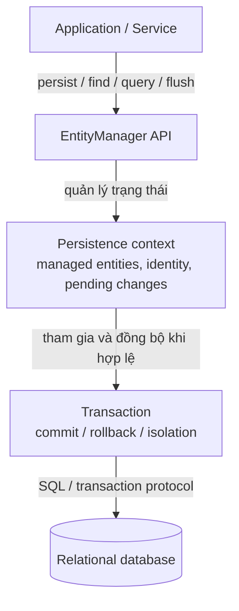
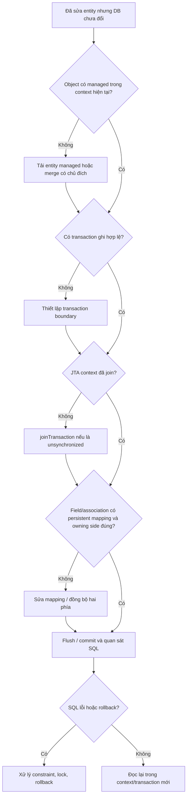

# Phân biệt giao dịch đang hoạt động và persistence context đang tồn tại

Trong JPA, hai khái niệm thường xuyên xuất hiện cùng nhau nhưng **không đồng nghĩa** là **giao dịch đang hoạt động (active transaction)** và **persistence context đang tồn tại**. Người mới học dễ nghĩ rằng cứ có `EntityManager` thì đã có transaction, hoặc khi transaction commit thì mọi entity lập tức trở thành detached. Những suy luận này chỉ có thể đúng trong **một số cấu hình**, không phải quy tắc chung của Jakarta Persistence.

Xét đoạn code:

```java
Product product = em.find(Product.class, 42L);
product.changePrice(new BigDecimal("199.00"));
```

Ba câu hỏi khác nhau cần được trả lời:

1. **Có persistence context nào đang quản lý `product` không?** Câu hỏi này liên quan đến identity map, trạng thái managed và dirty checking.
2. **Có transaction đang hoạt động không?** Câu hỏi này liên quan đến ranh giới atomicity, commit, rollback và quyền thực hiện thao tác ghi.
3. **Persistence context có đang tham gia transaction đó không?** Câu hỏi này quyết định state đang chờ có được đồng bộ qua flush/commit của transaction hay chưa.

Trong trường hợp thông thường, câu trả lời cho cả ba có thể là “có”. Nhưng một persistence context cũng có thể tồn tại **khi chưa có transaction**, và một transaction đang hoạt động cũng có thể **chưa có persistence context nào được tạo hoặc chưa được một context tham gia**.

**Mục tiêu của bài học:** hiểu vòng đời độc lập nhưng có liên hệ giữa transaction và persistence context; phân biệt `transaction-scoped`, `extended`, `resource-local` và `unsynchronized persistence context`; biết điều gì xảy ra với managed entity trước, trong và sau transaction; đồng thời sử dụng đúng `flush`, `joinTransaction`, `contains` và các API chẩn đoán.

## 1. Ba lớp trách nhiệm: EntityManager, persistence context và transaction

### 1.1. `EntityManager` là API thao tác persistence

`EntityManager` là giao diện ứng dụng dùng để:

- `persist` một entity mới.
- `find` hoặc tạo query đọc dữ liệu.
- `merge` state của detached entity vào managed entity.
- `remove` một entity được quản lý.
- `flush` các thay đổi pending xuống database.
- `clear`, `detach`, `refresh` và quản lý các thao tác liên quan.

Một `EntityManager` không nhất thiết đồng nghĩa với một **database connection cố định**. Provider có thể lấy/trả connection theo nhu cầu, transaction và connection pool.

### 1.2. Persistence context là môi trường quản lý entity

Persistence context là tập các entity instance được provider quản lý cùng thông tin identity và state liên quan. Nó thường được ví như **first-level cache**, nhưng không chỉ là cache đọc: nó còn là nơi lưu trạng thái cần đồng bộ.

Trong một persistence context, các lần tìm cùng entity identity thường trả về **cùng một Java object**:

```java
Product a = em.find(Product.class, 42L);
Product b = em.find(Product.class, 42L);

System.out.println(a == b); // Thông thường true trong cùng context.
```

Mô hình identity này giúp JPA bảo đảm một định danh entity tương ứng một managed instance trong cùng context. Nếu `a` bị đổi giá, `b` nhìn thấy giá mới vì hai biến tham chiếu cùng object; điều đó **chưa chứng minh** SQL `UPDATE` đã chạy.

### 1.3. Transaction là phạm vi xác nhận hoặc hủy thay đổi

Transaction xác định ranh giới nguyên tử cho các thao tác database:

```text
BEGIN
  UPDATE products SET ...
  INSERT INTO audit_logs ...
COMMIT
```

Nếu lỗi:

```text
BEGIN
  UPDATE products SET ...
  INSERT INTO audit_logs ...
ROLLBACK
```

Transaction cung cấp quy tắc commit/rollback và tương tác với isolation, locking, constraint của cơ sở dữ liệu. Nhưng transaction **không đồng nghĩa** với nơi lưu các Java object managed. Một transaction có thể được tạo trước lần đầu ứng dụng dùng `EntityManager`; ngược lại, một application-managed persistence context có thể tồn tại lâu hơn một transaction.

### 1.4. Ba khái niệm trên một sơ đồ



Mũi tên giữa persistence context và transaction biểu diễn **sự tham gia** (*join/synchronization*), không phải quan hệ đồng nhất. Chính sự khác biệt này giải thích các tình huống “entity vẫn managed nhưng chưa có transaction” hoặc “transaction tồn tại nhưng context chưa join”.

## 2. Câu trả lời ngắn: có thể có context mà không có transaction không?

**Có.** Ví dụ điển hình là application-managed `EntityManager` sử dụng resource-local transaction. Ta có thể tạo `EntityManager` và đọc entity; `EntityTransaction.isActive()` vẫn trả `false` nếu chưa gọi `begin()`.

```java
EntityManager em = emf.createEntityManager();
try {
    boolean txActive = em.getTransaction().isActive();
    System.out.println(txActive); // false: chưa begin transaction.

    Product product = em.find(Product.class, 42L);
    System.out.println(em.contains(product)); // Managed trong context của em.

    // Không nên hiểu thao tác đọc này đã mở một JPA transaction ghi.
} finally {
    em.close();
}
```

Đây là trường hợp **resource-local, application-managed EntityManager**. Việc đọc có thể sử dụng connection và cơ chế transaction đọc/auto-commit của JDBC/database bên dưới, nhưng `EntityTransaction` của JPA chưa được bắt đầu. Đừng đánh đồng mọi hoạt động thấp tầng của database với việc ứng dụng đã mở một resource-local JPA transaction.

### Có thể có transaction nhưng chưa có context không?

**Có thể.** Ví dụ, trong một transaction JTA, ứng dụng thực hiện công việc không liên quan JPA trước khi sử dụng `EntityManager`. Transaction vẫn hoạt động dù provider chưa cần tạo persistence context cho một entity nào.

```text
JTA transaction bắt đầu
  |
  |-- Gọi nghiệp vụ không đụng tới JPA
  |      (chưa cần persistence context)
  |
  |-- Gọi em.find(...)
  |      (provider xác lập context tương ứng khi cần)
  |
  |-- Commit
```

Trường hợp đặc biệt khác: có **unsynchronized persistence context** đang tồn tại và JTA transaction cũng đang hoạt động, nhưng context **chưa join** vào transaction. Khi đó điều kiện “context tồn tại” và “transaction tồn tại” đều đúng, còn “context tham gia transaction” là sai.

## 3. Bảng bốn tình huống nền tảng

| Transaction đang hoạt động? | Persistence context đang tồn tại? | Ví dụ dễ gặp | Hệ quả |
|---|---|---|---|
| **Không** | **Không** | Chưa gọi JPA, không giữ application-managed context; hoặc transaction-scoped context đã kết thúc | Không có entity nào được context đó theo dõi |
| **Không** | **Có** | Resource-local `EntityManager` vẫn mở; JTA extended context trong stateful component | Entity vẫn có thể managed; chưa có transaction để flush ghi |
| **Có** | **Không/chưa được tạo** | JTA transaction đã bắt đầu nhưng chưa dùng persistence | Transaction không tự sinh một danh sách entity managed |
| **Có** | **Có** | Xử lý service `@Transactional` thông thường | Có thể quản lý entity; cần xác định context đã join transaction chưa |

**Hàng cuối còn chia thành hai trường hợp:**

- **Synchronized/joined:** provider tham gia transaction; thay đổi pending có thể được flush theo quy tắc JPA.
- **Unsynchronized/not joined:** context vẫn quản lý state nhưng chưa được đồng bộ với transaction; cần `joinTransaction()` trước khi flush đối với JTA unsynchronized context.

Điều này cho thấy chỉ hỏi “transaction có active không?” là **chưa đủ** để kết luận state Java sẽ được commit.

## 4. Managed, detached và persistence context tồn tại lâu đến đâu?

Entity có các trạng thái thông dụng:

| Trạng thái entity | Mô tả | Có được context theo dõi? |
|---|---|---|
| **New/transient** | Mới tạo bằng `new`, chưa persist | Không |
| **Managed** | Nằm trong persistence context, có identity được quản lý | Có |
| **Detached** | Không còn được context quản lý | Không |
| **Removed** | Được đánh dấu xóa trong context | Được context quản lý theo vòng đời xóa |

Một managed entity không phải “entity đang trong transaction” theo định nghĩa. **Managed** nói về quan hệ giữa Java object và persistence context; **transaction active** nói về việc có một transaction hiện đang chạy.

Ví dụ:

```java
Product product = em.find(Product.class, id);
boolean managed = em.contains(product);
```

`contains` là API kiểm tra một instance có thuộc persistence context đang gắn với `EntityManager` hay không. Nó **không phải** API kiểm tra có transaction đang hoạt động.

Ngược lại:

```java
boolean active = em.getTransaction().isActive();
```

Đây là phép kiểm tra của **resource-local transaction**. Giá trị `true` **không bảo đảm** một entity cụ thể đã managed, và giá trị `false` không bảo đảm persistence context đã biến mất.

## 5. Ví dụ resource-local: context tồn tại qua nhiều transaction

Đây là ví dụ đơn giản và quan trọng nhất để tách hai khái niệm.

Giả sử persistence unit dùng kiểu transaction `RESOURCE_LOCAL`:

```xml
<persistence-unit name="shopPU"
                  transaction-type="RESOURCE_LOCAL">
    <class>example.domain.Product</class>
    <!-- Provider, JDBC properties và schema tùy môi trường. -->
</persistence-unit>
```

Phần cấu hình trên chỉ minh họa những thuộc tính liên quan của `persistence-unit`; để chạy thật, `persistence.xml` cần cấu trúc `<persistence>`, namespace/schema và datasource/provider đúng môi trường.

### 5.1. Đọc trước, transaction chưa bắt đầu

```java
EntityManager em = emf.createEntityManager();
try {
    System.out.println(em.getTransaction().isActive()); // false

    Product product = em.find(Product.class, 42L);
    System.out.println(em.contains(product)); // true trong context của em

    // Ở đây không có resource-local EntityTransaction đang active.
} finally {
    em.close();
}
```

`EntityManager` có context để quản lý `product`, trong khi `EntityTransaction` không active. Khi `em.close()`, context gắn với application-managed `EntityManager` này kết thúc, và những instance từng managed không còn được context đó theo dõi.

### 5.2. Transaction bắt đầu sau khi đã có managed entity

```java
EntityManager em = emf.createEntityManager();
try {
    Product product = em.find(Product.class, 42L);

    // Entity managed nhưng chưa có resource-local transaction.
    System.out.println(em.contains(product));          // true
    System.out.println(em.getTransaction().isActive()); // false

    em.getTransaction().begin();
    System.out.println(em.getTransaction().isActive()); // true

    product.changePrice(new BigDecimal("120.00"));
    em.getTransaction().commit();

    System.out.println(em.getTransaction().isActive()); // false
    System.out.println(em.contains(product));          // vẫn có thể true;
                                                       // context của em vẫn mở
} finally {
    em.close();
}
```

Trong mô hình resource-local application-managed bình thường, persistence context gắn với `EntityManager` tiếp tục tồn tại khi transaction kết thúc thành công, miễn `EntityManager` còn mở. Đây chính là điểm khác biệt với **transaction-scoped context do container quản lý** sẽ học ở phần sau.

Kết luận:

> **Transaction kết thúc không nhất thiết làm persistence context kết thúc.** Nó phụ thuộc loại context và cách `EntityManager` được quản lý.

### 5.3. Sử dụng cùng context cho transaction tiếp theo

```java
EntityManager em = emf.createEntityManager();
try {
    em.getTransaction().begin();
    Product product = em.find(Product.class, productId);
    product.changeName("First change");
    em.getTransaction().commit();

    // em vẫn mở; product vẫn thuộc context của em.

    em.getTransaction().begin();
    product.changePrice(new BigDecimal("199.00"));
    em.getTransaction().commit();
} finally {
    em.close();
}
```

Ví dụ nhằm minh họa khả năng một application-managed context kéo dài qua **hai transaction**. Trong hệ thống production, không vì vậy mà nên giữ một `EntityManager` xuyên nhiều request người dùng hoặc nhiều luồng. Càng sống lâu, context càng có rủi ro stale state và tiêu tốn bộ nhớ.

## 6. Không có transaction: có được đọc và có được ghi không?

Phải phân biệt **đọc entity**, **thay đổi Java object** và **ghi transaction xuống database**.

### 6.1. Đọc ngoài transaction

Một số phép đọc như `find` hoặc truy vấn `SELECT` có thể được thực hiện ngoài transaction theo quy tắc JPA. Tuy nhiên, sau phép đọc, **trạng thái managed hay detached của kết quả** phụ thuộc loại persistence context:

- Với application-managed `EntityManager` resource-local đang mở, kết quả có thể nằm trong context đó và được quản lý.
- Với transaction-scoped `EntityManager` do container quản lý **không có JTA transaction**, mỗi thao tác đọc có thể sử dụng một context tạm chỉ trong lời gọi; entity kết quả thường không tiếp tục được quản lý sau lời gọi đó.
- Với extended context, entity có thể tiếp tục managed giữa các lần gọi method ngay cả khi chưa có transaction.

Không thể suy ra “đọc ngoài transaction” luôn trả managed entity hoặc luôn trả detached entity mà không biết **context scope**.

### 6.2. Sửa Java object ngoài transaction

```java
Product product = em.find(Product.class, id);
product.changeName("Changed in Java");
```

Lời gọi `changeName` bản thân chỉ đổi state Java. Nếu không có transaction phù hợp thì **không có commit để xác nhận thay đổi xuống database**. Với context kéo dài, thay đổi có thể vẫn được giữ pending và được đồng bộ khi context tham gia một transaction sau này. Với object đã detached, thay đổi không tự được ghi.

Do đó, thực hành an toàn là **đặt thao tác ghi vào ranh giới transaction rõ ràng** thay vì cố “sửa trước, commit lúc nào cũng được”.

### 6.3. `flush()` ngoài transaction

```java
em.flush();
```

Khi không có transaction thích hợp hoặc context chưa join một JTA transaction cần thiết, `flush` không phải lối tắt để ghi SQL. Provider có thể ném `TransactionRequiredException` theo quy tắc JPA.

**Không cố dùng `flush()` để thay thế `begin()/commit()` hoặc container transaction.**

## 7. Transaction-scoped persistence context trong Jakarta EE

Với một component Jakarta EE, `EntityManager` được inject thường có **transaction-scoped persistence context** theo mặc định:

```java
import jakarta.persistence.EntityManager;
import jakarta.persistence.PersistenceContext;
import jakarta.ejb.Stateless;

@Stateless
public class ProductService {
    @PersistenceContext(unitName = "shopPU")
    private EntityManager em;

    public Product read(Long id) {
        return em.find(Product.class, id);
    }
}
```

Ở đây, `@PersistenceContext` thường cung cấp một **container-managed EntityManager**. Component nhận được đối tượng để gọi API, nhưng container quyết định context thực tế và cách liên kết với transaction hiện tại. `EntityManager` được inject có thể hoạt động như một proxy/contextual reference; không nên xem field `em` là bằng chứng một persistence context duy nhất đã được tạo từ lúc component khởi tạo.

### 7.1. Vòng đời của transaction-scoped context

Một luồng thông thường:

```text
Service method đi vào JTA transaction T1
       |
       v
Lần đầu dùng EntityManager trong T1
       |
       v
Transaction-scoped persistence context gắn với T1
       |
       v
find / persist / thay đổi managed entities
       |
       v
Flush và commit T1
       |
       v
Context gắn với T1 kết thúc
       |
       v
Các entity không còn managed trong context đã kết thúc
```

Phần lớn logic service nên nằm gọn trong một transaction. Khi ra khỏi transaction, không nên tiếp tục sửa object trả về rồi hy vọng những thay đổi sẽ tự động được lưu.

### 7.2. Ví dụ với transaction mặc định của EJB

```java
@Stateless
public class ProductService {
    @PersistenceContext(unitName = "shopPU")
    private EntityManager em;

    public void rename(Long id, String name) {
        Product product = em.find(Product.class, id);
        if (product == null) {
            throw new IllegalArgumentException("Product not found");
        }
        product.changeName(name);
        // Container-managed transaction; flush/commit khi thích hợp.
    }
}
```

Trong ví dụ này, phương thức EJB mặc định chạy với transaction attribute `REQUIRED` trong môi trường JTA thích hợp. Entity được tìm trong transaction hiện tại là managed, và provider sẽ đồng bộ thay đổi khi transaction hoàn tất thành công.

Không gọi:

```java
em.getTransaction().begin(); // Sai cách điều phối với JTA EntityManager.
em.close();                  // Không tự đóng container-managed EntityManager.
```

Đối với JTA entity manager, transaction được container quản lý; `getTransaction()` không phải API để điều khiển JTA transaction và có thể ném `IllegalStateException`.

### 7.3. Vì sao biến `em` có thể tồn tại sau transaction mà entity không còn managed?

Field inject:

```java
@PersistenceContext
private EntityManager em;
```

có thể tồn tại suốt vòng đời của component. Nhưng **transaction-scoped persistence context** gắn với từng JTA transaction, không nhất thiết tồn tại suốt vòng đời object chứa field `em`.

Vì vậy:

> **`EntityManager` reference còn sử dụng được không chứng minh context cũ vẫn tồn tại.** Với container-managed transaction-scoped EntityManager, những lần gọi ở các transaction khác nhau có thể được container liên kết tới các context khác nhau.

## 8. Extended persistence context: managed entity tồn tại qua nhiều transaction

Một **extended persistence context** có vòng đời dài hơn một transaction, đặc biệt trong mô hình conversational state như stateful session bean. Entity có thể tiếp tục managed khi một bước tương tác kết thúc mà **không có transaction active**.

Trong Jakarta EE, extended context thường được inject vào **stateful session bean**:

```java
import jakarta.ejb.Stateful;
import jakarta.ejb.TransactionAttribute;
import jakarta.ejb.TransactionAttributeType;
import jakarta.persistence.EntityManager;
import jakarta.persistence.PersistenceContext;
import jakarta.persistence.PersistenceContextType;

@Stateful
public class ProductEditConversation {
    @PersistenceContext(
        unitName = "shopPU",
        type = PersistenceContextType.EXTENDED
    )
    private EntityManager em;

    private Product draft;

    @TransactionAttribute(TransactionAttributeType.NOT_SUPPORTED)
    public void open(Long productId) {
        draft = em.find(Product.class, productId);
    }

    @TransactionAttribute(TransactionAttributeType.NOT_SUPPORTED)
    public void previewName(String name) {
        if (draft == null) {
            throw new IllegalStateException("Conversation not opened");
        }
        draft.changeName(name);
        // Chưa có JTA transaction trong method này.
        // draft có thể tiếp tục là managed trong extended context.
    }

    @TransactionAttribute(TransactionAttributeType.REQUIRED)
    public void save() {
        if (draft == null) {
            throw new IllegalStateException("Nothing to save");
        }
        // Synchronized extended context được tham gia transaction
        // theo quy tắc JTA/container; pending changes được flush.
    }
}
```

Ví dụ minh họa một conversation mang trạng thái riêng qua nhiều method, không phải lời khuyên bắt buộc dùng stateful EJB cho mọi form chỉnh sửa. Một extended context cần được quản lý vòng đời và hủy bỏ conversation rõ ràng; nếu người dùng bỏ dở, state pending không nên vô tình được commit khi một transaction khác tham gia.

### 8.1. Trạng thái qua các bước

```text
1. open(productId)
   Transaction: không có
   Extended context: tồn tại
   Product: managed trong extended context

2. previewName(...)
   Transaction: không có
   Extended context: vẫn tồn tại
   Product: managed, state mới đang được giữ trong RAM

3. save()
   Transaction: JTA active
   Extended context: tham gia transaction
   Flush: đồng bộ state pending

4. Sau save()
   Transaction: đã kết thúc
   Extended context: có thể vẫn tồn tại
   Product: có thể tiếp tục managed trong context đó
```

Điểm nổi bật: **managed state kéo dài hơn transaction**. Đây là một khả năng thiết kế có chủ đích, nhưng cũng khiến application dễ giữ state cũ, chiếm bộ nhớ và gặp xung đột nếu conversation kéo dài.

### 8.2. Khi nào extended context phù hợp?

- Quy trình chỉnh sửa nhiều bước trong một conversation có state.
- Hệ thống dùng stateful component và muốn giữ identity map xuyên các interaction.
- Đã có chiến lược concurrency, timeout, cleanup và hủy thay đổi rõ ràng.

### 8.3. Khi nào không nên dùng?

- REST API stateless thông thường.
- Web request độc lập, mỗi request nên mở transaction ngắn.
- Hệ thống có nhiều request đồng thời truy cập cùng state.
- Tập entity quá lớn hoặc data thay đổi liên tục bởi người dùng khác.

`EntityManager` và persistence context **không được thiết kế để sử dụng đồng thời từ nhiều thread**. Đừng đưa extended `EntityManager` vào singleton dùng chung giữa mọi người dùng.

## 9. Resource-local và extended context giống nhau ở điểm nào?

Cả application-managed resource-local `EntityManager` và extended persistence context có thể giữ managed state qua nhiều transaction. Nhưng chúng được tạo và tham gia transaction khác nhau.

| Đặc tính | Resource-local application-managed | JTA extended context |
|---|---|---|
| Cách tạo thường gặp | `emf.createEntityManager()` | `@PersistenceContext(type=EXTENDED)` trong stateful component |
| Ai quản lý transaction? | Ứng dụng qua `em.getTransaction()` | JTA container / transaction manager |
| Managed state có thể sống qua commit? | Có, khi `EntityManager` vẫn mở và transaction thành công | Có, theo vòng đời extended context |
| Có thể tồn tại khi không có transaction? | Có | Có |
| Bắt đầu transaction bằng `em.getTransaction().begin()`? | Có | Không, vì JTA |
| Có phù hợp singleton đa luồng? | Không | Không |
| Vòng đời context | Thường gắn với `EntityManager` ứng dụng mở/đóng | Gắn với extended context/conversational component |

Không thể dựa vào việc “entity còn managed sau commit” để khẳng định ứng dụng đang sử dụng extended JTA context; resource-local context cũng có đặc điểm đó.

## 10. Một context không tham gia transaction: `SynchronizationType.UNSYNCHRONIZED`

Ngoài câu hỏi *context có tồn tại?*, JPA còn có câu hỏi *context có đang synchronized với JTA transaction?*

Với JTA persistence context, có thể sử dụng:

```java
SynchronizationType.SYNCHRONIZED
SynchronizationType.UNSYNCHRONIZED
```

**Synchronized context** được tham gia JTA transaction theo quy tắc quản lý của JPA/container. **Unsynchronized context** không tự tham gia chỉ vì transaction bắt đầu; ứng dụng phải chủ động gọi `joinTransaction()` khi muốn đồng bộ.

### 10.1. Ví dụ extended unsynchronized context

```java
import jakarta.ejb.Stateful;
import jakarta.ejb.TransactionAttribute;
import jakarta.ejb.TransactionAttributeType;
import jakarta.persistence.EntityManager;
import jakarta.persistence.PersistenceContext;
import jakarta.persistence.PersistenceContextType;
import jakarta.persistence.SynchronizationType;

@Stateful
public class DraftEditor {

    @PersistenceContext(
        unitName = "shopPU",
        type = PersistenceContextType.EXTENDED,
        synchronization = SynchronizationType.UNSYNCHRONIZED
    )
    private EntityManager em;

    private Product draft;

    @TransactionAttribute(TransactionAttributeType.NOT_SUPPORTED)
    public void beginEditing(Long id) {
        draft = em.find(Product.class, id);
    }

    @TransactionAttribute(TransactionAttributeType.NOT_SUPPORTED)
    public void renameDraft(String name) {
        if (draft == null) {
            throw new IllegalStateException("Draft not loaded");
        }
        draft.changeName(name);
    }

    @TransactionAttribute(TransactionAttributeType.REQUIRED)
    public void publish() {
        if (draft == null) {
            throw new IllegalStateException("Draft not loaded");
        }
        em.joinTransaction();
        em.flush();
    }
}
```

**Quan trọng:** `joinTransaction()` được gọi trong method có JTA transaction. Trước đó, context vẫn có thể quản lý `draft` và ghi nhận thay đổi Java nhưng **không tự flush vào transaction chỉ vì transaction đang active ở thread**.

### 10.2. Bảng ba trạng thái cần phân biệt

| Context đang tồn tại? | JTA transaction đang active? | Context đã join? | Có thể kết luận gì? |
|---|---|---|---|
| Có | Không | Không | Có thể giữ managed state; không thể flush ghi thiếu transaction |
| Có | Có | Không | Transaction của thread tồn tại nhưng pending state của context chưa tự đồng bộ |
| Có | Có | Có | Context tham gia transaction; flush/commit xử lý pending state theo semantics |

Điều này là bằng chứng mạnh nhất rằng **“transaction active” không đồng nghĩa “persistence context đang tham gia transaction”**.

### 10.3. API `isJoinedToTransaction()`

Với JTA EntityManager:

```java
boolean joined = em.isJoinedToTransaction();
```

Phương thức này giúp kiểm tra EntityManager/context có đang joined với transaction hiện tại hay không. Nó không thay thế API kiểm tra transaction status nói chung, và không phải phép chứng minh một Java object cụ thể đã được managed.

Trong thực hành:

```java
if (!em.isJoinedToTransaction()) {
    em.joinTransaction();
}
```

Đoạn mã chỉ phù hợp khi đang có một **JTA transaction hợp lệ** mà application muốn cho context tham gia. Không gọi `joinTransaction()` tùy ý bên ngoài transaction, hoặc trên EntityManager không dùng JTA.

### 10.4. Flush khi unsynchronized chưa join

Nếu persistence context chưa join transaction, `flush()` không được dùng để lách cơ chế synchronization. Phải join theo quy tắc JPA trước khi đồng bộ. Trong môi trường JTA, thao tác flush khi chưa join có thể dẫn tới `TransactionRequiredException`.

## 11. Khi nào context bị tạo và kết thúc?

Không phải mọi context đều bắt đầu ngay tại thời điểm ứng dụng nhận reference `EntityManager`.

### 11.1. Application-managed `EntityManager`

```java
EntityManager em = emf.createEntityManager();
```

Trong mô hình application-managed, `EntityManager` đại diện cho context được ứng dụng quản lý và sử dụng đến khi `close()`. Provider có thể khởi tạo các cấu trúc/connection **một cách lazy**; ứng dụng không nên dựa vào việc constructor đã truy cập database.

### 11.2. Transaction-scoped container-managed

```java
@PersistenceContext
EntityManager em;
```

Đây có thể là reference được container điều phối theo transaction hiện tại. Persistence context của transaction thường kết thúc khi transaction kết thúc. Nếu có nhiều method với các transaction khác nhau, không nên giả định chúng cùng một context.

### 11.3. Extended context

Trong stateful conversation, context được gắn với vòng đời của component/conversation dài hơn transaction. Context kết thúc khi vòng đời tương ứng kết thúc hoặc bị đóng/giải phóng theo cách quản lý của container.

### 11.4. `EntityManager.isOpen()` có cho biết context còn hoạt động?

```java
boolean open = em.isOpen();
```

`isOpen()` cho biết trạng thái open/closed của EntityManager được gọi theo API thích hợp, **không phải** API kiểm tra transaction active, database connection đang mở hoặc entity X có đang managed. Với contextual/container-managed EntityManager, lifetime của proxy và context gắn transaction cũng không nhất thiết đồng nhất.

Vì vậy:

```text
em.isOpen() == true
    !=> transaction is active
    !=> SQL connection đang được giữ
    !=> Product cụ thể đang managed
    !=> context cũ từ request trước vẫn đang tồn tại
```

## 12. Các API chẩn đoán phải dùng đúng phạm vi

### 12.1. `EntityTransaction.isActive()` chỉ dành cho resource-local

```java
EntityTransaction tx = em.getTransaction();
boolean active = tx.isActive();
```

Đây là cách phù hợp khi ứng dụng **tự quản lý resource-local transaction**. Khi dùng JTA container-managed EntityManager, không gọi `getTransaction()` để hỏi JTA status; API đó không dành cho JTA.

### 12.2. `EntityManager.contains(entity)` hỏi trạng thái managed

```java
boolean managed = em.contains(product);
```

Nó kiểm tra entity instance thuộc persistence context tương ứng với `em` hay không. Nếu trả `false`, không có nghĩa transaction không active; đơn giản là object ấy không managed trong context đang xét, hoặc ngữ cảnh không giữ object đó.

### 12.3. `EntityManager.isJoinedToTransaction()` hỏi sự tham gia

```java
boolean joined = em.isJoinedToTransaction();
```

Hữu ích với JTA context, đặc biệt unsynchronized context. Nó không phải API trả về “database transaction hiện đang active” trong mọi cơ chế.

### 12.4. JTA transaction status

Trong container có Jakarta Transactions, có thể sử dụng `TransactionSynchronizationRegistry`:

```java
import jakarta.annotation.Resource;
import jakarta.transaction.Status;
import jakarta.transaction.TransactionSynchronizationRegistry;

public class TransactionDiagnostics {
    @Resource
    private TransactionSynchronizationRegistry txRegistry;

    public boolean isJtaTransactionActive() {
        return txRegistry.getTransactionStatus() == Status.STATUS_ACTIVE;
    }

    public boolean hasAssociatedTransaction() {
        return txRegistry.getTransactionKey() != null;
    }
}
```

Hai phép thử này **không hoàn toàn đồng nghĩa**: một transaction có thể tồn tại nhưng đã bị đánh dấu rollback-only hoặc có trạng thái khác `STATUS_ACTIVE`. Nếu quyết định nghiệp vụ là “có thể tiếp tục công việc ghi hợp lệ không?”, cần xử lý tình huống transaction marked rollback-only thay vì chỉ kiểm tra có transaction key.

### 12.5. Với Spring

Spring cung cấp API chẩn đoán riêng:

```java
import org.springframework.transaction.support.TransactionSynchronizationManager;

boolean active =
    TransactionSynchronizationManager.isActualTransactionActive();
```

Đây là thông tin theo transaction context do Spring quản lý, không phải phương thức của Jakarta Persistence. `isSynchronizationActive()` cũng không tương đương tuyệt đối với `isActualTransactionActive()`.

**Bảng tổng hợp:**

| Cần biết | API/biện pháp phù hợp | Không nên dùng thay |
|---|---|---|
| Resource-local transaction active? | `em.getTransaction().isActive()` | `em.isOpen()` |
| Một entity cụ thể có managed? | `em.contains(entity)` | `tx.isActive()` |
| JTA context đã join transaction? | `em.isJoinedToTransaction()` | `em.contains(entity)` |
| JTA transaction status? | `TransactionSynchronizationRegistry`/JTA manager | `em.getTransaction()` |
| Spring-managed transaction active? | `TransactionSynchronizationManager.isActualTransactionActive()` | `EntityManager.isOpen()` |
| SQL đã thực sự gửi? | SQL logging/metrics/provider diagnostics | Chỉ nhìn giá trị Java object |
| Transaction đã commit? | Kết quả transaction manager/commit | Gọi `em.flush()` |

## 13. Sự khác nhau giữa `flush`, `commit` và sự tồn tại của context

Giả sử trong resource-local context:

```java
em.getTransaction().begin();

Product product = em.find(Product.class, 42L);
product.changePrice(new BigDecimal("500.00"));

em.flush();
// SQL có thể đã được gửi đến database trong transaction.
// Transaction vẫn active.
// product vẫn managed.

em.getTransaction().commit();
// Transaction không còn active.
// EntityManager/resource-local context vẫn có thể tiếp tục mở.
```

Ba câu hỏi tại mỗi thời điểm:

| Thời điểm | Transaction | Context/managed entity | Database |
|---|---|---|---|
| Sau `find` trong transaction | Active | Entity managed | Có thể đã `SELECT` |
| Sau sửa field, trước flush | Active | Entity managed và dirty | Pending change có thể chưa thành SQL |
| Sau `flush()`, trước commit | Active | Entity managed | SQL đã có thể được thực thi nhưng chưa commit |
| Sau commit resource-local | Inactive | Context thường vẫn tồn tại khi `em` còn mở | Thay đổi đã commit nếu thành công |
| Sau `em.close()` | Không do `em` này quản lý nữa | Entity không còn managed trong context cũ | Dữ liệu commit trước vẫn tồn tại |

### Flush không tạo transaction

```java
em.flush();
```

Không phải tương đương:

```java
em.getTransaction().begin();
em.flush();
em.getTransaction().commit();
```

Flush có nghĩa **đồng bộ với transaction đang được phép sử dụng**. Nó không tự mở và commit một transaction mới theo ý ứng dụng.

### Commit không luôn đóng EntityManager

Trong resource-local:

```java
em.getTransaction().commit();
// em thường vẫn open, cần gọi em.close() khi không sử dụng.
```

Trong JTA transaction-scoped:

```text
Commit JTA transaction
  -> transaction-scoped context gắn transaction kết thúc
  -> reference EntityManager do container inject có thể tiếp tục dùng
     cho những transaction mới
```

Trong extended JTA:

```text
Commit JTA transaction
  -> extended context có thể vẫn tồn tại
  -> entity có thể tiếp tục managed qua conversation
```

Đó là lý do không có một quy tắc “sau commit, mọi entity detached” cho tất cả môi trường JPA.

## 14. Vấn đề khi sửa entity giữa hai transaction

### 14.1. Resource-local context giữ state xuyên transaction

```java
EntityManager em = emf.createEntityManager();
try {
    Product product = em.find(Product.class, 10L);

    // Chưa bắt đầu EntityTransaction, nhưng product thuộc context của em.
    product.changeName("Draft name");

    em.getTransaction().begin();
    em.getTransaction().commit();
} finally {
    em.close();
}
```

Với loại context kéo dài và tham gia transaction sau, state đã thay đổi khi chưa có transaction có thể được đồng bộ tại transaction tiếp theo. Tuy nhiên, đây là **nguồn rủi ro** khi code cho rằng “không có transaction thì chắc chắn mọi thay đổi bị quên đi”.

Thực hành tốt là chỉ chỉnh sửa entity trong ranh giới transaction được quản lý rõ ràng, hoặc dùng **DTO draft độc lập** để giữ dữ liệu chờ người dùng bấm “Save”.

### 14.2. Transaction-scoped context kết thúc

```java
// Service method 1 (transaction T1)
Product product = em.find(Product.class, id);
return product;
```

Khi transaction T1 kết thúc và context gắn T1 được giải phóng, `product` trả cho tầng khác thường là detached. Code ngoài service:

```java
product.changeName("Changed later");
```

không tự tạo cập nhật database. Muốn ghi, hãy gọi một service method mới mở transaction, tải lại entity managed theo ID, kiểm tra quyền và áp dụng thay đổi.

### 14.3. Extended context có thể giữ state của “draft”

Một extended context có thể giữ pending changes xuyên nhiều bước hội thoại. Nếu bước sau vô tình tham gia một transaction, các thay đổi trước đó có thể được flush. Cần thiết kế rõ hành vi **cancel draft**: detach/clear/reload hoặc kết thúc conversation, thay vì giả định “không bấm Save thì mọi sửa đổi trên managed entity tự biến mất”.

## 15. Tại sao `em.contains(entity)` có thể gây hiểu nhầm?

`contains` chỉ trả lời câu hỏi về một instance cụ thể **tại thời điểm gọi** và **trong context của EntityManager hiện tại**.

Ví dụ:

```java
Product productA = em.find(Product.class, id);
Product productB = new Product("Same title", new BigDecimal("10.00"));

System.out.println(em.contains(productA)); // true
System.out.println(em.contains(productB)); // false
```

Ngay cả nếu `productB` có cùng ID với một hàng trong database (giả sử có thể tạo object đó), nó không trở thành managed chỉ vì định danh trùng. Persistence context quản lý **Java instance cụ thể**, không phải mọi object có cùng primary key.

### `contains() == true` không nghĩa đang ghi dữ liệu

Trong extended/resource-local context không có transaction:

```java
boolean managed = em.contains(product); // true
boolean active = em.getTransaction().isActive(); // false (resource-local)
```

Entity có thể managed và dirty nhưng chưa có transaction để commit.

### `contains() == false` không nghĩa không có transaction

Trong transaction đang hoạt động:

```java
Product detached = loadFromOlderContext();
boolean managed = em.contains(detached); // false
```

Transaction vẫn active. Nếu cần cập nhật, load managed entity và áp dụng thay đổi hoặc dùng `merge` khi thích hợp. Đừng dùng `contains` như một công tắc “đã mở transaction”.

## 16. `merge` có thể tạo managed copy trong transaction mới

Một nghiệp vụ web nhận dữ liệu từ request trước có thể có detached entity hoặc DTO. Nếu dùng `merge`:

```java
em.getTransaction().begin();

Product managed = em.merge(detachedProduct);
managed.changePrice(new BigDecimal("180.00"));

em.getTransaction().commit();
```

**`merge` sao chép state từ detached instance vào một managed instance**. Object `detachedProduct` ban đầu vẫn detached; không dùng nó như bằng chứng một persistence context đã tiếp nhận nguyên object đó.

Hai điểm phải tách:

- **Transaction mới** cho phép commit thay đổi.
- **Persistence context hiện tại** quản lý object được `merge` trả về.

Nếu một detached object chứa dữ liệu cũ, merge toàn bộ có thể ghi đè thay đổi mới hơn của người khác khi thiếu `@Version` hoặc điều kiện concurrency phù hợp. Với REST API, cách an toàn thường là **nhận DTO, mở transaction, tìm entity managed, áp dụng các trường hợp lệ**.

## 17. `@Version`: context có state chưa đủ để tránh xung đột

Hai persistence context độc lập có thể cùng quản lý hai Java object đại diện cho **cùng một hàng database**:

```text
Context A: Product #42, price=100, version=7
Context B: Product #42, price=100, version=7

A trong transaction TA: changePrice(120)
B trong transaction TB: changePrice(150)
```

Nếu không có cơ chế concurrency phù hợp, giao dịch commit sau có thể ghi đè cập nhật trước. `@Version` cho provider khả năng optimistic locking:

```java
@Version
private long version;
```

SQL minh họa:

```sql
UPDATE products
SET unit_price = ?, version = ?
WHERE id = ? AND version = ?;
```

Nếu transaction B cố update dựa trên version cũ, provider có thể phát hiện xung đột và ném `OptimisticLockException` khi flush/commit.

Điều này minh họa:

- **Persistence context** quản lý state từng instance.
- **Transaction** điều phối thời điểm flush/commit/rollback.
- **Optimistic locking** giúp phát hiện các context/transaction khác đã sửa cùng dữ liệu.

Managed state có thể bị **stale** nếu context giữ entity quá lâu; điều này đặc biệt quan trọng với extended context và Open EntityManager in View.

## 18. Rollback và persistence context: điều gì còn dùng được?

Giả sử:

```java
em.getTransaction().begin();
Product product = em.find(Product.class, id);
product.changePrice(new BigDecimal("999.00"));
em.flush();
em.getTransaction().rollback();
```

Về database, các câu SQL trong transaction bị rollback. Nhưng **Java object đã được sửa trong bộ nhớ** không tự động quay ngược tất cả field về giá trị trước transaction theo cách ứng dụng có thể dựa vào một cách portable.

Ví dụ:

```text
Database sau rollback: unit_price = 100
Java object mà code còn giữ: unitPrice có thể vẫn = 999
```

Do đó:

1. Sau rollback, không giả định managed state cũ vẫn tương ứng với database.
2. Với transaction-scoped context, context kết thúc theo transaction.
3. Với application-managed context hoặc extended context, xử lý trạng thái sau rollback phải theo quy tắc lifecycle/provider; cách an toàn là **không tiếp tục dùng object graph đã thất bại như state mới được xác nhận**.
4. Khi cần tiếp tục, tạo transaction/context sạch, đọc lại entity và áp dụng nghiệp vụ đã được kiểm tra.

Rollback không tương đương `refresh()` trên mọi object và cũng không phải một lệnh undo tổng quát của Java heap.

### Có nên reuse EntityManager sau exception?

Với lỗi persistence nghiêm trọng hoặc transaction bị đánh dấu rollback-only, thường nên rollback, đóng hoặc giải phóng context theo mô hình quản lý và bắt đầu công việc mới bằng context/transaction mới. Không tiếp tục cố `flush` một transaction đã thất bại chỉ vì `EntityManager.isOpen()` vẫn trả true.

## 19. `clear`, `detach`, `refresh` và `close` tác động đến đâu?

Các API này dễ bị nhầm với ranh giới transaction:

| API | Ý nghĩa với persistence context | Có tự commit transaction không? |
|---|---|---|
| `em.detach(entity)` | Entity đó không còn managed | Không |
| `em.clear()` | Detach tất cả managed entities | Không |
| `em.refresh(entity)` | Đọc lại state managed entity từ database | Không |
| `em.close()` | Đóng application-managed EntityManager | Không nên coi là commit |
| `em.flush()` | Đồng bộ pending changes xuống DB trong transaction | Không |
| `tx.commit()` | Xác nhận resource-local transaction | Có, nếu thành công |
| JTA commit | Xác nhận transaction do JTA quản lý | Có, nếu thành công |

### 19.1. `clear()` không đóng transaction

```java
em.getTransaction().begin();

Product product = em.find(Product.class, id);
product.changeName("Draft");

em.clear();
// product detached. Pending changes có thể bị bỏ qua.
// Transaction vẫn active.

em.getTransaction().commit();
```

`clear()` không giống rollback. Nó thay đổi trạng thái quản lý entity. Nếu muốn giữ các thay đổi đang chờ trước khi clear, cần `flush()` phù hợp. Nhưng ngay cả `flush()` trước clear vẫn không đồng nghĩa commit.

### 19.2. `refresh()` không mở transaction ghi

```java
Product product = em.find(Product.class, id);
em.refresh(product);
```

`refresh` đọc lại state từ database cho managed entity, có thể ghi đè thay đổi chưa flush. Điều kiện transaction/locking cho `refresh` phụ thuộc loại context và lock mode. Đừng dùng refresh như một cách “lưu” entity.

### 19.3. `close()` không phải transaction manager

Với application-managed `EntityManager`:

```java
em.close();
```

Sau close không thể tiếp tục dùng EntityManager đó cho các thao tác persistence. Với transaction chưa hoàn tất, phải quản lý rollback/commit đúng cách trước khi giải phóng tài nguyên. Không dựa vào close để tự commit pending changes.

Với container-managed EntityManager inject bằng `@PersistenceContext`, container quản lý vòng đời; ứng dụng thường **không được tự gọi `close()`**.

## 20. Spring `@Transactional` và Open EntityManager in View

Trong ứng dụng Spring, ranh giới transaction thường được khai báo:

```java
@Service
public class ProductService {
    @PersistenceContext
    private EntityManager em;

    @Transactional
    public void changePrice(Long id, BigDecimal newPrice) {
        Product product = em.find(Product.class, id);
        if (product == null) {
            throw new IllegalArgumentException("Product not found");
        }
        product.changePrice(newPrice);
    }
}
```

Với `JpaTransactionManager`/Spring-managed JPA transaction thông thường, persistence context được gắn với phạm vi transaction qua cơ chế quản lý của Spring. Khi service method thoát thành công, transaction manager xử lý flush/commit theo cấu hình.

### 20.1. `@Transactional` không làm object Java thành transaction

Annotation áp dụng cho **phạm vi thực thi method khi interceptor/proxy thực sự hoạt động**. Nếu gọi method `@Transactional` từ chính object của nó (self-invocation) trong cơ chế Spring proxy mặc định, lời gọi có thể không qua interceptor và **không mở transaction mới** như mong đợi.

Ví dụ:

```java
@Service
public class ExampleService {
    public void outer() {
        inner(); // Self-invocation có thể bỏ qua transaction interceptor.
    }

    @Transactional
    public void inner() {
        // Không mặc định có transaction nếu được gọi qua this.inner().
    }
}
```

Vì vậy, khi thấy “entity không được flush dù method có `@Transactional`”, cần xác định transaction thực sự có active hay không, không chỉ đọc annotation trong source.

### 20.2. Open EntityManager in View (OSIV)

Một số ứng dụng Spring Web bật Open EntityManager in View, thường được gọi là **OSIV** hoặc **Open Session in View** khi dùng Hibernate. Ý tưởng là giữ một `EntityManager`/persistence context gắn với web request **ngoài ranh giới transaction service** để có thể truy cập lazy associations trong giai đoạn render response.

Sơ đồ:

```text
HTTP request bắt đầu
  |
  |-- OSIV mở/bind EntityManager/context
  |
  |-- Controller gọi service @Transactional
  |       |
  |       |-- Transaction active
  |       |-- Tải/sửa entities, flush và commit
  |       |
  |       '-- Transaction kết thúc
  |
  |-- Controller/serializer vẫn có thể truy cập lazy data
  |   qua context đang mở, dù không còn service transaction
  |
  '-- HTTP request kết thúc, OSIV đóng EntityManager/context
```

Đây là ví dụ rất dễ gặp của tình huống **persistence context còn tồn tại sau khi transaction đã kết thúc**.

### 20.3. Rủi ro của OSIV

- Controller/serializer có thể vô tình tạo các truy vấn database ngoài transaction nghiệp vụ.
- Các lazy load phát sinh theo nhu cầu dễ gây N+1 query.
- Dữ liệu được lấy ở những thời điểm khác nhau trong cùng request có thể không cùng snapshot.
- Context sống dài hơn transaction, làm tăng thời gian giữ managed state.
- Việc code sửa entity trong lúc render có thể tạo pending state khó kiểm soát.
- Không nên dựa vào OSIV để cập nhật dữ liệu ngoài service transaction.

Một thiết kế thay thế thường tốt cho REST API là **chỉ truy cập database trong service transaction**, trả DTO/projection đã có đủ dữ liệu mà response cần. Bật hay tắt OSIV cần quyết định theo framework, loại ứng dụng và yêu cầu hiệu năng; không nên áp dụng một kết luận cố định cho mọi dự án.

## 21. Spring `@Transactional(readOnly = true)` có nghĩa gì?

```java
@Transactional(readOnly = true)
public ProductDetails readProduct(Long id) {
    // Đọc và chuyển entity thành DTO.
}
```

`readOnly = true` là một **hint/cấu hình transaction của Spring**. Tùy transaction manager và JPA provider, nó có thể ảnh hưởng flush mode, dirty checking hoặc yêu cầu database transaction read-only. Nhưng không nên mặc định đó là một **rào chắn tuyệt đối** chống mọi câu SQL ghi trong mọi hệ thống.

Ngược lại, một persistence context còn tồn tại không chứng minh rằng method read-only đang ở trong **write transaction**. Nếu có yêu cầu thay đổi dữ liệu, nên dùng một service method với transaction ghi đúng mục đích và kiểm tra cơ chế thực thi.

### Hỏi transaction bằng API phù hợp

```java
boolean active =
    TransactionSynchronizationManager.isActualTransactionActive();
```

Đây là phép chẩn đoán Spring-specific. Nó có thể giúp phát hiện self-invocation hoặc method chạy ngoài transaction, nhưng không cho biết một entity cụ thể có thuộc persistence context hiện tại hay không. Muốn biết điều đó cần kiểm tra `em.contains(entity)` trong phạm vi context phù hợp.

## 22. Phân biệt transaction-scoped với application-managed EntityManager trong ứng dụng web

Một REST endpoint thường thực thi:

```text
HTTP request
  -> Controller
  -> Service @Transactional
  -> Repository / EntityManager
  -> Commit
  -> Response DTO
```

Trong mô hình này, transaction ngắn, entity không được trả ra ngoài để thay đổi thêm. Nhưng nếu ứng dụng tự tạo và giữ `EntityManager` trong một object lâu sống:

```java
class UnsafeRepository {
    private final EntityManager em;

    UnsafeRepository(EntityManagerFactory emf) {
        this.em = emf.createEntityManager();
    }
}
```

và dùng instance đó cho nhiều request, context có thể kéo dài ngoài ý muốn. Nó còn có nguy cơ truy cập đa luồng vì `EntityManager` không thread-safe.

**Không lưu một application-managed EntityManager trong singleton dùng chung tất cả request.** Nếu tự quản lý context, nên mở/đóng rõ ràng cho một đơn vị công việc, với transaction boundary thích hợp; hoặc để container/Spring quản lý cho từng phạm vi.

### Một mô hình an toàn với resource-local

```java
public void updatePrice(EntityManagerFactory emf, long id, BigDecimal price) {
    EntityManager em = emf.createEntityManager();
    try {
        em.getTransaction().begin();

        Product product = em.find(Product.class, id);
        if (product == null) {
            throw new IllegalArgumentException("Product not found");
        }
        product.changePrice(price);

        em.getTransaction().commit();
    } catch (RuntimeException ex) {
        if (em.getTransaction().isActive()) {
            em.getTransaction().rollback();
        }
        throw ex;
    } finally {
        em.close();
    }
}
```

Trong ví dụ này, mỗi lần gọi có EntityManager và transaction riêng, nên các managed instances không bị giữ lâu hơn nhu cầu.

## 23. Native SQL và bulk JPQL: transaction có thể ghi mà context không cập nhật object

Tình huống ngược lại cũng thường gặp: **transaction đang active, SQL đã thay database, nhưng persistence context vẫn chứa state cũ**.

Giả sử:

```java
em.getTransaction().begin();

Product product = em.find(Product.class, 42L);

em.createQuery(
    "update Product p set p.active = false where p.id = :id"
).setParameter("id", 42L)
 .executeUpdate();

// product có thể vẫn có active=true trong RAM.

em.getTransaction().commit();
```

JPQL bulk update/delete **đi trực tiếp tới database**, không dirty-check từng instance và không tự đồng bộ mọi managed entity đã được nạp trong context. Vì vậy:

- Transaction active và bulk SQL thành công không đồng nghĩa object Java đang managed đã được refresh.
- Context tồn tại không đồng nghĩa dữ liệu trong đó luôn phản ánh ngay mọi thay đổi do native SQL/bulk query thực hiện.
- Có thể `flush` trước bulk operation nếu có pending state cần giữ, và `clear/refresh` hoặc đọc trong context mới sau đó khi cần.

### Quy trình có chủ đích

```java
em.getTransaction().begin();

em.flush(); // Đồng bộ pending changes trong context.

int updated = em.createQuery(
        "update Product p set p.active = false " +
        "where p.unitPrice = :zero"
    )
    .setParameter("zero", BigDecimal.ZERO)
    .executeUpdate();

em.clear(); // Detach tất cả managed entities, tránh stale state.

em.getTransaction().commit();
```

`clear()` có tác động rộng: nó detach toàn bộ context, không chỉ những product vừa bulk update. Nếu code tiếp theo cần managed entity, phải tải lại hoặc thiết kế transaction/context riêng. Với second-level cache của provider, còn phải hiểu chính sách invalidation, không mặc định `clear` sẽ xóa mọi cache toàn ứng dụng.

## 24. Query và flush mode khi context đang tham gia transaction

JPA có `FlushModeType.AUTO` và `FlushModeType.COMMIT`.

### `AUTO`

```java
em.setFlushMode(FlushModeType.AUTO);
```

Khi context đang tham gia transaction, provider phải bảo đảm kết quả truy vấn phù hợp với thay đổi pending có thể ảnh hưởng đến query theo semantics của đặc tả. Provider có thể flush trước query hoặc sử dụng cơ chế khác phù hợp. Điều này không có nghĩa query nào cũng phải tạo SQL UPDATE trước khi SELECT.

### `COMMIT`

```java
em.setFlushMode(FlushModeType.COMMIT);
```

Provider có thể trì hoãn flush đến commit; ảnh hưởng của thay đổi pending đến query trước commit **không được xác định** theo JPA. Nếu nghiệp vụ phụ thuộc vào kết quả aggregate SQL chứa các thay đổi mới, cần `flush` phù hợp hoặc tổ chức lại luồng xử lý.

### Không áp dụng flush mode để “mở transaction”

```java
em.setFlushMode(FlushModeType.AUTO);
```

**Không** bắt đầu transaction và không biến detached entity thành managed. Flush mode chỉ điều chỉnh **khi nào đồng bộ** trong một bối cảnh context/transaction có thể đồng bộ hợp lệ.

Với unsynchronized context chưa join, đừng hiểu `AUTO` là một lệnh tự tham gia transaction; muốn đồng bộ phải tuân thủ cơ chế `joinTransaction()`.

## 25. Lazy loading ngoài transaction: context có còn không mới là một phần câu chuyện

Giả sử entity có association:

```java
@Entity
public class PurchaseOrder {
    @Id
    private Long id;

    @OneToMany(mappedBy = "order", fetch = FetchType.LAZY)
    private List<OrderLine> lines = new ArrayList<>();
}
```

Nếu transaction-scoped context kết thúc và entity bị detach:

```java
PurchaseOrder order = service.findOrder(id);
int count = order.getLines().size();
```

Với Hibernate, việc truy cập lazy collection chưa được nạp sau khi session/context đã đóng thường gây `LazyInitializationException`. JPA không chuẩn hóa một exception tên như vậy cho mọi provider; nguyên lý chung là entity detached **không thể tùy tiện yêu cầu context cũ tải dữ liệu**.

Ngược lại, nếu context **vẫn mở** sau khi transaction service kết thúc (ví dụ extended context hoặc OSIV), một phép lazy load có thể được provider xử lý dù transaction nghiệp vụ không còn active, theo khả năng và quy tắc của môi trường.

Nhưng từ đó không suy ra “lười tải được thì ghi dữ liệu được”. Lazy loading là vấn đề **đọc qua context**; commit thay đổi là vấn đề **transaction + synchronization**.

### Giải pháp khuyến nghị cho API

Chủ động lấy dữ liệu cần dùng trong transaction:

```java
List<OrderLineRow> rows = em.createQuery(
        "select new example.api.OrderLineRow(" +
        "l.id, l.sku, l.quantity) " +
        "from OrderLine l where l.order.id = :orderId " +
        "order by l.id",
        OrderLineRow.class
    )
    .setParameter("orderId", orderId)
    .setMaxResults(50)
    .getResultList();
```

DTO `OrderLineRow` trong ví dụ là một kiểu ứng dụng tự định nghĩa có constructor phù hợp. Dùng projection hoặc fetch plan có chủ đích giúp response không phụ thuộc vào persistence context còn mở trong giai đoạn serialize.

## 26. Một context dài hạn có thể chứa dữ liệu cũ

Persistence context bảo đảm identity của managed instances trong phạm vi của nó, nhưng **không tự liên tục cập nhật mọi object khi một transaction khác commit**.

Ví dụ:

```text
Extended context A đọc Product #42, giá=100
Transaction B ở context khác đổi giá thành 150 và commit
Extended context A vẫn giữ Product #42, giá=100
```

Khi code trong A gọi:

```java
Product product = em.find(Product.class, 42L);
```

provider có thể trả lại chính managed instance có sẵn trong context thay vì nạp lại dữ liệu từ database. Không nên nghĩ `find` luôn tạo một SELECT mới hoặc tự áp dụng các commit của transaction khác.

Để cập nhật state khi hợp lệ:

```java
em.refresh(product);
```

Nhưng `refresh` có thể ghi đè pending changes của entity. Nếu context đang giữ một draft chưa lưu, gọi refresh bừa bãi có thể làm mất dữ liệu người dùng nhập. Phải cân nhắc concurrency, `@Version`, optimistic lock và trải nghiệm chỉnh sửa nhiều bước.

### Vì sao “cứ giữ EntityManager mở cho nhanh” là nguy hiểm?

- Identity map có thể giữ nhiều entity và làm tăng memory.
- Dữ liệu cũ có thể không phản ánh thay đổi từ transaction khác.
- Dirty state có thể tích lũy ngoài transaction rồi flush ở lúc không mong muốn.
- Các request đồng thời dùng chung EntityManager không an toàn.
- Context lâu sống có thể làm lỗi lifecycle khó tái hiện.

Vì vậy, extended context chỉ nên dùng khi **vòng đời dài là một yêu cầu nghiệp vụ thực sự**.

## 27. Đa luồng và transaction khác nhau

Một request HTTP, một method service, một JTA transaction, một JDBC connection và một persistence context là **năm khái niệm khác nhau**.

Ví dụ:

```text
HTTP Request A
  Service method @Transactional
    JTA transaction T1
    Persistence context PC1

HTTP Request B
  Service method @Transactional
    JTA transaction T2
    Persistence context PC2
```

Ngay cả khi hai request cùng gọi một singleton Spring service, chúng không nên cùng sử dụng một application-managed `EntityManager` lưu trong field mutable chung. Những instance EntityManager/container proxies được thiết kế cho mô hình quản lý phù hợp, còn application-managed EntityManager **không thread-safe**.

### Transaction propagation cũng không hoàn toàn trùng với context scope

Trong Spring, các propagation như `REQUIRED` và `REQUIRES_NEW` điều khiển transaction:

- `REQUIRED` thường tham gia transaction hiện tại hoặc tạo mới.
- `REQUIRES_NEW` yêu cầu transaction độc lập theo semantics Spring, có thể suspend transaction bên ngoài.

Khi propagation đổi transaction, context được bind/synchronized cũng có thể thay đổi theo framework và transaction manager. Đừng giữ một managed entity từ transaction ngoài rồi mặc nhiên thao tác với nó trong context transaction trong như cùng một identity map.

Nếu cần qua ranh giới, truyền **ID hoặc DTO**, rồi tải lại entity trong transaction thích hợp.

## 28. Những hiểu lầm điển hình

| Phát biểu dễ nhầm | Vì sao sai hoặc thiếu? | Cách hiểu đúng |
|---|---|---|
| “Có `EntityManager` nghĩa là transaction đã active.” | EntityManager/context có thể tồn tại ngoài transaction | Kiểm tra transaction bằng API của transaction manager |
| “Transaction active nghĩa là entity tôi giữ đang managed.” | Entity có thể detached/new; context cũng có thể chưa được tạo | Dùng `contains` với instance trong context thích hợp |
| “Commit xong mọi entity đều detached.” | Resource-local hoặc extended context có thể tồn tại qua commit | Phụ thuộc persistence-context scope |
| “`em.isOpen()` true nghĩa là context request trước vẫn còn.” | Container-managed EM reference có thể là proxy | Xét cách context được bind theo transaction |
| “`em.contains` true nghĩa là có thể flush.” | Managed state có thể tồn tại khi không có transaction hoặc chưa joined | Cần transaction và synchronization hợp lệ |
| “JTA transaction active thì unsynchronized context tự flush.” | Unsynchronized context không tự join | Gọi `joinTransaction()` có chủ đích |
| “Không có transaction thì không thể có managed entity.” | Extended/resource-local context có thể giữ managed state | Tách lifetime của context khỏi transaction |
| “Flush sẽ commit dữ liệu.” | Flush gửi SQL pending trong transaction | Commit xác nhận, rollback có thể hủy |
| “Rollback tự đưa mọi Java field về giá trị cũ.” | Java heap không phải snapshot transaction | Bỏ state thất bại/tải lại trong context sạch |
| “`find` luôn đọc lại row mới nhất.” | Identity map có thể trả managed instance cũ | `refresh` hoặc context mới khi phù hợp |
| “Thấy lazy loading chạy thì transaction đang active.” | Context mở có thể cho phép đọc ngoài transaction | Loading và write transaction là hai vấn đề |
| “Dùng `merge` là commit.” | Merge sao chép state, chưa xác nhận transaction | Cần transaction/flush/commit |
| “Bulk update xong managed object tự đổi.” | Bulk JPQL bypass context | Refresh/clear hoặc đọc lại |
| “Spring `@Transactional` annotation luôn đã chạy.” | Self-invocation và proxy/configuration có thể ảnh hưởng | Kiểm tra interceptor/transaction status thật |
| “OSIV giữ transaction suốt HTTP request.” | OSIV có thể giữ context sau khi service transaction đóng | Phân biệt context lifetime và transaction boundary |

## 29. Lưu đồ chẩn đoán khi “đã đổi entity nhưng database không cập nhật”



Lưu đồ là phương pháp tư duy, không phải mã kiểm tra trực tiếp cho mọi loại EntityManager. Với resource-local context, điều kiện “đã join JTA?” không áp dụng như trong JTA; với synchronized context trong transaction bình thường, provider/container xử lý join theo quy tắc.

### Bộ câu hỏi thực tế

1. `Product` được tải trong transaction/context nào?
2. Có `em.contains(product)` trong context đang thao tác hay không?
3. Method có transaction thực sự active hay chỉ có annotation?
4. Nếu JTA unsynchronized, context đã join chưa?
5. Thuộc tính đổi có mapping persistent không? Có `updatable=false` hoặc `@Transient`?
6. Nếu quan hệ hai chiều, owning side đã được cập nhật chưa?
7. Có SQL `UPDATE` lúc flush/commit không?
8. Transaction có rollback hoặc bị đánh dấu rollback-only không?
9. Có lỗi optimistic locking/constraint/deadlock không?
10. Khi kiểm tra database, có đang đọc qua cùng context với state cũ hay không?

Trả lời đủ mười câu giúp tránh cách sửa sai như “thêm `em.flush()` ở khắp nơi” hoặc “bật EAGER cho mọi quan hệ” trong khi nguyên nhân thật là transaction không active hoặc entity đã detached.

## 30. Bài tập thực hành 1: context có nhưng transaction không active

Sử dụng một persistence unit `RESOURCE_LOCAL` và entity `Product`:

```java
EntityManager em = emf.createEntityManager();
try {
    System.out.println("tx=" + em.getTransaction().isActive());

    Product product = em.find(Product.class, id);
    System.out.println("managed=" + em.contains(product));

    em.getTransaction().begin();
    product.changePrice(new BigDecimal("80.00"));
    em.getTransaction().commit();

    System.out.println("tx=" + em.getTransaction().isActive());
    System.out.println("managed=" + em.contains(product));
} finally {
    em.close();
}
```

**Câu hỏi:**

1. Vì sao `tx=false` không làm `managed=false` ngay khi EntityManager vẫn mở?
2. Sau commit, vì sao cùng `EntityManager` có thể còn quản lý `product`?
3. Điều gì thay đổi sau `em.close()`?

**Điểm rút ra:** transaction và application-managed persistence context có vòng đời khác nhau.

## 31. Bài tập thực hành 2: hai method JTA transaction-scoped

Tạo một stateless service với `@PersistenceContext` mặc định, hai method:

```java
@Stateless
public class ProductService {
    @PersistenceContext
    private EntityManager em;

    public Product load(Long id) {
        return em.find(Product.class, id);
    }

    public void rename(Long id, String newName) {
        Product product = em.find(Product.class, id);
        product.changeName(newName);
    }
}
```

Thực hiện hai lời gọi độc lập từ client. Kiểm tra:

- Hai lời gọi có cùng JTA transaction hay không?
- Container có thể gắn context nào với từng lời gọi?
- Entity trả từ `load` còn managed khi caller thay field ngoài transaction không?
- Cách đúng để lưu tên mới là sửa object trả về hay gọi `rename` trong transaction?

**Điểm rút ra:** injected EntityManager có thể tồn tại lâu hơn transaction-scoped context mà nó điều phối.

## 32. Bài tập thực hành 3: unsynchronized context

Tạo stateful component với:

```java
@PersistenceContext(
    type = PersistenceContextType.EXTENDED,
    synchronization = SynchronizationType.UNSYNCHRONIZED
)
private EntityManager em;
```

Thử:

1. Tải entity trong một bước không có transaction.
2. Sửa state trong cùng extended context.
3. Bắt đầu một JTA transaction ở method khác nhưng **chưa gọi `joinTransaction()`**.
4. Kiểm tra `em.isJoinedToTransaction()`.
5. Gọi `em.joinTransaction()` trong transaction phù hợp.
6. Flush và commit, đọc lại trong context khác.

**Điểm rút ra:** context tồn tại, transaction tồn tại và context joined là ba trạng thái độc lập cần phân biệt.

## 33. Bài tập thực hành 4: rollback và state Java

```java
EntityManager em = emf.createEntityManager();
try {
    em.getTransaction().begin();

    Product product = em.find(Product.class, id);
    BigDecimal original = product.getUnitPrice();
    product.changePrice(original.add(new BigDecimal("50.00")));
    em.flush();

    em.getTransaction().rollback();

    // Đừng dùng object product vừa thất bại làm nguồn dữ liệu đã commit.
} finally {
    em.close();
}

EntityManager verify = emf.createEntityManager();
try {
    Product reloaded = verify.find(Product.class, id);
    System.out.println(reloaded.getUnitPrice());
} finally {
    verify.close();
}
```

**Câu hỏi:** Vì sao `flush` có thể chạy SQL nhưng lần `find` ở context mới vẫn trả giá cũ? Sau rollback, vì sao không nên tiếp tục tin vào Java object `product` đã sửa?

**Điểm rút ra:** rollback điều khiển database transaction, không biến mọi Java field thành bản sao ngược tự động.

## 34. Bài tập thực hành 5: Spring OSIV và lazy association

Trong ứng dụng Spring Web:

1. Tạo entity `PurchaseOrder` có `@OneToMany(fetch=LAZY)`.
2. Tải order trong service `@Transactional`, trả về entity.
3. Trong controller/serializer, thử đọc lazy collection.
4. So sánh hành vi khi bật/tắt OSIV trên cấu hình có hỗ trợ.
5. Thay cách trả entity bằng một DTO được dựng trong transaction và quan sát số query.

**Câu hỏi:** Khi lazy collection đọc được sau service commit, điều đó có chứng minh transaction vẫn active không? Tại sao làm DTO thường kiểm soát tốt hơn SQL và vòng đời persistence?

**Điểm rút ra:** OSIV có thể kéo dài context ngoài transaction, nhưng không phải thiết kế transaction cho phần ghi.

## 35. Câu hỏi tự kiểm tra

**1. Một `EntityManager` đã được tạo có nghĩa `EntityTransaction` đang active không?**

Không. Với resource-local EntityManager, có thể tạo `em` và đọc entity trong khi `em.getTransaction().isActive()` vẫn trả `false`.

**2. Persistence context và EntityManager là cùng một khái niệm không?**

Không. EntityManager là API/đối tượng truy cập; persistence context là môi trường quản lý entity và state. Với container-managed EntityManager, cùng một reference có thể được liên kết với các context khác nhau theo transaction.

**3. Managed entity có bắt buộc phải nằm trong transaction đang active không?**

Không. Resource-local hoặc extended persistence context có thể tiếp tục quản lý entity khi không có transaction.

**4. Có transaction active thì chắc chắn một entity Java đang managed không?**

Không. Entity đó có thể transient hoặc detached; transaction không tự đưa mọi object vào persistence context.

**5. Transaction-scoped context có thường tồn tại sau JTA commit không?**

Context gắn với transaction thường kết thúc khi transaction kết thúc. Nhưng injected container-managed EntityManager reference vẫn có thể được dùng cho transaction mới.

**6. Resource-local `EntityManager` có thể giữ managed entity qua nhiều commit không?**

Có, khi application-managed EntityManager vẫn mở và transaction kết thúc thành công. Điều này không có nghĩa nên dùng cùng EntityManager cho nhiều request đa luồng.

**7. Extended context giải quyết yêu cầu gì?**

Cho phép duy trì managed state qua nhiều bước tương tác và nhiều transaction của cùng conversation, với vòng đời context dài hơn transaction.

**8. `SynchronizationType.UNSYNCHRONIZED` có tự join JTA transaction không?**

Không. Context unsynchronized cần `joinTransaction()` để tham gia JTA transaction phù hợp trước khi đồng bộ.

**9. `em.contains(entity)` có kiểm tra transaction active không?**

Không. Nó kiểm tra entity instance có managed trong context của EntityManager đang xét hay không.

**10. `em.isOpen()` có chứng minh một database transaction đang active không?**

Không. Nó cũng không chứng minh connection đang được giữ hoặc một entity cụ thể đang managed.

**11. Đối với JTA EntityManager, có nên dùng `em.getTransaction().isActive()` không?**

Không. `getTransaction()` dành cho resource-local EntityManager; với JTA cần sử dụng transaction manager hoặc API JTA thích hợp để xác định trạng thái.

**12. `em.flush()` có tự mở và commit transaction không?**

Không. Nó đồng bộ state pending trong transaction phù hợp; có thể ném exception nếu không có transaction hoặc context chưa joined.

**13. Sau flush, transaction khác chắc chắn nhìn thấy thay đổi không?**

Không. Khả năng nhìn thấy tùy database isolation và commit; flush chưa xác nhận transaction.

**14. Sau rollback, giá trị trong Java object có chắc quay về cũ không?**

Không. Không nên tiếp tục dùng object graph đã thất bại như state đã commit; tải lại trong context sạch.

**15. Vì sao `find` trong một extended context có thể không đọc dữ liệu mới nhất?**

Vì identity map có thể trả managed instance đã nạp trước đó. `refresh`/context mới và cơ chế concurrency cần được dùng có chủ đích.

**16. Tại sao bulk JPQL update có thể khiến managed entity bị stale?**

Vì bulk operation cập nhật database trực tiếp mà không tự đồng bộ từng Java instance trong context.

**17. Spring OSIV có giữ transaction suốt HTTP request không?**

Không nhất thiết. OSIV có thể giữ EntityManager/context mở trong phần render sau khi service transaction đã kết thúc.

**18. `@Transactional(readOnly = true)` có bảo đảm không lệnh ghi nào có thể thực thi không?**

Không phải rào chắn portable tuyệt đối; đây là hint/configuration của Spring, tác động phụ thuộc transaction manager/provider/database.

**19. Nếu cần biết context đã join JTA transaction chưa, dùng API gì?**

`em.isJoinedToTransaction()`. Nếu dùng unsynchronized context và có transaction phù hợp, có thể cần `em.joinTransaction()`.

**20. Thế nào là một transaction boundary an toàn cho REST update?**

Controller nhận dữ liệu, service mở transaction, tải entity managed bằng ID, kiểm tra quyền và invariant, sửa state, để provider flush/commit, rồi trả DTO; không kéo EntityManager application-managed xuyên nhiều request.

## 36. Tổng kết

**Persistence context và transaction phục vụ hai mục đích khác nhau.** Persistence context quản lý entity identity và trạng thái Java để JPA có thể dirty-check và đồng bộ; transaction xác định phạm vi ghi, commit, rollback và isolation của database. Cả hai thường phối hợp trong một service method, nhưng **không có quan hệ một-một bắt buộc về vòng đời**.

Những nguyên tắc cần ghi nhớ:

1. **`EntityManager` còn sử dụng được không có nghĩa transaction active.** Với container-managed EntityManager, reference được inject cũng không nhất thiết là cùng một context qua nhiều transaction.
2. **Managed entity có thể tồn tại khi không có transaction**, nhất là với application-managed resource-local hoặc extended persistence context.
3. **Một transaction có thể đã active trước khi persistence context được tạo**, và JTA unsynchronized context có thể tồn tại nhưng chưa join transaction.
4. **`em.contains()` hỏi entity có managed; `EntityTransaction.isActive()` hỏi resource-local transaction; `isJoinedToTransaction()` hỏi trạng thái tham gia JTA.** Không dùng chúng thay cho nhau.
5. **Transaction-scoped context thường kết thúc khi transaction kết thúc**, nhưng resource-local và extended context có thể kéo dài qua nhiều transaction.
6. **`flush()` không phải `commit()`.** SQL đã flush vẫn có thể rollback, và context đang mở không bảo đảm mọi state đã được đồng bộ.
7. **Rollback, bulk JPQL và context dài hạn đều có thể để lại Java state không khớp database.** Tải lại hoặc quản lý refresh/clear/identity và version có chủ đích.
8. **Hãy đặt transaction boundary rõ ràng quanh thao tác ghi**, giới hạn vòng đời EntityManager và tránh chia sẻ một application-managed context cho nhiều request hoặc thread.

Khi tách được ba câu hỏi — *context có tồn tại không*, *transaction có đang hoạt động không*, và *context có tham gia transaction đó không* — người học sẽ hiểu chính xác hơn hành vi của JPA trong Java SE, Jakarta EE và Spring, đồng thời xử lý được nhiều lỗi thường gặp về dirty checking, lazy loading, flush, stale state và dữ liệu không được commit.
