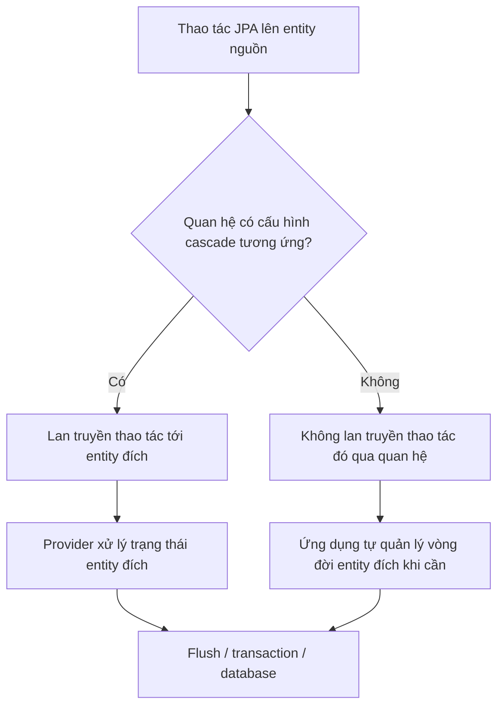
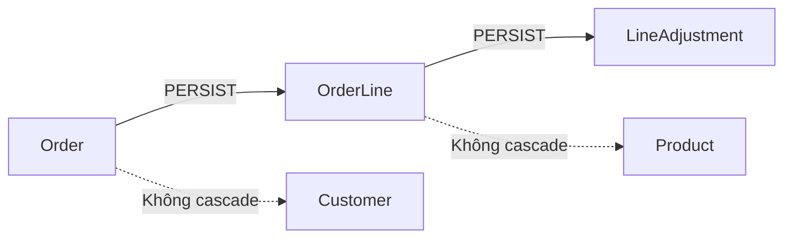
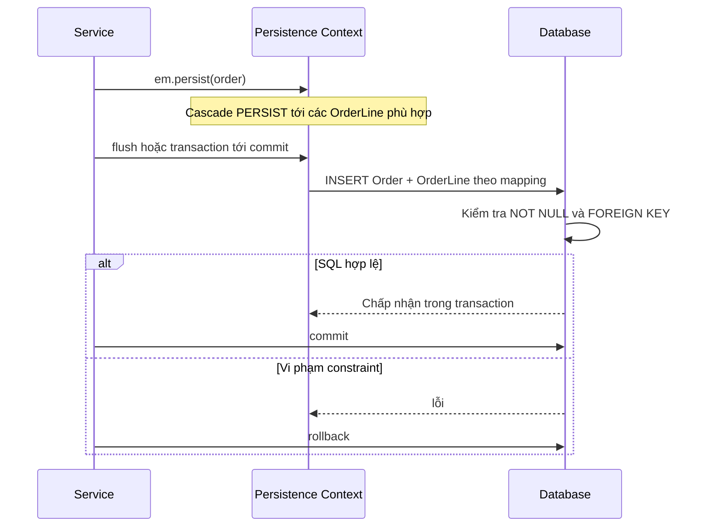

# Vai trò của cascade trong lan truyền thao tác vòng đời trong JPA

Khi một entity có quan hệ với các entity khác, ứng dụng thường cần thực hiện một thao tác vòng đời trên **một đối tượng gốc** và muốn một số thao tác đó được thực hiện tiếp trên **những đối tượng liên quan**. Jakarta Persistence (JPA) cung cấp thuộc tính `cascade` trong các annotation ánh xạ quan hệ để diễn đạt yêu cầu ấy.

Ví dụ, khi tạo đơn hàng mới cùng các dòng đơn hàng mới, ta có thể muốn:

```java
entityManager.persist(order);
```

vừa lưu `PurchaseOrder`, vừa lưu những `OrderLine` đang thuộc đơn hàng, thay vì phải `persist` từng dòng thủ công. Đây là trường hợp điển hình của **`CascadeType.PERSIST`**.

Tuy nhiên, từ ví dụ trên **không thể suy ra mọi loại cascade đều phù hợp với mọi quan hệ**. Tự động xóa `OrderLine` khi xóa `PurchaseOrder` có thể đúng với dữ liệu thành phần của đơn hàng; tự động xóa `Customer` khi xóa một đơn hàng lại thường là lỗi nghiêm trọng, vì nhiều đơn hàng có thể cùng tham chiếu khách hàng đó.

> **Tư tưởng cốt lõi:** Cascade điều khiển **lan truyền một thao tác vòng đời JPA từ entity nguồn sang entity đích thông qua một quan hệ được khai báo**. Nó không quyết định phía giữ khóa ngoại, không tự biến mọi quan hệ thành sở hữu vòng đời, không thay thế foreign key database và không đồng nghĩa với `orphanRemoval`.

Bài học này thuộc chương **Cascade và orphanRemoval** của module **Data Persistence Relational Access ORM JPA**, tập trung vào mục đích, cách chọn, ranh giới và hệ quả thực tế của `CascadeType.PERSIST`, `MERGE`, `REMOVE`, `REFRESH`, `DETACH` và `ALL`. Ví dụ dùng Jakarta Persistence, Java, SQL và một số ngữ cảnh Spring Data JPA/Hibernate.

## 1. Từ vòng đời entity đến ý tưởng cascade

JPA phân biệt những trạng thái thường gặp của entity:

| Trạng thái | Ý nghĩa |
|---|---|
| **New/transient** | Object được tạo trong Java, chưa được quản lý trong persistence context. |
| **Managed/persistent** | Object đang được một persistence context quản lý; thay đổi persistent state có thể được đồng bộ khi flush. |
| **Detached** | Object không còn được persistence context hiện tại quản lý; sửa nó không tự động tạo SQL. |
| **Removed** | Entity đang managed đã được đánh dấu xóa, chờ xử lý theo transaction. |

Các thao tác JPA như `persist`, `merge`, `remove`, `refresh` và `detach` thay đổi cách entity tham gia persistence context.

Khi entity có quan hệ:

```text
PurchaseOrder
    |
    +--- OrderLine #1
    |
    +--- OrderLine #2
    |
    +--- OrderLine #3
```

có hai câu hỏi tách biệt:

1. Khi gọi `persist(order)`, có muốn JPA cũng `persist` những line mới không?
2. Khi gọi `remove(order)`, có muốn JPA cũng `remove` các line không?

Một quan hệ có thể chọn **PERSIST mà không REMOVE**, hoặc **REMOVE mà không MERGE**, hoặc các tổ hợp phù hợp khác. Cascade giúp mô hình hóa câu trả lời theo từng **loại thao tác**, không phải một công tắc chung “quan hệ này có tự động làm tất cả hay không”.

### Sơ đồ lan truyền



Sơ đồ nói về **lan truyền thao tác vòng đời**. Nó không nói rằng mỗi phần tử sẽ sinh đúng một câu SQL, bởi provider có thể trì hoãn, gom batch, dùng cache hoặc cần xử lý ràng buộc tham chiếu.

## 2. Cú pháp khai báo cascade ở association

Ví dụ trên `@OneToMany`:

```java
@OneToMany(
    mappedBy = "order",
    cascade = {CascadeType.PERSIST, CascadeType.MERGE}
)
private List<OrderLine> lines = new ArrayList<>();
```

Hoặc:

```java
@OneToMany(
    mappedBy = "order",
    cascade = CascadeType.ALL,
    orphanRemoval = true
)
private List<OrderLine> lines = new ArrayList<>();
```

Cú pháp quan trọng:

- `cascade` là một thuộc tính của annotation ánh xạ quan hệ như `@OneToOne`, `@OneToMany`, `@ManyToOne` và `@ManyToMany`.
- Giá trị là một hoặc nhiều thành phần của enum `jakarta.persistence.CascadeType`.
- **Mặc định không cascade**: nếu không khai báo, không tự động lan truyền các thao tác theo mọi hướng.
- `CascadeType.ALL` là tập hợp những thao tác cascade tiêu chuẩn, không phải một cơ chế riêng có ý nghĩa nghiệp vụ.
- `orphanRemoval` là thuộc tính khác, chỉ có trên các quan hệ phù hợp như `@OneToOne` và `@OneToMany`; nó **không phải một giá trị của CascadeType**.
- Vị trí khai báo trên field/property cụ thể xác định **chiều truyền thao tác**.

### Những giá trị của `CascadeType`

| Giá trị | Thao tác liên quan trên EntityManager | Ý nghĩa khái quát |
|---|---|---|
| `PERSIST` | `persist(source)` | Lan truyền persist tới các entity đích liên quan. |
| `MERGE` | `merge(source)` | Lan truyền merge state đến các entity đích liên quan. |
| `REMOVE` | `remove(source)` | Lan truyền thao tác xóa entity đích. |
| `REFRESH` | `refresh(source)` | Lan truyền việc làm mới trạng thái từ database. |
| `DETACH` | `detach(source)` | Lan truyền thao tác tách khỏi persistence context. |
| `ALL` | Tổ hợp các thao tác trên | Bao gồm năm loại trên. |

Cần đọc bảng theo nghĩa **“khi thao tác đó xảy ra trên source”**. Ví dụ `CascadeType.REMOVE` trên `Order.lines` không có nghĩa việc xóa từng line sẽ tự động xóa order; đó là chiều ngược lại.

## 3. Cascade có hướng: nơi đặt annotation quyết định nguồn và đích

Xét hai entity:

```java
// Ở PurchaseOrder
@OneToMany(
    mappedBy = "order",
    cascade = CascadeType.PERSIST
)
private List<OrderLine> lines = new ArrayList<>();
```

```java
// Ở OrderLine
@ManyToOne(fetch = FetchType.LAZY)
@JoinColumn(name = "order_id")
private PurchaseOrder order;
```

Khi gọi:

```java
entityManager.persist(purchaseOrder);
```

`PERSIST` có thể lan truyền từ `PurchaseOrder` đến `OrderLine` trong `lines`.

Nhưng khi gọi:

```java
entityManager.persist(orderLine);
```

không thể suy ra việc persist line sẽ persist order mới, bởi `@ManyToOne` ở line **không có cascade PERSIST**.

Hướng quan hệ:

```text
PurchaseOrder -- cascade PERSIST --> OrderLine
PurchaseOrder <--  @ManyToOne FK --- OrderLine
```

Mũi tên cascade và mũi tên tham chiếu database không nhất thiết cùng chiều.

### Cascade không “tự lan hai chiều”

Đây là hiểu lầm thường gặp: có cả `@OneToMany` và `@ManyToOne` thì cascade sẽ tự vận hành hai chiều. Không phải vậy. Mỗi annotation có cấu hình cascade riêng.

Nếu một quan hệ hai chiều có cascade trên cả hai phía, có thể hình thành đường lan truyền không mong muốn; provider có cơ chế xử lý identity/graph, nhưng **không vì vậy mà cấu hình cascade hai chiều bừa bãi trở thành đúng nghiệp vụ**.

Khi chọn cascade, luôn trả lời: **“Từ entity nào, thao tác nào, sang entity nào?”**

## 4. Ví dụ xuyên suốt: đơn hàng sở hữu các dòng đơn

Một `PurchaseOrder` có nhiều `OrderLine`. Trong miền nghiệp vụ này giả định:

- `OrderLine` không có ý nghĩa độc lập khi không còn thuộc một order.
- Tạo order mới thường tạo luôn các line.
- Xóa order theo chính sách cho phép thì xóa cả các line.
- Chỉ order được phép thêm/xóa dòng.
- Mỗi line phải thuộc một order.
- `Product` là thực thể dùng chung, **không** được xóa khi xóa một line.

Đây là kiểu quan hệ gần với **aggregate ownership**. Cascade có thể giúp phản ánh sự phụ thuộc vòng đời của line vào order.

### Schema tham khảo

```sql
CREATE TABLE purchase_orders (
    id BIGINT GENERATED BY DEFAULT AS IDENTITY PRIMARY KEY,
    order_code VARCHAR(50) NOT NULL UNIQUE
);

CREATE TABLE order_lines (
    id BIGINT GENERATED BY DEFAULT AS IDENTITY PRIMARY KEY,
    order_id BIGINT NOT NULL,
    sku VARCHAR(50) NOT NULL,
    quantity INTEGER NOT NULL,
    CONSTRAINT fk_order_lines_order
        FOREIGN KEY (order_id) REFERENCES purchase_orders(id),
    CONSTRAINT ck_order_lines_quantity
        CHECK (quantity > 0)
);
```

Trong schema này, FK `order_lines.order_id` nằm ở bảng line. Do đó **owning side của association** thường là field `OrderLine.order` ở phía `@ManyToOne`.

### Entity PurchaseOrder

```java
import jakarta.persistence.*;
import java.util.ArrayList;
import java.util.Collections;
import java.util.List;
import java.util.Objects;

@Entity
@Table(name = "purchase_orders")
public class PurchaseOrder {

    @Id
    @GeneratedValue(strategy = GenerationType.IDENTITY)
    private Long id;

    @Column(name = "order_code", nullable = false, unique = true)
    private String orderCode;

    @OneToMany(
        mappedBy = "order",
        cascade = CascadeType.ALL,
        orphanRemoval = true
    )
    private List<OrderLine> lines = new ArrayList<>();

    protected PurchaseOrder() {}

    public PurchaseOrder(String orderCode) {
        if (orderCode == null || orderCode.isBlank()) {
            throw new IllegalArgumentException("Order code required");
        }
        this.orderCode = orderCode;
    }

    public Long getId() {
        return id;
    }

    public List<OrderLine> getLines() {
        return Collections.unmodifiableList(lines);
    }

    public void addLine(OrderLine line) {
        Objects.requireNonNull(line);
        if (line.getOrder() != null && line.getOrder() != this) {
            throw new IllegalStateException(
                "Line already belongs to another order");
        }
        if (!lines.contains(line)) {
            lines.add(line);
        }
        line.attachTo(this);
    }

    public void removeLine(OrderLine line) {
        Objects.requireNonNull(line);
        if (lines.remove(line)) {
            line.attachTo(null);
        }
    }
}
```

### Entity OrderLine

```java
import jakarta.persistence.*;

@Entity
@Table(name = "order_lines")
public class OrderLine {

    @Id
    @GeneratedValue(strategy = GenerationType.IDENTITY)
    private Long id;

    @ManyToOne(fetch = FetchType.LAZY, optional = false)
    @JoinColumn(name = "order_id", nullable = false)
    private PurchaseOrder order;

    @Column(name = "sku", nullable = false, length = 50)
    private String sku;

    @Column(name = "quantity", nullable = false)
    private int quantity;

    protected OrderLine() {}

    public OrderLine(String sku, int quantity) {
        if (sku == null || sku.isBlank()) {
            throw new IllegalArgumentException("SKU required");
        }
        this.sku = sku;
        changeQuantity(quantity);
    }

    public Long getId() { return id; }
    public PurchaseOrder getOrder() { return order; }
    public String getSku() { return sku; }
    public int getQuantity() { return quantity; }

    void attachTo(PurchaseOrder order) {
        this.order = order;
    }

    public void changeQuantity(int newQuantity) {
        if (newQuantity <= 0) {
            throw new IllegalArgumentException(
                "Quantity must be positive");
        }
        this.quantity = newQuantity;
    }
}
```

Thiết kế giả định line **không được chuyển từ order này sang order khác** khi đã persistent và bị xóa nếu rời khỏi order. Vì vậy `orphanRemoval = true` có ý nghĩa. Nếu nghiệp vụ cho phép di chuyển line đã lưu giữa các order, cần thiết kế vòng đời khác, thay vì remove rồi add lại tùy tiện.

`CascadeType.ALL` trong ví dụ được dùng để minh họa aggregate thật sự sở hữu vòng đời. Ở một ứng dụng khác, chọn chỉ `PERSIST` và `MERGE` hoặc các loại cụ thể sẽ dễ kiểm soát hơn.

## 5. `CascadeType.PERSIST`: tạo cả aggregate từ một thao tác

Khi Order là new và lines cũng new:

```java
@Transactional
public void createOrder(EntityManager em) {
    PurchaseOrder order = new PurchaseOrder("PO-2026-001");

    order.addLine(new OrderLine("SKU-A", 2));
    order.addLine(new OrderLine("SKU-B", 1));

    em.persist(order);
}
```

Vì `PurchaseOrder.lines` có `CascadeType.PERSIST` (bao gồm trong ALL), JPA lan truyền persist tới các line mới đang thuộc collection.

Khi flush, provider có thể sinh SQL tương đương:

```sql
INSERT INTO purchase_orders (order_code)
VALUES ('PO-2026-001');

INSERT INTO order_lines (order_id, sku, quantity)
VALUES (:new_order_id, 'SKU-A', 2);

INSERT INTO order_lines (order_id, sku, quantity)
VALUES (:new_order_id, 'SKU-B', 1);
```

Đây là SQL minh họa; cú pháp bind, thứ tự và thời điểm INSERT tùy provider, batching và chiến lược sinh ID.

**Cascade PERSIST giải quyết vấn đề cần gọi persist trên những entity con mới.** Nó không tự sửa các reference Java thiếu nhất quán: các line vẫn cần `line.order = order` ở owning side để FK đúng.

### Nếu không có cascade PERSIST

```java
@OneToMany(mappedBy = "order")
private List<OrderLine> lines = new ArrayList<>();
```

thì:

```java
em.persist(order);
```

không yêu cầu JPA tự persist toàn bộ line mới. Ứng dụng phải persist các line theo đúng trạng thái/lifecycle, ví dụ:

```java
em.persist(order);

for (OrderLine line : order.getLines()) {
    em.persist(line);
}
```

Vẫn phải đồng bộ `line.order`, và đối tượng đích cần tồn tại hợp lệ để FK được ghi thành công.

### PERSIST không phải “cứ có object trong graph là tự lưu tất cả”

Cascade chỉ đi qua **association được khai báo có cascade tương ứng**. Nếu Order chứa `Product` dưới dạng một tham chiếu thông qua OrderLine, nhưng `OrderLine.product` không cấu hình cascade, Product dùng chung không bị persist chỉ vì Order được persist.

Đây là điều mong muốn: khi bán sản phẩm đã có, hệ thống cần lưu dòng đơn hàng, **không cần tạo lại Product**.

## 6. `CascadeType.PERSIST` khi entity đích đã tồn tại

Một lỗi cấu hình là bật PERSIST trên `@ManyToOne` tới entity dùng chung:

```java
@ManyToOne(cascade = CascadeType.PERSIST)
private Customer customer;
```

Khi persist Order mới, provider có thể cố lan truyền persist sang Customer. Nhưng Customer thường đã được tạo và có vòng đời riêng; việc cố persist một detached Customer có thể gây `EntityExistsException` hoặc exception từ provider/flush.

Cách thông thường:

```java
@ManyToOne(fetch = FetchType.LAZY, optional = false)
@JoinColumn(name = "customer_id", nullable = false)
private Customer customer;
```

Khi tạo Order:

```java
Customer customer = em.find(Customer.class, customerId);

if (customer == null) {
    throw new IllegalArgumentException("Customer not found");
}

PurchaseOrder order = new PurchaseOrder(/* ... */, customer);
em.persist(order);
```

Ở ví dụ này constructor Order được giả định nhận Customer phù hợp; mô hình đầy đủ bên trên chỉ có OrderLine. Đây là minh họa nguyên tắc dành cho một loại Order khác có field Customer.

Nếu chỉ cần gán FK theo ID, có thể cân nhắc `em.getReference(Customer.class, customerId)` nhưng phải nhớ API đó **không xác minh Customer tồn tại**; foreign key trong database vẫn cần bảo vệ.

**Đừng dùng cascade để né việc xác định đúng entity nào là mới và entity nào đã tồn tại.**

## 7. `CascadeType.MERGE`: đồng bộ trạng thái graph detached

Một entity có thể từng managed rồi trở thành **detached** sau khi persistence context đóng hoặc gọi `detach`/`clear`. Thay đổi trên detached entity không tự được đồng bộ xuống database.

JPA có:

```java
PurchaseOrder managedOrder = em.merge(detachedOrder);
```

Với `CascadeType.MERGE` trên `PurchaseOrder.lines`, thao tác merge có thể lan truyền đến các dòng tham gia quan hệ. Provider sao chép state phù hợp từ detached source sang managed representation.

### Merge trả về managed instance

```java
PurchaseOrder managed = em.merge(detached);

System.out.println(em.contains(managed));  // true trong context đang mở
System.out.println(em.contains(detached)); // Thường false nếu nguồn thật sự detached
```

**Merge không biến chính object detached nguồn thành managed.** Nếu cần tiếp tục sửa sau merge, phải dùng instance trả về.

Ví dụ:

```java
PurchaseOrder managed = em.merge(detachedOrder);

managed.addLine(new OrderLine("SKU-C", 3));
// Tiếp tục thao tác trên managed, không trên detachedOrder.
```

### Không bật MERGE trên mọi nhánh graph

Khi OrderLine có relation tới `Product` dùng chung, nếu `Product` cũng được cascade MERGE từ OrderLine, một snapshot Product cũ từ detached graph có thể được copy vào Product đang managed và vô tình ghi đè tên, giá hay trạng thái hiện tại.

Ví dụ cần tránh khi Product không thuộc vòng đời của OrderLine:

```java
@ManyToOne(cascade = CascadeType.MERGE)
@JoinColumn(name = "product_id")
private Product product;
```

Không phải mọi relation cần cascade MERGE. Ở entity dùng chung, thường nên xác định ID của Product hoặc lấy managed reference và **chỉ cập nhật Product khi có use case riêng**.

### Merge collection không phải PATCH thông minh

Nếu detached order chỉ có một line do HTTP request gửi lên, provider không biết ứng dụng muốn “sửa đúng một line” hay “thay toàn bộ collection chỉ còn một line”. Với `orphanRemoval`, merge một graph không đầy đủ có thể gây xóa dữ liệu ngoài ý muốn.

Khi API chỉ sửa số lượng một line, cách rõ ràng hơn:

```java
@Transactional
public void changeQuantity(
        EntityManager em, Long lineId, int quantity) {

    OrderLine line = em.find(OrderLine.class, lineId);

    if (line == null) {
        throw new IllegalArgumentException("Line not found");
    }

    line.changeQuantity(quantity);
}
```

Đối với ứng dụng đa tenant hoặc cần kiểm tra chủ sở hữu, còn phải xác minh line thuộc order/người dùng được phép truy cập. Không xem merge graph detached như cách tự xử lý authorization, partial updates hoặc conflict.

## 8. `CascadeType.REMOVE`: xóa entity liên quan khi xóa nguồn

Nếu Order sở hữu hoàn toàn các dòng của nó:

```java
@OneToMany(
    mappedBy = "order",
    cascade = CascadeType.REMOVE
)
private List<OrderLine> lines = new ArrayList<>();
```

thì:

```java
PurchaseOrder order = em.find(PurchaseOrder.class, orderId);

em.remove(order);
```

có thể dẫn đến thao tác remove trên các OrderLine, đồng bộ các DELETE phù hợp trong transaction.

SQL minh họa:

```sql
DELETE FROM order_lines WHERE order_id = :order_id;
DELETE FROM purchase_orders WHERE id = :order_id;
```

Cách provider thực thi có thể không phải đúng hai statement như minh họa: có thể DELETE từng line, sử dụng batching hoặc cơ chế khác. Nhưng về mặt toàn vẹn tham chiếu, nếu FK không cho phép parent bị xóa khi còn child, child cần được xử lý trước hoặc database phải có chính sách xóa phù hợp.

**`CascadeType.REMOVE` chỉ nói về xóa entity liên quan khi xóa nguồn.** Nó không có nghĩa xóa một phần tử khỏi collection sẽ tự động xóa entity đó khi parent vẫn tồn tại.

### Khi nào REMOVE là sai?

Ví dụ:

```java
@ManyToOne(cascade = CascadeType.REMOVE)
@JoinColumn(name = "customer_id")
private Customer customer;
```

Nếu xóa một Order, thao tác REMOVE có thể lan sang Customer. Trong thực tế, Customer có thể sở hữu nhiều Order, và xóa Customer do xóa một order vừa sai nghiệp vụ vừa dễ bị FK từ những order khác chặn.

Đặc biệt cẩn thận với:

- `@ManyToOne` tới Customer, Department, Category, Product hoặc User.
- `@ManyToMany` tới Tag, Course, Role hoặc các đối tượng được chia sẻ.
- Các entity có lịch sử/audit/legal retention độc lập.

Theo cách sử dụng portable của JPA, cascade REMOVE nên giới hạn vào các quan hệ thể hiện **quyền sở hữu vòng đời**, điển hình là `@OneToOne` hoặc `@OneToMany` phù hợp. Không dùng REMOVE bừa bãi ở association dùng chung.

## 9. `orphanRemoval` khác `CascadeType.REMOVE`

Đây là phần rất quan trọng của chương.

Cả hai có thể dẫn tới việc xóa entity con, nhưng **tín hiệu kích hoạt không giống nhau**.

### Cascade REMOVE

Nguồn bị xóa:

```java
em.remove(order);
```

Nếu `Order.lines` có cascade REMOVE, JPA lan truyền thao tác remove xuống các line.

### Orphan removal

Owner vẫn tồn tại, nhưng một child bị gỡ khỏi quan hệ sở hữu:

```java
order.removeLine(line);
```

Với mapping:

```java
@OneToMany(
    mappedBy = "order",
    orphanRemoval = true
)
private List<OrderLine> lines = new ArrayList<>();
```

line bị loại khỏi quan hệ có thể trở thành **orphan** và được JPA xóa khi đồng bộ theo quy tắc lifecycle.

| Tình huống | `cascade = REMOVE` | `orphanRemoval = true` |
|---|---|---|
| Xóa parent bằng `em.remove(parent)` | Lan truyền xóa child | JPA cũng có semantics xóa target khi source bị remove; không nhất thiết khai REMOVE riêng |
| Gỡ một child khỏi collection khi parent vẫn sống | **Không đủ** để tự xóa child | Có thể xóa child bị gỡ khỏi quan hệ |
| Chuyển child sang parent khác | Không tự quy định | Có nguy cơ coi child là orphan; không phù hợp nếu child được phép chuyển owner |
| Tham chiếu many-to-one tới entity dùng chung | Thường không phù hợp | Không được dùng trên `@ManyToOne` |
| Mục đích | Lan truyền một thao tác remove từ source | Bảo vệ semantics thành phần không được tồn tại độc lập khỏi owner |

Theo JPA, với các quan hệ có `orphanRemoval = true`, khi remove owner, các target phù hợp cũng được xử lý để remove theo semantics của orphan removal; không cần khai `cascade = REMOVE` chỉ vì muốn xóa target trong tình huống đó.

### Không nhầm “tách liên kết” với “xóa entity”

Nếu `OrderLine` có thể được chuyển sang Order khác, việc `line.order = null` trong một bước trung gian không nên tự quyết định xóa hàng vĩnh viễn. Lúc đó `orphanRemoval = true` thường không khớp vòng đời nghiệp vụ.

Nếu có orphan removal, cần thiết kế helper add/remove theo chính sách rõ ràng. Không nên remove một child đang managed khỏi owner rồi gán nó sang owner khác và mặc định provider sẽ “hủy lịch xóa orphan” một cách portable.

## 10. Lưu ý về child mới, orphan và thời điểm flush

Một số người suy luận:

> “Vì có orphanRemoval, cứ thêm một child mới rồi gỡ nó ra trước flush thì chắc chắn provider sẽ DELETE hàng của child”.

Điều đó không chính xác. Một entity mới chưa được lưu có thể chưa có hàng database để DELETE; semantics orphan removal đối với new, detached hoặc removed targets có giới hạn theo JPA. Provider cần xác định đúng lifecycle và điều gì đã được persist.

Ví dụ:

```java
OrderLine line = new OrderLine("SKU-TEMP", 1);

order.addLine(line);
order.removeLine(line);

// Không tự giả định sẽ có INSERT rồi DELETE tương ứng.
```

Không dùng log SQL như hợp đồng nghiệp vụ “mỗi add là INSERT, mỗi remove là DELETE”. JPA xử lý theo trạng thái hiện tại của persistence context, các thao tác đã được cascade và thời điểm flush.

Quan trọng hơn, với line đã được persist ở database và được quản lý đúng trong owner collection, gỡ nó khỏi relation có orphan removal là một quyết định xóa dữ liệu thật. Không coi đó là thao tác UI tạm thời vô hại.

## 11. `CascadeType.REFRESH`: làm mới state lan sang entity liên quan

`EntityManager.refresh(entity)` yêu cầu JPA nạp lại trạng thái từ database cho một managed entity, theo semantics của provider và mapping.

Nếu quan hệ có `CascadeType.REFRESH`:

```java
@OneToMany(
    mappedBy = "order",
    cascade = CascadeType.REFRESH
)
private List<OrderLine> lines = new ArrayList<>();
```

thì:

```java
em.refresh(order);
```

có thể lan truyền refresh tới các line liên quan, đưa trạng thái của chúng về dữ liệu phù hợp từ database.

### Tại sao REFRESH phải dùng thận trọng?

Giả sử trong transaction:

```java
OrderLine line = em.find(OrderLine.class, lineId);
line.changeQuantity(9);

// Nếu refresh được áp dụng lên line,
// thay đổi chưa flush có thể bị ghi đè bằng state database.
em.refresh(line);
```

`refresh` không phải lệnh “tự tìm cách hợp nhất state hiện tại với database”. Nó có thể **ghi đè những thay đổi chưa được đồng bộ**. Khi refresh cascade qua một graph lớn, phạm vi bị reset có thể rộng hơn lập trình viên dự kiến.

Nên dùng cascade REFRESH khi các entity liên quan **thật sự cần được làm mới cùng nguồn** và hậu quả đối với unsaved changes được hiểu rõ.

### Refresh không giải quyết lỗi transaction

Nếu một flush trước đó thất bại vì FK/UNIQUE, không nên dùng:

```java
em.refresh(order);
```

để hy vọng transaction được phục hồi. Một failed transaction/persistence context có thể phải rollback và bỏ đi; refresh không sửa trạng thái aborted của database transaction.

## 12. `CascadeType.DETACH`: tách graph khỏi persistence context

`EntityManager.detach(entity)` đưa managed entity rời persistence context. Sau detach, sửa field của object đó không tự làm JPA phát UPDATE trong context cũ.

Nếu quan hệ có `CascadeType.DETACH`:

```java
@OneToMany(
    mappedBy = "order",
    cascade = CascadeType.DETACH
)
private List<OrderLine> lines = new ArrayList<>();
```

thì:

```java
em.detach(order);
```

có thể lan truyền detach tới các entity con liên quan theo quy tắc cascade.

### Phân biệt detach và delete

- `detach`: ngừng quản lý object trong persistence context; **không có mục đích xóa row database**.
- `remove`: đánh dấu entity để xóa khi flush/commit.
- `clear`: detach toàn bộ managed entities khỏi context.
- `close`: kết thúc một EntityManager application-managed và các object có thể không còn managed trong context đó.

Ví dụ:

```java
PurchaseOrder order = em.find(PurchaseOrder.class, orderId);

em.detach(order);

// Nếu đã detach, thay đổi trên order không tự flush như managed entity.
```

Khi graph có lazy relations chưa được tải, những object detached có thể không truy cập được dữ liệu lazy sau khi context đóng. Cascade DETACH không phải cách bảo đảm “đã tải toàn bộ graph” trước khi rời context.

### Dùng DETACH có chọn lọc

Không cần đặt `CascadeType.DETACH` vào mọi association. Nếu một Order đang tham chiếu Customer dùng chung trong cùng persistence context, cascade detach tới Customer có thể làm thay đổi trạng thái quản lý của Customer đang được xử lý ở một nghiệp vụ khác trong cùng đơn vị công việc.

## 13. `CascadeType.ALL` là gì và khi nào nên dùng?

`CascadeType.ALL` tương đương về ý nghĩa với:

```java
cascade = {
    CascadeType.PERSIST,
    CascadeType.MERGE,
    CascadeType.REMOVE,
    CascadeType.REFRESH,
    CascadeType.DETACH
}
```

Nó **không** bao gồm `orphanRemoval`, vì orphan removal là thuộc tính độc lập.

Ví dụ:

```java
@OneToMany(
    mappedBy = "order",
    cascade = CascadeType.ALL,
    orphanRemoval = true
)
private List<OrderLine> lines = new ArrayList<>();
```

là cấu hình phổ biến khi một aggregate root thực sự quản lý hoàn toàn các entity con.

Nhưng:

```java
@ManyToOne(cascade = CascadeType.ALL)
private Customer customer;
```

thường là lựa chọn nguy hiểm. Khi Order được remove, cascade REMOVE có thể cố xóa Customer, dù Customer thuộc nhiều Order và có vòng đời riêng.

### Chọn cụ thể hay ALL?

| Quan hệ | Cấu hình có thể cân nhắc | Giải thích |
|---|---|---|
| Order → OrderLine thuộc hoàn toàn Order | `ALL` + `orphanRemoval = true` | Aggregate root kiểm soát vòng đời child |
| Project → Task nhưng Task có vòng đời/di chuyển riêng | `PERSIST, MERGE` hoặc không cascade | Không tự REMOVE nếu Task được chuyển/giữ độc lập |
| OrderLine → Product dùng chung | Không cascade | Lưu hoặc xóa line không được sửa/xóa Product |
| Employee → Department dùng chung | Không cascade | Department độc lập với từng Employee |
| User → Profile phụ thuộc lifecycle User | Có thể `PERSIST, MERGE, REMOVE` hoặc `ALL` | Tùy quy tắc có xóa/refresh/detach Profile cùng User không |
| Student ↔ Course nhiều-nhiều | Thường không cascade REMOVE | Course tồn tại độc lập và được nhiều Student dùng chung |
| Order → Attachment có quyền sở hữu riêng | Chỉ những thao tác thật sự mong muốn | Đánh giá audit, storage, retention và chuyển owner |

**Lựa chọn tốt nhất thường không phải ít annotation nhất, mà là cấu hình mô tả đúng quyền sở hữu vòng đời**.

## 14. Cascade khác owning side và quyền ghi foreign key

Một quan hệ hai chiều:

```java
// Parent
@OneToMany(
    mappedBy = "order",
    cascade = CascadeType.PERSIST
)
private List<OrderLine> lines;
```

```java
// Child
@ManyToOne
@JoinColumn(name = "order_id")
private PurchaseOrder order;
```

cho thấy hai khái niệm độc lập:

| Vấn đề | Ai quyết định? |
|---|---|
| Persist parent có persist các child mới không? | `cascade = PERSIST` trên `Parent.lines` |
| Cột `order_lines.order_id` lấy giá trị từ đâu? | Owning side `OrderLine.order` |
| Parent có thể truy cập danh sách child không? | `Parent.lines` |
| Xóa một child khỏi list có xóa row không? | Orphan removal/operation lifecycle và owning side, không phải PERSIST |
| Khi xóa parent, child có bị remove không? | Cascade REMOVE hoặc orphan-removal semantics, cùng rule database |

Không thể viết:

```java
order.getLines().add(newLine);
em.persist(order);
```

rồi kỳ vọng foreign key đúng nếu `newLine.order` vẫn null và mapping dùng `mappedBy`. Cascade persist có thể persist line mới, nhưng **không tự sửa object graph sai**.

Helper đúng:

```java
public void addLine(OrderLine line) {
    lines.add(line);
    line.attachTo(this);
}
```

Trong domain thật, thêm kiểm tra null, trùng, owner cũ và các invariant.

### Không có cascade cũng không có nghĩa không thể ghi FK

Nếu child đã managed, chỉ thay `child.order` sang một Order managed khác có thể làm provider cập nhật FK khi flush, **dù không có cascade**. Cascade điều khiển thao tác vòng đời; dirty checking và mapping quan hệ quyết định SQL UPDATE của managed child.

## 15. Cascade không tự đồng bộ hai phía của quan hệ Java

Giả sử:

```java
order.getLines().add(line);
```

khi đó `line.getOrder()` có thể vẫn null. Ngược lại:

```java
line.attachTo(order);
```

có thể làm `line.order` đúng mà `order.lines` trong bộ nhớ chưa chứa line.

Cascade PERSIST/MERGE/REMOVE không phải cơ chế tự động thiết lập hai reference tương ứng trong Java. Ứng dụng nên cung cấp API điều khiển:

```java
public void addLine(OrderLine line) {
    Objects.requireNonNull(line);

    if (!lines.contains(line)) {
        lines.add(line);
    }
    line.attachTo(this);
}
```

Nếu dùng `Set`, cần thiết kế `equals/hashCode` phù hợp với JPA entity và ID sinh. Nếu dùng `List` có thứ tự nghiệp vụ, cần quản lý thứ tự rõ ràng.

Tránh cho code bên ngoài sửa collection tùy tiện rồi bỏ qua helper:

```java
order.getLines().clear();
```

Với `orphanRemoval = true`, `clear()` có thể biểu diễn quyết định xóa nhiều child; với `mappedBy`, nếu không cập nhật owning side, object graph có thể không nhất quán.

## 16. Cascading trong graph nhiều tầng

Một aggregate có thể gồm:

```text
PurchaseOrder
  ├── OrderLine
  │     ├── LineAdjustment
  │     └── TaxDetail
  └── OrderAddress
```

Nếu mỗi association từ Order đến Line, từ Line đến LineAdjustment có cascade PERSIST:

```java
// PurchaseOrder
@OneToMany(mappedBy = "order", cascade = CascadeType.PERSIST)
private List<OrderLine> lines;
```

```java
// OrderLine
@OneToMany(mappedBy = "line", cascade = CascadeType.PERSIST)
private List<LineAdjustment> adjustments;
```

thì persist Order có thể lan truyền:

```text
persist(Order)
    -> persist(Line)
         -> persist(LineAdjustment)
```

Nếu một cạnh không có cascade tương ứng, việc lan truyền không tự xuyên qua cạnh đó.

Một sơ đồ:



Như vậy **Customer và Product không bị persist chỉ vì chúng được tham chiếu**. Đây là ranh giới quan trọng của aggregate.

### Vòng tham chiếu hai chiều

Một graph có thể có:

```text
Order -> lines -> Line.order -> Order
```

Provider JPA có cơ chế nhận diện entity identity và xử lý graph khi cascade. Nhưng thiết kế vẫn nên tránh khai cascade ALL ở cả chiều parent→child lẫn child→parent khi không có lý do nghiệp vụ. Cascade hai chiều tăng phạm vi tác động và nguy cơ xóa/copy state ngoài ý muốn.

## 17. `@OneToOne`: cascade có thể phù hợp cho thành phần phụ thuộc

Giả sử `UserAccount` và `UserProfile` là quan hệ một-một. Mọi Profile chỉ có ý nghĩa khi gắn với Account và vòng đời được quản lý cùng Account.

```java
@Entity
public class UserAccount {

    @Id
    private Long id;

    @OneToOne(
        mappedBy = "account",
        cascade = {
            CascadeType.PERSIST,
            CascadeType.MERGE,
            CascadeType.REMOVE
        },
        orphanRemoval = true
    )
    private UserProfile profile;

    public void assignProfile(UserProfile profile) {
        this.profile = profile;
        if (profile != null) {
            profile.attachTo(this);
        }
    }
}
```

```java
@Entity
public class UserProfile {

    @Id
    private Long id;

    @OneToOne(fetch = FetchType.LAZY, optional = false)
    @JoinColumn(name = "account_id", nullable = false, unique = true)
    private UserAccount account;

    void attachTo(UserAccount account) {
        this.account = account;
    }
}
```

Mã minh họa lược constructor cho JPA, import và chính sách thay profile cũ. Nếu phải thay profile đang tồn tại, helper cần làm rõ profile cũ bị orphan/xóa hay được giữ lại, đồng bộ cả hai phía và cân nhắc unique constraint.

Trong mapping này:

- Cascade từ Account đến Profile thể hiện quyền sở hữu vòng đời.
- Owning side của FK có thể là `UserProfile.account` vì nó có `@JoinColumn`.
- Dù Account là **inverse side**, vẫn có thể khai cascade tại `Account.profile`.
- `orphanRemoval = true` khiến việc gỡ Profile khỏi Account có thể xóa Profile.
- `unique = true` trong schema giúp bảo vệ cardinality một-một theo chiều FK.

Cần phân biệt “Account sở hữu vòng đời Profile” với “Account sở hữu foreign key”. Hai điều không nhất thiết trùng nhau.

## 18. `@ManyToOne`: tránh lan truyền xóa tới parent dùng chung

Mô hình:

```text
Employee 1 ---\
Employee 2 ----> Department
Employee 3 ---/
```

Mỗi Employee có:

```java
@ManyToOne(fetch = FetchType.LAZY)
@JoinColumn(name = "department_id")
private Department department;
```

Nếu cấu hình:

```java
@ManyToOne(cascade = CascadeType.ALL)
private Department department;
```

sẽ tiềm ẩn các vấn đề:

1. Persist một Employee có thể cố persist Department đã tồn tại.
2. Merge Employee có thể cập nhật state Department từ detached graph.
3. Remove Employee có thể cố remove Department dùng chung.
4. Refresh hoặc detach Employee có thể lan tới Department, ảnh hưởng các xử lý khác trong cùng context.
5. Lỗi FK hoặc trạng thái managed/detached có thể khó lý giải vì phạm vi thao tác lớn hơn use case.

Với quan hệ **nhiều child tham chiếu một parent dùng chung**, mặc định không cascade thường là chính sách an toàn hơn.

### Một ngoại lệ cần suy nghĩ kỹ

Đôi khi một child thật sự chịu trách nhiệm tạo một parent mới, nhưng đó không phải mô hình parent dùng chung phổ biến. Nếu cần cascade PERSIST từ child tới parent, phải chứng minh vòng đời của parent phụ thuộc vào child, và đánh giá ảnh hưởng khi nhiều child cùng tham chiếu. Không bật cascade chỉ vì muốn gọi ít `persist`.

## 19. `@ManyToMany`: cascade REMOVE có thể xóa nhầm dữ liệu dùng chung

Ví dụ sinh viên và khóa học:

```java
@Entity
public class Student {

    @Id
    private Long id;

    @ManyToMany
    @JoinTable(
        name = "student_courses",
        joinColumns = @JoinColumn(name = "student_id"),
        inverseJoinColumns = @JoinColumn(name = "course_id")
    )
    private Set<Course> courses = new HashSet<>();
}
```

Một Course có thể được nhiều Student đăng ký. Khi Student bỏ đăng ký Course, nghiệp vụ cần **xóa một hàng liên kết trong `student_courses`**, không xóa Course.

Không nên:

```java
@ManyToMany(cascade = CascadeType.REMOVE)
private Set<Course> courses;
```

vì thao tác remove Student có thể lan truyền tới Course dùng chung. JPA không khuyến nghị/không bảo đảm tính portable của cascade REMOVE ngoài các quan hệ sở hữu vòng đời kiểu one-to-one/one-to-many phù hợp.

### Gỡ liên kết many-to-many

```java
student.getCourses().remove(course);
```

nếu `Student.courses` là owning side và transaction/mapping đúng, JPA có thể xóa hàng trong join table. Không cần cascade REMOVE để xóa entity Course, vì Course phải tiếp tục tồn tại cho sinh viên khác.

### Có nên cascade PERSIST ở many-to-many?

Có thể trong một số mô hình chuyên biệt, nhưng thường không đối với Course, Role, Tag hoặc các entity dùng chung đã tồn tại. Cố persist các target detached do cascade PERSIST có thể gây lỗi lifecycle. Khi chỉ thiết lập liên kết tới target đã có, lấy managed entity/reference là cách rõ nghĩa hơn.

## 20. Cascade và `@ElementCollection`

Một entity có thể sở hữu collection **giá trị**, không phải association tới entity riêng:

```java
@ElementCollection
@CollectionTable(
    name = "product_labels",
    joinColumns = @JoinColumn(name = "product_id")
)
@Column(name = "label")
private Set<String> labels = new HashSet<>();
```

Với `@ElementCollection`, từng phần tử như `String` hoặc `@Embeddable` **không phải entity có ID/lifecycle độc lập**. Chúng thuộc về owner.

Khi persist Product, JPA quản lý việc ghi các giá trị collection tương ứng. Khi remove Product, các hàng giá trị thuộc collection cũng cần được xử lý theo semantics collection. Không cần `CascadeType.PERSIST` hay `REMOVE` từ Product sang từng `String`, vì String không phải entity.

### So sánh

| Đặc điểm | `@OneToMany<OrderLine>` | `@ElementCollection<String>` |
|---|---|---|
| Phần tử | Entity riêng | Basic/embeddable value |
| Có entity ID riêng? | Có | Không |
| Có thể `em.persist(line)`? | Có nếu entity mới hợp lệ | Không áp dụng với String |
| Cấu hình cascade lifecycle? | Có, theo association | Không dùng cascade enum cho phần tử giá trị |
| Xóa một phần tử | Tùy owning side và orphan removal | Thay đổi giá trị thuộc owner |
| Khi owner bị xóa | Cần cascade REMOVE/orphan semantics hoặc quy tắc phù hợp | Collection values đi theo lifecycle owner |
| Nguy cơ xóa target dùng chung | Có với association cấu hình sai | Không có entity target dùng chung |

Điểm khác này giúp tránh việc tự áp dụng chính sách `CascadeType.ALL` cho mọi collection.

## 21. `Map` chứa entity cũng có cascade theo relationship

JPA cho phép ánh xạ collection kiểu Map:

```java
@OneToMany(
    mappedBy = "order",
    cascade = CascadeType.ALL,
    orphanRemoval = true
)
@MapKey(name = "lineCode")
private Map<String, OrderLine> linesByCode = new HashMap<>();
```

Ví dụ giả định OrderLine có thuộc tính `lineCode` ổn định. Cascade trên `@OneToMany` áp dụng tới **entity values** của association, không làm key String trở thành entity.

Cần phân biệt:

- `CascadeType.PERSIST` liên quan tới việc persist các OrderLine values mới.
- `Map.remove(key)` với orphan removal có thể làm line bị xóa.
- Thay đổi `lineCode` trên một entity đang nằm trong map không đồng nghĩa Java Map tự đổi key.
- Nếu key được ánh xạ từ property entity qua `@MapKey`, cần giữ key nhất quán theo domain method.
- Thay toàn bộ instance Map của managed entity có thể gây rủi ro với ORM wrapper/snapshot, đặc biệt khi orphan removal bật.

Cascade không tự sửa lỗi mutable key, không bảo đảm thứ tự Map và không thay thế thiết kế API quản lý collection.

## 22. Cascade khác `FetchType.LAZY` và `EAGER`

Hai cấu hình độc lập:

```java
@OneToMany(
    mappedBy = "order",
    cascade = CascadeType.PERSIST,
    fetch = FetchType.LAZY
)
private List<OrderLine> lines = new ArrayList<>();
```

- `cascade = PERSIST`: khi persist Order, xử lý lan truyền persist theo relationship.
- `fetch = LAZY`: yêu cầu trì hoãn tải collection khi chưa cần, theo khả năng provider.

Không có nghĩa collection LAZY sẽ “không được cascade” chỉ vì chưa được tải. Provider áp dụng các quy tắc lifecycle đối với association; việc có cần tải dữ liệu để thực hiện từng operation còn phụ thuộc thao tác, mapping và provider.

Ngược lại:

```java
@OneToMany(fetch = FetchType.EAGER)
private List<OrderLine> lines;
```

**không có nghĩa** persist Order sẽ tự persist line mới: EAGER nói về tải dữ liệu, không nói về cascade.

### N+1 và cascade

N+1 SELECT xảy ra khi chiến lược fetch/truy vấn khiến nhiều relation được tải lặp. Nó không được giải quyết chỉ bằng `cascade = ALL`. Cần dùng fetch join, entity graph, projection, batching phù hợp khi use case cần.

Cascade rộng còn có thể khiến thao tác merge/remove phải xử lý nhiều entity hơn; nó không phải cơ chế tối ưu truy vấn.

## 23. Cascade không thay thế ràng buộc database

Các annotation:

```java
@OneToMany(
    mappedBy = "order",
    cascade = CascadeType.ALL
)
private List<OrderLine> lines;
```

không tự đảm bảo schema có đủ:

```sql
order_lines.order_id BIGINT NOT NULL
FOREIGN KEY (order_id) REFERENCES purchase_orders(id)
```

Phải tách:

| Cơ chế | Vai trò |
|---|---|
| `cascade` | Lan truyền thao tác vòng đời entity qua association |
| `optional = false` | Mô tả quan hệ bắt buộc ở JPA |
| `@JoinColumn(nullable = false)` | Mô tả nullability của join column trong mapping |
| `NOT NULL` | Database cấm giá trị NULL ở cột |
| `FOREIGN KEY` | Database xác minh reference hợp lệ |
| `ON DELETE CASCADE` | Database tự xử lý xóa hàng tham chiếu khi parent bị xóa |
| `orphanRemoval = true` | JPA xóa entity target khi rời khỏi quan hệ sở hữu phù hợp |

Nếu `OrderLine.order` null nhưng cột `order_id NOT NULL`, cascade PERSIST có thể đưa line đến bước INSERT, rồi database từ chối vì FK null. Cascade không tự chữa mối liên hệ sai.

Nếu `OrderLine.order` trỏ tới ID không tồn tại, `NOT NULL` vẫn đạt nhưng `FOREIGN KEY` có thể từ chối khi SQL thực thi.

## 24. Cascade JPA REMOVE khác `ON DELETE CASCADE` của SQL

Hai cách có thể tạo kết quả xóa tương tự ở database, nhưng **đường thực hiện khác nhau**.

### JPA cascade REMOVE

```java
@OneToMany(mappedBy = "order", cascade = CascadeType.REMOVE)
private List<OrderLine> lines;
```

Sau `em.remove(order)`, JPA lan truyền remove tới các entity con liên quan. Những callback/lifecycle rules JPA phù hợp có thể được áp dụng; provider có thể cần truy cập trạng thái con hoặc thực thi nhiều SQL.

### Database ON DELETE CASCADE

```sql
FOREIGN KEY (order_id)
REFERENCES purchase_orders(id)
ON DELETE CASCADE
```

Khi database thực thi `DELETE` trên parent, nó tự xóa child rows theo FK action. JPA có thể không trực tiếp thực hiện lifecycle remove trên từng child trong persistence context.

| Khía cạnh | JPA cascade REMOVE | SQL `ON DELETE CASCADE` |
|---|---|---|
| Nơi xác định | Entity mapping | Database constraint |
| Tác nhân | JPA provider | Database |
| Tác động | Entity lifecycle operations | Xóa các hàng tham chiếu |
| Entity callbacks | Có thể áp dụng theo JPA lifecycle | Database không chạy JPA entity callbacks |
| SQL | Có thể nhiều DELETE/select/batch | Database xử lý liên quan từ DELETE parent |
| Persistence context | Provider biết các entity đang được remove qua JPA | Context có thể không phản ánh ngay xóa do DB tự làm |
| Các đường ghi ngoài JPA | Không áp dụng | Vẫn áp dụng cho SQL khác |

Không chọn cấu hình chỉ theo số lệnh SQL. Cần xem domain lifecycle, audit callbacks, cache, lịch sử và mọi đường ghi dữ liệu.

Nếu dùng đồng thời cascade REMOVE của JPA và ON DELETE CASCADE trong DB, phải hiểu provider có thể xử lý child trước, khiến DB cascade không còn việc để làm. Không nên kỳ vọng “hai lần xóa bằng nhau” tạo lợi ích. Ngoài ra, bulk JPQL DELETE bỏ qua entity cascade/lifecycle theo quy tắc riêng.

## 25. `orphanRemoval` khác `ON DELETE SET NULL`

Nếu child được phép rời parent nhưng vẫn sống độc lập, database có thể cho FK nullable:

```sql
order_id BIGINT NULL
FOREIGN KEY (order_id) REFERENCES purchase_orders(id)
ON DELETE SET NULL
```

Khi xóa parent bằng SQL, child vẫn tồn tại nhưng mất quan hệ. Đây là một chính sách **khác hẳn** orphan removal, vốn xóa child không còn thuộc owner.

Với một OrderLine thật sự không có ý nghĩa nếu thiếu Order:

- `order_id NOT NULL` thường phù hợp;
- orphan removal có thể phù hợp khi gỡ line;
- cascade REMOVE có thể phù hợp khi xóa order;
- `ON DELETE SET NULL` thường mâu thuẫn với invariant.

Với một Employee có thể chuyển Department:

- Chuyển `employee.department` là thao tác gán FK mới;
- Không nên xóa Employee chỉ vì rời Department cũ;
- `orphanRemoval` từ Department đến Employee thường không phù hợp;
- `ON DELETE SET NULL` chỉ phù hợp nếu schema/miền cho phép Employee không có Department.

## 26. Thời điểm cascade và việc gửi SQL

Khi gọi:

```java
em.persist(order);
```

provider có thể lan truyền PERSIST tới lines theo lifecycle; nhưng các câu SQL có thể được thực thi tại nhiều thời điểm:

- ngay khi persist do chiến lược sinh ID như IDENTITY;
- khi explicit `em.flush()`;
- trước một query nếu flush mode và query yêu cầu;
- khi transaction commit;
- các thời điểm provider cần đồng bộ khác.

Sơ đồ:



**Cấu hình cascade không đồng nghĩa một transaction độc lập cho từng entity.** Trong flow chuẩn, các thao tác cascade tham gia transaction hiện tại; nếu một SQL trong graph thất bại, transaction có thể rollback toàn bộ thay đổi.

### Không dùng cascade để “cứu” lỗi FK sau flush

Nếu một flush bị lỗi vì quan hệ chưa hợp lệ, không nên catch exception rồi thử bật/thay đổi cascade trong cùng persistence context để tiếp tục. Transaction/database có thể đã bị đánh dấu thất bại. Cách đúng là rollback, sửa mapping/dữ liệu/logic và bắt đầu đơn vị công việc hợp lệ mới.

## 27. Cascade và transaction: một thao tác nghiệp vụ, một ranh giới rõ ràng

Giả sử tạo order cùng ba line là một nghiệp vụ “tất cả hoặc không gì”:

```java
@Transactional
public Long createOrder(CreateOrderCommand command) {
    PurchaseOrder order = new PurchaseOrder(command.orderCode());

    for (CreateLineCommand line : command.lines()) {
        order.addLine(
            new OrderLine(line.sku(), line.quantity())
        );
    }

    em.persist(order); // Cascade PERSIST tới lines.
    return order.getId();
}
```

Các DTO `CreateOrderCommand` và `CreateLineCommand` được giả định định nghĩa riêng; ví dụ tập trung vào cách tập hợp thao tác.

Nếu một line vi phạm `CHECK(quantity > 0)` hoặc `NOT NULL`, flush/commit có thể thất bại và toàn bộ transaction rollback.

Trường hợp ứng dụng muốn lưu order nhưng bỏ qua vài dòng lỗi là **một chính sách nghiệp vụ khác**, phải thiết kế việc kiểm tra và transaction theo yêu cầu. Không thể dùng cascade để biến một transaction atomic thành “lưu được phần nào thì giữ phần đó”.

### Cascade không phải giao dịch phân tán

Nếu Order có một attachment lưu trong object storage hoặc một khoản thanh toán ở payment gateway, cascade JPA **không lan truyền** đến những hệ thống bên ngoài database theo nghĩa atomic. Cần dùng outbox, idempotency, compensation hoặc một chiến lược giao dịch phù hợp. Không coi `CascadeType.ALL` là bảo đảm an toàn cho mọi side effect bên ngoài ORM.

## 28. Quan hệ hai chiều: có nên đặt cascade trên cả hai phía?

Ví dụ:

```java
// Parent
@OneToMany(mappedBy = "parent", cascade = CascadeType.ALL)
private List<Child> children;
```

```java
// Child
@ManyToOne(cascade = CascadeType.ALL)
private Parent parent;
```

Dù provider có thể xử lý vòng tham chiếu graph trong nhiều trường hợp, thiết kế này dễ nguy hiểm:

- Remove một Child có thể cascade lên Parent.
- Remove Parent có thể cascade xuống tất cả Children.
- Merge Child có thể lan sang toàn bộ Parent và những branch khác.
- Persistence scope mở rộng ngoài use case.
- Dễ xuất hiện side effect trên dữ liệu không thuộc quyền quản lý của thao tác hiện tại.

Khi Parent sở hữu vòng đời Children, thường khai cascade **Parent → Children** và để `Child.parent` không cascade. Owning side của FK vẫn ở Child, nên các helper phải cập nhật đúng field đó.

### Một nguyên tắc hình ảnh

```text
Aggregate root
   |
   +-- cascade xuống các thành phần thuộc vòng đời root
   |
   +-- reference tới entity dùng chung: thường KHÔNG cascade
```

Không xác định cascade chỉ bằng “quan hệ có hai chiều”; xác định bằng **ranh giới lifecycle ownership**.

## 29. Cascade có thực sự làm số lượng SQL ít đi?

Một lý do khiến lập trình viên bật cascade là giảm code:

```java
em.persist(order);
```

thay vì:

```java
em.persist(order);
for (OrderLine line : order.getLines()) {
    em.persist(line);
}
```

Điều này giảm lời gọi từ ứng dụng, nhưng **không có nghĩa giảm số SQL xuống một statement**. Database vẫn phải lưu parent và từng child row theo schema.

Bản chất hiệu quả:

- Cascade giúp provider điều phối những entity tham gia lifecycle.
- Có thể hỗ trợ tính nhất quán object graph.
- Không tự giảm số hàng phải insert/update/delete.
- Có thể tạo thêm truy cập và SQL khi graph rất lớn.
- Có thể kết hợp với batching nếu provider/ID strategy hỗ trợ.
- Cascade MERGE/REFRESH/REMOVE rộng có thể làm phạm vi thao tác lớn hơn dự kiến.

Để tối ưu thực tế, hãy xem query plan, batching, lazy relations, số lượng entities và transaction; không dùng ALL như một “công tắc hiệu năng”.

## 30. Cascade và managed entity: không cần merge chỉ để cập nhật field

Với entity đang managed:

```java
OrderLine line = em.find(OrderLine.class, lineId);
line.changeQuantity(5);
```

JPA dirty checking có thể tạo UPDATE khi flush. Không cần `CascadeType.MERGE` để cập nhật một managed child đang được xử lý trực tiếp.

Tương tự, khi parent managed và ta thêm một child mới:

```java
PurchaseOrder order = em.find(PurchaseOrder.class, orderId);
order.addLine(new OrderLine("SKU-NEW", 1));
```

nếu mapping dùng cascade PERSIST phù hợp, provider có thể xử lý persist của child khi flush/lifecycle theo quy tắc JPA. Tuy nhiên, để diễn đạt rõ ý đồ trong code và tránh phụ thuộc chi tiết lifecycle/provider, ứng dụng cũng có thể chủ động `em.persist(newLine)` sau khi gán owning side nếu không chọn cascade.

Không được nghĩ:

> “Managed parent thì mọi child new tự được persist dù không cascade.”

Cần có một đường persistent hợp lệ cho child: cascade phù hợp hoặc persist tường minh.

## 31. Merge một graph lớn và rủi ro detached dữ liệu cũ

Giả sử Product được nhiều OrderLine tham chiếu, còn Customer được nhiều Order tham chiếu. Một detached Order graph có thể chứa:

```text
Detached Order
  ├── Customer (snapshot cũ)
  ├── OrderLine A
  │     └── Product (snapshot cũ)
  └── OrderLine B
        └── Product (snapshot cũ)
```

Nếu cấu hình cascade MERGE trên mọi edge, một thao tác merge Order có thể ảnh hưởng Customer và Product, dù use case chỉ muốn sửa số lượng line.

Các nguy cơ:

1. State Category/Product/Customer đang mới ở database bị snapshot cũ ghi đè.
2. Các detached object có cùng ID xuất hiện nhiều lần nhưng mang state khác nhau.
3. Merge đi qua nhiều nhánh, làm phát sinh SELECT hoặc UPDATE không mong muốn.
4. Collection detached không đầy đủ có thể ảnh hưởng orphan removal.
5. Một field null do deserialize thiếu dữ liệu có thể trở thành persistent null ngoài ý muốn.

Đối với HTTP PATCH, thường tốt hơn:

```java
@Transactional
public void changeLineQuantity(Long lineId, int quantity) {
    OrderLine managed = em.find(OrderLine.class, lineId);

    if (managed == null) {
        throw new IllegalArgumentException("Line not found");
    }

    managed.changeQuantity(quantity);
}
```

và kiểm tra quyền/owner/version phù hợp, thay vì merge toàn bộ detached object graph từ request.

Cascade MERGE hữu ích khi ứng dụng **thực sự muốn đồng bộ toàn bộ một aggregate detached** đã được kiểm soát. Nó không phải cơ chế cập nhật từng phần tự động.

## 32. Các collection: `List`, `Set` và `Map` không làm thay đổi ý nghĩa cascade

JPA có thể ánh xạ:

```java
@OneToMany(mappedBy = "order", cascade = CascadeType.ALL)
private List<OrderLine> lines = new ArrayList<>();
```

hoặc:

```java
@OneToMany(mappedBy = "order", cascade = CascadeType.ALL)
private Set<OrderLine> lines = new HashSet<>();
```

hoặc:

```java
@OneToMany(mappedBy = "order", cascade = CascadeType.ALL)
@MapKey(name = "lineCode")
private Map<String, OrderLine> lines = new HashMap<>();
```

Trong cả ba, cascade thuộc **relationship**, không thuộc bản thân kiểu cấu trúc dữ liệu Java. Tuy nhiên, kiểu collection ảnh hưởng cách provider quản lý phần tử:

- Với `Set`, `equals/hashCode` không ổn định có thể khiến remove/contains sai.
- Với `List` có thứ tự, cần xem `@OrderColumn`, `@OrderBy` hoặc quy tắc sắp xếp.
- Với `Map`, phải hiểu key thuộc tính có bất biến hay có thể đổi.
- Với managed collections, thay nguyên object `List`/`Set`/`Map` bằng instance mới có thể làm mất wrapper/snapshot mà provider đang theo dõi; đặc biệt nhạy cảm khi `orphanRemoval = true`.

Không mở public setter toàn collection một cách tùy tiện:

```java
public void setLines(List<OrderLine> incoming) {
    this.lines = incoming; // Rủi ro với managed collection.
}
```

Nên xây API domain như `addLine`, `removeLine`, `changeQuantity` hoặc đồng bộ theo ID nếu hợp đồng nghiệp vụ thật sự là replace.

## 33. Cascades và callback lifecycle

JPA cung cấp các callback như:

```java
@PrePersist
@PostPersist
@PreRemove
@PostRemove
@PreUpdate
@PostUpdate
```

Nếu cascade PERSIST/REMOVE dẫn tới lifecycle operation trên entity đích, các callbacks hợp lệ của entity đó có thể được chạy theo quy tắc JPA/provider.

Một ví dụ:

```java
@Entity
public class OrderLine {

    @Id
    private Long id;

    @PreRemove
    void beforeRemove() {
        // Ví dụ: kiểm tra/log theo quy tắc lifecycle phù hợp.
    }
}
```

Cần thận trọng:

- Callback không phải nơi an toàn để tạo network side effect không thể rollback.
- Thứ tự chính xác giữa các callbacks trên nhiều entities và các SQL có thể phụ thuộc lifecycle/provider.
- Xóa bằng **bulk JPQL DELETE** không chạy entity lifecycle/cascade như `em.remove()` từng instance.
- Xóa bởi SQL `ON DELETE CASCADE` ở database không kích hoạt `@PreRemove` của Java entity như JPA REMOVE thông thường.

Nếu ứng dụng cần audit quan trọng, phải thiết kế để không phụ thuộc ngầm vào callback của một đường xóa duy nhất; xem thêm transaction và outbox.

## 34. Bulk JPQL DELETE/UPDATE có cascade JPA không?

Một câu lệnh:

```java
int affected = em.createQuery(
    "delete from PurchaseOrder o where o.status = :status"
)
.setParameter("status", OrderStatus.CANCELLED)
.executeUpdate();
```

là **bulk JPQL delete**, khác với:

```java
for (PurchaseOrder order : orders) {
    em.remove(order);
}
```

Theo quy tắc bulk JPQL operations, provider không cần load từng entity và **không áp dụng entity lifecycle/cascade JPA như thao tác remove từng managed entity**. Nếu database có FK chặn xóa, bulk DELETE có thể thất bại trừ khi child đã được xử lý hoặc database có ON DELETE action phù hợp.

Ngoài ra, bulk update/delete có thể làm state trong persistence context hiện tại **không còn đồng bộ** với database. Cần thiết kế việc flush/clear/refresh và transaction phù hợp.

Vì vậy, nếu ứng dụng phụ thuộc `CascadeType.REMOVE` và orphan removal để xóa OrderLine, đừng thay `em.remove(order)` bằng một bulk DELETE mà không đánh giá hậu quả. Nó có thể bỏ qua chính semantics mà model đã khai báo.

## 35. `CascadeType.REFRESH` với dữ liệu bị thay đổi ngoài ứng dụng

Một số hệ thống có trigger/database process cập nhật giá trị của child, hoặc một transaction khác thay đổi dữ liệu. Khi cần làm mới managed state từ database:

```java
em.refresh(order);
```

Nếu có cascade REFRESH, việc refresh có thể lan sang những child theo association.

Tuy nhiên, refresh không tự giải quyết tất cả vấn đề concurrent updates:

- Có thể làm mất các thay đổi chưa flush của graph.
- Không thay thế optimistic/pessimistic locking.
- Không quyết định dữ liệu nào “đúng” về nghiệp vụ khi hai bên cập nhật cạnh tranh.
- Không đảm bảo một snapshot nhất quán xuyên qua nhiều truy vấn nếu isolation không phù hợp.
- Không nên gọi chỉ để “chữa” một transaction đã lỗi.

Chỉ sử dụng khi thật sự cần lấy lại state database và chấp nhận việc thay đổi unsaved state có thể bị bỏ.

## 36. Cascade và optimistic locking

Nếu `OrderLine` có:

```java
@Version
private Long version;
```

thì update/remove dòng có thể được kiểm soát bởi optimistic locking. Cascade MERGE hoặc REMOVE không bỏ qua version checks một cách mặc định. Khi một detached child đã cũ, merge/flush có thể phát sinh optimistic-lock exception.

Một trường hợp:

1. Transaction A tải Order và các Line, rồi detach graph.
2. Transaction B đổi quantity của Line#5 và commit, version Line tăng.
3. Transaction A merge graph cũ có Line#5 version trước đó.
4. Provider có thể phát hiện stale state ở merge, flush hoặc commit.

Cần rollback và giải quyết conflict, không tự retry bằng snapshot cũ cho đến khi ghi đè thành công.

### Version của parent có tự tăng không?

Không nên suy rằng **mọi thay đổi trong collection inverse** đều làm tăng `@Version` của parent giống nhau giữa mọi provider/mapping. Việc version được tăng khi association thay đổi phụ thuộc quyền sở hữu quan hệ, loại mapping và provider.

Nếu nghiệp vụ cần khóa toàn aggregate khi bất kỳ child nào đổi, phải thiết kế rõ concurrency boundary: version ở đâu, có explicit lock hay không, ai thực hiện cập nhật aggregate root và cách tránh lost update.

## 37. Cascade, validation và constraint khi ghi

Cascade đưa các entity liên quan vào lifecycle operation, nhưng không chứng minh rằng trạng thái của chúng hợp lệ.

Ví dụ:

```java
PurchaseOrder order = new PurchaseOrder("PO-1");
order.addLine(new OrderLine("SKU-X", 0));
```

Ở entity mẫu của bài, constructor đã chặn `quantity <= 0` ngay trong Java. Nếu không có bảo vệ này, JPA Bean Validation có thể phát hiện constraint như `@Min(1)` khi validation được kích hoạt, hoặc database có thể từ chối `CHECK(quantity > 0)` lúc flush.

Các tầng bảo vệ:

| Tầng | Ví dụ | Vai trò |
|---|---|---|
| Domain method | `quantity > 0` | Đảm bảo invariant theo API của entity |
| Jakarta Validation | `@Min(1)` | Xác thực khi validation được gọi/tích hợp |
| JPA metadata | `optional = false`, `nullable = false` | Mô tả yêu cầu mapping |
| Database | `CHECK`, `NOT NULL`, `FOREIGN KEY` | Bảo vệ dữ liệu từ mọi đường ghi |
| Transaction | `@Transactional` | Quy định đơn vị commit/rollback |

Nếu child được cascade PERSIST và database từ chối FK/UNIQUE/CHECK, toàn bộ transaction có thể bị rollback. **Cascade không phải cơ chế tự chọn bỏ qua child lỗi rồi tiếp tục commit parent.**

## 38. Cascade và SQL ordering

Khi persist một aggregate nhiều tầng, provider cần thỏa ràng buộc foreign key. Vì vậy có thể phải:

1. Xác định ID của parent.
2. Persist child có FK tới parent.
3. Persist các grandchild theo khóa của child.
4. Flush SQL theo thứ tự/batching phù hợp.

Người viết code không nên cho rằng:

```java
em.persist(order);
```

luôn tương ứng với một thứ tự INSERT duy nhất giữa các provider. Với `IDENTITY`, một số INSERT phải chạy sớm để lấy generated ID; với sequence, provider có thể biết ID trước và batch các INSERT.

**Cascade giúp provider quản lý thao tác vòng đời, không tự giải quyết một mô hình FK vòng tròn bất khả thi.**

Ví dụ vòng phụ thuộc:

```text
employee.department_id NOT NULL -> department.id
department.manager_id NOT NULL  -> employee.id
```

Khi tạo Department đầu tiên và manager đầu tiên, cả hai đòi entity kia đã tồn tại. Có thể cần thiết kế workflow khởi tạo, cho phép một association nullable tạm thời hoặc dùng constraint deferrable nơi database hỗ trợ. Chỉ thêm `CascadeType.ALL` không làm vòng FK biến mất.

## 39. Một bảng lựa chọn cascade theo mục đích

| Mục tiêu nghiệp vụ | Loại cascade thường cân nhắc | Điều kiện |
|---|---|---|
| Tạo Order mới cùng Line mới | `PERSIST` | Line thuộc vòng đời Order, helper gán FK đúng |
| Đồng bộ một detached aggregate gồm entity con | `MERGE` | Graph đầy đủ/được kiểm soát, version và scope hợp lý |
| Xóa Order và mọi Line của nó | `REMOVE` hoặc orphan-removal semantics | Line không cần sống sau Order; xóa được phép |
| Xóa một Line khỏi Order còn sống | `orphanRemoval = true` | Gỡ line có nghĩa xóa entity line |
| Nạp lại state của Order cùng thành phần con | `REFRESH` | Chấp nhận mất unsaved changes tương ứng |
| Ngừng quản lý Order và các entity con | `DETACH` | Hiểu tác động context/lazy state |
| Quản lý trọn vòng đời child phụ thuộc parent | Có thể `ALL` + `orphanRemoval` | Ranh giới aggregate rõ ràng |
| Chỉ gán FK tới Customer đã có | **Không cascade** | Customer độc lập, dùng managed/reference |
| Gỡ Tag khỏi Post mà không xóa Tag | **Không cascade REMOVE** | Chỉ thay link table |
| Cho Employee chuyển Department | Thường không cascade REMOVE/orphan | Employee không bị xóa khi đổi Department |
| Tạo một entity mới độc lập | `em.persist(entity)` trực tiếp | Không cần cascade từ entity khác |
| Sửa một managed entity đang được theo dõi | Dirty checking, **không cần MERGE** | Có transaction/context phù hợp |

Không có cấu hình áp dụng cho tất cả entity. Hãy bắt đầu từ quy tắc ownership và chọn **tập thao tác tối thiểu cần lan truyền**.

## 40. Ví dụ với Spring Data JPA

Spring Data JPA dùng repository như:

```java
public interface PurchaseOrderRepository
        extends JpaRepository<PurchaseOrder, Long> {}
```

Một service tạo order:

```java
@Service
public class OrderService {

    private final PurchaseOrderRepository orders;

    public OrderService(PurchaseOrderRepository orders) {
        this.orders = orders;
    }

    @Transactional
    public Long create(CreateOrderRequest request) {
        PurchaseOrder order =
            new PurchaseOrder(request.orderCode());

        for (CreateLineRequest line : request.lines()) {
            order.addLine(
                new OrderLine(line.sku(), line.quantity())
            );
        }

        PurchaseOrder saved = orders.save(order);
        return saved.getId();
    }
}
```

Các request DTO và imports Spring được lược bỏ để tập trung vào cascade. Trong Spring Data JPA, `save` có thể chọn `persist` hoặc `merge` dựa trên cách nhận diện entity mới. Vì vậy:

- Với **entity mới** và repository dùng persist, `CascadeType.PERSIST` là nhánh quan trọng.
- Với **detached entity** và repository dùng merge, `CascadeType.MERGE` quyết định các association liên quan có được merge không.
- Một cấu hình chỉ có PERSIST không tự đồng nghĩa MERGE khi repository chọn merge.
- `save` không bảo đảm SQL hoặc commit xảy ra ngay tại method body.
- `saveAndFlush` yêu cầu flush nhưng **không commit transaction**.
- Sau merge, nên dùng instance do `save` trả về nếu còn cần thao tác trên entity trong transaction.

Đừng bật ALL chỉ để làm mọi lời gọi `repository.save(...)` “hoạt động” mà không phân tích state new/detached và ownership.

## 41. Cascade khi xóa bằng Spring Data repository

Giả sử:

```java
@Transactional
public void cancelAndDelete(Long orderId) {
    PurchaseOrder order = orders.findById(orderId)
        .orElseThrow(() -> new IllegalArgumentException("Not found"));

    orders.delete(order);
}
```

Trong luồng xóa entity managed thông thường, Spring Data/JPA có thể dùng `EntityManager.remove` và JPA cascade REMOVE/orphan removal theo mapping.

Nhưng cần phân biệt với:

- Bulk delete qua JPQL `delete from PurchaseOrder ...`.
- Batch delete repository methods dùng bulk statements.
- SQL trực tiếp.
- Database ON DELETE CASCADE.

Những đường xóa này **không nhất thiết thực hiện entity cascade/lifecycle callbacks giống remove từng entity**. Nếu nghiệp vụ phụ thuộc vào callbacks, cascade hoặc orphan removal, phải chọn API xóa đúng.

Tương tự, `deleteById` cụ thể có thể được triển khai qua lookup rồi delete tùy phiên bản/framework; không khẳng định mọi repository delete method đều phát cùng SQL. Quan sát hợp đồng và cách thực thi của phiên bản sử dụng.

## 42. Không dùng cascade làm cơ chế phân quyền

Giả sử một request có thể tạo Order và tham chiếu một Customer ID. Nếu service cho phép caller gán bất kỳ Customer:

```java
order.assignCustomer(
    em.getReference(Customer.class, inputCustomerId)
);
```

thì cascade hay FK không bảo đảm caller **có quyền** tạo order cho Customer đó. FK chỉ kiểm tra tham chiếu tồn tại; cascade chỉ lan truyền lifecycle.

Tương tự, khi merge một graph con được client gửi, cascade MERGE không biết client có quyền chỉnh sửa từng child hay không. Cần xác thực:

- Người dùng được quyền thao tác trên aggregate root?
- Các child ID có thật sự thuộc root đó?
- Có được thêm/xóa/chuyển child không?
- Có được thay association tới shared entity không?
- Có giới hạn trạng thái (ví dụ Order đã PAID không thể đổi lines) không?

Các quy tắc này phải được xử lý ở domain/service/authorization. Không thể mã hóa đầy đủ bằng một giá trị CascadeType.

## 43. Troubleshooting: những lỗi thường gặp do cascade

| Triệu chứng | Nguyên nhân thường gặp | Hướng xử lý |
|---|---|---|
| Persist Order nhưng OrderLine mới không được lưu | Không có cascade PERSIST hoặc chưa persist line tường minh | Thêm PERSIST đúng hướng hoặc persist line rõ ràng |
| Cascade PERSIST có nhưng FK child null | Chỉ thêm vào inverse collection, chưa gán child.order | Đồng bộ owning side bằng helper |
| Persist Order báo detached entity passed to persist | Cascade PERSIST lan sang target đã tồn tại/detached | Bỏ cascade không phù hợp; dùng managed target |
| Merge Order sửa luôn Product/Customer | Cascade MERGE quá rộng qua entity dùng chung | Giới hạn cascade, tách use case cập nhật |
| Xóa child lại cố xóa parent | REMOVE/ALL khai trên ManyToOne | Bỏ REMOVE từ child tới parent dùng chung |
| Xóa Student lại cố xóa Course | REMOVE trên ManyToMany | Xóa association, không xóa Course |
| Remove parent nhưng child vẫn tồn tại | Không cascade REMOVE/orphan semantics; DB policy không xóa | Xác định chính sách vòng đời và ràng buộc |
| Gỡ child khỏi collection nhưng DB không DELETE | Chỉ có cascade REMOVE, không orphan removal | Dùng orphan removal khi “gỡ = xóa”; kiểm tra owning side |
| Gỡ child khỏi parent để chuyển rồi bị xóa | orphans được quản lý như dependent lifecycle | Không dùng orphan removal nếu child có thể chuyển |
| `orphanRemoval` báo wrapper no longer referenced | Gán collection mới vào managed entity | Cập nhật phần tử trên managed collection hiện tại |
| Cascade refresh làm mất giá trị mới sửa | REFRESH ghi đè unsaved managed state | Giới hạn scope, tránh refresh khi có thay đổi pending |
| Detach Order làm child cũng không được theo dõi | Cascade DETACH được bật | Chỉ detach graph khi thật sự muốn |
| Cascade ALL gây nhiều SELECT hoặc DELETE | Graph lớn/cấu hình lan truyền rộng | Đánh giá lại ownership, đo SQL |
| `save()` với detached graph không lưu child | Thiếu MERGE ở association cần đồng bộ | Hiểu repository persist/merge path, chọn cascade phù hợp |
| Bulk DELETE không gọi `@PreRemove` của child | Bulk JPQL bypass lifecycle từng entity | Dùng remove từng managed entity nếu cần callbacks |
| Xóa parent bị FK violation dù có cấu hình cascade | Graph/mapping/DB constraint không khớp, hoặc có reference từ bảng khác | Kiểm tra FK thực, ownership, statement và transaction |
| Có CascadeType.ALL nhưng @ManyToOne vẫn không lưu target hợp lệ | Target transient/detached/không đúng graph hoặc FK thiếu | Xem entity state, không coi ALL là chữa mọi quan hệ |
| Lỗi optimistic lock khi merge graph | Detached child/version đã cũ | Xử lý conflict, không retry stale state vô điều kiện |

## 44. Một quy trình suy luận trước khi bật cascade

Khi nhìn thấy quan hệ:

```java
@OneToMany(mappedBy = "owner")
private List<Child> children;
```

hãy tự hỏi:

1. **Entity nào là aggregate root hoặc chủ thể sở hữu vòng đời?**
2. **Child có ý nghĩa độc lập nếu parent bị xóa?**
3. **Child có thể được chia sẻ với parent khác?**
4. **Child có thể chuyển từ parent này sang parent khác?**
5. **Khi persist parent, các child đang new hay đã tồn tại?**
6. **Khi merge parent detached, có thực sự muốn ghi đè state child không?**
7. **Khi remove parent, có được phép xóa child trong database không?**
8. **Khi gỡ child khỏi collection, nó nên bị xóa hay chỉ tách FK?**
9. **Có cần refresh/detach child cùng parent không?**
10. **Phía nào giữ FK và helper có cập nhật đúng owning side không?**
11. **Database có NOT NULL/FK/ON DELETE rules gì?**
12. **Dữ liệu có chịu audit/retention/compliance hoặc truy cập đồng thời không?**

Sau đó mới chọn:

```java
cascade = {CascadeType.PERSIST, CascadeType.MERGE}
```

hay:

```java
cascade = CascadeType.ALL,
orphanRemoval = true
```

hay **không khai cascade**.

Đây là một quyết định thiết kế vòng đời, không phải lựa chọn cú pháp để làm code ngắn.

## 45. Câu hỏi thực hành

### Câu 1: Persist Order có hai dòng mới nhưng không cascade PERSIST, chuyện gì xảy ra?

Không được giả định JPA sẽ persist những dòng mới chỉ vì chúng nằm trong collection. Cần cấu hình cascade PERSIST đúng hướng hoặc persist từng OrderLine tường minh, đồng thời thiết lập owning `line.order`.

### Câu 2: `@OneToMany(mappedBy = "order", cascade = ALL)` có làm parent thành owning side của FK không?

Không. `mappedBy` vẫn chỉ ra phía inverse; owning FK thường là `OrderLine.order` ở child. Cascade và ownership là hai cơ chế độc lập.

### Câu 3: Xóa Order và muốn xóa Lines, chọn REMOVE hay orphanRemoval?

Nếu mục tiêu chỉ xóa Lines khi xóa Order, cascade REMOVE có thể phù hợp; với `orphanRemoval = true`, JPA cũng có semantics xóa target khi remove owner. Nếu còn muốn xóa từng Line khi gỡ khỏi một Order còn tồn tại, orphan removal là cơ chế cần cân nhắc. Chọn dựa trên vòng đời Line.

### Câu 4: Xóa Employee có nên xóa Department?

Thường không. Department là entity dùng chung và tồn tại độc lập. Không khai `CascadeType.REMOVE`/`ALL` trên `Employee.department`.

### Câu 5: Gỡ một Course khỏi Student.courses có nên xóa Course?

Không, nếu Course được nhiều sinh viên dùng chung. Chỉ gỡ liên kết many-to-many ở owning side; không dùng cascade REMOVE để xóa Course.

### Câu 6: Cascade MERGE có biến detached child thành managed ngay tại cùng object nguồn không?

Không. Merge sao chép state vào managed representation; dùng kết quả trả về từ merge parent và các managed instances phù hợp. Detached source không tự biến thành managed.

### Câu 7: Có cascade PERSIST thì chắc chắn không gặp lỗi FK?

Không. Cascade PERSIST không đảm bảo owning side được gán đúng, target có ID hợp lệ hoặc database constraint được đáp ứng. FK và NOT NULL vẫn có thể từ chối SQL khi flush.

### Câu 8: Có `fetch = LAZY` thì cascade không chạy?

Không. Fetch mode điều khiển tải dữ liệu, cascade điều khiển lan truyền lifecycle operations. Hai cấu hình độc lập.

### Câu 9: Có `ON DELETE CASCADE` rồi có cần `CascadeType.REMOVE`?

Không có câu trả lời chung. Database ON DELETE CASCADE xử lý hàng ở SQL, còn JPA REMOVE lan truyền entity lifecycle có thể liên quan callbacks và state trong persistence context. Phải chọn theo semantics cần thiết, không chỉ để “xóa được”.

### Câu 10: Đã sửa managed child thì có cần MERGE cascade từ parent?

Không nhất thiết. Một managed child có thể được dirty checking trực tiếp trong transaction; `MERGE` dành cho thao tác merge state của entity new/detached và cascade qua association khi được gọi.

### Câu 11: Có thể đặt CascadeType.ALL trên mọi relation cho tiện không?

Không nên. Nó bao gồm cả REMOVE, REFRESH, DETACH và MERGE; mỗi loại có thể ảnh hưởng dữ liệu ngoài phạm vi mong muốn, đặc biệt ở many-to-one và many-to-many dùng chung.

### Câu 12: Cascade có commit mỗi child riêng không?

Không. Những thao tác trong một transaction JPA thông thường được đồng bộ/commit theo transaction đó. Một child lỗi constraint có thể khiến toàn transaction rollback.

## 46. Tổng kết

`cascade` là cơ chế giúp JPA **lan truyền các thao tác vòng đời entity theo hướng association đã khai báo**. Các loại thao tác khác nhau phục vụ mục đích khác nhau:

- **`PERSIST`:** giúp lưu các entity con mới khi entity nguồn được persist.
- **`MERGE`:** giúp sao chép state của các entity liên quan khi nguồn được merge.
- **`REMOVE`:** giúp xóa các entity đích khi nguồn được remove, chỉ nên dùng khi có ownership lifecycle phù hợp.
- **`REFRESH`:** giúp nạp lại state từ database cho các entity liên quan; có thể làm mất unsaved changes.
- **`DETACH`:** giúp tách các entity liên quan khỏi persistence context.
- **`ALL`:** bao gồm toàn bộ các thao tác trên, không bao gồm orphanRemoval.

Để dùng đúng, phải phân biệt bốn trục:

1. **Cascade:** thao tác lifecycle có được lan truyền không?
2. **Owning side:** field/mapping nào quyết định giá trị khóa ngoại hoặc join-table relation?
3. **Orphan removal:** khi một entity con không còn thuộc owner, nó có phải bị xóa không?
4. **Database constraints và transaction:** SQL nào được phép tồn tại và khi nào thay đổi được commit?

Với một aggregate như Order–OrderLine, cascade từ Order xuống Line có thể thể hiện quyền sở hữu vòng đời rất rõ. Với Customer, Product, Department, Role hoặc Course dùng chung, việc bật cascade REMOVE/ALL thường làm sai phạm vi nghiệp vụ. **Hãy đặt cascade ở quan hệ và chiều có chủ đích, chọn từng thao tác cần lan truyền, và để database constraint tiếp tục bảo vệ tính toàn vẹn dữ liệu.**
