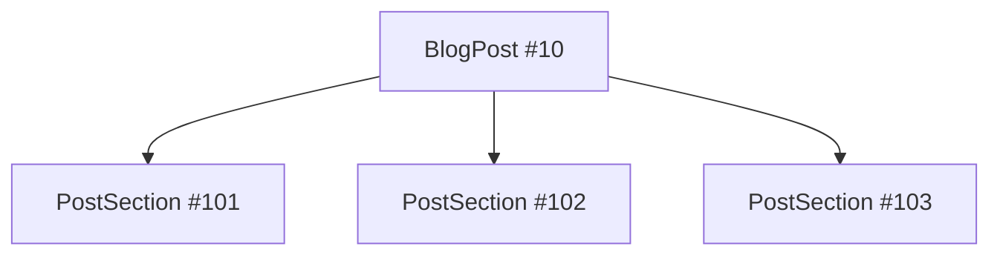
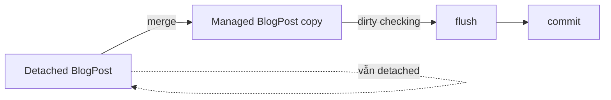
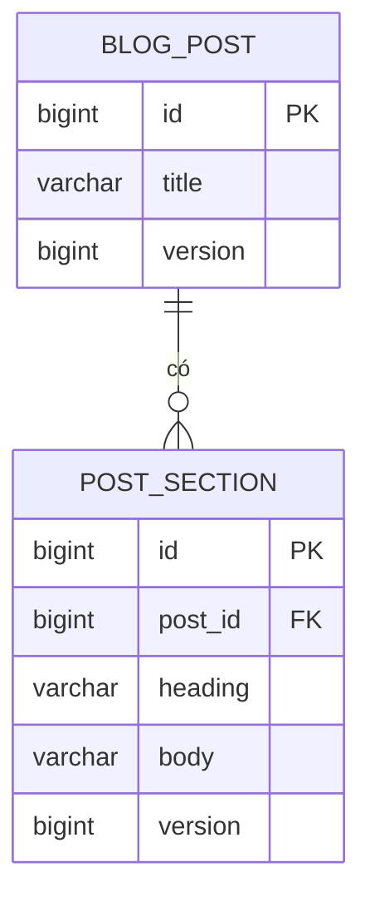
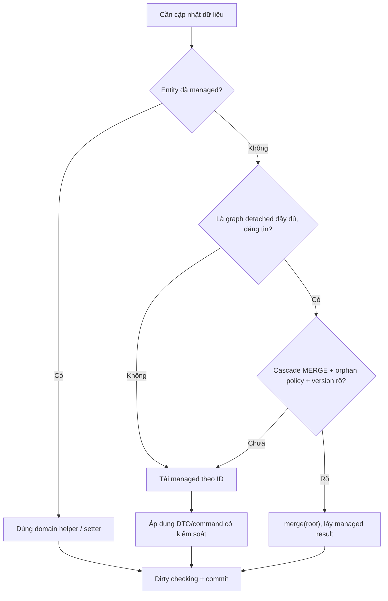

# Áp dụng MERGE khi hợp nhất đồ thị đã tách

Trong JPA, một entity có thể liên kết với nhiều entity khác để tạo thành **đồ thị đối tượng** (*object graph*). Chẳng hạn, một bài viết `BlogPost` có nhiều mục nội dung `PostSection`. Sau khi tải dữ liệu rồi đóng `EntityManager`, cả bài viết và các mục đã được tải có thể trở thành **detached**. Ứng dụng vẫn có thể sửa chúng trong Java, nhưng các thay đổi đó không tự được ghi xuống database.

Để hợp nhất trạng thái của một entity đã tách vào persistence context mới, JPA cung cấp `EntityManager.merge(...)`. Khi đồ thị chứa các entity liên quan, annotation **`cascade = CascadeType.MERGE`** (hoặc `CascadeType.ALL`) quyết định **việc merge có lan theo quan hệ đó hay không**.

Đây là một chủ đề quan trọng trong chương **Cascade và orphanRemoval** của *Data Persistence Relational Access ORM JPA*, vì một lần merge cả đồ thị có thể không chỉ cập nhật entity gốc mà còn cập nhật entity con, thêm entity con mới và, khi có `orphanRemoval = true`, **xóa entity con bị loại khỏi quan hệ**.

Mục tiêu bài học là hiểu và áp dụng `MERGE` đúng theo vòng đời entity, phân biệt cascade với fetch, tránh ghi đè graph không đầy đủ, bảo vệ quy tắc sở hữu quan hệ và chọn cách xử lý an toàn khi API chỉ muốn cập nhật một phần dữ liệu.

## 1. Tình huống: đồ thị BlogPost đã rời persistence context

Giả sử hệ thống quản lý nội dung có:

- `BlogPost`: bài viết, gồm tiêu đề và các mục nội dung.
- `PostSection`: một mục nội dung thuộc đúng một bài viết.
- Bảng `post_section` có khóa ngoại `post_id` trỏ tới `blog_post.id`.



Một phiên chỉnh sửa có thể diễn ra qua nhiều giai đoạn:

```text
Transaction/context thứ nhất:
    Tải BlogPost #10 cùng ba PostSection
    Đóng EntityManager
    => Object graph trở thành detached

Bên ngoài persistence context:
    Đổi tiêu đề BlogPost
    Đổi nội dung Section #101
    Bỏ Section #102
    Thêm một Section mới chưa có ID

Transaction/context thứ hai:
    em.merge(detachedBlogPost)
    => Managed copy của root và các node cascade MERGE
    Flush / commit
    => UPDATE, INSERT và có thể DELETE orphan
```

Nếu chỉ gọi `merge` trên `BlogPost` mà quan hệ tới `PostSection` không có `CascadeType.MERGE`, không thể mặc định những thay đổi nằm trong các `PostSection` cũng được hợp nhất.

Nếu có `CascadeType.MERGE` nhưng graph thiếu dữ liệu hoặc collection bị chỉnh sai, một lần merge có thể ghi nhiều thay đổi hơn dự kiến. Vì vậy cần hiểu **ngữ nghĩa của trạng thái detached** trước khi áp dụng API.

## 2. Nhắc lại trạng thái entity liên quan đến merge

Một entity trong JPA có thể ở các trạng thái thông dụng:

| Trạng thái | Mô tả | Có được dirty checking không? |
|---|---|---|
| **New / transient** | Mới tạo bằng `new`, chưa được quản lý | Không |
| **Managed** | Thuộc persistence context hiện tại | Có |
| **Detached** | Có thể đã được quản lý nhưng không còn thuộc context hiện tại | Không |
| **Removed** | Entity managed đang chờ xóa theo transaction | Không coi là entity cập nhật bình thường |

Ví dụ:

```java
BlogPost post = em.find(BlogPost.class, postId);

System.out.println(em.contains(post)); // true

em.detach(post);

System.out.println(em.contains(post)); // false
```

`detach` không xóa bản ghi database. Nó chỉ làm object `post` không còn được quản lý bởi `EntityManager` đó. Các mục nội dung liên quan có thể vẫn managed nếu không có cascade DETACH; còn khi đóng toàn bộ `EntityManager`, các managed entity của context ấy cũng không còn được quản lý.

Một entity có `id != null` **không nhất thiết managed**. Entity mới có ID do ứng dụng cấp trước persist cũng có thể là new, không phải detached.

### So sánh thay đổi managed và merge detached

```java
// Hướng 1: sửa entity đang managed.
BlogPost managed = em.find(BlogPost.class, postId);
managed.changeTitle("Tiêu đề mới");
// Dirty checking đồng bộ khi flush/commit.
```

```java
// Hướng 2: có object detached từ context khác.
BlogPost detached = ...;

BlogPost managedCopy = em.merge(detached);
// managedCopy thuộc context; detached vẫn detached.
```

Hướng 1 làm việc trên object được theo dõi. Hướng 2 sao chép trạng thái **persistent** của nguồn sang một managed instance đích. `merge` không biến chính object đối số thành managed.

## 3. Semantics cốt lõi của EntityManager.merge()

Phương thức:

```java
<T> T merge(T entity);
```

Khi gọi:

```java
BlogPost merged = em.merge(detachedPost);
```

cần nhớ sáu điều:

1. `merge` **sao chép trạng thái persistent** từ nguồn vào entity managed tương ứng; đối số không tự được attach lại.
2. **Giá trị trả về** là managed instance cần dùng cho các thao tác tiếp theo trong persistence context hiện tại.
3. Provider có thể đọc DB, lấy từ first-level cache hoặc tạo managed instance thích hợp để thực hiện việc hợp nhất.
4. `merge` trên root có thể lan sang các entity liên quan qua quan hệ có `cascade = MERGE` hoặc `ALL`.
5. `merge` không đồng nghĩa `commit`. Thay đổi được đồng bộ theo transaction/flush và chỉ bền vững khi commit thành công.
6. `merge` không phải một API **upsert tùy ý**: trạng thái mới/detached, ID, version và hàng DB có tồn tại hay không ảnh hưởng kết quả; không dùng nó thay cho việc xác định rõ ý định tạo mới hay cập nhật.

Ví dụ dễ gây nhầm:

```java
em.merge(detachedPost);
detachedPost.changeTitle("Sửa sau merge");

// detachedPost vẫn ở ngoài context;
// thay đổi sau merge ở đây không tự được theo dõi.
```

Nên làm:

```java
BlogPost managedPost = em.merge(detachedPost);
managedPost.changeTitle("Sửa tiếp trên managed copy");
```



## 4. CascadeType.MERGE chính xác là gì?

Một quan hệ JPA có thể khai báo:

```java
@OneToMany(
    mappedBy = "post",
    cascade = CascadeType.MERGE
)
private List<PostSection> sections;
```

Khi gọi `em.merge(post)`, thao tác merge có thể **cascade từ `post` tới những `PostSection` được tham chiếu trong trạng thái quan hệ thích hợp**. Mỗi con được hợp nhất theo identity/state của chính nó.

Các lựa chọn cascade quan trọng:

| Cascade | Thao tác được lan truyền | Tình huống |
|---|---|---|
| `PERSIST` | `persist` | Tạo root mới rồi lưu các con mới |
| `MERGE` | `merge` | Hợp nhất trạng thái graph detached |
| `REMOVE` | `remove` | Xóa root và lan xóa đối tượng liên quan theo policy |
| `REFRESH` | `refresh` | Tải lại trạng thái liên quan |
| `DETACH` | `detach` | Tách các entity liên quan khỏi context |
| `ALL` | Tất cả cascade trên | Chỉ hợp lý khi vòng đời liên quan phụ thuộc mạnh và mọi thao tác đều phù hợp |

**`CascadeType.PERSIST` không thay thế `CascadeType.MERGE`.** Một mapping chỉ có PERSIST có thể thêm con mới khi persist root, nhưng không bảo đảm những thay đổi trên con detached được hợp nhất khi merge root.

Ngược lại, chỉ có MERGE không khiến lời gọi `persist(root)` tự cascade persist tới con mới.

### Vì sao không phải association nào cũng cần MERGE?

Đồ thị Java có thể chứa những entity dùng chung giữa nhiều root, chẳng hạn:

```text
Order -> Product
BlogPost -> Category
Employee -> Department
```

Nếu một `Product`/`Category`/`Department` là entity độc lập, thay đổi các field của nó không nhất thiết phải diễn ra mỗi khi merge một order/post/employee. Cascade MERGE trên quan hệ tới entity chia sẻ có thể mở rộng phạm vi cập nhật ngoài ý định.

**Cascade phải theo quyền sở hữu nghiệp vụ của trạng thái**, không chỉ dựa vào việc một object có reference tới object khác.

## 5. Cascade MERGE khác orphanRemoval thế nào?

Hai cơ chế được dùng cùng nhau khá thường xuyên nhưng **giải quyết hai vấn đề khác nhau**:

- **Cascade MERGE:** khi hợp nhất root, có hợp nhất trạng thái các entity liên quan qua association không?
- **`orphanRemoval = true`:** khi một entity con phụ thuộc bị tách khỏi quan hệ quản lý, provider có thực hiện remove con theo vòng đời đó không?

Ví dụ:

```java
@OneToMany(
    mappedBy = "post",
    cascade = {CascadeType.PERSIST, CascadeType.MERGE},
    orphanRemoval = true
)
private List<PostSection> sections = new ArrayList<>();
```

Ở đây:

1. `PERSIST` cho phép tạo `BlogPost` mới cùng các `PostSection` mới.
2. `MERGE` cho phép hợp nhất trạng thái section khi root là detached.
3. `orphanRemoval = true` biểu đạt rằng section không tồn tại độc lập nếu bị loại khỏi bài viết theo trạng thái managed được đồng bộ.

Đây không phải ba tên khác nhau của một hành vi. Chúng kết hợp để tạo thành semantics **quản lý vòng đời cả đồ thị**.

### Bảng tác động

| Nghiệp vụ | MERGE | orphanRemoval |
|---|---|---|
| Sửa title của BlogPost detached rồi merge | Hợp nhất root | Không liên quan đến xóa |
| Sửa nội dung Section detached rồi merge root | Cần cascade MERGE qua association | Không quyết định việc sửa nội dung |
| Thêm Section mới vào graph detached rồi merge root | Cascade MERGE có thể tạo managed copy của con mới | Không thay thế cascade |
| Bỏ Section đã tồn tại khỏi collection và merge graph đầy đủ | Hợp nhất trạng thái collection | Có thể dẫn tới DELETE của orphan |
| Gọi `em.remove(post)` | MERGE không quyết định | Remove parent và lifecycle con phụ thuộc cần xét riêng |
| Muốn giữ Section sau khi bỏ khỏi Post | MERGE không tự bảo đảm | Không nên bật orphanRemoval như mô hình phụ thuộc |

Không dùng `orphanRemoval = true` như một cách để “tối ưu SQL”. Đó là **chính sách dữ liệu**: khi con bị tách, có thể xóa hàng con.

## 6. Ví dụ xuyên suốt: BlogPost có nhiều PostSection

Ta sẽ thực hành một đồ thị có đầy đủ ba tình huống:

- Root detached được đổi title.
- Một section detached được sửa text.
- Một section cũ bị loại khỏi graph và một section mới được thêm vào.

Để việc lưu graph nhất quán, quan hệ được ánh xạ **hai chiều**:



`PostSection.post` là phía sở hữu FK `post_id` thông qua `@ManyToOne`; `BlogPost.sections` với `mappedBy = "post"` là phía nghịch đảo. Dù merge cả graph, code Java vẫn phải giữ **hai phía của association đồng bộ** khi thêm/bỏ phần tử.

### 6.1. Entity BlogPost

Tệp `src/main/java/demo/BlogPost.java`:

```java
package demo;

import jakarta.persistence.CascadeType;
import jakarta.persistence.Column;
import jakarta.persistence.Entity;
import jakarta.persistence.GeneratedValue;
import jakarta.persistence.GenerationType;
import jakarta.persistence.Id;
import jakarta.persistence.OneToMany;
import jakarta.persistence.OrderBy;
import jakarta.persistence.Table;
import jakarta.persistence.Version;

import java.util.ArrayList;
import java.util.Collections;
import java.util.Iterator;
import java.util.List;
import java.util.Objects;

@Entity
@Table(name = "blog_post")
public class BlogPost {

    @Id
    @GeneratedValue(strategy = GenerationType.IDENTITY)
    private Long id;

    @Column(name = "title", nullable = false, length = 200)
    private String title;

    @Version
    private Long version;

    @OneToMany(
        mappedBy = "post",
        cascade = {CascadeType.PERSIST, CascadeType.MERGE},
        orphanRemoval = true
    )
    @OrderBy("id ASC")
    private List<PostSection> sections = new ArrayList<>();

    protected BlogPost() {
        // Constructor không tham số cho JPA.
    }

    public BlogPost(String title) {
        changeTitle(title);
    }

    public Long getId() {
        return id;
    }

    public Long getVersion() {
        return version;
    }

    public String getTitle() {
        return title;
    }

    public List<PostSection> getSections() {
        // Caller chỉ đọc; mọi sửa quan hệ qua helper.
        return Collections.unmodifiableList(sections);
    }

    public void changeTitle(String newTitle) {
        Objects.requireNonNull(newTitle, "title");
        if (newTitle.isBlank()) {
            throw new IllegalArgumentException("Title cannot be blank");
        }
        this.title = newTitle;
    }

    public void addSection(PostSection section) {
        Objects.requireNonNull(section, "section");

        BlogPost previous = section.getPost();
        if (previous != null && previous != this) {
            throw new IllegalArgumentException(
                "Section already belongs to another post");
        }

        for (PostSection current : sections) {
            if (current == section) {
                section.linkTo(this);
                return;
            }
        }

        sections.add(section);
        section.linkTo(this);
    }

    public void removeSection(PostSection section) {
        Objects.requireNonNull(section, "section");

        Iterator<PostSection> iterator = sections.iterator();
        while (iterator.hasNext()) {
            if (iterator.next() == section) {
                iterator.remove();

                if (section.getPost() == this) {
                    section.linkTo(null);
                }
                return;
            }
        }
    }
}
```

Đặc điểm quan trọng:

- `BlogPost` có ID sinh bởi database và một trường `@Version`.
- `@OneToMany` khai báo **`cascade = {PERSIST, MERGE}`**: đủ cho hai use case tạo mới và hợp nhất trong ví dụ, không tự thêm `REMOVE` chỉ vì muốn MERGE.
- `orphanRemoval = true` được chọn **có chủ đích** vì section là thành phần của bài viết, không phải entity dùng chung.
- `getSections()` trả view không sửa được; mã gọi phải dùng `addSection`/`removeSection` để giữ hai phía nhất quán.
- `@OrderBy("id ASC")` giúp khi tải lại các section đã lưu có thứ tự rõ hơn; nó **không phải** cột thứ tự nghiệp vụ có thể sắp xếp thủ công. Nếu cần vị trí kéo-thả, thiết kế field vị trí riêng.
- Helper so sánh bằng `==` để xử lý đúng **cùng instance**, ngay cả khi hai entity mới cùng có `id == null`. Đây là mẫu helper cho ví dụ, không áp đặt một hợp đồng `equals/hashCode` chung cho mọi entity.

### 6.2. Entity PostSection

Tệp `src/main/java/demo/PostSection.java`:

```java
package demo;

import jakarta.persistence.Column;
import jakarta.persistence.Entity;
import jakarta.persistence.FetchType;
import jakarta.persistence.GeneratedValue;
import jakarta.persistence.GenerationType;
import jakarta.persistence.Id;
import jakarta.persistence.JoinColumn;
import jakarta.persistence.ManyToOne;
import jakarta.persistence.Table;
import jakarta.persistence.Version;

import java.util.Objects;

@Entity
@Table(name = "post_section")
public class PostSection {

    @Id
    @GeneratedValue(strategy = GenerationType.IDENTITY)
    private Long id;

    @Column(name = "heading", nullable = false, length = 120)
    private String heading;

    @Column(name = "body", nullable = false, length = 4000)
    private String body;

    @Version
    private Long version;

    @ManyToOne(fetch = FetchType.LAZY, optional = false)
    @JoinColumn(name = "post_id", nullable = false)
    private BlogPost post;

    protected PostSection() {
        // Constructor JPA.
    }

    public PostSection(String heading, String body) {
        changeHeading(heading);
        changeBody(body);
    }

    public Long getId() {
        return id;
    }

    public Long getVersion() {
        return version;
    }

    public BlogPost getPost() {
        return post;
    }

    public String getHeading() {
        return heading;
    }

    public String getBody() {
        return body;
    }

    public void changeHeading(String value) {
        Objects.requireNonNull(value, "heading");
        if (value.isBlank()) {
            throw new IllegalArgumentException(
                "Heading cannot be blank");
        }
        this.heading = value;
    }

    public void changeBody(String value) {
        this.body = Objects.requireNonNull(value, "body");
    }

    // Package-private: helper ở BlogPost điều phối hai phía.
    void linkTo(BlogPost post) {
        this.post = post;
    }
}
```

`PostSection.post` là **owning side** quyết định FK. Chỉ sửa `BlogPost.sections` mà không cập nhật `section.post` có thể dẫn đến SQL FK sai hoặc lỗi `NOT NULL`.

`@Version` trên section giúp phát hiện xung đột khi cùng sửa nội dung một section. Version trên root không được mặc định rằng sẽ bảo vệ **mọi cập nhật field của tất cả section** trong mọi provider/mapping.

### 6.3. Schema khái niệm

Một lược đồ tương đương với mapping:

```sql
CREATE TABLE blog_post (
    id BIGINT GENERATED BY DEFAULT AS IDENTITY PRIMARY KEY,
    title VARCHAR(200) NOT NULL,
    version BIGINT NOT NULL
);

CREATE TABLE post_section (
    id BIGINT GENERATED BY DEFAULT AS IDENTITY PRIMARY KEY,
    post_id BIGINT NOT NULL,
    heading VARCHAR(120) NOT NULL,
    body VARCHAR(4000) NOT NULL,
    version BIGINT NOT NULL,
    CONSTRAINT fk_post_section_post
        FOREIGN KEY (post_id) REFERENCES blog_post(id)
);

CREATE INDEX idx_post_section_post_id
    ON post_section(post_id);
```

Đây là SQL minh họa. JPA provider có thể phát DDL khác về kiểu dữ liệu, tên constraint và identity column. Trong production nên sử dụng migration/schema quản lý độc lập và xác định rõ FK, index và version.

## 7. Cấu hình môi trường Java SE để chạy

Cấu trúc tệp ví dụ:

```text
merge-graph-demo/
├── pom.xml
└── src/
    └── main/
        ├── java/demo/
        │   ├── BlogPost.java
        │   ├── PostSection.java
        │   └── Main.java
        └── resources/META-INF/
            └── persistence.xml
```

Ví dụ dùng Java 17, Jakarta Persistence 3.1, Hibernate ORM 6.x và H2 để minh họa. Những version dưới đây là một bộ dependency ví dụ, không phải khẳng định phát hành mới nhất.

Tệp `pom.xml`:

```xml
<project xmlns="http://maven.apache.org/POM/4.0.0"
         xmlns:xsi="http://www.w3.org/2001/XMLSchema-instance"
         xsi:schemaLocation="http://maven.apache.org/POM/4.0.0
                             https://maven.apache.org/xsd/maven-4.0.0.xsd">
    <modelVersion>4.0.0</modelVersion>
    <groupId>demo</groupId>
    <artifactId>merge-graph-demo</artifactId>
    <version>1.0-SNAPSHOT</version>

    <properties>
        <maven.compiler.release>17</maven.compiler.release>
        <project.build.sourceEncoding>UTF-8</project.build.sourceEncoding>
    </properties>

    <dependencies>
        <dependency>
            <groupId>jakarta.persistence</groupId>
            <artifactId>jakarta.persistence-api</artifactId>
            <version>3.1.0</version>
        </dependency>
        <dependency>
            <groupId>org.hibernate.orm</groupId>
            <artifactId>hibernate-core</artifactId>
            <version>6.6.4.Final</version>
        </dependency>
        <dependency>
            <groupId>com.h2database</groupId>
            <artifactId>h2</artifactId>
            <version>2.3.232</version>
        </dependency>
    </dependencies>

    <build>
        <plugins>
            <plugin>
                <groupId>org.apache.maven.plugins</groupId>
                <artifactId>maven-compiler-plugin</artifactId>
            </plugin>
            <plugin>
                <groupId>org.codehaus.mojo</groupId>
                <artifactId>exec-maven-plugin</artifactId>
                <version>3.4.1</version>
                <configuration>
                    <mainClass>demo.Main</mainClass>
                </configuration>
            </plugin>
        </plugins>
    </build>
</project>
```

Tệp `src/main/resources/META-INF/persistence.xml`:

```xml
<?xml version="1.0" encoding="UTF-8"?>
<persistence xmlns="https://jakarta.ee/xml/ns/persistence"
             xmlns:xsi="http://www.w3.org/2001/XMLSchema-instance"
             xsi:schemaLocation="
                 https://jakarta.ee/xml/ns/persistence
                 https://jakarta.ee/xml/ns/persistence/persistence_3_1.xsd"
             version="3.1">

    <persistence-unit name="postsPU" transaction-type="RESOURCE_LOCAL">
        <provider>org.hibernate.jpa.HibernatePersistenceProvider</provider>
        <class>demo.BlogPost</class>
        <class>demo.PostSection</class>
        <exclude-unlisted-classes>true</exclude-unlisted-classes>

        <properties>
            <property name="jakarta.persistence.jdbc.driver"
                      value="org.h2.Driver"/>
            <property name="jakarta.persistence.jdbc.url"
                      value="jdbc:h2:mem:postsdb;DB_CLOSE_DELAY=-1"/>
            <property name="jakarta.persistence.jdbc.user"
                      value="sa"/>
            <property name="jakarta.persistence.jdbc.password"
                      value=""/>
            <property name="jakarta.persistence.schema-generation.database.action"
                      value="drop-and-create"/>
        </properties>
    </persistence-unit>
</persistence>
```

Cấu hình `drop-and-create` **có thể xóa dữ liệu** và chỉ nên dùng trong môi trường học/test. Không áp dụng nó cho database có dữ liệu thực.

## 8. Chương trình Java SE: merge đồ thị có sửa, thêm và bỏ con

Tệp `src/main/java/demo/Main.java`:

```java
package demo;

import jakarta.persistence.EntityManager;
import jakarta.persistence.EntityManagerFactory;
import jakarta.persistence.EntityTransaction;
import jakarta.persistence.Persistence;

import java.util.List;

public class Main {

    public static void main(String[] args) {
        EntityManagerFactory emf =
            Persistence.createEntityManagerFactory("postsPU");

        try {
            Long id = createPost(emf);

            BlogPost detachedGraph = loadDetachedGraph(emf, id);

            // Sửa root khi đã detached.
            detachedGraph.changeTitle("Bài đã biên tập");

            // Dữ liệu đã fetch và đã được sắp theo ID.
            List<PostSection> sections = detachedGraph.getSections();

            // Sửa section #1.
            sections.get(0).changeBody("Nội dung đã cập nhật");

            // Xóa section #2 khỏi quan hệ của root.
            detachedGraph.removeSection(sections.get(1));

            // Thêm section mới (chưa có ID).
            detachedGraph.addSection(
                new PostSection("Mục mới", "Nội dung mới"));

            mergeDetachedGraph(emf, detachedGraph);
            printResult(emf, id);
        } finally {
            emf.close();
        }
    }

    private static Long createPost(EntityManagerFactory emf) {
        EntityManager em = emf.createEntityManager();
        try {
            EntityTransaction tx = em.getTransaction();
            try {
                tx.begin();

                BlogPost post = new BlogPost("Bài ban đầu");
                post.addSection(new PostSection(
                    "Mục A", "Nội dung A"));
                post.addSection(new PostSection(
                    "Mục B", "Nội dung B"));

                // CascadeType.PERSIST xử lý các section mới.
                em.persist(post);

                tx.commit();
                return post.getId();
            } catch (RuntimeException ex) {
                if (tx.isActive()) tx.rollback();
                throw ex;
            }
        } finally {
            em.close();
        }
    }

    private static BlogPost loadDetachedGraph(
            EntityManagerFactory emf, Long id) {

        EntityManager em = emf.createEntityManager();
        try {
            // JOIN FETCH để collection được khởi tạo đầy đủ
            // trước khi đóng EntityManager.
            return em.createQuery(
                    """
                    SELECT DISTINCT p
                    FROM BlogPost p
                    LEFT JOIN FETCH p.sections
                    WHERE p.id = :id
                    """,
                    BlogPost.class
                )
                .setParameter("id", id)
                .getSingleResult();
        } finally {
            em.close();
        }
    }

    private static void mergeDetachedGraph(
            EntityManagerFactory emf, BlogPost detached) {

        EntityManager em = emf.createEntityManager();
        try {
            EntityTransaction tx = em.getTransaction();
            try {
                tx.begin();

                BlogPost managed = em.merge(detached);

                System.out.println("Detached managed? "
                    + em.contains(detached));    // false
                System.out.println("Result managed? "
                    + em.contains(managed));     // true

                // Từ thời điểm này nếu muốn sửa tiếp, dùng managed.
                managed.changeTitle("Bài đã biên tập và lưu");

                tx.commit();
            } catch (RuntimeException ex) {
                if (tx.isActive()) tx.rollback();
                throw ex;
            }
        } finally {
            em.close();
        }
    }

    private static void printResult(
            EntityManagerFactory emf, Long id) {

        EntityManager em = emf.createEntityManager();
        try {
            BlogPost post = em.createQuery(
                    """
                    SELECT DISTINCT p
                    FROM BlogPost p
                    LEFT JOIN FETCH p.sections
                    WHERE p.id = :id
                    """,
                    BlogPost.class
                )
                .setParameter("id", id)
                .getSingleResult();

            System.out.println("Title: " + post.getTitle());
            System.out.println("Section count: "
                + post.getSections().size());

            for (PostSection section : post.getSections()) {
                System.out.println(
                    section.getHeading() + ": " + section.getBody());
            }
        } finally {
            em.close();
        }
    }
}
```

Chạy:

```bash
mvn compile exec:java
```

Một lần chạy thành công có thể cho kết quả chính:

```text
Detached managed? false
Result managed? true
Title: Bài đã biên tập và lưu
Section count: 2
Mục A: Nội dung đã cập nhật
Mục mới: Nội dung mới
```

ID sinh bởi database có thể thay đổi. Log của Hibernate/H2 có thể xuất hiện thêm. `@OrderBy("id ASC")` làm các section đã lưu được sắp theo ID lúc tải; vì vậy trong ví dụ, phần đầu tương ứng `Mục A` và phần thứ hai là `Mục B`.

### Phân tích từng giai đoạn

**Giai đoạn 1 — Persist graph mới.** `BlogPost` mới có hai `PostSection` mới. `cascade = PERSIST` cho phép `em.persist(post)` lan tới cả hai con. Helper đảm bảo `PostSection.post` trỏ về root để FK được ghi chính xác.

**Giai đoạn 2 — Load đầy đủ trước khi detach.** `LEFT JOIN FETCH p.sections` đưa cả các section vào graph. Đóng `EntityManager` khiến root và những section đã managed đều không còn managed trong context đó.

**Giai đoạn 3 — Thay đổi detached graph.** Mã Java đổi title, sửa một section, gỡ section còn lại và thêm section mới. Những thay đổi này **chưa tự chạy SQL**.

**Giai đoạn 4 — Merge vào context mới.** `em.merge(detached)` trả về root managed. `CascadeType.MERGE` giúp hợp nhất các section liên quan, bao gồm nội dung section cũ đã sửa và section mới trong graph.

**Giai đoạn 5 — Xóa orphan và commit.** Vì root sau merge không còn quan hệ với section đã bỏ và mapping đặt `orphanRemoval = true`, provider có thể xóa hàng section bị loại khỏi quan hệ khi đồng bộ trạng thái managed. Commit chỉ thành công nếu các lệnh và constraint hợp lệ.

**Giai đoạn 6 — Đọc kiểm chứng.** Query lại cho thấy title đã cập nhật, section cũ được giữ/sửa, section mới được tạo và section bị bỏ không còn thuộc bài viết.

Đây là một **ví dụ giáo dục theo mapping/provider đã nêu**, không phải cam kết thứ tự câu SQL cố định trên mọi JPA provider.

## 9. Quan sát SQL: merge cả graph không chỉ là UPDATE root

Trên một graph như ví dụ, provider có thể cần:

- `SELECT` để tìm root và các con tương ứng.
- `UPDATE blog_post` khi title thay đổi.
- `UPDATE post_section` cho section cũ được sửa.
- `INSERT INTO post_section` cho section mới.
- `DELETE FROM post_section` cho orphan.
- Kiểm tra `version` khi có `@Version`.

Một chuỗi SQL khái niệm:

```sql
SELECT * FROM blog_post WHERE id = ?;
SELECT * FROM post_section WHERE post_id = ?;

UPDATE blog_post
SET title = ?, version = ?
WHERE id = ? AND version = ?;

UPDATE post_section
SET body = ?, version = ?
WHERE id = ? AND version = ?;

INSERT INTO post_section
    (post_id, heading, body, version)
VALUES (?, ?, ?, ?);

DELETE FROM post_section
WHERE id = ? AND version = ?;
```

Không suy ra chính xác số query hoặc thứ tự SQL chỉ từ số lệnh Java: persistence context/cache, flush mode, ID strategy, dirty checking, cascade và dialect đều ảnh hưởng. Nếu graph rất lớn, `merge` có thể phải xử lý nhiều entity và snapshot collection, ngay cả khi nghiệp vụ chỉ sửa một field của root.

### Khi graph quá lớn

Nếu một bài viết có hàng chục nghìn section hoặc quan hệ phức tạp, không nên luôn tải/merge toàn bộ graph để đổi một tiêu đề. Hãy dùng managed update theo đúng field cần sửa hoặc query cụ thể tới con cần sửa.

```java
BlogPost managed = em.find(BlogPost.class, postId);
managed.changeTitle(newTitle);
// Không bắt buộc tải hoặc merge tất cả PostSection.
```

`CascadeType.MERGE` diễn đạt **khả năng lan thao tác merge**; nó không yêu cầu mọi use case phải sử dụng merge graph.

## 10. Phải dùng kết quả merge thay cho đối số detached

Một lỗi phổ biến:

```java
BlogPost detached = loadDetachedGraph(...);
detached.changeTitle("Tiêu đề A");

BlogPost managed = em.merge(detached);

// Sai nếu mong thay đổi sau đây tự lưu:
detached.changeTitle("Tiêu đề B");
```

Sau lời gọi merge, đối số `detached` vẫn detached, nên thay đổi mới trên đó không tự được dirty-check.

Đúng:

```java
BlogPost managed = em.merge(detached);
managed.changeTitle("Tiêu đề B");
```

Điều này cũng áp dụng cho **các entity con**. Provider có thể tạo managed copies cho các section. Không giữ reference của `PostSection` detached rồi sửa tiếp sau merge với giả định nó đã được reattach.

Nếu cần tìm một con tương ứng sau merge:

```java
Long sectionId = detachedSection.getId();

PostSection managedSection = em.find(
    PostSection.class, sectionId);

managedSection.changeBody("Nội dung sửa tiếp");
```

Ví dụ này áp dụng cho con **đã tồn tại** với ID ổn định. Với con mới chưa có ID, hãy truy cập managed graph hoặc dùng kết quả xử lý do service trả về; đừng cho rằng object new đầu vào đã được gán ID vì cascade merge.

## 11. Vì sao thiếu cascade MERGE có thể bỏ sót thay đổi trên con?

Thử đổi mapping thành:

```java
@OneToMany(
    mappedBy = "post",
    cascade = CascadeType.PERSIST
)
private List<PostSection> sections;
```

Sau khi tải rồi detach:

```java
BlogPost detached = ...;
detached.changeTitle("Title changed");
detached.getSections().get(0)
    .changeBody("Section changed");

BlogPost managed = em.merge(detached);
```

`BlogPost` có thể được merge, nhưng `CascadeType.PERSIST` **không tự động cascade thao tác MERGE** sang `PostSection`. Đừng coi đây là đường chắc chắn để cập nhật nội dung detached của section.

Cần phân biệt hai khía cạnh:

- Trạng thái tham chiếu **relationship** được JPA xử lý theo ngữ nghĩa merge.
- Trạng thái persistent **bên trong entity liên quan** chỉ được cascade merge khi mapping cho phép.

Với entity con detached nhưng không cascade MERGE, provider có thể duy trì tham chiếu thích hợp tới identity managed của con, nhưng **không có nghĩa phải sao chép các field đã sửa của nó**.

Nếu nghiệp vụ cần chỉnh sửa section, có hai cách rõ ràng:

1. Dùng `cascade = MERGE`/`ALL` trên quan hệ phụ thuộc thực sự, rồi merge một graph đầy đủ và đáng tin.
2. Tải `PostSection` cần sửa như managed entity và gọi method thay đổi trực tiếp trong transaction, không cần merge root.

### Có nên bật ALL để khỏi quên MERGE?

Không nên theo phản xạ. `ALL` còn bao gồm `REMOVE`, `REFRESH` và `DETACH`. Với những quan hệ có entity dùng chung, nó có thể tạo hiệu ứng xóa/tách ngoài mong đợi.

Ví dụ một `BlogPost` liên kết với `Author` độc lập: merge post không nhất thiết được phép sửa thông tin cá nhân của author. Quan hệ `@ManyToOne Author` thường không cần cascade MERGE, trừ khi nghiệp vụ xác định rõ quyền sở hữu.

## 12. Thêm entity con mới vào một graph detached

Giả sử root và các section đã có ID, rồi ứng dụng thêm một section mới:

```java
BlogPost detachedPost = ...;

PostSection newSection = new PostSection(
    "Phần bổ sung",
    "Được tạo sau khi context đã đóng"
);

detachedPost.addSection(newSection);
// newSection.getId() == null trước khi được lưu.
```

Khi gọi:

```java
BlogPost managed = em.merge(detachedPost);
```

và association có cascade MERGE, JPA xử lý con new thông qua **merge semantics**: tạo/nhận managed instance thích hợp cho con mới và sắp xếp ghi INSERT ở transaction. Đây là hành vi có thể xuất hiện trong việc hợp nhất graph chứa cả new và detached nodes.

**Phân biệt:**

- `em.persist(newSection)` đưa **chính newSection** vào managed state.
- `em.merge(newSection)` trả **một managed copy** của newSection; object new ban đầu không tự thành managed.
- Cascade MERGE từ root tới new child tuân thủ ý nghĩa của merge, không đồng nghĩa người gọi đã trực tiếp persist chính instance đó.

### Khi nào nên tạo con mới trên managed root?

Với web API/service transaction thông thường, cách này đơn giản hơn:

```java
BlogPost managed = em.find(BlogPost.class, postId);

managed.addSection(
    new PostSection("Phần mới", "Nội dung mới")
);

// Cascade PERSIST/quan hệ phụ thuộc và provider
// xử lý con mới theo mapping khi đồng bộ.
```

Cần chú ý: **không nên dựa vào ý tưởng “có cascade PERSIST thì một new child tự được lưu trong mọi trường hợp” mà không xét state/mapping và flush**. Trong Hibernate, persist/flush trên managed parent cùng cascade phù hợp có thể xử lý con mới; một phương án minh bạch ở service là `em.persist(newSection)` sau khi liên kết hoặc thiết kế aggregate creation phù hợp. Quan sát SQL để chắc chắn với mapping/provider dự án.

Nếu chủ đích tạo một section mới, việc tạo trực tiếp trong transaction với root managed thường dễ kiểm soát hơn merge cả graph chỉ để thêm một phần tử.

## 13. Gỡ phần tử và orphanRemoval trong đồ thị detached

Đây là chỗ dễ mất dữ liệu nhất.

Giả sử database có:

```text
BlogPost #10
  - Section #101
  - Section #102
  - Section #103
```

Một người chỉnh sửa tải đầy đủ graph, sau đó chủ động gỡ `#102`:

```java
detachedPost.removeSection(section102);
```

Nếu sau đó merge graph đầy đủ và mapping có `orphanRemoval = true`, trạng thái quan hệ được hợp nhất có thể dẫn đến việc `#102` bị xem là orphan trong **managed graph** và bị xóa khi flush.

Đây là **ngữ nghĩa xóa** có chủ đích, không đơn thuần là “bỏ khỏi danh sách hiển thị”.

### Điều gì xảy ra nếu collection thiếu dữ liệu vì API?

Giả sử client gửi JSON:

```json
{
  "id": 10,
  "title": "Tiêu đề mới",
  "sections": [
    {"id": 101, "heading": "Mục A", "body": "..."},
    {"id": 103, "heading": "Mục C", "body": "..."}
  ]
}
```

Có ít nhất hai cách hiểu:

- **PATCH:** client chỉ gửi những section cần chỉnh, không nhắc `#102` vì nó không đổi.
- **PUT/replace:** client gửi danh sách **đầy đủ**; section `#102` vắng mặt có nghĩa yêu cầu xóa.

Nếu chuyển một payload PATCH thành detached graph rồi merge như một **snapshot đầy đủ**, section bị thiếu có thể bị xóa khi `orphanRemoval=true`. **Không được suy ra “không gửi = xóa” nếu API không định nghĩa như vậy.**

### Orphan removal khác cascade REMOVE

- `CascadeType.REMOVE` liên quan đến việc lan thao tác `em.remove(parent)` sang entity liên quan.
- `orphanRemoval=true` liên quan đến việc con phụ thuộc bị **tách khỏi relationship**.
- `CascadeType.MERGE` liên quan đến việc sao chép trạng thái khi merge.

Ví dụ: muốn xóa `Section #102` nhưng giữ `BlogPost #10`, dùng helper gỡ section trên managed graph/graph được hợp nhất phù hợp; `cascade REMOVE` tự nó không có nghĩa “remove phần tử khỏi collection sẽ xóa hàng con”.

### Không chuyển con giữa hai parent bằng remove/add khi orphanRemoval true

Nếu `PostSection` được phép chuyển sang `BlogPost` khác, việc gỡ khỏi cha cũ có thể khiến nó bị đánh dấu xóa như orphan. Mô hình chuyển quyền sở hữu nên **không đặt orphanRemoval true** trên quan hệ chuyển được, hoặc phải dùng workflow dữ liệu riêng có hiểu biết về semantics.

## 14. Trạng thái lazy chưa được tải khác collection rỗng

Một graph detached **không nhất thiết đầy đủ**. `BlogPost.sections` có thể khai báo LAZY và chưa được khởi tạo khi EntityManager đóng:

```java
BlogPost post = em.find(BlogPost.class, postId);
em.close();

// Nếu sections là lazy và chưa load:
post.getSections().size(); // Có thể lỗi với Hibernate.
```

Theo ngữ nghĩa merge của JPA, provider **không được merge những lazy field/association chưa được fetch**. Nhưng điều này không đồng nghĩa mọi field có giá trị `null` hoặc collection rỗng trong **object tự tạo từ DTO** đều được coi là "chưa fetch".

| Trạng thái | Ý nghĩa |
|---|---|
| Lazy association của detached entity thực sự **unfetched** | JPA provider phải tôn trọng trạng thái chưa tải khi merge |
| Association đã fetch, có đủ 3 con | Snapshot đầy đủ theo thời điểm đọc |
| Association đã fetch, app chủ động gỡ 1 con | Có thể là thay đổi quan hệ thực sự |
| DTO không chứa trường `sections`, app dựng entity với list mặc định rỗng | Không có thông tin JPA rằng field này “unfetched” |
| Client gửi `"sections": []` | Có thể là lệnh xóa toàn bộ nếu API định nghĩa replace; không được mặc định khi PATCH |
| Detached graph stale và DB vừa có section mới từ request khác | Merge snapshot có thể xung đột với cập nhật mới, cần version/concurrency policy |

Vì vậy, khi cần merge đồ thị, nên:

1. Biết graph được tải từ đâu và association nào đã được fetch.
2. Quy định request là PATCH hay replace toàn bộ.
3. Không deserialize JSON thẳng vào entity để merge khi có trường không được phép sửa.
4. Có optimistic locking hoặc chính sách tránh xóa dữ liệu mới do người khác vừa thêm.
5. Với collection lớn, ưu tiên cập nhật từng entity/relationship thay vì tải và merge toàn bộ.

## 15. Kiểm soát optimistic locking khi merge graph cũ

Một detached graph có thể được giữ trong nhiều giây, phút hoặc lâu hơn. Trong thời gian đó, transaction khác có thể sửa root hoặc con.

Giả sử:

```text
T1: tải BlogPost #10 version = 4
    tải PostSection #101 version = 2
    đóng EntityManager

T2: sửa Section #101, commit -> version = 3

T1: sửa Section #101 dựa trên bản version = 2
    gọi merge(detachedPost)
```

Với `@Version` trên `PostSection`, provider cần phát hiện xung đột optimistic locking vào thời điểm phù hợp (merge, flush hoặc commit) và có thể ném `OptimisticLockException` hay exception được framework chuyển đổi.

**Không tiếp tục commit bằng cách bỏ qua conflict**. Transaction lỗi cần rollback; nếu muốn retry, hãy mở transaction mới, tải trạng thái mới và áp dụng lại **ý định nghiệp vụ** sau khi xác định có thể hòa giải.

### Version root có đủ không?

Không nên mặc định. Một section có thể được cập nhật mà version của root không tăng trong mọi mapping/provider. Nếu nghiệp vụ yêu cầu **toàn bộ bài viết và section phải được kiểm soát như một aggregate**, cần thiết kế concurrency ở đúng cấp:

- `@Version` trên cả root và child khi mỗi phần tử có thể sửa độc lập.
- Có thể sử dụng lock hoặc tăng version root có chủ đích khi thay đổi collection/child cần được serialize.
- Hoặc áp dụng giao thức phiên bản API/ETag và transaction locking phù hợp.
- Kiểm tra xung đột bằng test với hai EntityManager/transaction.

**MERGE không tự giải quyết xung đột stale data** chỉ vì nó hoạt động trên một graph.

## 16. Đồ thị có nhiều object trùng một identity

Một graph có thể chứa hai object Java khác nhau nhưng cùng kiểu entity và cùng primary key:

```text
BlogPost #10
   |
   +-- PostSection object A (id = 101)
   |
   +-- PostSection object B (id = 101)
```

JPA persistence context chỉ nên quản lý **một managed instance cho một identity**. Khi merge đồ thị có nhiều detached copies cùng ID nhưng trạng thái khác nhau, provider có thể báo lỗi hoặc có cơ chế xử lý đặc thù. Hibernate có các lựa chọn cấu hình về entity copy khi merge, nhưng không nên dựa vào chúng để hợp thức hóa dữ liệu đầu vào mâu thuẫn.

Các biện pháp:

- Xác thực request không chứa cùng section ID hai lần.
- Với graph nội bộ, giữ một object đại diện cho mỗi identity.
- Không tạo một entity detached riêng cho từng field muốn sửa rồi trộn cùng graph.
- Dùng một managed instance làm đích cho mọi thay đổi của cùng entity.
- Không trông cậy `Set` tự phát hiện mọi trùng lặp vì `equals/hashCode` của entity mới/detached có nhiều điểm cần thiết kế.

## 17. Owning side vẫn quyết định khóa ngoại khi merge

Với quan hệ hai chiều:

```java
// Phía nghịch đảo (parent).
@OneToMany(mappedBy = "post", cascade = CascadeType.MERGE)
private List<PostSection> sections;

// Phía sở hữu (child).
@ManyToOne
@JoinColumn(name = "post_id")
private BlogPost post;
```

`PostSection.post` là phía sở hữu vì FK `post_id` nằm trên bảng của child. Chỉ thêm child vào `post.sections` mà quên gán `child.post` sẽ tạo **object graph bất nhất**.

```java
// Ví dụ ý tưởng sai, nếu getter trả mutable collection:
post.getSections().add(newSection);
// newSection.getPost() vẫn null.
```

Trong code mẫu, getter không sửa được; phải gọi:

```java
post.addSection(newSection);
```

Sau lệnh, cả hai phía đều có trạng thái tương ứng:

```text
post.sections chứa newSection
newSection.post == post
```

Tương tự, `removeSection` gỡ khỏi list và đặt lại tham chiếu con để biểu đạt đúng nghiệp vụ tách con. Không trông đợi `merge` tự suy ra mọi chỉnh sửa còn thiếu trên owning side.

**Cascade không thay thế quy tắc quan hệ.** `CascadeType.MERGE` chỉ điều khiển sự lan truyền merge; database FK, `mappedBy` và các method domain vẫn phải đúng.

## 18. Vì sao MERGE trên ManyToMany cần cân nhắc kỹ?

Không nên bê nguyên mẫu BlogPost–PostSection sang `@ManyToMany` giữa `Student` và `Course` hoặc `User` và `Role`. Trong many-to-many, cả hai phía thường có vòng đời độc lập.

Ví dụ:

```java
@ManyToMany
@JoinTable(
    name = "student_course",
    joinColumns = @JoinColumn(name = "student_id"),
    inverseJoinColumns = @JoinColumn(name = "course_id")
)
private Set<Course> courses = new HashSet<>();
```

Nếu `Course` là entity dùng chung:

- Không mặc định bật `CascadeType.ALL`; đặc biệt `REMOVE` có thể gây nguy cơ xóa Course dùng chung.
- Khi thêm/bỏ một khóa học khỏi sinh viên, mục tiêu thường là sửa **bảng nối**, không xóa bản ghi Course.
- Không có `orphanRemoval` tương đương để coi Course bị gỡ khỏi một student là entity phải xóa khỏi DB.
- Cascade MERGE sang Course chỉ nên dùng nếu use case thực sự được phép cập nhật state của Course khi merge Student, điều này thường không đúng với mô hình enrollment.

Nếu bản thân liên kết có metadata (ngày đăng ký, điểm, trạng thái), cân nhắc entity trung gian `Enrollment` với hai quan hệ `@ManyToOne`, rồi lựa chọn cascade theo lifecycle thực tế.

## 19. Đối chiếu với cách sửa managed graph

Khi request chỉ thay một section, cách đơn giản thường là:

```java
EntityTransaction tx = em.getTransaction();
try {
    tx.begin();

    PostSection section = em.find(
        PostSection.class, sectionId);

    if (section == null) {
        throw new IllegalArgumentException("Section not found");
    }

    // Kiểm tra quyền và section thuộc đúng postId.
    if (!section.getPost().getId().equals(postId)) {
        throw new IllegalArgumentException("Wrong post");
    }

    section.changeBody(newBody);

    // Không cần merge PostSection hoặc BlogPost đã managed.
    tx.commit();
} catch (RuntimeException ex) {
    if (tx.isActive()) tx.rollback();
    throw ex;
}
```

Ưu điểm:

- Không cần dựng hay merge một graph lớn.
- Trường nào được sửa là rõ ràng.
- Không có nguy cơ coi một collection vắng mặt trong request là yêu cầu xóa con.
- Dễ kiểm tra quyền cập nhật từng section.
- Optimistic locking của đúng `PostSection` có thể được áp dụng.

**Khi nào merge detached graph vẫn hợp lý?** Khi ứng dụng có một snapshot entity đầy đủ, đáng tin, có chính sách cập nhật nhiều phần tử cùng lúc, đã hiểu cascade/version/orphanRemoval và muốn hợp nhất state theo đúng semantics đó.

### So sánh nhanh

| Tiêu chí | Managed update | Merge detached graph |
|---|---|---|
| Đối tượng bắt đầu | Đã managed trong transaction | Detached ngoài context |
| Thao tác chính | Gọi domain methods rồi dirty checking | `merge(detached)`, lấy managed result |
| Sửa một field | Gọn và phạm vi rõ | Có thể thừa công việc |
| Sửa nhiều con đã tách | Phải tải/tìm từng con hoặc root managed | Có thể cascade MERGE theo association |
| Thêm con mới | `addSection` và persist/cascade phù hợp | Cascade MERGE xử lý new node theo merge semantics |
| Bỏ con | Gọi remove helper rõ | Dễ bị nhầm khi snapshot không đầy đủ |
| Optimistic lock | Áp dụng cho managed entity tương ứng | Phải kiểm tra version của detached snapshots |
| Nguy cơ mass assignment | Thấp khi áp dụng DTO có kiểm soát | Cao nếu merge entity dựng trực tiếp từ request |

## 20. Thiết kế API PATCH và PUT không xóa nhầm section

### PATCH — chỉ sửa phần yêu cầu

Ví dụ payload:

```json
{
  "title": "Tiêu đề cập nhật"
}
```

Không nhắc `sections` có nghĩa **không sửa collection**. Thực hiện bằng managed update:

```java
BlogPost post = em.find(BlogPost.class, postId);
post.changeTitle(request.title());
```

Không nên tạo một `BlogPost` giả có `id`, `title` và `sections = []` rồi merge. Một object được dựng lại từ DTO **không mang metadata “lazy chưa tải”** của một entity thực sự do JPA fetch.

### PUT — thay toàn bộ tập section, có luật rõ

Ví dụ:

```json
{
  "title": "Bài cập nhật toàn bộ",
  "sections": [
    {"id": 101, "heading": "Mục A", "body": "A mới"},
    {"id": null, "heading": "Mục mới", "body": "Nội dung mới"}
  ]
}
```

Nếu API định nghĩa `sections` là **danh sách đầy đủ**, có thể đối chiếu với graph managed:

1. Tải tất cả section hiện có của post trong transaction.
2. Kiểm tra ID input không trùng và mọi ID đã tồn tại phải thuộc post đó.
3. Cập nhật section có ID.
4. Thêm section mới qua `post.addSection(...)`.
5. Gỡ section cũ không còn trong payload bằng `post.removeSection(...)`.
6. Dựa trên `orphanRemoval=true` để xóa orphan sau flush/commit.

Đây là **reconciliation** theo ý nghĩa nghiệp vụ, có thể rõ và an toàn hơn merge một graph detached thiếu thông tin.

### DTO ví dụ và thuật toán reconcile

```java
public record SectionInput(
        Long id, String heading, String body) {}

public record ReplacePostRequest(
        String title, List<SectionInput> sections) {}
```

Một đoạn service được gọi trong transaction:

```java
public void replaceSections(
        BlogPost managedPost, ReplacePostRequest request) {

    Objects.requireNonNull(request.sections(), "sections");
    managedPost.changeTitle(request.title());

    Map<Long, PostSection> existing = managedPost.getSections()
        .stream()
        .filter(s -> s.getId() != null)
        .collect(Collectors.toMap(
            PostSection::getId, s -> s));

    Set<Long> retained = new HashSet<>();

    // Nên xác thực toàn bộ request trước khi mutate nếu có thể.
    for (SectionInput input : request.sections()) {
        if (input.id() == null) {
            managedPost.addSection(
                new PostSection(input.heading(), input.body()));
            continue;
        }

        PostSection section = existing.get(input.id());
        if (section == null) {
            throw new IllegalArgumentException(
                "Section does not belong to post: " + input.id());
        }
        if (!retained.add(input.id())) {
            throw new IllegalArgumentException(
                "Duplicate section id");
        }

        section.changeHeading(input.heading());
        section.changeBody(input.body());
    }

    List<PostSection> snapshot =
        new ArrayList<>(managedPost.getSections());

    for (PostSection section : snapshot) {
        if (section.getId() != null
                && !retained.contains(section.getId())) {
            managedPost.removeSection(section);
        }
    }
}
```

`Map`, `Set`, `HashSet`, `List`, `ArrayList`, `Objects` và `Collectors` cần được import. Đoạn này minh họa thuật toán, giả định `managedPost` cùng collection đã được tải trong transaction và cần bổ sung transaction/authorization/version checking ở service thực tế.

Với số lượng section rất lớn, không nên fetch toàn bộ chỉ để cập nhật vài dòng. Khi đó có thể dùng repository query theo ID, lệnh thêm/xóa cụ thể hoặc thiết kế association/entity khác.

## 21. Merge trong Spring Data JPA: hiểu repository.save()

Trong Spring Data JPA, code thường viết:

```java
BlogPost saved = repository.save(post);
```

`save` không phải một lệnh SQL UPDATE trực tiếp. Spring Data JPA thường nhận diện entity **mới** để gọi `persist`, hoặc entity được coi **không mới** để gọi `merge` theo `EntityManager`.

Vì vậy, nếu truyền một graph detached vào `save`:

- Root có thể đi theo đường `merge`.
- Cascade MERGE vẫn phụ thuộc mapping JPA.
- Returned entity từ `save` cần được dùng nếu tiếp tục sửa trong persistence context.
- Orphan removal và collection semantics vẫn quan trọng.
- Không nên deserialize thẳng JSON request thành entity rồi gọi `save` nếu payload chỉ là PATCH.

Với entity managed đã tải trong một Spring `@Transactional` service, đổi một field rồi kết thúc transaction thường không cần gọi `repository.save` lần nữa:

```java
@Service
public class PostService {

    private final BlogPostRepository repository;

    public PostService(BlogPostRepository repository) {
        this.repository = repository;
    }

    @Transactional
    public void rename(Long postId, String title) {
        BlogPost post = repository.findById(postId)
            .orElseThrow(() ->
                new IllegalArgumentException("Post not found"));

        post.changeTitle(title);
        // Dirty checking khi transaction flush/commit.
    }
}
```

Đây là snippet Spring; cần `BlogPostRepository extends JpaRepository<BlogPost, Long>` và các import `@Service`/`@Transactional` tương ứng. Không dùng `em.getTransaction()` trong service do Spring transaction manager quản lý.

### @Transactional có cứu được payload thiếu dữ liệu?

Không. Transaction chỉ giúp commit/rollback các thay đổi DB theo boundary. Nếu code yêu cầu merge một graph sai hoặc xóa orphan ngoài ý định, transaction có thể **commit kết quả sai nghiệp vụ một cách nguyên tử**. Vì vậy phải validate input, quyền sửa và graph semantics trước khi merge.

## 22. Quản lý lỗi và transaction khi merge

Lời gọi `merge` hoặc flush/commit có thể thất bại vì:

- Entity detached chứa ID/version cũ, gây optimistic locking conflict.
- Foreign key, unique constraint hoặc `NOT NULL` bị vi phạm.
- Graph chứa entity trùng identity hoặc quan hệ không hợp lệ.
- Provider không thể xử lý một state association/transient node theo mapping.
- DB lock timeout, deadlock hoặc mất kết nối.
- Cascade đi qua một graph có node không hợp lệ và lỗi xuất hiện lúc merge/flush.

Mẫu Java SE:

```java
EntityManager em = emf.createEntityManager();

try {
    EntityTransaction tx = em.getTransaction();

    try {
        tx.begin();

        BlogPost managed = em.merge(detached);

        // Có thể làm các thay đổi cần thiết trên managed.
        managed.changeTitle("Tiêu đề sau merge");

        tx.commit();
    } catch (RuntimeException ex) {
        if (tx.isActive()) {
            tx.rollback();
        }
        throw ex;
    }
} finally {
    em.close();
}
```

Khi transaction thất bại, không nên cố tiếp tục làm việc với cùng persistence context như thể state vẫn đáng tin. Rollback và tạo transaction/context mới nếu cần retry, đặc biệt khi đã có constraint violation.

### Retry sau lỗi optimistic lock

Nếu detached graph stale, **không retry bằng cách merge y nguyên snapshot cũ vô hạn**. Một retry an toàn hơn cần:

1. Tải trạng thái mới từ DB trong transaction mới.
2. Xác định người dùng có quyền cập nhật gì và ý định sửa field nào.
3. Kiểm tra liệu thay đổi còn hợp lệ khi state đã khác.
4. Áp dụng lại thay đổi nghiệp vụ hoặc yêu cầu người dùng hòa giải conflict.
5. Commit sau khi qua kiểm soát version/quy tắc cạnh tranh.

## 23. Detached graph có đi qua nhiều tầng hoặc hệ thống không?

Có thể, nhưng cần hiểu ý nghĩa:

- Entity JPA không nên được xem là **DTO ổn định** khi truyền qua HTTP hoặc message broker.
- Lazy proxy và collection chưa khởi tạo có thể không serialize được, hoặc làm việc serialize tải một graph rất lớn.
- Object Java gửi sang tiến trình khác không mang theo persistence context, transaction, connection hay quyền truy cập.
- Hình dạng object JPA có thể thay đổi khi refactor mapping, khiến hợp đồng API không ổn định.
- Client có thể sửa cả ID, version hoặc association mà service không cho phép.

Khi giao tiếp ngoài service/process, nên dùng DTO/command có schema rõ ràng, ID và version cần thiết, kiểm soát field được sửa. Trong transaction mới, tải managed graph phần cần thiết và áp dụng command.

Merge detached graph phù hợp hơn với **workflow nội bộ đáng tin**, có nguồn snapshot rõ và mapping/version/cascade được thiết kế đầy đủ.

## 24. Những lỗi thường gặp với cascade MERGE

### Lỗi 1: Chỉ có PERSIST nhưng mong con detached được merge

```java
@OneToMany(mappedBy = "post", cascade = CascadeType.PERSIST)
private List<PostSection> sections;
```

Đây không phải cấu hình cascade MERGE. Nếu muốn merge child state qua root, thêm `CascadeType.MERGE` có chủ đích hoặc dùng managed update của từng con.

### Lỗi 2: Gọi merge nhưng sửa tiếp trên detached

```java
em.merge(post);
post.changeTitle("Sau merge");
```

Object `post` vẫn detached. Dùng `BlogPost managed = em.merge(post)` rồi tiếp tục sửa managed.

### Lỗi 3: Tưởng merge là một UPDATE duy nhất

Một graph có thể kéo theo SELECT, UPDATE nhiều con, INSERT con mới và DELETE orphan. Đừng suy luận hiệu năng từ một dòng `merge`.

### Lỗi 4: Bỏ con khỏi collection nhưng không đồng bộ owning side

`BlogPost.sections` chỉ là inverse side. Dùng helper để ngắt `PostSection.post` đồng thời với việc bỏ phần tử.

### Lỗi 5: Gắn con đã bị orphan sang cha khác

Với `orphanRemoval=true`, con bị gỡ có thể được đánh dấu xóa. Nếu cần chuyển cha, thiết kế lại vòng đời và mapping.

### Lỗi 6: Bật ALL trên entity dùng chung

`CascadeType.ALL` bao gồm REMOVE. Ví dụ Order–Product hoặc Student–Course có entity đích dùng chung, không nên cascade xóa entity đích chỉ vì xóa root.

### Lỗi 7: Payload PATCH được hiểu như PUT

JSON thiếu section không có nghĩa phải xóa section. Không biến DTO thiếu thông tin thành detached graph rồi merge như snapshot đầy đủ.

### Lỗi 8: Tưởng collection rỗng luôn là lazy chưa tải

Một collection rỗng trong object được deserialize không giống lazy association chưa fetch của entity được JPA quản lý. Chỉ dựa trên cấu trúc data đã rõ.

### Lỗi 9: Gộp nhiều object cùng ID

Hai detached copies của cùng Section có thể gây xung đột hoặc state không xác định theo provider. Chuẩn hóa identity trước khi merge.

### Lỗi 10: Xóa orphan nhưng quên audit/lịch sử

Nếu Section cần lưu lịch sử hoặc soft delete, `orphanRemoval=true` mặc định hướng tới **xóa entity**, không tự biến thành quy trình lưu trữ lịch sử hay soft-delete nghiệp vụ.

### Lỗi 11: Tưởng version của root bao vệ mọi section

Version nên đặt và dùng ở cấp các entity thực sự được sửa; cần chiến lược aggregate concurrency nếu nhiều transaction cùng sửa collection.

### Lỗi 12: Gọi merge sau khi context đã đánh dấu rollback-only

Nếu transaction đã thất bại, gọi merge tiếp không làm nó có thể commit trở lại. Xử lý rollback và context mới.

## 25. Quy trình quyết định có nên merge cả graph

Trước một lời gọi `em.merge(detachedRoot)`, hỏi:

| Câu hỏi | Nếu câu trả lời chưa rõ |
|---|---|
| Root là detached từ một persistence context trước, hay entity tự dựng từ DTO? | Xác định nguồn state; ưu tiên managed update với DTO |
| Association nào được phép cascade MERGE? | Định nghĩa theo vòng đời và quyền sửa entity liên quan |
| Graph có tải **đầy đủ** những collection sẽ được thay đổi không? | Fetch đúng nhu cầu hoặc cập nhật từng phần trên managed graph |
| Collection thiếu phần tử nghĩa là xóa hay không gửi? | Phân biệt API PATCH với PUT/replace |
| Child có tồn tại độc lập ngoài parent không? | Cân nhắc orphanRemoval và cascade REMOVE |
| Entity nào có `@Version`? | Thiết kế optimistic locking ở root/child theo invariant |
| Có hai object trùng identity trong graph không? | Chuẩn hóa và reject dữ liệu mâu thuẫn |
| Có new child và owning side đã đúng chưa? | Dùng helper đồng bộ hai phía; kiểm soát cascade |
| Graph có rất lớn không? | Truy vấn/chỉnh từng entity, tránh merge toàn graph nếu chỉ đổi ít field |
| Cần lưu audit, authorization, tenant scope? | Kiểm tra trước khi merge, không dựa vào JPA tự xác thực |
| Đã xác định transaction boundary chưa? | Merge/flush/commit trong transaction phù hợp; rollback khi lỗi |

### Lưu đồ gợi ý



Không có quy tắc “graph detached phải luôn merge”. Đích đến là **tính đúng của nghiệp vụ**, không phải dùng càng nhiều cascade càng tốt.

## 26. Bài tập thực hành

### Bài 1 — Quan sát merge copy và đối số detached

Chạy ví dụ `BlogPost`. Trước và sau `merge`, in:

```java
System.out.println(em.contains(detachedPost));
System.out.println(em.contains(managedPost));
```

Giải thích vì sao đối số vẫn detached còn giá trị trả về được quản lý.

### Bài 2 — Xóa cascade MERGE

Đổi mapping thành `cascade = CascadeType.PERSIST`, tải graph rồi detach, sửa cả root và một section, sau đó merge root. Quan sát kết quả DB và SQL provider. Giải thích tại sao không thể trông đợi field của child detached được hợp nhất nếu thiếu MERGE.

### Bài 3 — MERGE nhưng không orphanRemoval

Tắt `orphanRemoval`, bảo đảm FK/semantics của quan hệ có thể cho phép child tách khỏi parent hoặc xác định thao tác xóa explicit. Gỡ một section rồi merge. So sánh với bản có `orphanRemoval=true`; giải thích tại sao chỉ bỏ khỏi collection không tự tương đương xóa DB khi orphanRemoval false.

### Bài 4 — Thêm con mới vào detached graph

Sau khi đóng EntityManager, thêm `new PostSection(...)` vào graph, gọi merge, rồi in ID của object mới trước/sau và ID của managed con tương ứng. Giải thích sự khác nhau giữa `merge` và `persist` đối với instance mới.

### Bài 5 — API PATCH không làm mất section

Tạo một DTO chỉ có `title`. Tải managed BlogPost và cập nhật title bằng setter. Xác nhận toàn bộ section vẫn tồn tại sau commit. Sau đó giải thích rủi ro nếu dựng entity mới từ DTO rồi gọi merge.

### Bài 6 — PUT thay toàn bộ collection

Tạo BlogPost có ba section. Gửi request thay toàn bộ danh sách chứa một section cũ và một section mới. Viết reconciliation với helper, xác định section nào được UPDATE, INSERT và DELETE do orphanRemoval.

### Bài 7 — Xung đột optimistic lock ở child

Dùng hai EntityManager. T1 tải PostSection rồi detach. T2 sửa section đó và commit. T1 sửa detached copy rồi merge graph chứa nó; quan sát exception/version và viết luồng xử lý conflict.

### Bài 8 — Đồ thị có hai detached copies cùng ID

Tạo hai object đại diện cùng `PostSection.id` với nội dung khác nhau trong một graph giả lập. Phân tích vì sao không thể lấy `Set` làm cơ chế giải quyết duy nhất và đề xuất validation từ chối ID trùng.

### Bài 9 — Trạng thái LAZY chưa fetch

Tải BlogPost mà không fetch `sections`, đóng EntityManager rồi merge root sau khi chỉ sửa title. So sánh với trường hợp `LEFT JOIN FETCH` đã nạp sections và ứng dụng chủ động gỡ một section. Giải thích sự khác nhau giữa **unfetched association** và **removed element**.

### Bài 10 — Cập nhật một section mà không merge graph

Viết transaction chỉ `em.find(PostSection.class, id)` rồi sửa `body`. So sánh số SQL, lượng entity được tải và độ rõ phạm vi thay đổi với phương án tải/merge toàn bộ BlogPost graph.

### Bài 11 — Cascade trên quan hệ dùng chung

Thiết kế `Student–Course` nhiều-nhiều. Giải thích vì sao `CascadeType.ALL` và orphan removal kiểu “xóa Course khi Student gỡ liên kết” không phù hợp. Đề xuất entity `Enrollment` khi quan hệ có metadata.

### Bài 12 — Bảo vệ quyền cập nhật

Giả lập người dùng gửi `postId` của người khác kèm graph gồm các Section thuộc nhiều post. Viết bước kiểm tra tenant, owner, và mỗi section phải thuộc đúng post trước khi áp dụng cập nhật. Giải thích vì sao merge không tự bảo vệ authorization.

## 27. Câu hỏi tự kiểm tra

1. **`CascadeType.MERGE` dùng để làm gì?** Cho thao tác merge lan từ entity được merge tới các entity liên quan theo association có cấu hình cascade.
2. **`CascadeType.PERSIST` có đủ cho việc merge child detached không?** Không. PERSIST và MERGE là các thao tác khác nhau.
3. **Kết quả trả về của `em.merge(detached)` là gì?** Một managed instance chứa trạng thái đã được hợp nhất theo ngữ nghĩa JPA.
4. **Sau merge, đối số detached có trở thành managed không?** Không.
5. **MERGE có chắc chỉ phát một UPDATE không?** Không. Có thể có nhiều SELECT/INSERT/UPDATE/DELETE tùy graph và mapping.
6. **`orphanRemoval=true` liên quan điều gì?** Xóa entity con phụ thuộc khi bị tách khỏi quan hệ theo semantics JPA.
7. **Tại sao thiếu section trong PATCH không được tự hiểu là xóa?** Vì request chỉ gửi dữ liệu thay đổi; thiếu không đồng nghĩa lệnh remove.
8. **Lazy association chưa fetch có bị merge như một collection rỗng không?** Không. JPA có semantics cho thuộc tính chưa fetch; object tự dựng từ DTO rỗng là chuyện khác.
9. **Owning side của `@OneToMany(mappedBy="post")` ở đâu?** `PostSection.post` với `@ManyToOne` và `@JoinColumn`.
10. **`@Version` giúp gì khi merge detached graph?** Phát hiện xung đột khi snapshot cũ được dùng để cập nhật.
11. **Chỉ có version trên root có luôn bảo vệ mọi thay đổi child không?** Không. Cần xét versioning và locking ở các entity tương ứng.
12. **Khi nào không nên CascadeType.ALL?** Khi association tới entity độc lập/dùng chung hoặc một số cascade như REMOVE không đúng nghiệp vụ.
13. **Có cần merge root managed sau khi sửa field không?** Thông thường không; dirty checking xử lý trong transaction.
14. **Tại sao không tự ý chuyển child giữa hai root khi orphanRemoval true?** Child bị gỡ có thể được coi là orphan phải xóa, mâu thuẫn với chuyển ownership.
15. **Khi nào nên ưu tiên managed update?** Khi API chỉ sửa vài field, graph lớn, cần authorization chi tiết hoặc payload không phải snapshot đầy đủ.
16. **Lỗi sau merge ở flush/commit xử lý thế nào?** Rollback transaction; không tiếp tục dùng context lỗi như thể mọi thứ nhất quán.
17. **Thêm child mới bằng cascade MERGE có giữ nguyên object đầu vào thành managed không?** Không; merge tạo/trả managed state, object đầu vào không tự được attach.
18. **Vì sao cần unique/FK constraints dù graph Java đã đồng bộ?** Vì database còn phục vụ concurrency và các writer khác ngoài JPA.

**Ghi nhớ:** **`CascadeType.MERGE`** cho phép `EntityManager.merge(detachedRoot)` **lan việc hợp nhất trạng thái persistent** sang những entity liên quan được cấu hình cascade, còn **`orphanRemoval=true`** quyết định vòng đời xóa của con bị gỡ khỏi quan hệ. `merge` trả về **managed copy** chứ không attach lại đối số; việc hợp nhất graph có thể bao gồm UPDATE, INSERT và DELETE. Chỉ merge đồ thị khi hiểu rõ **trạng thái đã tải, ownership, ý nghĩa collection, version và quyền cập nhật**; với yêu cầu thay đổi một phần, **tải managed entity rồi cập nhật đúng field** thường là lựa chọn rõ ràng hơn.
