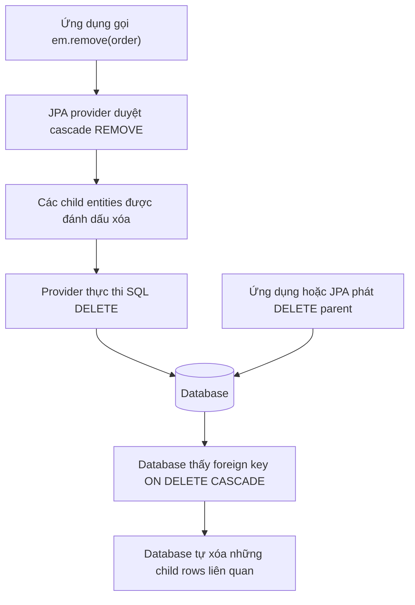

# Phân biệt cascade JPA và ON DELETE CASCADE của cơ sở dữ liệu

Khi xây dựng mô hình dữ liệu có quan hệ cha–con trong JPA, ta thường muốn một thao tác trên entity cha tác động tới các bản ghi liên quan. Ví dụ, xóa một `PurchaseOrder` phải giải quyết những `OrderLine` thuộc đơn hàng đó. Có ít nhất hai cơ chế dễ bị nhầm là **cascade của JPA** và **`ON DELETE CASCADE` của cơ sở dữ liệu**. Cả hai có thể góp phần làm các dòng con biến mất, nhưng chúng nằm ở **hai tầng khác nhau**, có **điểm kích hoạt khác nhau**, và không có cùng tác động tới entity lifecycle, persistence context hay các đoạn mã thực thi kèm theo.

Trong JPA, `CascadeType.REMOVE` yêu cầu **lan truyền thao tác xóa entity** qua một association đã được khai báo cascade. Ngược lại, `ON DELETE CASCADE` là một **hành động của foreign key constraint**: khi database thực thi `DELETE` đối với hàng được tham chiếu, nó tự xóa các hàng đang tham chiếu hàng đó theo ràng buộc khóa ngoại. Nếu kết hợp với `orphanRemoval = true`, ta còn có một cơ chế thứ ba: xóa entity con khi **nó bị tách khỏi quan hệ sở hữu**, dù entity cha không hề bị xóa.

Ví dụ, ba thao tác sau không tương đương:

```java
em.remove(order);               // Xóa entity qua EntityManager.
order.removeLine(line);         // Gỡ một con khỏi collection/association.
em.createQuery(
    "delete from PurchaseOrder o where o.id = :id"
).setParameter("id", orderId).executeUpdate(); // JPQL bulk delete.
```

Tùy mapping và schema, kết quả ở database có thể giống nhau ở một số tình huống, nhưng **callback, cascade, dirty checking, kiểm soát optimistic lock và trạng thái managed entities** có thể rất khác.

**Mục tiêu của bài học:** phân biệt chính xác `CascadeType`, `orphanRemoval` và `ON DELETE CASCADE`; đọc được hướng tác động của foreign key; chọn giải pháp phù hợp với vòng đời nghiệp vụ; tránh lỗi khi dùng JPQL bulk delete, native SQL, cache và entity listeners.

## 1. Nhìn từ hai tầng: object graph của JPA và ràng buộc database

Một hệ thống đặt hàng có mô hình Java:

```text
PurchaseOrder #101
    |
    +-- OrderLine #1001
    +-- OrderLine #1002
    +-- OrderLine #1003
```

Ở Java, đây là **object graph**. Các association `@OneToMany` và `@ManyToOne` cho phép ứng dụng điều hướng giữa những object. JPA provider xử lý persistence context, cascade và các thao tác `persist`, `merge`, `remove`.

Ở database, mối liên hệ là **foreign key**:

```text
purchase_orders                   order_lines
+-----------+                     +--------------+-------------+
| id (PK)   |                     | id (PK)      | order_id FK |
+-----------+                     +--------------+-------------+
| 101       | <------------------ | 1001         | 101         |
|           | <------------------ | 1002         | 101         |
|           | <------------------ | 1003         | 101         |
+-----------+                     +--------------+-------------+
```

Tầng database kiểm tra những ràng buộc như `PRIMARY KEY`, `FOREIGN KEY`, `NOT NULL` và `UNIQUE`. Nếu foreign key được khai báo `ON DELETE CASCADE`, database có thể xóa những hàng `order_lines` đang tham chiếu `purchase_orders.id` khi hàng parent tương ứng bị xóa.

### Sơ đồ so sánh hai luồng xóa



Đối với **cascade JPA**, quyết định lan truyền thao tác xuất phát từ metadata mapping entity và provider. Đối với **database cascade**, quyết định xóa hàng liên quan được thực thi bởi **database engine** dựa trên foreign key constraint, bất kể SQL bắt nguồn từ Java, command line, một ứng dụng khác hay công cụ vận hành.

## 2. Bảng phân biệt trọng tâm

| Tiêu chí | Cascade JPA (`CascadeType.REMOVE`) | Database `ON DELETE CASCADE` |
|---|---|---|
| Tầng thực thi | JPA provider / entity lifecycle | RDBMS / foreign key action |
| Được cấu hình ở đâu? | Association của entity, ví dụ `@OneToMany(cascade = REMOVE)` | Ràng buộc `FOREIGN KEY ... ON DELETE CASCADE` |
| Điều gì kích hoạt? | Thao tác `EntityManager.remove` lan theo association | Một hàng **được tham chiếu** bị xóa bằng SQL |
| Có áp dụng cho câu `DELETE` chạy trực tiếp ngoài JPA? | Không | Có, nếu FK action được database thực thi |
| JPQL bulk `DELETE` có kích hoạt không? | Không lan qua entity graph | Có thể, vì SQL parent DELETE kích hoạt FK cascade |
| Có chạy `@PreRemove` trên entity con? | Có theo lifecycle cho entity con thực sự được JPA remove | Không; DB không gọi JPA callbacks |
| Có xử lý JPA cascade xuống các entity cháu? | Có thể, nếu mapping tương ứng khai báo | Chỉ nếu các foreign key ở DB được cấu hình hành động liên quan |
| Có tự đồng bộ mọi managed entity trong context? | Provider theo dõi những entity đi qua lifecycle | Không; child managed có thể trở nên stale |
| `@Version` trên child có được kiểm tra? | Có thể tham gia thao tác remove entity theo optimistic locking | Không có JPA-level version check cho child bị DB tự xóa |
| Có yêu cầu Java nạp/traverse association? | Provider có thể phải truy vấn/traverse entity liên quan | Database xử lý hàng con trực tiếp, không cần tạo Java entity |
| Có phụ thuộc transaction không? | Có, theo transaction của JPA | Có, theo database transaction |
| Có thể rollback? | Có, khi transaction rollback | Có, tác động cascade thuộc transaction database |
| Tính portable ở JPA | `CascadeType.REMOVE` là chuẩn JPA | DDL của database; cú pháp/hành vi chi tiết tùy RDBMS |
| Mục tiêu chính | Lan truyền **thao tác entity** | Giữ **referential integrity khi xóa hàng tham chiếu** |

Một quy tắc giúp không nhầm:

> **Cascade JPA làm việc với entity và lifecycle; `ON DELETE CASCADE` làm việc với foreign key và hàng trong database.**

Đôi khi hai cơ chế đều tạo kết quả “các con bị xóa”, nhưng đường đi khác nhau và không thể thay thế hoàn toàn cho nhau.

## 3. Dựng mô hình ví dụ: đơn hàng và dòng đơn hàng

Ta sử dụng entity `PurchaseOrder` và `OrderLine` để giải thích các trường hợp.

### 3.1. Entity cha

```java
package example.domain;

import jakarta.persistence.CascadeType;
import jakarta.persistence.Column;
import jakarta.persistence.Entity;
import jakarta.persistence.GeneratedValue;
import jakarta.persistence.GenerationType;
import jakarta.persistence.Id;
import jakarta.persistence.OneToMany;
import jakarta.persistence.Table;
import jakarta.persistence.Version;
import java.util.ArrayList;
import java.util.List;

@Entity
@Table(name = "purchase_orders")
public class PurchaseOrder {
    @Id
    @GeneratedValue(strategy = GenerationType.IDENTITY)
    private Long id;

    @Column(name = "order_code", nullable = false, unique = true)
    private String orderCode;

    @Version
    private long version;

    @OneToMany(
        mappedBy = "order",
        cascade = {CascadeType.PERSIST, CascadeType.REMOVE},
        orphanRemoval = true
    )
    private List<OrderLine> lines = new ArrayList<>();

    protected PurchaseOrder() {
    }

    public PurchaseOrder(String orderCode) {
        if (orderCode == null || orderCode.isBlank()) {
            throw new IllegalArgumentException("Order code is required");
        }
        this.orderCode = orderCode;
    }

    public Long getId() {
        return id;
    }

    public List<OrderLine> getLines() {
        return List.copyOf(lines);
    }

    public void addLine(String sku, int quantity) {
        OrderLine line = new OrderLine(sku, quantity);
        line.attachTo(this);
        lines.add(line);
    }

    public void removeLine(OrderLine line) {
        if (lines.remove(line)) {
            line.detachFrom(this);
        }
    }
}
```

Các lựa chọn:

- `mappedBy = "order"`: phía `OrderLine.order` quản lý khóa ngoại.
- `CascadeType.PERSIST`: lưu order có thể lan `persist` đến các dòng mới.
- `CascadeType.REMOVE`: `em.remove(order)` có thể lan `remove` tới các dòng.
- `orphanRemoval = true`: một dòng bị tách khỏi collection theo ngữ nghĩa lifecycle có thể bị xóa dù order còn tồn tại.
- `@Version` trên order hỗ trợ optimistic locking cho entity order; việc quản lý version của child phải xét riêng.

Trong ví dụ, `getLines()` trả bản sao không sửa được để tránh code ngoài tự thay collection mà bỏ qua helper đồng bộ hai hướng. Cách trả bản sao này phù hợp với tập nhỏ/vừa; với hàng triệu child không nên tải/sao chép cả collection.

### 3.2. Entity con

```java
package example.domain;

import jakarta.persistence.Column;
import jakarta.persistence.Entity;
import jakarta.persistence.FetchType;
import jakarta.persistence.GeneratedValue;
import jakarta.persistence.GenerationType;
import jakarta.persistence.Id;
import jakarta.persistence.JoinColumn;
import jakarta.persistence.ManyToOne;
import jakarta.persistence.PreRemove;
import jakarta.persistence.Table;
import jakarta.persistence.Version;

@Entity
@Table(name = "order_lines")
public class OrderLine {
    @Id
    @GeneratedValue(strategy = GenerationType.IDENTITY)
    private Long id;

    @ManyToOne(fetch = FetchType.LAZY, optional = false)
    @JoinColumn(name = "order_id", nullable = false)
    private PurchaseOrder order;

    @Column(name = "sku", nullable = false, length = 80)
    private String sku;

    @Column(name = "quantity", nullable = false)
    private int quantity;

    @Version
    private long version;

    protected OrderLine() {
    }

    public OrderLine(String sku, int quantity) {
        if (sku == null || sku.isBlank() || quantity <= 0) {
            throw new IllegalArgumentException("Invalid order line");
        }
        this.sku = sku;
        this.quantity = quantity;
    }

    public Long getId() {
        return id;
    }

    public PurchaseOrder getOrder() {
        return order;
    }

    void attachTo(PurchaseOrder target) {
        if (target == null || order != null) {
            throw new IllegalStateException("Line cannot be attached");
        }
        order = target;
    }

    void detachFrom(PurchaseOrder expected) {
        if (order != expected) {
            throw new IllegalStateException("Wrong order");
        }
        order = null;
    }

    @PreRemove
    void beforeRemoval() {
        // Ví dụ điểm móc entity lifecycle.
        // Không gọi EntityManager hoặc gửi request mạng ở đây.
    }
}
```

`@PreRemove` ở đây dùng để minh họa sự khác nhau giữa việc JPA trực tiếp xử lý lifecycle xóa child và việc database tự xóa row do foreign key. Bài này không giả định callback chạy trên mọi hình thức SQL DELETE.

### 3.3. Mapping relationship và owning side

```text
PurchaseOrder.lines
  @OneToMany(mappedBy="order", cascade=REMOVE, orphanRemoval=true)
                |
                | inverse side: điều hướng Java
                v
OrderLine.order
  @ManyToOne
  @JoinColumn(name="order_id")
                |
                | owning side: foreign key
                v
order_lines.order_id --> purchase_orders.id
```

**Cascade direction không đồng nghĩa foreign-key direction**. Trong Java, ta chọn lan thao tác xóa từ `PurchaseOrder` xuống `OrderLine` bằng annotation ở phía `PurchaseOrder.lines`. Trong SQL, khóa ngoại lại nằm ở `order_lines` và hướng tham chiếu là **từ child tới parent**.

Không cần đưa `CascadeType.REMOVE` vào `OrderLine.order` chỉ vì `order_id` là owning side. Làm vậy có thể gây tác động rất nguy hiểm khi xóa một child.

## 4. Cascade JPA: lan truyền thao tác entity

JPA định nghĩa các kiểu cascade trong `jakarta.persistence.CascadeType`:

| CascadeType | Ý nghĩa |
|---|---|
| `PERSIST` | Lan truyền thao tác persist |
| `MERGE` | Lan truyền thao tác merge |
| `REMOVE` | Lan truyền thao tác remove |
| `REFRESH` | Lan truyền thao tác refresh |
| `DETACH` | Lan truyền thao tác detach |
| `ALL` | Tập hợp các thao tác cascade trên |

Ví dụ:

```java
@OneToMany(
    mappedBy = "order",
    cascade = CascadeType.ALL
)
private List<OrderLine> lines;
```

**`CascadeType.ALL` không phải một lệnh “database cascade mọi thao tác”.** Nó chỉ gom những lựa chọn cascade của JPA cho các hoạt động entity lifecycle tương ứng. `ALL` không có nghĩa database tự thêm `ON DELETE CASCADE` vào foreign key; cũng không đồng nghĩa bật `orphanRemoval`.

### 4.1. Khi gọi `em.remove(parent)`

Với `cascade = CascadeType.REMOVE`:

```java
em.getTransaction().begin();

PurchaseOrder order = em.find(PurchaseOrder.class, orderId);
if (order == null) {
    throw new IllegalArgumentException("Order not found");
}

em.remove(order);
em.getTransaction().commit();
```

Provider sẽ áp dụng semantics của `remove` cho những child được liên kết qua association có cascade `REMOVE`. Các child phải được xử lý theo entity lifecycle, bao gồm những quy tắc callback và version phù hợp. Provider có thể phải truy vấn các child, đánh dấu chúng removed rồi phát SQL DELETE khi flush/commit.

Một chuỗi SQL **minh họa**:

```sql
SELECT id, order_code, version
FROM purchase_orders
WHERE id = ?;

SELECT id, order_id, sku, quantity, version
FROM order_lines
WHERE order_id = ?;

DELETE FROM order_lines
WHERE id = ? AND version = ?;

DELETE FROM order_lines
WHERE id = ? AND version = ?;

DELETE FROM purchase_orders
WHERE id = ? AND version = ?;
```

**Không bảo đảm** provider nào cũng tạo đúng những câu SQL, thứ tự hay số lần SELECT/DELETE như trên. Mục đích là mô tả một hướng triển khai phù hợp với lifecycle: JPA xử lý child entities trước khi xóa parent để giữ ràng buộc foreign key. Một số provider dùng batching hoặc tối ưu quan hệ khác.

### 4.2. Callback của child

Nếu `OrderLine` có:

```java
@PreRemove
void beforeRemoval() {
    // Logic phù hợp với lifecycle callback.
}
```

Callback này thuộc lifecycle JPA của `OrderLine` và được gọi khi JPA thực hiện remove entity theo quy tắc đặc tả. Với cascade `REMOVE`, child được đưa qua lifecycle xóa nên callback tương ứng có thể chạy.

Tuy nhiên, callback có các giới hạn:

- Không xem callback là sự kiện domain bảo đảm đã commit; transaction còn có thể rollback.
- Không phát thông điệp ra bên ngoài không thể rollback ngay trong `@PreRemove` rồi giả định DB DELETE chắc chắn thành công.
- Không thực hiện logic phức tạp đụng `EntityManager` hoặc các relationship khác trong callback trái với giới hạn của JPA.
- Nếu cần outbox/audit giao dịch, thiết kế quy trình ở service hoặc bảng outbox cùng transaction thích hợp.

### 4.3. Xóa child không có nghĩa xóa parent

Cascade được khai báo **theo hướng association cụ thể**:

```java
@OneToMany(mappedBy = "order", cascade = CascadeType.REMOVE)
private List<OrderLine> lines;
```

Điều này cho phép thao tác remove order lan xuống lines. Nó **không** nói rằng:

```java
em.remove(line); // Sẽ xóa luôn order?
```

Nếu không khai báo cascade `REMOVE` trên `OrderLine.order`, xóa một dòng riêng không vì mapping phía parent mà tự xóa order. Trong mô hình thường gặp, **không nên** bật `CascadeType.REMOVE` ở phía `@ManyToOne` từ child lên parent, vì một child có thể là một trong nhiều child dùng cùng parent.

## 5. `ON DELETE CASCADE`: hành động của foreign key trong database

Bây giờ bỏ qua Java annotation và xét trực tiếp schema:

```sql
CREATE TABLE purchase_orders (
    id         BIGINT GENERATED BY DEFAULT AS IDENTITY PRIMARY KEY,
    order_code VARCHAR(80) NOT NULL UNIQUE
);

CREATE TABLE order_lines (
    id       BIGINT GENERATED BY DEFAULT AS IDENTITY PRIMARY KEY,
    order_id BIGINT NOT NULL,
    sku      VARCHAR(80) NOT NULL,
    quantity INTEGER NOT NULL,
    CONSTRAINT fk_order_lines_order
        FOREIGN KEY (order_id)
        REFERENCES purchase_orders(id)
        ON DELETE CASCADE
);
```

DDL này minh họa cú pháp phổ biến; cách khai báo identity và một số ràng buộc cần điều chỉnh theo database cụ thể.

Ràng buộc:

```sql
FOREIGN KEY (order_id)
REFERENCES purchase_orders(id)
ON DELETE CASCADE
```

có nghĩa: khi database xóa một hàng `purchase_orders` đã được các hàng `order_lines` tham chiếu, nó sẽ xóa những hàng tham chiếu tương ứng.

Ví dụ:

```sql
DELETE FROM purchase_orders WHERE id = 101;
```

Database sẽ tự giải quyết:

```text
Xóa purchase_orders.id = 101
       |
       v
FK fk_order_lines_order có ON DELETE CASCADE
       |
       v
Xóa các order_lines có order_id = 101
```

Không có `EntityManager` nào bắt buộc phải tồn tại để `ON DELETE CASCADE` hoạt động. Một câu lệnh từ JDBC, migration script, database console hoặc ứng dụng khác vẫn kích hoạt FK action nếu database thực thi ràng buộc này.

### 5.1. Hướng của `ON DELETE CASCADE`

Đây là nhầm lẫn rất phổ biến.

```text
order_lines.order_id  --->  purchase_orders.id
  referencing column         referenced key
  (bảng con)                 (bảng cha)
```

`ON DELETE CASCADE` nghĩa là: **xóa hàng được tham chiếu ở bảng cha thì database xóa hàng tham chiếu ở bảng con**.

Nó **không** có nghĩa:

- Xóa một `order_lines` thì xóa `purchase_orders`.
- Đặt `order_lines.order_id = NULL` thì xóa `order_lines`.
- Di chuyển child sang parent khác sẽ xóa child.
- Xóa một Java object khỏi `List` sẽ tự gây ra SQL DELETE parent.

`ON DELETE CASCADE` chỉ được kích hoạt khi **row được tham chiếu thực sự bị xóa** theo FK action tương ứng.

### 5.2. Những hành động foreign key khác

Tùy RDBMS, foreign key có thể hỗ trợ:

| FK action | Ý nghĩa khái quát khi xóa parent |
|---|---|
| `ON DELETE CASCADE` | Xóa các referencing child rows |
| `ON DELETE RESTRICT` | Chặn xóa parent khi còn child tham chiếu |
| `ON DELETE NO ACTION` | Không cho vi phạm referential integrity; thời điểm kiểm tra có thể khác RESTRICT ở DB có deferred constraints |
| `ON DELETE SET NULL` | Đặt FK của child về `NULL`, nếu schema cho phép |
| `ON DELETE SET DEFAULT` | Đặt FK về default value, nếu DB hỗ trợ và dữ liệu vẫn hợp lệ |

Không nên xem `RESTRICT` và `NO ACTION` luôn có cùng thời điểm kiểm tra ở mọi database; một số hệ quản trị có cơ chế deferred constraint.

Nếu `order_lines.order_id` là `NOT NULL`, một chính sách `ON DELETE SET NULL` có thể mâu thuẫn với ràng buộc nullability. Cần chọn hành động foreign key phù hợp với nghiệp vụ.

### 5.3. Database cascade cũng nằm trong transaction

`ON DELETE CASCADE` không phải thao tác “xóa ngoài transaction”. Nếu:

```sql
BEGIN;
DELETE FROM purchase_orders WHERE id = 101;
ROLLBACK;
```

thì các hàng bị xóa do cascading action thường cũng được rollback như một phần của cùng database transaction. Cách database quản lý undo log, MVCC, locking và trigger phụ thuộc engine, nhưng về semantics transaction, việc xóa parent và những hành động FK cascade liên quan thuộc cùng một thao tác có khả năng rollback.

Do đó không nên tin rằng `ON DELETE CASCADE` làm các child biến mất vĩnh viễn ngay cả khi transaction xóa parent bị rollback.

## 6. `@JoinColumn` không tự thêm `ON DELETE CASCADE`

Xét:

```java
@ManyToOne(optional = false)
@JoinColumn(name = "order_id", nullable = false)
private PurchaseOrder order;
```

Annotation `@JoinColumn` chỉ mô tả **cột join/foreign key** và các metadata liên quan. Nó không có nghĩa database constraint phải dùng `ON DELETE CASCADE`.

Tương tự:

```java
@OneToMany(
    mappedBy = "order",
    cascade = CascadeType.REMOVE
)
private List<OrderLine> lines;
```

chỉ khai báo cascade của JPA. Nếu schema hiện tại là:

```sql
FOREIGN KEY (order_id) REFERENCES purchase_orders(id)
```

thì **không được suy ra** database có ON DELETE CASCADE. Khi chạy:

```sql
DELETE FROM purchase_orders WHERE id = 101;
```

DB có thể từ chối nếu vẫn còn child rows tham chiếu, dù Java mapping có `CascadeType.REMOVE`, bởi câu SQL trực tiếp đó không đi qua JPA lifecycle.

### 6.1. `@ForeignKey` của Jakarta Persistence

JPA có thể đặt metadata tên constraint bằng:

```java
@JoinColumn(
    name = "order_id",
    foreignKey = @ForeignKey(name = "fk_order_lines_order")
)
private PurchaseOrder order;
```

`@ForeignKey` dùng để mô tả foreign-key constraint trong schema generation, chẳng hạn tên và constraint mode. **Nó không phải một annotation portable khai báo hành động `ON DELETE CASCADE`.**

Muốn dùng DB cascade, cần bảo đảm DDL thực tế khai báo hành động thích hợp, thường bằng **schema migration có quản lý**.

### 6.2. Annotation riêng của Hibernate: `@OnDelete`

Hibernate có annotation:

```java
import org.hibernate.annotations.OnDelete;
import org.hibernate.annotations.OnDeleteAction;

@ManyToOne(fetch = FetchType.LAZY, optional = false)
@JoinColumn(name = "order_id", nullable = false)
@OnDelete(action = OnDeleteAction.CASCADE)
private PurchaseOrder order;
```

Annotation Hibernate-specific này có thể được dùng để chỉ định hành động foreign key trong schema do Hibernate tạo/quản lý, tùy mapping và phiên bản. Nó **khác** `CascadeType.REMOVE` của JPA:

- `@OnDelete` hướng tới **database-level delete action**.
- `CascadeType.REMOVE` hướng tới **JPA entity lifecycle**.
- Khi dùng migration độc lập, vẫn phải kiểm tra DDL trong database thật; annotation không tự sửa mọi constraint hiện có.
- `@OnDelete` không phải Jakarta Persistence portable, và hành vi tối ưu/cache còn tùy Hibernate version/configuration.

Không nên thêm `@OnDelete` chỉ để “chạy nhanh hơn” mà chưa xác nhận chính sách lifecycle, audit và cache.

## 7. `orphanRemoval`: cơ chế thứ ba thường bị đánh đồng

Hai annotation nhìn có vẻ cùng xóa con:

```java
@OneToMany(
    mappedBy = "order",
    cascade = CascadeType.REMOVE,
    orphanRemoval = true
)
private List<OrderLine> lines;
```

Nhưng chúng có **điểm kích hoạt khác nhau**.

### 7.1. `CascadeType.REMOVE`: xóa cha, lan remove đến con

```java
PurchaseOrder order = em.find(PurchaseOrder.class, orderId);
em.remove(order);
```

Ở đây, ứng dụng **xóa order**. Cascade REMOVE được áp dụng tới các lines liên quan theo mapping.

### 7.2. `orphanRemoval = true`: tách một con, cha vẫn sống

```java
PurchaseOrder order = em.find(PurchaseOrder.class, orderId);
OrderLine line = order.getLines().get(0);

order.removeLine(line);
// order vẫn tồn tại; một line bị tháo khỏi quan hệ.
```

Nếu `OrderLine` thật sự là đối tượng phụ thuộc và đã bị orphan theo semantics JPA, provider sẽ xử lý remove line vào thời điểm synchronization. Không cần xóa `PurchaseOrder`.

### 7.3. `ON DELETE CASCADE` không xử lý thao tác tháo con này

Giả sử database có:

```sql
FOREIGN KEY (order_id)
REFERENCES purchase_orders(id)
ON DELETE CASCADE
```

Nếu ứng dụng chỉ:

```java
order.removeLine(line);
```

thì parent row **không bị xóa**. Vì vậy ON DELETE CASCADE **không tự kích hoạt** chỉ do quan hệ trong Java bị tách.

Nếu `orphanRemoval = false` và foreign key `NOT NULL`, việc đặt `line.order = null` rồi flush có thể vi phạm constraint. Muốn xóa line, cần `em.remove(line)` hoặc orphan removal có chủ đích.

### 7.4. Bảng ba cơ chế

| Nhu cầu nghiệp vụ | `CascadeType.REMOVE` | `orphanRemoval=true` | `ON DELETE CASCADE` |
|---|---|---|---|
| Xóa parent qua `em.remove(parent)` | Lan remove tới child entities | Có semantics xóa child trong vòng đời phụ thuộc, nếu mapping phù hợp | DB tự xóa referencing rows nếu FK action có |
| Gỡ một child khỏi collection, parent còn tồn tại | Không phải trigger của riêng REMOVE | **Có** trong quan hệ phù hợp | **Không** |
| Xóa parent bằng native SQL | Không | Không | **Có** |
| Xóa parent bằng JPQL bulk DELETE | Không lan qua entity graph | Không theo dạng tháo collection từng entity | **Có**, nếu DB FK action có |
| Muốn callback `@PreRemove` trên child | Có theo lifecycle của JPA child | Có theo lifecycle remove child | Không |
| Muốn DB tự dọn child không cần ORM | Không đảm bảo | Không đảm bảo | **Có** |

`orphanRemoval` thích hợp khi **child không có vòng đời độc lập khỏi parent**. JPA cho phép nó trên `@OneToOne` và `@OneToMany`; không dùng `orphanRemoval` trên `@ManyToMany` vì bản ghi phía đối diện có thể được nhiều owner chia sẻ.

### 7.5. Không áp dụng orphan removal như một API “chuyển chủ”

Giả sử ta gỡ `OrderLine` khỏi order A rồi thêm vào order B:

```java
orderA.removeLine(line);
orderB.addExistingLine(line); // Giả định có helper.
```

Với `orphanRemoval=true`, line có thể đã được xem là orphan cần xóa. Đặc tả không yêu cầu portable semantics cho việc chuyển một entity mồ côi sang parent khác như một thao tác tái sử dụng an toàn. Nếu nghiệp vụ thực sự cho phép child chuyển owner, cần cân nhắc không dùng orphan removal hoặc thiết kế thao tác chuyển có ranh giới rõ, kiểm soát owning side và constraints.

## 8. Ba kịch bản xóa cùng một parent

Giả sử một order có 10 lines, tất cả foreign key trỏ tới `purchase_orders.id`.

### Kịch bản A — Chỉ có cascade JPA, không có DB cascade

Mapping:

```java
@OneToMany(mappedBy = "order", cascade = CascadeType.REMOVE)
private List<OrderLine> lines;
```

Database:

```sql
CONSTRAINT fk_order_lines_order
FOREIGN KEY (order_id)
REFERENCES purchase_orders(id)
-- Không có ON DELETE CASCADE.
```

Gọi:

```java
em.remove(order);
```

JPA xử lý child entities rồi parent theo lifecycle. Nếu mapping đúng và không còn ràng buộc phụ nào chưa được xử lý, transaction có thể commit thành công.

Nhưng nếu một công cụ chạy:

```sql
DELETE FROM purchase_orders WHERE id = 101;
```

database thường từ chối do còn lines tham chiếu, vì công cụ đó **không chạy các JPA cascade mappings**.

### Kịch bản B — Chỉ có DB cascade, không có JPA REMOVE cascade

Mapping:

```java
@OneToMany(mappedBy = "order")
private List<OrderLine> lines;
```

Database:

```sql
CONSTRAINT fk_order_lines_order
FOREIGN KEY (order_id)
REFERENCES purchase_orders(id)
ON DELETE CASCADE
```

Gọi:

```java
em.remove(order);
```

Provider có thể thực hiện `DELETE` parent mà không đi qua vòng đời remove từng child. Database thấy parent bị xóa và tự xóa child rows. Kết quả lưu trữ có thể giống kịch bản A, **nhưng child `@PreRemove` không tự chạy** cho những row bị database cascade; managed child instances đang tồn tại trong context có thể trở nên stale.

Nếu xóa parent bằng SQL trực tiếp, DB cascade vẫn hoạt động.

### Kịch bản C — Có cả JPA REMOVE cascade và DB cascade

Mapping:

```java
@OneToMany(mappedBy = "order", cascade = CascadeType.REMOVE)
private List<OrderLine> lines;
```

Database:

```sql
FOREIGN KEY (order_id)
REFERENCES purchase_orders(id)
ON DELETE CASCADE
```

Gọi:

```java
em.remove(order);
```

Provider có thể vẫn thực hiện lifecycle remove và DELETE child từng entity, sau đó xóa parent. Khi parent bị xóa, DB cascade có thể không còn child rows để xóa.

**Không giả định rằng thêm `ON DELETE CASCADE` sẽ khiến provider tự bỏ mọi thao tác remove child.** Các tối ưu phụ thuộc provider và mapping. Nếu Hibernate dùng `@OnDelete` hoặc cấu hình riêng, cách phối hợp SQL, cache và lifecycle có thể khác; phải xác định trên môi trường dự án.

Một hệ thống có thể chủ đích giữ cả hai để:

- Có lifecycle semantics khi xóa qua JPA.
- Có DB referential integrity khi xóa qua native SQL/migration.

Nhưng cũng cần cân nhắc chi phí SQL, double-handling, caching và việc event/audit có còn nhất quán giữa các đường xóa không.

## 9. Điều gì xảy ra với `@PreRemove` và entity listeners?

Giả sử child có:

```java
@Entity
@EntityListeners(OrderLineListener.class)
public class OrderLine {
    @Id
    private Long id;
    // ...
}
```

Listener:

```java
public class OrderLineListener {
    @PreRemove
    public void beforeRemove(OrderLine line) {
        // Ví dụ chỉ cập nhật/log trạng thái nội bộ thích hợp.
    }
}
```

Khi JPA xử lý `em.remove(line)` hoặc cascade remove tới line, các callback theo entity lifecycle có thể được thực thi theo quy tắc JPA. Khi database tự xóa row vì:

```sql
DELETE FROM purchase_orders WHERE id = 101;
```

thì database **không biết và không gọi** `OrderLineListener` của Java.

### Đừng dùng lifecycle callback làm cơ chế audit duy nhất nếu DB cascade được phép

Nếu ứng dụng kỳ vọng mỗi lần xóa một order line phải ghi audit:

```text
@PreRemove(OrderLine)
  -> Ghi bản ghi audit trong Java
```

nhưng vận hành cho phép xóa parent bằng SQL và để DB cascade xử lý child, các lần xóa đó sẽ **không qua callback JPA**. Audit có thể thiếu.

Cách thiết kế cần tùy yêu cầu:

1. **Audit ở tầng service:** mọi thao tác xóa đi qua một use case nhất quán, lưu audit/outbox trong transaction.
2. **Audit ở tầng database:** trigger/temporal table/CDC phù hợp có thể ghi nhận cả những xóa do FK cascade; hành vi trigger và khả năng capture cần kiểm tra trên RDBMS thực tế.
3. **Cơ chế kép được định nghĩa rõ:** application events phục vụ domain và database audit phục vụ lịch sử dữ liệu, tránh hiểu chúng hoàn toàn đồng nhất.

Không nên gửi email, HTTP request hay thông điệp broker **trực tiếp trong `@PreRemove` rồi cho rằng DB transaction chắc chắn commit**. Nếu transaction rollback, tác dụng bên ngoài có thể không rollback theo. Outbox pattern hoặc transaction event sau commit phù hợp hơn cho yêu cầu đáng tin cậy.

## 10. `@Version` và optimistic locking có bị ảnh hưởng?

Giả sử `OrderLine` có:

```java
@Version
private long version;
```

Khi JPA remove một entity child đã managed theo lifecycle, provider có thể dùng version để phát hiện các cập nhật cạnh tranh theo optimistic locking. SQL minh họa:

```sql
DELETE FROM order_lines
WHERE id = ? AND version = ?;
```

Nếu version đã thay, provider có thể báo `OptimisticLockException` theo quy tắc JPA.

Ngược lại, khi database thực thi `ON DELETE CASCADE`, nó xóa child rows theo foreign key action và **không gọi JPA để kiểm tra `@Version` của từng child entity**. Database vẫn có locking/concurrency control riêng, nhưng đó không phải cùng cơ chế optimistic locking ở tầng JPA.

| Tình huống | Child `@Version` trong JPA |
|---|---|
| `em.remove(child)` | Có thể được provider kiểm tra trong lifecycle remove |
| `em.remove(parent)` + JPA cascade REMOVE | Có thể được kiểm tra khi child được remove qua JPA |
| `DELETE parent` và FK `ON DELETE CASCADE` | Không tự áp dụng JPA version check cho từng child |
| JPQL bulk `delete from Child ...` | Không áp dụng optimistic locking từng managed entity theo cơ chế thông thường |

Nếu cần bảo vệ invariant kiểu “không được xóa đơn khi có dòng đang được xử lý bởi giao dịch khác”, chỉ dựa vào ON DELETE CASCADE là không đủ. Có thể cần kiểm tra trạng thái, version trên aggregate root, locking ở database hoặc workflow trạng thái `DELETING` trước khi xóa.

## 11. Persistence context và nguy cơ entity con bị stale

Một vấn đề quan trọng của DB cascade: **database đã xóa row, nhưng Java persistence context không nhất thiết biết từng child row đã biến mất**.

Ví dụ:

```java
em.getTransaction().begin();

OrderLine line = em.find(OrderLine.class, lineId);
PurchaseOrder order = em.find(PurchaseOrder.class, orderId);

em.remove(order); // Không có JPA REMOVE cascade trên lines.
// Database có ON DELETE CASCADE cho order_lines.order_id.
em.flush();

// line Java đang nằm trong context có thể còn state cũ,
// mặc dù row tương ứng đã bị database cascade xóa.

em.getTransaction().commit();
```

Từ góc nhìn database, row `order_lines` có thể đã bị xóa. Nhưng từ góc nhìn identity map của JPA, `line` đã được nạp trước và **không được provider tự áp dụng lifecycle remove** qua JPA cascade.

Hậu quả có thể gặp:

- `line.getSku()` vẫn trả dữ liệu cũ từ Java object.
- `em.find(OrderLine.class, lineId)` trong cùng context có thể trả managed instance đã có, không query lại database.
- Nếu tiếp tục sửa `line`, lần flush sau có thể dẫn đến stale-state/optimistic-lock error hoặc hành vi khác tùy provider.
- Nếu bật second-level cache, các cache entries liên quan có thể cần invalidation thích hợp.

### 11.1. `clear()` sau database-side bulk/cascade

Một quy trình có chủ đích khi application tự chạy native parent delete:

```java
em.getTransaction().begin();

em.flush(); // Giữ các pending changes cần đồng bộ trước bulk SQL.

em.createNativeQuery(
    "DELETE FROM purchase_orders WHERE id = :orderId"
).setParameter("orderId", orderId)
 .executeUpdate();

em.clear(); // Detach tất cả managed entities của context hiện tại.

em.getTransaction().commit();
```

Đoạn này giả định database FK `ON DELETE CASCADE` đã được triển khai đúng và không còn constraint khác chặn lệnh xóa.

**`em.clear()` không xóa second-level cache toàn ứng dụng và không commit.** Nó detach mọi entity trong first-level persistence context. Nếu đang giữ nhiều managed objects khác có pending changes chưa flush, cần hiểu rõ tác động trước khi clear; vì vậy thao tác native/bulk thường dễ quản lý hơn khi đặt trong transaction/context riêng.

### 11.2. `refresh(child)` không phải phương án chung sau row bị xóa

Không thể mặc định gọi `em.refresh(line)` sẽ biến một managed entity thành trạng thái removed hợp lệ khi row của nó không còn tồn tại. Refresh một row đã bị xóa có thể gặp exception tùy provider và lifecycle. Nếu biết DB đã cascade xóa cả nhánh child, thường nên **không tiếp tục dùng các Java references đó** và đọc lại bằng context mới.

### 11.3. Second-level cache và query cache

Database không thể tự gửi một JPA lifecycle event để invalidation mọi entry trong cache của Hibernate/EclipseLink khi SQL được thực thi ngoài ORM. Provider-specific support có thể có những cơ chế evict/track khi thực hiện một số loại delete, nhưng không nên cho rằng **mọi native SQL và mọi trigger/FK cascade** luôn làm second-level cache nhất quán.

Nếu hệ thống dùng L2 cache:

- Xác định entity/collection region nào có thể bị ảnh hưởng.
- Cân nhắc cache eviction sau native SQL hoặc thiết kế xóa qua ORM khi cần cache coherence.
- Kiểm tra hành vi cache trên provider/version thực tế.
- Với nhiều ứng dụng cùng truy cập một database, cần một chiến lược invalidation/chia sẻ cache phù hợp.

## 12. JPQL bulk DELETE: ranh giới lớn giữa hai loại cascade

JPQL hỗ trợ bulk delete:

```java
int affected = em.createQuery(
        "delete from PurchaseOrder o " +
        "where o.id = :orderId"
    )
    .setParameter("orderId", orderId)
    .executeUpdate();
```

**Bulk JPQL `DELETE` không có cùng semantics với `em.remove(order)` cho từng entity.** Nó không duyệt entity graph để thực hiện cascading REMOVE, orphan removal hoặc callbacks trên từng child entity theo cách thông thường.

### 12.1. Khi database KHÔNG có ON DELETE CASCADE

Nếu order vẫn có child rows với foreign key chặn xóa parent, bulk delete có thể thất bại:

```text
JPQL bulk DELETE PurchaseOrder
    |
    v
SQL DELETE purchase_orders
    |
    v
DB thấy order_lines đang tham chiếu parent
    |
    v
Foreign key violation
```

Việc entity mapping có:

```java
@OneToMany(cascade = CascadeType.REMOVE)
```

**không cứu được câu bulk delete này**, vì bulk query không đi qua lifecycle cascade từng entity.

### 12.2. Khi database CÓ ON DELETE CASCADE

```text
JPQL bulk DELETE PurchaseOrder
    |
    v
SQL DELETE purchase_orders
    |
    v
DB FK ON DELETE CASCADE
    |
    v
DB xóa order_lines liên quan
```

Đây là một trường hợp DB cascade hữu ích: nó bảo vệ integrity ngay cả với bulk operations không qua ORM graph.

Nhưng vẫn nhớ:

- `@PreRemove` của `OrderLine` không chạy cho những row bị database cascade.
- Persistence context và caches có thể không tự đồng bộ.
- Optimistic locking JPA của child không tự diễn ra.
- SQL có thể xóa nhiều row hơn giá trị `affected` mà bulk query trả về. `executeUpdate()` thường phản ánh số entity/parent rows tác động bởi bulk DML, không nhất thiết bao gồm mọi child row xóa ngầm do FK cascade.

### 12.3. Bulk DELETE child có cần DB cascade không?

Nếu gọi:

```java
em.createQuery(
    "delete from OrderLine l where l.order.id = :orderId"
).setParameter("orderId", orderId)
 .executeUpdate();
```

thì ứng dụng đang xóa **child rows trực tiếp**. FK `order_lines.order_id -> purchase_orders.id ON DELETE CASCADE` không gây xóa parent, vì parent là referenced table. Sau đó có thể xóa order bằng một bulk operation khác nếu không còn bảng phụ thuộc khác.

## 13. Native SQL, JDBC, ETL và thao tác từ hệ thống khác

Một hệ thống thực tế không chỉ có JPA. Database có thể được truy cập bởi:

- Một ứng dụng Java dùng JDBC.
- Công cụ migration hoặc database administration.
- Job ETL/import dữ liệu.
- Một microservice khác dùng ORM khác.
- Batch job chạy SQL trực tiếp.

Khi đó, các annotation như `CascadeType.REMOVE` chỉ tồn tại trong **ứng dụng JPA cụ thể** và không bảo vệ những thao tác SQL chạy ngoài đường đi của provider.

Nếu schema sử dụng `ON DELETE CASCADE`, database sẽ áp dụng nó **thống nhất cho mọi nguồn DELETE** đi qua cùng constraint. Đây là lợi thế quan trọng của DB-level cascade trong việc bảo đảm referential integrity.

Tuy nhiên, cũng có mặt trái:

- Một lệnh DELETE parent “trông đơn giản” có thể xóa cả nhiều tầng dữ liệu.
- Một công cụ vận hành không biết schema có thể gây xóa dây chuyền ngoài ý muốn.
- Các side effect ở application không được chạy.
- Khi có nhiều service, xóa trong database không tự xóa dữ liệu ở hệ thống ngoài database đó.

Vì vậy, `ON DELETE CASCADE` là **quy tắc mạnh ở mức schema** và cần được review như một phần chính sách xóa dữ liệu, không phải một tùy chọn hiệu năng vô hại.

## 14. Quan hệ nhiều-một: vì sao không cascade REMOVE ngược lên parent?

Giả sử mỗi `OrderLine` thuộc một `PurchaseOrder`:

```java
@ManyToOne
@JoinColumn(name = "order_id")
private PurchaseOrder order;
```

Nếu thêm:

```java
@ManyToOne(cascade = CascadeType.REMOVE)
private PurchaseOrder order;
```

thì việc `em.remove(line)` có thể lan `remove` tới `PurchaseOrder`. Order có thể còn nhiều lines khác. Hành động này thường **sai vòng đời nghiệp vụ**, dẫn đến xóa cả đơn từ một thao tác xóa dòng.

Đây không phải “đảo chiều” tương đương với `ON DELETE CASCADE`. DB cascade trên FK child → parent nghĩa là **xóa parent thì xóa child**, không phải xóa child thì xóa parent. CascadeType.REMOVE đặt trên `@ManyToOne` lại có thể lan `remove` từ child **sang parent** theo Java association.

**Cần phân biệt hai hướng tác động:**

```text
JPA cascade đặt trên thuộc tính của object đang nhận remove:
  Order.remove() --cascade REMOVE--> OrderLine.remove()

DB ON DELETE CASCADE đặt trên FK nằm ở bảng child:
  DELETE purchase_orders --> DB DELETE order_lines

Sai thông thường:
  OrderLine.remove() --cascade REMOVE trên ManyToOne--> Order.remove()
```

Để mô hình vòng đời đúng, thường khai báo cascade từ **aggregate root** xuống entity phụ thuộc, không từ con lên đối tượng được nhiều con chia sẻ.

## 15. `@ManyToMany`: xóa hàng liên kết khác xóa entity đối diện

Giả sử `User` và `Group` có quan hệ nhiều-nhiều:

```text
users
  id PK

groups
  id PK

user_groups
  user_id  FK -> users.id
  group_id FK -> groups.id
  PRIMARY KEY(user_id, group_id)
```

`Group` có thể được nhiều user chia sẻ. Nếu ta làm:

```java
@ManyToMany(cascade = CascadeType.REMOVE)
private Set<Group> groups;
```

thì xóa một user có thể lan thao tác `remove` tới các `Group` được chia sẻ, gây xóa dữ liệu toàn hệ thống hoặc vi phạm foreign key.

**Thường không dùng `CascadeType.REMOVE` hoặc `ALL` trên `@ManyToMany` giữa những entity có vòng đời độc lập.**

### 15.1. Database cascade trên join table

Một schema hay gặp:

```sql
CREATE TABLE user_groups (
    user_id BIGINT NOT NULL,
    group_id BIGINT NOT NULL,
    PRIMARY KEY (user_id, group_id),
    CONSTRAINT fk_user_groups_user
        FOREIGN KEY (user_id) REFERENCES users(id)
        ON DELETE CASCADE,
    CONSTRAINT fk_user_groups_group
        FOREIGN KEY (group_id) REFERENCES groups(id)
        ON DELETE CASCADE
);
```

Khi xóa user, database sẽ xóa **các hàng user_groups** liên quan. **Nó không xóa row `groups`**, vì `groups` không phải bảng con tham chiếu user thông qua foreign key này.

Khi xóa group, database có thể xóa các hàng join của group mà không xóa users.

### 15.2. So sánh xóa member và xóa group

```java
user.getGroups().remove(group);
```

Nếu thao tác đúng trên owning association, JPA có thể xóa một row `user_groups`. Nhưng nó không đồng nghĩa `em.remove(group)`.

Nếu nghiệp vụ cần metadata của membership như `joinedAt`, `role`, `status`, hoặc lưu lịch sử, nên dùng một entity `Membership` riêng với các foreign key và lifecycle được thiết kế rõ ràng, thay vì cố cascade REMOVE sang group.

## 16. `@OneToOne` và khóa chính chia sẻ `@MapsId`

Một quan hệ một-một phụ thuộc hoàn toàn cũng thường đặt ra câu hỏi cascade.

Schema:

```sql
CREATE TABLE accounts (
    id BIGINT PRIMARY KEY,
    username VARCHAR(100) NOT NULL
);

CREATE TABLE account_profiles (
    account_id BIGINT PRIMARY KEY,
    display_name VARCHAR(200),
    CONSTRAINT fk_profile_account
        FOREIGN KEY (account_id) REFERENCES accounts(id)
        ON DELETE CASCADE
);
```

`account_profiles.account_id` vừa là PK của profile vừa là FK tới account.

Mapping:

```java
// Account
@OneToOne(
    mappedBy = "account",
    cascade = CascadeType.ALL,
    orphanRemoval = true
)
private AccountProfile profile;

// AccountProfile
@Id
private Long id;

@OneToOne(optional = false)
@MapsId
@JoinColumn(name = "account_id")
private Account account;
```

Trong mô hình này:

- `@MapsId` diễn đạt shared primary key, **không phải** cascade xóa.
- JPA cascade `REMOVE` từ `Account.profile` làm profile đi qua entity lifecycle khi xóa account bằng `em.remove`.
- `orphanRemoval` cho phép xóa profile khi tách khỏi account mà vẫn giữ account.
- `ON DELETE CASCADE` giúp database tự xóa profile row khi account row bị xóa qua SQL, kể cả ngoài JPA.

Đây là trường hợp có thể cân nhắc dùng cả JPA lifecycle cascade và DB referential action, nhưng phải xác định rõ callback/cache/performance và mọi đường xóa.

## 17. Hiệu năng: xóa nhiều entity với JPA và xóa theo FK

Giả sử một order có **200.000 lines**.

### 17.1. JPA cascade REMOVE

Khi gọi:

```java
em.remove(order);
```

provider cần tuân thủ entity lifecycle của các child liên quan. Nó có thể cần truy vấn hoặc quản lý state của nhiều child, thực hiện callback và optimistic locking, rồi tạo nhiều SQL DELETE. JDBC batching có thể giúp giảm round trips, nhưng không biến mọi trường hợp thành một lệnh DELETE duy nhất.

Những chi phí có thể phát sinh:

- Khởi tạo nhiều entity instances trong persistence context.
- Truy vấn association để biết những entity cần cascade.
- Dirty checking/action queue và entity listeners.
- SQL DELETE từng hàng, có thể được batch.
- Nhiều hàng/constraint/index bị tác động.
- Transaction log và database locks.

Một tập con có hàng triệu child thường không nên bị xử lý bằng một object graph cực lớn chỉ vì convenience của `CascadeType.ALL`.

### 17.2. Database ON DELETE CASCADE

Khi parent bị xóa:

```sql
DELETE FROM purchase_orders WHERE id = 101;
```

database tự xử lý các child rows có FK cascade, không cần materialize 200.000 `OrderLine` trong Java. Điều này **có thể giảm đáng kể memory và chi phí round trip của ORM**.

Tuy nhiên, đừng hiểu DB cascade là “miễn phí”:

- Database vẫn phải tìm, khóa và xóa các hàng con.
- Phải cập nhật index và transaction log.
- Có thể tạo nhiều lock, gây contention hoặc deadlock.
- Nếu dữ liệu con có nhiều tầng FK/trigger, chi phí xóa lan truyền có thể rất lớn.
- Một lệnh DELETE parent có thể kéo dài và ảnh hưởng latency của hệ thống.
- Concurrency, partitioning, timeout và replication lag vẫn cần được xem xét.

### 17.3. So sánh về chi phí

| Hạng mục | JPA cascade REMOVE | DB ON DELETE CASCADE |
|---|---|---|
| Java heap cho child entity | Có thể tăng nếu provider cần quản lý nhiều child | Thường không phải tạo Java child instances |
| Số round trip ứng dụng–DB | Có thể nhiều; batching giúp giảm | Một SQL parent DELETE từ ứng dụng, DB xử lý cascading nội bộ |
| Lifecycle callbacks | Có | Không cho child bị DB cascade |
| JPA version checks trên child | Có thể có | Không tự có |
| Database log/locks | Vẫn có | Vẫn có |
| Khả năng xử lý huge graph | Cần đánh giá memory/batching | Thường tốt hơn về ORM overhead, nhưng DB có thể vẫn rất nặng |
| Khả năng áp dụng khi chạy SQL từ nhiều ứng dụng | Chỉ qua JPA lifecycle | Có |

Nếu yêu cầu chính là **xóa toàn bộ dữ liệu phụ thuộc thuần túy theo FK**, DB cascade có lợi. Nếu mỗi child phải được xử lý bằng **business method, callback, validation hoặc event**, JPA cascade hay một workflow batch chuyên biệt có thể phù hợp hơn.

## 18. Xóa theo batch khi không muốn một transaction khổng lồ

`ON DELETE CASCADE` thường thực hiện xóa toàn bộ referencing rows trong cùng database transaction. Khi parent có vài triệu child, một thao tác DELETE parent duy nhất có thể khóa và ghi log quá nhiều.

Một workflow có thể:

1. Đánh dấu parent `DELETING` để chặn thêm child mới.
2. Chọn một batch child IDs theo index.
3. Xóa batch trong transaction ngắn.
4. Lặp lại cho tới khi không còn child.
5. Xóa parent.

Ví dụ JPQL chọn IDs:

```java
List<Long> ids = em.createQuery(
        "select l.id from OrderLine l " +
        "where l.order.id = :orderId " +
        "order by l.id",
        Long.class
    )
    .setParameter("orderId", orderId)
    .setMaxResults(500)
    .getResultList();
```

Sau đó bulk delete theo IDs:

```java
int removed = em.createQuery(
        "delete from OrderLine l where l.id in :ids"
    )
    .setParameter("ids", ids)
    .executeUpdate();
```

Mỗi batch nên nằm trong transaction phù hợp; nếu muốn transaction ngắn, **không bao toàn bộ vòng lặp trong một transaction lớn**. Bulk delete bypass entity callbacks/cascade và có thể làm context stale, vì vậy đây là workflow phù hợp khi nghiệp vụ cho phép.

Trong giai đoạn xóa theo nhiều transaction, parent tạm thời tồn tại với chỉ một phần child: ứng dụng phải chấp nhận và mô hình hóa trạng thái trung gian này. Nếu tính nguyên tử “xóa toàn bộ hoặc không xóa gì” là yêu cầu bắt buộc, cần chiến lược khác và có thể phải chấp nhận transaction lớn.

### Race condition khi có child mới

Nếu worker khác vẫn có thể chèn `OrderLine` trong lúc cleanup, batch process có thể không bao giờ kết thúc hoặc parent delete cuối gặp FK violation. Cần chặn việc thêm child qua trạng thái nghiệp vụ/locking hoặc thiết kế transaction/constraint phù hợp.

`ON DELETE CASCADE` giúp database duy trì integrity khi xóa parent, nhưng không tự thay thế chính sách “có được thêm dòng vào order đang bị xóa không?” của business domain.

## 19. DDL migration: thay đổi constraint phải thực hiện ở database

Nếu database hiện có:

```sql
ALTER TABLE order_lines
ADD CONSTRAINT fk_order_lines_order
FOREIGN KEY (order_id)
REFERENCES purchase_orders(id);
```

thì thêm `cascade = CascadeType.REMOVE` trong Java **không đổi constraint này**. Muốn DB cascade, schema migration thường cần **drop foreign key cũ và tạo lại với `ON DELETE CASCADE`** theo cú pháp database.

Ví dụ PostgreSQL:

```sql
ALTER TABLE order_lines
DROP CONSTRAINT fk_order_lines_order;

ALTER TABLE order_lines
ADD CONSTRAINT fk_order_lines_order
FOREIGN KEY (order_id)
REFERENCES purchase_orders(id)
ON DELETE CASCADE;
```

Trước khi áp dụng production migration:

- Xác nhận chính xác tên constraint hiện tại.
- Kiểm tra dữ liệu orphan/vi phạm FK.
- Xác nhận không có workflow nào phụ thuộc việc database **chặn xóa parent** khi còn child.
- Xem xét locking/migration downtime và ảnh hưởng lên các phiên bản ứng dụng đang chạy.
- Kiểm tra dữ liệu lịch sử, audit và chính sách retention.
- Lập kế hoạch rollback schema khi cần, không chỉ rollback transaction thực hiện data delete.

Với schema được quản lý bằng Flyway, Liquibase hoặc công cụ migration tương đương, hãy để migration là nguồn sự thật thay vì kỳ vọng chế độ schema auto-update của ORM luôn thay FK action an toàn. Provider schema generation cũng không tự sửa mọi constraint hiện hữu khi annotation thay đổi.

## 20. Vì sao `ON DELETE CASCADE` có thể là sai lựa chọn về nghiệp vụ?

Một số dữ liệu không nên bị xóa dây chuyền dù chúng tham chiếu parent.

### 20.1. Đơn hàng và hóa đơn đã phát hành

`Invoice` có thể liên quan tới `PurchaseOrder` nhưng phải được giữ nhiều năm do yêu cầu kế toán hoặc pháp lý. Nếu FK `invoices.order_id` dùng `ON DELETE CASCADE`, xóa order có thể xóa luôn chứng từ cần lưu trữ.

Lựa chọn hợp lý có thể là:

- Không cho xóa order đã phát hành invoice (FK `RESTRICT` hoặc business rule).
- Dùng soft delete/archival ở tầng nghiệp vụ.
- Giữ invoice độc lập với snapshot thông tin cần bảo toàn.
- Xử lý retention theo chính sách được phê duyệt.

**Khóa ngoại thể hiện liên kết; không phải mọi liên kết đều có nghĩa “child chết theo parent”.**

### 20.2. Product và OrderLine lịch sử

Nếu `OrderLine` tham chiếu `Product`, việc xóa một product khỏi catalogue không nhất thiết được phép xóa các dòng lịch sử đơn hàng. Đây thường là relationship **tham chiếu**, không phải ownership lifecycle.

Sai nguy hiểm:

```sql
FOREIGN KEY (product_id)
REFERENCES products(id)
ON DELETE CASCADE
```

Nếu nghiệp vụ cần giữ lịch sử, có thể dùng `RESTRICT`, soft delete product hoặc snapshot thông tin sản phẩm trong line; không cho phép database cascade xóa lịch sử chỉ vì catalogue item bị xóa.

### 20.3. User và dữ liệu audit

Khi user bị xóa theo chính sách tài khoản, audit logs có thể cần được giữ, ẩn danh hóa hoặc tách thông tin nhận diện. `ON DELETE CASCADE` trên mọi bảng tham chiếu user có thể xóa dữ liệu audit trái yêu cầu. Cần thiết kế retention và privacy policy riêng, không chọn DB cascade chỉ để “không phải xử lý FK”.

## 21. Soft delete không kích hoạt `ON DELETE CASCADE`

Một số hệ thống không xóa physical row mà đánh dấu:

```sql
UPDATE purchase_orders
SET deleted_at = CURRENT_TIMESTAMP
WHERE id = 101;
```

Hoặc:

```java
order.markDeleted();
```

Đó là **UPDATE**, không phải SQL DELETE. Foreign key `ON DELETE CASCADE` **không tự kích hoạt** để xóa `order_lines` chỉ vì `deleted_at` được gán.

Tương tự, nếu dùng một cơ chế soft delete provider-specific khiến `em.remove(order)` được chuyển thành SQL UPDATE thay vì DELETE, cần xem lại semantics thực tế của cascade, filtering, entity listeners và DB FK action. Không thể tự suy luận rằng những child rows được DB cascade xóa khi parent chỉ bị đánh dấu deleted.

Đối với soft delete aggregate, có thể cần:

- Lưu trạng thái deleted riêng cho parent và/hoặc child.
- Cấu hình filter để truy vấn không hiển thị dữ liệu đã ẩn.
- Có workflow cleanup physical rows sau thời hạn lưu trữ.
- Bảo vệ những query SQL bên ngoài ORM khỏi vô tình lấy dữ liệu đã soft-delete.

## 22. Khi nào có thể kết hợp cascade JPA với DB cascade?

Việc sử dụng cả hai **không tự động sai**. Vấn đề là phải biết mỗi cơ chế phục vụ nhu cầu gì.

Một thiết kế có thể yêu cầu:

1. Khi xóa aggregate qua service JPA, entity lifecycle của child cần được xử lý.
2. Khi chạy SQL maintenance ngoài JPA, database phải bảo vệ foreign-key integrity.
3. Dữ liệu child không có vòng đời độc lập và được phép xóa cùng parent.

Khi đó:

```java
@OneToMany(
    mappedBy = "order",
    cascade = CascadeType.REMOVE,
    orphanRemoval = true
)
private List<OrderLine> lines;
```

và:

```sql
FOREIGN KEY (order_id)
REFERENCES purchase_orders(id)
ON DELETE CASCADE
```

có thể cùng tồn tại.

Nhưng cần đánh giá:

- Provider có còn thực hiện per-child DELETE/SELECT không?
- Các callback có chạy trên đường `em.remove` nhưng không chạy trên đường native/bulk không?
- Cache eviction có được xử lý đối với native SQL không?
- Domain event/audit có thống nhất giữa các đường xóa không?
- Có thể xảy ra constraint conflict do các bảng cháu hoặc thứ tự SQL không?
- Tất cả child có đúng là dữ liệu được phép xóa khi parent mất hay không?

**Không sử dụng đồng thời để “chắc ăn” khi chưa hiểu semantic differences.** Đó là hai cơ chế khác nhau, chứ không phải hai công tắc tương đương.

## 23. Khóa ngoại nhiều tầng và dây chuyền xóa

Giả sử:

```text
PurchaseOrder
   |
   +-- OrderLine
           |
           +-- LineAdjustment
```

Ở JPA:

```java
// PurchaseOrder
@OneToMany(mappedBy = "order", cascade = CascadeType.REMOVE)
private List<OrderLine> lines;

// OrderLine
@OneToMany(mappedBy = "line", cascade = CascadeType.REMOVE)
private List<LineAdjustment> adjustments;
```

`em.remove(order)` có thể lan remove từ order tới lines, rồi tới adjustments theo **hai quan hệ cascade được khai báo**.

Ở database:

```sql
FOREIGN KEY (order_id)
REFERENCES purchase_orders(id)
ON DELETE CASCADE

FOREIGN KEY (line_id)
REFERENCES order_lines(id)
ON DELETE CASCADE
```

Xóa parent row có thể kéo theo xóa lines và adjustments theo **hai tầng FK cascade**.

Nhưng chỉ một tầng FK có ON DELETE CASCADE chưa bảo đảm toàn bộ cây bị xóa nếu những hàng ở tầng sâu vẫn tham chiếu child và ngăn xóa. Cần xem **toàn bộ dependency graph** và policies từng bảng.

### 23.1. Dữ liệu vòng tham chiếu

Nếu hai bảng tham chiếu chéo nhau hoặc có quan hệ self-reference phức tạp, cascade deletion có thể gặp giới hạn của database, constraint cycles hoặc cách thực thi đặc thù. Không nên dùng annotation/DDL tràn lan mà chưa xem quy tắc quan hệ và tình huống xóa.

### 23.2. Không tự áp dụng cascade vượt qua database boundary

`ON DELETE CASCADE` chỉ tác động tới những hàng liên quan trong database theo FK constraints. Nó không xóa file trên object storage, bản ghi trong một database khác, document search index hay dữ liệu ở microservice khác. Nếu nghiệp vụ cần cleanup nhiều hệ thống, phải có workflow/event/outbox/saga phù hợp.

## 24. Transaction, locking và tính nguyên tử

### 24.1. JPA cascade REMOVE

Một transaction có thể:

```java
em.getTransaction().begin();
PurchaseOrder order = em.find(PurchaseOrder.class, orderId);
em.remove(order);
em.getTransaction().commit();
```

Provider lên lịch/phát các SQL thích hợp, rồi transaction manager commit. Nếu lỗi hoặc rollback, những DELETE đã gửi trong transaction cũng bị rollback theo semantics của database.

### 24.2. Database cascade

Một transaction có thể:

```sql
BEGIN;
DELETE FROM purchase_orders WHERE id = 101;
ROLLBACK;
```

Database xóa child rows theo FK action trong cùng transaction; rollback hủy tác động. **Không có nghĩa transaction tự commit chỉ vì FK action hoàn tất.**

### 24.3. Vấn đề đồng thời

Nếu một transaction đang xóa order và transaction khác cố chèn order line tham chiếu order đó, database phải giải quyết bằng khóa/kiểm tra foreign key và isolation theo engine. Tác vụ chèn có thể bị chặn, thất bại hoặc chịu hành vi khác tùy lịch transaction.

Vì vậy DB cascade bảo vệ referential integrity, nhưng không tự bảo vệ toàn bộ **business invariant** như “order đã shipped không được xóa”. Business rule vẫn cần được áp dụng ở service/database.

### 24.4. Khi nào kiểm tra thành công?

Một số constraint có thể được kiểm tra tại statement execution hoặc commit (nếu hệ quản trị hỗ trợ deferred constraints). `em.flush()` thành công không nhất thiết bảo đảm `commit()` chắc chắn thành công. Không phát tác dụng phụ bên ngoài hệ thống trước khi xác nhận transaction hoặc dùng transactional outbox.

## 25. Đếm số dòng bị xóa: đừng suy đoán từ `executeUpdate()`

Ví dụ:

```java
int count = em.createQuery(
    "delete from PurchaseOrder o where o.status = :status"
).setParameter("status", OrderStatus.CANCELLED)
 .executeUpdate();
```

Giả sử câu query xóa 20 parent và database cascade làm mất thêm 5.000 child rows. Giá trị `count` của JPQL bulk DML phản ánh số entity/row đối tượng của bulk operation theo API, **không phải một bản tổng kê mọi bảng đã bị FK cascade xóa**.

Nếu cần audit/report số child bị xóa:

- Truy vấn/count theo tiêu chí trước khi thực thi trong transaction với concurrency policy phù hợp.
- Dùng database auditing/trigger/CDC hoặc tạo record cleanup theo từng batch.
- Tránh dựa vào `executeUpdate()` như số lượng chính xác của toàn bộ delete graph.

Tương tự, số JDBC statements ứng dụng gửi có thể chỉ là một nhưng số hàng database xóa thực tế rất lớn.

## 26. Chẩn đoán hành vi bằng SQL logging và schema

Khi không rõ cơ chế nào đang xóa child, hãy tách nguồn:

1. **Đọc mapping JPA:** association nào có `cascade=REMOVE` hoặc `ALL`? Có `orphanRemoval=true` không?
2. **Đọc schema:** foreign key nào thực sự có `ON DELETE CASCADE`? Cột child là gì?
3. **Xác định API xóa:** `em.remove`, `orphanRemoval`, JPQL bulk, native SQL hay tool bên ngoài?
4. **Quan sát SQL từ ứng dụng:** provider phát DELETE child hay chỉ DELETE parent?
5. **Kiểm tra database:** child rows có bị xóa không, và FK/trigger action nào chịu trách nhiệm?
6. **Kiểm tra callbacks/cache:** child `@PreRemove` có được kỳ vọng không; state đang managed đã được đồng bộ chưa?

Lưu ý: khi DB cascade, SQL logging ở tầng JPA/JDBC **có thể chỉ ghi nhận DELETE parent**; các DELETE child do database thực thi nội bộ không nhất thiết xuất hiện thành các statement riêng do ứng dụng gửi. Muốn quan sát chi tiết, dùng công cụ database logging/monitoring thích hợp.

### Hai thí nghiệm giúp phân biệt

**Thí nghiệm A — Gọi `em.remove(parent)`**

```java
em.getTransaction().begin();
PurchaseOrder order = em.find(PurchaseOrder.class, orderId);
em.remove(order);
em.getTransaction().commit();
```

Quan sát child callbacks và SQL provider phát. Khi có JPA cascade REMOVE, provider xử lý vòng đời child.

**Thí nghiệm B — Gọi native parent DELETE**

```java
em.getTransaction().begin();
em.createNativeQuery(
    "DELETE FROM purchase_orders WHERE id = :id"
).setParameter("id", orderId)
 .executeUpdate();
em.clear();
em.getTransaction().commit();
```

Nếu child rows được xóa, đó là do DB constraint/trigger hoặc cơ chế SQL liên quan, **không phải JPA cascade REMOVE qua object graph**.

Hai thí nghiệm cần chạy trên dữ liệu kiểm thử riêng và có transaction/rollback phù hợp. Không thử tùy tiện trên dữ liệu thật vì `ON DELETE CASCADE` có thể xóa dây chuyền nhiều bảng.

## 27. Những lỗi phổ biến và hướng xử lý

| Hiện tượng | Nguyên nhân khả dĩ | Hướng xử lý |
|---|---|---|
| Xóa parent bằng native SQL bị FK violation | DB không có ON DELETE CASCADE và child vẫn tồn tại | Dọn child theo workflow hoặc thiết kế FK action phù hợp |
| `em.remove(parent)` xóa child, nhưng bulk delete thất bại | Chỉ có JPA cascade REMOVE | Đừng đồng nhất remove entity với bulk DML |
| Xóa parent bằng SQL thành công nhưng `@PreRemove` child không chạy | DB cascade không gọi JPA callback | Thiết kế audit/service/trigger khác |
| Xóa một child làm mất luôn parent | Đặt `CascadeType.REMOVE` trên `@ManyToOne` child → parent | Bỏ cascade ngược nguy hiểm; xét vòng đời thật |
| Xóa user làm mất group dùng chung | `CascadeType.REMOVE` trên `@ManyToMany` | Gỡ join row, không remove Group |
| Gỡ line khỏi collection mà row không bị xóa | Không có orphanRemoval/remove đúng hoặc chỉ sửa inverse side | Đồng bộ relationship, quyết định orphanRemoval rõ |
| Gỡ line khỏi collection bị `NOT NULL` violation | Provider cố đặt FK null khi child vẫn tồn tại | Dùng orphanRemoval/remove hoặc đổi business model/schema |
| Child managed vẫn đọc được sau DB cascade | Persistence context stale | Clear/đọc lại trong context mới; không dùng object cũ |
| Cache trả child đã bị xóa | Cache không được invalidation từ native/DB action | Xem provider cache eviction/invalidation |
| Xóa parent rất chậm dù có ON DELETE CASCADE | Nhiều child, index/locks/log/trigger | Đo DB workload, batch cleanup/partition nếu phù hợp |
| Cascade JPA tạo rất nhiều SQL DELETE | Provider xử lý lifecycle từng entity | Batching hoặc DB cascade/workflow nếu callbacks không cần |
| `CascadeType.ALL` không tạo DB FK cascade | ALL chỉ là JPA lifecycle cascade | Schema migration thêm ON DELETE CASCADE khi cần |
| `@OnDelete` chạy ở Hibernate nhưng không chạy ở provider khác | Annotation riêng Hibernate | Dùng migration DDL cho giải pháp portable schema |
| Soft delete parent nhưng child không biến mất | DB ON DELETE chỉ hoạt động khi SQL DELETE | Thiết kế soft-delete propagation riêng |
| Lệnh DELETE xóa nhiều dữ liệu ngoài dự đoán | Chuỗi FK ON DELETE CASCADE nhiều tầng | Xem dependency graph và chính sách retention |
| Audit chỉ đếm parent, thiếu child | Dựa vào affected row count của bulk DELETE | Ghi audit đúng tầng và phép đo |

### 27.1. Sai: hiểu `CascadeType.ALL` bằng `ON DELETE CASCADE`

```java
@OneToMany(mappedBy = "order", cascade = CascadeType.ALL)
private List<OrderLine> lines;
```

Mapping này **không bảo đảm** DDL tạo:

```sql
FOREIGN KEY (order_id)
REFERENCES purchase_orders(id)
ON DELETE CASCADE
```

Kiểm tra schema và migration riêng.

### 27.2. Sai: nghĩ database cascade sẽ xóa một orphan

```java
order.removeLine(line);
```

Parent vẫn còn; FK action không được kích hoạt bởi việc xóa khỏi Java collection. Muốn xóa orphan theo JPA, dùng `orphanRemoval=true` đúng trường hợp hoặc remove child trực tiếp.

### 27.3. Sai: nhận SQL bulk là JPA lifecycle

```java
em.createQuery("delete from PurchaseOrder").executeUpdate();
```

Đây là bulk DML. Nó không tự gọi `@PreRemove` từng child hoặc JPA `CascadeType.REMOVE` dù mapping entity có các annotation đó. Nếu database không có ON DELETE CASCADE, câu lệnh còn có thể vi phạm FK.

### 27.4. Sai: bật ON DELETE CASCADE cho mọi foreign key

Nếu child là `Invoice`, `AuditLog` hoặc `OrderLine` tham chiếu `Product`, việc xóa parent có thể phải **bị chặn** hoặc giữ dữ liệu lịch sử. DB cascade là **quyết định nghiệp vụ về dữ liệu được phép mất**, không phải lựa chọn mặc định.

### 27.5. Sai: tiếp tục dùng child managed sau native DELETE parent

```java
OrderLine line = em.find(OrderLine.class, lineId);
em.createNativeQuery("DELETE FROM purchase_orders WHERE id = :id")
  .setParameter("id", orderId).executeUpdate();

line.changeQuantity(10); // Row có thể đã biến mất khỏi DB.
```

Sau DB cascade, các managed child có thể không phản ánh database. Tách context hoặc clear/đọc lại phù hợp trước khi tiếp tục.

## 28. Ma trận quyết định thiết kế

| Bối cảnh | Cơ chế nên cân nhắc | Lý do |
|---|---|---|
| Aggregate nhỏ, cần callback/invariant khi xóa từng child | JPA `CascadeType.REMOVE` | Đi qua entity lifecycle |
| Child bị xóa khi gỡ khỏi parent còn tồn tại | `orphanRemoval=true` | Trigger theo quan hệ orphan, không phải xóa parent |
| Dữ liệu phụ thuộc thuần, phải dọn khi parent bị xóa từ mọi ứng dụng | Database `ON DELETE CASCADE` | DB bảo vệ referential integrity |
| Parent có hàng triệu child, không cần callback từng child | DB cascade hoặc cleanup bulk/batch | Tránh materialize graph lớn trong Java |
| Child dùng chung bởi nhiều parent (ví dụ `Group`) | Không cascade REMOVE sang entity dùng chung | Không xóa nhầm dữ liệu chia sẻ |
| Cần giữ lịch sử khi parent “bị xóa” | FK RESTRICT, soft delete, archive | Không xóa dây chuyền dữ liệu cần lưu |
| Bulk JPQL/native DELETE parent vẫn phải xóa child | DB cascade hoặc xóa child SQL trước | JPA cascade không chạy theo bulk DML |
| Cần audit đầy đủ mọi con đường xóa | Service/outbox hoặc database audit phù hợp | JPA callback không chạy trên DB cascade |
| Muốn tránh context stale sau DB-side delete | Context sạch/clear/refresh có chủ đích | DB không tự cập nhật Java instances |
| Phụ thuộc provider duy nhất Hibernate và dùng schema generation | Có thể xem xét `@OnDelete` | Provider-specific; kiểm tra DDL/cache/lifecycle |

**Quy tắc chọn theo vòng đời:**

1. Entity con có sống độc lập được không?
2. Nếu parent bị xóa, có **được phép** xóa dữ liệu con không?
3. Khi một con bị tách riêng, cần xóa row hay chỉ thay association?
4. Có callback/domain event/audit bắt buộc trên từng child không?
5. Có đường xóa ngoài `EntityManager.remove` không?
6. Số lượng con có thể lớn đến mức nào?
7. Cache và concurrency có cần xử lý đặc biệt không?
8. Có bảng khác tham chiếu child mà không được cascade xóa không?

Trả lời được các câu hỏi này rồi mới quyết định cascade ở tầng nào.

## 29. Bài tập thực hành

### Bài A — Order và OrderLine

Schema:

```text
orders(id PK)
order_lines(id PK, order_id FK -> orders.id)
```

Yêu cầu:

- Xóa order qua service JPA phải xóa lines.
- Xóa một line khỏi order còn sống phải xóa đúng line đó.
- Có endpoint quản trị bulk delete orders đã hủy.

**Câu hỏi:**

1. Cần `CascadeType.REMOVE` hay `orphanRemoval` cho hai thao tác đầu?
2. Bulk delete có kích hoạt JPA cascade không?
3. Nếu muốn bulk delete thành công trong DB khi còn lines, cần DB FK action hoặc cleanup như thế nào?
4. Nếu line có `@PreRemove` để audit, bulk delete qua DB cascade có bảo đảm callback không?

**Hướng giải thích:** `CascadeType.REMOVE` giải quyết đường xóa qua entity parent, `orphanRemoval=true` giải quyết việc tách một con. Bulk JPQL không gọi lifecycle cascade; nếu dựa vào DB cascade, audit Java của line không chạy.

### Bài B — User và Group

Một user thuộc nhiều group, group thuộc nhiều user. Có bảng `user_groups` làm join table.

**Câu hỏi:**

1. Có nên dùng `CascadeType.REMOVE` trên `User.groups` không?
2. Đặt `ON DELETE CASCADE` ở foreign key nào để xóa join rows khi user hoặc group bị xóa?
3. Những constraint đó có làm database xóa luôn entity `Group` khi xóa một `User` không?

**Hướng giải thích:** Không nên cascade remove sang Group dùng chung. DB cascade trên FK của join table chỉ dọn liên kết, không xóa bản ghi ở bảng đối diện.

### Bài C — Account và AccountProfile shared PK

`AccountProfile.account_id` vừa là PK vừa là FK đến `Account.id`.

**Câu hỏi:**

1. `@MapsId` có tự tạo `ON DELETE CASCADE` không?
2. Nếu muốn gỡ profile khỏi account nhưng giữ account, cơ chế nào thích hợp?
3. Nếu xóa account bằng SQL trực tiếp, cơ chế nào bảo đảm profile row bị xóa?

**Hướng giải thích:** `@MapsId` chỉ biểu diễn shared identity. `orphanRemoval` giải quyết gỡ profile trong JPA, còn DB cascade giải quyết xóa account bằng SQL.

### Bài D — So sánh callback và DB deletion

Cho `OrderLine` có `@PreRemove`; tạo hai order cùng số dòng:

1. Order A xóa bằng `em.remove(orderA)` khi mapping có `cascade=REMOVE`.
2. Order B xóa bằng native SQL với FK `ON DELETE CASCADE`.

**Yêu cầu:** quan sát SQL, số callback, dữ liệu sau commit và state của các child đã nạp vào persistence context.

**Hướng giải thích:** JPA callback thuộc lifecycle remove; DB cascade không gọi callback Java. Nếu child managed trước khi chạy SQL trực tiếp, phải giải quyết stale state.

### Bài E — Lượng dữ liệu cực lớn

Một `Customer` có 3 triệu `ActivityLog`, log không có callback JPA cần chạy nhưng bắt buộc lưu trong 90 ngày.

**Câu hỏi:**

1. Có nên cascade REMOVE từng log khi customer bị xóa hay không?
2. Có thể dùng DB cascade không nếu chính sách retention yêu cầu giữ log đủ 90 ngày?
3. Nếu cleanup theo batch, cần chặn worker tạo log mới hoặc điều phối trạng thái ra sao?

**Hướng giải thích:** Phải ưu tiên retention/invariant trước hiệu năng. Có thể cần archive/anonymize, đánh dấu trạng thái, cleanup theo batch sau thời hạn. Không tự xóa dây chuyền mọi log chỉ vì có foreign key.

## 30. Câu hỏi tự kiểm tra

**1. `CascadeType.REMOVE` có tạo `ON DELETE CASCADE` ở database không?**

Không. Nó là metadata JPA cho việc lan truyền thao tác `remove` theo association. DB action được khai báo riêng trong foreign-key constraint.

**2. `ON DELETE CASCADE` có gọi `@PreRemove` của child entity không?**

Không. Database không thực thi JPA lifecycle callbacks.

**3. JPQL bulk `DELETE` có tự áp dụng `CascadeType.REMOVE` không?**

Không. Bulk DML bypass entity lifecycle cascade theo cách thông thường.

**4. Nếu bulk DELETE parent thành công và child biến mất, đó chắc chắn là JPA cascade không?**

Không. Có thể do foreign key `ON DELETE CASCADE` hoặc database trigger/SQL khác. Phải xem schema và SQL thực thi.

**5. Xóa một child có làm `ON DELETE CASCADE` xóa parent không?**

Không. FK action này xử lý khi referenced parent row bị xóa, không phải khi referencing child row bị xóa.

**6. `CascadeType.REMOVE` trên `@ManyToOne` child → parent có nguy hiểm không?**

Có. Xóa một child có thể lan remove sang parent đang được các child khác dùng.

**7. `orphanRemoval=true` khác `CascadeType.REMOVE` ở đâu?**

Orphan removal được kích hoạt khi child bị tách khỏi association có ownership lifecycle phù hợp; cascade REMOVE lan khi entity parent được remove.

**8. `ON DELETE CASCADE` có xóa orphan khi chỉ gỡ một phần tử khỏi collection không?**

Không, vì parent row vẫn còn; nếu cần xóa orphan trong JPA, dùng orphan removal hoặc remove child riêng.

**9. Nếu `User` và `Group` liên kết nhiều-nhiều, DB cascade trên join table sẽ xóa gì?**

Nó xóa các hàng trong join table tham chiếu row bị xóa; không tự xóa entity ở bảng đối diện.

**10. `@OnDelete` có portable giữa mọi JPA provider không?**

Không. `org.hibernate.annotations.OnDelete` là annotation riêng của Hibernate.

**11. Tại sao JPA cascade REMOVE có thể chậm với hàng trăm nghìn child?**

Provider có thể phải quản lý lifecycle của nhiều entity, callback, version checks và nhiều SQL DELETE, tạo chi phí memory/round trips.

**12. DB cascade có phải luôn nhanh và không có chi phí không?**

Không. Database vẫn thực thi delete cho từng hàng liên quan, cập nhật index/log, giữ locks và xử lý các constraint/trigger.

**13. Vì sao persistence context có thể stale sau database-side cascade?**

Vì database xóa row ngoài entity lifecycle của provider; Java instance đã managed có thể vẫn giữ giá trị cũ.

**14. `em.clear()` sau native SQL có tự xóa second-level cache không?**

Không. `clear()` detach first-level managed entities, không phải cơ chế invalidation mọi cache toàn hệ thống.

**15. `@Version` của child có tự được kiểm tra khi DB cascade xóa child không?**

Không theo JPA optimistic locking. DB có concurrency/locking riêng.

**16. Khi xóa parent bằng `em.remove` và FK cũng ON DELETE CASCADE, JPA có tự bỏ xóa child không?**

Không được giả định. SQL và tối ưu phối hợp phụ thuộc mapping/provider.

**17. Có thể rollback các child rows bị database cascade xóa không?**

Có, nếu transaction xóa parent rollback theo semantics của database.

**18. Soft delete parent bằng `UPDATE deleted_at` có kích hoạt DB ON DELETE CASCADE không?**

Không. FK action ON DELETE CASCADE được kích hoạt bởi SQL DELETE hàng được tham chiếu, không phải UPDATE cột đánh dấu xóa.

**19. `@ForeignKey` trong JPA có giống `ON DELETE CASCADE` không?**

Không. `@ForeignKey` mô tả metadata/constraint của schema generation, không phải cấu hình portable của hành động ON DELETE CASCADE.

**20. Nếu dữ liệu con có giá trị lịch sử/pháp lý, nên ưu tiên điều gì trước khi bật cascade?**

Chính sách retention, vòng đời và tính toàn vẹn nghiệp vụ. Không được xóa dữ liệu lịch sử chỉ để tránh FK violation.

## 31. Tổng kết

Trong mô hình quan hệ của JPA, các thao tác xóa có thể xuất phát từ **lifecycle entity** hoặc **foreign-key action của database**. Cùng một kết quả lưu trữ có thể che giấu những khác biệt quan trọng về callback, optimistic locking, cache, concurrency và khả năng xử lý qua nhiều ứng dụng.

Những nguyên tắc cốt lõi:

1. **`CascadeType.REMOVE` là JPA entity lifecycle cascade.** Nó lan thao tác `remove` qua association được cấu hình; không phải SQL foreign-key action.
2. **`ON DELETE CASCADE` là quy tắc của database.** Khi referenced parent row bị xóa, database tự xóa referencing child rows, bất kể SQL có đi qua JPA hay không.
3. **`orphanRemoval=true` giải quyết thao tác gỡ child khỏi quan hệ mà parent vẫn tồn tại.** Nó khác với cả việc remove parent và DB cascade.
4. **JPQL bulk DELETE và native SQL không đi qua JPA REMOVE cascade.** Muốn xóa child theo FK ở những đường này, cần DB cascade hoặc xử lý SQL/cleanup riêng.
5. **JPA callbacks và `@Version` trên child không tự chạy khi database cascade xóa row.** Nếu audit và concurrency của từng child là yêu cầu bắt buộc, cần chọn workflow khác hoặc bổ sung cơ chế tương ứng.
6. **Database cascade có thể để lại managed objects/cache stale.** Hãy quản lý persistence context, transaction và cache invalidation có chủ đích.
7. **Không cascade REMOVE vào entity dùng chung** như `Group` hoặc một `Product` được các đơn hàng lịch sử tham chiếu.
8. **Hiệu năng không thay thế quyết định vòng đời.** DB cascade thường giảm ORM overhead đối với tập child lớn, nhưng database vẫn phải xóa dữ liệu thật và chịu locking/logging.

**Câu hỏi quyết định không phải “cách nào xóa được nhiều dòng hơn?”, mà là “ai chịu trách nhiệm xóa, vào lúc nào, và ứng dụng cần bảo đảm điều gì sau khi xóa?”.** Khi trả lời rõ những câu hỏi đó, bạn có thể chọn cascade JPA, orphan removal, database `ON DELETE CASCADE` hoặc một workflow batch phù hợp mà không đánh đổi tính đúng đắn của dữ liệu.
