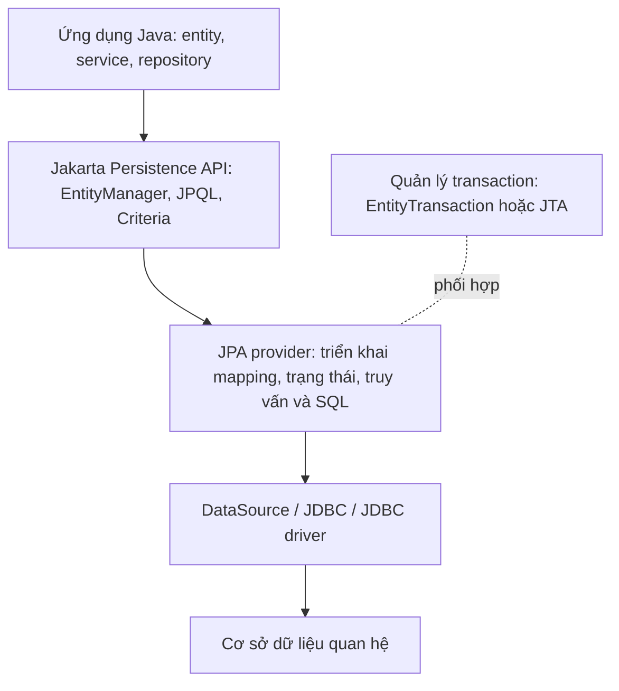

# Vai trò của provider trong triển khai đặc tả JPA

Khi phát triển ứng dụng Java cần lưu trữ dữ liệu trong cơ sở dữ liệu quan hệ, ta thường viết các lớp `@Entity`, thao tác với `EntityManager`, truy vấn bằng JPQL hoặc Criteria API và để JPA xử lý phần lớn công việc ánh xạ đối tượng sang bảng. Tuy nhiên, **JPA tự nó là một đặc tả**, không phải một bộ máy kết nối và ghi dữ liệu xuống cơ sở dữ liệu. Phần hiện thực các quy tắc của đặc tả ấy là **JPA provider** (nhà cung cấp triển khai JPA).

Trong kiến trúc JPA, hiểu đúng vai trò của provider giúp trả lời ba câu hỏi quan trọng: vì sao chỉ thêm JPA API chưa đủ để chạy ứng dụng, điều gì thực sự xảy ra sau lời gọi `persist()` hoặc một truy vấn JPQL, và đâu là ranh giới giữa mã JPA chuẩn với tính năng riêng của Hibernate, EclipseLink hoặc provider khác.

## 1. JPA là hợp đồng; provider là bên thực thi hợp đồng

**Jakarta Persistence** (trước đây thường được gọi là Java Persistence API, viết tắt JPA) định nghĩa một mô hình lập trình thống nhất cho việc ánh xạ và quản lý dữ liệu quan hệ bằng các đối tượng Java. Đặc tả mô tả:

- Các annotation ánh xạ như `@Entity`, `@Table`, `@Id`, `@Column`, `@OneToMany`, `@ManyToOne` và `@Version`.
- Các API như `EntityManagerFactory`, `EntityManager`, `Query`, `TypedQuery`, Criteria API và Metamodel API.
- Vòng đời entity, persistence context, quy tắc đồng bộ trạng thái, truy vấn JPQL, transaction, locking và các hành vi chuẩn khác.
- Các điểm mở rộng để container hoặc provider tham gia quá trình khởi tạo và vận hành.

Đặc tả quy định **hành vi quan sát được** mà một triển khai tuân thủ phải cung cấp. Nó không tự chứa toàn bộ logic phân tích mapping, theo dõi thay đổi của đối tượng, tạo SQL, gửi câu lệnh qua JDBC hoặc chuyển hàng kết quả thành entity.

Provider là thư viện triển khai các hợp đồng đó. Hai provider phổ biến là **Hibernate ORM** và **EclipseLink**. Chúng cùng có thể hỗ trợ JPA nhưng khác nhau về cấu trúc nội bộ, chiến lược tạo SQL, khả năng tối ưu, cơ chế enhancement và các tiện ích mở rộng.

Ví dụ, dòng khai báo sau thuộc API và annotation chuẩn:

```java
import jakarta.persistence.Entity;
import jakarta.persistence.Id;

@Entity
public class Customer {
    @Id
    private Long id;

    protected Customer() { }
}
```

`@Entity` cho biết lớp được ánh xạ như một entity, nhưng annotation không tự tạo bảng hoặc truy vấn. Khi ứng dụng khởi động, provider sẽ đọc metadata của lớp `Customer`, kiểm tra mapping, xây dựng mô hình ánh xạ và dùng mô hình ấy trong những thao tác tiếp theo.

> **Phân biệt tên gọi:** Một số tài liệu cũ dùng gói `javax.persistence`; hệ Jakarta Persistence hiện đại dùng `jakarta.persistence`. Mã ví dụ trong bài sử dụng namespace `jakarta.persistence`. Chọn phiên bản API và provider tương thích với nhau là điều kiện để triển khai hoạt động.

## 2. Provider đứng ở đâu trong kiến trúc?



Sơ đồ thể hiện **các trách nhiệm logic**; trong một ứng dụng thực tế, provider thường cung cấp đối tượng hiện thực `EntityManager`, nhận cấu hình từ container hoặc framework, lấy kết nối thông qua `DataSource`, và phối hợp với bộ quản lý transaction.

| Thành phần | Vai trò chính | Ví dụ |
|---|---|---|
| **JPA specification/API** | Đưa ra hợp đồng và cách lập trình chuẩn | `EntityManager.persist`, `@ManyToOne`, JPQL |
| **JPA provider** | Hiện thực hợp đồng, quản lý entity, ánh xạ và tạo câu lệnh truy cập dữ liệu | Hibernate ORM, EclipseLink |
| **JDBC driver** | Chuyển giao tiếp JDBC thành giao thức mà một hệ quản trị CSDL hiểu được | PostgreSQL JDBC Driver, MySQL Connector/J |
| **RDBMS** | Lưu trữ dữ liệu, thực thi SQL, kiểm tra ràng buộc và bảo đảm tính chất transaction ở tầng CSDL | PostgreSQL, MySQL, Oracle Database |
| **Container/framework** | Cấu hình ứng dụng, dependency injection, quản lý tài nguyên và transaction theo mô hình sử dụng | Jakarta EE container, Spring Framework |

Vì vậy:

- **Provider không phải JDBC driver.** Provider hiểu entity và JPA; driver hiểu giao thức trao đổi với một hệ quản trị cơ sở dữ liệu cụ thể.
- **Provider không phải cơ sở dữ liệu.** Nó có thể phát sinh lệnh tạo bảng khi được cấu hình, nhưng dữ liệu vẫn được lưu và xử lý bởi RDBMS.
- **Spring Data JPA không phải provider.** Spring Data JPA cung cấp tầng repository và tiện ích truy vấn; bên dưới, thao tác JPA vẫn được một provider như Hibernate thực thi.
- **Chỉ có JPA API là chưa đủ để chạy persistence.** Ứng dụng cần một triển khai phù hợp, cách lấy kết nối và cơ sở dữ liệu thực tế.

## 3. Provider thực hiện những công việc nào?

### 3.1. Khởi tạo persistence unit và đọc metadata

Một **persistence unit** mô tả tập hợp entity, cấu hình kết nối và các thiết lập liên quan được quản lý như một đơn vị. Khi tạo `EntityManagerFactory`, provider thường thực hiện các bước sau:

1. Nhận cấu hình của persistence unit từ `META-INF/persistence.xml`, thuộc tính runtime hoặc cơ chế do container/framework cung cấp.
2. Tìm các lớp entity và đọc annotation hay metadata ánh xạ XML.
3. Xây dựng mô hình metadata: thực thể, bảng, khóa chính, cột, quan hệ, kiểu dữ liệu, chiến lược sinh khóa và các quy tắc kế thừa.
4. Xác thực các mapping và chuẩn bị những thành phần nội bộ phục vụ truy vấn, quản lý trạng thái, transaction và truy cập CSDL.

Ví dụ:

```java
@Entity
@Table(name = "orders")
public class Order {
    @Id
    @GeneratedValue(strategy = GenerationType.IDENTITY)
    private Long id;

    @ManyToOne(fetch = FetchType.LAZY)
    @JoinColumn(name = "customer_id", nullable = false)
    private Customer customer;

    protected Order() { }
}
```

Provider diễn giải `@ManyToOne` và `@JoinColumn` thành metadata về quan hệ giữa `Order` và `Customer`. Cách nó dựng SQL join, chọn thời điểm truy vấn quan hệ và tối ưu truy cập dữ liệu là một phần công việc triển khai, trong giới hạn mà đặc tả yêu cầu.

Provider phải tuân theo mapping JPA chuẩn; tuy nhiên, các quy ước mặc định và tiện ích mở rộng được sử dụng trong ứng dụng có thể làm giảm tính di động giữa provider hoặc giữa các hệ quản trị CSDL.

### 3.2. Tạo và quản lý `EntityManager` cùng persistence context

`EntityManager` là API trung tâm để làm việc với entity. Provider tạo ra phần hiện thực của giao diện này và quản lý **persistence context** liên kết với nó.

Một entity thường ở một trong bốn trạng thái:

| Trạng thái | Ý nghĩa | Tương tác tiêu biểu |
|---|---|---|
| **New/transient** | Đối tượng mới tạo, chưa được persistence context quản lý | `new Book(...)` |
| **Managed** | Được persistence context theo dõi; các thay đổi có thể được đồng bộ xuống CSDL | `persist`, `find`, kết quả truy vấn entity |
| **Detached** | Từng được quản lý nhưng hiện ở ngoài persistence context | `detach`, `clear`, đóng context |
| **Removed** | Được đánh dấu xóa trong persistence context; lệnh xóa được xử lý khi đồng bộ | `remove` |

Provider bảo đảm một persistence context có **định danh đối tượng nhất quán**: trong cùng context, cùng một entity type và khóa chính thường tương ứng một đối tượng managed duy nhất. Nhờ đó, khi gọi `find()` nhiều lần với cùng khóa trong một context, ứng dụng không phải tự ghép các bản sao của cùng hàng dữ liệu.

Đây cũng là cơ sở của cơ chế thường được gọi là **first-level cache**. Nó gắn với persistence context; đừng nhầm với bộ đệm cấp hai dùng chung giữa nhiều context.

`EntityManagerFactory` thường được tạo một lần cho một persistence unit và dùng chung; việc tạo nó tốn chi phí hơn `EntityManager`. Ngược lại, `EntityManager` **không được thiết kế để chia sẻ đồng thời giữa nhiều luồng**. Trong môi trường Jakarta EE hoặc Spring, container/framework thường quản lý phạm vi `EntityManager` theo request hoặc transaction.

### 3.3. Theo dõi thay đổi và đồng bộ với cơ sở dữ liệu

Khi một entity đang ở trạng thái managed, provider có thể phát hiện các trường đã thay đổi và xây dựng lệnh SQL tương ứng. Cơ chế này thường gọi là **dirty checking**.

```java
Book book = em.find(Book.class, 10L); // book là managed nếu được tìm thấy
book.rename("JPA chuyên sâu");        // thay đổi trạng thái trong bộ nhớ
// Khi flush trong transaction, provider đồng bộ thay đổi nếu cần.
```

Không cần gọi `update()` trên entity managed như khi làm việc trực tiếp với một số API khác. Provider tự theo dõi thay đổi theo ngữ nghĩa JPA và quyết định việc tạo `UPDATE` lúc đồng bộ.

Các thao tác thường gặp:

| Lời gọi API | Ý nghĩa đối với provider |
|---|---|
| `persist(entity)` | Đưa entity mới vào persistence context và lên lịch lưu theo ngữ nghĩa JPA |
| `find(Type.class, id)` | Tìm entity theo khóa chính, có thể sử dụng context trước khi truy vấn CSDL |
| `merge(detached)` | Sao chép trạng thái từ entity detached vào một phiên bản managed và trả về đối tượng managed đó |
| `remove(managed)` | Đánh dấu entity managed để xóa |
| `flush()` | Yêu cầu đồng bộ những thay đổi đang được quản lý với CSDL |
| `clear()` | Tách tất cả entity khỏi persistence context |

**`flush()` không đồng nghĩa với `commit()`.** Flush gửi các thay đổi cần thiết tới CSDL trong phạm vi transaction, còn commit kết thúc transaction và xác nhận thay đổi. Thời điểm phát sinh SQL phụ thuộc chế độ flush, loại thao tác, chiến lược sinh khóa và provider; chẳng hạn `IDENTITY` có thể đòi hỏi thực hiện `INSERT` sớm để lấy khóa. Không nên suy đoán rằng mọi lệnh SQL chỉ chạy đúng lúc `commit()`.

### 3.4. Biên dịch JPQL và Criteria thành thao tác CSDL

Ứng dụng có thể truy vấn theo **mô hình entity** thay vì trực tiếp theo tên bảng:

```java
List<Book> books = em.createQuery(
        "select b from Book b where lower(b.title) like :keyword order by b.id",
        Book.class)
    .setParameter("keyword", "%jpa%")
    .setMaxResults(10)
    .getResultList();
```

Ở truy vấn này, `Book` là **tên entity**, `title` là **thuộc tính Java**. Provider thực hiện các công việc như:

1. Phân tích cú pháp và ngữ nghĩa JPQL, hoặc cây biểu thức Criteria API.
2. Tra cứu metadata để biết entity và thuộc tính ánh xạ tới bảng/cột nào.
3. Chuyển truy vấn thành SQL phù hợp với hệ quản trị CSDL, bao gồm join, sắp xếp, giới hạn kết quả và binding tham số.
4. Thực thi qua JDBC, đọc `ResultSet` và ánh xạ kết quả trở lại các đối tượng hoặc kiểu kết quả được yêu cầu.
5. Đưa các entity được truy vấn vào persistence context khi phù hợp, bảo đảm quy tắc định danh và trạng thái managed.

Chính vì provider đảm nhiệm khâu dịch này mà cùng một truy vấn JPQL chuẩn có thể chạy với nhiều hệ CSDL. Tuy nhiên, **SQL được tạo có thể khác nhau** giữa các provider và giữa các dialect. CSDL vẫn quyết định kế hoạch thực thi truy vấn; việc JPQL chạy đúng không tự bảo đảm hiệu năng tốt.

### 3.5. Xử lý quan hệ và chiến lược tải dữ liệu

Từ các mapping `@OneToOne`, `@OneToMany`, `@ManyToOne` và `@ManyToMany`, provider tổ chức việc tải dữ liệu liên quan, duy trì quan hệ object trong context và phát sinh câu lệnh cần thiết.

Hai khái niệm thường gây nhầm lẫn là:

- **`EAGER`**: quan hệ phải được tải sẵn theo ngữ nghĩa của JPA; provider có thể chọn join hoặc truy vấn bổ sung để đáp ứng.
- **`LAZY`**: yêu cầu trì hoãn tải dữ liệu cho đến khi cần sử dụng; khả năng thực hiện và chi tiết kỹ thuật phụ thuộc dạng thuộc tính, provider và cấu hình.

Ví dụ, một truy vấn lấy 100 `Order` rồi truy cập `order.getCustomer()` ở từng phần tử có thể phát sinh nhiều lệnh SQL riêng lẻ nếu quan hệ chưa được tải phù hợp. Đây là hiện tượng **N+1 query**, liên quan trực tiếp đến cách provider thực hiện fetching.

JPA cung cấp các công cụ chuẩn như `JOIN FETCH` trong JPQL và `@EntityGraph`/entity graph để nêu rõ nhu cầu tải dữ liệu. Một số provider bổ sung batch fetching, fetch profile hay annotation riêng. Chọn chiến lược tải là trách nhiệm thiết kế truy vấn của ứng dụng; provider thực hiện chiến lược đó dựa trên mapping và khả năng của mình.

Một truy cập lazy có thể thất bại nếu persistence context cần thiết đã đóng và provider không còn điều kiện lấy dữ liệu. Ví dụ, Hibernate thường báo `LazyInitializationException` trong tình huống này. Đó là thông báo lỗi riêng của Hibernate, không phải loại ngoại lệ chuẩn chung cho mọi provider.

### 3.6. Phối hợp transaction và quản lý kết nối

Provider thực hiện thao tác truy cập dữ liệu trong ranh giới transaction mà ứng dụng hoặc container cung cấp. Có hai mô hình điển hình:

| Mô hình | Đơn vị điều khiển transaction | Cách sử dụng tiêu biểu |
|---|---|---|
| **Resource-local transaction** | Ứng dụng thông qua `EntityTransaction` | Java SE, ứng dụng cấu hình `RESOURCE_LOCAL` |
| **JTA transaction** | Transaction manager của container/framework | Jakarta EE, hệ thống tích hợp nhiều tài nguyên giao dịch |

Trong mô hình resource-local, mã thường gọi `em.getTransaction().begin()` và `commit()` hoặc `rollback()`. Với persistence context quản lý bởi container và JTA, ứng dụng thường sử dụng cơ chế transaction của container/framework thay vì tự gọi `getTransaction()`.

Provider phối hợp flush, JDBC connection, khóa và trạng thái entity với transaction hiện tại. Nó không thay thế engine transaction của RDBMS hoặc JTA transaction manager. Việc lấy kết nối có thể do `DataSource` và connection pool đảm nhiệm; provider sử dụng kết nối ấy để gửi SQL.

### 3.7. Locking, versioning, cache và callback

Các trách nhiệm bổ sung của provider gồm:

- **Optimistic locking:** diễn giải `@Version`, kiểm tra version khi cập nhật/xóa và phát sinh `OptimisticLockException` khi phát hiện xung đột theo quy tắc JPA.
- **Pessimistic locking:** thực hiện các lock mode chuẩn như `PESSIMISTIC_WRITE` theo khả năng của database và dialect.
- **Lifecycle callback:** gọi các phương thức như `@PrePersist`, `@PostLoad`, `@PreUpdate`, `@PreRemove` theo thời điểm được đặc tả quy định.
- **Chuyển đổi giá trị:** áp dụng mapping kiểu dữ liệu, enum, thời gian và các `AttributeConverter` được khai báo.
- **Shared cache:** hỗ trợ cơ chế cache cấp hai theo khả năng và cấu hình; không thể giả định mọi ứng dụng đều bật cache này. Query cache là tính năng mở rộng của một số provider, không phải hành vi mặc định của JPQL.
- **Schema generation:** có thể tạo/xóa schema theo thuộc tính cấu hình chuẩn hoặc cơ chế riêng. Năng lực này hữu ích cho thử nghiệm và phát triển, nhưng việc nâng cấp schema sản xuất thường cần công cụ migration có kiểm soát như Flyway hoặc Liquibase.

Các khả năng trên làm cho provider trở thành một **ORM runtime** thực thụ, thay vì chỉ là bộ chuyển câu lệnh Java thành SQL.

## 4. Ví dụ: từ API chuẩn đến triển khai cụ thể

Xét một ứng dụng Java SE đơn giản, sử dụng PostgreSQL và Hibernate làm provider để lưu thông tin sách. Ví dụ minh họa các lớp trách nhiệm; muốn chạy thực tế cần thêm các dependency tương thích cho Jakarta Persistence API, Hibernate ORM và PostgreSQL JDBC driver.

### 4.1. Entity chỉ sử dụng annotation JPA chuẩn

```java
package example.domain;

import jakarta.persistence.Column;
import jakarta.persistence.Entity;
import jakarta.persistence.GeneratedValue;
import jakarta.persistence.GenerationType;
import jakarta.persistence.Id;
import jakarta.persistence.Table;
import jakarta.persistence.Version;

@Entity
@Table(name = "books")
public class Book {
    @Id
    @GeneratedValue(strategy = GenerationType.IDENTITY)
    private Long id;

    @Column(nullable = false)
    private String title;

    @Version
    private long version;

    protected Book() { } // Constructor không đối số cho JPA

    public Book(String title) {
        this.title = title;
    }

    public Long getId() {
        return id;
    }

    public String getTitle() {
        return title;
    }

    public void rename(String newTitle) {
        this.title = newTitle;
    }
}
```

Mọi annotation trong `Book` đều thuộc `jakarta.persistence`. Chưa có tên lớp nào của Hibernate xuất hiện ở entity. Provider chịu trách nhiệm diễn giải các mapping này.

### 4.2. Chọn provider trong `persistence.xml`

Tệp `src/main/resources/META-INF/persistence.xml` có thể được khai báo như sau:

```xml
<?xml version="1.0" encoding="UTF-8"?>
<persistence xmlns="https://jakarta.ee/xml/ns/persistence"
             version="3.1">
    <persistence-unit name="libraryPU" transaction-type="RESOURCE_LOCAL">
        <provider>org.hibernate.jpa.HibernatePersistenceProvider</provider>
        <class>example.domain.Book</class>
        <properties>
            <property name="jakarta.persistence.jdbc.driver"
                      value="org.postgresql.Driver" />
            <property name="jakarta.persistence.jdbc.url"
                      value="jdbc:postgresql://localhost:5432/learning" />
            <property name="jakarta.persistence.jdbc.user"
                      value="app_user" />
            <property name="jakarta.persistence.jdbc.password"
                      value="replace-me" />
            <property name="jakarta.persistence.schema-generation.database.action"
                      value="none" />
        </properties>
    </persistence-unit>
</persistence>
```

Trong ví dụ này:

- `libraryPU` là tên persistence unit mà ứng dụng sẽ khởi tạo.
- `<provider>` chỉ định Hibernate là triển khai JPA thực hiện công việc. Trong những môi trường phù hợp, provider cũng có thể được phát hiện/chọn qua cơ chế tích hợp thay vì khai báo rõ như ví dụ.
- Các thuộc tính `jakarta.persistence.jdbc.*` cấu hình cách kết nối JDBC cho trường hợp Java SE đơn giản.
- `schema-generation.database.action=none` yêu cầu không tự tạo/xóa schema. Bảng `books` cần tồn tại sẵn, chẳng hạn được tạo bằng một migration.

Giá trị mật khẩu ở trên chỉ là chỗ giữ chỗ để minh họa cấu trúc XML; ứng dụng thực tế nên lấy thông tin bí mật từ cấu hình ngoài mã nguồn. Trong môi trường container hoặc Spring Boot, cấu hình thường nằm ở `DataSource` và tệp cấu hình framework, không nhất thiết viết trực tiếp trong `persistence.xml`.

### 4.3. Ứng dụng thao tác qua `EntityManager`

```java
package example;

import example.domain.Book;
import jakarta.persistence.EntityManager;
import jakarta.persistence.EntityManagerFactory;
import jakarta.persistence.Persistence;

public class Main {
    public static void main(String[] args) {
        EntityManagerFactory emf =
            Persistence.createEntityManagerFactory("libraryPU");

        try {
            EntityManager em = emf.createEntityManager();
            try {
                em.getTransaction().begin();

                Book book = new Book("Nhập môn JPA");
                em.persist(book);

                em.getTransaction().commit();

                em.clear(); // Xóa entity managed khỏi context để lần find sau có thể truy vấn DB

                em.getTransaction().begin();

                Book loaded = em.find(Book.class, book.getId());
                loaded.rename("JPA và vai trò của provider");

                em.getTransaction().commit();
            } catch (RuntimeException ex) {
                if (em.getTransaction().isActive()) {
                    em.getTransaction().rollback();
                }
                throw ex;
            } finally {
                em.close();
            }
        } finally {
            emf.close();
        }
    }
}
```

Điểm đáng chú ý: đoạn mã chỉ dùng API JPA. Ứng dụng yêu cầu `persist`, `find` và thay đổi thuộc tính của entity; provider xác định câu lệnh SQL phù hợp. Với cấu hình phù hợp và bảng đã tồn tại, một luồng thực thi có thể được hình dung như sau:

```text
Persistence.createEntityManagerFactory("libraryPU")
    -> khởi tạo provider, đọc mapping Book và cấu hình kết nối

em.persist(book)
    -> book chuyển thành managed
    -> provider chuẩn bị/thực hiện INSERT theo thời điểm thích hợp

em.getTransaction().commit()
    -> đồng bộ các thay đổi cần thiết và commit transaction

em.clear(); em.find(Book.class, id)
    -> provider tải hàng tương ứng qua SQL/JDBC
    -> tạo hoặc tái sử dụng entity managed theo context

loaded.rename(...); commit()
    -> provider nhận biết thay đổi trên entity managed
    -> thực hiện UPDATE và kiểm tra version khi cần
```

Các câu SQL cụ thể, số lệnh được phát ra và thời điểm thực thi có thể khác theo provider, chiến lược sinh khóa, cấu hình và CSDL. Ví dụ có `@Version`, nên khi cập nhật provider còn phải duy trì quy tắc optimistic locking. Ứng dụng không tự viết `INSERT` hoặc `UPDATE` nhưng vẫn cần thiết kế transaction, mapping và index đúng.

## 5. Cách provider được tìm thấy và được tích hợp

JPA có các giao diện SPI (Service Provider Interface) để một triển khai tham gia quá trình khởi tạo. Tiêu biểu là `jakarta.persistence.spi.PersistenceProvider`. Ứng dụng Java SE gọi `Persistence.createEntityManagerFactory(...)`; cơ chế bootstrap tìm provider phù hợp rồi yêu cầu nó tạo `EntityManagerFactory` cho persistence unit.

Có thể mô tả các kịch bản thường gặp như sau:

| Môi trường | Ai tổ chức việc khởi tạo và phạm vi hoạt động? | Provider đảm nhận phần nào? |
|---|---|---|
| **Java SE thuần** | Ứng dụng tạo và đóng `EntityManagerFactory`, `EntityManager`, quản lý transaction resource-local | Hiện thực persistence unit, API JPA, ánh xạ, truy vấn, truy cập JDBC |
| **Jakarta EE** | Container tích hợp JPA, `@PersistenceContext`, JTA và quản lý tài nguyên | Cung cấp triển khai JPA tương thích, tham gia persistence context/transaction của container |
| **Spring / Spring Boot với Spring Data JPA** | Spring cấu hình bean, `DataSource`, transaction và repository | Một provider (thường là Hibernate khi sử dụng cấu hình mặc định phổ biến) thực hiện lời gọi JPA bên dưới |

Ví dụ trong Jakarta EE:

```java
import jakarta.persistence.EntityManager;
import jakarta.persistence.PersistenceContext;

public class BookService {
    @PersistenceContext
    private EntityManager em;

    public void add(Book book) {
        em.persist(book);
    }
}
```

Đoạn code minh họa việc tiêm `EntityManager` do container quản lý; transaction thực tế phải được thiết lập phù hợp với kiểu component và cấu hình container. Không lấy cách quản lý transaction resource-local trong `Main` áp nguyên xi sang môi trường có JTA/container-managed persistence context.

## 6. Chuẩn JPA bảo đảm điều gì, và provider được mở rộng điều gì?

Một lợi ích lớn của JPA là tạo ra lớp hợp đồng để ứng dụng ít phụ thuộc hơn vào một ORM cụ thể. Tuy nhiên, **khả năng thay provider không có nghĩa là mọi cấu hình, SQL và hiệu năng đều giống nhau**.

| Khía cạnh | Phần thuộc đặc tả JPA | Phần provider có thể khác biệt |
|---|---|---|
| Mapping cơ bản | `@Entity`, `@Id`, quan hệ, inheritance, converter | Quy ước đặt tên, kiểu SQL cụ thể, metadata extension |
| Quản lý entity | Persistence context, vòng đời, `persist`/`merge`/`remove` | Thuật toán dirty checking, enhancement, tối ưu flush |
| Truy vấn | JPQL, Criteria, parameter binding, entity graph | SQL sinh ra, dialect, hint và hàm riêng |
| Transaction/locking | `EntityTransaction`, JTA integration, lock modes, `@Version` | SQL khóa cụ thể, chiến lược retry hoặc exception bổ sung |
| Cache | Quy tắc persistence context, Shared Cache API | Thiết kế cache cấp hai, query cache và cấu hình eviction |
| Schema | Thuộc tính schema generation chuẩn | DDL cụ thể, khả năng tự cập nhật schema và hỗ trợ database |
| Hiệu năng | Không cam kết một kế hoạch SQL hoặc số truy vấn cố định | Batching, fetch optimization, statement ordering, caching |

Hibernate, chẳng hạn, có annotation `@BatchSize`, cấu hình `hibernate.jdbc.batch_size` và HQL với những khả năng riêng ngoài JPQL chuẩn. Chúng có thể hữu ích trong một hệ thống cụ thể, nhưng sử dụng chúng đồng nghĩa với việc mã/cấu hình đã phụ thuộc thêm vào Hibernate.

Một số nguồn khác của khác biệt là các hàm SQL riêng của CSDL, kiểu cột đặc biệt, cách sinh khóa, quy ước tên bảng và phiên bản Jakarta Persistence mà provider hỗ trợ. Khi thay provider, cần kiểm chứng mapping, DDL, transaction, truy vấn, lazy loading và hành vi thực tế trên CSDL mục tiêu. Chỉ đổi tên `<provider>` chưa chắc đã đủ.

## 7. Những nhầm lẫn thường gặp

**“Đã thêm `jakarta.persistence-api` thì có thể lưu entity ngay?”**

Chưa. Dependency API cung cấp annotation và interface. Để thực thi cần provider tương thích, JDBC driver/cách kết nối và một CSDL sẵn sàng phục vụ.

**“Gọi `save()` của Spring Data JPA tức là Spring tự tạo SQL?”**

Repository của Spring Data JPA cung cấp thao tác lưu ở tầng thuận tiện hơn. Các hành vi JPA bên dưới được ủy quyền cho `EntityManager` và provider; không nên nhầm lớp repository với bộ máy ORM.

**“Khi gọi `persist()`, SQL luôn được chạy ngay?”**

Không có bảo đảm như vậy. `persist()` thay đổi trạng thái quản lý của entity; SQL có thể được thực hiện ở nhiều thời điểm tùy điều kiện, đặc biệt là chiến lược sinh khóa và cơ chế flush. Muốn nắm chắc hành vi, xem transaction và SQL thực tế của ứng dụng.

**“Tắt `EntityManager` rồi vẫn có thể truy cập mọi quan hệ `LAZY`?”**

Không nên giả định. Quan hệ chưa được tải có thể cần persistence context còn hoạt động. Nên tải dữ liệu cần dùng trong ranh giới transaction hợp lý hoặc dùng DTO/projection cho các trường hợp đọc dữ liệu phục vụ API.

**“Provider có thể thay hoàn toàn migration, connection pool và transaction manager?”**

Không. Provider có khả năng sinh DDL và giao tiếp JDBC, nhưng migration, cấp phát kết nối, quản lý transaction phân tán và bảo đảm bền vững ở tầng CSDL có những trách nhiệm riêng. Trong hệ thống sản xuất, các thành phần này thường phối hợp thay vì gộp thành một.

**“Theo chuẩn JPA thì chuyển từ PostgreSQL sang Oracle sẽ không phải sửa gì?”**

JPA giảm số vị trí phải viết SQL phụ thuộc database, nhưng sự khác nhau về cú pháp, kiểu dữ liệu, locking, cách sinh khóa, tối ưu và DDL vẫn cần được đánh giá. Provider hỗ trợ dialect giúp xử lý nhiều điểm khác biệt, không xóa bỏ mọi khác biệt giữa các CSDL.

## 8. Một tình huống tổng hợp: ai chịu trách nhiệm khi truy vấn chậm?

Giả sử endpoint trả danh sách đơn hàng và tên khách hàng; code dùng một truy vấn JPQL lấy đơn hàng, rồi lặp qua từng đơn để đọc `order.getCustomer().getName()`. Khi kiểm tra SQL thực tế, ứng dụng phát ra một câu `SELECT` lấy đơn hàng và nhiều câu `SELECT` lấy khách hàng.

Phân tích theo các lớp trách nhiệm:

1. **Ứng dụng** quyết định dữ liệu nào cần trả và lựa chọn truy vấn hoặc entity graph phù hợp. Thiết kế dữ liệu trả về có thể dùng DTO nếu chỉ cần một vài trường.
2. **JPA API** cung cấp công cụ chuẩn để diễn đạt yêu cầu, ví dụ `JOIN FETCH` hoặc entity graph.
3. **Provider** chuyển cách truy vấn đã chọn thành SQL, thực hiện fetching, mapping kết quả và quản lý entity trong persistence context.
4. **JDBC driver/DataSource** cung cấp đường truyền và kết nối đến CSDL.
5. **RDBMS** tối ưu và thực thi câu SQL dựa trên index, thống kê và dữ liệu thực tế.

Thay provider có thể làm số lệnh SQL thay đổi, nhưng không nên coi đó là phương án đầu tiên cho mọi vấn đề hiệu năng. Cần hiểu cách ứng dụng đang yêu cầu tải dữ liệu, SQL provider sinh ra và kế hoạch thực thi của CSDL. Ranh giới này giúp chẩn đoán đúng nguyên nhân: mapping sai, lựa chọn fetch chưa phù hợp, thiếu index hay cấu hình kết nối không hiệu quả.

## 9. Ghi nhớ mô hình vận hành

Khi nhìn thấy đoạn code như sau:

```java
em.persist(book);
Book sameBook = em.find(Book.class, book.getId());
List<Book> found = em.createQuery("select b from Book b", Book.class)
                     .getResultList();
```

Hãy phân biệt rõ:

- **Ứng dụng** mô tả đối tượng và yêu cầu nghiệp vụ.
- **Đặc tả JPA** định nghĩa ý nghĩa chuẩn của annotation và lời gọi API.
- **Provider** hiện thực ý nghĩa đó: tạo và quản lý persistence context, diễn giải mapping, nhận biết thay đổi, dịch truy vấn, phát sinh SQL và phối hợp transaction.
- **JDBC cùng RDBMS** đảm nhiệm truyền lệnh, thực thi, lưu dữ liệu và ràng buộc tính nhất quán ở tầng cơ sở dữ liệu.

Đây là vị trí cốt lõi của provider trong kiến trúc JPA: **nó là cầu nối thực thi giữa mô hình đối tượng theo hợp đồng Jakarta Persistence và việc truy cập dữ liệu quan hệ thực tế**. Hiểu vai trò này là nền tảng để học sâu hơn về `EntityManager`, persistence context, transaction, loading strategy, caching và tối ưu truy vấn ORM.
