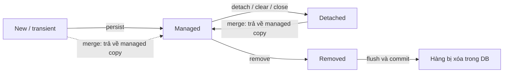

# Ngữ cảnh lưu trữ (Persistence Context) và đơn vị công việc (Unit of Work) trong JPA

## 1. Vì sao cần hiểu hai khái niệm này?

Khi làm việc với JDBC thuần, lập trình viên thường tự quyết định lúc nào chạy câu `INSERT`, `UPDATE`, `DELETE`, lấy dữ liệu từ `ResultSet` rồi gán vào đối tượng Java. Với **Jakarta Persistence (JPA)**, ta làm việc chủ yếu với **entity** và `EntityManager`: đọc đối tượng, thay đổi thuộc tính, tạo hoặc xóa đối tượng. JPA phối hợp các thao tác đó với cơ sở dữ liệu thông qua hai ý tưởng trung tâm:

- **Persistence context (ngữ cảnh lưu trữ)** là phạm vi mà trong đó JPA quản lý danh tính và trạng thái của các entity.
- **Unit of Work (đơn vị công việc)** là tập thay đổi cần được xử lý như một công việc logic: đọc dữ liệu, tạo mới, cập nhật, xóa và đồng bộ các thay đổi với cơ sở dữ liệu.

Ví dụ, nghiệp vụ chuyển tiền cần trừ tiền từ tài khoản A và cộng vào tài khoản B. Thay vì viết hai câu `UPDATE` riêng rẽ, ta có thể tải hai entity vào cùng một persistence context, thay đổi số dư của chúng và thực hiện giao dịch. JPA nhận ra các thay đổi; giao dịch cơ sở dữ liệu quyết định chúng cùng được xác nhận hay cùng bị hủy.

> Cần phân biệt ngay từ đầu: **persistence context quản lý đối tượng**, **Unit of Work mô tả công việc cần đồng bộ**, còn **database transaction** quy định ranh giới nguyên tử và khả năng `COMMIT`/`ROLLBACK` của thao tác dữ liệu. Ba khái niệm liên quan chặt chẽ nhưng không đồng nghĩa.

## 2. Persistence context là gì?

Một persistence context là tập các entity **managed** được một `EntityManager` quản lý theo danh tính bền vững của chúng. Trong phạm vi đó, JPA biết một hàng dữ liệu tương ứng với đối tượng nào, theo dõi thay đổi trên các đối tượng được quản lý và phối hợp thao tác ghi vào cơ sở dữ liệu.

Có thể hình dung luồng làm việc như sau:

```text
Mã nghiệp vụ
    |
    | find(), persist(), sửa field, remove(), ...
    v
EntityManager
    |
    v
Persistence context
    |-- Entity #1: đang được quản lý
    |-- Entity #2: đang được quản lý, có thay đổi
    |-- Entity #3: đã được đánh dấu xóa
    |
    | flush() / flush khi commit
    v
SQL gửi xuống cơ sở dữ liệu
    |
    | COMMIT hoặc ROLLBACK của transaction
    v
Cơ sở dữ liệu
```

### 2.1. Bảo đảm danh tính trong cùng một context

Với cùng loại entity và cùng khóa chính, JPA duy trì **một đối tượng Java được quản lý** trong một persistence context tại một thời điểm. Ví dụ:

```java
BankAccount first = em.find(BankAccount.class, 10L);
BankAccount second = em.find(BankAccount.class, 10L);

System.out.println(first == second); // true nếu tìm thấy entity
```

Hai lời gọi cùng tìm khóa `10L` trong cùng context trả về cùng một instance. Nhờ đó, khi một đoạn mã thay đổi `first`, đoạn mã khác sử dụng `second` nhìn thấy thay đổi ngay trong bộ nhớ. Nếu mở **hai persistence context khác nhau**, mỗi context có thể giữ một instance riêng cho cùng hàng trong cơ sở dữ liệu; vì vậy không thể suy luận `==` giữa hai context.

Khả năng nhận diện này thường được gọi là **identity map**. Nó cũng lý giải vì sao persistence context hoạt động như một bộ đệm cấp một (*first-level cache*) của JPA: khi entity đã được quản lý, `find()` theo cùng khóa thường không cần tải lại hàng đó. Tuy nhiên, đây không phải cache dùng chung giữa các request, không phải query cache và không bảo đảm dữ liệu luôn mới trước mọi thay đổi bên ngoài.

### 2.2. Theo dõi thay đổi (dirty checking)

Khi một entity đang **managed**, JPA có thể nhận ra thuộc tính lưu trữ của nó đã thay đổi so với trạng thái được theo dõi. Đến thời điểm đồng bộ, provider tạo những câu SQL cần thiết theo mapping và chiến lược của mình.

```java
BankAccount account = em.find(BankAccount.class, 10L); // managed
account.setOwnerName("Nguyen An");

// Không cần gọi em.update(account) — JPA không có phương thức này.
// Khi flush/commit, thay đổi có thể được chuyển thành UPDATE.
```

Chi tiết kỹ thuật theo dõi thay đổi (ví dụ so sánh snapshot hoặc dùng bytecode enhancement) phụ thuộc nhà cung cấp JPA. Điều lập trình viên cần nhớ là **dirty checking chỉ áp dụng cho trạng thái entity đang được quản lý** và với những thuộc tính được ánh xạ để lưu trữ.

## 3. Vòng đời entity trong persistence context

Một entity thường được mô tả bởi bốn trạng thái:

| Trạng thái | Ý nghĩa | Liên hệ với persistence context |
|---|---|---|
| **New / Transient** | Đối tượng vừa tạo bằng `new`, chưa được `persist()` hoặc liên kết với context | Chưa được quản lý; sửa thuộc tính không tự phát sinh SQL |
| **Managed / Persistent** | Đối tượng thuộc persistence context đang hoạt động | JPA quản lý danh tính, thay đổi và các thao tác liên quan |
| **Detached** | Đối tượng từng được quản lý nhưng không còn thuộc context đang xét | Sửa đối tượng không tự đồng bộ; có thể truyền vào `merge()` |
| **Removed** | Entity đang được quản lý và được đánh dấu để xóa | Lệnh xóa được thực hiện khi đồng bộ; chưa đồng nghĩa transaction đã commit |



Sơ đồ mô tả luồng thường gặp, không phải toàn bộ mọi chuyển đổi hợp lệ của đặc tả. Ví dụ, gọi `persist()` trên một entity `Removed` có thể đưa nó trở lại trạng thái managed trước khi việc xóa được đồng bộ. Ngoài ra, trạng thái trong bộ nhớ và tình trạng hàng dữ liệu **chưa chắc thay đổi cùng một thời điểm**: sau `persist()` entity có thể đã managed nhưng `INSERT` chưa được gửi; sau `remove()` entity có thể đã removed nhưng `DELETE` chưa được commit.

### 3.1. `persist()` và `merge()` khác nhau ở đâu?

Đây là một khác biệt quan trọng trong thiết kế tầng truy cập dữ liệu:

```java
BankAccount created = new BankAccount("Linh", new BigDecimal("500.00"));
em.persist(created);
// created trở thành managed trong context này.

BankAccount detached = obtainDetachedAccount();
BankAccount managedCopy = em.merge(detached);
// managedCopy là đối tượng được quản lý.
// detached không tự chuyển thành managed chỉ vì gọi merge().
```

`persist()` thường dùng cho entity mới. `merge()` **sao chép trạng thái** từ một entity detached (hoặc trong những trường hợp phù hợp, entity mới) sang một entity managed rồi **trả về entity managed đó**. Không nên tiếp tục sửa `detached` và kỳ vọng các sửa đổi ấy được theo dõi. Cũng không nên coi `merge()` là lệnh “upsert” có hành vi độc lập với mapping, khóa chính, version và trạng thái thực tế của dữ liệu.

## 4. `EntityManager`: cổng thao tác với context

`EntityManager` cung cấp API để tìm kiếm và điều khiển vòng đời entity. Những phương thức sau liên quan trực tiếp đến Unit of Work:

| Phương thức | Tác động chính | Điểm cần chú ý |
|---|---|---|
| `find(Entity.class, id)` | Tìm entity theo khóa chính; entity trả về là managed | Có thể trả `null` nếu không tìm thấy |
| `getReference(Entity.class, id)` | Lấy tham chiếu đến entity theo khóa, có thể trì hoãn truy cập DB | Nhà cung cấp có thể dùng proxy; lỗi thiếu dữ liệu có thể xuất hiện khi truy cập |
| `persist(entity)` | Yêu cầu làm cho entity mới trở thành managed | `INSERT` không nhất thiết xảy ra ngay lúc gọi |
| `merge(entity)` | Sao chép trạng thái sang đối tượng managed và trả về đối tượng đó | Tham số truyền vào không nhất thiết trở thành managed |
| `remove(entity)` | Đánh dấu entity managed để xóa | Truyền entity detached vào trực tiếp thường gây `IllegalArgumentException` |
| `flush()` | Đồng bộ các thay đổi đang chờ tới DB | Không phải `commit`; có thể phát sinh lỗi ràng buộc/khóa |
| `refresh(entity)` | Tải lại trạng thái entity managed từ DB | Có thể ghi đè thay đổi chưa flush trên entity đó |
| `detach(entity)` | Loại một entity ra khỏi context | Thay đổi sau đó không tự được đồng bộ |
| `clear()` | Tách tất cả entity khỏi context | Thay đổi chưa flush có thể bị mất khỏi Unit of Work |
| `contains(entity)` | Kiểm tra entity có đang managed trong context này không | Hữu ích khi xử lý entity qua nhiều tầng ứng dụng |

Phương thức `close()` kết thúc một `EntityManager` do ứng dụng quản lý; trong mô hình quản lý bởi container, vòng đời thường do container đảm nhiệm. `EntityManagerFactory` dùng để tạo `EntityManager` ở mô hình application-managed và được thiết kế để dùng chung, còn `EntityManager` **không được dùng đồng thời từ nhiều thread**.

## 5. Unit of Work: từ thao tác trên đối tượng đến SQL

**Unit of Work** là một mẫu thiết kế ORM: theo dõi những đối tượng mới, đã đổi hoặc cần xóa trong một công việc nghiệp vụ; sau đó phối hợp đưa các thay đổi xuống cơ sở dữ liệu. JPA triển khai nhiều hành vi của mẫu này thông qua persistence context và `EntityManager`.

Một Unit of Work điển hình có trình tự:

1. Bắt đầu transaction phù hợp với cách ứng dụng quản lý giao dịch.
2. Tải hoặc tạo entity; các entity cần theo dõi nằm trong persistence context.
3. Thực hiện quy tắc nghiệp vụ bằng cách thay đổi thuộc tính hoặc quan hệ.
4. Đồng bộ khi `flush()` hoặc khi transaction commit; provider quyết định thứ tự SQL hợp lệ theo mapping và các ràng buộc.
5. Commit để xác nhận, hoặc rollback để hủy các thay đổi của transaction ở cơ sở dữ liệu.

Không có đối tượng `UnitOfWork` chuẩn trong API JPA mà ứng dụng phải tự tạo. Một Unit of Work nghiệp vụ thường gắn với một transaction, nhưng các khái niệm vẫn khác nhau: một context có thể tồn tại qua nhiều transaction tùy cách cấu hình, còn một transaction có thể bao gồm nhiều thao tác DB và tài nguyên khác.

### 5.1. Entity minh họa: tài khoản ngân hàng

Ví dụ dưới đây dùng **Jakarta Persistence** (`jakarta.persistence.*`). Phần cấu hình kết nối DB và persistence unit đã được giả định có sẵn. Đây là ví dụ học cách JPA quản lý trạng thái; hệ thống tài chính thực tế cần thêm xác thực, quy tắc nghiệp vụ, cô lập giao dịch và kiểm soát đồng thời.

```java
import jakarta.persistence.*;
import java.math.BigDecimal;

@Entity
@Table(name = "bank_accounts")
public class BankAccount {

    @Id
    @GeneratedValue(strategy = GenerationType.IDENTITY)
    private Long id;

    @Column(name = "owner_name", nullable = false)
    private String ownerName;

    @Column(nullable = false, precision = 19, scale = 2)
    private BigDecimal balance;

    @Version
    private long version;

    protected BankAccount() { } // Constructor cho JPA

    public BankAccount(String ownerName, BigDecimal balance) {
        this.ownerName = ownerName;
        this.balance = balance;
    }

    public Long getId() {
        return id;
    }

    public String getOwnerName() {
        return ownerName;
    }

    public void setOwnerName(String ownerName) {
        this.ownerName = ownerName;
    }

    public BigDecimal getBalance() {
        return balance;
    }

    public void debit(BigDecimal amount) {
        balance = balance.subtract(amount);
    }

    public void credit(BigDecimal amount) {
        balance = balance.add(amount);
    }
}
```

`@Entity` đánh dấu lớp có mapping JPA; `@Id` xác định định danh; `@Version` hỗ trợ **optimistic locking** để phát hiện một số xung đột cập nhật đồng thời. `GenerationType.IDENTITY` thường đòi hỏi DB sinh khóa khi chèn, nên trong cấu hình này một `INSERT` có thể xảy ra sớm hơn thời điểm `flush()` tường minh. Không nên suy luận rằng **mọi** lệnh `persist()` chỉ thực hiện SQL khi commit.

### 5.2. Gộp hai thay đổi trong một transaction

Ví dụ dưới dùng transaction kiểu **resource-local** (`EntityTransaction`), phù hợp khi tự tạo và quản lý `EntityManager`. Trong môi trường JTA/container, ranh giới transaction thường do `@Transactional` và container điều khiển; không gọi `em.getTransaction()` theo cùng cách.

```java
import jakarta.persistence.*;
import java.math.BigDecimal;

public void transfer(EntityManagerFactory emf,
                     long fromId,
                     long toId,
                     BigDecimal amount) {
    if (amount == null || amount.signum() <= 0 || fromId == toId) {
        throw new IllegalArgumentException("Yeu cau chuyen tien khong hop le");
    }

    EntityManager em = emf.createEntityManager();
    EntityTransaction tx = em.getTransaction();

    try {
        tx.begin();

        BankAccount from = em.find(BankAccount.class, fromId);
        BankAccount to = em.find(BankAccount.class, toId);

        if (from == null || to == null) {
            throw new IllegalArgumentException("Khong tim thay tai khoan");
        }
        if (from.getBalance().compareTo(amount) < 0) {
            throw new IllegalStateException("So du khong du");
        }

        from.debit(amount);
        to.credit(amount);

        // Không gọi UPDATE bằng tay: from và to đều đang managed.
        tx.commit(); // JPA đồng bộ khi cần; DB xác nhận transaction.

    } catch (RuntimeException ex) {
        if (tx.isActive()) {
            tx.rollback();
        }
        throw ex;
    } finally {
        em.close();
    }
}
```

Trong đoạn mã này:

- Hai `find()` đưa entity vào persistence context của `em`.
- `debit()` và `credit()` sửa đối tượng Java đang managed. Các thay đổi được JPA theo dõi mà không cần gọi `merge()`.
- Khi đồng bộ, provider thực hiện các lệnh cập nhật cần thiết. Nếu giao dịch thành công, DB xác nhận cả hai; nếu transaction rollback, những thay đổi đã gửi trong transaction cũng bị hủy ở DB.
- Nếu xung đột version, vi phạm ràng buộc hoặc lỗi SQL xảy ra khi đồng bộ, giao dịch có thể thất bại. Sau rollback, không nên tái sử dụng trạng thái entity trong context cũ như thể đã được khôi phục hoàn toàn; nên kết thúc công việc và tạo context mới cho lần thử lại.

Một thao tác nghiệp vụ “chuyển tiền” là **một Unit of Work** theo nghĩa thiết kế. Database transaction làm cho các thay đổi DB được xác nhận nguyên tử, còn persistence context theo dõi hai entity trong bộ nhớ.

## 6. `flush()` khác `commit()` như thế nào?

Đây là điểm rất dễ nhầm khi bắt đầu học ORM.

| Sự kiện | Persistence context / JPA | Cơ sở dữ liệu |
|---|---|---|
| Sửa field của managed entity | Ghi nhận trạng thái đã thay đổi | Có thể chưa nhận SQL |
| `em.flush()` | Đồng bộ những thay đổi cần thiết | SQL đã được gửi/thực thi trong transaction hiện tại, nhưng chưa xác nhận vĩnh viễn |
| `tx.commit()` | JPA đồng bộ phần còn lại khi cần | Transaction được xác nhận nếu thành công |
| `tx.rollback()` | Công việc transaction không được xác nhận | Các thay đổi của transaction bị hoàn tác tại DB |

Ví dụ:

```java
tx.begin();

BankAccount account = em.find(BankAccount.class, 10L);
account.credit(new BigDecimal("100.00"));

em.flush(); // Có thể gửi UPDATE và phát hiện lỗi SQL ở đây.

tx.rollback(); // UPDATE vừa flush vẫn bị hoàn tác trong DB.
```

**Flush không phải commit.** Một số tác dụng quan trọng của `flush()` là phát hiện sớm lỗi ràng buộc dữ liệu, gửi SQL để các thao tác tiếp theo trong cùng transaction có thể phụ thuộc vào dữ liệu đã đồng bộ, hoặc chủ động kiểm soát thời điểm đồng bộ. Tuy vậy, JPA có quyền phát SQL **trước** một `flush()` tường minh trong một số tình huống, chẳng hạn để lấy khóa chính được DB cấp.

### 6.1. Flush mode

JPA định nghĩa `FlushModeType` với hai chế độ thông dụng:

- **`AUTO`** (thường là mặc định): JPA bảo đảm các thay đổi có khả năng ảnh hưởng đến kết quả truy vấn trong transaction được xét đến theo ngữ nghĩa của đặc tả; provider có thể flush trước khi chạy truy vấn.
- **`COMMIT`**: thay đổi chủ yếu được đồng bộ tại commit; tác động của các thay đổi chưa flush đến kết quả truy vấn trước commit không được đặc tả theo cùng cách như `AUTO`.

```java
em.setFlushMode(FlushModeType.AUTO);

// Truy vấn có thể là một điểm JPA cần đồng bộ trước khi thực hiện.
List<BankAccount> accounts = em.createQuery(
    "select a from BankAccount a where a.balance > :minimum",
    BankAccount.class
).setParameter("minimum", new BigDecimal("0.00"))
 .getResultList();
```

Không nên viết code phụ thuộc vào số lượng SQL, thời điểm SQL chính xác hoặc thứ tự SQL giả định. Những chi tiết này có thể thay đổi theo provider, chiến lược cấp khóa, batching, mapping quan hệ và loại truy vấn.

## 7. Vòng đời của persistence context

Ranh giới context quyết định **entity được quản lý bao lâu**, ảnh hưởng đến dữ liệu cũ, bộ nhớ và cách truyền entity giữa các lớp.

### 7.1. Transaction-scoped persistence context

Trong môi trường Jakarta EE/JTA, một persistence context kiểu **transaction-scoped** thường được gắn với transaction hiện tại. Đây là kiểu mặc định khi injection bằng `@PersistenceContext`:

```java
import jakarta.persistence.EntityManager;
import jakarta.persistence.PersistenceContext;
import jakarta.persistence.PersistenceContextType;

@PersistenceContext(type = PersistenceContextType.TRANSACTION)
private EntityManager em;
```

Trong transaction, các thao tác sử dụng context đã liên kết với transaction đó. Khi transaction kết thúc, các entity không tiếp tục managed trong transaction-scoped context vừa hoàn tất. **Tham chiếu `EntityManager` được inject** có thể vẫn tồn tại dưới dạng đối tượng đại diện do container quản lý; không nên đồng nhất vòng đời của field được inject với vòng đời của context thực tế.

### 7.2. Extended persistence context

**Extended persistence context** có thể sống qua nhiều transaction; nó thường xuất hiện trong các luồng tương tác có trạng thái, ví dụ stateful session bean:

```java
@PersistenceContext(type = PersistenceContextType.EXTENDED)
private EntityManager em;
```

Entity có thể tiếp tục managed sau một transaction và tham gia transaction sau theo quy tắc container. Điều này hữu ích cho tác vụ nhiều bước, nhưng có rủi ro tích lũy nhiều entity trong bộ nhớ, giữ dữ liệu cũ và gây xung đột đồng thời. Không nên chọn extended context chỉ để tránh gọi `merge()`; cần cân nhắc vòng đời component và mô hình giao dịch của ứng dụng.

### 7.3. Application-managed persistence context

Trong ứng dụng tự quản lý JPA, mỗi lần `EntityManagerFactory.createEntityManager()` tạo `EntityManager` với context riêng. Context có vòng đời gắn với `EntityManager` đó cho đến khi đóng; ứng dụng chịu trách nhiệm đóng tài nguyên đúng lúc.

```java
EntityManager em = emf.createEntityManager();
try {
    // Thực hiện các thao tác trong phạm vi context này.
} finally {
    em.close();
}
```

Context kiểu application-managed có thể trải qua nhiều transaction nếu `EntityManager` còn mở. Vì lý do quản lý tài nguyên và tính nhất quán, trong ứng dụng dịch vụ web thông thường người ta ưu tiên phạm vi công việc ngắn, rõ ràng.

### 7.4. Unsynchronized persistence context

JPA còn hỗ trợ context **không tự động tham gia transaction** (`SynchronizationType.UNSYNCHRONIZED`) trong những tình huống được cho phép. Context có thể giữ thay đổi nhưng chỉ đồng bộ với transaction sau khi tham gia đúng cách, chẳng hạn qua `joinTransaction()`. Đây là khả năng nâng cao; không nên xem nó như phương án thay thế transaction cho thao tác ghi dữ liệu.

## 8. Những tình huống thường gặp

### 8.1. Chỉ sửa entity managed, không cần `merge()`

```java
tx.begin();
BankAccount account = em.find(BankAccount.class, 10L);
account.setOwnerName("Tran Binh");
tx.commit();
```

Gọi `em.merge(account)` ở đây là thừa vì `account` đã managed. Nếu một phương thức repository trả về entity managed và toàn bộ nghiệp vụ chạy trong cùng transaction/context, dirty checking thường đã đủ.

### 8.2. Sửa detached entity cần nhận đúng giá trị trả về của `merge()`

Giả sử một entity được tải bằng `EntityManager` cũ, sau đó context đóng:

```java
// oldEm đã đóng: detachedAccount không còn được quản lý.
BankAccount detachedAccount = loadFromPreviousContext();
detachedAccount.setOwnerName("Mai Ha");

tx.begin();
BankAccount managedAccount = em.merge(detachedAccount);
managedAccount.setOwnerName("Mai Ha (verified)");
tx.commit();
```

`merge()` trả về `managedAccount`, đối tượng mà context hiện tại theo dõi. Nếu entity detached đã cũ, merge còn có nguy cơ đè lên những thay đổi khác; optimistic locking với `@Version`, DTO có trường dữ liệu được phép cập nhật và thiết kế lệnh cập nhật cụ thể giúp kiểm soát rủi ro.

### 8.3. `clear()` làm mất theo dõi những sửa đổi chưa flush

```java
tx.begin();
BankAccount account = em.find(BankAccount.class, 10L);
account.setOwnerName("Tên mới");

em.clear(); // account giờ detached; thay đổi chưa flush không còn được quản lý.
tx.commit();
```

Không nên mong chờ thay đổi trên `account` được ghi ở commit trong trường hợp này. Nếu có lý do phải `clear()` giữa transaction, hãy chủ động xem xét `flush()` trước đó và hiểu rằng flush vẫn chưa commit.

### 8.4. JPQL bulk update/delete bỏ qua entity đang managed

Các câu lệnh cập nhật/xóa hàng loạt bằng JPQL hoạt động trực tiếp trên dữ liệu, **không đồng bộ từng entity đã tải** và không thực hiện dirty checking theo từng đối tượng trong context.

```java
tx.begin();
BankAccount account = em.find(BankAccount.class, 10L);

em.createQuery(
    "update BankAccount a set a.ownerName = :name where a.id = :id"
).setParameter("name", "Tên từ bulk update")
 .setParameter("id", 10L)
 .executeUpdate();

// account có thể vẫn giữ ownerName cũ trong bộ nhớ.
em.clear(); // Khi cần, bỏ state cũ rồi tải lại bằng find().
tx.commit();
```

Khi kết hợp bulk DML với entity managed, hãy xử lý rõ các thay đổi còn chờ (thường flush trước bulk nếu cần) và làm mới hoặc `clear()` context ở thời điểm thích hợp. Bulk JPQL cũng không tự áp dụng toàn bộ cơ chế cascade, callback và kiểm tra version như thay đổi từng managed entity; cần thiết kế riêng nếu nghiệp vụ dựa vào chúng.

### 8.5. Lazy loading phụ thuộc vào context còn hoạt động

Một quan hệ được ánh xạ lazy có thể chưa tải dữ liệu liên quan khi truy xuất entity chính. Khi context đã đóng hoặc entity đã detached, truy cập phần chưa tải có thể thất bại tùy provider và cách ánh xạ. Thay vì giữ `EntityManager` mở vô thời hạn, nên định nghĩa rõ dữ liệu cần cho use case, dùng `join fetch`, entity graph hoặc DTO projection khi phù hợp.

## 9. Cascade và đồ thị entity trong một Unit of Work

Với quan hệ giữa các entity, JPA có thể lan truyền thao tác qua **cascade** theo cấu hình mapping:

```java
@OneToMany(mappedBy = "order", cascade = CascadeType.PERSIST)
private List<OrderLine> lines = new ArrayList<>();
```

Nếu một `PurchaseOrder` mới tham chiếu những `OrderLine` mới và quan hệ được thiết lập đúng ở phía sở hữu, `persist(order)` có thể lan truyền `persist` đến các dòng hàng. Một số lựa chọn cascade thường gặp:

| Tùy chọn | Tác động khi thao tác trên entity cha |
|---|---|
| `PERSIST` | Lan truyền thao tác persist |
| `MERGE` | Lan truyền thao tác merge |
| `REMOVE` | Lan truyền thao tác remove |
| `REFRESH` | Lan truyền thao tác refresh |
| `DETACH` | Lan truyền thao tác detach |
| `ALL` | Bao gồm các loại cascade được định nghĩa ở trên |

`orphanRemoval = true` là một cơ chế riêng, dùng khi đối tượng con bị tách khỏi quan hệ sở hữu theo mapping tương ứng và cần được xóa. Không nên bật `CascadeType.REMOVE` bừa bãi trên những quan hệ chia sẻ như `@ManyToMany`: xóa một entity không có nghĩa những entity đang được đối tượng khác sử dụng cũng phải bị xóa.

Cascade giúp Unit of Work thao tác nhất quán trên **đồ thị đối tượng**, nhưng không thay thế việc xác định chủ sở hữu quan hệ (`mappedBy`, cột khóa ngoại), duy trì hai phía quan hệ trong bộ nhớ và bảo đảm quy tắc nghiệp vụ.

## 10. Đồng thời, dữ liệu cũ và nhất quán

Persistence context là một ảnh nhìn có trạng thái của dữ liệu đối với `EntityManager`. Nếu transaction khác sửa cùng hàng, instance managed **không tự động cập nhật ngay**. Một `find()` lặp lại trong context có thể trả về instance đang giữ thay vì nạp lại DB. Khi thật sự cần lấy lại trạng thái DB, có thể cân nhắc `refresh()`, nhưng phải hiểu nó có thể ghi đè sửa đổi trong bộ nhớ và vẫn chịu quy tắc cô lập transaction của DB.

### 10.1. Lost update và optimistic locking

Tình huống:

1. Transaction T1 và T2 cùng đọc một tài khoản có số dư ban đầu là `100`.
2. T1 tăng số dư lên `120`; T2 đồng thời giảm xuống `90`, dựa trên trạng thái ban đầu của nó.
3. Nếu không có kiểm soát đồng thời phù hợp, cập nhật sau có thể ghi đè kết quả cập nhật trước.

Ánh xạ `@Version` cho phép provider so khớp version khi cập nhật/xóa qua cơ chế entity thông thường. Khi phát hiện version không còn khớp, JPA có thể ném `OptimisticLockException` trong lúc flush hoặc commit; nghiệp vụ phải quyết định báo lỗi hay thử lại toàn bộ transaction bằng một context mới. `@Version` không tự giải quyết mọi vấn đề giao dịch (như kiểm tra tổng hợp nhiều hàng hay tính nhất quán của bulk DML); những trường hợp đó còn phụ thuộc mức cô lập và thiết kế dữ liệu.

### 10.2. Vì sao context không đồng nghĩa transaction?

| Khái niệm | Quản lý | Chấm dứt khi nào? |
|---|---|---|
| **Persistence context** | Danh tính, trạng thái và thay đổi của entity managed | Tùy phạm vi transaction-scoped, extended hoặc vòng đời `EntityManager` |
| **Unit of Work** | Một tập thao tác logic của nghiệp vụ cần phối hợp | Khi công việc hoàn tất/thất bại theo thiết kế ứng dụng |
| **Database transaction** | Tính nguyên tử `COMMIT`/`ROLLBACK`, cùng các bảo đảm DB khác | Khi commit hoặc rollback |

Một persistence context có thể tồn tại qua nhiều transaction; ngược lại, một transaction có thể chứa cả lệnh JPA lẫn SQL trực tiếp. Vì vậy, context không tự bảo đảm isolation, không đảm bảo dữ liệu từ JDBC/bulk SQL đã phản ánh ngay trong các entity managed và không thể thay thế transaction.

## 11. Lỗi thiết kế hay gặp và cách tránh

| Hiện tượng | Nguyên nhân thường gặp | Hướng xử lý |
|---|---|---|
| Sửa entity nhưng DB không đổi | Entity đã detached, transaction không hoàn tất hoặc thay đổi bị `clear()` trước flush | Xác định context và transaction; thao tác trên managed entity hoặc dùng `merge()` đúng cách |
| `merge()` xong nhưng tiếp tục sửa đối tượng cũ | Không dùng entity managed được trả về | Sửa đối tượng `managed = em.merge(detached)` |
| `remove()` báo lỗi | Truyền thẳng detached entity | Tải entity managed theo ID, xác thực rồi xóa |
| Dữ liệu đọc lại vẫn cũ | Context giữ managed instance hoặc bulk SQL bỏ qua context | Xem xét `refresh()`, `clear()` hoặc context mới đúng lúc |
| Lỗi chỉ xuất hiện khi commit | SQL được trì hoãn đến flush/commit | Hiểu vị trí lỗi transaction; flush sớm nếu cần kiểm tra ràng buộc |
| Dữ liệu mất sau chạy đồng thời | Lost update hoặc isolation chưa đáp ứng yêu cầu | Cân nhắc `@Version`, khóa pessimistic, ràng buộc DB và transaction phù hợp |
| Tốn bộ nhớ sau xử lý hàng loạt | Context giữ quá nhiều entity managed | Dùng batch có giới hạn; `flush()`/`clear()` theo lô với transaction thích hợp |
| Truy cập quan hệ lazy thất bại | Entity đã detached hoặc context đóng | Truy vấn đủ dữ liệu trong transaction; cân nhắc fetch plan/DTO |

Những quy tắc thực hành hữu ích:

1. **Đặt ranh giới transaction theo use case**, ví dụ tạo đơn hàng hoặc chuyển tiền, thay vì mở transaction cho từng setter.
2. **Giữ persistence context đủ ngắn** để tránh dữ liệu cũ, rò tài nguyên và đồ thị đối tượng quá lớn.
3. **Tách rõ entity managed và detached** khi đi qua API, message queue, UI hoặc request khác; cân nhắc DTO để tránh cập nhật vô ý.
4. **Dùng dirty checking cho managed entity**, `persist()` cho entity mới và dùng giá trị trả về của `merge()` khi cần hợp nhất trạng thái detached.
5. **Không giả định flush là commit**; luôn xử lý rollback, lỗi ràng buộc và xung đột đồng thời.
6. **Cẩn trọng với bulk SQL/JPQL**, vì các lệnh này có thể làm context không còn đồng bộ với DB.
7. **Không chia sẻ một `EntityManager` giữa nhiều thread** và luôn quản lý vòng đời đúng với môi trường chạy.

## 12. Tự kiểm tra mức hiểu

**Tình huống A.** Cùng `EntityManager`, hai lần gọi `find()` theo cùng khóa chính trả về mấy đối tượng managed?

> Thông thường là một instance managed duy nhất cho cặp loại entity và khóa đó; nếu dữ liệu không tồn tại thì `find()` trả `null`.

**Tình huống B.** Gọi `persist(newEntity)` rồi lập tức `rollback()`: dữ liệu mới có chắc tồn tại trong DB không?

> Không. Provider có thể đã gửi `INSERT`, nhưng transaction rollback sẽ không xác nhận thay đổi ấy trong DB. Việc cấp ID hoặc trạng thái đối tượng Java sau rollback không có nghĩa dữ liệu đã được commit.

**Tình huống C.** Sau `merge(detached)`, sửa tiếp chính `detached` rồi commit: những sửa đổi mới có được đồng bộ tự động không?

> Không. Cần thao tác trên đối tượng managed mà `merge()` trả về, hoặc hợp nhất lại trạng thái theo một Unit of Work khác.

**Tình huống D.** Đã `flush()` hai `UPDATE`, sau đó phát hiện điều kiện nghiệp vụ thất bại và rollback: hai `UPDATE` có được giữ lại không?

> Không, nếu chúng thuộc cùng transaction và rollback thành công. Flush chỉ đồng bộ SQL; commit mới xác nhận transaction.

**Tình huống E.** JPQL bulk update vừa thay đổi hàng `10`, tại sao `em.find(BankAccount.class, 10L)` vẫn thấy giá trị cũ?

> Context có thể đang giữ instance managed của hàng đó; bulk update bỏ qua việc cập nhật state của từng entity trong context. Cần điều phối flush và refresh/clear ở ranh giới thích hợp.

## 13. Kết nối các khái niệm

Khi đọc một luồng JPA, hãy xác định lần lượt: **entity đang ở trạng thái nào**, **context nào đang quản lý nó**, **những thay đổi nào nằm trong Unit of Work**, **điểm flush có thể xảy ra ở đâu** và **transaction nào sẽ commit hoặc rollback**. Trả lời được năm câu hỏi đó sẽ giúp giải thích phần lớn hành vi khó hiểu của ORM: vì sao cập nhật không cần gọi `update()`, vì sao `merge()` trả đối tượng khác, vì sao SQL có thể xuất hiện trước commit, và vì sao dữ liệu trong bộ nhớ đôi khi khác dữ liệu vừa được cập nhật trực tiếp tại DB.
