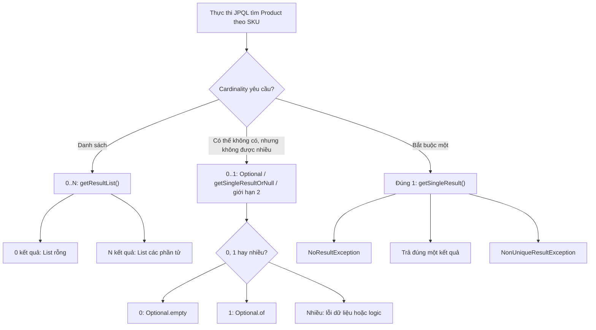

# Đọc danh sách, một kết quả và xử lý không có hoặc có nhiều kết quả

Trong JPA, cùng một câu truy vấn JPQL có thể trả về **không có bản ghi**, **đúng một kết quả** hoặc **nhiều kết quả**. Chọn sai phương thức lấy dữ liệu thường dẫn tới lỗi khó hiểu: màn hình danh sách ném exception khi bảng trống, màn hình chi tiết lấy nhầm một entity trong số nhiều entity, hoặc service giả định dữ liệu duy nhất nhưng database lại tồn tại hai hàng trùng khóa nghiệp vụ.

Hai phương thức cơ bản nhất trên `Query` và `TypedQuery<T>` là:

- `getResultList()`: đọc **danh sách** kết quả, có thể rỗng.
- `getSingleResult()`: yêu cầu **đúng một kết quả**; nếu không có hoặc có nhiều kết quả, JPA ném những exception cụ thể.

Ví dụ:

```java
List<Product> products = em.createQuery(
        "select p from Product p where p.active = true",
        Product.class)
    .getResultList();

Product product = em.createQuery(
        "select p from Product p where p.sku = :sku",
        Product.class)
    .setParameter("sku", "KB-100")
    .getSingleResult();
```

Đoạn đầu phù hợp khi bài toán trả **0..N** sản phẩm. Đoạn sau chỉ phù hợp khi nghiệp vụ yêu cầu **đúng một** sản phẩm với SKU đó và ứng dụng biết cách xử lý trường hợp không tìm thấy hoặc dữ liệu không duy nhất.

**Điểm cốt lõi:** phương thức lấy kết quả phải phản ánh **cardinality của nghiệp vụ**, không phải thói quen gọi API. Một kết quả không nhất thiết là một hàng SQL; một dòng dữ liệu không nhất thiết là một Java entity; `LIMIT 1` không biến dữ liệu trùng thành dữ liệu duy nhất.

## 1. JPQL là truy vấn trên entity và thuộc tính Java

JPQL (*Jakarta Persistence Query Language*) mô tả truy vấn dựa trên **entity name**, thuộc tính persistent và quan hệ JPA, không dựa trực tiếp vào tên bảng/cột vật lý như SQL.

Ví dụ schema:

```sql
CREATE TABLE products (
    id         BIGINT PRIMARY KEY,
    sku        VARCHAR(80) NOT NULL UNIQUE,
    name       VARCHAR(200) NOT NULL,
    unit_price DECIMAL(15, 2) NOT NULL,
    active     BOOLEAN NOT NULL,
    category_id BIGINT
);

CREATE TABLE categories (
    id   BIGINT PRIMARY KEY,
    name VARCHAR(150) NOT NULL
);
```

Entity có thể được khai báo:

```java
package example.domain;

import jakarta.persistence.Column;
import jakarta.persistence.Entity;
import jakarta.persistence.FetchType;
import jakarta.persistence.GeneratedValue;
import jakarta.persistence.GenerationType;
import jakarta.persistence.Id;
import jakarta.persistence.JoinColumn;
import jakarta.persistence.ManyToOne;
import jakarta.persistence.Table;
import jakarta.persistence.Version;
import java.math.BigDecimal;

@Entity
@Table(name = "products")
public class Product {

    @Id
    @GeneratedValue(strategy = GenerationType.SEQUENCE)
    private Long id;

    @Column(nullable = false, unique = true, length = 80)
    private String sku;

    @Column(nullable = false, length = 200)
    private String name;

    @Column(name = "unit_price", nullable = false,
            precision = 15, scale = 2)
    private BigDecimal unitPrice;

    @Column(nullable = false)
    private boolean active;

    @ManyToOne(fetch = FetchType.LAZY)
    @JoinColumn(name = "category_id")
    private Category category;

    @Version
    private long version;

    protected Product() {}

    public Product(String sku, String name, BigDecimal unitPrice) {
        this.sku = sku;
        this.name = name;
        this.unitPrice = unitPrice;
        this.active = true;
    }

    public Long getId() { return id; }
    public String getSku() { return sku; }
    public String getName() { return name; }
    public BigDecimal getUnitPrice() { return unitPrice; }
    public boolean isActive() { return active; }
    public Category getCategory() { return category; }
}
```

Entity `Category`:

```java
package example.domain;

import jakarta.persistence.Entity;
import jakarta.persistence.GeneratedValue;
import jakarta.persistence.GenerationType;
import jakarta.persistence.Id;
import jakarta.persistence.Table;

@Entity
@Table(name = "categories")
public class Category {

    @Id
    @GeneratedValue(strategy = GenerationType.SEQUENCE)
    private Long id;

    private String name;

    protected Category() {}

    public Long getId() { return id; }
    public String getName() { return name; }
}
```

Với những entity trên, JPQL dùng:

```sql
select p from Product p where p.sku = :sku
```

Không dùng:

```sql
-- Đây là SQL theo bảng/cột, không phải JPQL.
SELECT * FROM products WHERE sku = ?;
```

Tên `Product` trong JPQL là entity name (mặc định là tên class nếu không khai báo `@Entity(name = "...")`), `p` là alias, `p.sku` là persistent attribute, còn `:sku` là **named parameter**.

Nếu một entity được khai báo `@Entity(name = "CatalogItem")`, câu JPQL phải dùng `CatalogItem` thay vì tự suy ra theo tên bảng `products`. Mapping và JPQL luôn cần được đối chiếu theo tên entity và thuộc tính Java.

## 2. Hai loại Query: `Query` và `TypedQuery<T>`

JPA cung cấp:

```java
Query query = em.createQuery(
    "select p from Product p where p.active = true");
```

và:

```java
TypedQuery<Product> query = em.createQuery(
    "select p from Product p where p.active = true",
    Product.class);
```

**Nên ưu tiên `TypedQuery<T>`** khi biết kiểu kết quả:

- `getResultList()` trả về `List<Product>` thay vì kết quả thô cần ép kiểu.
- `getSingleResult()` trả về `Product`.
- IDE và Java compiler hỗ trợ kiểm tra kiểu ở nơi nhận kết quả.
- Code đọc dễ biết đang chọn entity, scalar hay DTO projection.

Ví dụ scalar:

```java
TypedQuery<Long> query = em.createQuery(
    "select count(p) from Product p",
    Long.class);
Long count = query.getSingleResult();
```

Ví dụ DTO:

```java
TypedQuery<ProductRow> query = em.createQuery(
    "select new example.api.ProductRow(p.id, p.sku, p.name) " +
    "from Product p order by p.name, p.id",
    ProductRow.class);
```

Với:

```java
package example.api;

public record ProductRow(Long id, String sku, String name) {}
```

Tên kiểu trong `select new ...` phải là tên class đầy đủ mà provider có thể tìm thấy, và constructor phải phù hợp kiểu/ thứ tự các biểu thức. Một `ProductRow` được trả về là DTO, **không phải managed entity**.

### 2.1. Bảng lựa chọn API theo kết quả mong đợi

| Nhu cầu | Kiểu truy vấn | API đọc | Khi không có dữ liệu |
|---|---|---|---|
| Danh sách sản phẩm | `TypedQuery<Product>` | `getResultList()` | `List` rỗng |
| Một SKU bắt buộc có đúng một sản phẩm | `TypedQuery<Product>` | `getSingleResult()` | `NoResultException` |
| Một SKU có thể chưa tồn tại | `TypedQuery<Product>` | `getResultList()` giới hạn 2 hoặc `getSingleResultOrNull()` khi được hỗ trợ | Rỗng hoặc `null` |
| Số lượng sản phẩm | `TypedQuery<Long>` | `getSingleResult()` với `COUNT` | Số `0L` |
| Giá cao nhất | `TypedQuery<BigDecimal>` | `getSingleResult()` với `MAX` | Thường một scalar `null` |
| Kiểm tra có ít nhất một sản phẩm không | `TypedQuery<Long>` | `getResultList()` giới hạn 1 | Danh sách rỗng |
| Các nhóm thống kê theo category | `TypedQuery<...>` | `getResultList()` | Danh sách rỗng |

Lưu ý: `getSingleResultOrNull()` thuộc API Jakarta Persistence mới hơn (Jakarta Persistence 3.2). Nếu ứng dụng đang dùng JPA/Jakarta Persistence phiên bản cũ, phải dùng cách khác; không gọi một method mà interface ở dependency hiện tại chưa khai báo.

## 3. `getResultList()`: phương thức mặc định cho kết quả 0..N

Khi người dùng truy cập trang danh sách, bộ lọc, tìm kiếm hay lịch sử, số lượng kết quả thường không cố định.

```java
List<Product> products = em.createQuery(
        "select p from Product p " +
        "where p.active = true " +
        "order by p.name, p.id",
        Product.class)
    .getResultList();
```

Nếu không có product nào thỏa điều kiện, `getResultList()` trả về **danh sách rỗng**.

```java
if (products.isEmpty()) {
    // Hiển thị trạng thái "Không tìm thấy sản phẩm".
}
```

Không cần bắt `NoResultException` cho trường hợp danh sách rỗng:

```java
try {
    List<Product> products = query.getResultList();
} catch (NoResultException ex) {
    // Đây không phải cách xử lý danh sách không có kết quả.
}
```

`NoResultException` là quy tắc của API yêu cầu một kết quả, không phải signal mà `getResultList()` phát ra cho kết quả rỗng.

### 3.1. `getResultList()` trả những kiểu nào?

Nó trả về nhiều phần tử **cùng kiểu với select expression**:

```java
// Một danh sách entity.
List<Product> entities = em.createQuery(
    "select p from Product p", Product.class
).getResultList();

// Một danh sách tên.
List<String> names = em.createQuery(
    "select p.name from Product p", String.class
).getResultList();

// Một danh sách số ID.
List<Long> ids = em.createQuery(
    "select p.id from Product p", Long.class
).getResultList();

// Một danh sách DTO.
List<ProductRow> rows = em.createQuery(
    "select new example.api.ProductRow(p.id, p.sku, p.name) " +
    "from Product p",
    ProductRow.class
).getResultList();
```

**Entity và DTO có semantics khác nhau:**

- Entity do query trả về được quản lý bởi persistence context phù hợp, trừ các tình huống lifecycle/context cụ thể.
- DTO projection chỉ là object giá trị từ constructor, không có dirty checking tự động như entity.
- Scalar như `String`, `Long` hoặc `BigDecimal` không phải entity.

### 3.2. Chọn nhiều expression

Nếu cần nhiều cột mà không dùng DTO:

```java
List<Object[]> rows = em.createQuery(
        "select p.id, p.name, p.unitPrice " +
        "from Product p where p.active = true " +
        "order by p.id",
        Object[].class)
    .getResultList();

for (Object[] row : rows) {
    Long id = (Long) row[0];
    String name = (String) row[1];
    BigDecimal price = (BigDecimal) row[2];
}
```

Kiểu `Object[]` dễ nhầm chỉ số và ép kiểu sai, đặc biệt khi truy vấn dài. Với API dài hạn, constructor DTO thường dễ bảo trì hơn.

### 3.3. Không được cho rằng kết quả luôn có thứ tự

Không có `ORDER BY`, database không cam kết một thứ tự ổn định:

```java
List<Product> products = em.createQuery(
    "select p from Product p",
    Product.class
).getResultList();
```

Việc hôm nay product có ID nhỏ xuất hiện trước không phải hợp đồng của JPQL. Nếu thứ tự quan trọng:

```java
List<Product> products = em.createQuery(
        "select p from Product p " +
        "order by p.name asc, p.id asc",
        Product.class)
    .getResultList();
```

Thêm `p.id` làm tie-breaker giúp kết quả xác định khi nhiều product trùng `name`.

## 4. `getSingleResult()`: yêu cầu đúng một kết quả

Với nghiệp vụ tìm sản phẩm theo `sku` duy nhất:

```java
Product product = em.createQuery(
        "select p from Product p " +
        "where p.sku = :sku",
        Product.class)
    .setParameter("sku", "KB-100")
    .getSingleResult();
```

Phương thức này có ba kết cục quan trọng:

| Số kết quả JPQL | Hành vi `getSingleResult()` |
|---|---|
| **0** | Ném `NoResultException` |
| **1** | Trả về một kết quả thuộc kiểu query |
| **Nhiều hơn 1** | Ném `NonUniqueResultException` |

**Không nên viết**:

```java
Product product = query.getSingleResult();
if (product == null) {
    // Không phải nhánh xử lý chuẩn của trường hợp "không có row"
    // đối với getSingleResult().
}
```

Khi không có kết quả, `getSingleResult()` ném `NoResultException`; code không chạy tiếp tới phép kiểm tra `product == null`.

### 4.1. Phân biệt không có row với một scalar `null`

Một ngoại lệ quan trọng là **câu query aggregate** có thể trả **một row mà giá trị scalar là `null`**. Ví dụ `MAX` trên một tập rỗng có thể cho một kết quả scalar null.

```java
BigDecimal max = em.createQuery(
        "select max(p.unitPrice) from Product p",
        BigDecimal.class)
    .getSingleResult();

// max có thể null khi không có product.
```

Ở đây không phải “query không trả row” theo cùng semantics như query chọn entity. SQL aggregate không có `GROUP BY` thường trả một row đại diện kết quả phép tổng hợp. Ta phải phân biệt **giá trị null của một kết quả** với **không có kết quả**.

Để xử lý chính xác, hãy xét query shape:

- `select p from Product p where ...`: không có entity thì `getSingleResult()` ném `NoResultException`.
- `select count(p) from Product p`: thường trả một `Long`, kể cả khi số lượng là 0.
- `select max(p.unitPrice) from Product p`: trả một scalar, có thể null nếu không có giá phù hợp.
- `select p.category.id, count(p) ... group by ...`: có thể 0, 1 hoặc nhiều **nhóm**, tùy dữ liệu.

### 4.2. `getSingleResult()` không kiểm tra uniqueness ở database thay constraint

Giả sử query:

```java
Product product = em.createQuery(
        "select p from Product p where p.sku = :sku",
        Product.class)
    .setParameter("sku", sku)
    .getSingleResult();
```

Nếu business rule yêu cầu mỗi SKU chỉ có một product, database phải có ràng buộc:

```sql
ALTER TABLE products
ADD CONSTRAINT uq_products_sku UNIQUE (sku);
```

`getSingleResult()` chỉ nhận biết query trả nhiều hơn một kết quả **ở thời điểm truy vấn**. Nó không ngăn được hai transaction đồng thời INSERT cùng SKU nếu database không có unique constraint. Query cardinality là hợp đồng API, còn uniqueness constraint bảo vệ dữ liệu ở tất cả đường ghi.

## 5. `NoResultException`: trường hợp không tìm thấy

`NoResultException` thuộc package `jakarta.persistence`:

```java
import jakarta.persistence.NoResultException;
```

Ví dụ xử lý:

```java
public Product requireBySku(EntityManager em, String sku) {
    try {
        return em.createQuery(
                "select p from Product p where p.sku = :sku",
                Product.class)
            .setParameter("sku", sku)
            .getSingleResult();
    } catch (NoResultException ex) {
        throw new ProductNotFoundException(
            "Product not found for SKU: " + sku, ex);
    }
}
```

`ProductNotFoundException` là exception nghiệp vụ do dự án tự định nghĩa. Ví dụ:

```java
public class ProductNotFoundException extends RuntimeException {
    public ProductNotFoundException(String message, Throwable cause) {
        super(message, cause);
    }
}
```

Cách chuyển `NoResultException` thành lỗi nghiệp vụ giúp service phân biệt “đối tượng bắt buộc không tồn tại” với lỗi kỹ thuật khác.

### 5.1. Không tìm thấy có luôn là lỗi không?

Không. Nó tùy use case:

- Màn hình chi tiết `GET /products/{id}`: có thể trả HTTP 404 nếu ID không tồn tại.
- Hàm `requireBySku`: thiếu product là vi phạm tiền điều kiện nghiệp vụ.
- Chức năng kiểm tra SKU đã tồn tại trước khi tạo: không tìm thấy là kết quả **bình thường**.
- Tính năng gợi ý sản phẩm: tìm thấy rỗng là kết quả bình thường.

Vì vậy, có hai API service khác nhau:

```java
Product requireBySku(String sku);     // Phải tồn tại, nếu không thì lỗi.
Optional<Product> findBySku(String sku); // Có thể không tồn tại.
```

Hai hàm có thể dùng chung JPQL, nhưng **trả những hợp đồng nghiệp vụ khác nhau**.

### 5.2. `NoResultException` có đánh dấu transaction rollback-only không?

Theo JPA, `NoResultException` do `getSingleResult()` ném ra **không tự đánh dấu transaction hiện tại rollback-only**. Điều này cho phép ứng dụng xử lý “không tìm thấy” như một nhánh điều khiển bình thường.

Tuy nhiên, không được suy ra rằng **mọi exception của query** đều an toàn tương tự. SQL error, lock failure, timeout và các `PersistenceException` khác có thể ảnh hưởng trạng thái transaction theo loại exception/provider.

Trong Spring, nếu ứng dụng bắt một exception và **ném tiếp một runtime exception nghiệp vụ ra khỏi phương thức `@Transactional`**, transaction manager có thể quyết định rollback theo cấu hình Spring. Đây là chính sách của transaction framework ở tầng cao hơn, không mâu thuẫn với việc JPA `NoResultException` nguyên thủy không tự đánh dấu rollback.

## 6. `NonUniqueResultException`: có nhiều kết quả khi chỉ chấp nhận một

`NonUniqueResultException` cũng thuộc `jakarta.persistence`:

```java
import jakarta.persistence.NonUniqueResultException;
```

Ví dụ một query:

```java
Product product = em.createQuery(
        "select p from Product p " +
        "where lower(p.name) = lower(:name)",
        Product.class)
    .setParameter("name", "Mouse")
    .getSingleResult();
```

Không có gì bảo đảm tên product là duy nhất. Nếu hai product cùng tên “Mouse”, query trả nhiều kết quả và `getSingleResult()` ném `NonUniqueResultException`.

### 6.1. Không xử lý bằng cách lấy phần tử đầu tiên một cách tùy tiện

Một cách sửa nguy hiểm:

```java
Product product = em.createQuery(
        "select p from Product p where p.name = :name",
        Product.class)
    .setParameter("name", name)
    .setMaxResults(1)
    .getSingleResult();
```

`setMaxResults(1)` chỉ yêu cầu query **trả tối đa một kết quả**. Nó không chứng minh dữ liệu thực sự duy nhất. Nếu có 500 hàng thỏa điều kiện, query vẫn trả một hàng và không còn cách phát hiện dữ liệu trùng từ kết quả ấy.

Ngoài ra, nếu thiếu `ORDER BY`, “một hàng đầu tiên” không có ý nghĩa xác định.

**Nếu nghiệp vụ yêu cầu duy nhất:** đặt unique constraint đúng phạm vi và chủ động phát hiện dữ liệu vi phạm. **Nếu nghiệp vụ chỉ cần một bản ghi đại diện:** hãy nói rõ tiêu chí chọn, ví dụ mới nhất hoặc rẻ nhất, rồi dùng `ORDER BY` và giới hạn một kết quả.

### 6.2. Nếu nhiều kết quả là lỗi dữ liệu

```java
public Product requireUniqueBySku(EntityManager em, String sku) {
    try {
        return em.createQuery(
                "select p from Product p where p.sku = :sku",
                Product.class)
            .setParameter("sku", sku)
            .getSingleResult();
    } catch (NoResultException ex) {
        throw new ProductNotFoundException(
            "Missing SKU: " + sku, ex);
    } catch (NonUniqueResultException ex) {
        throw new IllegalStateException(
            "Duplicate product SKU detected: " + sku, ex);
    }
}
```

`NonUniqueResultException` là tín hiệu mạnh rằng giả định **chỉ một kết quả** không đúng. Có thể nguyên nhân là thiếu ràng buộc, query thiếu điều kiện phân biệt tenant, join tạo nhiều dòng hoặc business rule thực tế cho phép nhiều entity.

**Không được tự chọn ngẫu nhiên một entity** khi dữ liệu trùng có thể gây tính tiền sai, cấp quyền nhầm hay gắn đơn hàng sai owner.

### 6.3. `NonUniqueResultException` và transaction

Tương tự `NoResultException`, `NonUniqueResultException` do `getSingleResult()` ném ra **không tự đánh dấu transaction JPA rollback-only**. Nhưng nếu ứng dụng chuyển nó thành một runtime exception và ném ra qua transaction interceptor, framework có thể rollback theo policy.

Trong các hệ thống nghiệp vụ, trường hợp không duy nhất thường được xem là lỗi dữ liệu cần điều tra; tiếp tục thao tác ghi sau khi phát hiện duplicate cần được cân nhắc, không phải tự động hợp lệ chỉ vì JPA không đánh dấu rollback.

## 7. Luồng xử lý 0, 1 và nhiều kết quả



Lưu đồ nhấn mạnh việc **chọn phương thức dựa trên yêu cầu**, không phải nhận exception rồi “sửa” bằng cách bỏ đi dữ liệu.

Một bảng quyết định:

| Cardinality của miền nghiệp vụ | Chữ ký phương thức phù hợp | Cách biểu diễn |
|---|---|---|
| 0..N | `List<Product> findActive()` | Danh sách rỗng hoặc có phần tử |
| 1..N | `List<Product> requireAtLeastOne()` | Danh sách; ứng dụng tự kiểm tra `isEmpty()` |
| 0..1 | `Optional<Product> findBySku()` | `empty` hoặc một entity |
| Chính xác 1 | `Product requireBySku()` | Entity hoặc lỗi có ý nghĩa |
| 1 đầu tiên theo tiêu chí xác định | `Optional<Product> findNewestBy...()` | `ORDER BY` + `setMaxResults(1)`; không đòi dữ liệu duy nhất |
| Một giá trị thống kê | `long countProducts()` | Aggregate `COUNT` |

## 8. Xây repository trả `Optional<T>` mà không che giấu dữ liệu trùng

Java `Optional<T>` rất phù hợp khi hàm được phép trả **0 hoặc 1** entity. Nhưng JPA API cũ không trực tiếp trả Optional từ `getSingleResult()`.

Có nhiều cách thực hiện. Mỗi cách có đánh đổi riêng.

### 8.1. Cách A: bắt riêng `NoResultException`

```java
public Optional<Product> findBySku(EntityManager em, String sku) {
    try {
        Product product = em.createQuery(
                "select p from Product p where p.sku = :sku",
                Product.class)
            .setParameter("sku", sku)
            .getSingleResult();

        return Optional.of(product);
    } catch (NoResultException ex) {
        return Optional.empty();
    }
}
```

**Ưu điểm:**

- Ngắn gọn.
- Giữ nguyên semantics yêu cầu tối đa một: nếu có nhiều kết quả, `NonUniqueResultException` vẫn được ném ra.
- Phù hợp khi mong đợi một kết quả duy nhất.

**Nhược điểm:** dùng exception cho nhánh “không tìm thấy”, vốn có thể xảy ra thường xuyên như một kết quả bình thường. Với nhiều tầng service, điều này có thể làm logging hoặc profiling khó đọc nếu ứng dụng lạm dụng việc ghi mọi exception đã bắt.

### 8.2. Cách B: `getSingleResultOrNull()` khi API hỗ trợ

Trong Jakarta Persistence 3.2, `Query`/`TypedQuery` có `getSingleResultOrNull()`:

```java
public Optional<Product> findBySku(EntityManager em, String sku) {
    Product result = em.createQuery(
            "select p from Product p where p.sku = :sku",
            Product.class)
        .setParameter("sku", sku)
        .getSingleResultOrNull();

    return Optional.ofNullable(result);
}
```

**Semantics:**

- Không có kết quả: trả `null`.
- Đúng một kết quả: trả kết quả.
- Nhiều kết quả: vẫn ném `NonUniqueResultException`.

Đây không phải phương thức có sẵn trong mọi phiên bản JPA cũ. Khi chạy ứng dụng trên Jakarta Persistence 3.0/3.1 hoặc `javax.persistence` 2.x, hãy xác nhận dependency và provider trước khi sử dụng. Không nhầm với helper của Hibernate/Spring có thể mang tên tương tự nhưng API khác.

**Lưu ý về scalar:** nếu chính kết quả query là `null` (ví dụ `MAX` trên tập rỗng), `getSingleResultOrNull()` không cho caller phân biệt một row scalar null với không có row chỉ bằng return value. Khi cần phân biệt, thiết kế query/result wrapper rõ hơn.

### 8.3. Cách C: `getResultList()` với giới hạn 2

Muốn xử lý 0..1 mà không dựa vào exception “not found”, đồng thời **phát hiện trường hợp nhiều kết quả**, có thể lấy tối đa **hai**:

```java
public Optional<Product> findUniqueBySku(
        EntityManager em, String sku) {

    List<Product> results = em.createQuery(
            "select p from Product p where p.sku = :sku",
            Product.class)
        .setParameter("sku", sku)
        .setMaxResults(2)
        .getResultList();

    if (results.isEmpty()) {
        return Optional.empty();
    }
    if (results.size() > 1) {
        throw new IllegalStateException(
            "More than one product has SKU: " + sku);
    }
    return Optional.of(results.get(0));
}
```

**Tại sao là 2 mà không phải 1?** Vì cần phân biệt ba trường hợp: 0, 1 và **ít nhất 2**. Không cần tải hàng nghìn kết quả để biết đã có nhiều hơn một.

Điều kiện:

- Query phải thật sự chọn các entity/giá trị phản ánh cardinality cần kiểm tra.
- Với những query có join nhiều-nhiều/một-nhiều, cần hiểu `DISTINCT`, multiplicity và semantics của result projection trước khi đếm.
- Nếu cần tính duy nhất bền vững, database unique constraint vẫn là nguồn bảo vệ cuối cùng.

### 8.4. Cách nào nên chọn?

| Cách | 0 kết quả | Nhiều kết quả | Phù hợp |
|---|---|---|---|
| `getSingleResult()` + catch `NoResultException` | Bắt exception | Ném `NonUniqueResultException` | JPA cũ, code ngắn, giữ lỗi duplicate |
| `getSingleResultOrNull()` | `null` | Ném `NonUniqueResultException` | Jakarta Persistence hỗ trợ method |
| `getResultList()` + `setMaxResults(2)` | List rỗng | Tự kiểm tra size=2 | API 0..1 với nhánh rõ, giới hạn dữ liệu |
| `getResultList()` + `setMaxResults(1)` | List rỗng | **Không phát hiện duplicate** | Chỉ muốn một bản ghi đại diện, không yêu cầu uniqueness |

Tùy convention của team, có thể chọn một trong các cách đầu và dùng nhất quán trong repository.

## 9. Khi nào `setMaxResults(1)` là hợp lý?

Trong nhiều nghiệp vụ, “lấy một phần tử” **không** có nghĩa “chỉ có một phần tử tồn tại”.

Ví dụ: cần sản phẩm mới nhất thuộc một category:

```java
List<Product> newest = em.createQuery(
        "select p from Product p " +
        "where p.category.id = :categoryId " +
        "order by p.id desc",
        Product.class)
    .setParameter("categoryId", categoryId)
    .setMaxResults(1)
    .getResultList();

Optional<Product> result = newest.stream().findFirst();
```

Ở đây:

- Có thể có nhiều product trong category.
- Ta **cố ý** chọn một theo thứ tự `id desc`.
- Nếu không có, Optional rỗng.
- Không cần exception `NonUniqueResultException`, vì nhiều product là dữ liệu hợp lệ.

**Phân biệt lời hứa:**

```text
findUniqueBySku(sku)
  -> Domain nói SKU phải duy nhất.
  -> Nhiều kết quả là lỗi.

findNewestInCategory(categoryId)
  -> Domain cho phép nhiều product.
  -> Chọn đúng một theo ORDER BY.
```

Nếu “mới nhất” thực sự dựa vào thời gian tạo, entity nên có thuộc tính `createdAt`, và query nên dùng `order by p.createdAt desc, p.id desc`. `id desc` chỉ là tiêu chí minh họa, không phải bằng chứng rằng ID lớn luôn được tạo gần đây hơn trong mọi generator/import.

### 9.1. Đừng dùng “first result” không có ORDER BY

```java
Product p = em.createQuery(
        "select p from Product p where p.category.id = :id",
        Product.class)
    .setParameter("id", categoryId)
    .setMaxResults(1)
    .getSingleResult();
```

Khi có nhiều kết quả hợp lệ, dòng đầu tiên có thể thay đổi theo query plan, index, cập nhật dữ liệu và provider. Nếu thứ tự có ý nghĩa, hãy luôn khai báo.

### 9.2. Vì sao không dùng `getSingleResult()` trên query giới hạn 1 rồi coi dữ liệu unique?

`getSingleResult()` chỉ nhìn thấy result set **sau khi giới hạn**, nên không thể biết ban đầu có bao nhiêu hàng khác cũng khớp. Nếu nghi ngờ trùng, hãy bỏ giới hạn, dùng cách `setMaxResults(2)` hoặc unique constraint.

## 10. `getResultList()` trên tập dữ liệu lớn: phân trang ngay từ query

`getResultList()` trả các phần tử kết quả mà query lấy về. Nếu bảng có 10 triệu product, gọi:

```java
List<Product> all = em.createQuery(
    "select p from Product p",
    Product.class
).getResultList();
```

có thể gây tốn RAM, thời gian SQL, network, tạo nhiều managed entity và làm persistence context quá lớn. Không nên dùng một list khổng lồ chỉ để hiển thị 20 dòng.

### 10.1. Phân trang theo offset

```java
public List<Product> findPage(
        EntityManager em, int page, int pageSize) {

    if (page < 0 || pageSize < 1 || pageSize > 200) {
        throw new IllegalArgumentException("Invalid page");
    }

    long offset = (long) page * pageSize;
    if (offset > Integer.MAX_VALUE) {
        throw new IllegalArgumentException("Offset too large");
    }

    return em.createQuery(
            "select p from Product p " +
            "order by p.name asc, p.id asc",
            Product.class)
        .setFirstResult((int) offset)
        .setMaxResults(pageSize)
        .getResultList();
}
```

JPA cung cấp `setFirstResult(int)` và `setMaxResults(int)`. Provider sẽ chuyển chúng thành cú pháp phân trang thích hợp với database.

Lưu ý:

- `page` trong ví dụ bắt đầu từ 0.
- `setFirstResult` dùng offset; trang rất sâu có thể tốn nhiều chi phí database.
- `ORDER BY` cần ổn định; thêm ID làm tie-breaker.
- Không phân trang parent bằng `JOIN FETCH` collection lớn một cách tùy tiện vì các SQL JOIN có thể nhân row và khiến provider phải phân trang trong bộ nhớ.

### 10.2. Phân trang bằng cursor/keyset

Nếu cần đi qua hàng triệu product theo ID:

```java
List<Product> nextPage = em.createQuery(
        "select p from Product p " +
        "where p.id > :afterId " +
        "order by p.id",
        Product.class)
    .setParameter("afterId", lastId)
    .setMaxResults(100)
    .getResultList();
```

Cách này tránh bỏ qua một offset lớn khi có index phù hợp. Nhưng nó không tạo snapshot bất biến: bản ghi được chèn/xóa/thay điều kiện lọc trong khi duyệt vẫn ảnh hưởng các trang tiếp theo.

### 10.3. `getResultStream()` không tự đảm bảo streaming RAM thấp

JPA cũng có `getResultStream()` trên `Query` trong các phiên bản hỗ trợ. Tuy nhiên, theo provider, stream có thể dựa trên list đã được lấy về hoặc được tối ưu bằng cursor. Kể cả khi JDBC dùng cursor, managed entities vẫn có thể tích tụ trong persistence context.

Để xử lý tập lớn theo cách có thể kiểm soát, hãy cân nhắc paging, DTO projection, transaction ngắn và `flush/clear` có chủ đích. Không đánh đồng API Java `Stream` với bảo đảm database đọc dần bộ nhớ cố định.

## 11. Truy vấn `COUNT`: không có row khác số đếm bằng 0

Một câu hỏi kinh điển: “Nếu không có sản phẩm, `getSingleResult()` với `COUNT` có ném `NoResultException` không?”

Với JPQL aggregate không có `GROUP BY`:

```java
Long count = em.createQuery(
        "select count(p) from Product p " +
        "where p.active = true",
        Long.class)
    .getSingleResult();
```

Khi không có product active, `count` nhận **`0L`**. Đó là **một kết quả aggregate**, không phải “không có kết quả”.

### 11.1. `COUNT` trả `Long`

```java
Long total = em.createQuery(
    "select count(p) from Product p",
    Long.class
).getSingleResult();
```

Đừng ép mặc định về `Integer`:

```java
// Không đúng kiểu kết quả chuẩn của COUNT:
// Integer total = (Integer) query.getSingleResult();
```

Khi application API cần `int`, chỉ chuyển đổi có kiểm tra phạm vi. Với dữ liệu lớn, `long` thường phù hợp hơn.

### 11.2. `SUM`, `AVG`, `MIN`, `MAX` có thể cho scalar null

Ví dụ:

```java
BigDecimal highestPrice = em.createQuery(
        "select max(p.unitPrice) " +
        "from Product p where p.active = true",
        BigDecimal.class)
    .getSingleResult();

if (highestPrice == null) {
    // Không có giá phù hợp để lấy MAX.
}
```

Đối với một tập rỗng, các aggregate ngoài `COUNT` thường trả `null` khi không có giá trị để tổng hợp. Kiểu kết quả của `AVG` thường là `Double` cho numeric expressions theo quy tắc JPA; cần kiểm tra đúng kiểu của từng phép tính thay vì coi tất cả là `BigDecimal`.

### 11.3. `GROUP BY` thay đổi cardinality

```java
List<Object[]> summary = em.createQuery(
        "select p.category.id, count(p) " +
        "from Product p " +
        "where p.active = true " +
        "group by p.category.id",
        Object[].class)
    .getResultList();
```

Kết quả có **một row cho mỗi nhóm**, nên số row có thể là 0, 1 hoặc N. Nếu không có product active, danh sách nhóm rỗng.

Không nên:

```java
Object[] onlyCategory = em.createQuery(
        "select p.category.id, count(p) " +
        "from Product p group by p.category.id",
        Object[].class)
    .getSingleResult();
```

trừ khi điều kiện nghiệp vụ bảo đảm query chỉ có đúng một nhóm. Nếu không, `NonUniqueResultException` là kết quả hợp lý.

### 11.4. `HAVING` cũng có thể loại hết các nhóm

```java
List<Object[]> categories = em.createQuery(
        "select p.category.id, count(p) " +
        "from Product p " +
        "group by p.category.id " +
        "having count(p) >= :minCount",
        Object[].class)
    .setParameter("minCount", 10L)
    .getResultList();
```

Nếu không nhóm nào có ít nhất 10 product, danh sách rỗng. Đừng sử dụng `getSingleResult()` cho truy vấn grouped thống kê khi miền nghiệp vụ cho phép nhiều category.

## 12. Kiểm tra tồn tại mà không tải entity

Để hỏi “Có sản phẩm nào mang SKU X không?”, không cần tải toàn bộ entity hoặc gọi `COUNT` mọi lúc.

### 12.1. Truy vấn ID giới hạn một phần tử

```java
public boolean existsBySku(EntityManager em, String sku) {
    return !em.createQuery(
            "select p.id from Product p " +
            "where p.sku = :sku",
            Long.class)
        .setParameter("sku", sku)
        .setMaxResults(1)
        .getResultList()
        .isEmpty();
}
```

Ý nghĩa:

- Query chỉ chọn ID.
- `setMaxResults(1)` giúp trả tối đa một ID.
- Nếu không có kết quả, list rỗng và trả `false`.
- Nếu có ít nhất một kết quả, trả `true`.

Ở đây **không cần phát hiện duplicate**, vì câu hỏi chỉ là “có ít nhất một không”. Dù vậy, nếu SKU phải unique, database vẫn cần constraint.

### 12.2. Dùng `COUNT` khi thực sự cần số lượng

```java
boolean exists = em.createQuery(
        "select count(p) from Product p " +
        "where p.sku = :sku",
        Long.class)
    .setParameter("sku", sku)
    .getSingleResult() > 0;
```

Cách này rõ ràng và portable, nhưng tùy dữ liệu/index, database có thể phải tính toàn bộ số row khớp điều kiện. Với câu hỏi tồn tại đơn giản, query giới hạn một kết quả có thể hiệu quả hơn.

### 12.3. `EXISTS` trong subquery

JPQL hỗ trợ `EXISTS` trong biểu thức điều kiện, đặc biệt hữu ích với quan hệ:

```java
List<Category> categories = em.createQuery(
        "select c from Category c " +
        "where exists (" +
        "  select p.id from Product p " +
        "  where p.category = c and p.active = true" +
        ")",
        Category.class)
    .getResultList();
```

Đây là danh sách những category có ít nhất một active product. `EXISTS` là điều kiện của JPQL query; nó không buộc ứng dụng phải tải toàn bộ `Product` để kiểm tra.

## 13. Truy vấn ID: khi nào dùng `EntityManager.find`?

Nếu bạn đã biết **primary key** của entity:

```java
Product product = em.find(Product.class, productId);
```

`find` có semantics khác `getSingleResult()`:

- Nếu ID có entity: trả entity managed phù hợp với context.
- Nếu không tìm thấy: **trả `null`**.
- Không có khái niệm “nhiều entity có cùng primary key” trong một bảng đúng ràng buộc PK.
- Có thể tận dụng identity map của persistence context và cache tùy provider.

### Bảng so sánh

| Tác vụ | Cách gọi | Không tìm thấy | Nhiều kết quả |
|---|---|---|---|
| Tìm theo primary key | `em.find(Product.class, id)` | `null` | Không áp dụng theo PK hợp lệ |
| Tìm theo SKU unique | JPQL + `getSingleResult()` | `NoResultException` | `NonUniqueResultException` |
| Tìm theo tên, có thể trùng | JPQL + `getResultList()` | List rỗng | List nhiều phần tử |
| Chọn mới nhất trong category | JPQL `ORDER BY` + `setMaxResults(1)` | List rỗng | Chỉ trả một theo tiêu chí |

Với primary key, dùng `find` thường ngắn gọn và đúng ý hơn việc viết:

```java
em.createQuery(
    "select p from Product p where p.id = :id", Product.class
).setParameter("id", id).getSingleResult();
```

Tuy nhiên, nếu cần thêm điều kiện **tenantId**, quyền truy cập, trạng thái `active` hoặc soft delete trong query, một JPQL query có điều kiện có thể cần thiết thay vì `find` thuần PK.

## 14. Phân biệt “một hàng SQL” và “một kết quả JPQL”

Một JPQL query có join có thể tạo nhiều **SQL rows** cho cùng một entity root:

```java
@Entity
public class PurchaseOrder {
    @Id
    private Long id;

    @OneToMany(mappedBy = "order")
    private List<OrderLine> lines;
}
```

```java
List<PurchaseOrder> orders = em.createQuery(
        "select o from PurchaseOrder o " +
        "join o.lines l " +
        "where l.quantity > :minQty",
        PurchaseOrder.class)
    .setParameter("minQty", 10)
    .getResultList();
```

Nếu một order có ba lines thỏa điều kiện, SQL join có thể chứa ba row tương ứng với cùng order. Kết quả Java và cách provider xử lý duplicate entity references phụ thuộc kiểu truy vấn và semantics `DISTINCT`.

Nếu nghiệp vụ yêu cầu mỗi order xuất hiện một lần:

```java
List<PurchaseOrder> orders = em.createQuery(
        "select distinct o from PurchaseOrder o " +
        "join o.lines l " +
        "where l.quantity > :minQty",
        PurchaseOrder.class)
    .setParameter("minQty", 10)
    .getResultList();
```

`DISTINCT` ở JPQL dùng để loại kết quả trùng theo semantics của biểu thức được chọn. SQL do provider sinh có thể khác nhau giữa providers; điều quan trọng là cardinality của **kết quả JPQL**, không phải nhìn một SQL join rồi đoán mọi duplicate trong Java.

### 14.1. Vì sao `getSingleResult()` trên join cần thận trọng?

Nếu query chọn entity root và join với collection, quan hệ một-nhiều có thể làm xuất hiện nhiều SQL rows. Ngược lại, nếu query chọn từng child hoặc nhiều scalar, một owner có nhiều child nghĩa là **nhiều kết quả thật**.

Ví dụ:

```java
// Có thể trả nhiều OrderLine, dù tất cả cùng thuộc một order.
OrderLine line = em.createQuery(
        "select l from OrderLine l where l.order.id = :orderId",
        OrderLine.class)
    .setParameter("orderId", orderId)
    .getSingleResult();
```

Nếu một order có nhiều lines, `getSingleResult()` là sai đối với nghiệp vụ “đọc tất cả lines”. Không phải lỗi database trùng; mà là code yêu cầu cardinality sai.

### 14.2. `DISTINCT` không phải thuốc chữa cho thiếu unique constraint

```java
select distinct p from Product p where p.sku = :sku
```

Nếu có hai entity `Product` khác ID nhưng cùng SKU, `DISTINCT` **không gộp** chúng thành một entity, vì chúng là hai kết quả entity khác nhau. Muốn bảo đảm SKU unique, phải áp dụng unique constraint.

## 15. Kết quả rỗng và `LEFT JOIN`

Một nguyên nhân khó hiểu của “không có kết quả” là query dùng `INNER JOIN` trong khi quan hệ phía bên kia là optional.

Ví dụ product có thể chưa được gắn category:

```java
List<Product> products = em.createQuery(
        "select p from Product p join p.category c " +
        "where p.active = true",
        Product.class)
    .getResultList();
```

`JOIN` mặc định là inner join; những product không có category sẽ không có row tương ứng trong kết quả.

Muốn giữ tất cả active product, kể cả khi chưa có category:

```java
List<Product> products = em.createQuery(
        "select p from Product p " +
        "left join p.category c " +
        "where p.active = true",
        Product.class)
    .getResultList();
```

Nhưng nếu đặt điều kiện:

```java
where c.name = :name
```

thì product với `c == null` thường bị loại bởi điều kiện WHERE, làm nhiều trường hợp về mặt kết quả giống inner join. Nếu cần giữ phía optional, phải thiết kế điều kiện cho phép null rõ ràng hoặc dùng cú pháp join condition phù hợp.

**Bài học:** khi query trả 0 bản ghi ngoài mong đợi, không chỉ nhìn `getResultList/getSingleResult`; hãy đọc lại các JOIN và WHERE clauses.

## 16. Dùng tham số đúng cách

### 16.1. Named parameter

```java
List<Product> products = em.createQuery(
        "select p from Product p " +
        "where p.name like :pattern and p.active = :active",
        Product.class)
    .setParameter("pattern", "%mouse%")
    .setParameter("active", true)
    .getResultList();
```

Ưu điểm:

- Tách dữ liệu khỏi JPQL syntax.
- Tránh tạo query bằng nối chuỗi input.
- Khi có nhiều tham số, tên có ý nghĩa dễ đọc hơn vị trí.

Không nên:

```java
String jpql = "select p from Product p where p.sku = '" + sku + "'";
```

Nối input trực tiếp vào JPQL có thể gây injection và lỗi escape ký tự.

### 16.2. Positional parameter

```java
Product product = em.createQuery(
        "select p from Product p where p.sku = ?1",
        Product.class)
    .setParameter(1, sku)
    .getSingleResult();
```

JPQL positional parameters dùng chỉ số bắt đầu từ **1**. Với câu query phức tạp, named parameters thường dễ bảo trì hơn.

### 16.3. Tham số null không giống `IS NULL`

Nếu muốn tìm product không có category:

```java
List<Product> noCategory = em.createQuery(
        "select p from Product p where p.category is null",
        Product.class)
    .getResultList();
```

Không nên dựa vào:

```java
where p.category = :category
```

với `category == null` để thay cho `IS NULL`; theo ba-valued logic của SQL/JPQL, so sánh bằng `NULL` không mang semantics như so sánh giá trị thông thường.

### 16.4. `LIKE` và cách xử lý pattern

```java
where lower(p.name) like :pattern
```

Nếu cần tìm chuỗi nhập nguyên văn, phải xử lý các ký tự wildcard `%` và `_` theo yêu cầu nghiệp vụ. Named parameter ngăn injection vào cú pháp query nhưng **không tự escape ý nghĩa wildcard của LIKE**. Việc sử dụng `ESCAPE` cần được thiết kế phù hợp với JPQL và database/provider.

## 17. Sự khác biệt giữa lỗi kết quả và lỗi thực thi query

Không phải mọi lỗi khi gọi `getResultList()` hoặc `getSingleResult()` đều liên quan cardinality.

Một số loại exception:

| Exception | Tình huống điển hình | Phản ứng phù hợp |
|---|---|---|
| `NoResultException` | `getSingleResult()` không tìm thấy | Quyết định “không tồn tại” có hợp lệ không |
| `NonUniqueResultException` | `getSingleResult()` có nhiều kết quả | Kiểm tra business cardinality, điều kiện WHERE/unique constraint |
| `IllegalArgumentException` | Gán sai tham số/tên hoặc kiểu không phù hợp | Sửa cách dùng query API |
| `QueryTimeoutException` | Query timeout loại chỉ rollback statement theo hợp đồng exception | Xử lý timeout, đo hiệu năng, retry nếu phù hợp |
| `LockTimeoutException` | Không lấy được lock trong thời gian cho phép theo semantics exception | Thử lại/đổi concurrency strategy |
| `PessimisticLockException` | Lỗi khóa yêu cầu rollback transaction | Rollback theo policy |
| `PersistenceException` | Lỗi persistence/SQL/provider khác | Xác định transaction state, rollback và chẩn đoán |
| `TransactionRequiredException` | Một số thao tác yêu cầu transaction nhưng không có | Sửa transaction boundary |

Chi tiết rollback state phụ thuộc exception cụ thể, transaction manager và provider. Không nên bắt mọi `PersistenceException` rồi trả danh sách rỗng:

```java
try {
    return query.getResultList();
} catch (PersistenceException ex) {
    return List.of(); // Nguy hiểm: che giấu DB failure thành "không có dữ liệu".
}
```

Một truy vấn thất bại vì connection lỗi **khác hoàn toàn** với truy vấn thành công và trả 0 kết quả. API nên giữ được khác biệt đó để ứng dụng không ra quyết định sai.

## 18. Service trả kết quả như thế nào?

Một repository có thể cung cấp ba nhóm method:

```java
public interface ProductReader {
    List<ProductRow> findActive(int page, int pageSize);

    Optional<Product> findBySku(String sku);

    Product requireBySku(String sku);
}
```

Các method biểu diễn:

- `findActive`: 0..N results.
- `findBySku`: 0..1 result; thiếu là trạng thái bình thường.
- `requireBySku`: phải có đúng một result; thiếu thì lỗi, duplicate thì lỗi dữ liệu.

### 18.1. Một implementation có thể dùng lại query semantics

```java
public class JpaProductReader {
    private final EntityManager em;

    public JpaProductReader(EntityManager em) {
        this.em = em;
    }

    public Optional<Product> findBySku(String sku) {
        List<Product> rows = em.createQuery(
                "select p from Product p where p.sku = :sku",
                Product.class)
            .setParameter("sku", sku)
            .setMaxResults(2)
            .getResultList();

        if (rows.isEmpty()) {
            return Optional.empty();
        }
        if (rows.size() != 1) {
            throw new IllegalStateException(
                "Duplicate SKU: " + sku);
        }
        return Optional.of(rows.get(0));
    }

    public Product requireBySku(String sku) {
        return findBySku(sku)
            .orElseThrow(() -> new IllegalArgumentException(
                "Unknown SKU: " + sku));
    }
}
```

Đây là ví dụ về **hợp đồng dữ liệu**, không bao gồm quản lý transaction hoặc lifecycle của `EntityManager`. Trong ứng dụng Jakarta EE/Spring, service/container thường sở hữu transaction. Nếu repository giữ `EntityManager`, phải đảm bảo phạm vi của instance phù hợp và không dùng application-managed EntityManager như singleton đa luồng.

### 18.2. Có nên trả managed entity ra REST API?

Đối với API đọc, trả một entity managed trực tiếp có thể khiến serializer truy cập các association lazy, gây N+1 query, vòng tham chiếu hoặc lỗi khi context đã đóng. DTO projection phù hợp hơn cho danh sách, còn endpoint chi tiết nên định nghĩa rõ dữ liệu nào cần trả.

Với command cập nhật, service có thể tải managed entity bằng `find`/JPQL, kiểm tra permission/tenant và sửa state trong transaction. Không đưa mọi entity trong object graph ra ngoài phạm vi transaction rồi giả định chúng mãi được quản lý.

## 19. Trường hợp multi-tenant: một kết quả trong phạm vi nào?

Trong ứng dụng nhiều tenant, có thể có nhiều product cùng `sku` nhưng thuộc tenant khác nhau:

```text
tenant_id | sku    | product_id
----------+--------+-----------
T1        | KB-100 | 10
T2        | KB-100 | 20
```

Truy vấn:

```java
select p from Product p where p.sku = :sku
```

có thể trả **hai kết quả hợp lệ**, dù mỗi tenant chỉ có một SKU đó.

Nếu entity có thuộc tính `tenantId`, cần:

```java
Product product = em.createQuery(
        "select p from Product p " +
        "where p.tenantId = :tenantId " +
        "and p.sku = :sku",
        Product.class)
    .setParameter("tenantId", tenantId)
    .setParameter("sku", sku)
    .getSingleResult();
```

Trong schema, có thể cần:

```sql
UNIQUE (tenant_id, sku)
```

thay cho unique toàn cục trên SKU. Đó là lý do `NonUniqueResultException` không tự chứng minh “dữ liệu hỏng”: đôi khi **query đang thiếu phạm vi nghiệp vụ**.

Ngoài ra, không chỉ tin vào tenant ID nhận trực tiếp từ client; phải lấy/kiểm tra nó theo authentication/authorization context. Cardinality và data isolation đều cần được thiết kế ở tầng domain/security.

## 20. Soft delete: query thiếu điều kiện có thể thấy nhiều kết quả

Một hệ thống có chính sách soft delete:

```text
products:
id=10, sku=KB-100, deleted_at=2026-01-01
id=25, sku=KB-100, deleted_at=NULL
```

Nếu business chỉ cho phép một product **đang hoạt động** cho mỗi SKU, query:

```java
select p from Product p where p.sku = :sku
```

có thể có hai kết quả dù trong UI chỉ một product được xem là hiện hành.

Query có thể cần:

```java
select p from Product p
where p.sku = :sku and p.deletedAt is null
```

Đoạn trên giả định entity có thuộc tính `deletedAt`. Nếu dùng provider-level filter hoặc `@SQLRestriction` kiểu Hibernate, query semantics còn phụ thuộc cấu hình filter.

Tại database, uniqueness cho “chỉ một row chưa soft-delete cùng SKU” có thể dùng unique partial index hoặc một cấu trúc tương đương tùy RDBMS. Không mặc định rằng unique constraint trên `(sku, deleted_at)` có cùng semantics khi `deleted_at` là NULL trong mọi database.

**Bài học:** “đúng một kết quả” là quy tắc **trong phạm vi điều kiện truy vấn**. Phải làm rõ active/deleted/tenant/version và các biến thể dữ liệu.

## 21. Spring Data JPA: `List`, `Optional` và lỗi không duy nhất

Nếu ứng dụng dùng Spring Data JPA, repository có thể khai báo:

```java
public interface ProductRepository
        extends JpaRepository<Product, Long> {

    List<Product> findByActiveTrueOrderByNameAsc();

    Optional<Product> findBySku(String sku);

    boolean existsBySku(String sku);

    long countByActiveTrue();
}
```

Các kiểu trả về truyền tải tương tự:

- `List<Product>`: 0..N.
- `Optional<Product>`: 0..1, không có thì `Optional.empty()`.
- `boolean`: kiểm tra tồn tại.
- `long`: số lượng.

Nếu method trả một entity/Optional nhưng query có nhiều kết quả, Spring Data/JPA có thể ném hoặc chuyển đổi thành exception liên quan **incorrect result size**, không phải tự lấy một row ngẫu nhiên. Tên exception cụ thể có thể chịu ảnh hưởng cơ chế exception translation của Spring.

Để tìm “bản ghi đầu tiên theo tiêu chí”:

```java
Optional<Product> findFirstByActiveTrueOrderByIdDesc();
```

Đây là **limiting query** có thứ tự, không phải phát biểu rằng toàn hệ thống chỉ có một active product.

### 21.1. `Page` và `Slice`

Một repository có thể dùng:

```java
Page<Product> findByActiveTrue(Pageable pageable);
```

hoặc:

```java
Slice<Product> findByActiveTrue(Pageable pageable);
```

`Page` cung cấp thông tin tổng số phần tử/trang và có thể cần một count query. `Slice` tập trung vào kết quả trang hiện tại và việc còn trang tiếp theo hay không, thường giúp tránh phép tính tổng khi UI chỉ dùng “Load more”.

Đó là API riêng Spring Data, không phải tên phương thức `EntityManager`. Khi học JPQL cơ bản, cần hiểu nền tảng `getResultList` và giới hạn query trước rồi mới áp dụng repository abstractions.

## 22. Concurrency: truy vấn một kết quả không khóa được cả miền dữ liệu

Giả sử hai transaction cùng tạo một SKU chưa tồn tại:

```text
T1: findBySku("KB-100") -> không có
T2: findBySku("KB-100") -> không có
T1: INSERT Product(sku="KB-100")
T2: INSERT Product(sku="KB-100")
```

Nếu database không có unique constraint, cả hai có thể thành công. Việc T1 và T2 đã dùng `getSingleResult()` hoặc `getResultList()` không tạo ra exclusivity cho SKU.

Để bảo vệ dữ liệu:

1. Khai báo `UNIQUE(sku)` hoặc `UNIQUE(tenant_id, sku)` đúng phạm vi.
2. Thực hiện INSERT trong transaction.
3. Xử lý unique constraint violation hợp lệ khi có race.
4. Tùy nghiệp vụ, có thể dùng chiến lược retry/upsert/locking phù hợp với DB.

Một “check then insert” chỉ dựa trên SELECT không có bảo đảm atomicity chống duplicate.

### 22.1. Query thay đổi giữa hai lần gọi

```java
Optional<Product> before = findBySku(sku);
// Một transaction khác INSERT/DELETE/UPDATE.
Optional<Product> after = findBySku(sku);
```

Hai lần query có thể có kết quả khác nhau tùy isolation, transaction snapshot, caches và trạng thái dữ liệu. Trong một persistence context, `find` còn có thể trả managed entity đã có từ identity map thay vì đọc lại row mới nhất.

Không dùng phép kiểm tra một kết quả làm thay thế optimistic locking `@Version` hoặc database constraints.

## 23. Read-only query và transaction

JPQL `SELECT` thường được phép chạy ngoài transaction ghi trong nhiều cấu hình JPA, nhưng **trạng thái managed/detached của entity kết quả** phụ thuộc persistence context scope.

- Với resource-local application-managed `EntityManager` đang mở, entity lấy qua `getResultList/getSingleResult` có thể tiếp tục managed trong context đó.
- Với container-managed transaction-scoped EntityManager không có JTA transaction, provider có thể dùng context tạm thời và entity kết quả bị detached sau lời gọi.
- Với extended persistence context, managed state có thể tồn tại qua nhiều interaction.

**Không đồng nhất “query đã trả một entity” với “entity đang trong transaction và chắc chắn cập nhật được”.**

Ví dụ:

```java
Product product = query.getSingleResult();
boolean managed = em.contains(product);
```

`em.contains(product)` kiểm tra instance thuộc context hiện tại, không kiểm tra transaction có active hay không. Khi muốn cập nhật, service nên có transaction ghi rõ ràng và managed state phù hợp.

### 23.1. Flush trước query

Với `FlushModeType.AUTO` trong transaction, provider đảm bảo query semantics phù hợp với pending changes có thể ảnh hưởng kết quả. Nó có thể flush trước SELECT hoặc dùng cơ chế khác tương ứng.

```java
em.getTransaction().begin();
Product product = em.find(Product.class, id);
product.changePrice(new BigDecimal("99.00"));

List<Product> cheap = em.createQuery(
        "select p from Product p " +
        "where p.unitPrice < :max",
        Product.class)
    .setParameter("max", new BigDecimal("100.00"))
    .getResultList();
```

Trong `AUTO`, provider cần xử lý để query phù hợp với các thay đổi có ảnh hưởng trong transaction. Với `FlushModeType.COMMIT`, ảnh hưởng của pending changes lên query trước commit không được xác định theo JPA.

### 23.2. Đếm row trong query không phải lúc nào cũng thấy bản ghi mới nhất toàn hệ thống

`COUNT` và `EXISTS` tuân theo transaction isolation, snapshot, locking và visibility của database. Một query trong transaction dùng snapshot cũ có thể không thấy các row vừa commit ở transaction khác, dù query dùng `getSingleResult()` thành công. Đúng một kết quả aggregate không đồng nghĩa dữ liệu toàn cục tức thời.

## 24. Xử lý exception tại API boundary

Một endpoint REST có thể muốn trả:

| Tình huống | Hành vi nghiệp vụ/API |
|---|---|
| Không tìm thấy product theo ID | Trả HTTP 404 |
| SKU không tồn tại khi người dùng đang tìm kiếm | Trả kết quả tìm kiếm rỗng hoặc `Optional.empty()` |
| Có hai product cùng SKU dù schema yêu cầu unique | Lỗi dữ liệu phía server, cần cảnh báo vận hành |
| SQL connection lỗi | HTTP 5xx hoặc lỗi hạ tầng có giám sát |
| User không có quyền truy cập product | Trả 403/404 theo chính sách bảo mật, không tiết lộ dữ liệu ngoài phạm vi |

Ví dụ service:

```java
public ProductDetails getDetails(Long id) {
    Product product = em.find(Product.class, id);

    if (product == null) {
        throw new ProductNotFoundException(
            "Product with id " + id + " not found", null);
    }

    return new ProductDetails(
        product.getId(),
        product.getSku(),
        product.getName(),
        product.getUnitPrice());
}
```

`ProductDetails` là DTO ứng dụng, có thể là:

```java
public record ProductDetails(
    Long id,
    String sku,
    String name,
    BigDecimal unitPrice
) {}
```

Ví dụ không bao gồm controller/JAX-RS/Spring MVC exception mapper; việc chuyển ngoại lệ nghiệp vụ thành mã HTTP nên được thực hiện ở API boundary có chủ đích.

Đừng biến `NonUniqueResultException` thành 404. Việc có quá nhiều kết quả khác hẳn việc không có kết quả, và thường cần log/điều tra ràng buộc hoặc điều kiện query.

## 25. Một số truy vấn JPQL thực hành

### 25.1. Danh sách sản phẩm active theo giá tăng dần

```java
List<Product> products = em.createQuery(
        "select p from Product p " +
        "where p.active = true " +
        "order by p.unitPrice asc, p.id asc",
        Product.class)
    .getResultList();
```

**Cardinality:** 0..N. Dùng `getResultList()`.

### 25.2. Một sản phẩm theo SKU duy nhất

```java
Product product = em.createQuery(
        "select p from Product p " +
        "where p.sku = :sku",
        Product.class)
    .setParameter("sku", sku)
    .getSingleResult();
```

**Cardinality:** chính xác 1 theo giả định có unique constraint. Cần xử lý `NoResultException`/`NonUniqueResultException` theo hợp đồng service.

### 25.3. Sản phẩm đầu tiên có giá thấp nhất

```java
List<Product> cheapest = em.createQuery(
        "select p from Product p " +
        "where p.active = true " +
        "order by p.unitPrice asc, p.id asc",
        Product.class)
    .setMaxResults(1)
    .getResultList();
```

**Cardinality:** 0..1 trong response, nhưng database có thể có nhiều product active. `ORDER BY` xác định chọn sản phẩm nào.

### 25.4. Đếm sản phẩm trong category

```java
long count = em.createQuery(
        "select count(p) from Product p " +
        "where p.category.id = :categoryId",
        Long.class)
    .setParameter("categoryId", categoryId)
    .getSingleResult();
```

**Cardinality:** một scalar `Long`; số 0 hợp lệ.

### 25.5. Sản phẩm có mức giá tối đa trong category

```java
BigDecimal maxPrice = em.createQuery(
        "select max(p.unitPrice) from Product p " +
        "where p.category.id = :categoryId",
        BigDecimal.class)
    .setParameter("categoryId", categoryId)
    .getSingleResult();
```

**Cardinality:** một aggregate scalar có thể null nếu tập rỗng.

### 25.6. Category có ít nhất 5 sản phẩm

```java
List<Object[]> rows = em.createQuery(
        "select p.category.id, count(p) " +
        "from Product p " +
        "group by p.category.id " +
        "having count(p) >= :min",
        Object[].class)
    .setParameter("min", 5L)
    .getResultList();
```

**Cardinality:** 0..N nhóm. Không dùng `getSingleResult()` trừ khi một điều kiện khác bảo đảm chỉ một nhóm.

### 25.7. Tìm product theo một phần tên

```java
List<Product> matches = em.createQuery(
        "select p from Product p " +
        "where lower(p.name) like :pattern " +
        "order by p.name, p.id",
        Product.class)
    .setParameter("pattern", "%keyboard%")
    .setMaxResults(50)
    .getResultList();
```

**Cardinality:** nhiều kết quả hợp lệ; dùng list + giới hạn hợp lý.

### 25.8. Một bản ghi được chọn bằng subquery

```java
List<Product> expensive = em.createQuery(
        "select p from Product p " +
        "where p.unitPrice = (" +
        "  select max(p2.unitPrice) from Product p2" +
        ") " +
        "order by p.id",
        Product.class)
    .getResultList();
```

**Quan trọng:** nếu nhiều product cùng đạt giá tối đa, query trả **nhiều product**. Subquery `MAX` chỉ chọn **một giá trị giá**, không bảo đảm chỉ một entity có giá đó. `getSingleResult()` có thể ném `NonUniqueResultException` trong trường hợp đồng giá.

Nếu nghiệp vụ cần một sản phẩm đắt nhất theo quy tắc tie-breaker, dùng `ORDER BY p.unitPrice DESC, p.id ASC` + `setMaxResults(1)`.

## 26. Các lỗi rất dễ gặp

| Dấu hiệu | Nguyên nhân | Cách xử lý |
|---|---|---|
| `NoResultException` khi tìm SKU | Query không trả entity nào | Quyết định Optional hay lỗi not found |
| `NonUniqueResultException` khi tìm theo tên | Tên không phải unique key | Trả list hoặc định nghĩa thứ tự/chọn một |
| `getResultList()` trả list rỗng | Không có row khớp hoặc JOIN/WHERE loại dữ liệu | Kiểm tra điều kiện và UI trạng thái rỗng |
| Code `if (entity == null)` không chạy | `getSingleResult()` đã ném `NoResultException` | Bắt riêng exception hoặc dùng API nullable/list |
| `COUNT` trả 0 nhưng code kỳ vọng NoResult | Nhầm aggregate với query entity | `COUNT` trả một số `Long` |
| `MAX` trả null nhưng code báo lỗi | Không có giá trị để tính max | Xử lý nullable aggregate |
| Query grouped ném `NonUniqueResultException` | Có nhiều group | Dùng `getResultList()` |
| Dùng `setMaxResults(1)` và bỏ qua trùng SKU | Giới hạn response che giấu duplicates | Unique constraint; hoặc lấy tối đa 2 để phát hiện |
| Trang danh sách có thứ tự thay đổi | Thiếu `ORDER BY` ổn định | Sort có tie-breaker |
| List quá lớn làm tốn heap | Không phân trang hoặc chọn cả entity khi chỉ cần DTO | Paging/DTO projection |
| JPQL “không tìm thấy” dù SQL trực tiếp có row | Dùng tên entity/attribute sai, JOIN, soft delete, tenant filter | Đọc mapping và query predicates |
| Không thấy result của entity vừa sửa | Flush mode/transaction/context semantics | Hiểu AUTO/COMMIT và context |
| Query dùng `p.id = :id` nhưng trả khác `find` | Query có filter/join hoặc context/cache khác | So sánh chính xác tiêu chí và scope |
| App coi lỗi database là list rỗng | Bắt quá rộng `PersistenceException` | Phân biệt query success rỗng và lỗi hạ tầng |
| Duplicate giữa hai request tạo product | Chỉ check bằng SELECT, thiếu constraint | Ràng buộc unique DB và xử lý race |
| Constructor projection lỗi runtime | Sai tên DTO/constructor/kiểu argument | Khớp `select new ...` với DTO |

### 26.1. Sai: danh sách mà dùng `getSingleResult()`

```java
Product product = em.createQuery(
    "select p from Product p where p.active = true",
    Product.class
).getSingleResult();
```

Nếu có nhiều active products, exception là điều bình thường. Sửa thành `getResultList()`.

### 26.2. Sai: dữ liệu không tìm thấy được biểu diễn bằng exception chung

```java
try {
    return query.getSingleResult();
} catch (Exception ex) {
    return null;
}
```

Cách này che giấu `NonUniqueResultException`, query timeout, database outage và nhiều lỗi khác. Chỉ xử lý những exception **được mong đợi bởi nghiệp vụ**, ví dụ `NoResultException` khi thực sự cho phép không tìm thấy.

### 26.3. Sai: lấy `getResultList().get(0)` mà không kiểm tra

```java
Product product = query.getResultList().get(0);
```

Khi list rỗng, Java ném `IndexOutOfBoundsException`. Nếu cần Optional, kiểm tra `isEmpty()` trước; nếu cần đúng một, dùng API và logic kiểm soát cardinality rõ ràng.

### 26.4. Sai: `setMaxResults(1)` nhưng gọi “unique”

```java
List<Product> result = em.createQuery(
        "select p from Product p where p.sku = :sku",
        Product.class)
    .setParameter("sku", sku)
    .setMaxResults(1)
    .getResultList();
```

Đây chỉ là “lấy nhiều nhất một”. Nếu domain đòi SKU unique, cần unique constraint hoặc ít nhất phát hiện nhiều kết quả trong repository.

### 26.5. Sai: dùng `getSingleResult()` cho tất cả aggregate

```java
Object[] group = em.createQuery(
    "select p.category.id, count(p) " +
    "from Product p group by p.category.id",
    Object[].class
).getSingleResult();
```

Aggregation có `GROUP BY` có thể trả nhiều nhóm. Hãy chọn `getResultList()` hoặc bổ sung điều kiện giới hạn nhóm nếu nghiệp vụ thật sự yêu cầu.

## 27. Bài tập thực hành

### Bài tập 1 — Danh sách rỗng

Viết JPQL lấy các product active có giá tối đa 100:

```java
select p from Product p
where p.active = true and p.unitPrice <= :maxPrice
order by p.unitPrice, p.id
```

**Yêu cầu:** dùng `getResultList()`, xử lý khi rỗng, trả DTO phù hợp cho UI và không ném `NoResultException` chỉ vì không có hàng khớp.

### Bài tập 2 — Tìm SKU theo hợp đồng 0..1

Xây `Optional<Product> findBySku(String sku)` bằng hai cách:

1. `getSingleResult()`, bắt riêng `NoResultException`.
2. `getResultList()` + `setMaxResults(2)`.

**Yêu cầu:** không âm thầm bỏ qua duplicate; so sánh các kết quả 0, 1 và 2 sản phẩm.

### Bài tập 3 — Lỗi do `getSingleResult()`

Cho dữ liệu:

```text
id   name       sku
10   Mouse      M-10
11   Mouse      M-11
12   Keyboard   K-12
```

Chạy:

```java
select p from Product p where p.name = 'Mouse'
```

**Câu hỏi:** khi gọi `getSingleResult()` xảy ra gì? Nếu người dùng cần **tất cả** sản phẩm tên Mouse, phương thức nào đúng? Nếu chỉ cần sản phẩm có ID nhỏ nhất, viết query và giới hạn như thế nào?

**Gợi ý:** nhiều kết quả là hợp lệ theo tên, nên dùng `getResultList()`. Nếu muốn chọn một theo ID, dùng `order by p.id asc` và `setMaxResults(1)`.

### Bài tập 4 — `COUNT` và `MAX` trên bảng trống

Viết hai query:

```java
select count(p) from Product p
select max(p.unitPrice) from Product p
```

**Yêu cầu:** dự đoán kết quả khi bảng `products` không có row. Giải thích vì sao `COUNT` cho 0, còn `MAX` có thể null, thay vì hai query đều ném `NoResultException`.

### Bài tập 5 — Group by nhiều nhóm

Viết query đếm sản phẩm trong từng category:

```java
select p.category.id, count(p)
from Product p
group by p.category.id
```

**Yêu cầu:** dùng `getResultList()`, biểu diễn từng nhóm bằng DTO, và xử lý danh sách nhóm rỗng. Giải thích vì sao `getSingleResult()` không phù hợp nếu có nhiều category.

### Bài tập 6 — Multi-tenant SKU

Một database cho phép cùng SKU ở hai tenant. Thêm `tenantId` vào entity và unique constraint `(tenant_id, sku)`.

**Yêu cầu:** viết query trả tối đa một product **trong tenant hiện tại**; xử lý 0..1, giới hạn phạm vi authorization và chứng minh vì sao thiếu `tenantId` có thể ném `NonUniqueResultException` dù dữ liệu hợp lệ.

### Bài tập 7 — Trang danh sách

Viết repository method nhận `page` và `pageSize`, lấy các product active theo `unitPrice ASC, id ASC`.

**Yêu cầu:** kiểm tra tham số, dùng `setFirstResult`/`setMaxResults`, trả list rỗng khi trang vượt phạm vi và không tải toàn bộ products rồi `subList` trong Java.

### Bài tập 8 — Tồn tại và uniqueness

Viết `existsBySku(sku)` lấy tối đa một ID. Sau đó giải thích vì sao method này trả `true` cả khi có hai product cùng SKU, và vì sao cần database unique constraint dù trước INSERT đã gọi `existsBySku`.

## 28. Câu hỏi tự kiểm tra

**1. `getResultList()` trả gì khi không có kết quả?**

Một danh sách rỗng; không ném `NoResultException` chỉ vì không có row.

**2. `getSingleResult()` ném exception nào khi không có kết quả?**

`NoResultException`.

**3. `getSingleResult()` ném exception nào khi có nhiều kết quả?**

`NonUniqueResultException`.

**4. Có nên dùng `if (result == null)` sau `getSingleResult()` để xử lý không tìm thấy entity không?**

Không. Với entity query trả 0 kết quả, method đã ném `NoResultException`. Scalar aggregate null là tình huống khác.

**5. Tại sao `COUNT` thường trả 0 thay vì `NoResultException`?**

Vì aggregate `COUNT` không có `GROUP BY` trả một kết quả đếm, kể cả khi tập dữ liệu rỗng.

**6. `MAX` trên tập rỗng có thể trả gì?**

Một scalar `null`, không nhất thiết là “không có kết quả” theo semantics của `getSingleResult()`.

**7. Khi có `GROUP BY`, có thể dùng `getSingleResult()` không?**

Chỉ nếu điều kiện truy vấn thật sự bảo đảm có đúng một nhóm. Thông thường số nhóm là 0..N, nên dùng `getResultList()`.

**8. `setMaxResults(1)` có đảm bảo dữ liệu duy nhất không?**

Không. Nó chỉ giới hạn kết quả trả về và có thể che giấu các bản ghi trùng.

**9. Tại sao `setMaxResults(2)` hữu ích khi tìm 0..1?**

Vì đủ để phân biệt 0, 1 và **ít nhất hai** kết quả mà không cần tải toàn bộ.

**10. Có gì khác nhau giữa `findBySku` và `findNewestByCategory`?**

`findBySku` có thể đòi uniqueness theo domain; `findNewestByCategory` chủ động chọn một theo thứ tự trong tập có thể nhiều phần tử.

**11. `em.find(Product.class, id)` làm gì nếu không có ID?**

Trả `null`, không ném `NoResultException` trong trường hợp tìm không thấy thông thường.

**12. `TypedQuery<Product>` có lợi gì so với raw `Query`?**

Giúp thể hiện và kiểm tra kiểu kết quả tại compile time, giảm ép kiểu không cần thiết.

**13. Kết quả `getResultList()` có thứ tự mặc định không?**

Không có bảo đảm thứ tự ổn định nếu không khai báo `ORDER BY`.

**14. `DISTINCT` có thay thế unique constraint trên SKU không?**

Không. Hai entity có ID khác nhau nhưng cùng SKU vẫn là hai entity khác nhau.

**15. Tại sao dùng `getSingleResult()` trên một query join collection có thể nguy hiểm?**

Vì query có thể trả nhiều kết quả thực sự; cần hiểu select expression, multiplicity của join và `DISTINCT`.

**16. `NoResultException` có tự đánh dấu transaction JPA rollback-only không?**

Không theo semantics của exception này; tuy nhiên framework transaction có thể rollback nếu exception được ném tiếp ra ngoài theo policy.

**17. `getSingleResultOrNull()` có sẵn trong mọi JPA phiên bản không?**

Không. Nó thuộc Jakarta Persistence mới hơn; kiểm tra dependency/version trước khi sử dụng.

**18. Vì sao không bắt mọi `PersistenceException` rồi trả list rỗng?**

Vì lỗi kết nối, timeout hoặc SQL hỏng không phải là một truy vấn hợp lệ trả không có dữ liệu.

**19. Nếu nhiều user cùng tạo SKU, một câu SELECT kiểm tra tồn tại có đủ ngăn duplicate không?**

Không. Cần unique constraint database và xử lý tình huống ghi đồng thời.

**20. Nếu chỉ cần biết có dữ liệu không, tại sao query tối đa một ID thường phù hợp hơn tải entity?**

Vì nó giảm dữ liệu trả về, không cần dựng managed entity và không cần đếm toàn bộ tập dữ liệu.

## 29. Checklist ra quyết định trước khi chọn API

Trước khi viết `getResultList()` hoặc `getSingleResult()`, hãy xác định:

1. **Domain cho phép bao nhiêu kết quả?** 0..N, 0..1 hay chính xác 1?
2. **Nếu không có kết quả là bình thường hay lỗi?** List/Optional hay exception nghiệp vụ?
3. **Nếu có nhiều kết quả là bình thường hay lỗi?** Trả list, chọn một theo thứ tự, hay báo vi phạm uniqueness?
4. **Database có ràng buộc uniqueness đúng phạm vi không?** SKU toàn cục, SKU theo tenant hay SKU active?
5. **Query chọn entity, scalar hay DTO?** Kiểu của `TypedQuery` phải khớp.
6. **Query có `JOIN`, `DISTINCT`, `GROUP BY` hay aggregate không?** Chúng thay đổi cardinality.
7. **Có `ORDER BY` xác định không?** Cần khi phân trang hoặc chọn “first”.
8. **Cần giới hạn lượng dữ liệu không?** `setMaxResults`, paging hoặc projection.
9. **Có phân biệt được lỗi thực thi với kết quả rỗng không?** Không bắt exception quá rộng.
10. **Transaction/context và dữ liệu đồng thời được xử lý thế nào?** Query không thay thế constraints/locking.

Đây là các câu hỏi về **hợp đồng truy vấn và dữ liệu**, không phải chỉ là lựa chọn cú pháp.

## 30. Tổng kết

JPQL cung cấp những cách đọc kết quả đơn giản nhưng rất khác nhau về ý nghĩa:

- **`getResultList()`** là lựa chọn phù hợp cho truy vấn có **0 đến nhiều** kết quả. Khi rỗng, nhận list rỗng và xử lý như dữ liệu bình thường.
- **`getSingleResult()`** biểu diễn yêu cầu **đúng một kết quả**. Nó ném `NoResultException` khi không có kết quả và `NonUniqueResultException` khi có nhiều kết quả.
- **`getSingleResultOrNull()`**, khi phiên bản Jakarta Persistence hỗ trợ, cho phép trả `null` khi không có kết quả nhưng vẫn báo lỗi nếu có nhiều kết quả. Với API cũ, có thể dùng catch `NoResultException` hoặc lấy tối đa hai kết quả.
- **`setMaxResults(1)` không chứng minh uniqueness**; nó chỉ giới hạn một kết quả. Muốn phát hiện duplicate mà vẫn giới hạn dữ liệu, dùng `setMaxResults(2)` hoặc dựa vào API single-result.
- **`COUNT`/`MAX` và `GROUP BY` có cardinality riêng:** `COUNT` trên tập rỗng cho 0; các aggregate khác có thể cho scalar null; `GROUP BY` có thể tạo 0..N nhóm.
- **Hợp đồng nghiệp vụ và database constraints** mới quyết định điều gì là “duy nhất”. `getSingleResult()` không thay thế `UNIQUE`, và việc kiểm tra tồn tại không loại bỏ race condition khi ghi đồng thời.
- **Phân trang, DTO projection và ORDER BY** cần được thiết kế ngay từ đầu khi dữ liệu lớn hoặc UI yêu cầu thứ tự ổn định.

**Nguyên tắc cuối cùng:** đừng hỏi “phương thức nào lấy được dữ liệu?” trước khi hỏi “có bao nhiêu kết quả là hợp lệ và nếu cardinality khác kỳ vọng thì ứng dụng phải làm gì?”. Khi trả lời rõ câu hỏi đó, việc lựa chọn `getResultList()`, `getSingleResult()` hay một API Optional trở nên chính xác, dễ kiểm thử và ít lỗi hơn.
