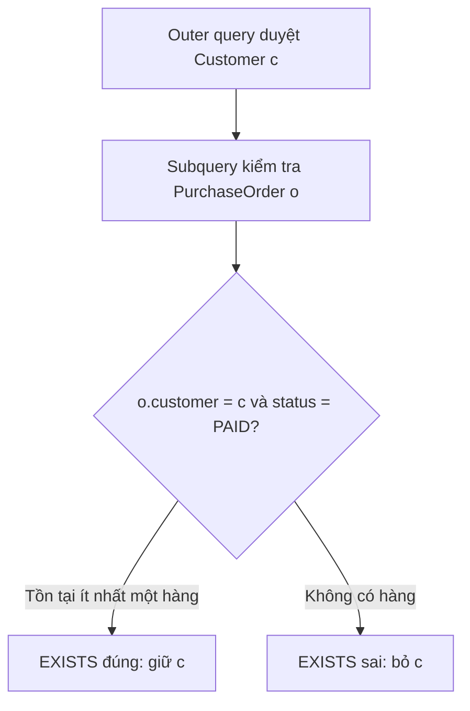
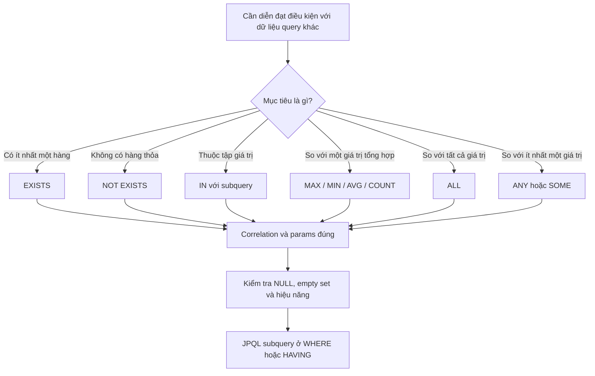

# Viết truy vấn con trong phạm vi chuẩn JPQL

Một **truy vấn con** (*subquery*) là câu truy vấn được đặt bên trong câu truy vấn khác, để câu truy vấn bên ngoài sử dụng kết quả của nó trong một điều kiện. Trong ứng dụng Java dùng JPA, truy vấn con rất hữu ích để diễn đạt những câu hỏi như:

- Khách hàng nào **đã có ít nhất một** đơn hàng thanh toán?
- Khách hàng nào **chưa từng** đặt hàng?
- Đơn hàng nào có tổng tiền **lớn nhất trong cùng nhóm khách hàng**?
- Sản phẩm nào có giá **cao hơn mọi** sản phẩm thuộc một nhóm khác?
- Đơn nào thuộc những khách hàng đáp ứng một điều kiện xác định bằng truy vấn riêng?

JPQL cho phép viết các kiểu điều kiện này trên **entity và thuộc tính Java**, không cần sử dụng tên bảng SQL trực tiếp.

Tuy vậy, khi nói **trong phạm vi chuẩn JPQL**, cần nhớ một giới hạn quyết định:

> **Trong JPQL chuẩn, subquery được dùng trong các mệnh đề điều kiện `WHERE` và `HAVING`; không coi subquery trong `FROM` hoặc danh sách `SELECT` là cú pháp JPQL portable.** Một số phiên bản Hibernate HQL hoặc SQL của database hỗ trợ thêm `FROM (SELECT ...)`, CTE, lateral join hay scalar subquery trong SELECT, nhưng đó là những khả năng cần tách khỏi hợp đồng JPQL chuẩn.

Ngoài vị trí đặt subquery, người viết còn cần hiểu **subquery độc lập và tương quan**, `EXISTS`/`NOT EXISTS`, `IN`/`NOT IN`, `ALL`/`ANY`/`SOME`, phép so sánh với kết quả aggregate, phạm vi alias, xử lý NULL, gán tham số và hệ quả hiệu năng.

Bài học thuộc chương **JPQL nâng cao** của module **Data Persistence Relational Access ORM JPA**. Các ví dụ sử dụng Jakarta Persistence và mô hình đơn hàng nhằm tập trung vào các quy tắc có thể dùng giữa nhiều JPA provider.

## 1. Nhắc lại: JPQL làm việc với entity, không phải bảng

Giả sử database có ba bảng:

```sql
CREATE TABLE customers (
    id BIGINT PRIMARY KEY,
    display_name VARCHAR(150) NOT NULL,
    active BOOLEAN NOT NULL
);

CREATE TABLE purchase_orders (
    id BIGINT PRIMARY KEY,
    order_code VARCHAR(50) NOT NULL,
    customer_id BIGINT NOT NULL,
    status VARCHAR(20) NOT NULL,
    total_amount NUMERIC(19, 2) NOT NULL,
    created_at TIMESTAMP NOT NULL,
    FOREIGN KEY (customer_id) REFERENCES customers(id)
);

CREATE TABLE payments (
    id BIGINT PRIMARY KEY,
    order_id BIGINT NOT NULL,
    payment_status VARCHAR(20) NOT NULL,
    paid_amount NUMERIC(19, 2) NOT NULL,
    FOREIGN KEY (order_id) REFERENCES purchase_orders(id)
);
```

Trong JPA, ánh xạ tới các entity `Customer`, `PurchaseOrder` và `Payment`. Ví dụ quan hệ:

```text
Customer (1) ----- (N) PurchaseOrder (1) ----- (N) Payment
   id                        customer_id                  order_id
```

JPQL:

```jpql
SELECT o
FROM PurchaseOrder o
WHERE o.customer.id = :customerId
```

sử dụng:

- `PurchaseOrder`: tên entity JPA;
- `o`: alias của entity;
- `o.customer.id`: đường dẫn qua thuộc tính Java;
- `:customerId`: named parameter được bind từ Java.

Không viết trực tiếp `purchase_orders.customer_id` theo SQL khi câu query đang được biên dịch như JPQL. Khi thêm subquery, quy tắc này **vẫn giữ nguyên**.

## 2. Mô hình entity xuyên suốt

Ví dụ `Customer`:

```java
import jakarta.persistence.*;
import java.util.ArrayList;
import java.util.List;

@Entity
@Table(name = "customers")
public class Customer {

    @Id
    private Long id;

    @Column(name = "display_name", nullable = false)
    private String displayName;

    @Column(name = "active", nullable = false)
    private boolean active;

    @OneToMany(mappedBy = "customer")
    private List<PurchaseOrder> orders = new ArrayList<>();

    protected Customer() {}

    public Long getId() { return id; }
    public String getDisplayName() { return displayName; }
    public boolean isActive() { return active; }
}
```

Ví dụ `PurchaseOrder`:

```java
import jakarta.persistence.*;
import java.math.BigDecimal;
import java.time.LocalDateTime;
import java.util.ArrayList;
import java.util.List;

@Entity
@Table(name = "purchase_orders")
public class PurchaseOrder {

    @Id
    private Long id;

    @Column(name = "order_code", nullable = false)
    private String orderCode;

    @Enumerated(EnumType.STRING)
    @Column(name = "status", nullable = false)
    private OrderStatus status;

    @Column(name = "total_amount", nullable = false)
    private BigDecimal totalAmount;

    @Column(name = "created_at", nullable = false)
    private LocalDateTime createdAt;

    @ManyToOne(fetch = FetchType.LAZY, optional = false)
    @JoinColumn(name = "customer_id", nullable = false)
    private Customer customer;

    @OneToMany(mappedBy = "order")
    private List<Payment> payments = new ArrayList<>();

    protected PurchaseOrder() {}

    public Long getId() { return id; }
    public String getOrderCode() { return orderCode; }
    public OrderStatus getStatus() { return status; }
    public BigDecimal getTotalAmount() { return totalAmount; }
    public LocalDateTime getCreatedAt() { return createdAt; }
}
```

Ví dụ `Payment`:

```java
import jakarta.persistence.*;
import java.math.BigDecimal;

@Entity
@Table(name = "payments")
public class Payment {

    @Id
    private Long id;

    @ManyToOne(fetch = FetchType.LAZY, optional = false)
    @JoinColumn(name = "order_id", nullable = false)
    private PurchaseOrder order;

    @Enumerated(EnumType.STRING)
    @Column(name = "payment_status", nullable = false)
    private PaymentStatus paymentStatus;

    @Column(name = "paid_amount", nullable = false)
    private BigDecimal paidAmount;

    protected Payment() {}
}
```

Hai enum:

```java
public enum OrderStatus {
    NEW, PAID, CANCELLED
}

public enum PaymentStatus {
    PENDING, SUCCESS, FAILED
}
```

Các class trên lược constructor nghiệp vụ và nhiều accessor để tập trung vào query. Các ví dụ JPQL sử dụng **đúng tên field Java** `customer`, `orders`, `payments`, `status`, `paymentStatus`, `totalAmount`.

## 3. Cấu trúc một truy vấn con

Ví dụ tìm khách hàng đã có đơn `PAID`:

```jpql
SELECT c
FROM Customer c
WHERE EXISTS (
    SELECT o.id
    FROM PurchaseOrder o
    WHERE o.customer = c
      AND o.status = :paidStatus
)
```

Có hai phần:

**Outer query:**

```jpql
SELECT c FROM Customer c
```

Xác định kết quả muốn trả: các `Customer`.

**Subquery:**

```jpql
SELECT o.id
FROM PurchaseOrder o
WHERE o.customer = c
  AND o.status = :paidStatus
```

Tìm những `PurchaseOrder` thỏa điều kiện.

Trong `EXISTS`, outer query chỉ cần biết subquery **có ít nhất một hàng hay không**, không cần lấy danh sách ID của những order đó làm kết quả cuối.

`o.customer = c` tạo một **subquery tương quan** vì alias `c` thuộc truy vấn ngoài nhưng được tham chiếu từ truy vấn con.

Sơ đồ:



SQL cụ thể do JPA provider quyết định, có thể được database optimizer triển khai bằng semi-join hoặc chiến lược khác. Không nên suy rằng mỗi khách hàng nhất định phải phát sinh một SQL statement riêng.

## 4. Giới hạn portable: subquery chỉ ở `WHERE` và `HAVING`

Với JPQL chuẩn, cách dùng điển hình:

```jpql
SELECT c
FROM Customer c
WHERE EXISTS (
    SELECT o.id
    FROM PurchaseOrder o
    WHERE o.customer = c
)
```

Hoặc:

```jpql
SELECT c.id, COUNT(o)
FROM Customer c
JOIN c.orders o
GROUP BY c.id
HAVING COUNT(o) > (
    SELECT COUNT(x)
    FROM PurchaseOrder x
    WHERE x.status = :status
)
```

Không nên coi các cách dưới đây là JPQL chuẩn portable:

```sql
-- Derived table trong FROM: SQL/HQL mở rộng, không portable JPQL.
SELECT x.customer_id, x.total
FROM (
    SELECT customer_id, COUNT(*) AS total
    FROM purchase_orders
    GROUP BY customer_id
) x;
```

```sql
-- Scalar subselect trong SELECT: có thể được SQL/HQL hỗ trợ,
-- nhưng không nên xem là JPQL chuẩn.
SELECT c.id,
       (SELECT COUNT(*)
        FROM purchase_orders o
        WHERE o.customer_id = c.id)
FROM customers c;
```

```sql
-- CTE và window function là tính năng SQL phổ biến.
WITH ranked AS (...) SELECT ...
```

Các đoạn trên dùng biểu diễn SQL để minh họa **những kiểu cú pháp không thể bê nguyên vào JPQL chuẩn**.

### Thay thế khi cần tính toán ở SELECT

Nếu muốn lấy ID khách hàng và số đơn hàng, có thể dùng join và aggregate:

```jpql
SELECT c.id, COUNT(o)
FROM Customer c
LEFT JOIN c.orders o
GROUP BY c.id
```

Nếu cần một phép truy vấn phức tạp với derived table, CTE hoặc window function, cân nhắc:

- viết lại thành JPQL `JOIN`/`GROUP BY`/`HAVING` hoặc subquery ở `WHERE`;
- dùng Criteria API nếu khó dựng điều kiện động;
- dùng **native SQL** cho khả năng database-specific thật sự cần thiết;
- tách thành các bước truy vấn có chủ đích nếu phù hợp chi phí/transaction.

Đừng nhầm **Hibernate HQL** với **JPQL chuẩn**. Hibernate có thể cho phép những tính năng mở rộng trong phiên bản hiện hành; query chạy trên Hibernate không tự chứng minh nó portable sang EclipseLink hoặc provider khác.

## 5. `EXISTS`: kiểm tra có ít nhất một kết quả

Trường hợp kinh điển: khách hàng có tối thiểu một đơn hàng.

```jpql
SELECT c
FROM Customer c
WHERE EXISTS (
    SELECT o.id
    FROM PurchaseOrder o
    WHERE o.customer = c
)
```

Đọc theo ngôn ngữ nghiệp vụ:

> “Lấy Customer `c` nếu tồn tại PurchaseOrder `o` thuộc chính Customer đó.”

Với Hibernate/JPA, Java code:

```java
String jpql = """
    select c
    from Customer c
    where exists (
        select o.id
        from PurchaseOrder o
        where o.customer = c
    )
    """;

List<Customer> customers = entityManager
    .createQuery(jpql, Customer.class)
    .getResultList();
```

Trong `EXISTS`, giá trị cụ thể của biểu thức `SELECT o.id` không quyết định true/false; **sự tồn tại của ít nhất một hàng** mới quyết định.

### Tại sao `EXISTS` thường tốt hơn join khi chỉ kiểm tra tồn tại?

Một phương án join:

```jpql
SELECT c
FROM Customer c
JOIN c.orders o
```

Một customer có ba order có thể xuất hiện nhiều lần trong kết quả truy vấn ở mức hàng join. Tùy cách provider materialize kết quả, ứng dụng có thể cần `DISTINCT` để lấy tập customer không trùng.

Với `EXISTS`:

```jpql
SELECT c
FROM Customer c
WHERE EXISTS (
    SELECT o.id FROM PurchaseOrder o WHERE o.customer = c
)
```

outer query vẫn có một candidate `c` cho mỗi customer, subquery chỉ là phép kiểm tra tồn tại. Không cần nhân hàng theo số order để diễn đạt điều kiện này.

**Đừng khẳng định EXISTS luôn nhanh hơn JOIN.** Database optimizer có thể biến đổi cả hai thành kế hoạch tương đương hoặc khác nhau tùy index, thống kê và cardinality. Lợi ích chính trước hết là **ngữ nghĩa rõ ràng và tránh nhân bản kết quả không cần thiết**.

## 6. `EXISTS` với nhiều điều kiện và tham số

Lấy khách hàng có đơn `PAID` từ ngày chỉ định:

```jpql
SELECT c
FROM Customer c
WHERE EXISTS (
    SELECT o.id
    FROM PurchaseOrder o
    WHERE o.customer = c
      AND o.status = :paidStatus
      AND o.createdAt >= :fromTime
)
```

Java:

```java
LocalDateTime from =
    LocalDateTime.of(2026, 1, 1, 0, 0);

TypedQuery<Customer> query = entityManager.createQuery(
    """
    select c
    from Customer c
    where exists (
        select o.id
        from PurchaseOrder o
        where o.customer = c
          and o.status = :paidStatus
          and o.createdAt >= :fromTime
    )
    """,
    Customer.class
);

query.setParameter("paidStatus", OrderStatus.PAID);
query.setParameter("fromTime", from);

List<Customer> result = query.getResultList();
```

Các tham số của subquery **được bind trên cùng Query/TypedQuery bên ngoài**. Không có một `Query` độc lập cho chuỗi bên trong ngoặc.

Nếu `:paidStatus` được dùng cả ở outer query và subquery, đó vẫn là cùng named parameter trong câu JPQL.

## 7. `NOT EXISTS`: tìm bản ghi chưa có liên kết phù hợp

Lấy khách hàng chưa từng có đơn hàng:

```jpql
SELECT c
FROM Customer c
WHERE NOT EXISTS (
    SELECT o.id
    FROM PurchaseOrder o
    WHERE o.customer = c
)
```

Đọc đúng: “Không tồn tại bất kỳ order nào có `o.customer = c`.”

Khác với:

```jpql
SELECT c
FROM Customer c
WHERE EXISTS (
    SELECT o.id
    FROM PurchaseOrder o
    WHERE o.customer = c
      AND o.status <> :paidStatus
)
```

Truy vấn thứ hai lấy khách hàng có **ít nhất một order không phải PAID**, hoàn toàn không giống “chưa từng có order PAID”.

### Tìm khách hàng chưa có đơn PAID

```jpql
SELECT c
FROM Customer c
WHERE NOT EXISTS (
    SELECT o.id
    FROM PurchaseOrder o
    WHERE o.customer = c
      AND o.status = :paidStatus
)
```

Kết quả có thể gồm:

- khách hàng chưa có đơn nào;
- khách hàng chỉ có đơn `NEW` hoặc `CANCELLED`;
- khách hàng có nhiều đơn nhưng không có đơn `PAID`.

Đây là pattern **anti-existence** rất hữu ích cho việc tìm đối tượng “chưa phát sinh nghiệp vụ”.

## 8. Một lỗi logic lớn: đặt điều kiện của `NOT EXISTS` sai phạm vi

Muốn tìm khách hàng không có đơn PAID, câu đúng:

```jpql
SELECT c
FROM Customer c
WHERE NOT EXISTS (
    SELECT o.id
    FROM PurchaseOrder o
    WHERE o.customer = c
      AND o.status = :paidStatus
)
```

Câu dễ sai:

```jpql
SELECT c
FROM Customer c
WHERE NOT EXISTS (
    SELECT o.id
    FROM PurchaseOrder o
    WHERE o.customer = c
)
AND c.active = true
```

Câu sai đối với yêu cầu ban đầu vì nó loại **mọi khách hàng có bất kỳ order nào**, không chỉ khách hàng có order PAID.

Một câu sai khác:

```jpql
SELECT c
FROM Customer c
WHERE NOT EXISTS (
    SELECT o.id
    FROM PurchaseOrder o
    WHERE o.status = :paidStatus
)
```

Thiếu `o.customer = c`, subquery trở thành độc lập. Khi database có **bất kỳ** order PAID nào, `NOT EXISTS` sẽ sai cho **tất cả** customer. Đây là một lỗi thiếu correlation đặc biệt nguy hiểm: query có thể chạy hoàn toàn hợp lệ nhưng trả sai về mặt nghiệp vụ.

## 9. Subquery không tương quan và tương quan

### Subquery không tương quan (*uncorrelated*)

```jpql
SELECT o
FROM PurchaseOrder o
WHERE o.totalAmount > (
    SELECT AVG(x.totalAmount)
    FROM PurchaseOrder x
)
```

Subquery tính tổng tiền trung bình trên **toàn bộ orders**, không tham chiếu alias `o` của query ngoài. Kết quả trung bình có cùng ý nghĩa đối với mọi hàng outer query.

### Subquery tương quan (*correlated*)

```jpql
SELECT o
FROM PurchaseOrder o
WHERE o.totalAmount > (
    SELECT AVG(x.totalAmount)
    FROM PurchaseOrder x
    WHERE x.customer = o.customer
)
```

Ở đây `o.customer` tham chiếu **order hiện tại trong outer query**. Subquery tính mức trung bình của những order **thuộc cùng Customer** với order đang xét.

Điểm khác:

| Tiêu chí | Không tương quan | Tương quan |
|---|---|---|
| Tham chiếu alias outer query? | Không | Có |
| Ý nghĩa so sánh | Một tập dữ liệu độc lập | Tập dữ liệu thay đổi theo outer row/group |
| Ví dụ | So đơn với trung bình toàn hệ thống | So đơn với trung bình trong cùng Customer |
| SQL plan | Database có thể tính subquery độc lập theo kế hoạch | Database có thể decorrelate, semi-join hoặc evaluate theo chiến lược khác |
| Rủi ro thường gặp | Quên thêm correlation nên điều kiện áp chung cho mọi hàng | Correlation sai alias/quan hệ, tạo kết quả logic khác mong muốn |

**Tương quan là quan hệ logic giữa hai phạm vi truy vấn**, không có nghĩa ứng dụng Java sẽ gọi N câu SQL cho N entity. Database thường nhận một statement SQL do provider dịch từ JPQL và tự tối ưu kế hoạch thực thi.

## 10. Phạm vi alias: outer alias và inner alias

Ví dụ đúng:

```jpql
SELECT c
FROM Customer c
WHERE EXISTS (
    SELECT o.id
    FROM PurchaseOrder o
    WHERE o.customer = c
)
```

Ở đây:

- `c` được khai báo tại truy vấn ngoài.
- `o` được khai báo tại truy vấn trong.
- Truy vấn trong **có thể tham chiếu** `c` trong một correlated predicate.
- Truy vấn ngoài **không thể dùng** alias `o` bên ngoài dấu ngoặc subquery, vì `o` chỉ thuộc phạm vi subquery.

Ví dụ sai:

```jpql
SELECT c
FROM Customer c
WHERE EXISTS (
    SELECT o.id
    FROM PurchaseOrder o
    WHERE o.customer = c
)
ORDER BY o.id
```

`ORDER BY o.id` dùng alias chỉ tồn tại trong subquery, nên không hợp lệ theo phạm vi tên.

### Tránh dùng lại cùng một alias ở hai mức

Không nên viết kiểu:

```jpql
SELECT o
FROM PurchaseOrder o
WHERE EXISTS (
    SELECT o.id
    FROM PurchaseOrder o
    WHERE o.status = :status
)
```

Dù quy tắc shadowing/scoping có thể được một số provider diễn giải, cách này làm người đọc dễ nhầm `o` nào thuộc ngoài hay trong và vô tình mất correlation.

Nên đặt alias riêng:

```jpql
SELECT outerOrder
FROM PurchaseOrder outerOrder
WHERE EXISTS (
    SELECT candidate.id
    FROM PurchaseOrder candidate
    WHERE candidate.customer = outerOrder.customer
      AND candidate.status = :status
)
```

Tên alias rõ ràng là cách phòng lỗi rất hiệu quả khi có nhiều lớp query.

## 11. `IN (subquery)`: lọc theo tập giá trị được tính từ query khác

Giả sử muốn lấy đơn thuộc những khách hàng đang hoạt động:

```jpql
SELECT o
FROM PurchaseOrder o
WHERE o.customer.id IN (
    SELECT c.id
    FROM Customer c
    WHERE c.active = true
)
```

Subquery trả **một cột ID** của Customer active. Outer query giữ những order có `customer.id` thuộc tập đó.

Có thể viết tương đương bằng join/path navigation:

```jpql
SELECT o
FROM PurchaseOrder o
WHERE o.customer.active = true
```

Vì thế, **không cần sử dụng subquery chỉ để thể hiện một đường dẫn quan hệ đơn giản**. Subquery đáng cân nhắc khi predicate thật sự yêu cầu một tập kết quả trung gian có ý nghĩa.

### `IN` với nhiều trạng thái

```jpql
SELECT c
FROM Customer c
WHERE c.id IN (
    SELECT o.customer.id
    FROM PurchaseOrder o
    WHERE o.status IN :statuses
)
```

Java:

```java
List<Customer> customers = entityManager.createQuery(
    """
    select c
    from Customer c
    where c.id in (
        select o.customer.id
        from PurchaseOrder o
        where o.status in :statuses
    )
    """,
    Customer.class
)
.setParameter(
    "statuses",
    List.of(OrderStatus.NEW, OrderStatus.PAID)
)
.getResultList();
```

Ở đây có **hai loại IN**:

1. `c.id IN (SELECT ...)`: kết quả từ **subquery**.
2. `o.status IN :statuses`: một **collection parameter** được bind từ Java.

Cả hai hợp lệ về ý nghĩa, nhưng nguồn tập giá trị và khả năng tối ưu khác nhau.

### Kiểu của giá trị bên trái và subquery phải tương thích

Nếu outer expression là `Long`:

```jpql
c.id IN (SELECT o.customer.id FROM PurchaseOrder o)
```

thì subquery chọn ID kiểu tương thích.

Không nên viết:

```jpql
c.id IN (
    SELECT o
    FROM PurchaseOrder o
)
```

vì bên ngoài là ID Long nhưng bên trong là entity PurchaseOrder. Chọn một biểu thức phù hợp kiểu, thông thường là entity ID hoặc scalar giá trị.

## 12. `EXISTS` hay `IN` khi kiểm tra quan hệ?

Hai câu có thể cùng ý nghĩa nghiệp vụ “khách hàng có đơn PAID”:

```jpql
SELECT c
FROM Customer c
WHERE EXISTS (
    SELECT o.id
    FROM PurchaseOrder o
    WHERE o.customer = c
      AND o.status = :status
)
```

```jpql
SELECT c
FROM Customer c
WHERE c.id IN (
    SELECT o.customer.id
    FROM PurchaseOrder o
    WHERE o.status = :status
)
```

So sánh:

| Đặc điểm | `EXISTS` | `IN (subquery)` |
|---|---|---|
| Điều kiện | Subquery trả ít nhất một hàng | Giá trị outer nằm trong tập giá trị subquery |
| Correlation bắt buộc? | Không, nhưng thường dùng trong case này | Không bắt buộc |
| Projection của subquery | Không quyết định true/false; chỉ cần hàng tồn tại | **Rất quan trọng**, phải tương thích kiểu với biểu thức bên trái |
| Có thể thay bằng semijoin? | Database optimizer có thể làm | Database optimizer có thể làm |
| Rủi ro NULL | `EXISTS` nhìn số hàng, không dùng so khớp NULL của `IN` | `IN` chịu logic NULL trong tập kết quả |
| Dễ diễn tả “có ít nhất một” | Rất trực tiếp | Cũng được, nhưng đôi khi vòng hơn |

Với yêu cầu “có ít nhất một order của chính customer”, `EXISTS` thường dễ đọc. Với yêu cầu lọc theo một tập giá trị được truy vấn từ nơi khác, `IN` có thể tự nhiên hơn.

**Đừng mặc định một lựa chọn luôn có hiệu năng tốt hơn**: kiểm tra SQL được dịch và execution plan trên database thực tế.

## 13. `NOT IN (subquery)` và bẫy `NULL`

Giả sử muốn tìm những order chưa có payment thành công:

```jpql
SELECT o
FROM PurchaseOrder o
WHERE o.id NOT IN (
    SELECT p.order.id
    FROM Payment p
    WHERE p.paymentStatus = :success
)
```

Nếu `p.order.id` luôn không NULL theo mapping/database và subquery hoạt động đúng, cách này có thể biểu diễn yêu cầu.

Nhưng **NOT IN có bẫy lớn khi tập subquery chứa NULL**. Trong SQL logic ba giá trị, nếu tập kết quả có NULL, biểu thức `x NOT IN (...)` có thể trở thành UNKNOWN ngay cả khi `x` không bằng giá trị khác nào; query lọc WHERE chỉ giữ TRUE.

Ví dụ SQL minh họa:

```sql
-- Về mặt logic, NOT IN với NULL có thể không trả
-- những hàng mà ta nghĩ là "không nằm trong tập".
WHERE order_id NOT IN (10, 20, NULL)
```

Trong model Payment trên, `p.order` bắt buộc và FK không-null, nên trường hợp NULL trong `p.order.id` đã được hạn chế. Tuy nhiên, với schema/mapping khác hoặc một subquery chọn nullable scalar, bẫy vẫn tồn tại.

### `NOT EXISTS` thường rõ nghĩa hơn

```jpql
SELECT o
FROM PurchaseOrder o
WHERE NOT EXISTS (
    SELECT p.id
    FROM Payment p
    WHERE p.order = o
      AND p.paymentStatus = :success
)
```

Đọc đúng: “Chọn order nếu không có payment SUCCESS thuộc order đó.”

Vì so sánh là `p.order = o` trong correlated predicate, ta không cần dựa vào semantics của `NOT IN` với một tập scalar có thể chứa NULL.

**Quy tắc:** khi muốn diễn đạt “không có phần tử liên quan nào thỏa điều kiện”, cân nhắc `NOT EXISTS` trước; nếu dùng `NOT IN`, kiểm tra nullability của giá trị subquery.

## 14. Subquery trả một giá trị: `MAX`, `MIN` và `AVG`

Một pattern phổ biến là dùng aggregate để subquery tạo một giá trị so sánh.

### Đơn hàng có tổng tiền bằng giá trị lớn nhất trong cùng khách hàng

```jpql
SELECT o
FROM PurchaseOrder o
WHERE o.totalAmount = (
    SELECT MAX(x.totalAmount)
    FROM PurchaseOrder x
    WHERE x.customer = o.customer
)
```

Ở đây:

- Mỗi order `o` có một customer.
- Subquery xét những order `x` của cùng customer.
- `MAX(x.totalAmount)` trả một giá trị lớn nhất.
- Outer query giữ các order có `totalAmount` bằng giá trị lớn nhất đó.

**Nếu hai order cùng có tổng tiền cao nhất, cả hai đều được trả về.** Query không tự chọn “một đơn duy nhất” khi có tie.

### Đơn hàng có tổng tiền cao hơn trung bình của cùng khách hàng

```jpql
SELECT o
FROM PurchaseOrder o
WHERE o.totalAmount > (
    SELECT AVG(x.totalAmount)
    FROM PurchaseOrder x
    WHERE x.customer = o.customer
)
```

`AVG` có kiểu giá trị trả về theo quy tắc JPA aggregate (thường là `Double` cho numeric types). Database/provider cần xử lý phép so sánh với trường `BigDecimal`; với yêu cầu chính xác số học/kiểu nghiêm ngặt, nên kiểm tra query ở provider và database mục tiêu.

### Kiểu trả về của aggregate

| Biểu thức JPQL | Ý nghĩa | Kiểu/đặc điểm |
|---|---|---|
| `COUNT(x)` | Số bản ghi | `Long` theo JPA |
| `MAX(x.totalAmount)` | Giá trị lớn nhất | Kiểu dựa trên thuộc tính, ở đây thường `BigDecimal` |
| `MIN(x.totalAmount)` | Giá trị nhỏ nhất | Tương tự `MAX` |
| `AVG(x.totalAmount)` | Trung bình | Thông thường `Double` |
| `SUM(x.totalAmount)` | Tổng | Kiểu theo quy tắc aggregate của JPA, với `BigDecimal` thường là `BigDecimal` |

Lưu ý kết quả khi không có hàng: `COUNT` thường là 0, còn `MAX`/`MIN`/`SUM`/`AVG` trên tập rỗng thường cho NULL theo semantics aggregate SQL.

## 15. Subquery scalar phải có ý nghĩa một giá trị

Câu này có vấn đề:

```jpql
SELECT o
FROM PurchaseOrder o
WHERE o.totalAmount = (
    SELECT x.totalAmount
    FROM PurchaseOrder x
    WHERE x.customer = o.customer
)
```

Nếu customer có nhiều order, subquery có thể trả **nhiều giá trị** nhưng phép `= (subquery)` đòi một giá trị scalar thích hợp. Database có thể báo lỗi “subquery returned more than one row” hoặc lỗi tương đương khi chạy.

Cách sửa tùy mục tiêu:

- Muốn so với **giá trị lớn nhất** → dùng `MAX(...)`.
- Muốn so với **ít nhất một giá trị** → dùng `= ANY (subquery)` hoặc `IN (subquery)` khi phù hợp.
- Muốn so với **mọi giá trị** → dùng `= ALL` hoặc toán tử khác với ALL.
- Muốn chỉ biết **có tồn tại hàng** → `EXISTS`.
- Muốn kết quả là một order cụ thể theo tie-breaker → cân nhắc `NOT EXISTS` với điều kiện so sánh chi tiết, hoặc giải pháp database-specific có `ROW_NUMBER`.

Không dùng `setMaxResults(1)` cho outer query rồi mong nó giới hạn số hàng **bên trong subquery**. Pagination của outer `TypedQuery` không giải quyết cardinality của subquery.

## 16. `ALL`: so với tất cả giá trị của truy vấn con

Ví dụ lấy order có tổng tiền lớn hơn **mọi order PAID** của customer khác:

```jpql
SELECT o
FROM PurchaseOrder o
WHERE o.totalAmount > ALL (
    SELECT x.totalAmount
    FROM PurchaseOrder x
    WHERE x.status = :paidStatus
      AND x.customer <> o.customer
)
```

Ý nghĩa:

- Subquery trả các tổng tiền của đơn PAID thuộc customer khác.
- Outer `o` được giữ nếu `o.totalAmount` lớn hơn **tất cả** giá trị trả về.

Nếu subquery trả tập rỗng, `> ALL (empty set)` được xem là TRUE theo semantics lượng từ trên tập rỗng. Điều này có thể bất ngờ: một order có thể đạt điều kiện đơn giản vì không có order đối chiếu nào.

### So với `MAX`

Trong nhiều trường hợp, điều kiện:

```jpql
o.totalAmount > ALL (
    SELECT x.totalAmount
    FROM PurchaseOrder x
    WHERE x.status = :paidStatus
)
```

gần giống:

```jpql
o.totalAmount > (
    SELECT MAX(x.totalAmount)
    FROM PurchaseOrder x
    WHERE x.status = :paidStatus
)
```

nhưng **không hoàn toàn giống nhau với tập rỗng hoặc NULL**. Khi tập rỗng, `MAX` trả NULL, phép `> NULL` là UNKNOWN, còn `> ALL (empty set)` là TRUE. Nếu có NULL, semantics cũng cần xem kỹ.

Không thay thế `ALL` bằng `MAX` một cách cơ học nếu kết quả ở các trường hợp rìa quan trọng.

### Khi `ALL` hữu ích

- “Lớn hơn tất cả kết quả trong một nhóm.”
- “Nhỏ hơn mọi mức giới hạn đang áp dụng.”
- “Giá trị của bản ghi vượt toàn bộ benchmark thuộc một tập động.”

Tuy nhiên, `EXISTS`/`NOT EXISTS` với predicate phủ định thường dễ biểu diễn trường hợp cần so sánh và xử lý các quy tắc null cụ thể.

## 17. `ANY` và `SOME`: có ít nhất một giá trị thỏa so sánh

Ví dụ:

```jpql
SELECT o
FROM PurchaseOrder o
WHERE o.totalAmount > ANY (
    SELECT x.totalAmount
    FROM PurchaseOrder x
    WHERE x.status = :paidStatus
      AND x.customer = o.customer
)
```

Ý nghĩa: Order `o` có tổng tiền lớn hơn **ít nhất một** đơn PAID cùng customer.

`SOME` có cùng ý nghĩa định lượng với `ANY` trong ngữ cảnh này:

```jpql
WHERE o.totalAmount > SOME (
    SELECT x.totalAmount FROM PurchaseOrder x
    WHERE x.status = :paidStatus
)
```

Phân biệt:

| Toán tử | Điều kiện đúng khi |
|---|---|
| `> ALL (subquery)` | Lớn hơn mọi giá trị được trả về |
| `> ANY (subquery)` | Lớn hơn ít nhất một giá trị được trả về |
| `> SOME (subquery)` | Tương đương `> ANY` |
| `IN (subquery)` | Bằng một giá trị trong tập, với semantics IN |
| `EXISTS (subquery)` | Subquery trả ít nhất một hàng |

### Trường hợp tập rỗng

- `ANY(empty)` / `SOME(empty)` là FALSE.
- `ALL(empty)` là TRUE.
- `EXISTS(empty)` là FALSE.
- `NOT EXISTS(empty)` là TRUE.

Nếu các giá trị có thể NULL, phép so sánh `ALL/ANY/SOME` chịu logic ba giá trị; kết quả UNKNOWN có thể làm WHERE không chọn hàng. Đừng bỏ qua NULL chỉ vì các ví dụ mẫu đều dùng cột `NOT NULL`.

## 18. Xử lý `NULL` trong điều kiện subquery

Với SQL/JPQL, có ba giá trị logic: TRUE, FALSE và UNKNOWN. Trong `WHERE`, chỉ predicate TRUE giữ hàng.

Ví dụ outer:

```jpql
WHERE o.totalAmount > (
    SELECT MAX(x.totalAmount)
    FROM PurchaseOrder x
    WHERE x.customer.id = :missingCustomerId
)
```

Nếu subquery không tìm được order, `MAX` thường là NULL. So sánh `o.totalAmount > NULL` thành UNKNOWN, nên query không chọn hàng.

### Nếu muốn mặc định giá trị khi aggregate NULL

JPQL hỗ trợ `COALESCE`:

```jpql
SELECT o
FROM PurchaseOrder o
WHERE o.totalAmount > COALESCE(
    (
        SELECT MAX(x.totalAmount)
        FROM PurchaseOrder x
        WHERE x.customer.id = :customerId
    ),
    :defaultAmount
)
```

Tuy nhiên, cú pháp biểu thức lồng subquery trong một lời gọi function có thể phụ thuộc chính xác grammar/khả năng của provider. Khi cần portable tuyệt đối với một phiên bản chuẩn cụ thể, có thể dùng một biểu thức so sánh ở WHERE/HAVING được kiểm chứng, hoặc viết lại bằng `EXISTS/NOT EXISTS` thay vì đặt subquery vào ngữ cảnh expression/function mà provider có thể phân tích khác nhau.

Một hướng không cần scalar aggregate là quyết định nghiệp vụ: nếu không có hàng đối chiếu, outer row được giữ hay loại? Chọn rõ `NOT EXISTS` hoặc kiểm tra tồn tại trước khi so sánh thay vì ngầm giả định NULL bằng 0.

### So sánh và `NULL` trong `NOT EXISTS`

`NOT EXISTS` chỉ quan tâm **có hàng thỏa predicate**. Nếu predicate trong subquery so sánh một field nullable bằng `= :value`, các hàng có NULL không thỏa TRUE. Vì thế kết quả vẫn phụ thuộc cách viết predicate, dù `NOT EXISTS` không gặp bẫy tập NULL như `NOT IN`.

## 19. Điều kiện `HAVING` có subquery

`HAVING` lọc **nhóm sau khi aggregate**, khác với `WHERE` lọc hàng trước khi nhóm.

Ví dụ: tìm những khách hàng có tổng số đơn hàng lớn hơn số đơn PAID của chính họ.

```jpql
SELECT c.id, COUNT(o)
FROM Customer c
JOIN c.orders o
GROUP BY c.id
HAVING COUNT(o) > (
    SELECT COUNT(x)
    FROM PurchaseOrder x
    WHERE x.customer = c
      AND x.status = :paidStatus
)
```

Đây là một correlated subquery trong `HAVING`:

- Outer nhóm các order theo customer.
- `COUNT(o)` là tổng số order của customer trong nhóm.
- Subquery đếm order PAID của customer đó.
- HAVING giữ các customer có nhiều order hơn số PAID.

Nếu muốn loại cả khách hàng chưa có order, `JOIN c.orders o` làm điều đó. Nếu muốn chứa cả khách hàng có zero orders thì phải dùng `LEFT JOIN` và xem semantics `COUNT(o)`.

### Ví dụ `HAVING` với subquery độc lập

```jpql
SELECT c.id, COUNT(o)
FROM Customer c
JOIN c.orders o
GROUP BY c.id
HAVING COUNT(o) >= (
    SELECT COUNT(x)
    FROM PurchaseOrder x
    WHERE x.status = :status
)
```

Query này so số order từng customer với tổng số order có một status trong toàn hệ thống. Nó minh họa kỹ thuật một subquery **không tương quan** ở HAVING; về nghiệp vụ, phải cân nhắc xem điều kiện đó có thật sự có ích.

### Những điều phải nhớ khi dùng `HAVING`

- Những field được SELECT ngoài aggregate phải tuân theo yêu cầu `GROUP BY` của JPQL/provider.
- Subquery tương quan nên tham chiếu key nhóm hoặc dữ liệu hợp lệ trong phạm vi nhóm.
- Không lấy một thuộc tính không grouped từ outer row rồi giả định nó có giá trị duy nhất cho cả group.
- Dùng `COUNT(o)` để đếm non-null entity; `COUNT(*)` là cú pháp SQL quen thuộc, không nên chép máy móc vào JPQL.

## 20. Subquery lồng nhiều tầng

Một truy vấn con có thể chứa một truy vấn con khác nếu vẫn nằm trong các điều kiện chuẩn.

Ví dụ tìm khách hàng có order chứa ít nhất một payment SUCCESS:

```jpql
SELECT c
FROM Customer c
WHERE EXISTS (
    SELECT o.id
    FROM PurchaseOrder o
    WHERE o.customer = c
      AND EXISTS (
          SELECT p.id
          FROM Payment p
          WHERE p.order = o
            AND p.paymentStatus = :success
      )
)
```

Các phạm vi alias:

- `c`: customer của outer query.
- `o`: order của middle query.
- `p`: payment của innermost query.

Subquery trong cùng tham chiếu alias `o` ở mức kế cận; subquery giữa tham chiếu `c` ở ngoài cùng.

Một sơ đồ:

```text
Customer c
└── EXISTS (PurchaseOrder o có o.customer = c)
    └── EXISTS (Payment p có p.order = o, status SUCCESS)
```

Ngữ nghĩa này có thể viết lại thành một `EXISTS` với join:

```jpql
SELECT c
FROM Customer c
WHERE EXISTS (
    SELECT o.id
    FROM PurchaseOrder o
    JOIN o.payments p
    WHERE o.customer = c
      AND p.paymentStatus = :success
)
```

Phiên bản thứ hai thường ngắn và dễ đọc hơn. **Không thêm nhiều tầng subquery chỉ vì cú pháp cho phép**; chọn biểu thức rõ nghĩa, phù hợp dữ liệu và query plan.

## 21. Truy vấn top-per-group mà không dùng window function

Nhiều người muốn lấy **đơn hàng mới nhất của từng khách hàng**. Trong SQL hiện đại, có thể dùng `ROW_NUMBER() OVER(PARTITION BY ...)`, nhưng window function không thuộc cú pháp JPQL chuẩn truyền thống mà ta đang giới hạn ở đây.

Một cách JPQL portable là `NOT EXISTS` với điều kiện không có bản ghi mới hơn:

```jpql
SELECT o
FROM PurchaseOrder o
WHERE NOT EXISTS (
    SELECT newer.id
    FROM PurchaseOrder newer
    WHERE newer.customer = o.customer
      AND (
          newer.createdAt > o.createdAt
          OR (
              newer.createdAt = o.createdAt
              AND newer.id > o.id
          )
      )
)
```

Ý nghĩa:

> “Giữ order `o` nếu không tồn tại order của cùng customer có thời điểm muộn hơn; khi cùng thời điểm, chọn ID lớn hơn làm tie-breaker.”

Nhờ điều kiện ID, mỗi customer có dữ liệu thường còn một order mới nhất theo quy tắc sắp xếp `(createdAt, id)`.

### Vì sao cần tie-breaker?

Nếu chỉ so:

```jpql
newer.createdAt > o.createdAt
```

và hai order có cùng `createdAt` lớn nhất, query sẽ giữ **cả hai**. Điều đó có thể đúng nếu nghiệp vụ muốn tất cả bản ghi cùng mốc, nhưng không đúng nếu mục tiêu là một hàng duy nhất mỗi customer.

### Về hiệu năng

Pattern này có thể cần index phù hợp, chẳng hạn trên `(customer_id, created_at, id)` và cần xem execution plan. Trong một hệ thống cần top-per-group trên tập dữ liệu rất lớn, native SQL với window functions có thể tối ưu hơn, nhưng khi đó phải ghi rõ tính database-specific và không gọi nó là JPQL chuẩn.

## 22. Tìm giá trị lớn nhất bằng `NOT EXISTS`

Ngoài `MAX`, có một cách khác để lấy order có tổng tiền cao nhất mỗi customer:

```jpql
SELECT o
FROM PurchaseOrder o
WHERE NOT EXISTS (
    SELECT competitor.id
    FROM PurchaseOrder competitor
    WHERE competitor.customer = o.customer
      AND competitor.totalAmount > o.totalAmount
)
```

Cách này chọn những order không có competitor thuộc cùng customer có giá trị lớn hơn. Nếu có **nhiều order cùng giá trị lớn nhất**, tất cả đều được chọn.

Muốn chỉ một order cho mỗi customer, thêm tie-breaker theo ID:

```jpql
SELECT o
FROM PurchaseOrder o
WHERE NOT EXISTS (
    SELECT x.id
    FROM PurchaseOrder x
    WHERE x.customer = o.customer
      AND (
          x.totalAmount > o.totalAmount
          OR (
              x.totalAmount = o.totalAmount
              AND x.id > o.id
          )
      )
)
```

So với `MAX`:

- `MAX` gọn hơn nếu chỉ cần điều kiện “bằng giá trị lớn nhất”.
- `NOT EXISTS` phù hợp khi cần thứ tự phức hợp/tie-breaker.
- SQL plan khác nhau tùy database; không kết luận phương án nào luôn tốt hơn.

Cả hai đều trong phạm vi WHERE subquery của JPQL.

## 23. JPQL `IS EMPTY` và `SIZE`: khi nào không cần subquery tường minh?

Nếu entity Customer có:

```java
@OneToMany(mappedBy = "customer")
private List<PurchaseOrder> orders;
```

JPQL hỗ trợ một số biểu thức collection:

```jpql
SELECT c
FROM Customer c
WHERE c.orders IS EMPTY
```

Có ý nghĩa “customer không có order nào”. Provider có thể hiện thực bằng SQL `NOT EXISTS` hoặc kỹ thuật khác.

Tương đương về ngữ nghĩa thường gặp:

```jpql
SELECT c
FROM Customer c
WHERE NOT EXISTS (
    SELECT o.id
    FROM PurchaseOrder o
    WHERE o.customer = c
)
```

Một trường hợp khác:

```jpql
SELECT c
FROM Customer c
WHERE SIZE(c.orders) >= :minimumOrders
```

Ví dụ này chỉ có ích nếu mối quan hệ collection thể hiện đúng các order cần đếm. Nếu chỉ muốn đếm order PAID, subquery `COUNT` có lọc status hoặc `EXISTS` với condition có thể rõ ràng hơn.

### Chọn dạng nào?

| Yêu cầu | Cú pháp thường cân nhắc |
|---|---|
| Không có bất kỳ phần tử nào trong mapped collection | `IS EMPTY` |
| Có ít nhất một phần tử bất kể điều kiện | `IS NOT EMPTY` hoặc `EXISTS` |
| Số phần tử trong collection vượt ngưỡng | `SIZE(collection)` hoặc subquery `COUNT` |
| Có child thỏa điều kiện bổ sung | `EXISTS (SELECT ... WHERE ...)` |
| Không có child thỏa điều kiện bổ sung | `NOT EXISTS (SELECT ... WHERE ...)` |

`IS EMPTY` và `SIZE` là cú pháp JPQL trên collection, **không phải lời gọi Java tải collection rồi xử lý trong bộ nhớ**. Provider dịch chúng thành truy vấn database theo mapping.

## 24. Subquery so với JOIN: chọn theo ngữ nghĩa

Để tìm order đã có payment SUCCESS, có thể dùng:

**JOIN:**

```jpql
SELECT DISTINCT o
FROM PurchaseOrder o
JOIN o.payments p
WHERE p.paymentStatus = :success
```

**EXISTS:**

```jpql
SELECT o
FROM PurchaseOrder o
WHERE EXISTS (
    SELECT p.id
    FROM Payment p
    WHERE p.order = o
      AND p.paymentStatus = :success
)
```

Hai câu thường diễn đạt cùng tập order.

Nhưng:

- JOIN có thể tạo nhiều hàng khi một order có nhiều payment SUCCESS; `DISTINCT` giúp diễn đạt yêu cầu một order một lần.
- EXISTS chỉ cần điều kiện có ít nhất một payment, nên ý nghĩa “có” trực tiếp hơn.
- JOIN phù hợp khi cần dùng thuộc tính payment trong projection, filter phối hợp hoặc order/group.
- EXISTS phù hợp khi chỉ dùng payment như điều kiện lọc.
- Khi làm `JOIN FETCH`, đó là nhu cầu **tải association**, không phải cùng vấn đề với điều kiện tồn tại.

**Không thay tất cả JOIN bằng subquery.** Một truy vấn nên phản ánh hình dạng dữ liệu cần trả và các điều kiện thực, tránh phức tạp không cần thiết.

## 25. Không dùng subquery ở `FROM` để giả lập bảng tạm

Nhiều tutorial SQL cho ví dụ:

```sql
SELECT customer_id, average_total
FROM (
    SELECT customer_id, AVG(total_amount) AS average_total
    FROM purchase_orders
    GROUP BY customer_id
) t;
```

Cú pháp `FROM (SELECT ...)` là **derived table** của SQL và có thể được hỗ trợ trong một số ngôn ngữ truy vấn mở rộng, nhưng không nằm trong **JPQL portable**.

Nếu mục tiêu chỉ là tổng tiền trung bình theo khách hàng, JPQL có thể viết:

```jpql
SELECT o.customer.id, AVG(o.totalAmount)
FROM PurchaseOrder o
GROUP BY o.customer.id
```

Nếu cần lọc order dựa trên mức trung bình cùng customer:

```jpql
SELECT o
FROM PurchaseOrder o
WHERE o.totalAmount > (
    SELECT AVG(x.totalAmount)
    FROM PurchaseOrder x
    WHERE x.customer = o.customer
)
```

Chính yêu cầu nghiệp vụ quyết định viết lại bằng grouping hay correlated subquery, thay vì cố giữ nguyên cấu trúc SQL `FROM subquery`.

## 26. Không đưa subquery vào `SELECT` như một projection portable

SQL:

```sql
SELECT c.id,
       (SELECT COUNT(*)
        FROM purchase_orders o
        WHERE o.customer_id = c.id) AS order_count
FROM customers c;
```

rất phổ biến trong SQL, nhưng **không nên coi scalar subquery trong SELECT list là tính năng JPQL chuẩn portable**.

Trong JPQL, có thể viết:

```jpql
SELECT c.id, COUNT(o)
FROM Customer c
LEFT JOIN c.orders o
GROUP BY c.id
```

Nếu muốn DTO:

```java
public record CustomerOrderCount(Long customerId, Long orderCount) {}
```

JPQL projection:

```jpql
SELECT NEW com.example.dto.CustomerOrderCount(c.id, COUNT(o))
FROM Customer c
LEFT JOIN c.orders o
GROUP BY c.id
```

Ví dụ trên giả định class `com.example.dto.CustomerOrderCount` tồn tại đúng package và constructor phù hợp với `Long, Long`. Với record Java, canonical constructor phù hợp có thể được dùng theo quy tắc JPQL constructor expression/provider.

Nếu projection đòi nhiều phép tính khó biểu diễn bằng `JOIN/GROUP BY`, cân nhắc native SQL và map result sang DTO thay vì dựa vào cú pháp mở rộng không portable.

## 27. `ORDER BY`, `LIMIT` và `OFFSET` bên trong subquery

Trong JPQL chuẩn, subquery không phải một câu `SELECT` độc lập có đầy đủ mọi mệnh đề như một query top-level; không nên chép cú pháp SQL kiểu:

```sql
SELECT ...
WHERE id = (
    SELECT id
    FROM ...
    ORDER BY created_at DESC
    LIMIT 1
);
```

vào JPQL rồi mặc định provider sẽ hiểu.

Đặc biệt:

- Subquery chuẩn không hỗ trợ `ORDER BY` và pagination theo cách top-level query.
- `LIMIT` / `OFFSET` là cú pháp SQL/dialect, không phải cấu trúc JPQL portable cần đưa vào subquery.
- `setMaxResults()` / `setFirstResult()` tác động tới query được thực thi ngoài cùng, không phải lệnh giới hạn một subquery bên trong một chuỗi JPQL.
- Nếu cần “latest row per group”, có thể dùng `NOT EXISTS` với so sánh thời gian và tie-breaker như phần trước.
- Nếu cần chính xác SQL `ROW_NUMBER`, native query thường là lựa chọn minh bạch hơn.

Không cố mô phỏng “lấy top 1” bằng `= (SELECT id ...)` mà không bảo đảm subquery trả đúng một giá trị.

## 28. Các tham số áp dụng xuyên suốt query

Ví dụ tìm customer active không có order CANCELLED từ một thời điểm:

```jpql
SELECT c
FROM Customer c
WHERE c.active = true
  AND NOT EXISTS (
      SELECT o.id
      FROM PurchaseOrder o
      WHERE o.customer = c
        AND o.status = :cancelledStatus
        AND o.createdAt >= :fromTime
  )
```

Java:

```java
TypedQuery<Customer> query = entityManager.createQuery(
    """
    select c
    from Customer c
    where c.active = true
      and not exists (
          select o.id
          from PurchaseOrder o
          where o.customer = c
            and o.status = :cancelledStatus
            and o.createdAt >= :fromTime
      )
    """,
    Customer.class
);

query.setParameter("cancelledStatus", OrderStatus.CANCELLED);
query.setParameter(
    "fromTime",
    LocalDateTime.of(2026, 1, 1, 0, 0)
);

List<Customer> result = query.getResultList();
```

**Gán tham số cho cả query** qua `TypedQuery`. Không tạo riêng query object cho đoạn `SELECT o.id ...` bên trong.

### Tham số có thể lặp trong outer và inner

```jpql
SELECT o
FROM PurchaseOrder o
WHERE o.status = :status
  AND o.totalAmount > (
      SELECT AVG(x.totalAmount)
      FROM PurchaseOrder x
      WHERE x.status = :status
  )
```

Một lời gọi:

```java
query.setParameter("status", OrderStatus.PAID);
```

bind cùng giá trị cho cả hai vị trí `:status`.

### Positional parameters cũng dùng được

```jpql
SELECT c
FROM Customer c
WHERE EXISTS (
    SELECT o.id
    FROM PurchaseOrder o
    WHERE o.customer = c
      AND o.status = ?1
      AND o.createdAt >= ?2
)
```

Java:

```java
query.setParameter(1, OrderStatus.PAID);
query.setParameter(2, fromTime);
```

Nhớ rằng vị trí JPQL bắt đầu từ **1**, không trộn `:name` và `?1` trong một query. Với subquery dài, named parameters thường dễ đọc và tránh nhầm thứ tự hơn.

## 29. Criteria API: tạo subquery bằng `Subquery<T>`

JPQL dạng chuỗi phù hợp với query cố định. Nếu có nhiều điều kiện động, JPA Criteria API cung cấp `Subquery<T>` để diễn tả truy vấn con bằng Java.

Ví dụ tương đương với:

```jpql
SELECT c FROM Customer c
WHERE EXISTS (
    SELECT o.id FROM PurchaseOrder o
    WHERE o.customer = c
      AND o.status = :status
)
```

Criteria:

```java
import jakarta.persistence.EntityManager;
import jakarta.persistence.TypedQuery;
import jakarta.persistence.criteria.*;
import java.util.List;

CriteriaBuilder cb = entityManager.getCriteriaBuilder();

CriteriaQuery<Customer> cq = cb.createQuery(Customer.class);

Root<Customer> customer = cq.from(Customer.class);

ParameterExpression<OrderStatus> statusParam =
    cb.parameter(OrderStatus.class, "status");

Subquery<Long> sq = cq.subquery(Long.class);
Root<PurchaseOrder> order = sq.from(PurchaseOrder.class);

sq.select(order.get("id"))
  .where(
      cb.equal(order.get("customer"), customer),
      cb.equal(order.get("status"), statusParam)
  );

cq.select(customer)
  .where(cb.exists(sq));

TypedQuery<Customer> query = entityManager.createQuery(cq);

query.setParameter("status", OrderStatus.PAID);

List<Customer> result = query.getResultList();
```

Trong đoạn này:

- `cq` là outer criteria query.
- `customer` là root của outer query.
- `sq` là subquery tạo từ `cq`.
- `order` là root của subquery.
- `cb.equal(order.get("customer"), customer)` thể hiện correlation.
- `cb.exists(sq)` chuyển subquery thành predicate của outer WHERE.

Không tạo hai `CriteriaQuery` độc lập rồi ghép object của chúng tùy tiện. Subquery là một phần của cấu trúc query cha.

## 30. Criteria API: dùng `correlate()` tường minh

Criteria API còn hỗ trợ **correlation** bằng method `Subquery.correlate(...)`. Ví dụ với association `Customer.orders`:

```java
CriteriaBuilder cb = entityManager.getCriteriaBuilder();
CriteriaQuery<Customer> cq = cb.createQuery(Customer.class);

Root<Customer> customer = cq.from(Customer.class);

Subquery<Long> sq = cq.subquery(Long.class);

Root<Customer> correlatedCustomer = sq.correlate(customer);

Join<Customer, PurchaseOrder> order =
    correlatedCustomer.join("orders");

ParameterExpression<OrderStatus> statusParam =
    cb.parameter(OrderStatus.class, "status");

sq.select(order.get("id"))
  .where(cb.equal(order.get("status"), statusParam));

cq.select(customer)
  .where(cb.exists(sq));

List<Customer> result = entityManager.createQuery(cq)
    .setParameter("status", OrderStatus.PAID)
    .getResultList();
```

Lưu ý:

- `correlate(customer)` tạo một correlated root gắn với root của outer query.
- Truy vấn con có thể join collection `orders` từ root tương quan.
- `exists(sq)` vẫn kiểm tra có order thỏa status hay không.
- Cách viết dùng `correlate()` đặc biệt hữu ích khi biểu thức cần rõ ràng về scope hoặc có các join của outer query.

**Đừng nhầm `sq.from(Customer.class)` với `sq.correlate(customer)`.** `from` tạo một root độc lập trong subquery; `correlate` diễn đạt sự gắn kết với một root/join đã tồn tại ở query ngoài.

Criteria hỗ trợ `correlate()` cho nhiều dạng `From` và `Join` phù hợp; cần sử dụng đúng kiểu và mapping collection.

## 31. Criteria API: `IN (subquery)`

Ví dụ query `PurchaseOrder` thuộc Customer active:

```jpql
SELECT o
FROM PurchaseOrder o
WHERE o.customer.id IN (
    SELECT c.id FROM Customer c WHERE c.active = true
)
```

Criteria:

```java
CriteriaBuilder cb = entityManager.getCriteriaBuilder();

CriteriaQuery<PurchaseOrder> cq =
    cb.createQuery(PurchaseOrder.class);

Root<PurchaseOrder> order = cq.from(PurchaseOrder.class);

Subquery<Long> sq = cq.subquery(Long.class);
Root<Customer> customer = sq.from(Customer.class);

sq.select(customer.get("id"))
  .where(cb.isTrue(customer.get("active")));

cq.select(order)
  .where(order.get("customer").get("id").in(sq));

List<PurchaseOrder> result =
    entityManager.createQuery(cq).getResultList();
```

Cần lưu ý static types của path:

- `customer.get("id")` là ID kiểu `Long`.
- `order.get("customer").get("id")` cũng có kiểu ID tương thích.
- `Subquery<Long>` thể hiện một biểu thức query trả Long.

Sử dụng JPA static metamodel, nếu dự án có, giúp tránh việc phải dùng chuỗi như `"customer"`, `"id"` và `"active"` ở nhiều nơi.

## 32. Criteria API: `NOT EXISTS`

Truy vấn khách hàng chưa có order:

```java
CriteriaBuilder cb = entityManager.getCriteriaBuilder();
CriteriaQuery<Customer> cq = cb.createQuery(Customer.class);

Root<Customer> c = cq.from(Customer.class);

Subquery<Long> sq = cq.subquery(Long.class);
Root<PurchaseOrder> o = sq.from(PurchaseOrder.class);

sq.select(o.get("id"))
  .where(cb.equal(o.get("customer"), c));

cq.select(c)
  .where(cb.not(cb.exists(sq)));

List<Customer> customers =
    entityManager.createQuery(cq).getResultList();
```

Đây là biểu diễn Criteria của:

```jpql
SELECT c
FROM Customer c
WHERE NOT EXISTS (
    SELECT o.id FROM PurchaseOrder o WHERE o.customer = c
)
```

Một số biểu thức Criteria còn cho phép `cb.exists(sq).not()`; việc dùng `cb.not(cb.exists(sq))` thường trực tiếp và dễ đọc.

Criteria không thay đổi semantics của SQL NULL, hay giới hạn cần thiết của relation. Nó chỉ là cách xây expression tree thay vì viết chuỗi JPQL.

## 33. Tạo subquery theo điều kiện động

Giả sử màn hình tìm kiếm Customer có filter tùy chọn:

- chỉ customer active;
- chỉ customer có ít nhất một order PAID từ ngày chỉ định;
- tùy chọn không lọc theo order nếu thời gian không được nhập.

Một phương thức dùng Criteria:

```java
public List<Customer> findCustomers(
        Boolean active,
        OrderStatus requiredOrderStatus,
        LocalDateTime fromTime) {

    CriteriaBuilder cb = em.getCriteriaBuilder();
    CriteriaQuery<Customer> cq = cb.createQuery(Customer.class);
    Root<Customer> c = cq.from(Customer.class);

    List<Predicate> predicates = new ArrayList<>();

    if (active != null) {
        predicates.add(cb.equal(c.get("active"), active));
    }

    if (requiredOrderStatus != null) {
        Subquery<Long> sq = cq.subquery(Long.class);
        Root<PurchaseOrder> o = sq.from(PurchaseOrder.class);

        List<Predicate> inside = new ArrayList<>();
        inside.add(cb.equal(o.get("customer"), c));
        inside.add(cb.equal(
            o.get("status"),
            requiredOrderStatus
        ));

        if (fromTime != null) {
            inside.add(cb.greaterThanOrEqualTo(
                o.get("createdAt"), fromTime
            ));
        }

        sq.select(o.get("id"))
          .where(inside.toArray(new Predicate[0]));

        predicates.add(cb.exists(sq));
    }

    cq.select(c)
      .where(predicates.toArray(new Predicate[0]));

    return em.createQuery(cq)
             .setMaxResults(100)
             .getResultList();
}
```

Đoạn này giả định imports `java.util.ArrayList`, `java.util.List`, `java.time.LocalDateTime`, các kiểu Criteria và EntityManager có sẵn.

Điểm cần phân biệt:

- `fromTime` chỉ có tác dụng nếu có `requiredOrderStatus` trong chính thiết kế ví dụ này. Nếu nghiệp vụ muốn lọc theo thời gian ngay cả khi status null, phải thay điều kiện tạo subquery.
- Mỗi Predicate được thêm vào là một phần **cấu trúc query được code kiểm soát**; các giá trị Java được Criteria xử lý phù hợp.
- Không dùng điều kiện động để bỏ qua authorization/tenant isolation.
- Giới hạn kết quả giúp kiểm soát API, nhưng phải chọn pagination và ORDER BY ổn định theo nhu cầu thực tế.

## 34. Khi subquery trở nên đắt: nghĩ về tính chọn lọc và index

Xét:

```jpql
SELECT c
FROM Customer c
WHERE EXISTS (
    SELECT o.id
    FROM PurchaseOrder o
    WHERE o.customer = c
      AND o.status = :status
)
```

Database có thể cần tra những order tương ứng mỗi customer. Với dữ liệu lớn, index phù hợp có thể giúp:

```sql
CREATE INDEX idx_purchase_orders_customer_status
ON purchase_orders(customer_id, status);
```

Một query khác:

```jpql
SELECT o
FROM PurchaseOrder o
WHERE NOT EXISTS (
    SELECT newer.id
    FROM PurchaseOrder newer
    WHERE newer.customer = o.customer
      AND newer.createdAt > o.createdAt
)
```

có thể được hỗ trợ bằng:

```sql
CREATE INDEX idx_purchase_orders_customer_created
ON purchase_orders(customer_id, created_at);
```

Nhưng index không miễn phí: chi phí insert/update và dung lượng lưu trữ cũng tăng. Thứ tự cột trong composite index tùy query pattern, tính chọn lọc, database và statistics.

### Không suy ra hiệu năng chỉ từ cú pháp JPQL

- DB optimizer có thể decorrelate subquery.
- `EXISTS` có thể triển khai như semi-join.
- `NOT EXISTS` có thể triển khai như anti-join.
- `IN` có thể thành semi-join/hash/filter.
- Điều kiện aggregate có thể cần quét nhiều dòng và nhóm.
- Phép so sánh có function hoặc giá trị NULL có thể ảnh hưởng kế hoạch.

Muốn đánh giá, cần xem **SQL provider sinh ra**, tham số bind, execution plan và số lượng dữ liệu thật.

## 35. Sử dụng `EXPLAIN` khi điều tra query chậm

JPQL không thực thi trực tiếp trong database; provider dịch sang SQL. Khi cần kiểm tra hiệu năng:

1. Bật log SQL ở môi trường phù hợp.
2. Xác định SQL statement cùng tham số thực.
3. Lấy query plan trên database bằng công cụ như `EXPLAIN` hoặc `EXPLAIN ANALYZE`, lưu ý `ANALYZE` có thể thực thi truy vấn thật.
4. Kiểm tra join strategy, index scan, full scan, số dòng dự kiến/thực tế.
5. Điều chỉnh query/index sau khi hiểu nguyên nhân.
6. So sánh `EXISTS`, `JOIN DISTINCT` và những cách viết tương đương nếu cần.

Ví dụ PostgreSQL:

```sql
EXPLAIN
SELECT c.id
FROM customers c
WHERE EXISTS (
    SELECT 1
    FROM purchase_orders o
    WHERE o.customer_id = c.id
      AND o.status = 'PAID'
);
```

Đây là SQL do con người viết để minh họa kế hoạch; SQL thực tế mà Hibernate/EclipseLink sinh có thể khác. Không copy lại câu này vào `EntityManager.createQuery(...)` dưới dạng JPQL vì tên bảng/cột và `SELECT 1` ở đây đang thuộc SQL.

Khi dùng `createNativeQuery(...)` thì đây là một con đường riêng, mang đặc điểm database-specific.

## 36. Truy vấn con và `fetch join`

Một yêu cầu thường là: “lấy khách hàng có order PAID, đồng thời tải dữ liệu customer phục vụ màn hình”. Nếu query trả Customer, filter có thể dùng EXISTS:

```jpql
SELECT c
FROM Customer c
WHERE EXISTS (
    SELECT o.id
    FROM PurchaseOrder o
    WHERE o.customer = c
      AND o.status = :status
)
```

Nhưng kết quả Customer không tự đồng nghĩa collection `c.orders` đã được tải. Nếu sau đó code duyệt `customer.getOrders()` cho nhiều Customer, có thể gây N+1.

Có thể xem xét fetch plan riêng tùy nhu cầu: entity graph, một query join fetch đúng mapping, hoặc DTO/projection. **Không đặt `JOIN FETCH` bừa bãi trong subquery** chỉ để tải association, vì trong subquery owner không phải một kết quả entity top-level được fetch đúng ngữ nghĩa và nhiều provider từ chối fetch join trong subquery.

Tách hai câu hỏi:

- **Subquery:** entity nào thỏa điều kiện tồn tại/so sánh?
- **Fetch plan:** những dữ liệu liên quan nào cần được tải cùng kết quả?

Một query có thể lọc đúng nhưng vẫn chậm do N+1 hoặc fetch quá rộng. Giải quyết bằng cấu hình lấy dữ liệu theo use case, không chỉ đổi `EXISTS` sang JOIN.

## 37. Pagination và kết quả từ subquery

Lấy trang Customer có ít nhất một order PAID:

```java
TypedQuery<Customer> query = em.createQuery(
    """
    select c
    from Customer c
    where exists (
        select o.id
        from PurchaseOrder o
        where o.customer = c
          and o.status = :status
    )
    order by c.id
    """,
    Customer.class
);

query.setParameter("status", OrderStatus.PAID);
query.setFirstResult(0);
query.setMaxResults(20);

List<Customer> page = query.getResultList();
```

Điểm quan trọng:

- Pagination áp dụng cho **outer result** Customer.
- `ORDER BY c.id` tạo thứ tự ổn định cho trang theo ID.
- Query vẫn lọc bằng EXISTS trong database, không fetch tất cả Customer rồi lọc trong Java.
- `setFirstResult` / `setMaxResults` không giới hạn số hàng trong subquery.
- Với số lượng bản ghi lớn và offset cao, có thể cân nhắc keyset pagination theo ID/time, nhưng cần thiết kế predicate và sort tương ứng.

Nếu outer query dùng JOIN với collection và trả bản ghi nhân hàng, phân trang có thể trở nên khó lường hơn. Dùng EXISTS cho điều kiện tồn tại thường giúp giữ cardinality của outer result rõ ràng.

## 38. Cẩn thận với tính toàn vẹn và transaction

JPQL subquery là câu truy vấn, không tự khóa những hàng được đọc hoặc bảo đảm trạng thái không thay đổi sau khi truy vấn.

Ví dụ:

```java
List<Customer> customers = em.createQuery(
    """
    select c from Customer c
    where not exists (
        select o.id from PurchaseOrder o
        where o.customer = c
    )
    """,
    Customer.class
).getResultList();
```

Kết quả tại thời điểm truy vấn là danh sách customer chưa có order theo snapshot/isolation hiện hành. Nhưng trước khi code xóa Customer, transaction khác có thể tạo order.

Vì vậy không thể xem:

> “NOT EXISTS trả true, vậy xóa parent chắc chắn thành công.”

là một bảo đảm.

- **Foreign key** vẫn phải bảo vệ quan hệ Customer–PurchaseOrder.
- Nếu cần kết quả nhất quán mạnh, xem transaction isolation/locking.
- Nếu muốn xóa có điều kiện, có thể dùng chiến lược DML/constraint phù hợp, nhưng phải hiểu bulk operations và concurrency.
- Không dùng subquery như thay thế authorization, validation hoặc constraint.

Một query cho biết điều kiện **khi được đánh giá**, không biến điều kiện đó thành một invariant bền vững trong tương lai.

## 39. Subquery với bulk `UPDATE` hoặc `DELETE`

JPQL bulk update/delete có thể có `WHERE` với các điều kiện, và các biểu thức truy vấn con có thể xuất hiện ở vị trí điều kiện thích hợp theo grammar liên quan. Tuy nhiên bulk DML có các hạn chế riêng:

- Target của một bulk `UPDATE` hoặc `DELETE` là một entity abstract schema type.
- Không dùng toàn bộ join syntax của SELECT tại top-level bulk DML.
- Bulk DML **không chạy qua dirty checking của từng managed entity** và thường không gọi lifecycle callbacks theo cách xóa/cập nhật từng entity.
- Bulk DML có thể làm persistence context hiện tại giữ state cũ.
- Lỗi constraint và optimistic locking cần được quản lý khác với cập nhật entity thông thường.

Ví dụ minh họa filter ID bằng subquery:

```jpql
DELETE FROM PurchaseOrder o
WHERE o.customer.id IN (
    SELECT c.id
    FROM Customer c
    WHERE c.active = false
)
```

Câu này chỉ mô tả ý tưởng xóa order của inactive customers; **không nên thực thi trực tiếp trong hệ thống có payment, audit hoặc dữ liệu lịch sử** nếu nghiệp vụ không cho phép. Foreign key từ Payment có thể chặn thao tác, và bulk DELETE không tự làm cascade JPA như `em.remove` trên từng entity.

Khi dùng một câu bulk DML có subquery, cần kiểm chứng cú pháp JPQL theo phiên bản/provider, SQL được sinh, ràng buộc FK, transaction và tác động persistence context. Đây không phải lý do để sử dụng native SQL một cách vô điều kiện.

## 40. Tránh injection khi xây query có subquery động

Nếu filter do client cung cấp, không nối giá trị trực tiếp vào JPQL:

```java
String jpql =
    "select c from Customer c where exists (" +
    "select o.id from PurchaseOrder o " +
    "where o.customer = c and o.status = '" +
    inputStatus + "')";
```

Đây là cách sai vì giá trị `inputStatus` trở thành nội dung cú pháp.

Dùng bind parameter:

```java
String jpql = """
    select c
    from Customer c
    where exists (
        select o.id
        from PurchaseOrder o
        where o.customer = c
          and o.status = :status
    )
    """;

TypedQuery<Customer> query =
    em.createQuery(jpql, Customer.class);

query.setParameter("status", statusEnum);
```

Các nguyên tắc:

- Bind dữ liệu bằng `setParameter` hoặc Criteria parameters.
- Parse input enum/number/date sang kiểu Java phù hợp.
- Nếu điều kiện động, chỉ ghép những đoạn JPQL hardcoded/được whitelist.
- Parameter không thể thay tên entity, thuộc tính hay toán tử JOIN.
- Tenant ID/authorization phải lấy từ ngữ cảnh đáng tin, không coi bind parameter tự giải quyết phân quyền.
- Với `LIKE`, parameter binding không tự escape ký tự wildcard `%`/`_` theo ngữ nghĩa tìm literal.

## 41. Multi-tenant: subquery phải giữ cùng phạm vi dữ liệu

Giả sử một phiên bản khác của hệ thống có `tenantId` trên Customer và PurchaseOrder. Nếu outer query giới hạn tenant nhưng subquery vô tình đọc dữ liệu của tenant khác, kết quả có thể sai hoặc rò rỉ thông tin theo kiểu side channel.

Ví dụ **minh họa** (yêu cầu entity thật có field `tenantId`):

```jpql
SELECT c
FROM Customer c
WHERE c.tenantId = :tenantId
  AND EXISTS (
      SELECT o.id
      FROM PurchaseOrder o
      WHERE o.customer = c
        AND o.tenantId = :tenantId
        AND o.status = :status
  )
```

Với mô hình FK và mapping được thiết kế nhất quán, `o.customer = c` có thể đã liên kết đúng Customer; thêm predicate tenant thích hợp có thể là defense-in-depth cho mô hình đa tenant. Nhưng bảo mật còn phụ thuộc schema, row-level security, session filters, soft delete và quyền truy cập ở mọi đường query.

**Không coi `EXISTS` là cơ chế bảo mật.** Nó chỉ đánh giá điều kiện; nếu viết thiếu điều kiện phân quyền, JPQL không tự sửa lỗi.

## 42. Các lỗi thường gặp với JPQL subquery

| Triệu chứng | Nguyên nhân có thể | Cách xử lý |
|---|---|---|
| Provider báo lỗi syntax khi có `FROM (SELECT ...)` | Derived table thuộc SQL/HQL mở rộng, không portable JPQL | Viết lại bằng JOIN/GROUP BY/WHERE subquery hoặc native SQL |
| Scalar subquery trong `SELECT` không chạy trên provider khác | Không nằm trong phạm vi chuẩn JPQL portable | Dùng projection aggregate + JOIN/GROUP BY hoặc native SQL |
| `LIMIT 1` trong subquery bị từ chối | Cú pháp SQL, không thuộc subquery JPQL chuẩn | Dùng MAX/MIN, NOT EXISTS với tie-breaker hoặc native SQL |
| `ORDER BY` trong subquery lỗi | Grammar subquery không có ORDER BY như query ngoài | Sửa logic bằng aggregate hoặc anti-existence |
| `EXISTS` trả quá nhiều customer | Quên predicate correlation `o.customer = c` | Liên kết subquery với alias outer đúng field |
| `NOT EXISTS` trả rỗng bất ngờ | Quên correlation khiến subquery không phụ thuộc outer row | Kiểm tra scope alias và predicate |
| Query trùng entity khi JOIN | JOIN to-many nhân số hàng SQL | Dùng DISTINCT hoặc EXISTS khi chỉ kiểm tra tồn tại |
| `NOT IN` không trả hàng dự kiến | Subquery chứa NULL, logic UNKNOWN | Cân nhắc NOT EXISTS với predicate rõ |
| Scalar subquery báo nhiều hàng | SELECT trả nhiều dòng nhưng dùng với `=` | Dùng MAX/MIN/COUNT, IN, ANY hoặc EXISTS |
| So sánh với aggregate cho kết quả rỗng | MAX/MIN/AVG trên tập rỗng cho NULL | Quyết định ngữ nghĩa empty set và xử lý phù hợp |
| `> ALL` trả true dù không có hàng so sánh | ALL trên tập rỗng là TRUE | Thêm EXISTS nếu cần bảo đảm có dữ liệu |
| `> ANY` trả false khi tập rỗng | ANY/SOME trên tập rỗng là FALSE | Xem lại yêu cầu nghiệp vụ |
| Subquery trỏ nhầm alias | Alias trùng tên hoặc vượt scope | Đặt alias riêng, rõ trách nhiệm từng tầng |
| Query dùng tên cột SQL | JPQL dùng entity/property Java | Kiểm tra mapping và tên field |
| Gán thiếu tham số | `:status` ở subquery chưa được bind | Bind trên outer TypedQuery |
| Bind enum bằng String | Property là `OrderStatus` | Dùng enum constant |
| Subquery chậm với bảng lớn | Thiếu index hoặc plan chưa tốt | Quan sát SQL, EXPLAIN, statistics |
| `JOIN FETCH` trong subquery bị lỗi | Fetch join không phù hợp vị trí và kết quả subquery | Tách filter và fetch plan |
| Criteria subquery thiếu correlation | Tạo root độc lập nhưng quên liên hệ outer root | Dùng predicate outer hoặc `correlate()` |
| Tưởng Hibernate HQL là JPQL portable | Dùng extension của một provider | Kiểm tra chuẩn, giới hạn query hoặc dùng native SQL có chủ đích |

## 43. Một bài tập nhỏ theo từng mẫu

### Bài 1: customer có ít nhất một order PAID

```jpql
SELECT c
FROM Customer c
WHERE EXISTS (
    SELECT o.id
    FROM PurchaseOrder o
    WHERE o.customer = c
      AND o.status = :paid
)
```

### Bài 2: customer chưa bao giờ có order PAID

```jpql
SELECT c
FROM Customer c
WHERE NOT EXISTS (
    SELECT o.id
    FROM PurchaseOrder o
    WHERE o.customer = c
      AND o.status = :paid
)
```

### Bài 3: order của active customer

```jpql
SELECT o
FROM PurchaseOrder o
WHERE o.customer.id IN (
    SELECT c.id
    FROM Customer c
    WHERE c.active = true
)
```

### Bài 4: order có tổng lớn nhất của customer

```jpql
SELECT o
FROM PurchaseOrder o
WHERE o.totalAmount = (
    SELECT MAX(x.totalAmount)
    FROM PurchaseOrder x
    WHERE x.customer = o.customer
)
```

Có thể có nhiều kết quả khi đồng hạng.

### Bài 5: order chưa có payment SUCCESS

```jpql
SELECT o
FROM PurchaseOrder o
WHERE NOT EXISTS (
    SELECT p.id
    FROM Payment p
    WHERE p.order = o
      AND p.paymentStatus = :success
)
```

### Bài 6: order mới nhất của mỗi customer

```jpql
SELECT o
FROM PurchaseOrder o
WHERE NOT EXISTS (
    SELECT newer.id
    FROM PurchaseOrder newer
    WHERE newer.customer = o.customer
      AND (
          newer.createdAt > o.createdAt
          OR (
              newer.createdAt = o.createdAt
              AND newer.id > o.id
          )
      )
)
```

### Bài 7: customer có nhiều đơn hơn số đơn PAID của chính mình

```jpql
SELECT c.id, COUNT(o)
FROM Customer c
JOIN c.orders o
GROUP BY c.id
HAVING COUNT(o) > (
    SELECT COUNT(x)
    FROM PurchaseOrder x
    WHERE x.customer = c
      AND x.status = :paid
)
```

Tất cả ví dụ ở đây dùng subquery **trong WHERE/HAVING**, tránh những cú pháp derived-table/CTE/window function không portable.

## 44. Cây quyết định chọn cú pháp



Nếu cần trả dữ liệu kết hợp từ nhiều entity, `JOIN` và projection có thể phù hợp hơn. Nếu cần cú pháp SQL đặc thù như window function hoặc derived table, hãy chọn native SQL có chủ đích thay vì gắn nhãn đó là JPQL chuẩn.

## 45. Những nguyên tắc thực hành cần nhớ

1. **Chỉ đặt subquery trong `WHERE` hoặc `HAVING` nếu mục tiêu là JPQL chuẩn portable.**
2. **`EXISTS` và `NOT EXISTS` kiểm tra sự tồn tại**, không dựa vào giá trị cột được chọn bên trong.
3. **`IN` dùng tập giá trị**, nên projection subquery phải tương thích với biểu thức bên trái.
4. **`NOT IN` có bẫy NULL**; nếu muốn biểu diễn “không có child thỏa điều kiện”, `NOT EXISTS` thường rõ hơn.
5. **`ALL` yêu cầu mọi giá trị, `ANY/SOME` yêu cầu ít nhất một giá trị**; khác nhau ở tập rỗng và khi có NULL.
6. **Correlated subquery dùng alias outer query**, phải có predicate liên hệ đúng mục tiêu.
7. **Scalar subquery cần trả một giá trị** trong ngữ cảnh dùng toán tử so sánh scalar; nếu trả nhiều hàng, query có thể lỗi.
8. **Aggregate MAX/MIN/AVG trên tập rỗng thường cho NULL**, cần thiết kế semantics rõ.
9. **Không dùng `LIMIT`/`ORDER BY` trong subquery JPQL chuẩn**; nếu cần latest/top-per-group, cân nhắc `NOT EXISTS` + tie-breaker.
10. **Criteria API hỗ trợ `Subquery<T>` và `correlate()`** cho các truy vấn động hoặc cần kiểm soát scope.
11. **Bind tham số qua outer Query/TypedQuery**, không nối giá trị người dùng trực tiếp vào cú pháp.
12. **Quan sát SQL và execution plan thật** nếu vấn đề là hiệu năng, không suy từ độ dài query.
13. **Tách điều kiện lọc khỏi fetch plan**, nhất là khi có association LAZY và nguy cơ N+1.
14. **Database constraints và transaction vẫn cần thiết**; kết quả subquery không khóa hoặc bảo đảm tính đúng đắn vĩnh viễn của trạng thái liên quan.

## 46. Tổng kết

Truy vấn con giúp JPQL diễn đạt những điều kiện phức tạp mà không cần tải dữ liệu về Java rồi lọc bằng vòng lặp. Mấu chốt của bài **“Viết truy vấn con trong phạm vi chuẩn JPQL”** là hiểu đúng ranh giới cú pháp và ngữ nghĩa:

```jpql
-- Có ít nhất một bản ghi liên quan
WHERE EXISTS (
    SELECT x.id FROM SomeEntity x WHERE x.parent = outerAlias
)

-- Không có bản ghi liên quan
WHERE NOT EXISTS (
    SELECT x.id FROM SomeEntity x WHERE x.parent = outerAlias
)

-- Thuộc tập giá trị được chọn
WHERE outerAlias.someId IN (
    SELECT x.someId FROM SomeEntity x WHERE ...
)

-- So với một giá trị tổng hợp
WHERE outerAlias.amount > (
    SELECT AVG(x.amount) FROM SomeEntity x WHERE ...
)

-- So với mọi hoặc ít nhất một giá trị
WHERE outerAlias.amount > ALL (SELECT x.amount FROM SomeEntity x)
WHERE outerAlias.amount > ANY (SELECT x.amount FROM SomeEntity x)
```

Trong các ví dụ trên, `SomeEntity`, `parent`, `someId` và `amount` là tên minh họa, cần thay bằng entity/property thật; `outerAlias` phải được khai ở outer query và các dấu `...` chỉ biểu thị điều kiện cần điền.

Sử dụng **`EXISTS`, `NOT EXISTS`, `IN`, aggregate scalar và `ALL/ANY/SOME` trong `WHERE/HAVING`**, gắn correlation chính xác, kiểm tra NULL/tập rỗng và bind tham số đúng kiểu sẽ giúp câu JPQL vừa dễ hiểu vừa portable. Khi yêu cầu vượt ngoài giới hạn chuẩn — subquery trong `FROM`/`SELECT`, CTE, window function hoặc pagination trong subquery — nên đổi cách diễn đạt, dùng Criteria hoặc khai báo rõ việc sử dụng HQL/native SQL đặc thù.

Nắm được giới hạn và các mẫu này, người học có thể viết truy vấn con JPQL chính xác về mặt nghiệp vụ, tránh sai logic khó phát hiện và chủ động lựa chọn cách truy vấn phù hợp khi ứng dụng phát triển về dữ liệu và độ phức tạp.
