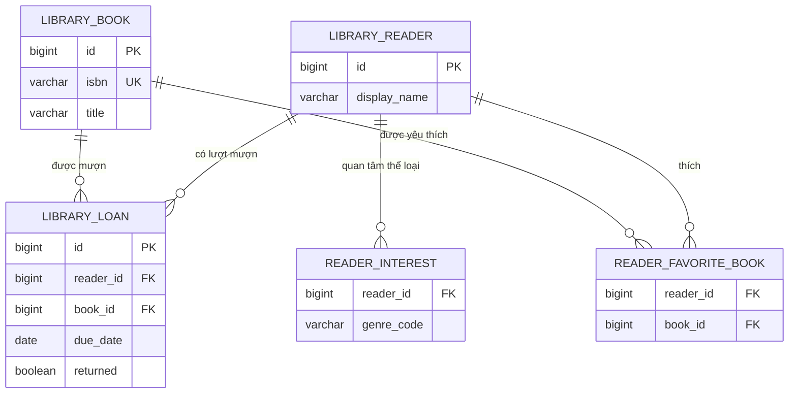
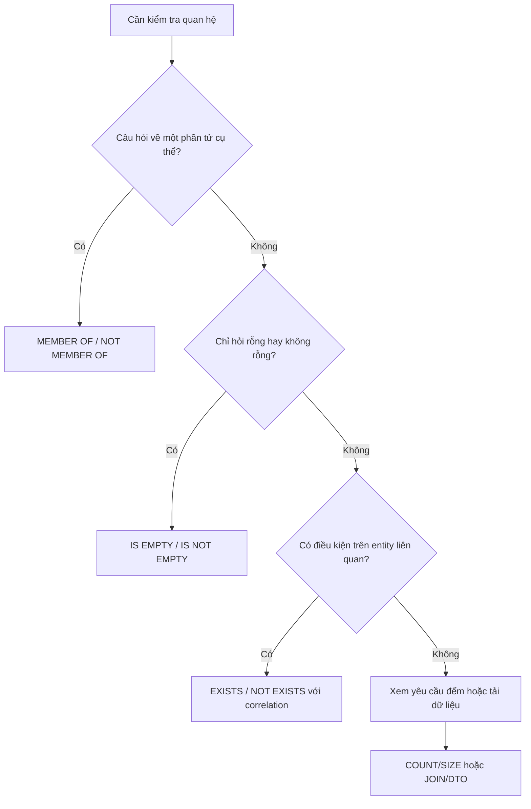

# Kiểm tra quan hệ bằng EXISTS, MEMBER OF và IS EMPTY

Trong JPQL (*Jakarta Persistence Query Language*), nhiều câu hỏi nghiệp vụ không yêu cầu tải toàn bộ danh sách entity liên quan. Chúng chỉ muốn biết **có tồn tại một liên kết hay không**, **một phần tử có thuộc collection hay không**, hoặc **collection của một entity có rỗng không**.

Ví dụ trong hệ thống thư viện:

- Người đọc nào **đang có ít nhất một lượt mượn chưa trả**?
- Người đọc nào **đã đánh dấu cuốn sách X là yêu thích**?
- Người đọc nào **chưa từng có lượt mượn**?
- Người đọc nào **không có lượt mượn quá hạn**?
- Người đọc nào **có lượt mượn nhưng không có lượt nào quá hạn**?

JPQL có ba công cụ quan trọng để diễn đạt các câu hỏi đó: **`EXISTS`**, **`MEMBER OF`** và **`IS EMPTY`**. Chúng đều kiểm tra quan hệ, nhưng khác nhau ở loại điều kiện, vị trí sử dụng, cách diễn đạt và phạm vi dữ liệu cần xét.

Bài học thuộc chương **JPQL nâng cao** của chủ đề *Data Persistence Relational Access ORM JPA*. Ta sẽ xây mô hình Reader–Loan–Book, viết truy vấn thật, giải thích SQL tương đương, so sánh với `JOIN`/`COUNT`/`SIZE`, xử lý `NOT`, `NULL` và phân trang, rồi áp dụng các cách kiểm tra quan hệ trong Java SE và Spring Data JPA.

## 1. Ba biểu thức giải quyết ba kiểu câu hỏi

| Biểu thức JPQL | Câu hỏi điển hình | Dữ liệu dùng để kiểm tra |
|---|---|---|
| `EXISTS (subquery)` | Có **ít nhất một hàng** thỏa một điều kiện bất kỳ không? | Kết quả của truy vấn con |
| `NOT EXISTS (subquery)` | Có **không có hàng nào** thỏa điều kiện đó không? | Kết quả của truy vấn con |
| `:book MEMBER OF r.favoriteBooks` | Cuốn sách cụ thể có thuộc collection của người đọc không? | Một phần tử và một collection-valued association |
| `:book NOT MEMBER OF r.favoriteBooks` | Cuốn sách cụ thể có không thuộc collection không? | Một phần tử và collection |
| `r.loans IS EMPTY` | Collection các lượt mượn có không chứa phần tử nào? | Collection-valued path |
| `r.loans IS NOT EMPTY` | Collection các lượt mượn có ít nhất một phần tử không? | Collection-valued path |

Các biểu thức này thường nằm trong `WHERE` hoặc `HAVING`, như các điều kiện boolean khác.

```jpql
-- Có ít nhất một lượt mượn chưa trả.
SELECT r
FROM ReaderAccount r
WHERE EXISTS (
    SELECT l.id
    FROM Loan l
    WHERE l.reader = r AND l.returned = false
)

-- Cuốn sách cụ thể thuộc danh sách yêu thích.
SELECT r
FROM ReaderAccount r
WHERE :book MEMBER OF r.favoriteBooks

-- Không có lượt mượn nào.
SELECT r
FROM ReaderAccount r
WHERE r.loans IS EMPTY
```

Nhìn vào ba câu truy vấn, có thể thấy:

1. `EXISTS` mạnh nhất khi điều kiện cần tìm **phức tạp**, chẳng hạn `returned = false` và `dueDate < :today`.
2. `MEMBER OF` ngắn gọn khi kiểm tra **một phần tử xác định** có trong collection.
3. `IS EMPTY` trực tiếp nhất khi chỉ cần kiểm tra **collection có phần tử nào hay không**, không quan tâm điều kiện của từng phần tử.

## 2. Mô hình ví dụ: người đọc, sách và lượt mượn

Ta dùng bốn khái niệm:

- `ReaderAccount`: người đọc, có tên và các quan hệ.
- `Book`: sách, tồn tại độc lập với người đọc.
- `Loan`: một lượt mượn, trỏ tới đúng một người đọc và một cuốn sách.
- `favoriteBooks` và `interests`: lần lượt là collection entity và collection giá trị đơn giản.



Các kiểu collection mà JPA hỗ trợ ở đây:

```java
// Quan hệ một-nhiều: collection các entity Loan.
@OneToMany(mappedBy = "reader")
private List<Loan> loans;

// Quan hệ nhiều-nhiều: collection các entity Book.
@ManyToMany
private Set<Book> favoriteBooks;

// Element collection: collection giá trị String.
@ElementCollection
private Set<String> interests;
```

Ba collection này đều có thể tham gia một số phép kiểm tra JPQL; tuy nhiên, **kiểu phần tử** quyết định giá trị được phép dùng với `MEMBER OF`.

### Bộ dữ liệu giả định

Các truy vấn trong bài sử dụng dữ liệu minh họa sau:

| Người đọc | Sách yêu thích | Lượt mượn | Thể loại quan tâm |
|---|---|---|---|
| **An** | *JPA Practical*, *Clean Code* | Một lượt chưa trả đã quá hạn; một lượt đã trả | `JAVA` |
| **Bình** | *JPA Practical* | Chưa có lượt mượn | `JAVA` |
| **Chi** | *Algorithms* | Một lượt chưa trả, chưa quá hạn | `ALGORITHMS` |
| **Dung** | Không có | Chưa có lượt mượn | Không có |

Để kết quả không phụ thuộc ngày chạy, ta cố định **ngày tham chiếu là 15/11/2026**. Một lượt mượn được coi là quá hạn nếu `returned = false` và `dueDate < 2026-11-15`.

Ví dụ này giúp thấy rõ sự khác nhau giữa:

- **Không có lượt mượn**: Bình và Dung.
- **Có lượt mượn nhưng không có lượt nào quá hạn**: Chi.
- **Không có lượt nào quá hạn**, kể cả chưa từng mượn: Bình, Chi và Dung.
- **Có sách yêu thích JPA Practical**: An và Bình.

## 3. EXISTS: kiểm tra sự tồn tại của kết quả truy vấn con

`EXISTS` nhận một **subquery** và trả về true nếu subquery có ít nhất một hàng kết quả.

```jpql
SELECT r
FROM ReaderAccount r
WHERE EXISTS (
    SELECT l.id
    FROM Loan l
    WHERE l.reader = r
)
```

Cách đọc:

> Lấy từng ReaderAccount `r`. Giữ lại `r` khi tồn tại ít nhất một `Loan l` có `l.reader = r`.

Kết quả là các người đọc có ít nhất một lượt mượn: **An** và **Chi**.

### EXISTS không yêu cầu dữ liệu từ subquery xuất hiện trong kết quả

Bên trong truy vấn con:

```jpql
SELECT l.id
```

chúng ta chọn một thuộc tính hợp lệ để JPQL có một select expression. Nhưng phần `WHERE EXISTS (...)` **chỉ quan tâm subquery có hàng hay không**, không dùng giá trị `l.id` để hiển thị.

Trường hợp tương ứng ở SQL thường có dạng:

```sql
SELECT r.*
FROM library_reader r
WHERE EXISTS (
    SELECT 1
    FROM library_loan l
    WHERE l.reader_id = r.id
);
```

Đây là SQL **minh họa ý nghĩa**, không phải bản sao của SQL do mọi JPA provider phát. Việc optimizer chuyển `EXISTS` thành semi-join hay cách truy cập index phụ thuộc database.

### Tại sao cần liên hệ giữa l.reader và r?

Điều kiện:

```jpql
l.reader = r
```

là **điều kiện tương quan** (*correlation predicate*) giữa query con và query ngoài. Nếu thiếu:

```jpql
SELECT r
FROM ReaderAccount r
WHERE EXISTS (
    SELECT l.id
    FROM Loan l
)
```

thì subquery không còn gắn với `r`. Chỉ cần **bất kỳ Loan nào tồn tại trong toàn database**, tất cả ReaderAccount có thể được trả về. Đó là một lỗi logic rất dễ bỏ qua vì cú pháp truy vấn vẫn hợp lệ.

## 4. EXISTS với điều kiện nghiệp vụ

Một thế mạnh lớn của `EXISTS` là cho phép kiểm tra **nhiều thuộc tính và điều kiện trên chính entity liên quan**.

### 4.1. Có ít nhất một lượt mượn chưa trả

```jpql
SELECT r
FROM ReaderAccount r
WHERE EXISTS (
    SELECT l.id
    FROM Loan l
    WHERE l.reader = r
      AND l.returned = false
)
ORDER BY r.id ASC
```

Kết quả: **An, Chi**.

Bình và Dung không có Loan nào; lượt đã trả của An không được tính, nhưng An có một lượt chưa trả khác nên vẫn được chọn.

### 4.2. Có ít nhất một lượt mượn quá hạn

```jpql
SELECT r
FROM ReaderAccount r
WHERE EXISTS (
    SELECT l.id
    FROM Loan l
    WHERE l.reader = r
      AND l.returned = false
      AND l.dueDate < :today
)
ORDER BY r.id ASC
```

`:today` là `LocalDate` được bind khi gọi query.

Kết quả với ngày 15/11/2026: **An**.

Ở đây `IS NOT EMPTY` không đủ, vì câu hỏi không phải “có bất kỳ Loan nào?” mà là “có Loan **thỏa điều kiện quá hạn** không?”. Một truy vấn con tương quan giúp thể hiện chính xác tiêu chí đó.

### 4.3. Kiểm tra sự tồn tại của một loại sách cụ thể

Nếu `Book` có thuộc tính `isbn`, có thể viết:

```jpql
SELECT r
FROM ReaderAccount r
WHERE EXISTS (
    SELECT l.id
    FROM Loan l
    WHERE l.reader = r
      AND l.book.isbn = :isbn
)
```

Đây là câu hỏi “người đọc từng có lượt mượn sách với ISBN này hay chưa?”. Nó **khác** với “người đọc đã thêm sách đó vào favoriteBooks hay chưa”, vì lượt mượn và danh sách yêu thích là **hai quan hệ khác nhau**.

## 5. NOT EXISTS: không có phần tử nào thỏa điều kiện

Dùng `NOT EXISTS` khi muốn phủ định **sự tồn tại của một hàng thỏa điều kiện**.

Ví dụ người đọc **không có lượt mượn quá hạn**:

```jpql
SELECT r
FROM ReaderAccount r
WHERE NOT EXISTS (
    SELECT l.id
    FROM Loan l
    WHERE l.reader = r
      AND l.returned = false
      AND l.dueDate < :today
)
ORDER BY r.id ASC
```

Kết quả: **Bình, Chi, Dung**.

Một điểm quan trọng: query này vẫn trả về **Bình và Dung dù họ không có lượt mượn**. Với người không có Loan, không tồn tại Loan quá hạn, nên điều kiện `NOT EXISTS` đúng.

### Nếu yêu cầu “có mượn, nhưng không quá hạn”?

Ta phải kết hợp **hai điều kiện**:

```jpql
SELECT r
FROM ReaderAccount r
WHERE EXISTS (
    SELECT anyLoan.id
    FROM Loan anyLoan
    WHERE anyLoan.reader = r
)
AND NOT EXISTS (
    SELECT overdue.id
    FROM Loan overdue
    WHERE overdue.reader = r
      AND overdue.returned = false
      AND overdue.dueDate < :today
)
ORDER BY r.id ASC
```

Kết quả: **Chi**; nếu An có ít nhất một quá hạn thì bị loại, còn Bình và Dung bị loại vì chưa từng mượn.

Đây là cách tránh một lỗi về **logic chân lý với tập rỗng** (*vacuous truth*): “không tồn tại phần tử vi phạm” luôn đúng khi tập ban đầu rỗng, nhưng yêu cầu kinh doanh có thể còn muốn tập phải không rỗng.

### Phân biệt NOT EXISTS và NOT IN

`NOT EXISTS` là phủ định về sự tồn tại của **kết quả subquery**. `NOT IN` so sánh một giá trị với tập giá trị; nếu subquery chứa `NULL`, logic ba giá trị của SQL có thể gây kết quả không như dự đoán.

Ví dụ, một truy vấn `NOT IN (SELECT l.reader.id ...)` cần cân nhắc nullability và semantics của tập giá trị. `NOT EXISTS` với điều kiện tương quan rõ thường dễ diễn đạt các bài toán **không có liên kết thỏa điều kiện** hơn.

Không kết luận `NOT EXISTS` luôn nhanh hơn `NOT IN` trên mọi DB; hãy kiểm tra SQL và execution plan của workload thực.

## 6. MEMBER OF: phần tử cụ thể thuộc collection hay không?

`MEMBER OF` dùng để kiểm tra **giá trị bên trái có phải phần tử của collection bên phải** hay không.

Cú pháp:

```jpql
:element MEMBER OF entity.collectionProperty
```

Ví dụ `ReaderAccount.favoriteBooks` là `Set<Book>`:

```jpql
SELECT r
FROM ReaderAccount r
WHERE :book MEMBER OF r.favoriteBooks
ORDER BY r.id ASC
```

Nếu `:book` là entity `Book` đại diện cho *JPA Practical*, kết quả là **An, Bình**.

Trong Java, bind một entity Book:

```java
Book book = em.getReference(Book.class, bookId);

List<ReaderAccount> fans = em.createQuery(
        """
        SELECT r
        FROM ReaderAccount r
        WHERE :book MEMBER OF r.favoriteBooks
        ORDER BY r.id ASC
        """,
        ReaderAccount.class
    )
    .setParameter("book", book)
    .getResultList();
```

### Quan trọng: Book entity khác Book ID

Vì `favoriteBooks` là `Set<Book>`, phần tử được kiểm tra có kiểu `Book`. Do đó, cách viết này **không đúng về kiểu**:

```java
// Sai ý nghĩa: favoriteBooks chứa Book, không chứa Long.
query.setParameter("book", bookId);
```

Nếu API chỉ có một ID `Long`, có thể lấy reference:

```java
Book bookRef = em.getReference(Book.class, bookId);
query.setParameter("book", bookRef);
```

Hoặc dùng `JOIN`/`EXISTS` với điều kiện so sánh `b.id = :bookId`, trình bày ở phần sau.

`getReference` có thể không tải đầy đủ Book ngay lập tức, nhưng **không thay thế việc xác thực Book thực sự tồn tại hoặc người gọi có quyền truy cập**. Lỗi liên quan ID không tồn tại có thể xuất hiện khi proxy được truy cập hay thao tác persistence, tùy provider.

### MEMBER OF không có nghĩa là Java Collection.contains()

JPQL:

```jpql
:book MEMBER OF r.favoriteBooks
```

được đánh giá theo semantics của JPA query/database. Nó **không đòi hỏi** ứng dụng phải tải toàn bộ `r.favoriteBooks` rồi chạy `Set.contains` trong JVM.

Ngược lại:

```java
ReaderAccount r = em.find(ReaderAccount.class, readerId);
boolean favorite = r.getFavoriteBooks().contains(book);
```

có thể khiến lazy collection được khởi tạo tùy provider/mapping. Khi chỉ cần kiểm tra quan hệ, dùng query rõ ràng là cách dễ dự đoán phạm vi dữ liệu hơn.

## 7. MEMBER OF cho collection kiểu giá trị đơn giản

`MEMBER OF` không chỉ dành cho entity association. Nó có thể kiểm tra phần tử trong `@ElementCollection`.

Ví dụ `ReaderAccount` giữ các mã thể loại:

```java
@ElementCollection
@CollectionTable(
    name = "reader_interest",
    joinColumns = @JoinColumn(name = "reader_id")
)
@Column(name = "genre_code", nullable = false)
private Set<String> interests = new HashSet<>();
```

Truy vấn:

```jpql
SELECT r
FROM ReaderAccount r
WHERE :genre MEMBER OF r.interests
ORDER BY r.id ASC
```

Bind:

```java
List<ReaderAccount> javaReaders = em.createQuery(
        """
        SELECT r
        FROM ReaderAccount r
        WHERE :genre MEMBER OF r.interests
        ORDER BY r.id ASC
        """,
        ReaderAccount.class
    )
    .setParameter("genre", "JAVA")
    .getResultList();
```

Kết quả trên dữ liệu ví dụ: **An, Bình**.

Ở đây `:genre` phải là giá trị `String`, vì `interests` chứa `String`, không phải entity `Genre`.

### Lưu ý về chuỗi và chuẩn hóa

Nếu mã thể loại có thể lưu `"java"`, `"JAVA"` hay `"Java"`, kết quả membership phụ thuộc giá trị và quy tắc so sánh ở DB. Khi nghiệp vụ muốn mã thể loại không phân biệt hoa/thường, nên **chuẩn hóa mã trước khi lưu và trước khi bind**, ví dụ chuyển sang uppercase theo quy tắc áp dụng nhất quán.

Không nên dựa vào một cơ chế collation không rõ ràng rồi giả định `"java"` và `"JAVA"` luôn bằng nhau trên mọi database.

## 8. NOT MEMBER OF: phủ định membership

Cú pháp:

```jpql
SELECT r
FROM ReaderAccount r
WHERE :book NOT MEMBER OF r.favoriteBooks
ORDER BY r.id ASC
```

Nếu `:book` là *JPA Practical*, kết quả là **Chi, Dung**.

- Chi có favorite khác (*Algorithms*) nhưng không có *JPA Practical*.
- Dung không có favorite nào, nên sách đó cũng không là thành viên của collection.

Đây là phép phủ định trên **phần tử cụ thể**, không phải điều kiện collection rỗng.

So sánh:

```jpql
-- Reader không thích JPA Practical.
WHERE :book NOT MEMBER OF r.favoriteBooks

-- Reader không có bất kỳ sách yêu thích nào.
WHERE r.favoriteBooks IS EMPTY
```

Hai query khác nhau: Chi thỏa query thứ nhất nhưng không thỏa query thứ hai vì Chi có *Algorithms* trong favorites.

### Kiểu dữ liệu không khớp là lỗi thiết kế query

Không dùng:

```jpql
-- Sai kiểu: r.favoriteBooks chứa Book, không chứa String title.
WHERE :bookTitle MEMBER OF r.favoriteBooks
```

Nếu muốn hỏi về thuộc tính của phần tử, dùng `EXISTS` hoặc `JOIN` với điều kiện `b.title = :bookTitle`, chứ không so sánh một String với entity collection.

## 9. IS EMPTY: collection không chứa phần tử nào

`IS EMPTY` kiểm tra trạng thái **rỗng của collection-valued path**.

```jpql
SELECT r
FROM ReaderAccount r
WHERE r.loans IS EMPTY
ORDER BY r.id ASC
```

Kết quả: **Bình, Dung**.

Truy vấn này không yêu cầu `Loan` phải đáp ứng điều kiện ngày hạn hay trạng thái trả sách: chỉ cần một Loan bất kỳ tồn tại thì collection không còn rỗng.

Kiểm tra collection yêu thích:

```jpql
SELECT r
FROM ReaderAccount r
WHERE r.favoriteBooks IS EMPTY
ORDER BY r.id ASC
```

Kết quả: **Dung**.

Kiểm tra collection thể loại:

```jpql
SELECT r
FROM ReaderAccount r
WHERE r.interests IS EMPTY
ORDER BY r.id ASC
```

Kết quả cũng là **Dung**.

### IS EMPTY không phải IS NULL

Đây là nhầm lẫn quan trọng:

```jpql
r.loans IS EMPTY
```

là kiểm tra **collection không có phần tử liên kết**.

Trong khi:

```jpql
r.loans IS NULL
```

không phải cách diễn đạt kiểm tra một quan hệ collection rỗng trong JPQL. `IS NULL` thích hợp cho **single-valued path**, ví dụ `l.book IS NULL` nếu mapping cho phép, hoặc `p.reviewedAt IS NULL` khi field có thể null.

Trong Java, một collection có thể được khởi tạo `new ArrayList<>()`; khi JPA quản lý collection, đối tượng runtime có thể là một wrapper lazy. Trạng thái object collection có bị `null` trong Java không **không phải** ngữ nghĩa mà `IS EMPTY` kiểm tra trong database.

## 10. IS NOT EMPTY: có ít nhất một phần tử

Dùng `IS NOT EMPTY` khi chỉ cần biết collection có phần tử:

```jpql
SELECT r
FROM ReaderAccount r
WHERE r.loans IS NOT EMPTY
ORDER BY r.id ASC
```

Kết quả: **An, Chi**.

Tương tự:

```jpql
SELECT r
FROM ReaderAccount r
WHERE r.favoriteBooks IS NOT EMPTY
ORDER BY r.id ASC
```

Kết quả: **An, Bình, Chi**.

### IS NOT EMPTY so với EXISTS

Hai truy vấn sau có cùng ý định với mô hình ví dụ:

```jpql
SELECT r
FROM ReaderAccount r
WHERE r.loans IS NOT EMPTY
```

```jpql
SELECT r
FROM ReaderAccount r
WHERE EXISTS (
    SELECT l.id
    FROM Loan l
    WHERE l.reader = r
)
```

`IS NOT EMPTY` dễ đọc hơn khi chỉ hỏi **có bất kỳ phần tử**. `EXISTS` linh hoạt hơn khi phải bổ sung điều kiện của `Loan`.

Không được suy ra rằng hai truy vấn sẽ có **chính xác cùng chuỗi SQL hoặc plan** trên mọi provider/DB. Cần quan sát query plan khi dùng ở đường đi dữ liệu có tải lớn.

## 11. EXISTS, MEMBER OF và IS EMPTY giống và khác nhau ở đâu?

| Yêu cầu | Biểu thức ưu tiên | Ví dụ |
|---|---|---|
| Có bất kỳ Loan nào | `IS NOT EMPTY` hoặc `EXISTS` | `r.loans IS NOT EMPTY` |
| Không có Loan nào | `IS EMPTY` | `r.loans IS EMPTY` |
| Có Loan quá hạn | `EXISTS` có điều kiện | `EXISTS (SELECT l.id FROM Loan l WHERE l.reader=r AND l.dueDate < :today AND l.returned=false)` |
| Không có Loan quá hạn | `NOT EXISTS` | Phủ định truy vấn con lọc overdue |
| Book X thuộc favorites | `MEMBER OF` | `:book MEMBER OF r.favoriteBooks` |
| Book X không thuộc favorites | `NOT MEMBER OF` | `:book NOT MEMBER OF r.favoriteBooks` |
| Mã String X thuộc interests | `MEMBER OF` | `:genre MEMBER OF r.interests` |
| Không có bất kỳ interest | `IS EMPTY` | `r.interests IS EMPTY` |
| Có Loan của một Book theo ISBN | `EXISTS` hoặc `JOIN` | Điều kiện `l.book.isbn = :isbn` |

Điểm chung: cả ba đều có thể kiểm tra quan hệ **ngay trong query**, không bắt buộc mang toàn bộ object graph về ứng dụng.

Điểm khác: `MEMBER OF` đòi hỏi **một phần tử xác định và collection path**, `IS EMPTY` kiểm tra **độ rỗng**, còn `EXISTS` kiểm tra **kết quả của một subquery tùy ý**.

## 12. Ví dụ entity đầy đủ: Book

Ví dụ Java SE sử dụng Java 17+, Jakarta Persistence 3.1, Hibernate ORM và H2.

Tệp `src/main/java/demo/Book.java`:

```java
package demo;

import jakarta.persistence.Column;
import jakarta.persistence.Entity;
import jakarta.persistence.GeneratedValue;
import jakarta.persistence.GenerationType;
import jakarta.persistence.Id;
import jakarta.persistence.Table;

import java.util.Objects;

@Entity
@Table(name = "library_book")
public class Book {

    @Id
    @GeneratedValue(strategy = GenerationType.IDENTITY)
    private Long id;

    @Column(name = "isbn", nullable = false, unique = true, length = 32)
    private String isbn;

    @Column(name = "title", nullable = false, length = 200)
    private String title;

    protected Book() {
        // JPA constructor.
    }

    public Book(String isbn, String title) {
        this.isbn = Objects.requireNonNull(isbn, "isbn");
        this.title = Objects.requireNonNull(title, "title");
        if (isbn.isBlank() || title.isBlank()) {
            throw new IllegalArgumentException("isbn/title is blank");
        }
    }

    public Long getId() {
        return id;
    }

    public String getIsbn() {
        return isbn;
    }

    public String getTitle() {
        return title;
    }
}
```

Book là entity độc lập. Một cuốn sách có thể được nhiều Reader yêu thích và xuất hiện trong nhiều Loan. Vì vậy không bật `CascadeType.REMOVE` trên `favoriteBooks` chỉ để JPA “dọn liên kết”: xóa một Reader không có nghĩa phải xóa Book khỏi danh mục thư viện.

## 13. Ví dụ entity đầy đủ: ReaderAccount

Tệp `src/main/java/demo/ReaderAccount.java`:

```java
package demo;

import jakarta.persistence.CascadeType;
import jakarta.persistence.CollectionTable;
import jakarta.persistence.Column;
import jakarta.persistence.ElementCollection;
import jakarta.persistence.Entity;
import jakarta.persistence.GeneratedValue;
import jakarta.persistence.GenerationType;
import jakarta.persistence.Id;
import jakarta.persistence.JoinColumn;
import jakarta.persistence.JoinTable;
import jakarta.persistence.ManyToMany;
import jakarta.persistence.OneToMany;
import jakarta.persistence.Table;
import jakarta.persistence.UniqueConstraint;

import java.util.ArrayList;
import java.util.Collections;
import java.util.HashSet;
import java.util.List;
import java.util.Objects;
import java.util.Set;

@Entity
@Table(name = "library_reader")
public class ReaderAccount {

    @Id
    @GeneratedValue(strategy = GenerationType.IDENTITY)
    private Long id;

    @Column(name = "display_name", nullable = false, unique = true, length = 80)
    private String displayName;

    @OneToMany(mappedBy = "reader", cascade = CascadeType.PERSIST)
    private List<Loan> loans = new ArrayList<>();

    @ManyToMany
    @JoinTable(
        name = "reader_favorite_book",
        joinColumns = @JoinColumn(name = "reader_id"),
        inverseJoinColumns = @JoinColumn(name = "book_id"),
        uniqueConstraints = @UniqueConstraint(
            name = "uk_reader_favorite",
            columnNames = {"reader_id", "book_id"}
        )
    )
    private Set<Book> favoriteBooks = new HashSet<>();

    @ElementCollection
    @CollectionTable(
        name = "reader_interest",
        joinColumns = @JoinColumn(name = "reader_id")
    )
    @Column(name = "genre_code", nullable = false, length = 40)
    private Set<String> interests = new HashSet<>();

    protected ReaderAccount() {
        // JPA constructor.
    }

    public ReaderAccount(String displayName) {
        this.displayName =
            Objects.requireNonNull(displayName, "displayName");

        if (displayName.isBlank()) {
            throw new IllegalArgumentException(
                "displayName cannot be blank");
        }
    }

    public Long getId() {
        return id;
    }

    public String getDisplayName() {
        return displayName;
    }

    public List<Loan> getLoans() {
        return Collections.unmodifiableList(loans);
    }

    public Set<Book> getFavoriteBooks() {
        return Collections.unmodifiableSet(favoriteBooks);
    }

    public Set<String> getInterests() {
        return Collections.unmodifiableSet(interests);
    }

    public void addFavorite(Book book) {
        favoriteBooks.add(Objects.requireNonNull(book, "book"));
    }

    public void addInterest(String genre) {
        String normalized = Objects.requireNonNull(genre, "genre")
            .trim()
            .toUpperCase(java.util.Locale.ROOT);

        if (normalized.isEmpty()) {
            throw new IllegalArgumentException("genre is blank");
        }

        interests.add(normalized);
    }

    public void addLoan(Loan loan) {
        Objects.requireNonNull(loan, "loan");

        ReaderAccount previous = loan.getReader();
        if (previous != null && previous != this) {
            throw new IllegalArgumentException(
                "Loan belongs to another reader");
        }

        for (Loan existing : loans) {
            if (existing == loan) {
                loan.linkToReader(this);
                return;
            }
        }

        loans.add(loan);
        loan.linkToReader(this);
    }
}
```

Giải thích các quan hệ:

- `loans` là `@OneToMany(mappedBy = "reader")`; phía `Loan.reader` quản lý FK.
- `favoriteBooks` là `@ManyToMany`; bảng nối `reader_favorite_book` giữ các cặp reader–book.
- `interests` là `@ElementCollection`, dùng bảng `reader_interest` để lưu các String.
- Các getter trả collection chỉ đọc để người gọi không vô tình thao tác sai mô hình.
- `CascadeType.PERSIST` trên `loans` phục vụ tạo Reader cùng Loan trong ví dụ. **Không cascade REMOVE** tùy tiện vì nhật ký lượt mượn trong hệ thống thật có thể cần bảo toàn/audit.
- Không khai báo cascade trên favoriteBooks vì Book là entity độc lập được nhiều Reader sử dụng.

Một lưu ý về `Set<Book>`: trong ví dụ ta dùng object Book managed từ cùng `EntityManager` khi thêm favorite, nên `HashSet` nhận diện những reference tương ứng theo mặc định identity. Nếu ứng dụng thường trộn detached objects/proxy đại diện cùng ID, phải thiết kế `equals/hashCode` phù hợp với vòng đời ID và provider; không dựa vào `Set` để thay thế unique constraint trong DB.

## 14. Ví dụ entity đầy đủ: Loan

Tệp `src/main/java/demo/Loan.java`:

```java
package demo;

import jakarta.persistence.Column;
import jakarta.persistence.Entity;
import jakarta.persistence.FetchType;
import jakarta.persistence.GeneratedValue;
import jakarta.persistence.GenerationType;
import jakarta.persistence.Id;
import jakarta.persistence.JoinColumn;
import jakarta.persistence.ManyToOne;
import jakarta.persistence.Table;

import java.time.LocalDate;
import java.util.Objects;

@Entity
@Table(name = "library_loan")
public class Loan {

    @Id
    @GeneratedValue(strategy = GenerationType.IDENTITY)
    private Long id;

    @ManyToOne(fetch = FetchType.LAZY, optional = false)
    @JoinColumn(name = "reader_id", nullable = false)
    private ReaderAccount reader;

    @ManyToOne(fetch = FetchType.LAZY, optional = false)
    @JoinColumn(name = "book_id", nullable = false)
    private Book book;

    @Column(name = "due_date", nullable = false)
    private LocalDate dueDate;

    @Column(name = "returned", nullable = false)
    private boolean returned;

    protected Loan() {
        // JPA constructor.
    }

    public Loan(Book book, LocalDate dueDate, boolean returned) {
        this.book = Objects.requireNonNull(book, "book");
        this.dueDate = Objects.requireNonNull(dueDate, "dueDate");
        this.returned = returned;
    }

    public Long getId() {
        return id;
    }

    public ReaderAccount getReader() {
        return reader;
    }

    public Book getBook() {
        return book;
    }

    public LocalDate getDueDate() {
        return dueDate;
    }

    public boolean isReturned() {
        return returned;
    }

    void linkToReader(ReaderAccount reader) {
        this.reader = reader;
    }

    public void markReturned() {
        this.returned = true;
    }
}
```

Ở đây các field `returned` và `dueDate` là dữ liệu giúp `EXISTS` lọc **những Loan phù hợp**, thay vì chỉ kiểm tra collection có phần tử.

## 15. Cấu hình dự án Java SE và persistence.xml

Cấu trúc mẫu:

```text
jpql-relation-predicates/
├── pom.xml
└── src/
    └── main/
        ├── java/demo/
        │   ├── Book.java
        │   ├── ReaderAccount.java
        │   ├── Loan.java
        │   └── Main.java
        └── resources/
            └── META-INF/
                └── persistence.xml
```

`pom.xml` minh họa:

```xml
<project xmlns="http://maven.apache.org/POM/4.0.0"
         xmlns:xsi="http://www.w3.org/2001/XMLSchema-instance"
         xsi:schemaLocation="http://maven.apache.org/POM/4.0.0
                             https://maven.apache.org/xsd/maven-4.0.0.xsd">
    <modelVersion>4.0.0</modelVersion>
    <groupId>demo</groupId>
    <artifactId>jpql-relation-predicates</artifactId>
    <version>1.0-SNAPSHOT</version>

    <properties>
        <maven.compiler.release>17</maven.compiler.release>
        <project.build.sourceEncoding>UTF-8</project.build.sourceEncoding>
    </properties>

    <dependencies>
        <dependency>
            <groupId>jakarta.persistence</groupId>
            <artifactId>jakarta.persistence-api</artifactId>
            <version>3.1.0</version>
        </dependency>
        <dependency>
            <groupId>org.hibernate.orm</groupId>
            <artifactId>hibernate-core</artifactId>
            <version>6.6.4.Final</version>
        </dependency>
        <dependency>
            <groupId>com.h2database</groupId>
            <artifactId>h2</artifactId>
            <version>2.3.232</version>
        </dependency>
    </dependencies>

    <build>
        <plugins>
            <plugin>
                <groupId>org.apache.maven.plugins</groupId>
                <artifactId>maven-compiler-plugin</artifactId>
                <version>3.13.0</version>
            </plugin>
            <plugin>
                <groupId>org.codehaus.mojo</groupId>
                <artifactId>exec-maven-plugin</artifactId>
                <version>3.4.1</version>
                <configuration>
                    <mainClass>demo.Main</mainClass>
                </configuration>
            </plugin>
        </plugins>
    </build>
</project>
```

Tệp `src/main/resources/META-INF/persistence.xml`:

```xml
<?xml version="1.0" encoding="UTF-8"?>
<persistence xmlns="https://jakarta.ee/xml/ns/persistence"
             xmlns:xsi="http://www.w3.org/2001/XMLSchema-instance"
             xsi:schemaLocation="
               https://jakarta.ee/xml/ns/persistence
               https://jakarta.ee/xml/ns/persistence/persistence_3_1.xsd"
             version="3.1">
    <persistence-unit name="libraryPU" transaction-type="RESOURCE_LOCAL">
        <provider>org.hibernate.jpa.HibernatePersistenceProvider</provider>

        <class>demo.Book</class>
        <class>demo.ReaderAccount</class>
        <class>demo.Loan</class>
        <exclude-unlisted-classes>true</exclude-unlisted-classes>

        <properties>
            <property name="jakarta.persistence.jdbc.driver"
                      value="org.h2.Driver"/>
            <property name="jakarta.persistence.jdbc.url"
                      value="jdbc:h2:mem:librarydb;DB_CLOSE_DELAY=-1"/>
            <property name="jakarta.persistence.jdbc.user" value="sa"/>
            <property name="jakarta.persistence.jdbc.password" value=""/>
            <property name="jakarta.persistence.schema-generation.database.action"
                      value="drop-and-create"/>
        </properties>
    </persistence-unit>
</persistence>
```

`drop-and-create` chỉ phù hợp cho **demo/test** vì có thể **xóa toàn bộ dữ liệu**. Ứng dụng production nên sử dụng migration, kiểm tra schema, index và constraint theo cơ sở dữ liệu mục tiêu.

Dependency version ở đây là một bộ minh họa cùng thế hệ Jakarta Persistence; không mang ý nghĩa là các bản phát hành mới nhất.

## 16. Chương trình Main: tạo dữ liệu và chạy cả ba loại điều kiện

Tệp `src/main/java/demo/Main.java`:

```java
package demo;

import jakarta.persistence.EntityManager;
import jakarta.persistence.EntityManagerFactory;
import jakarta.persistence.EntityTransaction;
import jakarta.persistence.Persistence;

import java.time.LocalDate;
import java.util.List;

public class Main {

    private record SeedIds(Long jpaBookId) {}

    public static void main(String[] args) {
        EntityManagerFactory emf =
            Persistence.createEntityManagerFactory("libraryPU");

        try {
            SeedIds ids = seed(emf);
            runQueries(emf, ids);
        } finally {
            emf.close();
        }
    }

    private static SeedIds seed(EntityManagerFactory emf) {
        EntityManager em = emf.createEntityManager();

        try {
            EntityTransaction tx = em.getTransaction();

            try {
                tx.begin();

                Book clean = new Book(
                    "9780000000001", "Clean Code");
                Book jpa = new Book(
                    "9780000000002", "JPA Practical");
                Book algorithms = new Book(
                    "9780000000003", "Algorithms");

                em.persist(clean);
                em.persist(jpa);
                em.persist(algorithms);

                ReaderAccount an = new ReaderAccount("An");
                an.addFavorite(jpa);
                an.addFavorite(clean);
                an.addInterest("JAVA");
                an.addLoan(new Loan(
                    clean, LocalDate.of(2026, 10, 1), false));
                an.addLoan(new Loan(
                    jpa, LocalDate.of(2026, 10, 10), true));

                ReaderAccount binh = new ReaderAccount("Bình");
                binh.addFavorite(jpa);
                binh.addInterest("JAVA");

                ReaderAccount chi = new ReaderAccount("Chi");
                chi.addFavorite(algorithms);
                chi.addInterest("ALGORITHMS");
                chi.addLoan(new Loan(
                    algorithms, LocalDate.of(2027, 1, 1), false));

                ReaderAccount dung = new ReaderAccount("Dung");

                // CascadeType.PERSIST trên Reader.loans
                // lưu các Loan mới cùng Reader.
                em.persist(an);
                em.persist(binh);
                em.persist(chi);
                em.persist(dung);

                tx.commit();
                return new SeedIds(jpa.getId());

            } catch (RuntimeException ex) {
                if (tx.isActive()) tx.rollback();
                throw ex;
            }
        } finally {
            em.close();
        }
    }

    private static void runQueries(
            EntityManagerFactory emf, SeedIds ids) {

        EntityManager em = emf.createEntityManager();

        try {
            LocalDate today = LocalDate.of(2026, 11, 15);

            List<ReaderAccount> activeLoanReaders =
                em.createQuery(
                    """
                    SELECT r
                    FROM ReaderAccount r
                    WHERE EXISTS (
                        SELECT l.id
                        FROM Loan l
                        WHERE l.reader = r
                          AND l.returned = false
                    )
                    ORDER BY r.id
                    """,
                    ReaderAccount.class
                ).getResultList();

            print("EXISTS active loan", activeLoanReaders);

            List<ReaderAccount> noLoans =
                em.createQuery(
                    """
                    SELECT r
                    FROM ReaderAccount r
                    WHERE r.loans IS EMPTY
                    ORDER BY r.id
                    """,
                    ReaderAccount.class
                ).getResultList();

            print("IS EMPTY loans", noLoans);

            List<ReaderAccount> noOverdue =
                em.createQuery(
                    """
                    SELECT r
                    FROM ReaderAccount r
                    WHERE NOT EXISTS (
                        SELECT l.id
                        FROM Loan l
                        WHERE l.reader = r
                          AND l.returned = false
                          AND l.dueDate < :today
                    )
                    ORDER BY r.id
                    """,
                    ReaderAccount.class
                )
                .setParameter("today", today)
                .getResultList();

            print("NOT EXISTS overdue loan", noOverdue);

            Book jpaBook =
                em.getReference(Book.class, ids.jpaBookId());

            List<ReaderAccount> jpaFans =
                em.createQuery(
                    """
                    SELECT r
                    FROM ReaderAccount r
                    WHERE :book MEMBER OF r.favoriteBooks
                    ORDER BY r.id
                    """,
                    ReaderAccount.class
                )
                .setParameter("book", jpaBook)
                .getResultList();

            print("MEMBER OF JPA Practical", jpaFans);

            List<ReaderAccount> javaInterests =
                em.createQuery(
                    """
                    SELECT r
                    FROM ReaderAccount r
                    WHERE :genre MEMBER OF r.interests
                    ORDER BY r.id
                    """,
                    ReaderAccount.class
                )
                .setParameter("genre", "JAVA")
                .getResultList();

            print("MEMBER OF genre JAVA", javaInterests);

            List<ReaderAccount> noFavorites =
                em.createQuery(
                    """
                    SELECT r
                    FROM ReaderAccount r
                    WHERE r.favoriteBooks IS EMPTY
                    ORDER BY r.id
                    """,
                    ReaderAccount.class
                ).getResultList();

            print("IS EMPTY favorites", noFavorites);

            List<ReaderAccount> borrowedButNotOverdue =
                em.createQuery(
                    """
                    SELECT r
                    FROM ReaderAccount r
                    WHERE r.loans IS NOT EMPTY
                      AND NOT EXISTS (
                          SELECT l.id
                          FROM Loan l
                          WHERE l.reader = r
                            AND l.returned = false
                            AND l.dueDate < :today
                      )
                    ORDER BY r.id
                    """,
                    ReaderAccount.class
                )
                .setParameter("today", today)
                .getResultList();

            print("Has loans but none overdue",
                  borrowedButNotOverdue);
        } finally {
            em.close();
        }
    }

    private static void print(
            String label, List<ReaderAccount> readers) {

        String names = readers.stream()
            .map(ReaderAccount::getDisplayName)
            .reduce((a, b) -> a + ", " + b)
            .orElse("(none)");

        System.out.println(label + " => " + names);
    }
}
```

Chạy:

```bash
mvn compile exec:java
```

Kết quả chính dự kiến, bỏ qua log của JPA provider:

```text
EXISTS active loan => An, Chi
IS EMPTY loans => Bình, Dung
NOT EXISTS overdue loan => Bình, Chi, Dung
MEMBER OF JPA Practical => An, Bình
MEMBER OF genre JAVA => An, Bình
IS EMPTY favorites => Dung
Has loans but none overdue => Chi
```

Đây là kết quả của **bộ dữ liệu minh họa và ngày tham chiếu cố định**, không phải dữ liệu trực tiếp từ một hệ thống thư viện thật.

### Vì sao có ORDER BY r.id?

Các truy vấn kiểm tra quan hệ không tự cam kết thứ tự. `ORDER BY r.id` giúp trình tự hiển thị ổn định theo primary key khi bộ dữ liệu không đổi. Không có `ORDER BY`, cùng một tập Reader có thể được trả về theo nhiều thứ tự tùy execution plan.

## 17. Viết tương đương bằng JOIN: khi nào cần DISTINCT?

Một câu kiểm tra **có Loan chưa trả** có thể được viết qua `JOIN`:

```jpql
SELECT DISTINCT r
FROM ReaderAccount r
JOIN r.loans l
WHERE l.returned = false
ORDER BY r.id
```

Vì một Reader có thể có **nhiều Loan chưa trả**, phép join có thể tạo **nhiều hàng SQL cho cùng Reader**. `DISTINCT` diễn đạt ý định lấy mỗi Reader một lần trong kết quả.

Còn bản `EXISTS`:

```jpql
SELECT r
FROM ReaderAccount r
WHERE EXISTS (
    SELECT l.id
    FROM Loan l
    WHERE l.reader = r AND l.returned = false
)
ORDER BY r.id
```

không tạo việc nhân bản Reader ở kết quả ngoài vì subquery chỉ dùng làm điều kiện boolean.

### Không có quy tắc EXISTS luôn nhanh hơn JOIN

Optimizer của database có thể chuyển truy vấn tồn tại thành **semi-join** hoặc chọn execution plan khác. `JOIN DISTINCT` đôi khi hiệu quả tùy index, số lượng hàng và điều kiện lọc; `EXISTS` thường diễn đạt mục đích rõ hơn và tránh phải nghĩ tới việc loại duplicate ở tầng root.

Hãy đo trên dữ liệu thực tế bằng `EXPLAIN`/`EXPLAIN ANALYZE`, SQL log và thống kê hàng trả về. Không kết luận dựa trên số dòng JPQL.

### JOIN phù hợp khi cần dữ liệu từ entity liên quan

Nếu muốn hiển thị **cả Reader và từng Loan thỏa điều kiện**:

```jpql
SELECT r, l
FROM ReaderAccount r
JOIN r.loans l
WHERE l.returned = false
ORDER BY r.id, l.id
```

thì `JOIN` và kết quả `Object[]`/DTO có ý nghĩa vì ứng dụng cần dữ liệu cả hai phía. Khi chỉ hỏi “Reader có Loan phù hợp không?”, `EXISTS` là lựa chọn dễ biểu đạt hơn.

## 18. MEMBER OF tương đương JOIN như thế nào?

Hai truy vấn dưới đây có mục đích tương đương trên mô hình `favoriteBooks`:

```jpql
SELECT r
FROM ReaderAccount r
WHERE :book MEMBER OF r.favoriteBooks
ORDER BY r.id
```

```jpql
SELECT DISTINCT r
FROM ReaderAccount r
JOIN r.favoriteBooks b
WHERE b = :book
ORDER BY r.id
```

Nếu chỉ có `bookId` dạng Long và không muốn tạo entity reference, có thể viết:

```jpql
SELECT DISTINCT r
FROM ReaderAccount r
JOIN r.favoriteBooks b
WHERE b.id = :bookId
ORDER BY r.id
```

Bind:

```java
List<ReaderAccount> readers = em.createQuery(
        """
        SELECT DISTINCT r
        FROM ReaderAccount r
        JOIN r.favoriteBooks b
        WHERE b.id = :bookId
        ORDER BY r.id
        """,
        ReaderAccount.class
    )
    .setParameter("bookId", bookId)
    .getResultList();
```

**Lựa chọn thực tế:**

- Đã có entity `Book` và cần diễn đạt membership rõ ràng → `MEMBER OF`.
- Chỉ có ID và muốn lọc theo thuộc tính khác của Book → `JOIN`/`EXISTS` với `b.id` và các điều kiện liên quan.
- Cần trả thông tin của Book cùng Reader → `JOIN` + DTO.
- Chỉ cần biết có tồn tại liên kết trên bảng nối → dùng cấu trúc quan hệ được mapping hoặc SQL trực tiếp khi có yêu cầu đặc biệt.

Không mặc định rằng `MEMBER OF` phải tải nguyên collection vào JVM; nó là biểu thức trong query.

## 19. IS EMPTY tương đương NOT EXISTS như thế nào?

Với `ReaderAccount.loans`:

```jpql
SELECT r
FROM ReaderAccount r
WHERE r.loans IS EMPTY
```

có thể biểu đạt bằng:

```jpql
SELECT r
FROM ReaderAccount r
WHERE NOT EXISTS (
    SELECT l.id
    FROM Loan l
    WHERE l.reader = r
)
```

Hai query đều tìm Reader **không có bất kỳ Loan nào**.

Nhưng đây không phải tương đương:

```jpql
-- Không có Loan chưa trả.
WHERE NOT EXISTS (
    SELECT l.id
    FROM Loan l
    WHERE l.reader = r
      AND l.returned = false
)
```

Query thứ ba vẫn chấp nhận người có Loan **đã trả hết**; `r.loans IS EMPTY` chỉ chấp nhận người **không có Loan nào**.

### Không dùng JOIN thông thường để tìm collection rỗng

`INNER JOIN`:

```jpql
SELECT r
FROM ReaderAccount r
JOIN r.loans l
```

chỉ cho các Reader có ít nhất một Loan, nên **không thể** dùng nó để lấy người chưa mượn.

Có thể dùng `LEFT JOIN` và điều kiện kiểm tra phía con không tồn tại:

```jpql
SELECT r
FROM ReaderAccount r
LEFT JOIN r.loans l
WHERE l.id IS NULL
```

nhưng `IS EMPTY` hoặc `NOT EXISTS` thường diễn đạt trực tiếp ý định hơn. Với các điều kiện phức tạp, đặt predicate vào `WHERE` sau `LEFT JOIN` có thể vô tình làm thay đổi semantics của outer join; cần hiểu thật rõ điều kiện trên phía nullable.

## 20. SIZE, COUNT và quan hệ rỗng

JPA còn có hàm `SIZE(collection)`:

```jpql
SELECT r
FROM ReaderAccount r
WHERE SIZE(r.loans) = 0
```

Trong nhiều trường hợp, nó có cùng ý định với:

```jpql
WHERE r.loans IS EMPTY
```

Nhưng mục tiêu của `SIZE` là cung cấp **số phần tử**, còn `IS EMPTY` biểu đạt **kiểm tra rỗng**. Không nên mặc định chúng sinh cùng SQL hoặc có chi phí bằng nhau.

### Khi cần nhiều hơn một phần tử

Ví dụ người đọc có ít nhất ba Loan:

```jpql
SELECT r
FROM ReaderAccount r
WHERE SIZE(r.loans) >= 3
```

Hoặc truy vấn tổng hợp:

```jpql
SELECT r.id, COUNT(l)
FROM ReaderAccount r
LEFT JOIN r.loans l
GROUP BY r.id
HAVING COUNT(l) >= 3
```

Khi cần đếm, `SIZE`/`COUNT` phù hợp về ý nghĩa; khi chỉ cần **có hay không**, `EXISTS`/`IS EMPTY` thường rõ hơn và có thể cho DB cơ hội tối ưu phép tồn tại.

### COUNT(*) không phải EXISTS

`COUNT` yêu cầu tính số lượng theo query, còn `EXISTS` chỉ yêu cầu xác định **có kết quả hay không**. Database có thể tối ưu hai phép khác nhau. Đặc biệt với tập rất lớn, không cần bắt DB đếm mọi phần tử chỉ để phân biệt 0 và lớn hơn 0, trừ khi query plan cho thấy phương án đếm phù hợp hơn trong workload đó.

## 21. NULL và logic ba giá trị

SQL/JPQL không chỉ có true/false với mọi phép so sánh. Khi liên quan `NULL`, có thể phát sinh kết quả **UNKNOWN** và điều kiện `WHERE` chỉ giữ những hàng mà predicate đánh giá là true.

### EXISTS với NULL

`EXISTS` chỉ xét **subquery có hàng hay không**, không xét giá trị được chọn có `NULL` hay không.

Ví dụ:

```jpql
EXISTS (
    SELECT l.dueDate
    FROM Loan l
    WHERE l.reader = r
)
```

Ngay cả nếu một cột kết quả được phép NULL, nếu subquery có một hàng thì `EXISTS` vẫn true. Trong mô hình ví dụ `dueDate` không nullable nên vấn đề đó không phát sinh, nhưng ý nghĩa của `EXISTS` vẫn như trên.

### So sánh NULL trong predicate

Không dùng:

```jpql
-- Sai khi muốn kiểm tra giá trị NULL.
l.dueDate = NULL
```

Thay bằng:

```jpql
l.dueDate IS NULL
```

Trong query quá hạn, ta đã định nghĩa `dueDate` `nullable=false` nên điều kiện `l.dueDate < :today` có ý nghĩa rõ. Nếu ngày hạn có thể NULL, phải quy định “không có dueDate” có được coi là quá hạn hay không và dùng `IS NULL`/`OR` phù hợp.

### MEMBER OF và NULL

Khi phần tử cần kiểm tra là `null`, hoặc collection giá trị chứa `NULL`, không nên suy ra phép membership luôn hành xử như Java `Set.contains(null)`. Ngữ nghĩa JPQL/SQL có thể dựa trên logic ba giá trị và cách provider xử lý collection. Với API nghiệp vụ, **validate phần tử đầu vào không null** nếu không có một yêu cầu rõ ràng cần xử lý null membership.

Nếu muốn tìm entity mà association đơn trị thiếu liên kết, dùng `IS NULL` trên single-valued path; nếu muốn tìm collection không có phần tử, dùng `IS EMPTY`.

## 22. NOT EXISTS và bài toán “mọi phần tử đều thỏa”

Trong logic tập hợp, phát biểu:

> Tất cả lượt mượn chưa trả của người đọc đều chưa quá hạn.

có thể viết bằng cách phủ định sự tồn tại của **một phần tử vi phạm**:

```jpql
SELECT r
FROM ReaderAccount r
WHERE NOT EXISTS (
    SELECT l.id
    FROM Loan l
    WHERE l.reader = r
      AND l.returned = false
      AND l.dueDate < :today
)
```

Cách đọc là:

> Không tồn tại lượt mượn chưa trả nào có ngày hạn trước hôm nay.

Nhưng như đã nêu, người **không có lượt mượn** cũng thỏa.

Nếu nghiệp vụ đòi “đang có ít nhất một lượt mượn chưa trả và mọi lượt đó đều chưa quá hạn”:

```jpql
SELECT r
FROM ReaderAccount r
WHERE EXISTS (
    SELECT active.id
    FROM Loan active
    WHERE active.reader = r
      AND active.returned = false
)
AND NOT EXISTS (
    SELECT overdue.id
    FROM Loan overdue
    WHERE overdue.reader = r
      AND overdue.returned = false
      AND overdue.dueDate < :today
)
ORDER BY r.id
```

Đây là mẫu quan trọng để diễn đạt điều kiện **“mọi phần tử trong tập thỏa P”** bằng `NOT EXISTS` của một **phản ví dụ**, kết hợp `EXISTS` nếu không muốn chấp nhận tập rỗng.

### Tránh nhầm điều kiện “có một” và “mọi”

Hai câu sau khác nhau:

```jpql
-- Có ít nhất một Loan đúng hạn.
EXISTS (
    SELECT l.id FROM Loan l
    WHERE l.reader = r AND l.dueDate >= :today
)
```

```jpql
-- Không có Loan chưa trả nào quá hạn.
NOT EXISTS (
    SELECT l.id FROM Loan l
    WHERE l.reader = r
      AND l.returned = false
      AND l.dueDate < :today
)
```

Người đọc có cả một Loan đúng hạn và một Loan quá hạn sẽ thỏa câu thứ nhất, nhưng **không thỏa** câu thứ hai.

## 23. EXISTS lồng nhau và quan hệ nhiều bước

Trong các truy vấn phức tạp, điều kiện tồn tại có thể liên quan nhiều entity.

Ví dụ tìm Reader đã mượn ít nhất một cuốn sách **đồng thời** đã đánh dấu chính cuốn đó là yêu thích:

```jpql
SELECT r
FROM ReaderAccount r
WHERE EXISTS (
    SELECT l.id
    FROM Loan l
    WHERE l.reader = r
      AND l.book MEMBER OF r.favoriteBooks
)
ORDER BY r.id
```

Câu hỏi này không phải “Reader có Loan bất kỳ và có favorite bất kỳ”. Nó yêu cầu **cùng một Book** là đối tượng của Loan và thành viên của favorites.

Trên dữ liệu ví dụ:

- An có Loan tới *Clean Code* và *JPA Practical*, đồng thời thích cả hai → thỏa.
- Chi có Loan *Algorithms* và thích *Algorithms* → thỏa.
- Bình không có Loan → không thỏa.
- Dung không có Loan → không thỏa.

Kết quả: **An, Chi**.

Một lỗi logic thường gặp:

```jpql
-- Không đồng nghĩa với "đã mượn một sách mình thích".
WHERE r.loans IS NOT EMPTY
  AND r.favoriteBooks IS NOT EMPTY
```

Hai collection không rỗng **không chứng minh có cùng Book** xuất hiện ở cả hai. Cần điều kiện tương quan như `l.book MEMBER OF r.favoriteBooks`.

### Truy vấn lồng subquery khi cần điều kiện qua nhiều tầng

Ví dụ người đọc có ít nhất một Loan mà Book thuộc một tập thỏa điều kiện bổ sung:

```jpql
SELECT r
FROM ReaderAccount r
WHERE EXISTS (
    SELECT l.id
    FROM Loan l
    WHERE l.reader = r
      AND EXISTS (
          SELECT b.id
          FROM Book b
          WHERE b = l.book
            AND b.title LIKE :prefix
      )
)
```

Dạng lồng này hợp lệ về ý nghĩa, nhưng trong ví dụ có thể viết ngắn hơn bằng `l.book.title LIKE :prefix`. Chọn cấu trúc đơn giản nhất thể hiện điều kiện; không lồng EXISTS chỉ để làm query trông “nâng cao”.

## 24. JPQL subquery đặt ở đâu?

Đối với ngữ nghĩa JPQL truyền thống, subquery được sử dụng trong **điều kiện `WHERE` và `HAVING`**, ví dụ `EXISTS (SELECT ... )`.

```jpql
SELECT r
FROM ReaderAccount r
WHERE EXISTS (
    SELECT l.id FROM Loan l WHERE l.reader = r
)
```

Không lấy ví dụ SQL native như:

```sql
SELECT ...
FROM (SELECT ... ) AS derived_table
```

rồi mặc định JPQL trên mọi phiên bản/provider hỗ trợ y hệt derived table trong `FROM`. JPQL dùng **entity và đường dẫn quan hệ**; SQL native và các extension của provider có phạm vi cú pháp riêng.

Ngoài ra, JPQL không cần `LIMIT 1` bên trong `EXISTS` để biểu đạt phép tồn tại. Nếu muốn giới hạn kết quả bên ngoài, dùng `setMaxResults` trên `TypedQuery`. Provider/DB tự tối ưu điều kiện tồn tại theo khả năng.

## 25. Criteria API tương đương

Khi bộ lọc được xây động, Criteria API cho phép biểu diễn các predicate qua object thay vì ghép chuỗi JPQL.

### EXISTS bằng Subquery và CriteriaBuilder.exists

```java
CriteriaBuilder cb = em.getCriteriaBuilder();
CriteriaQuery<ReaderAccount> cq =
    cb.createQuery(ReaderAccount.class);

Root<ReaderAccount> reader = cq.from(ReaderAccount.class);

Subquery<Long> subquery = cq.subquery(Long.class);
Root<Loan> loan = subquery.from(Loan.class);

subquery.select(loan.get("id"))
    .where(
        cb.equal(loan.get("reader"), reader),
        cb.isFalse(loan.get("returned"))
    );

cq.select(reader)
  .where(cb.exists(subquery))
  .orderBy(cb.asc(reader.get("id")));

List<ReaderAccount> result =
    em.createQuery(cq).getResultList();
```

Các import cần dùng:

```java
import jakarta.persistence.criteria.CriteriaBuilder;
import jakarta.persistence.criteria.CriteriaQuery;
import jakarta.persistence.criteria.Root;
import jakarta.persistence.criteria.Subquery;
import java.util.List;
```

Ở đây `cb.exists(subquery)` tương đương `WHERE EXISTS (...)`.

### IS EMPTY bằng CriteriaBuilder.isEmpty

```java
CriteriaBuilder cb = em.getCriteriaBuilder();
CriteriaQuery<ReaderAccount> cq =
    cb.createQuery(ReaderAccount.class);

Root<ReaderAccount> r = cq.from(ReaderAccount.class);

cq.select(r)
  .where(cb.isEmpty(r.get("loans")))
  .orderBy(cb.asc(r.get("id")));

List<ReaderAccount> result =
    em.createQuery(cq).getResultList();
```

### MEMBER OF bằng CriteriaBuilder.isMember

```java
Book target = em.getReference(Book.class, bookId);

CriteriaBuilder cb = em.getCriteriaBuilder();
CriteriaQuery<ReaderAccount> cq =
    cb.createQuery(ReaderAccount.class);

Root<ReaderAccount> r = cq.from(ReaderAccount.class);

cq.select(r)
  .where(cb.isMember(
      target,
      r.<Set<Book>>get("favoriteBooks")
  ));

List<ReaderAccount> result =
    em.createQuery(cq).getResultList();
```

Cần `import java.util.Set;` cho đoạn Criteria membership. Có thể dùng static metamodel (`ReaderAccount_.favoriteBooks`) khi dự án cấu hình annotation processing để giảm lỗi tên field dạng chuỗi.

**Lưu ý:** kiểm tra relationship bằng Criteria không tự làm truy vấn nhanh hơn JPQL string. Cả hai được provider dịch thành SQL theo metadata và query plan; lợi ích chính của Criteria là **dựng query động có cấu trúc**.

## 26. Spring Data JPA và @Query

Trong Spring Data JPA, có thể định nghĩa repository methods:

```java
public interface ReaderAccountRepository
        extends JpaRepository<ReaderAccount, Long> {

    @Query("""
        SELECT r
        FROM ReaderAccount r
        WHERE EXISTS (
            SELECT l.id
            FROM Loan l
            WHERE l.reader = r
              AND l.returned = false
        )
        ORDER BY r.id
        """)
    List<ReaderAccount> findReadersWithActiveLoans();

    @Query("""
        SELECT r
        FROM ReaderAccount r
        WHERE :book MEMBER OF r.favoriteBooks
        ORDER BY r.id
        """)
    List<ReaderAccount> findReadersWhoLike(
        @Param("book") Book book
    );

    @Query("""
        SELECT r
        FROM ReaderAccount r
        WHERE r.loans IS EMPTY
        ORDER BY r.id
        """)
    List<ReaderAccount> findReadersWithoutLoans();

    @Query("""
        SELECT r
        FROM ReaderAccount r
        WHERE NOT EXISTS (
            SELECT l.id
            FROM Loan l
            WHERE l.reader = r
              AND l.returned = false
              AND l.dueDate < :today
        )
        ORDER BY r.id
        """)
    List<ReaderAccount> findReadersWithoutOverdueLoans(
        @Param("today") LocalDate today
    );
}
```

Cần import Spring Data `JpaRepository`, `@Query`, `@Param` và Java `List`/`LocalDate`. Các phương thức ở đây trả ReaderAccount managed/detached theo phạm vi persistence context của Spring; tránh expose trực tiếp lazy entity graph trong JSON nếu endpoint chỉ cần tên và ID.

### Cần kiểm tra thuộc tính phân quyền

Nếu ứng dụng đa tenant, nên thêm predicate theo tenant/authorization scope vào query. Một query `EXISTS` đúng về mặt quan hệ vẫn có thể làm lộ dữ liệu giữa các tenant nếu thiếu điều kiện lọc root và association theo chính sách truy cập.

### Spring Data derived queries có thay thế tất cả không?

Một số câu hỏi có thể biểu diễn bằng tên method, nhưng điều kiện `EXISTS` tương quan phức tạp, `MEMBER OF` cho element collection hoặc kết hợp `NOT EXISTS` thường dễ đọc và bảo trì hơn với `@Query`/Specification/Criteria. Không cố tạo tên method quá dài chỉ để tránh viết JPQL.

## 27. Phân trang với EXISTS không nhân bản root

Giả sử cần lấy 20 người đọc đầu tiên có Loan chưa trả:

```java
List<ReaderAccount> page = em.createQuery(
        """
        SELECT r
        FROM ReaderAccount r
        WHERE EXISTS (
            SELECT l.id
            FROM Loan l
            WHERE l.reader = r
              AND l.returned = false
        )
        ORDER BY r.id ASC
        """,
        ReaderAccount.class
    )
    .setFirstResult(0)
    .setMaxResults(20)
    .getResultList();
```

Vì subquery `EXISTS` chỉ lọc Reader, query ngoài có thể trả **mỗi Reader root một lần** mà không cần `JOIN` vào tất cả Loan. Điều này thuận tiện hơn khi phân trang root entity so với một join nhiều dòng cần `DISTINCT`.

Tuy nhiên:

- `ORDER BY r.id` cần thiết để thứ tự page xác định trên dữ liệu không đổi.
- Thêm/xóa Loan giữa các page có thể khiến Reader đi vào hoặc rời tập phù hợp, làm offset page dịch chuyển.
- Khi dữ liệu rất lớn hoặc thay đổi thường xuyên, cân nhắc keyset pagination và quy tắc snapshot/concurrency phù hợp.
- Query trả entity chưa chắc tối ưu nếu UI chỉ cần `id` và `displayName`; có thể dùng DTO projection.

Ví dụ chỉ lấy ID:

```jpql
SELECT r.id
FROM ReaderAccount r
WHERE r.loans IS EMPTY
ORDER BY r.id
```

Cách này không cần materialize entity Reader chỉ để lấy khóa.

## 28. Index và SQL plan cho các truy vấn quan hệ

Với `EXISTS` lọc Loan theo Reader và quá hạn:

```jpql
WHERE EXISTS (
    SELECT l.id
    FROM Loan l
    WHERE l.reader = r
      AND l.returned = false
      AND l.dueDate < :today
)
```

SQL tương đương thường sử dụng điều kiện:

```sql
WHERE l.reader_id = r.id
  AND l.returned = FALSE
  AND l.due_date < ?
```

Có thể cân nhắc index:

```sql
CREATE INDEX idx_loan_reader_returned_due
ON library_loan(reader_id, returned, due_date);
```

Với truy vấn tìm độc giả thích Book theo ID, một index trên bảng nối theo chiều Book → Reader có thể hữu ích:

```sql
CREATE INDEX idx_favorite_book_reader
ON reader_favorite_book(book_id, reader_id);
```

Nếu DB đã tạo unique index theo `(reader_id, book_id)`, index đảo chiều có thể hỗ trợ truy vấn từ Book sang Reader, nhưng **không nên tạo mọi index vô điều kiện**. Mỗi index tốn dung lượng và chi phí ghi.

Các điểm cần đo:

1. DB dùng index seek, scan hay join nào?
2. Số hàng Loan/favorite được xét để trả một trang Reader là bao nhiêu?
3. Tỷ lệ Reader có Loan, số Loan trung bình và p95/p99.
4. Có nhiều Loan quá hạn hay chỉ rất ít?
5. Có join/duplicate/aggregate không cần thiết không?
6. Độ trễ query dưới tải đồng thời và ảnh hưởng của cache.

Về mặt ý nghĩa, `EXISTS` là phép **tồn tại**, nhưng không cam kết DB sẽ chỉ đọc đúng một hàng vật lý rồi dừng trên mọi query plan.

## 29. Transaction, tính nhất quán và kiểm tra trước khi ghi

Một lỗi thiết kế thường gặp là:

```java
boolean alreadyFavorite = ...; // Query MEMBER OF hoặc EXISTS.
if (!alreadyFavorite) {
    reader.addFavorite(book);
}
```

Nếu hai transaction đồng thời cùng thấy quan hệ chưa tồn tại, cả hai có thể thử thêm cặp `(reader_id, book_id)`. **Kiểm tra trước** không loại trừ race condition.

Vì vậy:

- Dùng unique constraint trên bảng nối nếu một cặp không được trùng.
- Định nghĩa behavior khi request thêm favorite bị lặp: từ chối hay idempotent.
- Với thao tác phức tạp, sử dụng locking/version/transaction isolation phù hợp.
- Nếu có lỗi unique trong flush/commit, rollback transaction lỗi và xử lý theo quy tắc nghiệp vụ.
- Không lấy kết quả một query lúc T1 làm bằng chứng vĩnh viễn rằng dữ liệu ở T2 sẽ giống hệt.

Tương tự, trước khi cho một Reader mượn sách, `NOT EXISTS` có thể kiểm tra không có Loan vi phạm hạn mức, nhưng nếu nhiều request cùng thực hiện, vẫn cần cơ chế chống race khi invariant phụ thuộc số lượt mượn tối đa.

### Kết quả IS EMPTY có thể thay đổi sau đó

`WHERE r.loans IS EMPTY` phản ánh dữ liệu mà transaction/query nhìn thấy theo isolation và trạng thái DB tại thời điểm phù hợp. Một transaction khác có thể tạo Loan sau khi query trả kết quả. Không biến kết quả kiểm tra quan hệ thành một khóa quản lý concurrency nếu chưa có transaction/locking đủ mạnh.

## 30. Tách biệt việc hỏi quan hệ với việc tải graph

Một use case chỉ cần xác định boolean:

> Người đọc #12 đã thích Book #7 chưa?

Không cần nhất thiết:

```java
ReaderAccount reader = em.find(ReaderAccount.class, readerId);
Book book = em.find(Book.class, bookId);

boolean exists = reader.getFavoriteBooks().contains(book);
```

Đường trên có thể khởi tạo một collection lazy rất lớn và tạo nhiều managed entity.

Hướng query theo ID:

```java
boolean exists = !em.createQuery(
        """
        SELECT r.id
        FROM ReaderAccount r
        JOIN r.favoriteBooks b
        WHERE r.id = :readerId
          AND b.id = :bookId
        """,
        Long.class
    )
    .setParameter("readerId", readerId)
    .setParameter("bookId", bookId)
    .setMaxResults(1)
    .getResultList()
    .isEmpty();
```

Truy vấn này trả tối đa một ID, không yêu cầu tải toàn bộ collection favorite. Hoặc có thể dùng `MEMBER OF` với một Book reference khi nó phù hợp với kiến trúc service.

### Query existence và graph fetch phục vụ hai mục tiêu

- `EXISTS`, `MEMBER OF`, `IS EMPTY`: kiểm tra **điều kiện liên kết**.
- `JOIN FETCH`/`EntityGraph`: tải **dữ liệu của entity liên quan** để sử dụng trong Java.

Dùng fetch join chỉ để biết collection có một phần tử là không cần thiết. Ngược lại, dùng `EXISTS` không giúp trả chi tiết mọi Loan nếu UI thật sự cần danh sách Loan: khi đó phải thiết kế query/DTO cho danh sách.

## 31. Các lỗi thường gặp

### Lỗi 1: Quên correlation trong EXISTS

```jpql
-- Sai logic nếu muốn kiểm tra Loan của từng Reader.
WHERE EXISTS (SELECT l.id FROM Loan l)
```

Thêm `l.reader = r` hoặc điều kiện liên hệ tương đương.

### Lỗi 2: Dùng IS EMPTY thay EXISTS có điều kiện

```jpql
-- Chỉ kiểm tra không có Loan nào, không phải không có Loan quá hạn.
WHERE r.loans IS EMPTY
```

Nếu muốn “không có Loan quá hạn”, dùng `NOT EXISTS` với điều kiện về hạn và trạng thái.

### Lỗi 3: Dùng ID thay entity trong MEMBER OF

`:bookId MEMBER OF r.favoriteBooks` không phù hợp nếu favoriteBooks là `Set<Book>`. Bind entity Book hoặc viết query JOIN theo `b.id`.

### Lỗi 4: Dùng MEMBER OF trên single-valued path

`MEMBER OF` yêu cầu collection-valued path. `:name MEMBER OF r.displayName` sai vì `displayName` là String đơn trị, không phải collection.

### Lỗi 5: Dùng IS NULL để hỏi collection rỗng

`r.loans IS NULL` không phải cách kiểm tra collection empty. Dùng `r.loans IS EMPTY`.

### Lỗi 6: Quên rằng NOT EXISTS chấp nhận tập rỗng

Một Reader không có Loan chắc chắn không có Loan quá hạn. Nếu yêu cầu có Loan nhưng tất cả đều không quá hạn, thêm `r.loans IS NOT EMPTY` hoặc `EXISTS` tương ứng.

### Lỗi 7: JOIN gây trùng root

`SELECT r FROM ReaderAccount r JOIN r.loans l` có thể tạo nhiều hàng cho một Reader. Cân nhắc `DISTINCT`, `EXISTS` hoặc DTO đúng yêu cầu.

### Lỗi 8: Dùng COUNT chỉ để biết có hay không và suy ra luôn tối ưu

`COUNT` trả số lượng; `EXISTS` kiểm tra tồn tại. Đo plan trong workload lớn thay vì mặc định một phép luôn hiệu quả hơn.

### Lỗi 9: Dựa vào số lượng collection trong Java nhưng tưởng không có query

`reader.getLoans().size()` có thể kích hoạt lazy loading. `IS EMPTY` trong JPQL không yêu cầu đem cả collection về JVM.

### Lỗi 10: Dùng NOT MEMBER OF khi input null mà không có chính sách

Khi phần tử bind null, logic và cách provider xử lý có thể khác mong đợi. Validate đầu vào hoặc định nghĩa rõ trường hợp NULL.

### Lỗi 11: Trộn điều kiện cho hai quan hệ khác nhau

`r.loans IS NOT EMPTY AND r.favoriteBooks IS NOT EMPTY` không chứng minh đã mượn đúng cuốn mình thích. Dùng điều kiện `l.book MEMBER OF r.favoriteBooks` trong EXISTS.

### Lỗi 12: Thiếu ràng buộc unique khi ghi liên kết

Một kiểm tra membership không thay thế unique constraint của bảng nối khi có concurrency.

### Lỗi 13: Dùng query EXISTS nhưng thiếu tenant/authorization scope

Một query đúng về mặt hình thức vẫn có thể tiết lộ trạng thái quan hệ của tài khoản khác nếu không giới hạn theo người dùng/tenant được phép.

### Lỗi 14: Mong subquery trả dữ liệu qua EXISTS

`EXISTS` chỉ dùng làm predicate. Muốn trả Loan cụ thể, select Loan hoặc DTO ở query ngoài phù hợp.

### Lỗi 15: Truyền raw ID không tồn tại vào getReference rồi cho rằng đã validate

`getReference` có thể không truy vấn DB ngay. Kiểm tra tồn tại/quyền là bước nghiệp vụ riêng, không được giả định đã thực hiện.

## 32. Quy trình lựa chọn biểu thức

Khi gặp yêu cầu kiểm tra quan hệ, hỏi lần lượt:

| Câu hỏi | Lựa chọn |
|---|---|
| Chỉ cần biết collection có ít nhất một phần tử? | `IS NOT EMPTY` |
| Chỉ cần biết collection không có phần tử nào? | `IS EMPTY` |
| Muốn kiểm tra **một entity/value cụ thể** có trong collection? | `MEMBER OF` |
| Muốn phủ định membership của một phần tử cụ thể? | `NOT MEMBER OF` |
| Muốn kiểm tra một phần tử liên quan thỏa điều kiện phức tạp? | `EXISTS` với subquery tương quan |
| Muốn chắc chắn không có phần tử vi phạm? | `NOT EXISTS` |
| Muốn “mọi phần tử thỏa P” nhưng tập không được rỗng? | `EXISTS` tập gốc + `NOT EXISTS` phần tử vi phạm |
| Muốn đếm chính xác bao nhiêu phần tử? | `COUNT`/`SIZE` |
| Muốn trả chi tiết dữ liệu liên quan? | `JOIN`/DTO/fetch thích hợp |
| Muốn kiểm tra theo ID chứ không bind entity? | `JOIN`/`EXISTS` so sánh `id` hoặc lấy entity reference hợp lệ |



Lưu đồ chỉ giúp xác định cách biểu đạt ngắn gọn. Có thể có nhiều cách JPQL cho cùng một yêu cầu; lựa chọn cuối cùng phải xét tính đúng, khả năng bảo trì, phạm vi dữ liệu và query plan.

## 33. Bài tập thực hành

### Bài 1 — EXISTS cơ bản

Dùng dữ liệu ví dụ, viết query lấy Reader có ít nhất một Loan. Giải thích vì sao kết quả là An và Chi, còn Bình/Dung bị loại.

### Bài 2 — Bắt lỗi thiếu correlation

Cố tình bỏ `l.reader = r` khỏi subquery EXISTS. Quan sát kết quả và giải thích vì sao query có thể trả tất cả Reader khi database có ít nhất một Loan.

### Bài 3 — Loan quá hạn

Viết query lấy Reader có ít nhất một Loan chưa trả với `dueDate < :today`. Dùng `LocalDate.of(2026, 11, 15)` và dự đoán kết quả An.

### Bài 4 — NOT EXISTS và tập rỗng

Viết query lấy Reader không có Loan quá hạn. Giải thích vì sao Bình, Chi, Dung đều thỏa dù hai người chưa từng mượn.

### Bài 5 — Có Loan nhưng không quá hạn

Thêm `IS NOT EMPTY` hoặc `EXISTS` cho tất cả Loan kết hợp `NOT EXISTS` cho Loan quá hạn. Chứng minh chỉ Chi thỏa bộ dữ liệu ví dụ.

### Bài 6 — MEMBER OF entity

Bind một Book managed/reference đại diện *JPA Practical*, tìm Reader đã đánh dấu sách yêu thích. So sánh query `MEMBER OF` với query `JOIN r.favoriteBooks b WHERE b.id = :id`.

### Bài 7 — MEMBER OF giá trị

Thêm thể loại `"DATABASE"` vào `interests` của An. Viết query `:genre MEMBER OF r.interests` rồi so sánh kết quả với `"JAVA"`.

### Bài 8 — IS EMPTY ở ba collection khác nhau

Viết ba query rỗng cho `loans`, `favoriteBooks` và `interests`. Giải thích vì sao kết quả từng query có thể khác, dù cùng cú pháp.

### Bài 9 — Loan có Book thuộc favoriteBooks

Viết EXISTS có điều kiện `l.book MEMBER OF r.favoriteBooks`. Giải thích tại sao hai kiểm tra `IS NOT EMPTY` tách biệt không đủ.

### Bài 10 — JOIN và DISTINCT

Viết query JOIN lấy Reader có Loan chưa trả. Tạo thêm Loan chưa trả cho An để thấy một Reader có thể sinh nhiều join rows. So sánh `SELECT DISTINCT r` với `EXISTS`.

### Bài 11 — COUNT và EXISTS

Tạo một Reader có hàng nghìn Loan. Đo query `COUNT(l)` và EXISTS cho câu hỏi “có Loan chưa trả không?” bằng SQL log và execution plan. Không kết luận tốc độ chỉ từ cú pháp.

### Bài 12 — Criteria API

Dùng `CriteriaBuilder.exists(...)` để viết truy vấn Reader có Loan chưa trả. Sau đó dùng `cb.isEmpty(...)` cho Reader không có Loan và `cb.isMember(...)` cho Book yêu thích.

### Bài 13 — Tìm lỗi NULL

Thêm một field nullable vào Loan trên schema test. So sánh điều kiện `field = NULL` với `field IS NULL`. Nêu tác động của giá trị null lên điều kiện bên trong EXISTS.

### Bài 14 — Race condition khi thêm favorite

Mô phỏng hai transaction cùng kiểm tra `NOT MEMBER OF` và cùng thêm một Book vào favorites. Giải thích vai trò của unique constraint và xử lý lỗi/retry.

### Bài 15 — Phân trang root bằng EXISTS

Tạo 1.000 Reader với số Loan khác nhau. Dùng `EXISTS` và `ORDER BY r.id`, phân trang 50 Reader. Giải thích vì sao kết quả root không bị nhân bản như một join một-nhiều thiếu DISTINCT.

## 34. Câu hỏi tự kiểm tra

1. **`EXISTS` trả true trong trường hợp nào?** Khi subquery có ít nhất một hàng kết quả.
2. **Giá trị được SELECT trong subquery có phải được dùng làm output không?** Không. Với EXISTS, điều quan trọng là có hàng hay không.
3. **Điều kiện `l.reader = r` để làm gì?** Tương quan Loan trong subquery với Reader đang xét ở query ngoài.
4. **Nếu quên correlation, có thể xảy ra điều gì?** Subquery kiểm tra dữ liệu toàn cục, khiến tất cả root cùng thỏa khi có một hàng phù hợp.
5. **`NOT EXISTS` có trả Reader chưa từng mượn khi kiểm tra “không có Loan quá hạn” không?** Có.
6. **Muốn Reader có Loan nhưng không quá hạn thì thêm gì?** `IS NOT EMPTY` hoặc một `EXISTS` cho Loan bất kỳ, rồi `NOT EXISTS` cho Loan quá hạn.
7. **`MEMBER OF` kiểm tra điều gì?** Một entity/value cụ thể có là phần tử của collection-valued path hay không.
8. **Với `Set<Book>`, có nên bind ID Long làm phần tử cho MEMBER OF không?** Không. Bind Book hoặc truy vấn theo b.id bằng JOIN/EXISTS.
9. **`MEMBER OF` dùng cho `@ElementCollection Set<String>` được không?** Được, nếu phần tử kiểm tra có kiểu tương thích.
10. **`IS EMPTY` dùng cho thuộc tính String đơn trị được không?** Không. Nó dành cho collection-valued path.
11. **`IS EMPTY` có giống `IS NULL` không?** Không. Một cái kiểm tra độ rỗng của collection, một cái kiểm tra null của biểu thức đơn trị.
12. **`IS NOT EMPTY` có diễn đạt điều kiện “có Loan quá hạn” không?** Không; nó chỉ kiểm tra có bất kỳ Loan nào.
13. **Khi nào cần `DISTINCT` với JOIN?** Khi join một-nhiều có thể nhân bản entity root nhưng query cần mỗi root một lần.
14. **`EXISTS` có bắt buộc tải toàn bộ collection vào JVM không?** Không. Đây là predicate query do provider/DB xử lý.
15. **COUNT và EXISTS luôn có hiệu năng giống nhau không?** Không. Query plan và dữ liệu quyết định chi phí.
16. **Một Reader có Loan và có favorite có chắc từng mượn đúng cuốn yêu thích không?** Không. Cần tương quan đúng Loan.book với favoriteBooks.
17. **`NOT MEMBER OF` của một Book có đồng nghĩa `favoriteBooks IS EMPTY` không?** Không. Reader có thể thích các Book khác.
18. **Vì sao cần kiểm tra NULL trong predicate của EXISTS?** So sánh với NULL có logic ba giá trị; dùng `IS NULL` khi muốn kiểm tra null.
19. **Một lần kiểm tra không tồn tại liên kết có chống được hai transaction cùng insert không?** Không; cần unique constraint và transaction/locking phù hợp.
20. **Khi dùng Criteria API, hàm nào tương ứng ba kiểu kiểm tra?** `cb.exists(...)`, `cb.isMember(...)` và `cb.isEmpty(...)`.

**Ghi nhớ:** **`EXISTS`** kiểm tra có hay không một hàng thỏa **subquery** và đặc biệt hữu ích khi điều kiện quan hệ phức tạp; **`MEMBER OF`** kiểm tra **một phần tử cụ thể** thuộc entity/value collection; còn **`IS EMPTY`** kiểm tra **collection không chứa phần tử nào**. Khi phủ định hoặc kết hợp điều kiện, cần xác định rõ tập rỗng có được chấp nhận không, không quên **correlation**, dùng đúng kiểu phần tử, tránh nhầm `IS EMPTY` với `IS NULL`, và đo SQL/index thực tế khi truy vấn trở thành đường đi quan trọng của hệ thống.
