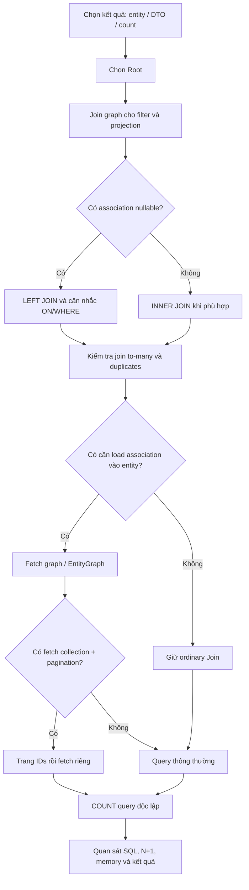

# Thiết kế Join và Fetch trong cây truy vấn Criteria API

Trong JPA Criteria API, một câu truy vấn không được tạo bằng cách nối chuỗi JPQL mà bằng **cây đối tượng Java biểu diễn cấu trúc truy vấn**: `CriteriaQuery` giữ truy vấn, `Root` xác định entity gốc, `Join` nối các association để xây điều kiện hoặc projection, còn `Fetch` yêu cầu tải dữ liệu liên quan cùng entity được chọn.

Hai lời gọi sau có hình thức khá giống nhưng **không cùng mục đích**:

```java
Join<PurchaseOrder, Customer> customer =
    order.join("customer", JoinType.INNER);

Fetch<PurchaseOrder, Customer> customerFetch =
    order.fetch("customer", JoinType.LEFT);
```

- `join(...)` tạo một nút liên kết trong **cây truy vấn**, cho phép truy cập thuộc tính của entity liên quan trong `WHERE`, `SELECT`, `ORDER BY` hoặc các predicate khác.
- `fetch(...)` tạo một nút trong **fetch graph của truy vấn**, yêu cầu provider lấy association tương ứng cùng kết quả entity, giúp kiểm soát lazy loading và nguy cơ N+1.
- `Join` là một `Path` có thể đi tiếp đến thuộc tính; `Fetch` không cung cấp API `get(...)` theo hợp đồng portable của JPA.
- `JOIN` thường ảnh hưởng tập hàng ứng viên; `FETCH JOIN` có thể ảnh hưởng lượng dữ liệu tải và số hàng SQL cần xử lý.
- Dùng nhiều `JOIN` hoặc `FETCH` một cách thiếu chủ đích có thể dẫn tới sai kết quả, nhân bản hàng, tải quá nhiều association hoặc phân trang không hiệu quả.

> **Nguyên tắc trọng tâm:** Hãy thiết kế **cây Join** theo điều kiện lọc, liên kết và projection mà truy vấn cần; thiết kế **cây Fetch** theo dữ liệu liên quan mà phần mềm sẽ sử dụng sau khi truy vấn. Hai cây có thể cùng xuất phát từ một `Root` nhưng không nên bị đánh đồng.

Bài học thuộc chương **Criteria API** của module **Data Persistence Relational Access ORM JPA**. Nội dung sử dụng API `jakarta.persistence.criteria`, ví dụ Java/JPQL/SQL, cách chọn `JoinType`, `on(...)`, join nhiều tầng, fetch to-one/to-many, truy vấn đếm, DTO, phân trang, static metamodel, Criteria subquery và các lưu ý khi sử dụng Hibernate.

---

## 1. Mô hình dữ liệu xuyên suốt

Giả sử ứng dụng quản lý đơn hàng có các quan hệ:

```text
Customer 1 ────── N PurchaseOrder 1 ────── N OrderLine
   │                     │                       │
   │                     │                       └──── N ── 1 Product
   │                     │
   └── id, region         └── status, totalAmount, createdAt
```

Ý nghĩa nghiệp vụ:

- Mỗi `PurchaseOrder` thuộc một `Customer`.
- Mỗi `Customer` có thể có nhiều `PurchaseOrder`.
- Mỗi `PurchaseOrder` có nhiều `OrderLine`.
- Mỗi `OrderLine` tham chiếu một `Product`.
- Cần tìm đơn hàng theo trạng thái, vùng khách hàng, SKU của sản phẩm, khoảng thời gian; một số màn hình còn cần hiển thị customer và danh sách dòng hàng.

Mapping tối giản:

```java
import jakarta.persistence.*;
import java.math.BigDecimal;
import java.time.LocalDateTime;
import java.util.ArrayList;
import java.util.List;

@Entity
@Table(name = "purchase_orders")
public class PurchaseOrder {

    @Id
    private Long id;

    @Enumerated(EnumType.STRING)
    @Column(name = "status", nullable = false)
    private OrderStatus status;

    @Column(name = "total_amount", nullable = false)
    private BigDecimal totalAmount;

    @Column(name = "created_at", nullable = false)
    private LocalDateTime createdAt;

    @ManyToOne(fetch = FetchType.LAZY, optional = false)
    @JoinColumn(name = "customer_id", nullable = false)
    private Customer customer;

    @OneToMany(mappedBy = "order")
    private List<OrderLine> lines = new ArrayList<>();

    protected PurchaseOrder() {}

    public Long getId() { return id; }
    public OrderStatus getStatus() { return status; }
    public BigDecimal getTotalAmount() { return totalAmount; }
    public LocalDateTime getCreatedAt() { return createdAt; }
    public Customer getCustomer() { return customer; }
    public List<OrderLine> getLines() { return lines; }
}
```

```java
@Entity
@Table(name = "customers")
public class Customer {

    @Id
    private Long id;

    @Column(name = "display_name", nullable = false)
    private String displayName;

    @Column(name = "region", nullable = false)
    private String region;

    @Column(name = "active", nullable = false)
    private boolean active;

    @OneToMany(mappedBy = "customer")
    private List<PurchaseOrder> orders = new ArrayList<>();

    protected Customer() {}

    public Long getId() { return id; }
    public String getDisplayName() { return displayName; }
    public String getRegion() { return region; }
}
```

```java
@Entity
@Table(name = "order_lines")
public class OrderLine {

    @Id
    private Long id;

    @ManyToOne(fetch = FetchType.LAZY, optional = false)
    @JoinColumn(name = "order_id", nullable = false)
    private PurchaseOrder order;

    @ManyToOne(fetch = FetchType.LAZY, optional = false)
    @JoinColumn(name = "product_id", nullable = false)
    private Product product;

    @Column(name = "quantity", nullable = false)
    private int quantity;

    protected OrderLine() {}

    public Long getId() { return id; }
    public Product getProduct() { return product; }
    public int getQuantity() { return quantity; }
}
```

```java
@Entity
@Table(name = "products")
public class Product {

    @Id
    private Long id;

    @Column(name = "sku", nullable = false, unique = true)
    private String sku;

    @Column(name = "product_name", nullable = false)
    private String name;

    protected Product() {}

    public Long getId() { return id; }
    public String getSku() { return sku; }
    public String getName() { return name; }
}
```

Và:

```java
public enum OrderStatus {
    NEW, PAID, CANCELLED
}
```

Các class chỉ giữ những thành phần cần cho bài. Constructor nghiệp vụ, validation, version và một số getter/setter được lược bỏ. Các ví dụ Java về Criteria dùng `EntityManager em` đang có persistence context và imports tương ứng từ `jakarta.persistence.*`, `jakarta.persistence.criteria.*`.

### Schema SQL nhìn từ database

```sql
CREATE TABLE customers (
    id BIGINT PRIMARY KEY,
    display_name VARCHAR(150) NOT NULL,
    region VARCHAR(30) NOT NULL,
    active BOOLEAN NOT NULL
);

CREATE TABLE products (
    id BIGINT PRIMARY KEY,
    sku VARCHAR(60) NOT NULL UNIQUE,
    product_name VARCHAR(150) NOT NULL
);

CREATE TABLE purchase_orders (
    id BIGINT PRIMARY KEY,
    customer_id BIGINT NOT NULL REFERENCES customers(id),
    status VARCHAR(20) NOT NULL,
    total_amount NUMERIC(19, 2) NOT NULL,
    created_at TIMESTAMP NOT NULL
);

CREATE TABLE order_lines (
    id BIGINT PRIMARY KEY,
    order_id BIGINT NOT NULL REFERENCES purchase_orders(id),
    product_id BIGINT NOT NULL REFERENCES products(id),
    quantity INTEGER NOT NULL CHECK (quantity > 0)
);
```

JPQL/Criteria API sử dụng **tên entity và tên field Java**, không dùng trực tiếp `purchase_orders.customer_id` như khi viết SQL.

---

## 2. Cây Criteria Query gồm những nút nào?

Ví dụ:

```java
CriteriaBuilder cb = em.getCriteriaBuilder();

CriteriaQuery<PurchaseOrder> cq =
    cb.createQuery(PurchaseOrder.class);

Root<PurchaseOrder> order = cq.from(PurchaseOrder.class);

Join<PurchaseOrder, Customer> customer =
    order.join("customer", JoinType.INNER);

cq.select(order)
  .where(cb.equal(customer.get("region"), "HCM"));

List<PurchaseOrder> result =
    em.createQuery(cq).getResultList();
```

Cây logic có thể hình dung:

```text
CriteriaQuery<PurchaseOrder>
│
├── FROM
│   └── Root<PurchaseOrder> order
│       └── Join<Customer> customer [INNER]
│
├── SELECT
│   └── order
│
└── WHERE
    └── customer.region = "HCM"
```

Tương ứng JPQL:

```jpql
SELECT o
FROM PurchaseOrder o
JOIN o.customer c
WHERE c.region = :region
```

Trong đoạn Criteria trên, giá trị `"HCM"` là literal expression do `CriteriaBuilder` tạo, không phải một đoạn chuỗi JPQL được nối trực tiếp vào cú pháp. Với giá trị request, vẫn nên dùng parameter để rõ kiểu và thuận tiện tái sử dụng:

```java
ParameterExpression<String> regionParam =
    cb.parameter(String.class, "region");

cq.where(cb.equal(customer.get("region"), regionParam));

List<PurchaseOrder> result = em.createQuery(cq)
    .setParameter("region", "HCM")
    .getResultList();
```

### Vai trò các interface

| API | Vai trò | Ví dụ |
|---|---|---|
| `CriteriaBuilder` | Tạo điều kiện, biểu thức, hàm, query | `cb.equal(...)` |
| `CriteriaQuery<T>` | Định nghĩa SELECT, FROM, WHERE, GROUP BY, ORDER BY | `cq.select(order)` |
| `Root<T>` | Entity gốc ở FROM | `cq.from(PurchaseOrder.class)` |
| `Join<Z, X>` | Liên kết association từ Z tới X, dùng làm path | `order.join("customer")` |
| `Fetch<Z, X>` | Yêu cầu tải association từ Z tới X | `order.fetch("customer")` |
| `Path<X>` | Đường dẫn thuộc tính | `customer.get("region")` |
| `Predicate` | Biểu thức điều kiện Boolean | `cb.equal(...)` |
| `Selection<X>` | Biểu thức được chọn trong SELECT | `order.get("id")` |
| `Subquery<T>` | Truy vấn con có thể dùng trong điều kiện | `cq.subquery(Long.class)` |

`Root` và `Join` đều thuộc hệ `From`, nên có thể tạo joins tiếp. `Fetch` không có đầy đủ contract `Path/From`, vì vậy nó phục vụ việc tải dữ liệu chứ không thay thế mọi thao tác của Join.

## 3. `join()` tạo liên kết phục vụ truy vấn

Một `Join` diễn tả đường liên kết từ một entity đã có trong FROM đến association của nó:

```java
Join<PurchaseOrder, Customer> customer =
    order.join("customer");
```

Đối với `From.join(String)`, join mặc định là **INNER JOIN**. Có thể chỉ định rõ:

```java
Join<PurchaseOrder, Customer> customer =
    order.join("customer", JoinType.INNER);
```

Từ nút `customer`, có thể truy cập thuộc tính:

```java
Predicate isHcm = cb.equal(
    customer.get("region"),
    "HCM"
);
```

hoặc sử dụng trong `ORDER BY`:

```java
cq.orderBy(cb.asc(customer.get("displayName")));
```

hoặc trong projection:

```java
cq.multiselect(order.get("id"), customer.get("displayName"));
```

**Không có quy tắc một Join luôn đồng nghĩa toàn bộ đối tượng liên quan đã được khởi tạo trong Java.** Một ordinary JOIN quyết định dữ liệu kết hợp để thực hiện query; fetch strategy mới quyết định dữ liệu nào cần được nạp vào các association của entity trả về.

## 4. `JoinType.INNER`: chỉ giữ hàng có liên kết phù hợp

Ví dụ tìm đơn hàng thuộc khách hàng ở vùng HCM:

```java
CriteriaBuilder cb = em.getCriteriaBuilder();
CriteriaQuery<PurchaseOrder> cq =
    cb.createQuery(PurchaseOrder.class);

Root<PurchaseOrder> order = cq.from(PurchaseOrder.class);

Join<PurchaseOrder, Customer> customer =
    order.join("customer", JoinType.INNER);

cq.select(order)
  .where(cb.equal(customer.get("region"), "HCM"));

List<PurchaseOrder> orders =
    em.createQuery(cq).getResultList();
```

SQL minh họa:

```sql
SELECT o.*
FROM purchase_orders o
INNER JOIN customers c ON c.id = o.customer_id
WHERE c.region = 'HCM';
```

Với INNER JOIN:

- Không có hàng ghép được thì outer row bị loại.
- Điều kiện `c.region = 'HCM'` tiếp tục lọc tập kết quả.
- Khi `customer_id NOT NULL` có FK hợp lệ, mỗi order phải có customer, nên INNER JOIN trên association này thường không tự loại order vì thiếu customer.
- Với association nullable, INNER JOIN có thể loại hàng dù không có predicate nào khác.

Một câu hỏi quan trọng trước khi chọn INNER: **nghiệp vụ có muốn giữ entity gốc khi association bị thiếu hay không?**

## 5. `JoinType.LEFT`: giữ entity gốc khi association không có

Một Customer có thể chưa có bất kỳ order nào. Nếu truy vấn từ Customer:

```java
CriteriaQuery<Customer> cq =
    cb.createQuery(Customer.class);

Root<Customer> customer = cq.from(Customer.class);

Join<Customer, PurchaseOrder> order =
    customer.join("orders", JoinType.LEFT);

cq.select(customer).distinct(true);
```

SQL minh họa:

```sql
SELECT DISTINCT c.*
FROM customers c
LEFT JOIN purchase_orders o ON o.customer_id = c.id;
```

Với LEFT JOIN:

- Customer không có order vẫn xuất hiện trong quan hệ kết quả SQL, với cột order phía phải là NULL.
- Customer có nhiều order có thể tạo nhiều **hàng SQL** tương ứng.
- `distinct(true)` biểu diễn mong muốn chỉ trả từng Customer một lần trong entity-result query; chi tiết SQL `DISTINCT`/khử trùng lặp phụ thuộc provider.

Không cần LEFT JOIN chỉ để lấy mọi Customer nếu không dùng dữ liệu/điều kiện của order; lúc đó `SELECT c FROM Customer c` đơn giản và thường ít dữ liệu hơn.

### Bảng so sánh join type

| Kiểu | Nếu association không có | Trường hợp thường dùng |
|---|---|---|
| `INNER` | Entity gốc có thể bị loại | Bắt buộc có association và thỏa filter |
| `LEFT` | Giữ entity phía trái | Cần entity gốc ngay cả khi association vắng mặt |
| `RIGHT` | Giữ entity phía phải | Có trong enum JoinType nhưng hỗ trợ thực tế của các provider không đồng đều; thường tránh nếu cần portable |

Với truy vấn Criteria JPA giữa nhiều provider, **INNER** và **LEFT** thường là hai lựa chọn cơ bản nên ưu tiên.

## 6. Bẫy lớn: `LEFT JOIN` nhưng `WHERE` làm mất hàng không có association

Một yêu cầu: “Lấy **mọi** Customer đang active, kể cả khi họ chưa có order PAID; nếu có order PAID thì dùng thông tin đó.”

Sai với ý nghĩa giữ mọi Customer:

```java
Root<Customer> customer = cq.from(Customer.class);

Join<Customer, PurchaseOrder> order =
    customer.join("orders", JoinType.LEFT);

cq.where(
    cb.isTrue(customer.get("active")),
    cb.equal(order.get("status"), OrderStatus.PAID)
);
```

SQL logic:

```sql
LEFT JOIN purchase_orders o ON ...
WHERE c.active = TRUE AND o.status = 'PAID'
```

Với Customer không có order PAID, `o.status` NULL hoặc không thỏa PAID, nên điều kiện WHERE loại hàng. Kết quả hành xử gần như một INNER JOIN trên điều kiện status.

### Cách đúng khi muốn giữ những hàng bên trái: đặt predicate vào ON

Criteria API hỗ trợ `Join.on(...)`:

```java
CriteriaBuilder cb = em.getCriteriaBuilder();

CriteriaQuery<Customer> cq =
    cb.createQuery(Customer.class);

Root<Customer> customer = cq.from(Customer.class);

Join<Customer, PurchaseOrder> paidOrder =
    customer.join("orders", JoinType.LEFT);

paidOrder.on(
    cb.equal(paidOrder.get("status"), OrderStatus.PAID)
);

cq.select(customer)
  .distinct(true)
  .where(cb.isTrue(customer.get("active")));
```

SQL logic:

```sql
FROM customers c
LEFT JOIN purchase_orders o
  ON o.customer_id = c.id
 AND o.status = 'PAID'
WHERE c.active = TRUE
```

Ý nghĩa:

- `ON` xác định **những hàng bên phải được coi là khớp join**.
- `WHERE` xác định **những hàng của kết quả tổng thể được giữ**.
- Customer active không có order PAID vẫn có mặt vì là LEFT JOIN.

**Thời điểm và nơi đặt predicate quan trọng không kém việc chọn JoinType.**

## 7. Dùng `LEFT JOIN ... ON ... IS NULL` để tìm dữ liệu vắng mặt

Tìm Customer **chưa có order PAID**:

```java
CriteriaBuilder cb = em.getCriteriaBuilder();
CriteriaQuery<Customer> cq =
    cb.createQuery(Customer.class);

Root<Customer> customer = cq.from(Customer.class);

Join<Customer, PurchaseOrder> paidOrder =
    customer.join("orders", JoinType.LEFT);

paidOrder.on(
    cb.equal(paidOrder.get("status"), OrderStatus.PAID)
);

cq.select(customer)
  .where(cb.isNull(paidOrder.get("id")));
```

Ý nghĩa:

1. LEFT JOIN chỉ ghép các order PAID.
2. Nếu không có order PAID phù hợp, phía order là NULL.
3. `paidOrder.id IS NULL` giữ đúng các Customer không có order PAID.

Một cách diễn đạt khác là `NOT EXISTS` với correlated subquery:

```jpql
SELECT c FROM Customer c
WHERE NOT EXISTS (
    SELECT o.id
    FROM PurchaseOrder o
    WHERE o.customer = c
      AND o.status = :paidStatus
)
```

Khi nhu cầu chỉ là kiểm tra “không tồn tại association thỏa predicate”, `NOT EXISTS` thường rõ nghĩa và tránh nhân hàng join. Cả hai có thể có query plan tốt tùy index và database; không có quy tắc một cách luôn nhanh hơn.

### Chú ý nullable field

Trong anti-join, kiểm tra `paidOrder.id IS NULL` an toàn về nghĩa nếu ID của order thực luôn NOT NULL. Kiểm tra một field nullable như `paidOrder.description IS NULL` không tương đương: hàng order có tồn tại nhưng description NULL cũng sẽ được chọn.

## 8. `Join.on(...)` khác `CriteriaQuery.where(...)`

Cả hai nhận `Predicate` nhưng đi tới **nút khác nhau trong cây**.

```java
Join<Customer, PurchaseOrder> order =
    customer.join("orders", JoinType.LEFT);

// Predicate của liên kết:
order.on(cb.equal(order.get("status"), OrderStatus.PAID));

// Predicate toàn truy vấn:
cq.where(cb.isTrue(customer.get("active")));
```

Cây logic:

```text
Root<Customer> customer
└── Join<PurchaseOrder> order [LEFT]
    └── ON: order.status = PAID

CriteriaQuery
└── WHERE: customer.active = true
```

Trong SQL, việc chuyển điều kiện từ ON sang WHERE **không phải lúc nào cũng bảo toàn kết quả**, đặc biệt với outer joins.

### `on()` không phải phương thức để lọc collection được fetch

`on()` thuộc `Join` để xác định điều kiện ghép. `Fetch` **không có API `on()` portable**, và cố gắng dùng một fetch join có điều kiện để chỉ nạp một phần collection thường không an toàn cho trạng thái entity/collection managed.

Muốn lọc entity gốc theo điều kiện child, dùng `join` hoặc `EXISTS`. Muốn tải child được chọn, dùng DTO/projection hoặc truy vấn riêng thay vì giả định một collection bị filter trong fetch join đã đại diện đầy đủ cho quan hệ.

## 9. Join một tầng và nhiều tầng

Để tìm order chứa Product SKU `"SKU-123"`:

```java
CriteriaBuilder cb = em.getCriteriaBuilder();

CriteriaQuery<PurchaseOrder> cq =
    cb.createQuery(PurchaseOrder.class);

Root<PurchaseOrder> order = cq.from(PurchaseOrder.class);

Join<PurchaseOrder, OrderLine> line =
    order.join("lines", JoinType.INNER);

Join<OrderLine, Product> product =
    line.join("product", JoinType.INNER);

cq.select(order)
  .distinct(true)
  .where(cb.equal(product.get("sku"), "SKU-123"));

List<PurchaseOrder> result =
    em.createQuery(cq).getResultList();
```

Cây:

```text
PurchaseOrder [Root]
└── lines [Join<OrderLine>, INNER]
    └── product [Join<Product>, INNER]
        └── sku [Path<String>]
```

JPQL tương ứng:

```jpql
SELECT DISTINCT o
FROM PurchaseOrder o
JOIN o.lines l
JOIN l.product p
WHERE p.sku = :sku
```

Chú ý:

- `line` là `Join<PurchaseOrder, OrderLine>`.
- `product` là `Join<OrderLine, Product>`, được tạo **từ `line`**, không trực tiếp từ order.
- Dùng tên field Java `"lines"`, `"product"`, `"sku"`.
- Một order có thể có nhiều dòng cùng SKU nên ordinary join tạo nhiều hàng SQL cho cùng order; `distinct(true)` biểu diễn một order mỗi kết quả.

Một lỗi dễ gặp là lấy `order.join("product")` khi entity `PurchaseOrder` không có field product. Đường join phải đi qua association thực có trong mapping.

## 10. Join không đồng nghĩa association đã được fetch

Giả sử truy vấn:

```java
CriteriaQuery<PurchaseOrder> cq =
    cb.createQuery(PurchaseOrder.class);

Root<PurchaseOrder> order = cq.from(PurchaseOrder.class);

Join<PurchaseOrder, Customer> customer =
    order.join("customer", JoinType.INNER);

cq.select(order)
  .where(cb.equal(customer.get("region"), "HCM"));
```

Query cần `customers.region` để lọc. Database có thể JOIN tới bảng Customer. Nhưng sau khi nhận `PurchaseOrder`:

```java
for (PurchaseOrder item : results) {
    System.out.println(item.getCustomer().getDisplayName());
}
```

nếu association `PurchaseOrder.customer` được khai `LAZY`, provider có thể vẫn cần tải từng Customer vì ordinary join không bắt buộc khởi tạo association thành một object fully fetched. Có thể xuất hiện **N+1 SELECT**, đặc biệt khi nhiều order thuộc các customer khác nhau.

Một cách nhìn:

```text
JOIN:
  SQL có thể sử dụng bảng Customer để lọc/order/projection
  nhưng PurchaseOrder.customer chưa chắc đã khởi tạo.

FETCH:
  Query được yêu cầu tải Customer cùng PurchaseOrder
  để truy cập thuộc tính sau đó không phải tải lười riêng.
```

Bài toán “lọc theo customer.region” và “hiển thị customer.displayName” khác nhau. Nếu **cả hai nhu cầu** tồn tại, phải thiết kế điều kiện và fetch plan tương ứng.

## 11. `fetch()`: tải association cùng entity được chọn

Ví dụ load PurchaseOrder cùng Customer:

```java
CriteriaBuilder cb = em.getCriteriaBuilder();

CriteriaQuery<PurchaseOrder> cq =
    cb.createQuery(PurchaseOrder.class);

Root<PurchaseOrder> order = cq.from(PurchaseOrder.class);

order.fetch("customer", JoinType.INNER);

cq.select(order)
  .where(cb.equal(order.get("status"), OrderStatus.PAID));

List<PurchaseOrder> result =
    em.createQuery(cq).getResultList();
```

Tương đương ý tưởng JPQL:

```jpql
SELECT o
FROM PurchaseOrder o
JOIN FETCH o.customer
WHERE o.status = :status
```

Lúc này mục đích của fetch là đưa Customer vào **dữ liệu được load của PurchaseOrder**. Khi code truy cập `order.getCustomer().getDisplayName()` trong ngữ cảnh thông thường sau query, tránh được các SELECT riêng chỉ để khởi tạo Customer ấy.

Tuy nhiên, với các association khác, lazy loading vẫn có thể xảy ra; fetch `customer` không đồng nghĩa tự fetch mọi quan hệ của Customer hoặc của Order.

### Ưu tiên cấu hình `LAZY` và chọn fetch theo use case

Một mapping phổ biến:

```java
@ManyToOne(fetch = FetchType.LAZY, optional = false)
@JoinColumn(name = "customer_id", nullable = false)
private Customer customer;
```

Nó không phủ nhận khả năng dùng `fetch()`. Ngược lại, mapping LAZY cho phép truy vấn thông thường không tải Customer khi không cần, và các query cần Customer có thể chỉ định fetch riêng.

Nếu mapping dùng EAGER, provider phải bảo đảm association được load theo yêu cầu EAGER, có thể bằng join hoặc nhiều SELECT. Đừng coi `join()` là cách ép EAGER load theo đúng một SQL statement.

## 12. `Fetch` không phải `Join` có thể gọi `get()`

So sánh interface:

```java
Join<PurchaseOrder, Customer> customerJoin =
    order.join("customer", JoinType.LEFT);

Path<String> region = customerJoin.get("region");
```

Hợp lệ vì `Join` là một `Path`/`From`.

Trong khi đó:

```java
Fetch<PurchaseOrder, Customer> customerFetch =
    order.fetch("customer", JoinType.LEFT);

// Không có API portable:
// customerFetch.get("region");
```

Một số ví dụ trên mạng ép kiểu `(Join<?, ?>) fetch` và có thể hoạt động trong một phiên bản Hibernate. Đây là **sự phụ thuộc implementation**, không thuộc hợp đồng Criteria JPA chuẩn.

**Không ép kiểu `Fetch` thành `Join` để tạo predicate trong code cần portable.** Nếu cần điều kiện trên thuộc tính Customer, tạo `Join` bình thường, hoặc chọn entity graph/fetch plan khác.

## 13. Kết hợp `join()` để lọc và `fetch()` để tải

Một truy vấn muốn:

- lấy PurchaseOrder thuộc Customer ở HCM;
- đồng thời tải Customer để hiển thị.

Có thể biểu diễn rõ hai ý định:

```java
CriteriaBuilder cb = em.getCriteriaBuilder();
CriteriaQuery<PurchaseOrder> cq =
    cb.createQuery(PurchaseOrder.class);

Root<PurchaseOrder> order = cq.from(PurchaseOrder.class);

Join<PurchaseOrder, Customer> customerForFilter =
    order.join("customer", JoinType.INNER);

order.fetch("customer", JoinType.INNER);

cq.select(order)
  .where(cb.equal(
      customerForFilter.get("region"), "HCM"
  ));
```

Về mặt cấu trúc, một `Join` phục vụ predicate và một `Fetch` phục vụ loading. Provider có thể sinh hai join hoặc tối ưu dùng chung tùy phiên bản/dialect. Không thể cam kết câu SQL luôn chỉ chứa một JOIN.

### Khi nào nên tách mục đích?

- Nếu chỉ cần **lọc** mà không đọc Customer sau query: chỉ cần `join`.
- Nếu chỉ cần **tải** Customer nhưng không lọc trên thuộc tính Customer: chỉ cần `fetch`.
- Nếu cần cả hai: có thể dùng `join` + `fetch`, hoặc dùng join để lọc và một entity graph để tải.

Những lựa chọn này cần được đánh giá dựa trên SQL thực tế. “Bớt một lời gọi Java” không đồng nghĩa SQL ít hơn hoặc kết quả đúng hơn.

## 14. Hai cây cùng xuất phát từ Root

Cách nhìn rõ nhất là tách **cây điều kiện** và **cây tải dữ liệu**:

```text
CriteriaQuery<PurchaseOrder>
└── Root<PurchaseOrder> order
    ├── JOIN graph
    │   └── customer [INNER]
    │       └── region -> WHERE condition
    │
    └── FETCH graph
        └── customer [INNER]
            └── loaded with order
```

Một query có thể chỉ có một trong hai nhánh, hoặc cả hai.

Điều này giúp tránh hai phản xạ sai:

1. **“Đã join nên chắc chắn Customer không lazy.”** Không đúng với ordinary join.
2. **“Đã fetch nên có thể dùng Fetch để filter theo mọi thuộc tính.”** Không đúng với API portable của Fetch.

Thiết kế cây truy vấn tốt phải trả lời hai câu hỏi độc lập: **lọc kết quả dựa trên gì?** và **cần load dữ liệu gì cho use case?**

## 15. Fetch nhiều tầng: từ OrderLine đến Product

Một màn hình chi tiết đơn hàng cần:

- PurchaseOrder;
- các OrderLine;
- Product tương ứng mỗi dòng.

Có thể fetch nhiều tầng:

```java
CriteriaBuilder cb = em.getCriteriaBuilder();
CriteriaQuery<PurchaseOrder> cq =
    cb.createQuery(PurchaseOrder.class);

Root<PurchaseOrder> order = cq.from(PurchaseOrder.class);

Fetch<PurchaseOrder, OrderLine> lineFetch =
    order.fetch("lines", JoinType.LEFT);

lineFetch.fetch("product", JoinType.LEFT);

cq.select(order)
  .distinct(true)
  .where(cb.equal(order.get("id"), orderId));

List<PurchaseOrder> orders =
    em.createQuery(cq).getResultList();
```

Cây fetch:

```text
PurchaseOrder [Root]
└── lines [Fetch<OrderLine>, LEFT]
    └── product [Fetch<Product>, LEFT]
```

SQL logic có thể tương tự:

```sql
SELECT o.*, l.*, p.*
FROM purchase_orders o
LEFT JOIN order_lines l ON l.order_id = o.id
LEFT JOIN products p ON p.id = l.product_id
WHERE o.id = ?;
```

Ví dụ cho một order:

- Nếu có 3 lines, result set SQL có thể có 3 hàng lặp các cột order.
- Provider tập hợp lại thành một PurchaseOrder với collection lines được khởi tạo.
- Nếu 0 lines, LEFT FETCH giữ PurchaseOrder và collection rỗng.

**Fetch collection giúp tránh N+1 nhưng làm tăng số hàng/cột SQL**, đặc biệt với collection lớn. Vì vậy phải chọn theo hình dạng response: màn hình detail một order có thể phù hợp; màn hình list hàng trăm orders thường không.

## 16. INNER FETCH và LEFT FETCH

Hai lựa chọn:

```java
order.fetch("lines", JoinType.INNER);
```

và:

```java
order.fetch("lines", JoinType.LEFT);
```

khác nhau về cardinality.

Nếu dùng INNER FETCH trên collection rỗng, order không có line có thể bị loại khỏi kết quả vì không có hàng JOIN tương ứng. Nếu nghiệp vụ muốn hiển thị Order dù danh sách dòng hàng rỗng, LEFT FETCH thường phù hợp hơn.

Với `@ManyToOne(optional = false)` và FK hợp lệ, INNER FETCH customer thường không làm mất order. Với association nullable, hãy cân nhắc LEFT FETCH để giữ owner khi relation không có.

**Đừng chọn INNER chỉ vì nghĩ nó luôn nhanh hơn LEFT**: quyết định đầu tiên là kết quả phải bao gồm những entity nào, tiếp đến mới đo query plan.

## 17. Collection FETCH gây nhân số hàng SQL

Giả sử ba order:

| Order | Số dòng hàng |
|---|---:|
| O-1 | 2 |
| O-2 | 4 |
| O-3 | 1 |

Một LEFT JOIN FETCH `o.lines` có thể tạo:

```text
O-1 + line-A
O-1 + line-B
O-2 + line-C
O-2 + line-D
O-2 + line-E
O-2 + line-F
O-3 + line-G
```

Tổng 7 hàng SQL cho 3 order.

Nguy cơ:

- Trùng entity root nếu query không diễn đạt distinct theo cách provider cần.
- Tốn băng thông do các cột của order lặp lại.
- Khó phân trang chính xác theo **order**.
- Tiêu tốn bộ nhớ khi hydrating graph lớn.
- Khi fetch thêm collection thứ hai, số hàng có thể tăng theo tích số phần tử.

Không phải mỗi hàng SQL sẽ thành một instance PurchaseOrder độc lập trong persistence context. JPA quản lý identity theo entity key, nhưng **danh sách kết quả và cách khử trùng lặp** vẫn cần được hiểu theo query/provider.

## 18. `distinct(true)` với FETCH collection

Một truy vấn thường gặp:

```java
Root<PurchaseOrder> order = cq.from(PurchaseOrder.class);

order.fetch("lines", JoinType.LEFT);

cq.select(order).distinct(true);
```

`distinct(true)` trong Criteria API tương đương thêm `DISTINCT` ở mức truy vấn JPQL:

```jpql
SELECT DISTINCT o
FROM PurchaseOrder o
LEFT JOIN FETCH o.lines
```

Mục tiêu là trả một bản kết quả entity root cho mỗi order khi fetch to-many.

Những lưu ý:

- `DISTINCT` không khiến SQL phải đọc ít hàng liên kết hơn: database vẫn có thể cần gửi mọi line để provider khởi tạo collection.
- Cách `DISTINCT` được đẩy xuống SQL hay xử lý ở phía ORM tùy provider/phiên bản.
- Hibernate 6 có cơ chế khử trùng lặp entity results của collection fetch trong một số trường hợp, nhưng không nên dựa vào hành vi provider đó như một quy tắc portable.
- Không nhầm `distinct(true)` với `GROUP BY`; distinct không làm count aggregate.
- Nếu fetch hai collection lớn, distinct không giải quyết vấn đề tích hàng và bộ nhớ.

`distinct(true)` là công cụ về **ngữ nghĩa tập kết quả**, không phải phép màu tối ưu hiệu năng.

## 19. Vì sao fetch collection cùng pagination dễ sai?

Xét:

```java
CriteriaQuery<PurchaseOrder> cq =
    cb.createQuery(PurchaseOrder.class);

Root<PurchaseOrder> order = cq.from(PurchaseOrder.class);
order.fetch("lines", JoinType.LEFT);

cq.select(order).distinct(true);
cq.orderBy(cb.desc(order.get("createdAt")));

TypedQuery<PurchaseOrder> query = em.createQuery(cq);
query.setFirstResult(0);
query.setMaxResults(20);

List<PurchaseOrder> page = query.getResultList();
```

Mong muốn: lấy 20 orders mới nhất **và đủ lines**.

Nhưng SQL với join to-many có nhiều hàng cho mỗi order. Nếu database `LIMIT 20` trên **hàng SQL**, rất có thể chỉ nhận một phần lines của order cuối trang hoặc ít hơn 20 orders. Để bảo toàn collection, provider có thể thực thi pagination **trong bộ nhớ** sau khi đọc toàn bộ result set; điều đó cực kỳ tốn tài nguyên khi dữ liệu lớn.

Với Hibernate, có thể gặp cảnh báo phân trang kết hợp collection fetch, và có cấu hình để biến tình huống này thành lỗi thay vì âm thầm paginate in-memory:

```properties
hibernate.query.fail_on_pagination_over_collection_fetch=true
```

Tên/cách khai cấu hình phụ thuộc phiên bản và cách tích hợp Hibernate/Spring Boot, nhưng ý tưởng là **phát hiện thiết kế nguy hiểm sớm**.

### Nguyên tắc

- Fetch một association **to-one** thường không nhân số hàng root theo kiểu collection, nên pagination dễ kiểm soát hơn.
- Fetch **to-many** cùng `setFirstResult/setMaxResults` cần đặc biệt thận trọng.
- `DISTINCT` không bảo đảm database phân trang theo root chính xác và hiệu quả.
- Khi cần một trang orders kèm đầy đủ lines, ưu tiên **hai giai đoạn** hoặc chiến lược fetch riêng.

## 20. Giải pháp hai giai đoạn cho trang order và lines

Giả sử yêu cầu trả trang 20 đơn `PAID` mới nhất, kèm toàn bộ lines.

**Giai đoạn A: phân trang IDs của root, không fetch collection.**

```java
CriteriaBuilder cb = em.getCriteriaBuilder();

CriteriaQuery<Long> idQuery = cb.createQuery(Long.class);
Root<PurchaseOrder> order = idQuery.from(PurchaseOrder.class);

idQuery.select(order.get("id"))
    .where(cb.equal(order.get("status"), OrderStatus.PAID))
    .orderBy(
        cb.desc(order.get("createdAt")),
        cb.desc(order.get("id"))
    );

List<Long> pageIds = em.createQuery(idQuery)
    .setFirstResult(pageIndex * pageSize)
    .setMaxResults(pageSize)
    .getResultList();
```

**Giai đoạn B: tải các orders trong trang cùng lines.**

```java
if (pageIds.isEmpty()) {
    return List.of();
}

CriteriaQuery<PurchaseOrder> dataQuery =
    cb.createQuery(PurchaseOrder.class);

Root<PurchaseOrder> pageOrder =
    dataQuery.from(PurchaseOrder.class);

pageOrder.fetch("lines", JoinType.LEFT);

dataQuery.select(pageOrder)
    .distinct(true)
    .where(pageOrder.get("id").in(pageIds));

List<PurchaseOrder> fetched =
    em.createQuery(dataQuery).getResultList();
```

Đây là hai đoạn thuộc cùng một phương thức xử lý đã biết `pageIndex` và `pageSize`; không nên copy nguyên dòng `return List.of()` vào giữa một method có phần code phía sau mà không sắp cấu trúc tương ứng.

### Sắp xếp lại theo thứ tự trang IDs

SQL `IN (:ids)` không bảo đảm giữ thứ tự `pageIds`. Sau khi lấy `fetched`:

```java
Map<Long, PurchaseOrder> byId = fetched.stream()
    .collect(Collectors.toMap(
        PurchaseOrder::getId,
        Function.identity()
    ));

List<PurchaseOrder> orderedPage = pageIds.stream()
    .map(byId::get)
    .filter(Objects::nonNull)
    .toList();
```

Đoạn này cần imports `java.util.*`, `java.util.function.Function` và `java.util.stream.Collectors`.

Ý nghĩa:

1. Query đầu quyết định **chính xác tập root IDs trong trang** và thứ tự.
2. Query sau load đủ collection cho chính những root đó.
3. Code sắp lại vì `IN` không bảo đảm thứ tự.
4. Không áp dụng SQL pagination vào join-result của collection fetch.

### Giới hạn cần biết

- Hai câu query có thể quan sát hai thời điểm dữ liệu khác nhau dưới một số isolation level; nếu yêu cầu snapshot nhất quán mạnh, cần thiết kế transaction/isolation.
- Với trang lớn, `IN` có nhiều bind parameters; phải xem giới hạn database.
- Nếu filter của giai đoạn A dùng to-many join, phải xử lý duplicates và pagination IDs đúng.
- Nên có sort ổn định, ví dụ `createdAt DESC, id DESC`, vì nhiều order có thể cùng createdAt.
- Với hệ thống dữ liệu lớn, cân nhắc keyset pagination hoặc batch fetching phù hợp.

## 21. Count query phải tách khỏi fetch query

Một trang dữ liệu thường cần cả:

- `content`: danh sách orders cho trang.
- `totalElements`: tổng số orders thỏa điều kiện.

Sai nếu tái sử dụng trực tiếp query đã fetch collection rồi thay SELECT thành COUNT:

```java
Root<PurchaseOrder> order = countQuery.from(
    PurchaseOrder.class
);

order.fetch("lines", JoinType.LEFT);

countQuery.select(cb.count(order)); // Không phù hợp.
```

Fetch join yêu cầu ngữ nghĩa tải association cho entity owner trong kết quả; một query trả `Long` từ `COUNT` không chọn owner entity để gắn dữ liệu fetched. Provider như Hibernate có thể báo lỗi rằng owner của fetch join không có trong select list.

### Count query riêng

```java
CriteriaBuilder cb = em.getCriteriaBuilder();

CriteriaQuery<Long> countQuery = cb.createQuery(Long.class);
Root<PurchaseOrder> countRoot =
    countQuery.from(PurchaseOrder.class);

countQuery.select(cb.count(countRoot))
    .where(cb.equal(
        countRoot.get("status"), OrderStatus.PAID
    ));

Long total = em.createQuery(countQuery)
    .getSingleResult();
```

**Không fetch bất kỳ association nào chỉ để đếm root entities.**

### Nếu count query cần JOIN to-many để lọc

Ví dụ đếm số order có line chứa Product SKU:

```java
CriteriaQuery<Long> cq = cb.createQuery(Long.class);

Root<PurchaseOrder> order = cq.from(PurchaseOrder.class);

Join<PurchaseOrder, OrderLine> line =
    order.join("lines", JoinType.INNER);

Join<OrderLine, Product> product =
    line.join("product", JoinType.INNER);

cq.select(cb.countDistinct(order.get("id")))
  .where(cb.equal(product.get("sku"), sku));
```

Dùng `countDistinct(order.get("id"))` vì nhiều lines có thể làm nhân số hàng của cùng order.

Một cách khác tránh join nhân hàng ở outer query là `EXISTS` subquery. Chọn cách nào phụ thuộc độ rõ nghĩa, kiểu filter và SQL plan.

## 22. Lọc theo child mà không dùng JOIN to-many ở outer query

Ví dụ tìm những orders chứa một SKU, đồng thời cần lấy root một lần:

```java
CriteriaBuilder cb = em.getCriteriaBuilder();
CriteriaQuery<PurchaseOrder> cq =
    cb.createQuery(PurchaseOrder.class);

Root<PurchaseOrder> order = cq.from(PurchaseOrder.class);

Subquery<Long> sq = cq.subquery(Long.class);
Root<OrderLine> line = sq.from(OrderLine.class);

Join<OrderLine, Product> product =
    line.join("product", JoinType.INNER);

sq.select(line.get("id"))
  .where(
      cb.equal(line.get("order"), order),
      cb.equal(product.get("sku"), sku)
  );

cq.select(order).where(cb.exists(sq));
```

Đọc theo nghiệp vụ: lấy `PurchaseOrder` nếu **tồn tại** một `OrderLine` thuộc order đó và Product có SKU cần tìm.

Ưu điểm:

- Không nhân các hàng PurchaseOrder trong outer query chỉ để kiểm tra tồn tại.
- Count query tương tự có thể dùng `cb.count(order)` nếu outer query không có to-many join khác.
- Pagination root theo ID/createdAt dễ diễn đạt hơn.

Điều này không có nghĩa `EXISTS` luôn nhanh hơn JOIN; database có thể biến đổi cả hai tương đương. Nhưng `EXISTS` khớp rất tốt với ngữ nghĩa “có ít nhất một child”.

## 23. Kết hợp filter subquery và fetch collection có chủ đích

Một màn hình chi tiết cần các orders **có ít nhất một Product SKU được yêu cầu**, nhưng khi hiển thị phải thấy **toàn bộ OrderLine của mỗi order**, không chỉ lines khớp SKU.

Có thể:

1. Dùng subquery `EXISTS` để lọc orders.
2. Fetch toàn bộ `lines` của những orders được chọn nếu số lượng root đã được giới hạn hợp lý.

```java
CriteriaQuery<PurchaseOrder> cq =
    cb.createQuery(PurchaseOrder.class);

Root<PurchaseOrder> order = cq.from(PurchaseOrder.class);

order.fetch("lines", JoinType.LEFT);

Subquery<Long> sq = cq.subquery(Long.class);
Root<OrderLine> line = sq.from(OrderLine.class);

Join<OrderLine, Product> product =
    line.join("product", JoinType.INNER);

sq.select(line.get("id")).where(
    cb.equal(line.get("order"), order),
    cb.equal(product.get("sku"), sku)
);

cq.select(order)
  .distinct(true)
  .where(cb.exists(sq));
```

**Vì sao không chỉ `JOIN o.lines l WHERE l.product.sku = :sku` rồi coi collection đã được fetch?**

Ordinary join không tải collection như fetch. Nếu thay bằng một fetch join có điều kiện không portable, collection có nguy cơ chỉ chứa những lines khớp filter và bị hiểu nhầm là đầy đủ.

Tách filter và fetch giúp nói rõ: SKU quyết định **order có được chọn hay không**, còn fetch quyết định **những dữ liệu nào của order được tải**.

Nếu outer query trả quá nhiều root, vẫn không nên fetch collection lớn không giới hạn. Kết hợp với chiến lược hai bước/pagination phù hợp.

## 24. Fetch collection bị lọc một phần có thể gây hiểu nhầm về object graph

Giả sử PurchaseOrder#100 có ba lines:

```text
Order#100
├── Line#1: SKU-A
├── Line#2: SKU-B
└── Line#3: SKU-A
```

Màn hình tìm “order chứa SKU-A” nhưng chi tiết đơn phải hiển thị **cả ba** lines.

Nếu ORM load một collection fetched chỉ chứa Line#1 và Line#3 do filter gắn vào fetch join, code:

```java
order.getLines().size()
```

có thể cho kết quả 2 thay vì 3, gây hiểu nhầm rằng collection đầy đủ.

Trong một persistence context, provider còn theo dõi trạng thái collection để xử lý dirty checking, cascade và orphan removal. Một collection bị coi đã khởi tạo nhưng thiếu phần tử có thể nguy hiểm nếu code sau đó sửa/xóa collection.

**Không dùng fetch join có điều kiện trên to-many collection như một cách biểu diễn “collection đã được filter” mà không hiểu semantics provider**. Với dữ liệu con đã lọc, hãy trả DTO/projection riêng hoặc query OrderLine trực tiếp:

```java
CriteriaQuery<OrderLine> cq =
    cb.createQuery(OrderLine.class);

Root<OrderLine> line = cq.from(OrderLine.class);
Join<OrderLine, Product> product = line.join("product");

cq.select(line)
  .where(
      cb.equal(line.get("order").get("id"), orderId),
      cb.equal(product.get("sku"), sku)
  );
```

Query này trả **danh sách dòng hàng đã lọc**, không hứa collection `PurchaseOrder.lines` được khởi tạo đầy đủ.

## 25. DTO projection: JOIN cần thiết nhưng FETCH thường không

Giả sử API list chỉ cần:

- ID order;
- tên Customer;
- tổng tiền order.

Không cần hydrate cả PurchaseOrder và Customer, chỉ trả DTO.

```java
package com.example.dto;

import java.math.BigDecimal;

public record OrderSummary(
    Long orderId,
    String customerName,
    BigDecimal totalAmount
) {}
```

Criteria:

```java
CriteriaBuilder cb = em.getCriteriaBuilder();

CriteriaQuery<OrderSummary> cq =
    cb.createQuery(OrderSummary.class);

Root<PurchaseOrder> order = cq.from(PurchaseOrder.class);

Join<PurchaseOrder, Customer> customer =
    order.join("customer", JoinType.INNER);

cq.select(cb.construct(
    OrderSummary.class,
    order.get("id"),
    customer.get("displayName"),
    order.get("totalAmount")
));

cq.where(cb.equal(
    order.get("status"), OrderStatus.PAID
));

List<OrderSummary> summaries =
    em.createQuery(cq).getResultList();
```

JPQL tương đương:

```jpql
SELECT NEW com.example.dto.OrderSummary(
    o.id, c.displayName, o.totalAmount
)
FROM PurchaseOrder o
JOIN o.customer c
WHERE o.status = :status
```

**Không cần `order.fetch("customer")`**, vì query trả DTO, không trả entity `PurchaseOrder` cần được provider khởi tạo association.

Với Hibernate, fetch join khi owner entity không được chọn có thể ném lỗi kiểu “owner of fetched association was not present in select list”. Đó cũng là lý do fetch không thuộc một count query hay scalar projection.

### Khi projection tốt hơn fetch

- Trang danh sách chỉ có vài cột từ nhiều entity.
- Cần API response ổn định, tránh serialize entity trực tiếp.
- Không cần sửa entity được trả về.
- Muốn giảm lượng cột/hàng được gửi qua JDBC.
- Cần lấy một vài giá trị của child thay vì toàn bộ collection.

Khi cần cập nhật managed aggregate và truy cập nhiều association, entity + fetch plan có thể phù hợp hơn projection. Chọn theo use case.

## 26. Projection `Tuple` với JOIN

Ngoài constructor expression, Criteria hỗ trợ `Tuple`:

```java
CriteriaQuery<Tuple> cq = cb.createTupleQuery();

Root<PurchaseOrder> order = cq.from(PurchaseOrder.class);

Join<PurchaseOrder, Customer> customer =
    order.join("customer", JoinType.LEFT);

cq.multiselect(
    order.get("id").alias("orderId"),
    customer.get("displayName").alias("customerName")
);

List<Tuple> rows =
    em.createQuery(cq).getResultList();

for (Tuple row : rows) {
    Long id = row.get("orderId", Long.class);
    String name = row.get("customerName", String.class);
}
```

Lợi ích: không cần DTO class nếu dữ liệu chỉ dùng nội bộ. Nhược điểm: alias/kiểu trong runtime dễ sai hơn constructor có kiểu cụ thể, và code tầng ngoài dễ phụ thuộc vào cấu trúc query.

Một `Tuple` chứa scalar values không đồng nghĩa association đã được FETCH vào entity. Nếu cần toàn bộ Customer cho một tác vụ tiếp theo, phải xác định fetch plan riêng.

## 27. Dùng LEFT JOIN cùng COUNT để tổng hợp

Yêu cầu: lấy Customer và số đơn hàng PAID, kể cả Customer chưa có đơn PAID.

Nếu WHERE filter status ở join phải, dễ mất Customer không có order PAID. Dùng LEFT JOIN + ON:

```java
public record CustomerPaidCount(
    Long customerId,
    String customerName,
    Long paidOrderCount
) {}
```

```java
CriteriaBuilder cb = em.getCriteriaBuilder();

CriteriaQuery<CustomerPaidCount> cq =
    cb.createQuery(CustomerPaidCount.class);

Root<Customer> customer = cq.from(Customer.class);

Join<Customer, PurchaseOrder> paidOrder =
    customer.join("orders", JoinType.LEFT);

paidOrder.on(
    cb.equal(paidOrder.get("status"), OrderStatus.PAID)
);

cq.select(cb.construct(
    CustomerPaidCount.class,
    customer.get("id"),
    customer.get("displayName"),
    cb.count(paidOrder.get("id"))
));

cq.groupBy(
    customer.get("id"),
    customer.get("displayName")
);
```

SQL logic:

```sql
SELECT c.id, c.display_name, COUNT(o.id)
FROM customers c
LEFT JOIN purchase_orders o
  ON o.customer_id = c.id
 AND o.status = 'PAID'
GROUP BY c.id, c.display_name;
```

Với Customer không có order PAID, `o.id` là NULL, nên `COUNT(o.id)` trả 0.

**Tại sao không `COUNT(*)`?** Với LEFT JOIN, một Customer không có order vẫn có một hàng SQL kết quả với cột order NULL; `COUNT(*)` có thể trả 1 thay vì 0. Đếm `paidOrder.id` giúp đo đúng số dòng order khớp.

## 28. `WHERE`, `ON` và `GROUP BY` ở ba cấp khác nhau

Cây Criteria phân biệt:

```java
paidOrder.on(onPredicate);
cq.where(wherePredicate);
cq.groupBy(groupExpression);
cq.having(havingPredicate);
```

Mỗi vị trí có ý nghĩa:

| Cấp | Hành động | Ví dụ |
|---|---|---|
| `ON` | Xác định những rows khớp liên kết | Chỉ join order PAID |
| `WHERE` | Lọc rows trước khi group | Chỉ Customer active |
| `GROUP BY` | Gom rows theo nhóm | Nhóm theo Customer ID |
| `HAVING` | Lọc nhóm sau aggregate | Chỉ Customer có ít nhất 2 order PAID |

Một ví dụ có đủ các cấp:

```java
Join<Customer, PurchaseOrder> paidOrder =
    customer.join("orders", JoinType.LEFT);

paidOrder.on(cb.equal(
    paidOrder.get("status"), OrderStatus.PAID
));

cq.where(cb.isTrue(customer.get("active")));

cq.groupBy(
    customer.get("id"),
    customer.get("displayName")
);

cq.having(cb.ge(cb.count(paidOrder.get("id")), 2L));
```

Kết quả: những Customer active có ít nhất hai order PAID. Nếu đặt `paidOrder.status = PAID` ở WHERE, Customer không có PAID bị loại trước khi nhóm; điều này có thể vô hại cho điều kiện “>=2” nhưng **khác** khi cần trả cả nhóm có count 0.

Thiết kế nên bám vào semantics dữ liệu, không chỉ “viết sao cho query chạy”.

## 29. Static metamodel: giữ kiểu của các đường JOIN

Các ví dụ trước dùng:

```java
order.join("customer", JoinType.INNER);
```

Cách này đơn giản, nhưng tên `"customer"` là chuỗi: nếu đổi tên field Java mà quên sửa query, lỗi chỉ có thể xuất hiện khi xây hoặc thực thi.

JPA Static Metamodel cho phép biểu diễn attribute bằng class có hậu tố `_` do annotation processor sinh, ví dụ:

```java
// Minh họa hình dạng lớp được generate; không tự khai báo thủ công.
@StaticMetamodel(PurchaseOrder.class)
public abstract class PurchaseOrder_ {
    public static volatile SingularAttribute<PurchaseOrder, Customer> customer;
    public static volatile ListAttribute<PurchaseOrder, OrderLine> lines;
    public static volatile SingularAttribute<PurchaseOrder, OrderStatus> status;
}
```

Query:

```java
Root<PurchaseOrder> order = cq.from(PurchaseOrder.class);

Join<PurchaseOrder, Customer> customer =
    order.join(PurchaseOrder_.customer, JoinType.INNER);

cq.select(order).where(cb.equal(
    customer.get(Customer_.region),
    region
));
```

Ưu điểm:

- IDE có autocomplete và refactor tên field tốt hơn.
- Compiler có cơ hội bắt nhầm kiểu association.
- Tránh gõ sai string path.
- Các phương thức có overload generic mang kiểu association rõ ràng.

Điều kiện: dự án phải có annotation processor/metamodel generator tương thích phiên bản Jakarta Persistence và build system. Code sẽ không compile nếu các class `PurchaseOrder_`, `Customer_` chưa được sinh.

Dùng string-based Criteria hoàn toàn hợp lệ; static metamodel hữu ích khi dự án có nhiều Criteria queries cần bảo trì lâu dài.

## 30. `Join` trên `List`, `Set` và `Map`

Criteria API phân biệt loại association để cho phép thao tác phù hợp:

```java
ListJoin<PurchaseOrder, OrderLine> lineJoin =
    order.joinList("lines", JoinType.INNER);
```

Tương tự với các mapping tương ứng:

```java
SetJoin<Owner, Tag> tagJoin =
    root.joinSet("tags", JoinType.LEFT);

MapJoin<Owner, String, Translation> translationJoin =
    root.joinMap("translations", JoinType.LEFT);
```

Hai ví dụ sau là **mẫu cú pháp** đòi entity `Owner`, `Tag`, `Translation` và các field `tags`/`translations` được ánh xạ thực tế; chúng không thuộc model PurchaseOrder tối giản của bài.

Đối với `MapJoin`, có thêm API:

```java
translationJoin.key();
translationJoin.value();
translationJoin.entry();
```

Tùy mục tiêu, bạn có thể tạo predicate trên key hoặc value. Ví dụ bản dịch theo ngôn ngữ:

```java
MapJoin<Product, String, String> label =
    product.joinMap("labels", JoinType.LEFT);

cq.where(cb.equal(label.key(), "vi"));
```

Mẫu này giả định `Product.labels` là `Map<String,String>` được ánh xạ bằng `@ElementCollection`; không copy trực tiếp vào Product class ở phần 1 nếu chưa thêm mapping.

**Không gộp tất cả collection joins thành cùng một phép JOIN đơn giản về cardinality.** Với `List`, `Set`, `Map`, dữ liệu trùng, thứ tự, keys và số hàng có thể khác; khi join vào root, vẫn có nguy cơ nhân hàng tương ứng số phần tử.

## 31. Join nhiều collection có thể tạo tích Descartes

Giả sử một PurchaseOrder có:

- 5 OrderLine;
- 4 shipment events.

Nếu cùng một query fetch cả hai collection to-many:

```java
order.fetch("lines", JoinType.LEFT);
order.fetch("shipments", JoinType.LEFT);
```

thì SQL result set **có thể có tới 5 × 4 = 20 hàng cho cùng một order**, chưa kể các association khác. Ở đây `shipments` là collection giả định được thêm vào mô hình.

Nếu query fetch 100 orders với cùng kích thước trung bình, lượng hàng được truyền và xử lý có thể tăng rất mạnh.

### Hibernate và `MultipleBagFetchException`

Với Hibernate, cố fetch nhiều association dạng bag trong cùng query có thể gặp lỗi kiểu `MultipleBagFetchException`. Đây là giới hạn/chiến lược đặc thù Hibernate, không phải một exception được JPA yêu cầu mọi provider ném.

**Không đổi mọi `List` sang `Set` chỉ để tắt lỗi** nếu ngữ nghĩa domain không phù hợp. Chuyển cấu trúc collection có ảnh hưởng đến equality, ordering và mapping; SQL Cartesian explosion vẫn có thể tồn tại ngay cả khi provider cho chạy query.

Giải pháp đáng cân nhắc:

- Fetch một collection trong query chính, các collection khác tải qua batch fetching hoặc query riêng.
- Tách thành các truy vấn theo aggregate/collection khi cần.
- Chỉ lấy DTO những field cần cho màn hình.
- Giới hạn root IDs trước khi fetch to-many.
- Đo số hàng SQL, memory và response size.

## 32. Fetch to-one thường ít gây nhân hàng hơn fetch to-many

Ví dụ một PurchaseOrder có:

- đúng một Customer;
- mỗi OrderLine có đúng một Product.

Fetch Customer từ order:

```java
order.fetch("customer", JoinType.INNER);
```

không nhân hàng PurchaseOrder theo **số Customer**, vì một Order chỉ tham chiếu một Customer.

Trong khi fetch lines:

```java
order.fetch("lines", JoinType.LEFT);
```

mở rộng result set theo **số OrderLine**.

Tuy nhiên, một query với nhiều to-one fetch vẫn có thể tải nhiều cột, nhiều JOIN và dữ liệu không cần. Khi liên quan nullable relationships hoặc quan hệ sâu, SQL plan cũng có thể phức tạp.

**Ưu tiên không chỉ là “to-one luôn fetch, to-many không fetch”**. Đúng hơn là:

- To-one fetch thường phù hợp cho màn hình cần một vài association.
- To-many fetch phù hợp khi số root nhỏ và thực sự cần toàn bộ collection.
- Với trang danh sách root lớn, DTO hoặc batch/second query thường tốt hơn fetch graph rộng.

## 33. `EntityGraph` là lựa chọn cho fetch plan tách khỏi filter

Criteria API có thể dùng Join để lọc và dùng **JPA EntityGraph** để mô tả dữ liệu cần tải.

Ví dụ:

```java
CriteriaBuilder cb = em.getCriteriaBuilder();

CriteriaQuery<PurchaseOrder> cq =
    cb.createQuery(PurchaseOrder.class);

Root<PurchaseOrder> order = cq.from(PurchaseOrder.class);

Join<PurchaseOrder, Customer> customer =
    order.join("customer", JoinType.INNER);

cq.select(order).where(
    cb.equal(customer.get("region"), region)
);

EntityGraph<PurchaseOrder> graph =
    em.createEntityGraph(PurchaseOrder.class);

graph.addAttributeNodes("customer");

TypedQuery<PurchaseOrder> query = em.createQuery(cq);

query.setHint("jakarta.persistence.fetchgraph", graph);

List<PurchaseOrder> result = query.getResultList();
```

Ở đây:

- Criteria `join` xác định predicate lọc theo region.
- EntityGraph yêu cầu tải `customer` theo fetch graph.
- Không cần ép kiểu `Fetch` thành `Join`.
- Provider quyết định kế hoạch load thực tế theo hợp đồng EntityGraph; **EntityGraph không bảo đảm mọi association đều được fetch bằng một SQL JOIN duy nhất**.

Có hai hint phổ biến:

| Hint | Ý nghĩa tổng quát |
|---|---|
| `jakarta.persistence.fetchgraph` | Dùng graph để xác định các attribute cần eagerly fetched theo fetch-graph semantics; những thuộc tính không có trong graph có đặc điểm xử lý theo chuẩn/provider |
| `jakarta.persistence.loadgraph` | Attribute trong graph được eagerly fetched; các thuộc tính không khai vẫn theo fetch defaults/mapping |

Cần hiểu khác biệt giữa graph semantics và JPA provider behavior, nhất là các association mapping EAGER. Với ứng dụng cần port giữa provider, đánh giá kết quả load theo tiêu chuẩn phiên bản Jakarta Persistence đang dùng.

## 34. EntityGraph lồng nhiều tầng

Muốn tải PurchaseOrder.lines và OrderLine.product bằng EntityGraph:

```java
EntityGraph<PurchaseOrder> graph =
    em.createEntityGraph(PurchaseOrder.class);

Subgraph<OrderLine> lines =
    graph.addSubgraph("lines");

lines.addAttributeNodes("product");
```

Sau đó dùng hint:

```java
TypedQuery<PurchaseOrder> query = em.createQuery(cq);
query.setHint("jakarta.persistence.fetchgraph", graph);
```

EntityGraph và `root.fetch(...).fetch(...)` có mục tiêu tương tự là xác định **những association cần load**, nhưng không hoàn toàn cùng cách mô tả và kế hoạch SQL. Với to-many graph lớn, nguy cơ nhiều hàng và memory vẫn tồn tại dù query nhìn gọn.

### Khi nên dùng EntityGraph

- Cùng một bộ điều kiện filter nhưng nhiều màn hình cần dữ liệu khác nhau.
- Muốn tách fetch plan khỏi predicate tree.
- Dùng Spring Data JPA repository và annotation `@EntityGraph` tương ứng.
- Không muốn phụ thuộc implementation-specific cast của Fetch.
- Muốn reuse một graph ở những query/entity use case thích hợp.

### Khi dùng `fetch()` trực tiếp

- Truy vấn entity cụ thể chỉ sử dụng một fetch plan cố định.
- Muốn nhìn ngay fetch paths trong cùng đoạn Criteria.
- Query không phải count/DTO projection và pagination đã được thiết kế đúng.

Không có lựa chọn luôn thắng; mục tiêu là **cây query dễ hiểu và dữ liệu tải phù hợp**.

## 35. `FetchType.LAZY/EAGER` và fetch query không thay thế nhau

Mapping:

```java
@ManyToOne(fetch = FetchType.LAZY)
private Customer customer;
```

mô tả chiến lược mặc định khi query không quy định fetch plan khác.

Trong từng query, lời gọi:

```java
root.fetch("customer", JoinType.LEFT);
```

yêu cầu tải association ngay cho root được trả về.

Không nên thay mapping thành EAGER chỉ vì một màn hình đôi lúc cần Customer:

```java
@ManyToOne(fetch = FetchType.EAGER)
private Customer customer;
```

EAGER có thể ảnh hưởng **mọi query** trả PurchaseOrder, kể cả những use case chỉ cần orderCode. Một số provider có thể tải EAGER bằng secondary SELECT khi query không JOIN FETCH, tạo N+1 không mong muốn.

Ngược lại, map LAZY không cho phép dựa vào `getCustomer().getName()` ở bên ngoài persistence context nếu Customer chưa được khởi tạo. Query/fetch graph/DTO cần được thiết kế ở service boundary.

### Một chiến lược thường dùng

- Mapping association thành LAZY khi nghiệp vụ cho phép.
- Truy vấn entity cùng fetch plan chỉ cho use case cần graph.
- Dùng DTO projection cho màn hình list hoặc report.
- Không serialize nguyên entity graph sang JSON một cách vô thức.
- Quan sát SQL khi use case có số lượng bản ghi lớn.

## 36. Trạng thái managed và nguy cơ N+1

Một `EntityManager` thường có persistence context theo dõi managed entities.

Trường hợp không fetch:

```java
List<PurchaseOrder> orders =
    em.createQuery(cq).getResultList();

for (PurchaseOrder order : orders) {
    System.out.println(
        order.getCustomer().getDisplayName()
    );
}
```

Nếu `customer` LAZY chưa load, provider có thể gửi thêm SELECT để lấy Customer. Nếu nhiều orders cùng Customer, first-level cache có thể tái sử dụng cùng entity nên số SELECT không nhất thiết chính xác bằng số order, nhưng vẫn có thể là **N+1 theo số association identity được truy cập**.

Có các giải pháp:

1. Fetch to-one trong query nếu đúng nhu cầu.
2. Dùng DTO projection từ JOIN.
3. Batch fetching hoặc entity graph phù hợp.
4. Load các Customer cần thiết theo batch trong transaction.
5. Không đi qua association nếu API không cần dữ liệu của nó.

Việc tạo `Join<PurchaseOrder,Customer>` để lọc không bảo đảm đã giải quyết tình huống này.

## 37. Criteria `JOIN` khác `FETCH` ở kết quả DTO và managed entity

Hai kiểu kết quả thường gặp:

**Entity result:**

```java
CriteriaQuery<PurchaseOrder> cq =
    cb.createQuery(PurchaseOrder.class);

Root<PurchaseOrder> order = cq.from(PurchaseOrder.class);

order.fetch("customer", JoinType.LEFT);

cq.select(order);
```

Kết quả: managed PurchaseOrder objects cùng fetch plan.

**DTO result:**

```java
CriteriaQuery<OrderSummary> cq =
    cb.createQuery(OrderSummary.class);

Root<PurchaseOrder> order = cq.from(PurchaseOrder.class);

Join<PurchaseOrder, Customer> customer =
    order.join("customer", JoinType.LEFT);

cq.select(cb.construct(
    OrderSummary.class,
    order.get("id"),
    customer.get("displayName"),
    order.get("totalAmount")
));
```

Kết quả: DTO chỉ gồm những giá trị cần, không cần Hibernate khởi tạo association trên owner entity.

Một DTO không được persistence context dirty-check như entity. Nếu mục tiêu là cập nhật database trong cùng transaction, bạn nên load managed entity thích hợp; nếu mục tiêu là đọc hiển thị, DTO thường tiết kiệm và rõ ràng hơn.

## 38. Phạm vi alias trong Criteria Query

Khi có nhiều joins, nên đặt tên biến theo chức năng:

```java
Root<PurchaseOrder> order = cq.from(PurchaseOrder.class);

Join<PurchaseOrder, Customer> customerForFilter =
    order.join("customer", JoinType.INNER);

Join<PurchaseOrder, OrderLine> linesForSku =
    order.join("lines", JoinType.INNER);

Join<OrderLine, Product> productForSku =
    linesForSku.join("product", JoinType.INNER);
```

Về mặt code Java, biến giúp quản lý các nút. Có thể thêm `alias(...)` cho selection/from tùy mục đích:

```java
order.alias("o");
customerForFilter.alias("c");
productForSku.alias("p");
```

Không nên dùng alias để hợp thức hóa hai đường join có semantics khác nhau. Ví dụ `customerForFilter` và một `customerForDisplay` được tạo qua hai lời gọi join có thể tương ứng hai nút JOIN khác nhau; đổi alias không tự làm provider hợp nhất.

### Tái sử dụng nút Join

Nếu cùng một Customer join được dùng cho region và displayName, nên dùng **cùng reference**:

```java
Join<PurchaseOrder, Customer> customer =
    order.join("customer", JoinType.INNER);

Predicate byRegion =
    cb.equal(customer.get("region"), region);

Order byName =
    cb.asc(customer.get("displayName"));
```

Tránh tạo lại `order.join("customer")` ở mỗi chỗ chỉ vì code ngắn hơn. Provider có thể tạo thêm joins, làm SQL khó đọc hoặc kết quả khác nếu join có ON predicates.

## 39. Tái sử dụng Join trong truy vấn động

Giả sử filter có:

- `region` của Customer;
- `status` của PurchaseOrder;
- SKU của Product nếu người dùng nhập.

Có thể tạo join khi cần:

```java
CriteriaBuilder cb = em.getCriteriaBuilder();

CriteriaQuery<PurchaseOrder> cq =
    cb.createQuery(PurchaseOrder.class);

Root<PurchaseOrder> order = cq.from(PurchaseOrder.class);

List<Predicate> predicates = new ArrayList<>();

if (status != null) {
    predicates.add(cb.equal(
        order.get("status"), status
    ));
}

if (region != null && !region.isBlank()) {
    Join<PurchaseOrder, Customer> customer =
        order.join("customer", JoinType.INNER);

    predicates.add(cb.equal(
        customer.get("region"), region
    ));
}

if (sku != null && !sku.isBlank()) {
    Join<PurchaseOrder, OrderLine> line =
        order.join("lines", JoinType.INNER);

    Join<OrderLine, Product> product =
        line.join("product", JoinType.INNER);

    predicates.add(cb.equal(
        product.get("sku"), sku
    ));
}

cq.select(order)
  .distinct(true)
  .where(predicates.toArray(new Predicate[0]));

List<PurchaseOrder> result =
    em.createQuery(cq).getResultList();
```

Mẫu này dùng `status` kiểu `OrderStatus` và `region/sku` kiểu `String` do service nhận/validate. `ArrayList` cần import từ `java.util`.

Lợi ích:

- Không join Customer khi filter không cần Customer.
- Không join lines/product khi không lọc SKU.
- Tránh điều kiện `:param IS NULL OR ...` dài khó tối ưu.
- Dễ nhìn nhánh nào của cây query được bổ sung khi filter tương ứng có dữ liệu.

Giới hạn: khi có nhiều điều kiện trên cùng collection, cần cân nhắc **cùng một child hay các child khác nhau**, không chỉ tạo nhiều joins tùy tiện.

## 40. Hai predicate trên cùng collection: cùng phần tử hay hai phần tử khác nhau?

Giả sử cần “order có một dòng sản phẩm SKU-A với quantity ≥ 2”.

Đúng nếu cả hai điều kiện áp dụng trên **cùng một Line**:

```java
Join<PurchaseOrder, OrderLine> line =
    order.join("lines", JoinType.INNER);

Join<OrderLine, Product> product =
    line.join("product", JoinType.INNER);

cq.where(
    cb.equal(product.get("sku"), "SKU-A"),
    cb.ge(line.get("quantity"), 2)
);
```

Nếu ứng dụng tạo **hai join riêng** đến lines:

```java
Join<PurchaseOrder, OrderLine> lineForSku =
    order.join("lines", JoinType.INNER);

Join<PurchaseOrder, OrderLine> lineForQuantity =
    order.join("lines", JoinType.INNER);
```

rồi đặt:

```java
Predicate skuMatch = ...;     // Trên lineForSku.
Predicate quantityMatch = ...; // Trên lineForQuantity.
```

thì câu query có thể mang nghĩa: một line có SKU-A **và một line khác** có quantity ≥ 2. Nó không bảo đảm cùng một phần tử thỏa cả hai điều kiện.

Đây là sai lầm thiết kế **logic** chứ không chỉ hiệu năng.

### Khi thực sự cần hai phần tử khác nhau

Ví dụ “order có một line SKU-A và một line SKU-B”, hai join hoặc hai EXISTS subqueries có thể phù hợp. Khi đó phải cố ý chọn semantics “tồn tại A” **và** “tồn tại B”, không vô tình buộc một Line vừa mang SKU-A vừa mang SKU-B.

## 41. Chọn `EXISTS` khi điều kiện liên quan collection chỉ cần kiểm tra tồn tại

Thay vì join to-many làm tăng cardinality của outer query, với yêu cầu “có ít nhất một line SKU-A quantity ≥2” có thể dùng correlated subquery:

```java
CriteriaQuery<PurchaseOrder> cq =
    cb.createQuery(PurchaseOrder.class);

Root<PurchaseOrder> order = cq.from(PurchaseOrder.class);

Subquery<Long> sq = cq.subquery(Long.class);

Root<OrderLine> line = sq.from(OrderLine.class);

Join<OrderLine, Product> product =
    line.join("product", JoinType.INNER);

sq.select(line.get("id")).where(
    cb.equal(line.get("order"), order),
    cb.equal(product.get("sku"), "SKU-A"),
    cb.ge(line.get("quantity"), 2)
);

cq.select(order).where(cb.exists(sq));
```

Ưu điểm:

- Điều kiện SKU và quantity cùng áp lên một alias `line`.
- Outer result không nhân bản theo nhiều lines.
- Có thể thêm sort/pagination trên root dễ hơn.
- Một câu count query riêng có thể dùng cùng ý tưởng EXISTS.

Một query dùng `EXISTS` vẫn có thể tốn chi phí nếu thiếu index hoặc filter không chọn lọc; quan sát execution plan để tối ưu.

## 42. Các quy tắc `JOIN` trong Criteria không thay thế quy tắc owning side

Criteria Join dựa trên mapping association:

```java
@OneToMany(mappedBy = "order")
private List<OrderLine> lines;
```

và:

```java
@ManyToOne
@JoinColumn(name = "order_id")
private PurchaseOrder order;
```

Một join từ PurchaseOrder đến lines:

```java
order.join("lines");
```

không làm cho phía `@OneToMany(mappedBy)` trở thành **owning side** của FK. Owning side là khái niệm **ghi quan hệ**, còn Criteria Join là khái niệm **đọc/lọc kết quả**.

Vì vậy:

- Query có thể join theo inverse side bình thường.
- Khi persist/update OrderLine, vẫn cần cập nhật `OrderLine.order` để ghi FK.
- `fetch("lines")` không cấp cho ứng dụng quyền thay thế collection managed không có kiểm soát.
- Cascade và orphanRemoval là vấn đề lifecycle của mapping, không được quyết định bởi JoinType của Criteria.

Không lẫn lộn việc thiết kế query tree với thiết kế object graph update.

## 43. INNER JOIN và điều kiện `WHERE` trên association nullable

Giả sử có một version PurchaseOrder chứa:

```java
@ManyToOne(fetch = FetchType.LAZY)
@JoinColumn(name = "sales_agent_id")
private SalesAgent salesAgent;
```

và `salesAgent` là nullable.

Nếu query:

```java
Join<PurchaseOrder, SalesAgent> agent =
    order.join("salesAgent", JoinType.INNER);
```

mọi order không có sales agent bị loại, **ngay cả khi không thêm predicate** trên agent.

Nếu cần giữ mọi order nhưng hiển thị tên agent khi có:

```java
Join<PurchaseOrder, SalesAgent> agent =
    order.join("salesAgent", JoinType.LEFT);
```

và dùng DTO projection với `agent.get("name")` có thể trả null cho những order không có agent.

Đoạn này minh họa một association giả định chưa được khai trong PurchaseOrder gốc; phải thêm entity SalesAgent và mapping tương ứng trước khi biên dịch.

### Điều kiện mặc định có thể thay đổi kết quả

Nếu framework xây dynamic query và tự thêm `order.join("salesAgent")` dù filter agent null, kết quả có thể âm thầm mất orders không có agent. Đây là lý do join cần được tạo **có chủ đích**, không chỉ để “có sẵn đường dẫn”.

## 44. Fetch nhiều tầng với nullable association

Nếu OrderLine.product có thể nullable trong một domain khác, chuỗi:

```java
Fetch<PurchaseOrder, OrderLine> lineFetch =
    order.fetch("lines", JoinType.LEFT);

lineFetch.fetch("product", JoinType.INNER);
```

có thể loại line không có Product trong join-result theo cấu trúc inner join phía dưới. Khi một nhánh quan hệ được chọn là LEFT ở parent, việc dùng INNER tiếp theo cần được đánh giá cẩn thận vì SQL nested join và semantics vắng mặt.

Nếu mục tiêu giữ Order và mọi Line, dù Product thiếu, hãy cân nhắc:

```java
Fetch<PurchaseOrder, OrderLine> lineFetch =
    order.fetch("lines", JoinType.LEFT);

lineFetch.fetch("product", JoinType.LEFT);
```

Trong model gốc, `product_id` không-null và FK hợp lệ, nên nullable Product là ví dụ mở rộng. Ý chính: **JoinType ở từng tầng của fetch graph đều có tác động lên dữ liệu được giữ**.

## 45. Lỗi khi lấy dữ liệu ngoài transaction

Giả sử service truy vấn orders không fetch Customer/Lines:

```java
List<PurchaseOrder> orders =
    em.createQuery(cq).getResultList();
```

Sau khi persistence context đóng, tầng controller hoặc JSON serializer gọi:

```java
orders.get(0).getLines().size();
```

Nếu `lines` là LAZY và chưa được khởi tạo, Hibernate có thể báo `LazyInitializationException`. Đây là lỗi đặc thù Hibernate do cố tải dữ liệu lazy khi không còn session thích hợp.

Giải pháp không phải chuyển tất cả association thành EAGER, cũng không phải giữ transaction mở bừa bãi qua toàn bộ HTTP response.

Các lựa chọn phù hợp:

- Tạo DTO trong service.
- Chọn fetch plan đúng cho response.
- Dùng query riêng để lấy collection cần thiết theo IDs.
- Đặt boundary transaction đúng với use case.
- Không serialize toàn bộ entity graph không được kiểm soát.

**Fetch là một quyết định của use case đọc**, không phải công tắc để “làm cho mọi getter luôn chạy được”.

## 46. `JOIN FETCH` và vòng lặp object graph khi serialize

Ví dụ quan hệ hai chiều:

```text
PurchaseOrder.lines → OrderLine.order → PurchaseOrder.lines → ...
```

Fetch `lines` không tự giải quyết vấn đề serializer duyệt ngược lại qua `line.order` rồi qua lines lần nữa. Nếu API trả entity trực tiếp, có thể:

- phát sinh vòng lặp serialization;
- lộ field không cần thiết;
- tải thêm lazy associations;
- tăng kích thước response;
- tạo N+1 ngoài dự kiến.

Thường nên có DTO được thiết kế riêng:

```java
public record OrderLineView(
    Long lineId,
    String sku,
    int quantity
) {}

public record OrderDetailView(
    Long orderId,
    String customerName,
    List<OrderLineView> lines
) {}
```

Có thể tải entity graph phù hợp trong service và map sang DTO, hoặc truy vấn DTO trực tiếp tùy yêu cầu. Fetch graph là **cơ chế đọc entity**, không phải contract API.

## 47. Khi nào `JOIN FETCH` không nên xuất hiện?

Những trường hợp cần dè chừng:

| Trường hợp | Vì sao? | Lựa chọn |
|---|---|---|
| Query COUNT | Không chọn owner entity để fetch | Query đếm riêng không fetch |
| DTO/scalar projection | Không cần hydrate owner graph; provider có thể từ chối | Ordinary JOIN + `construct`/Tuple |
| Pagination qua to-many | SQL nhân hàng, provider có thể paginate trong RAM | Hai bước IDs rồi fetch/batch |
| Hai hoặc nhiều collection lớn | Tích số hàng, có thể gặp multiple bag fetch | Tách query, batch/subselect |
| Chỉ cần kiểm tra tồn tại child | Fetch toàn bộ collection lãng phí | `EXISTS` hoặc ordinary JOIN |
| Chỉ cần một vài cột của related entity | Fetch toàn bộ target tốn dữ liệu | DTO projection |
| Streaming rất nhiều root rows | Hydrating graph rộng gây tốn bộ nhớ | Projection/batch phù hợp |
| Fetch collection với filter chỉ muốn một phần | Có thể tạo collection thiếu nội dung | Query child riêng/DTO |
| Dynamic filter có nhiều join tùy chọn | Thừa join và khó kiểm soát cardinality | Tạo joins khi thật sự cần |

Một câu query có ít dòng Java nhưng nhiều fetch không nhất thiết đơn giản hoặc nhanh hơn nhiều query nhỏ đúng ranh giới.

## 48. Có nên dùng `RIGHT JOIN` trong Criteria?

JPA `JoinType` có `INNER`, `LEFT` và `RIGHT`. Tuy nhiên, khả năng hỗ trợ RIGHT OUTER JOIN của provider/dialect không đồng nhất; một số tài liệu JPA coi việc dùng RIGHT JOIN không đảm bảo portable.

Nếu cần “giữ tất cả entity phía phải”, thường có thể **đảo gốc truy vấn**:

Thay vì:

```text
FROM Customer c RIGHT JOIN c.orders o
```

cân nhắc:

```text
FROM PurchaseOrder o LEFT JOIN o.customer c
```

nếu mapping cho phép và semantics tương ứng.

Một Criteria query được tạo từ root nào ảnh hưởng:

- loại entity được trả;
- outer result cardinality;
- khả năng phân trang;
- cách tạo joins/fetches;
- khả năng kiểm tra NULL.

Hãy chọn **root theo loại kết quả chính**. Không cố giữ một root không tự nhiên rồi bù bằng RIGHT JOIN chỉ vì quen viết SQL.

## 49. Multiple Roots khác Join association

Criteria cho phép:

```java
Root<Customer> customer = cq.from(Customer.class);
Root<PurchaseOrder> order = cq.from(PurchaseOrder.class);
```

Điều này tạo **hai root trong FROM**, thường tương ứng Cartesian product/cross join nếu không có predicate liên kết.

Để lọc:

```java
cq.where(cb.equal(
    order.get("customer"), customer
));
```

có thể mô phỏng liên kết, nhưng thường không cần thiết vì đã có association mapping.

Khi có `PurchaseOrder.customer`, cách rõ hơn là:

```java
Root<PurchaseOrder> order = cq.from(PurchaseOrder.class);

Join<PurchaseOrder, Customer> customer =
    order.join("customer");
```

### Khi nào nhiều Roots hợp lý?

Có thể dùng với các entity không có mapped association trực tiếp và cần so sánh theo một quy tắc nhất định; tuy nhiên phải hiểu cross product và cardinality. Trong JPA Criteria portable, navigation-based joins qua association là con đường tự nhiên khi mapping đã tồn tại.

Không coi `cq.from(Customer.class)` là một “join mới” tương đương `order.join("customer")`. Cây FROM và semantics khác nhau.

## 50. JPQL `JOIN ON`, Criteria `Join.on()` và provider extensions

Trong JPA Criteria, `on(Predicate...)` gắn với một node `Join` đã được tạo qua association:

```java
Join<Customer, PurchaseOrder> orderJoin =
    customer.join("orders", JoinType.LEFT);

orderJoin.on(
    cb.equal(orderJoin.get("status"), OrderStatus.PAID)
);
```

Không nên suy từ cú pháp SQL `JOIN arbitrary_table ON ...` rằng mọi provider đều hỗ trợ tạo một `Join<EntityA, EntityB>` tùy ý giữa hai entity không có association mapping.

Một số Hibernate HQL/Criteria extensions hỗ trợ entity joins/derived joins đặc thù, nhưng đó không mặc nhiên là JPA Criteria chuẩn portable.

Nếu cần join hai entity không có association:

- Cân nhắc liệu domain mapping có nên biểu diễn relation không.
- Có thể dùng nhiều roots với predicate phù hợp, nhưng phải quản lý cardinality.
- Dùng subquery hoặc native SQL nếu bài toán cần join arbitrary tables phức tạp.
- Không phụ thuộc provider extension nếu mục tiêu là code chạy giữa các JPA providers.

## 51. Query tree và quyền truy cập dữ liệu đa tenant

Trong hệ thống multi-tenant, một query có thể join qua association nhưng vẫn phải giữ ranh giới dữ liệu. Ví dụ nếu PurchaseOrder và Customer có thêm `tenantId`:

```java
Predicate orderTenant = cb.equal(
    order.get("tenantId"), currentTenantId
);

Predicate customerTenant = cb.equal(
    customer.get("tenantId"), currentTenantId
);

cq.where(orderTenant, customerTenant);
```

Đây là **ví dụ mở rộng**: model đầu bài chưa có `tenantId`; muốn biên dịch phải khai mapping thật.

Giữ các quy tắc:

- Giá trị `currentTenantId` phải lấy từ ngữ cảnh xác thực đáng tin.
- Không nhận tenant ID client gửi rồi coi là đã phân quyền.
- Một JOIN không tự giới hạn dữ liệu tới tenant hiện tại nếu model/query thiếu điều kiện.
- Entity graph và fetch không thay thế các điều kiện bảo mật.
- Kiểm soát cả outer query, subquery và target của association để tránh đọc nhầm dữ liệu.

Thiết kế query phải đảm bảo **đúng tập dữ liệu được phép xem**, trước khi bàn tối ưu tốc độ.

## 52. Transaction và SQL có thể khác hình dạng Java tree

Một Criteria query:

```java
Join<PurchaseOrder, Customer> c =
    order.join("customer");

order.fetch("lines", JoinType.LEFT);
```

không có nghĩa SQL bắt buộc dùng chính xác hai JOIN theo đúng thứ tự Java method calls. Provider có thể:

- chọn alias và thứ tự joins;
- thêm joins để đáp ứng mapping EAGER;
- loại bỏ hoặc tái sử dụng những joins tương đương;
- dùng secondary selects cho một số fetch graph mechanisms;
- áp dụng SQL dialect syntax khác;
- đưa DISTINCT vào SQL hoặc khử trùng lặp entity results ở phía ORM;
- sắp thứ tự load để hydrate collection.

Người viết code phải tách:

**Cây Criteria**: biểu diễn semantics và ý định của query.

**SQL được sinh**: cách provider chuyển semantic đó vào database.

**Kế hoạch thực thi**: cách database quyết định index scan, join algorithm, grouping, sort.

Nếu query chậm hoặc không đúng, cần xem đủ ba tầng.

## 53. Logging SQL để quan sát Join và Fetch

Trong Spring Boot với Hibernate 6, logging môi trường phát triển có thể cấu hình:

```yaml
logging:
  level:
    org.hibernate.SQL: DEBUG
    org.hibernate.orm.jdbc.bind: TRACE
```

Cần thận trọng: bind logging có thể chứa dữ liệu nhạy cảm như email, customer ID, token hoặc giá trị tài chính. Không bật rộng ở production không có kiểm soát.

Khi quan sát query, hãy tìm:

1. SQL thực tế có mấy JOIN?
2. INNER hay LEFT, điều kiện nằm ở ON hay WHERE?
3. Có nhiều rows lặp lại cùng root ID không?
4. Những cột của association có được SELECT để fetch không?
5. Sau khi truy vấn trả về, truy cập Customer/Lines có sinh SELECT phụ không?
6. Có dấu hiệu N+1?
7. Có cảnh báo paginate collection fetch?
8. Có DISTINCT, ORDER BY và LIMIT/OFFSET ở SQL đúng kỳ vọng không?
9. Khi dùng nhiều collection fetch, số hàng trả về tăng theo tỷ lệ nào?
10. COUNT query có chứa fetch hoặc join thừa không?

**Không chỉ nhìn một câu SQL có JOIN là kết luận “đã eager load”.** Cần xem dữ liệu returned entities, các SQL sau đó và hành vi provider.

## 54. Chọn index theo điều kiện Join và Filter

Ví dụ điều kiện:

```jpql
SELECT o FROM PurchaseOrder o
JOIN o.customer c
WHERE c.region = :region
  AND o.status = :status
ORDER BY o.createdAt DESC
```

Các index có thể cân nhắc, tùy database, số hàng và độ chọn lọc:

```sql
CREATE INDEX idx_customers_region
    ON customers(region);

CREATE INDEX idx_purchase_orders_customer
    ON purchase_orders(customer_id);

CREATE INDEX idx_purchase_orders_status_created
    ON purchase_orders(status, created_at);
```

Với filter theo SKU qua OrderLine:

```sql
CREATE INDEX idx_products_sku
    ON products(sku);

CREATE INDEX idx_order_lines_product_order
    ON order_lines(product_id, order_id);
```

Đây là **ví dụ ứng viên**, không phải chỉ dẫn rằng mọi hệ thống phải tạo cả bốn index. Có thể một số đã được sinh bởi UNIQUE/PRIMARY KEY hoặc schema, và database có plan khác. Index tốn storage/write cost; nên đo với `EXPLAIN`/runtime statistics trên dataset đại diện.

Một query fetch to-many lớn sẽ không tự trở nên nhẹ chỉ vì có index; số hàng cần truyền và hydrate vẫn có thể rất lớn.

## 55. Quy trình thiết kế một Criteria Query có Join/Fetch

Khi nhận yêu cầu mới, làm theo trình tự sau:

**Bước 1: Chọn loại kết quả.** Trả managed entity, DTO, Tuple hay aggregate count? Loại kết quả quyết định fetch có hợp lý không.

**Bước 2: Chọn Root.** Entity nào là đơn vị cần một lần xuất hiện trong kết quả hoặc phân trang? Ví dụ trang orders thì root là PurchaseOrder.

**Bước 3: Liệt kê điều kiện cần association.** Vùng khách hàng cần Customer join, SKU cần OrderLine → Product join hoặc EXISTS.

**Bước 4: Chọn JoinType.** Association có thể thiếu không? Có cần giữ owner khi thiếu? INNER hay LEFT?

**Bước 5: Quyết định vị trí predicate.** Với LEFT JOIN, điều kiện trên association đặt trong ON hay WHERE sẽ thay đổi ngữ nghĩa.

**Bước 6: Kiểm tra cardinality.** Có join to-many làm nhân hàng root không? Có cần DISTINCT, EXISTS hoặc COUNT DISTINCT?

**Bước 7: Thiết kế fetch plan.** Kết quả có cần truy cập Customer, Lines, Product sau query không? Chỉ fetch các association cần thiết.

**Bước 8: Kiểm tra pagination.** Nếu fetch collection, không paginate trực tiếp theo join result; cân nhắc trang IDs rồi fetch.

**Bước 9: Tạo count query độc lập.** Chỉ giữ những join/predicate thật sự cần cho count, tuyệt đối không bê fetch graph của content query sang.

**Bước 10: Kiểm tra SQL và dữ liệu thật.** Xem query result, duplicate roots, N+1, số hàng và execution plan.

Sơ đồ tóm tắt:



## 56. Các lỗi thường gặp và hướng xử lý

| Triệu chứng | Nguyên nhân | Cách xử lý |
|---|---|---|
| Có `join("customer")` nhưng vẫn N+1 khi đọc Customer | Ordinary join không bắt buộc fetch association | Dùng `fetch`, EntityGraph hoặc DTO |
| Không thể gọi `get("region")` trên `Fetch` | Fetch không phải Path theo API portable | Dùng `Join` cho predicate |
| Cast `Fetch` sang `Join` chạy ở một provider nhưng lỗi nơi khác | Dùng implementation detail | Không ép kiểu, tách join/filter và fetch |
| LEFT JOIN mất các Customer chưa có order | Predicate bên phải nằm ở WHERE | Dùng `Join.on` hoặc viết NOT EXISTS theo nghiệp vụ |
| Cùng order xuất hiện nhiều lần | Join to-many làm nhân hàng | `distinct(true)`, EXISTS hoặc thay truy vấn |
| Count lớn hơn số root thực | Đếm rows sau to-many join | `countDistinct(root.id)` hoặc EXISTS |
| Count query báo lỗi fetch owner không được chọn | Tái sử dụng `fetch` trong query trả Long | Tạo count query riêng không fetch |
| Trang 20 orders có ít hơn 20 hoặc chậm | Collection fetch + pagination | Phân trang IDs rồi fetch associations |
| Query trả hàng trăm nghìn dòng | Fetch nhiều collection tạo tích hàng | Tách query, batch/DTO |
| Hibernate báo `MultipleBagFetchException` | Fetch nhiều bag collections | Thiết kế fetch riêng, không đổi List thành Set máy móc |
| Có SQL JOIN nhưng association vẫn lazy | Join phục vụ lọc chứ không fetch state | Xác định fetch plan theo use case |
| Dùng `fetch` trong DTO projection bị lỗi | Owner entity không có trong select list | Ordinary join + DTO constructor |
| Filter SKU khiến collection lines chỉ còn dòng khớp | Cố filter fetch to-many | Filter root bằng EXISTS, load toàn bộ collection riêng |
| Query động sinh nhiều JOIN trùng | Gọi `join` lặp thay vì dùng lại Join node | Giữ reference Join theo path và semantics |
| Hai điều kiện trên hai `Join("lines")` khác nhau | Không còn yêu cầu cùng một child | Dùng cùng Join hoặc EXISTS |
| `join("product")` báo field không tồn tại | Sai cấp association | Join từ OrderLine tới Product |
| RIGHT JOIN không chạy giữa các providers | Hỗ trợ RIGHT không portable | Đảo Root/LEFT JOIN |
| Root mới trong FROM làm nhiều hàng bất thường | Tạo Cartesian product | Dùng mapped association Join |
| Fetch sâu làm tăng memory | Tải graph rộng hơn nhu cầu | DTO/fetch tối giản, đo SQL |
| API trả entity gây recursion/lazy error | Serialize object graph thay vì DTO | Trả DTO, tải dữ liệu trong service |
| EntityGraph không tạo một SQL JOIN như mong đợi | Graph mô tả fetch plan, không cam kết một SQL | Quan sát SQL/provider strategy |
| Fetch collection rỗng với INNER làm mất root | INNER JOIN loại hàng không có child | LEFT FETCH nếu muốn giữ root |
| Count trên LEFT JOIN không có order lại là 1 | Dùng `COUNT(*)` | `COUNT(order.id)` |
| Đổi mapping sang EAGER làm mọi query nặng | Fetch strategy ở mapping áp toàn hệ thống | Dùng LAZY và fetch plan theo use case |

## 57. Bài tập thực hành

### Bài 1: tìm đơn của Customer ở vùng HCM

Yêu cầu chỉ lọc, không hiển thị thông tin Customer:

```java
Root<PurchaseOrder> order = cq.from(PurchaseOrder.class);
Join<PurchaseOrder, Customer> customer =
    order.join("customer", JoinType.INNER);

cq.select(order).where(
    cb.equal(customer.get("region"), "HCM")
);
```

**Giải thích:** ordinary JOIN là đủ nếu không cần tải Customer state sau query.

### Bài 2: tìm đơn ở HCM và hiển thị tên Customer

Có thể thêm:

```java
order.fetch("customer", JoinType.INNER);
```

hoặc chọn DTO projection lấy `customer.displayName`. Với trang danh sách ít cột, DTO thường giảm số trường được tải.

### Bài 3: lấy Customer chưa có đơn PAID

Dùng LEFT JOIN + ON + IS NULL:

```java
Join<Customer, PurchaseOrder> paid =
    customer.join("orders", JoinType.LEFT);

paid.on(cb.equal(
    paid.get("status"), OrderStatus.PAID
));

cq.where(cb.isNull(paid.get("id")));
```

Hoặc dùng `NOT EXISTS`. Không chuyển predicate PAID sang WHERE nếu ý định là giữ Customer không có PAID.

### Bài 4: trả trang 50 orders kèm lines

Không dùng trực tiếp:

```java
root.fetch("lines", JoinType.LEFT);
em.createQuery(cq).setMaxResults(50);
```

**Giải thích:** collection fetch có thể làm provider phân trang trong RAM hoặc không phân trang root đúng kỳ vọng. Truy vấn trang IDs trước, rồi fetch lines cho những IDs đã chọn.

### Bài 5: đếm orders có SKU-A

Không count trực tiếp số hàng sau JOIN to-many. Dùng `countDistinct(order.id)` hoặc `EXISTS` để định nghĩa đúng “số orders” chứ không phải “số lines”.

### Bài 6: API chỉ cần `orderId`, `customerName`, `totalAmount`

Dùng `Join` và `cb.construct(OrderSummary.class, ...)`. Không fetch toàn bộ Order/Customer để rồi chỉ dùng ba giá trị.

### Bài 7: order có line SKU-A quantity ≥ 2

Sử dụng **cùng một Join<OrderLine>** cho cả SKU và quantity, hoặc EXISTS correlated với một alias line. Không tạo hai join khác nhau rồi vô tình cho phép hai child khác nhau thỏa hai nửa điều kiện.

### Bài 8: mở Order Detail với Lines và Product

Dùng nested fetch trong query lấy một root theo ID:

```java
Fetch<PurchaseOrder, OrderLine> lines =
    order.fetch("lines", JoinType.LEFT);

lines.fetch("product", JoinType.LEFT);
```

Sau đó map kết quả thành DTO. Với danh sách nhiều orders, xem chiến lược khác để tránh khối lượng dữ liệu lớn.

## 58. Tổng kết

Trong Criteria API, **Join** và **Fetch** là hai nhánh của một thiết kế query nhưng phục vụ hai quyết định khác nhau:

```text
JOIN  → truy vấn cần liên kết dữ liệu nào để lọc/chọn/sắp xếp?
FETCH → kết quả entity cần tải association nào để sử dụng?
```

Quy trình thực hành:

1. Tạo `CriteriaQuery<T>` với `Root<T>` phản ánh entity chính của kết quả.
2. Dùng `join(...)` để tạo path tới association cần làm điều kiện hoặc projection.
3. Chọn `INNER`/`LEFT` và đặt predicate đúng `ON` hoặc `WHERE`.
4. Khi join to-many, kiểm tra khả năng nhân hàng root; dùng `distinct(true)`, `countDistinct` hoặc `EXISTS` theo đúng ngữ nghĩa.
5. Dùng `fetch(...)` hoặc EntityGraph để tải những association thật sự cần; không ép `Fetch` thành `Join` để filter.
6. Với collection fetch, cân nhắc số hàng SQL, fetch nhiều bag, N+1 và đặc biệt là phân trang.
7. Tách **content query**, **count query** và **DTO projection** theo mục đích thay vì tái sử dụng bừa một cây Criteria.
8. Quan sát SQL thực tế, index, thời gian truy vấn và lượng dữ liệu hydrate trước khi tối ưu.

**Thiết kế Join và Fetch trong cây truy vấn** không đơn thuần là học hai method `join()` và `fetch()`; đó là việc phân biệt chính xác **tập kết quả cần tìm** với **dữ liệu liên quan cần tải**, để câu Criteria API đúng về mặt nghiệp vụ, dễ bảo trì và không phát sinh chi phí database ngoài dự kiến.
