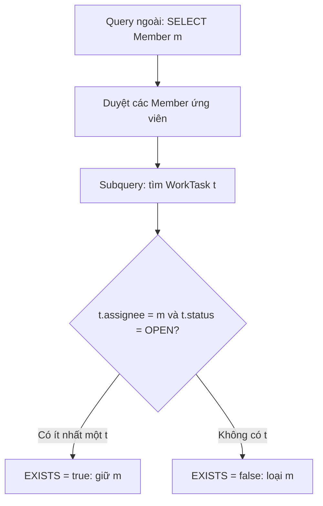
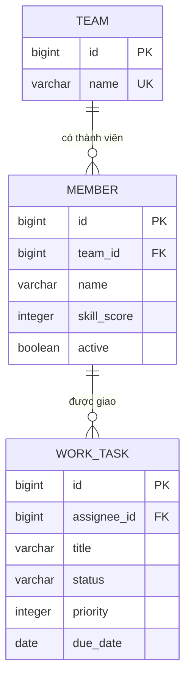
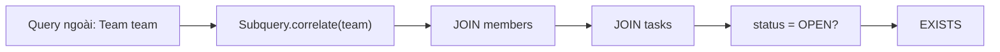
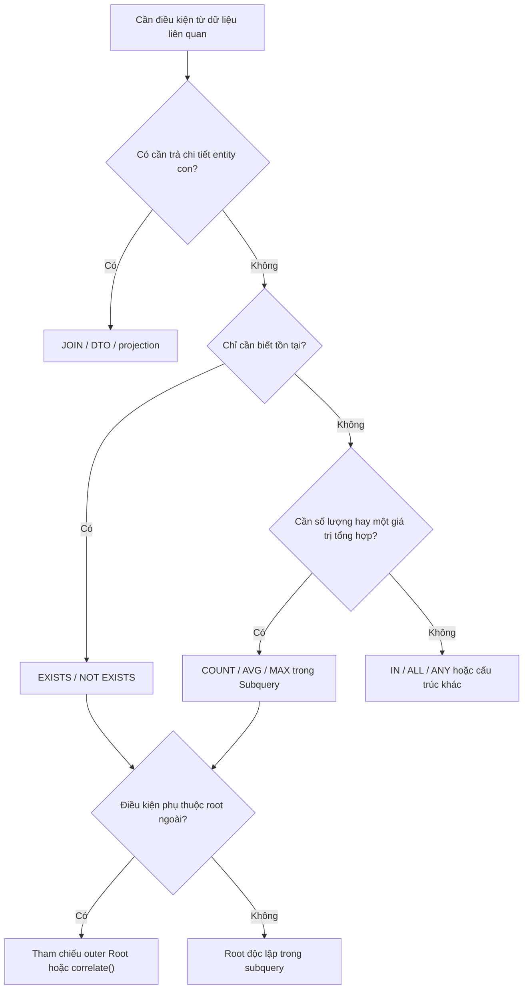

# Tạo truy vấn con và truy vấn con tương quan

Khi truy vấn dữ liệu bằng **JPA Criteria API**, không phải điều kiện nào cũng diễn đạt tốt bằng một `JOIN` và vài phép so sánh đơn giản. Nhiều yêu cầu nghiệp vụ có dạng:

- Tìm nhân viên **có ít nhất một công việc đang mở**.
- Tìm nhân viên **không có công việc đang mở nào đã quá hạn**.
- Tìm nhân viên có **điểm kỹ năng cao hơn mức trung bình của chính nhóm mình**.
- Tìm nhóm có **ít nhất hai thành viên đang hoạt động**.
- Tìm nhóm mà **một thành viên nào đó có công việc ưu tiên cao**.

Những điều kiện này thường cần một truy vấn nằm bên trong truy vấn khác: **truy vấn con** (*subquery*). Khi truy vấn con tham chiếu dữ liệu của dòng đang được xét ở truy vấn ngoài, nó trở thành **truy vấn con tương quan** (*correlated subquery*).

Trong Criteria API, trọng tâm là `Subquery<T>` và `CriteriaBuilder`, đặc biệt các phương thức `subquery(...)`, `exists(...)`, `not(...)`, `correlate(...)`, `count(...)`, `avg(...)` và những toán tử so sánh.

Bài học thuộc chương **Criteria API** của *Data Persistence Relational Access ORM JPA*. Nội dung đi từ cú pháp cơ sở đến ví dụ Java SE chạy với Jakarta Persistence, kỹ thuật correlate root/join, sự khác nhau giữa `EXISTS` và `IN`, điều kiện tổng hợp, các rủi ro về `NULL`, hiệu năng và phân trang.

## 1. Truy vấn con là gì?

Một **subquery** là câu truy vấn được lồng trong một câu truy vấn khác. Truy vấn con có thể dùng làm:

1. **Điều kiện tồn tại** trong `WHERE EXISTS (...)`.
2. **Điều kiện phủ định tồn tại** trong `WHERE NOT EXISTS (...)`.
3. **Nguồn tập giá trị** cho `IN (SELECT ...)`.
4. **Biểu thức vô hướng** trong phép so sánh nếu subquery trả một giá trị, chẳng hạn `score > (SELECT AVG(...))`.
5. Một phần của điều kiện `HAVING` khi truy vấn nhóm cần kiểm tra thêm.

Ví dụ JPQL:

```jpql
SELECT m
FROM Member m
WHERE EXISTS (
    SELECT t.id
    FROM WorkTask t
    WHERE t.assignee = m
      AND t.status = :openStatus
)
ORDER BY m.name, m.id
```

Ta đọc như sau:

> Với mỗi `Member m`, kiểm tra có tồn tại `WorkTask t` được giao cho **chính m** và đang có trạng thái OPEN hay không.

Phần:

```jpql
t.assignee = m
```

là điều kiện **tương quan**: alias `m` thuộc query ngoài, nhưng được tham chiếu trong query con. Vì kết quả của subquery có thể khác nhau theo từng `m`, đây là correlated subquery.

### Sơ đồ tư duy



Sơ đồ dùng từ “duyệt từng Member” để giải thích semantics, **không khẳng định database thực sự chạy subquery một lần cho mỗi hàng**. SQL optimizer có thể chuyển correlated subquery thành semi-join, anti-join hoặc kế hoạch khác.

## 2. Truy vấn con thường và truy vấn con tương quan khác gì?

Xét hai câu hỏi:

**A. Ai có điểm kỹ năng cao hơn điểm trung bình của toàn công ty?**

```jpql
SELECT m
FROM Member m
WHERE m.skillScore > (
    SELECT AVG(x.skillScore)
    FROM Member x
)
```

Subquery chỉ tham chiếu `x` của riêng nó. Nó **không phụ thuộc** vào `m` ở query ngoài. Đây là **uncorrelated subquery**.

**B. Ai có điểm kỹ năng cao hơn điểm trung bình của nhóm mình?**

```jpql
SELECT m
FROM Member m
WHERE m.skillScore > (
    SELECT AVG(x.skillScore)
    FROM Member x
    WHERE x.team = m.team
)
```

Lần này subquery tham chiếu `m.team`. Giá trị trung bình thay đổi theo nhóm của `m`: đây là **correlated subquery**.

| Đặc điểm | Truy vấn con không tương quan | Truy vấn con tương quan |
|---|---|---|
| Có dùng thuộc tính alias của query ngoài? | Không | Có |
| Kết quả logic của subquery có phụ thuộc hàng ngoài? | Không | Có thể có |
| Ví dụ | Trung bình điểm toàn công ty | Trung bình điểm của nhóm nhân viên đang xét |
| Sử dụng | `IN`, phép so sánh, `EXISTS` không tương quan khi thật sự cần | `EXISTS`, `NOT EXISTS`, scalar subquery theo nhóm |
| Cách tạo Criteria | `cq.subquery(...)` và root riêng | `cq.subquery(...)`, tham chiếu outer root hoặc `subquery.correlate(...)` |

**Cẩn thận:** chỉ vì đã tạo `Subquery` không có nghĩa query ấy tương quan. Correlation phải được tạo bằng một biểu thức tham chiếu query ngoài hoặc qua API `correlate`.

## 3. Những kiểu và phương thức quan trọng

Criteria API nằm trong namespace `jakarta.persistence.criteria`.

| API | Công dụng |
|---|---|
| `CriteriaBuilder` | Tạo predicate, so sánh, phép tổng hợp và query |
| `CriteriaQuery<T>` | Query ngoài, có kiểu kết quả `T` |
| `Root<X>` | Root entity trong một query |
| `Subquery<T>` | Query con, cũng là một biểu thức có kiểu `T` |
| `CriteriaQuery.subquery(Class<T>)` | Tạo subquery thuộc query ngoài |
| `Subquery.select(Expression<T>)` | Xác định biểu thức kết quả của subquery |
| `Subquery.from(EntityClass.class)` | Tạo root riêng cho subquery |
| `CriteriaBuilder.exists(Subquery<?>)` | Predicate true khi subquery có hàng |
| `CriteriaBuilder.not(predicate)` | Phủ định predicate, thường kết hợp EXISTS |
| `Subquery.correlate(rootOrJoin)` | Tạo root/join tương quan dựa trên root/join của query cha |
| `CriteriaBuilder.count(expression)` | Đếm số hàng/giá trị theo semantics của COUNT |
| `CriteriaBuilder.avg(expression)` | Tính trung bình biểu thức số |
| `Expression.in(subquery)` | Kiểm tra biểu thức thuộc tập giá trị của subquery |

Ví dụ mẫu nhỏ nhất:

```java
CriteriaBuilder cb = em.getCriteriaBuilder();

CriteriaQuery<Member> cq =
    cb.createQuery(Member.class);

Root<Member> member = cq.from(Member.class);

Subquery<Long> sq = cq.subquery(Long.class);
Root<WorkTask> task = sq.from(WorkTask.class);

sq.select(task.get("id"))
  .where(cb.equal(task.get("assignee"), member));

cq.select(member)
  .where(cb.exists(sq));
```

Đoạn code này tạo đối tượng truy vấn; SQL chỉ được thực thi khi gọi `em.createQuery(cq).getResultList()` hoặc thao tác thực thi tương ứng.

### Tại sao subquery có kiểu Long?

Vì `sq.select(task.get("id"))` chọn ID có kiểu `Long`. Trong phép `EXISTS`, giá trị được chọn không phải dữ liệu trả về query ngoài, nhưng subquery vẫn cần một **biểu thức SELECT hợp lệ**.

Không chọn ngẫu nhiên kiểu `String` cho `Subquery<String>` rồi select một `Long`. Kiểu generic trong Criteria giúp hạn chế những lỗi đó.

## 4. Mô hình thực hành: Team, Member và WorkTask

Ta dùng một ứng dụng quản lý công việc:

- `Team`: một nhóm.
- `Member`: nhân viên, thuộc đúng một nhóm, có `skillScore` và `active`.
- `WorkTask`: công việc giao cho đúng một nhân viên, có `status`, `priority` và `dueDate`.



Ví dụ dữ liệu dự kiến:

| Nhóm | Nhân viên | Điểm kỹ năng | Active | Công việc |
|---|---|---:|---|---|
| Backend | An | 90 | Có | 1 OPEN quá hạn, 1 DONE |
| Backend | Bình | 70 | Có | 1 DONE |
| Backend | Chi | 80 | Không | 1 OPEN chưa quá hạn |
| Frontend | Dung | 85 | Có | 1 OPEN chưa quá hạn |
| Frontend | Em | 95 | Có | Chưa có task |
| Infrastructure | Giang | 50 | Có | Chưa có task |

Ngày tham chiếu được cố định là **15/11/2026** để ví dụ có thể lặp lại về mặt logic.

Từ đây ta dự đoán:

- Có task OPEN: **An, Chi, Dung**.
- Không có task OPEN quá hạn: **Bình, Chi, Dung, Em, Giang**.
- Điểm cao hơn trung bình nhóm: **An, Em**.
- Team có ít nhất 2 member active: **Backend, Frontend**.
- Team có ít nhất 1 task OPEN: **Backend, Frontend**.

Mọi query trả danh sách trong ví dụ đều thêm `ORDER BY` rõ ràng; nếu không có `ORDER BY`, database không cam kết thứ tự.

## 5. Tạo EXISTS bằng một root độc lập trong Subquery

Hãy tìm thành viên có ít nhất một công việc OPEN:

```java
CriteriaBuilder cb = em.getCriteriaBuilder();

CriteriaQuery<Member> cq =
    cb.createQuery(Member.class);

Root<Member> member = cq.from(Member.class);

Subquery<Long> sq = cq.subquery(Long.class);
Root<WorkTask> task = sq.from(WorkTask.class);

sq.select(task.get("id"))
  .where(
      cb.equal(task.get("assignee"), member),
      cb.equal(task.get("status"), TaskStatus.OPEN)
  );

cq.select(member)
  .where(cb.exists(sq))
  .orderBy(
      cb.asc(member.get("name")),
      cb.asc(member.get("id"))
  );

List<Member> result = em.createQuery(cq).getResultList();
```

Đây là **correlated subquery bằng cách tham chiếu outer root**. `task` là root riêng của subquery; `member` thuộc query ngoài và được dùng trong `cb.equal(task.get("assignee"), member)`.

JPQL tương đương:

```jpql
SELECT m
FROM Member m
WHERE EXISTS (
    SELECT t.id
    FROM WorkTask t
    WHERE t.assignee = m
      AND t.status = :status
)
ORDER BY m.name, m.id
```

Kết quả: **An, Chi, Dung**.

### Không cần JOIN ở query ngoài

Query này chỉ chọn `Member`, không trả WorkTask. Vì vậy ta không cần `JOIN m.tasks` ở query ngoài rồi dùng `DISTINCT` để loại member bị lặp khi có nhiều task.

Nếu cần thông tin chi tiết từng task, khi đó `JOIN` với DTO có thể thích hợp hơn.

### Tương quan sai làm đổi nghĩa query

Sai logic:

```java
sq.select(task.get("id"))
  .where(cb.equal(task.get("status"), TaskStatus.OPEN));
// Không liên hệ task với member của query ngoài!
```

Nếu có bất kỳ task OPEN nào trong database, `EXISTS(sq)` sẽ đúng đối với **mọi Member**, kể cả người không có task. Muốn kiểm tra task của từng member, phải thêm liên hệ `task.assignee = member`.

## 6. NOT EXISTS: không có công việc vi phạm

Để tìm người **không có task OPEN nào quá hạn**:

```java
LocalDate today = LocalDate.of(2026, 11, 15);

CriteriaBuilder cb = em.getCriteriaBuilder();
CriteriaQuery<Member> cq = cb.createQuery(Member.class);
Root<Member> member = cq.from(Member.class);

Subquery<Long> sq = cq.subquery(Long.class);
Root<WorkTask> task = sq.from(WorkTask.class);

sq.select(task.get("id"))
  .where(
      cb.equal(task.get("assignee"), member),
      cb.equal(task.get("status"), TaskStatus.OPEN),
      cb.lessThan(task.<LocalDate>get("dueDate"), today)
  );

cq.select(member)
  .where(cb.not(cb.exists(sq)))
  .orderBy(
      cb.asc(member.get("name")),
      cb.asc(member.get("id"))
  );

List<Member> result = em.createQuery(cq).getResultList();
```

Kết quả: **Bình, Chi, Dung, Em, Giang**.

`cb.not(cb.exists(sq))` biểu đạt `NOT EXISTS (...)`.

### Đừng nhầm “không quá hạn” với “có task đúng hạn”

Hai yêu cầu khác nhau:

1. **Không tồn tại task OPEN quá hạn**: người không có task cũng thỏa.
2. **Có ít nhất một task OPEN và không có task OPEN quá hạn**: người chưa từng có task không thỏa.

Để diễn đạt yêu cầu thứ hai, ta cần **hai subquery**:

```java
Subquery<Long> hasOpen = cq.subquery(Long.class);
Root<WorkTask> openTask = hasOpen.from(WorkTask.class);

hasOpen.select(openTask.get("id"))
    .where(
        cb.equal(openTask.get("assignee"), member),
        cb.equal(openTask.get("status"), TaskStatus.OPEN)
    );

Subquery<Long> hasOverdue = cq.subquery(Long.class);
Root<WorkTask> overdueTask = hasOverdue.from(WorkTask.class);

hasOverdue.select(overdueTask.get("id"))
    .where(
        cb.equal(overdueTask.get("assignee"), member),
        cb.equal(overdueTask.get("status"), TaskStatus.OPEN),
        cb.lessThan(overdueTask.<LocalDate>get("dueDate"), today)
    );

cq.where(
    cb.exists(hasOpen),
    cb.not(cb.exists(hasOverdue))
);
```

Trong bộ dữ liệu, kết quả của logic này là **Chi và Dung**. Những người không có task OPEN bị loại; An bị loại do có một task OPEN quá hạn.

Đây là mô hình phổ biến của điều kiện **“tồn tại ít nhất một phần tử nhưng không có phần tử nào vi phạm”**. Nếu bỏ điều kiện tồn tại thứ nhất, tập rỗng sẽ thỏa phủ định tồn tại thứ hai.

## 7. Tạo truy vấn con tương quan bằng Subquery.correlate(Root)

Criteria API có hai cách phổ biến để làm cho subquery phụ thuộc query ngoài:

**Cách A — tham chiếu outer root trong điều kiện WHERE:**

```java
Root<Member> member = cq.from(Member.class);
Subquery<Long> sq = cq.subquery(Long.class);
Root<WorkTask> task = sq.from(WorkTask.class);

sq.select(task.get("id"))
  .where(cb.equal(task.get("assignee"), member));
```

**Cách B — correlate trực tiếp root của query ngoài:**

```java
Root<Member> member = cq.from(Member.class);

Subquery<Long> sq = cq.subquery(Long.class);

Root<Member> correlatedMember = sq.correlate(member);

Join<Member, WorkTask> task =
    correlatedMember.join("tasks");

sq.select(task.get("id"))
  .where(cb.equal(task.get("status"), TaskStatus.OPEN));

cq.where(cb.exists(sq));
```

Ở cách B, `sq.correlate(member)` tạo một **correlated root** gắn với `member` của query ngoài. Subquery sau đó đi từ correlated root sang association `tasks`.

JPQL tương đương về ý định:

```jpql
SELECT m
FROM Member m
WHERE EXISTS (
    SELECT t.id
    FROM m.tasks t
    WHERE t.status = :status
)
```

Đây là minh họa cách đọc liên kết logic; khả năng JPQL dùng trực tiếp outer identification variable như root collection trong `FROM` phụ thuộc cú pháp được đặc tả/provider. Một cách JPQL rõ và thường portable hơn là `FROM WorkTask t WHERE t.assignee = m`, như phần 5.

### correlate không phải JOIN FETCH

`correlate` không có nghĩa tải association vào JVM và cũng không phải `JOIN FETCH`. Nó xây **mối liên hệ logic giữa query con và parent query** để database đánh giá điều kiện.

Khi chỉ dùng `EXISTS`, không cần load toàn bộ `member.tasks` vào persistence context; provider có thể chuyển Criteria sang SQL kiểm tra tồn tại.

### Không dùng root tương quan như root độc lập

Root từ `sq.correlate(member)` được thiết kế dựa trên parent `member`. Nó không biểu diễn việc quét một tập Member độc lập như `sq.from(Member.class)`.

Đừng trộn lẫn hai ý định:

- Muốn một tập Member độc lập để tính AVG toàn công ty → `sq.from(Member.class)`.
- Muốn đi từ **chính Member đang xét** tới tasks → `sq.correlate(member)` rồi join.

## 8. Correlate Join: khi query ngoài đã có một JOIN

`Subquery` còn có các overload tương quan cho `Join` và những kiểu join collection khác.

Giả sử query ngoài đã join Team → Member:

```java
CriteriaBuilder cb = em.getCriteriaBuilder();
CriteriaQuery<Team> cq = cb.createQuery(Team.class);

Root<Team> team = cq.from(Team.class);
Join<Team, Member> member = team.join("members");

Subquery<Long> sq = cq.subquery(Long.class);

// Tương quan từ Join có sẵn ở query ngoài.
Join<Team, Member> correlatedMember =
    sq.correlate(member);

Join<Member, WorkTask> task =
    correlatedMember.join("tasks");

sq.select(task.get("id"))
  .where(
      cb.equal(task.get("status"), TaskStatus.OPEN),
      cb.ge(task.<Integer>get("priority"), 7)
  );

cq.select(team)
  .distinct(true)
  .where(cb.exists(sq))
  .orderBy(cb.asc(team.get("name")));
```

Truy vấn muốn tìm Team có ít nhất một Member liên quan tới task OPEN có priority từ 7 trở lên. Ví dụ dữ liệu trả **Backend** (An) và **Frontend** (Dung).

Vì query ngoài join `team.members`, nó có thể tạo **nhiều hàng cho cùng một Team**. `distinct(true)` thể hiện ý định trả mỗi Team một lần.

### Khi nào không nên correlate Join?

Nếu query ngoài **chỉ cần Team**, không cần Member để select/filter/order ở query ngoài, việc join sớm Team → Member chỉ nhằm correlate Join có thể thừa. Một subquery tương quan trực tiếp Team root rồi join các association thường đơn giản hơn.

`correlate(Join)` hữu ích khi cấu trúc query ngoài **đã có join hợp lý** và subquery phải dùng đúng alias logic ấy. Không nên thêm join vô cớ chỉ để trình diễn API.

## 9. Tương quan qua nhiều tầng quan hệ

Muốn tìm Team có ít nhất một task OPEN, có thể correlate Team root:

```java
CriteriaBuilder cb = em.getCriteriaBuilder();
CriteriaQuery<Team> cq = cb.createQuery(Team.class);

Root<Team> team = cq.from(Team.class);

Subquery<Long> sq = cq.subquery(Long.class);
Root<Team> correlatedTeam = sq.correlate(team);

Join<Team, Member> member =
    correlatedTeam.join("members");

Join<Member, WorkTask> task =
    member.join("tasks");

sq.select(task.get("id"))
  .where(cb.equal(task.get("status"), TaskStatus.OPEN));

cq.select(team)
  .where(cb.exists(sq))
  .orderBy(cb.asc(team.get("name")));
```

Sơ đồ tương quan:



Khác với `JOIN FETCH` trên collection, cách này chỉ kiểm tra điều kiện; nó không có nhiệm vụ tự tải từng Member và WorkTask trong graph.

Nếu chỉ cần Team có task phù hợp, cách viết này thường dễ tránh duplicate root hơn một query ngoài join cả hai collection rồi `SELECT DISTINCT team`, dù SQL thực tế phải được kiểm chứng.

## 10. Subquery không tương quan: so với trung bình toàn hệ thống

Giả sử ta muốn nhân viên có `skillScore` cao hơn điểm trung bình **tất cả nhân viên**.

JPQL:

```jpql
SELECT m
FROM Member m
WHERE m.skillScore > (
    SELECT AVG(x.skillScore)
    FROM Member x
)
ORDER BY m.name
```

Criteria:

```java
CriteriaBuilder cb = em.getCriteriaBuilder();
CriteriaQuery<Member> cq = cb.createQuery(Member.class);
Root<Member> member = cq.from(Member.class);

Subquery<Double> average = cq.subquery(Double.class);
Root<Member> anyMember = average.from(Member.class);

average.select(
    cb.avg(anyMember.<Integer>get("skillScore"))
);

cq.select(member)
  .where(cb.gt(member.<Integer>get("skillScore"), average))
  .orderBy(
      cb.asc(member.get("name")),
      cb.asc(member.get("id"))
  );
```

Vì subquery **không tham chiếu `member` của query ngoài**, giá trị AVG có ý nghĩa toàn công ty.

Với bộ dữ liệu, tổng điểm là `90 + 70 + 80 + 85 + 95 + 50 = 470`, có 6 người, trung bình xấp xỉ **78,33**. Kết quả là **An, Chi, Dung, Em**.

### Vì sao dùng Subquery<Double>?

Trong Criteria API, `CriteriaBuilder.avg(...)` cho biểu thức kiểu `Double`. Dù trường `skillScore` là `Integer`, kết quả trung bình có thể là số thực. Sử dụng kiểu `Double` cho subquery tránh ép kết quả AVG thành `Long` hoặc `Integer`.

Ở các bài toán tiền tệ, không nên tự động dùng giá trị `Double` làm số tiền nghiệp vụ để thanh toán. Ở đây `skillScore` là điểm số minh họa; với tài chính cần thiết kế precision và quy tắc làm tròn phù hợp.

## 11. Subquery tương quan: so với trung bình của chính Team

Yêu cầu mới:

> Lấy những Member có điểm kỹ năng cao hơn **trung bình điểm của nhóm mình**.

JPQL:

```jpql
SELECT m
FROM Member m
WHERE m.skillScore > (
    SELECT AVG(peer.skillScore)
    FROM Member peer
    WHERE peer.team = m.team
)
ORDER BY m.name
```

Criteria:

```java
CriteriaBuilder cb = em.getCriteriaBuilder();
CriteriaQuery<Member> cq = cb.createQuery(Member.class);
Root<Member> member = cq.from(Member.class);

Subquery<Double> teamAverage = cq.subquery(Double.class);
Root<Member> peer = teamAverage.from(Member.class);

teamAverage.select(
    cb.avg(peer.<Integer>get("skillScore"))
);

teamAverage.where(
    cb.equal(peer.get("team"), member.get("team"))
);

cq.select(member)
  .where(
      cb.gt(member.<Integer>get("skillScore"), teamAverage)
  )
  .orderBy(
      cb.asc(member.get("name")),
      cb.asc(member.get("id"))
  );
```

Kết quả:

| Team | Điểm thành viên | Trung bình | Người cao hơn trung bình |
|---|---|---:|---|
| Backend | An 90, Bình 70, Chi 80 | 80 | **An** |
| Frontend | Dung 85, Em 95 | 90 | **Em** |
| Infrastructure | Giang 50 | 50 | Không có |

Kết quả chung: **An, Em**.

### Điều kiện tương quan quyết định bài toán

Nếu quên:

```java
teamAverage.where(
    cb.equal(peer.get("team"), member.get("team"))
);
```

thì query trở lại yêu cầu so với **trung bình toàn công ty**, đưa thêm Chi và Dung vào kết quả. Đây là lỗi logic dù query vẫn chạy.

### Cẩn thận với trường NULL

Ví dụ đặt `skillScore` nullable: `AVG` bỏ qua các giá trị `NULL` theo semantics SQL. Nếu không có giá trị số trong một nhóm, AVG có thể trả NULL; phép `score > NULL` không cho true, nên Member có thể bị loại.

Bài học dùng `skillScore NOT NULL` để tránh mơ hồ. Trong hệ thống thật, cần xác định nghiệp vụ muốn bỏ qua điểm chưa có, thay bằng giá trị mặc định hay loại nhóm.

## 12. Subquery có COUNT và điều kiện số lượng

Ta muốn tìm Team có **ít nhất hai thành viên active**. Đây là yêu cầu đếm **những Member của chính Team đang xét**.

JPQL:

```jpql
SELECT t
FROM Team t
WHERE (
    SELECT COUNT(m)
    FROM Member m
    WHERE m.team = t
      AND m.active = true
) >= 2
ORDER BY t.name
```

Criteria dùng correlated root:

```java
CriteriaBuilder cb = em.getCriteriaBuilder();
CriteriaQuery<Team> cq = cb.createQuery(Team.class);
Root<Team> team = cq.from(Team.class);

Subquery<Long> activeCount = cq.subquery(Long.class);

Root<Team> sameTeam = activeCount.correlate(team);
Join<Team, Member> member = sameTeam.join("members");

activeCount.select(cb.count(member))
    .where(cb.isTrue(member.<Boolean>get("active")));

cq.select(team)
  .where(cb.ge(activeCount, 2L))
  .orderBy(
      cb.asc(team.get("name")),
      cb.asc(team.get("id"))
  );
```

Kết quả: **Backend, Frontend**.

`cb.count(member)` trả `Long` nên subquery dùng `Subquery<Long>`. `cb.ge(activeCount, 2L)` diễn đạt `COUNT >= 2`.

### So sánh với GROUP BY + HAVING

Có thể viết bằng query nhóm:

```jpql
SELECT t
FROM Team t
JOIN t.members m
WHERE m.active = true
GROUP BY t
HAVING COUNT(m) >= 2
ORDER BY t.name
```

Ở đây điều kiện “Member active” nằm trong WHERE trước khi nhóm, nên COUNT chỉ đếm member active. Truy vấn này có thể hợp lý; không phải lúc nào subquery cũng là cách duy nhất.

Điểm mạnh của subquery tương quan là dễ thêm một điều kiện số lượng vào một query ngoài vốn đã có nhiều tiêu chí mà không phải kéo toàn bộ query ngoài sang `GROUP BY`.

### COUNT có yêu cầu tải Member vào JVM không?

Không. `cb.count(...)` được dịch sang SQL aggregate; nó không có nghĩa phải tạo từng entity Member trong Java chỉ để đếm. Nhưng database vẫn cần thực hiện công việc phù hợp để tính COUNT; khi chỉ cần có ít nhất một member, `EXISTS` thường biểu đạt trực tiếp hơn.

## 13. IN (subquery): tập ID làm điều kiện

`EXISTS` không phải cách duy nhất để kiểm tra mối quan hệ. Ta cũng có thể chọn ID từ query con rồi kiểm tra membership bằng `IN`.

Ví dụ tìm Member có WorkTask ở trạng thái OPEN:

```jpql
SELECT m
FROM Member m
WHERE m.id IN (
    SELECT t.assignee.id
    FROM WorkTask t
    WHERE t.status = :openStatus
)
ORDER BY m.name
```

Criteria:

```java
CriteriaBuilder cb = em.getCriteriaBuilder();
CriteriaQuery<Member> cq = cb.createQuery(Member.class);
Root<Member> member = cq.from(Member.class);

Subquery<Long> assigneeIds = cq.subquery(Long.class);
Root<WorkTask> task = assigneeIds.from(WorkTask.class);

assigneeIds.select(
    task.<Long>get("assignee").get("id")
);

assigneeIds.where(
    cb.equal(task.get("status"), TaskStatus.OPEN)
);

cq.select(member)
  .where(member.get("id").in(assigneeIds))
  .orderBy(
      cb.asc(member.get("name")),
      cb.asc(member.get("id"))
  );
```

Kết quả: **An, Chi, Dung**.

### EXISTS và IN khác nhau về mô hình diễn đạt

| Trường hợp | EXISTS | IN |
|---|---|---|
| Kiểm tra có hàng liên quan đúng điều kiện | Rất trực tiếp | Có thể chọn ID liên quan |
| Subquery cần tham chiếu outer entity? | Thường dùng correlated predicate | Thường có thể độc lập |
| Subquery trả nhiều cột? | EXISTS chỉ cần subquery hợp lệ, thường chọn một cột | IN ở dạng này cần một kiểu giá trị tương thích |
| Có NULL trong tập ID? | Phủ định tồn tại thường rõ hơn | `NOT IN` đặc biệt dễ gặp logic ba giá trị |
| SQL optimizer | Có thể dùng semi-join | Cũng có thể dùng semi-join |
| Lựa chọn mặc định | Khi câu hỏi là “có phần tử thỏa không?” | Khi câu hỏi tự nhiên là “khóa thuộc tập giá trị nào?” |

Không kết luận EXISTS luôn nhanh hơn IN; các DB có thể biến đổi và tối ưu hai hình thức tương đương. Kiểm tra execution plan theo dữ liệu thật.

### Cảnh báo về NOT IN và NULL

`m.id NOT IN (subquery)` có thể không hoạt động như phép “không có liên kết” nếu subquery chứa giá trị `NULL`. Với quan hệ optional hoặc dữ liệu legacy, `NOT EXISTS` tương quan thường là cách rõ ràng hơn để biểu đạt “không có WorkTask thỏa điều kiện”.

Trong mô hình ví dụ, `WorkTask.assignee` là bắt buộc (`optional=false`, FK NOT NULL), nhưng vẫn cần hiểu quy tắc NULL khi áp dụng sang schema khác.

## 14. Subquery với ANY, ALL và SOME

Bên cạnh `EXISTS` và `IN`, JPQL hỗ trợ so sánh với tập giá trị của subquery qua các lượng từ như `ALL` và `ANY`/`SOME`. CriteriaBuilder cung cấp các hàm tương ứng trên `Subquery<Y>`.

Ví dụ về ý tưởng:

> Member có skillScore lớn hơn **mọi Member khác trong cùng Team**.

JPQL có thể biểu diễn bằng:

```jpql
SELECT m
FROM Member m
WHERE m.skillScore > ALL (
    SELECT peer.skillScore
    FROM Member peer
    WHERE peer.team = m.team
      AND peer.id <> m.id
)
```

Phải chú ý **semantics tập rỗng**: nếu không có peer nào khác, mệnh đề `> ALL (empty set)` đúng theo logic lượng từ. Có thể vì vậy mà một Member là người duy nhất trong Team được đưa vào kết quả.

Trong Criteria:

```java
Subquery<Integer> peerScores =
    cq.subquery(Integer.class);

Root<Member> peer = peerScores.from(Member.class);

peerScores.select(peer.<Integer>get("skillScore"))
    .where(
        cb.equal(peer.get("team"), member.get("team")),
        cb.notEqual(peer.get("id"), member.get("id"))
    );

cq.where(
    cb.greaterThan(
        member.<Integer>get("skillScore"),
        cb.all(peerScores)
    )
);
```

`ANY` hoặc `SOME` có ý nghĩa “thỏa so sánh với **ít nhất một** giá trị”. `ALL` có ý nghĩa “thỏa với **mọi** giá trị” (và cần xét trường hợp subquery rỗng/NULL).

Đối với nhiều use case, `NOT EXISTS` tìm một **phản ví dụ** còn dễ đọc hơn `ALL`:

```jpql
SELECT m
FROM Member m
WHERE NOT EXISTS (
    SELECT peer.id
    FROM Member peer
    WHERE peer.team = m.team
      AND peer.skillScore >= m.skillScore
      AND peer.id <> m.id
)
```

Truy vấn này tìm người có điểm **cao hơn nghiêm ngặt tất cả người khác** trong team; khác với việc dùng `ALL` khi có NULL hoặc điều kiện phạm vi không giống nhau. Khi dữ liệu có điểm bằng nhau, cả hai người cao nhất có thể bị loại vì mỗi người là phản ví dụ cho người kia. Nếu nghiệp vụ muốn lấy **tất cả người đồng hạng nhất**, cần dùng điều kiện “không tồn tại người có điểm lớn hơn” (`peer.skillScore > m.skillScore`), không dùng `>=`.

## 15. Truy vấn con nhiều tầng (nested subqueries)

Ta có thể tìm Team có ít nhất một Member mà Member đó có ít nhất một task OPEN:

```jpql
SELECT team
FROM Team team
WHERE EXISTS (
    SELECT member.id
    FROM Member member
    WHERE member.team = team
      AND EXISTS (
          SELECT task.id
          FROM WorkTask task
          WHERE task.assignee = member
            AND task.status = :status
      )
)
```

Criteria tạo subquery lồng trong subquery:

```java
CriteriaBuilder cb = em.getCriteriaBuilder();
CriteriaQuery<Team> cq = cb.createQuery(Team.class);
Root<Team> team = cq.from(Team.class);

Subquery<Long> memberSq = cq.subquery(Long.class);
Root<Member> member = memberSq.from(Member.class);

Subquery<Long> taskSq = memberSq.subquery(Long.class);
Root<WorkTask> task = taskSq.from(WorkTask.class);

taskSq.select(task.get("id"))
    .where(
        cb.equal(task.get("assignee"), member),
        cb.equal(task.get("status"), TaskStatus.OPEN)
    );

memberSq.select(member.get("id"))
    .where(
        cb.equal(member.get("team"), team),
        cb.exists(taskSq)
    );

cq.select(team)
  .where(cb.exists(memberSq))
  .orderBy(cb.asc(team.get("name")));
```

Kết quả: **Backend, Frontend**.

Ở đây:

- `memberSq` là subquery của query Team.
- `taskSq` là subquery của `memberSq`.
- `taskSq` tham chiếu `member` của query cha trực tiếp.
- `memberSq` tham chiếu `team` của query ngoài cùng.

Đây là ví dụ về **hai cấp tương quan**. Cũng có thể viết ngắn hơn bằng một subquery `Team → Member → WorkTask` với `correlate(team)` và `JOIN`, như phần 9.

**Nguyên tắc:** chọn cách rõ nhất cho nghiệp vụ. Subquery lồng quá sâu có thể khó đọc và khó tối ưu; không cần dùng nhiều tầng nếu một JOIN trong subquery đủ thể hiện điều kiện.

## 16. Vòng đời API: Subquery thuộc parent query nào?

Một `Subquery` được tạo từ query cha:

```java
CriteriaQuery<Member> outer =
    cb.createQuery(Member.class);

Subquery<Long> sq = outer.subquery(Long.class);
```

Subquery thuộc cấu trúc parent này; không nên tạo ở query A rồi đưa tùy tiện vào query B và mong provider tự ghép toàn bộ scope/alias.

Các điểm cần nhớ:

- `Subquery<T>` kế thừa các khả năng xây truy vấn có liên quan tới select/from/where/groupBy/having.
- `Subquery.correlate(...)` chỉ dành cho root/join thuộc **cấp query cha phù hợp**.
- Root/join từ những query không liên quan không thể được dùng như các tham chiếu cùng scope.
- `getParent()` giúp truy xuất parent query của subquery khi cần hiểu cấu trúc.
- `getCorrelatedJoins()` và `isCorrelated()` có thể hữu ích khi xây công cụ query động/phân tích AST, nhưng application thông thường ít khi cần trực tiếp.

### Không tạo subquery bằng em.createQuery

`em.createQuery(...)` dùng để chuẩn bị/thực thi một query hoàn chỉnh, không phải tạo một subquery lồng vào CriteriaQuery khác. Subquery được tạo từ `CriteriaQuery.subquery(...)` hoặc `Subquery.subquery(...)` (nếu cần lồng tiếp).

```java
CriteriaQuery<Member> cq =
    cb.createQuery(Member.class);

Subquery<Long> sq = cq.subquery(Long.class);
```

Sau khi hoàn thiện query, mới thực thi:

```java
List<Member> result =
    em.createQuery(cq).getResultList();
```

## 17. Query con trong HAVING và phân nhóm

Một điều kiện truy vấn con có thể kết hợp với việc nhóm và lọc nhóm. Ví dụ muốn liệt kê Team có số member active lớn hơn một ngưỡng được tính từ dữ liệu khác, ta có thể dùng `GROUP BY`/`HAVING` và subquery tổng hợp.

Một ví dụ vừa đủ:

```jpql
SELECT t.name, COUNT(m)
FROM Team t
JOIN t.members m
WHERE m.active = true
GROUP BY t.id, t.name
HAVING COUNT(m) > (
    SELECT AVG(x.skillScore) / 50
    FROM Member x
)
ORDER BY t.name
```

Ở đây subquery AVG toàn công ty là **không tương quan**; ví dụ chỉ minh họa vị trí cú pháp của scalar subquery trong HAVING, không đề xuất quy tắc quản lý nhân sự có ý nghĩa kinh doanh.

Với một yêu cầu thực tế hơn là “Team có từ hai member active trở lên”, query `HAVING COUNT(m) >= 2` sẽ rõ và đơn giản hơn; không nên tạo subquery vô ích chỉ để sử dụng API.

### Quy tắc giới hạn vị trí subquery

Đối với JPQL/Criteria ở mức portable, nên dùng subquery trong **`WHERE` hoặc `HAVING`**. Không tự áp dụng cú pháp SQL tùy tiện để viết một derived table trong `FROM`:

```sql
-- SQL native; không mặc định là JPQL portable.
SELECT *
FROM (SELECT ... ) x
```

Một số provider có extension cho subquery trong những vị trí khác, nhưng không nên coi là API chuẩn áp dụng mọi phiên bản JPA.

## 18. Tạo project Java SE chạy được

Ta sử dụng **Java 17**, **Jakarta Persistence 3.1**, **Hibernate ORM 6.x** và **H2**. Đây là một bộ phiên bản minh họa tương thích về thế hệ API, không phải khẳng định phiên bản mới nhất.

Cấu trúc thư mục:

```text
criteria-subquery-demo/
├── pom.xml
└── src/
    └── main/
        ├── java/demo/
        │   ├── Team.java
        │   ├── Member.java
        │   ├── TaskStatus.java
        │   ├── WorkTask.java
        │   └── Main.java
        └── resources/
            └── META-INF/
                └── persistence.xml
```

Tệp `pom.xml`:

```xml
<project xmlns="http://maven.apache.org/POM/4.0.0"
         xmlns:xsi="http://www.w3.org/2001/XMLSchema-instance"
         xsi:schemaLocation="http://maven.apache.org/POM/4.0.0
                             https://maven.apache.org/xsd/maven-4.0.0.xsd">
    <modelVersion>4.0.0</modelVersion>

    <groupId>demo</groupId>
    <artifactId>criteria-subquery-demo</artifactId>
    <version>1.0-SNAPSHOT</version>

    <properties>
        <maven.compiler.release>17</maven.compiler.release>
        <project.build.sourceEncoding>UTF-8</project.build.sourceEncoding>
    </properties>

    <dependencies>
        <dependency>
            <groupId>jakarta.persistence</groupId>
            <artifactId>jakarta.persistence-api</artifactId>
            <version>3.1.0</version>
        </dependency>
        <dependency>
            <groupId>org.hibernate.orm</groupId>
            <artifactId>hibernate-core</artifactId>
            <version>6.6.4.Final</version>
        </dependency>
        <dependency>
            <groupId>com.h2database</groupId>
            <artifactId>h2</artifactId>
            <version>2.3.232</version>
        </dependency>
    </dependencies>

    <build>
        <plugins>
            <plugin>
                <groupId>org.apache.maven.plugins</groupId>
                <artifactId>maven-compiler-plugin</artifactId>
                <version>3.13.0</version>
            </plugin>
            <plugin>
                <groupId>org.codehaus.mojo</groupId>
                <artifactId>exec-maven-plugin</artifactId>
                <version>3.4.1</version>
                <configuration>
                    <mainClass>demo.Main</mainClass>
                </configuration>
            </plugin>
        </plugins>
    </build>
</project>
```

Tệp `src/main/resources/META-INF/persistence.xml`:

```xml
<?xml version="1.0" encoding="UTF-8"?>
<persistence xmlns="https://jakarta.ee/xml/ns/persistence"
             xmlns:xsi="http://www.w3.org/2001/XMLSchema-instance"
             xsi:schemaLocation="
               https://jakarta.ee/xml/ns/persistence
               https://jakarta.ee/xml/ns/persistence/persistence_3_1.xsd"
             version="3.1">

    <persistence-unit name="workPU" transaction-type="RESOURCE_LOCAL">
        <provider>org.hibernate.jpa.HibernatePersistenceProvider</provider>

        <class>demo.Team</class>
        <class>demo.Member</class>
        <class>demo.WorkTask</class>
        <exclude-unlisted-classes>true</exclude-unlisted-classes>

        <properties>
            <property name="jakarta.persistence.jdbc.driver"
                      value="org.h2.Driver"/>
            <property name="jakarta.persistence.jdbc.url"
                      value="jdbc:h2:mem:workdb;DB_CLOSE_DELAY=-1"/>
            <property name="jakarta.persistence.jdbc.user"
                      value="sa"/>
            <property name="jakarta.persistence.jdbc.password"
                      value=""/>
            <property name="jakarta.persistence.schema-generation.database.action"
                      value="drop-and-create"/>
        </properties>
    </persistence-unit>
</persistence>
```

**Cảnh báo:** `drop-and-create` có thể xóa schema và dữ liệu. Nó chỉ phù hợp với demo/test. Trong production dùng migration đã được kiểm soát, index, constraint và chiến lược deploy thích hợp.

## 19. Entity Team — parent của Member

Tệp `src/main/java/demo/Team.java`:

```java
package demo;

import jakarta.persistence.CascadeType;
import jakarta.persistence.Column;
import jakarta.persistence.Entity;
import jakarta.persistence.GeneratedValue;
import jakarta.persistence.GenerationType;
import jakarta.persistence.Id;
import jakarta.persistence.OneToMany;
import jakarta.persistence.Table;

import java.util.ArrayList;
import java.util.Collections;
import java.util.List;
import java.util.Objects;

@Entity
@Table(name = "work_team")
public class Team {

    @Id
    @GeneratedValue(strategy = GenerationType.IDENTITY)
    private Long id;

    @Column(name = "name", nullable = false, unique = true, length = 120)
    private String name;

    @OneToMany(mappedBy = "team", cascade = CascadeType.PERSIST)
    private List<Member> members = new ArrayList<>();

    protected Team() {
        // JPA constructor.
    }

    public Team(String name) {
        this.name = Objects.requireNonNull(name, "name");
        if (name.isBlank()) {
            throw new IllegalArgumentException("name is blank");
        }
    }

    public Long getId() {
        return id;
    }

    public String getName() {
        return name;
    }

    public List<Member> getMembers() {
        return Collections.unmodifiableList(members);
    }

    public void addMember(Member member) {
        Objects.requireNonNull(member, "member");

        if (member.getTeam() != null
                && member.getTeam() != this) {
            throw new IllegalArgumentException(
                "Member belongs to another team");
        }

        for (Member existing : members) {
            if (existing == member) {
                return;
            }
        }

        members.add(member);
        member.linkToTeam(this);
    }
}
```

Ở đây `Team.members` là phía inverse (`mappedBy`). `Member.team` sẽ là owning side giữ FK `team_id`. Helper `addMember` đồng bộ cả hai phía.

`cascade = PERSIST` chỉ phục vụ việc tạo dữ liệu ví dụ `Team` mới với các `Member` mới. Không mặc định dùng `CascadeType.REMOVE` ở mọi mô hình nhân sự vì dữ liệu lịch sử có thể cần được lưu độc lập.

## 20. Entity Member — thuộc Team, có nhiều WorkTask

Tệp `src/main/java/demo/Member.java`:

```java
package demo;

import jakarta.persistence.CascadeType;
import jakarta.persistence.Column;
import jakarta.persistence.Entity;
import jakarta.persistence.FetchType;
import jakarta.persistence.GeneratedValue;
import jakarta.persistence.GenerationType;
import jakarta.persistence.Id;
import jakarta.persistence.JoinColumn;
import jakarta.persistence.ManyToOne;
import jakarta.persistence.OneToMany;
import jakarta.persistence.Table;

import java.util.ArrayList;
import java.util.Collections;
import java.util.List;
import java.util.Objects;

@Entity
@Table(name = "work_member")
public class Member {

    @Id
    @GeneratedValue(strategy = GenerationType.IDENTITY)
    private Long id;

    @Column(name = "name", nullable = false, length = 100)
    private String name;

    @Column(name = "skill_score", nullable = false)
    private Integer skillScore;

    @Column(name = "active", nullable = false)
    private boolean active;

    @ManyToOne(fetch = FetchType.LAZY, optional = false)
    @JoinColumn(name = "team_id", nullable = false)
    private Team team;

    @OneToMany(mappedBy = "assignee", cascade = CascadeType.PERSIST)
    private List<WorkTask> tasks = new ArrayList<>();

    protected Member() {
        // JPA constructor.
    }

    public Member(String name, int skillScore, boolean active) {
        this.name = Objects.requireNonNull(name, "name");

        if (name.isBlank()) {
            throw new IllegalArgumentException("name is blank");
        }
        if (skillScore < 0 || skillScore > 100) {
            throw new IllegalArgumentException(
                "skillScore must be between 0 and 100");
        }

        this.skillScore = skillScore;
        this.active = active;
    }

    public Long getId() {
        return id;
    }

    public String getName() {
        return name;
    }

    public Integer getSkillScore() {
        return skillScore;
    }

    public boolean isActive() {
        return active;
    }

    public Team getTeam() {
        return team;
    }

    public List<WorkTask> getTasks() {
        return Collections.unmodifiableList(tasks);
    }

    void linkToTeam(Team next) {
        team = next;
    }

    public void addTask(WorkTask task) {
        Objects.requireNonNull(task, "task");

        if (task.getAssignee() != null
                && task.getAssignee() != this) {
            throw new IllegalArgumentException(
                "Task belongs to another member");
        }

        for (WorkTask existing : tasks) {
            if (existing == task) {
                return;
            }
        }

        tasks.add(task);
        task.linkToAssignee(this);
    }
}
```

`Member.tasks` là collection được dùng cho các ví dụ `sq.correlate(member).join("tasks")`. Nó **không cần được fetch** để xây điều kiện tồn tại; Criteria API dùng metadata quan hệ để tạo SQL.

## 21. Entity WorkTask và enum TaskStatus

Tệp `src/main/java/demo/TaskStatus.java`:

```java
package demo;

public enum TaskStatus {
    OPEN,
    DONE,
    BLOCKED
}
```

Tệp `src/main/java/demo/WorkTask.java`:

```java
package demo;

import jakarta.persistence.Column;
import jakarta.persistence.Entity;
import jakarta.persistence.EnumType;
import jakarta.persistence.Enumerated;
import jakarta.persistence.FetchType;
import jakarta.persistence.GeneratedValue;
import jakarta.persistence.GenerationType;
import jakarta.persistence.Id;
import jakarta.persistence.JoinColumn;
import jakarta.persistence.ManyToOne;
import jakarta.persistence.Table;

import java.time.LocalDate;
import java.util.Objects;

@Entity
@Table(name = "work_task")
public class WorkTask {

    @Id
    @GeneratedValue(strategy = GenerationType.IDENTITY)
    private Long id;

    @Column(name = "title", nullable = false, length = 200)
    private String title;

    @Enumerated(EnumType.STRING)
    @Column(name = "status", nullable = false, length = 20)
    private TaskStatus status;

    @Column(name = "priority", nullable = false)
    private Integer priority;

    @Column(name = "due_date", nullable = false)
    private LocalDate dueDate;

    @ManyToOne(fetch = FetchType.LAZY, optional = false)
    @JoinColumn(name = "assignee_id", nullable = false)
    private Member assignee;

    protected WorkTask() {
        // JPA constructor.
    }

    public WorkTask(
            String title,
            TaskStatus status,
            int priority,
            LocalDate dueDate) {

        this.title = Objects.requireNonNull(title, "title");
        this.status = Objects.requireNonNull(status, "status");
        this.dueDate = Objects.requireNonNull(dueDate, "dueDate");

        if (title.isBlank()) {
            throw new IllegalArgumentException("title is blank");
        }
        if (priority < 1 || priority > 10) {
            throw new IllegalArgumentException(
                "priority must be between 1 and 10");
        }

        this.priority = priority;
    }

    public Long getId() {
        return id;
    }

    public Member getAssignee() {
        return assignee;
    }

    public TaskStatus getStatus() {
        return status;
    }

    public LocalDate getDueDate() {
        return dueDate;
    }

    public Integer getPriority() {
        return priority;
    }

    void linkToAssignee(Member next) {
        assignee = next;
    }
}
```

`WorkTask.assignee` giữ FK `assignee_id`. Với `EnumType.STRING`, enum được lưu theo tên (`OPEN`, `DONE`, `BLOCKED`), giúp đọc dữ liệu rõ hơn ordinal nhưng cần migration khi đổi tên enum constant.

## 22. Main: tạo dữ liệu và chạy các truy vấn

Tệp `src/main/java/demo/Main.java`:

```java
package demo;

import jakarta.persistence.EntityManager;
import jakarta.persistence.EntityManagerFactory;
import jakarta.persistence.EntityTransaction;
import jakarta.persistence.Persistence;
import jakarta.persistence.criteria.CriteriaBuilder;
import jakarta.persistence.criteria.CriteriaQuery;
import jakarta.persistence.criteria.Join;
import jakarta.persistence.criteria.Root;
import jakarta.persistence.criteria.Subquery;

import java.time.LocalDate;
import java.util.List;

public class Main {

    public static void main(String[] args) {
        EntityManagerFactory emf =
            Persistence.createEntityManagerFactory("workPU");

        try {
            seed(emf);

            EntityManager em = emf.createEntityManager();
            try {
                printMembers(
                    "EXISTS OPEN",
                    membersWithOpenTasks(em)
                );

                printMembers(
                    "NOT EXISTS overdue OPEN",
                    membersWithoutOverdueOpenTasks(
                        em, LocalDate.of(2026, 11, 15))
                );

                printMembers(
                    "Above team average",
                    membersAboveTeamAverage(em)
                );

                printTeams(
                    "At least two active members",
                    teamsWithAtLeastTwoActiveMembers(em)
                );

                printTeams(
                    "Teams with OPEN tasks",
                    teamsWithOpenTasks(em)
                );
            } finally {
                em.close();
            }
        } finally {
            emf.close();
        }
    }

    private static void seed(EntityManagerFactory emf) {
        EntityManager em = emf.createEntityManager();

        try {
            EntityTransaction tx = em.getTransaction();

            try {
                tx.begin();

                Team backend = new Team("Backend");
                Team frontend = new Team("Frontend");
                Team infra = new Team("Infrastructure");

                Member an = new Member("An", 90, true);
                an.addTask(new WorkTask(
                    "Fix urgent API", TaskStatus.OPEN, 9,
                    LocalDate.of(2026, 11, 1)));
                an.addTask(new WorkTask(
                    "Review docs", TaskStatus.DONE, 2,
                    LocalDate.of(2026, 10, 20)));

                Member binh = new Member("Bình", 70, true);
                binh.addTask(new WorkTask(
                    "Completed report", TaskStatus.DONE, 4,
                    LocalDate.of(2026, 11, 5)));

                Member chi = new Member("Chi", 80, false);
                chi.addTask(new WorkTask(
                    "Prepare migration", TaskStatus.OPEN, 4,
                    LocalDate.of(2026, 12, 1)));

                Member dung = new Member("Dung", 85, true);
                dung.addTask(new WorkTask(
                    "Build UI", TaskStatus.OPEN, 7,
                    LocalDate.of(2026, 12, 15)));

                Member emMember = new Member("Em", 95, true);
                Member giang = new Member("Giang", 50, true);

                backend.addMember(an);
                backend.addMember(binh);
                backend.addMember(chi);

                frontend.addMember(dung);
                frontend.addMember(emMember);

                infra.addMember(giang);

                // Cascade PERSIST theo Team -> Member -> WorkTask.
                em.persist(backend);
                em.persist(frontend);
                em.persist(infra);

                tx.commit();
            } catch (RuntimeException ex) {
                if (tx.isActive()) {
                    tx.rollback();
                }
                throw ex;
            }
        } finally {
            em.close();
        }
    }

    private static List<Member> membersWithOpenTasks(
            EntityManager em) {

        CriteriaBuilder cb = em.getCriteriaBuilder();
        CriteriaQuery<Member> cq =
            cb.createQuery(Member.class);

        Root<Member> member = cq.from(Member.class);

        Subquery<Long> sq = cq.subquery(Long.class);
        Root<WorkTask> task = sq.from(WorkTask.class);

        sq.select(task.get("id"))
          .where(
              cb.equal(task.get("assignee"), member),
              cb.equal(task.get("status"), TaskStatus.OPEN)
          );

        cq.select(member)
          .where(cb.exists(sq))
          .orderBy(
              cb.asc(member.get("name")),
              cb.asc(member.get("id"))
          );

        return em.createQuery(cq).getResultList();
    }

    private static List<Member> membersWithoutOverdueOpenTasks(
            EntityManager em, LocalDate today) {

        CriteriaBuilder cb = em.getCriteriaBuilder();
        CriteriaQuery<Member> cq =
            cb.createQuery(Member.class);

        Root<Member> member = cq.from(Member.class);

        Subquery<Long> sq = cq.subquery(Long.class);
        Root<WorkTask> task = sq.from(WorkTask.class);

        sq.select(task.get("id"))
          .where(
              cb.equal(task.get("assignee"), member),
              cb.equal(task.get("status"), TaskStatus.OPEN),
              cb.lessThan(
                  task.<LocalDate>get("dueDate"), today)
          );

        cq.select(member)
          .where(cb.not(cb.exists(sq)))
          .orderBy(
              cb.asc(member.get("name")),
              cb.asc(member.get("id"))
          );

        return em.createQuery(cq).getResultList();
    }

    private static List<Member> membersAboveTeamAverage(
            EntityManager em) {

        CriteriaBuilder cb = em.getCriteriaBuilder();
        CriteriaQuery<Member> cq =
            cb.createQuery(Member.class);

        Root<Member> member = cq.from(Member.class);

        Subquery<Double> average =
            cq.subquery(Double.class);

        Root<Member> peer = average.from(Member.class);

        average.select(
            cb.avg(peer.<Integer>get("skillScore"))
        );
        average.where(
            cb.equal(peer.get("team"), member.get("team"))
        );

        cq.select(member)
          .where(
              cb.gt(member.<Integer>get("skillScore"), average)
          )
          .orderBy(
              cb.asc(member.get("name")),
              cb.asc(member.get("id"))
          );

        return em.createQuery(cq).getResultList();
    }

    private static List<Team> teamsWithAtLeastTwoActiveMembers(
            EntityManager em) {

        CriteriaBuilder cb = em.getCriteriaBuilder();
        CriteriaQuery<Team> cq =
            cb.createQuery(Team.class);

        Root<Team> team = cq.from(Team.class);

        Subquery<Long> count = cq.subquery(Long.class);
        Root<Team> sameTeam = count.correlate(team);

        Join<Team, Member> member =
            sameTeam.join("members");

        count.select(cb.count(member))
             .where(
                 cb.isTrue(member.<Boolean>get("active"))
             );

        cq.select(team)
          .where(cb.ge(count, 2L))
          .orderBy(
              cb.asc(team.get("name")),
              cb.asc(team.get("id"))
          );

        return em.createQuery(cq).getResultList();
    }

    private static List<Team> teamsWithOpenTasks(
            EntityManager em) {

        CriteriaBuilder cb = em.getCriteriaBuilder();
        CriteriaQuery<Team> cq =
            cb.createQuery(Team.class);

        Root<Team> team = cq.from(Team.class);

        Subquery<Long> sq = cq.subquery(Long.class);
        Root<Team> sameTeam = sq.correlate(team);

        Join<Team, Member> member =
            sameTeam.join("members");

        Join<Member, WorkTask> task =
            member.join("tasks");

        sq.select(task.get("id"))
          .where(
              cb.equal(task.get("status"), TaskStatus.OPEN)
          );

        cq.select(team)
          .where(cb.exists(sq))
          .orderBy(
              cb.asc(team.get("name")),
              cb.asc(team.get("id"))
          );

        return em.createQuery(cq).getResultList();
    }

    private static void printMembers(
            String label, List<Member> members) {

        String names = members.stream()
            .map(Member::getName)
            .reduce((a, b) -> a + ", " + b)
            .orElse("(none)");

        System.out.println(label + " => " + names);
    }

    private static void printTeams(
            String label, List<Team> teams) {

        String names = teams.stream()
            .map(Team::getName)
            .reduce((a, b) -> a + ", " + b)
            .orElse("(none)");

        System.out.println(label + " => " + names);
    }
}
```

Chạy ở thư mục chứa `pom.xml`:

```bash
mvn compile exec:java
```

Kết quả logic mong đợi (ngoài log của Hibernate):

```text
EXISTS OPEN => An, Chi, Dung
NOT EXISTS overdue OPEN => Bình, Chi, Dung, Em, Giang
Above team average => An, Em
At least two active members => Backend, Frontend
Teams with OPEN tasks => Backend, Frontend
```

Kết quả được tính từ bộ dữ liệu mẫu và ngày tham chiếu cố định. Provider/dialect có thể phát SQL khác nhau để thực hiện cùng semantics.

## 23. Tạo SQL tương đương để hiểu correlated subquery

Query tìm Member có task OPEN bằng Criteria:

```java
sq.select(task.get("id"))
  .where(
      cb.equal(task.get("assignee"), member),
      cb.equal(task.get("status"), TaskStatus.OPEN)
  );
cq.where(cb.exists(sq));
```

SQL khái niệm:

```sql
SELECT m.*
FROM work_member m
WHERE EXISTS (
    SELECT 1
    FROM work_task t
    WHERE t.assignee_id = m.id
      AND t.status = 'OPEN'
);
```

Query đếm thành viên active của từng Team:

```sql
SELECT t.*
FROM work_team t
WHERE (
    SELECT COUNT(*)
    FROM work_member m
    WHERE m.team_id = t.id
      AND m.active = TRUE
) >= 2;
```

Query so điểm với trung bình Team:

```sql
SELECT m.*
FROM work_member m
WHERE m.skill_score > (
    SELECT AVG(peer.skill_score)
    FROM work_member peer
    WHERE peer.team_id = m.team_id
);
```

Đây là SQL minh họa **mối quan hệ giữa alias ngoài và trong**. Nó không mô tả chính xác mọi SQL do Hibernate phát, số bind parameters, alias, cách cast AVG hoặc kế hoạch thực thi.

### SQL optimizer có thể viết lại subquery

DB có thể biến:

```sql
WHERE EXISTS (SELECT 1 FROM work_task ...)
```

thành semi-join; hoặc biến `NOT EXISTS` thành anti-join. Việc đặt một subquery trong Criteria **không đảm bảo database sẽ thực hiện vòng lặp N+1 query** ở tầng mạng.

Một câu JPQL/Criteria có correlated subquery thường vẫn là **một SQL statement**, không tự trở thành một SQL query riêng cho mỗi entity được trả về. Đừng nhầm chi phí đánh giá subquery trong DB với lỗi N+1 do ứng dụng kích hoạt lazy loading trên từng entity.

## 24. So sánh correlated EXISTS với JOIN + DISTINCT

Truy vấn tìm Member có task OPEN có thể viết bằng join:

```java
CriteriaQuery<Member> cq =
    cb.createQuery(Member.class);

Root<Member> member = cq.from(Member.class);

Join<Member, WorkTask> task =
    member.join("tasks");

cq.select(member)
  .distinct(true)
  .where(
      cb.equal(task.get("status"), TaskStatus.OPEN)
  );
```

Nếu Member có nhiều WorkTask OPEN, phép join có thể tạo **nhiều hàng SQL** tương ứng cùng một Member. `distinct(true)` biểu đạt ý định chỉ trả mỗi root một lần.

Dạng EXISTS:

```java
cq.select(member)
  .where(cb.exists(sq));
```

chỉ kiểm tra sự tồn tại và không cần nhân hàng trong query ngoài.

| Khía cạnh | Correlated EXISTS | JOIN + DISTINCT |
|---|---|---|
| Ý nghĩa chính | Có ít nhất một entity liên quan thỏa điều kiện | Kết hợp hàng của root với entity liên quan |
| Kết quả root bị nhân vì nhiều con? | Không ở query ngoài do EXISTS | Có thể cần DISTINCT |
| Có tiện khi chỉ cần root? | Rất tiện | Có thể thừa join |
| Có tiện khi cần cả dữ liệu con? | Không trả con từ subquery | JOIN/DTO thích hợp |
| Tốc độ chắc chắn hơn? | Không thể khẳng định tuyệt đối | Không thể khẳng định tuyệt đối |

Khi một số member có hàng chục nghìn task, correlated EXISTS thường diễn đạt đúng bài toán “có task hay không”, còn JOIN cần xử lý duplicate. Tuy nhiên, hiệu năng cụ thể phụ thuộc thống kê, index và optimizer.

## 25. NOT EXISTS với LEFT JOIN IS NULL

“Không có task OPEN” còn có thể biểu diễn bằng một outer join với điều kiện trên phía con. Ví dụ SQL:

```sql
SELECT m.*
FROM work_member m
LEFT JOIN work_task t
  ON t.assignee_id = m.id
 AND t.status = 'OPEN'
WHERE t.id IS NULL;
```

Nếu đẩy nhầm `t.status = 'OPEN'` sang `WHERE`:

```sql
SELECT m.*
FROM work_member m
LEFT JOIN work_task t
  ON t.assignee_id = m.id
WHERE t.status = 'OPEN'
  AND t.id IS NULL;
```

thì điều kiện có thể trở thành bất khả thi hoặc làm mất ý nghĩa outer join.

Vì thế `NOT EXISTS` thường rõ ràng hơn cho logic “không có bản ghi liên quan thỏa điều kiện”.

Trong Criteria, dùng:

```java
cq.where(cb.not(cb.exists(sq)));
```

thay vì tạo nhiều biểu thức LEFT JOIN/ON/IS NULL khi không cần tới dữ liệu con.

## 26. Lỗi thường gặp: nhiều FROM root làm sinh tích Descartes

Một sai lầm:

```java
CriteriaQuery<Member> cq =
    cb.createQuery(Member.class);

Root<Member> member = cq.from(Member.class);
Root<WorkTask> task = cq.from(WorkTask.class);

cq.select(member)
  .where(
      cb.equal(task.get("status"), TaskStatus.OPEN)
  );
```

Ở đây cả `Member` và `WorkTask` đều là root trong **cùng query ngoài**. Nếu thiếu điều kiện nối đúng `task.assignee = member`, query có thể tạo tích Descartes và lặp Member cho nhiều WorkTask.

Nếu mục tiêu chỉ là lọc Member theo tồn tại task, thay root thứ hai bằng **root của subquery**:

```java
Subquery<Long> sq = cq.subquery(Long.class);
Root<WorkTask> task = sq.from(WorkTask.class);

sq.select(task.get("id"))
  .where(
      cb.equal(task.get("assignee"), member),
      cb.equal(task.get("status"), TaskStatus.OPEN)
  );

cq.where(cb.exists(sq));
```

**Phạm vi của Root quan trọng**: `cq.from(...)` thêm root vào query ngoài, còn `sq.from(...)` thêm root vào subquery.

## 27. Lỗi thường gặp: chọn sai kiểu Subquery

`Subquery<T>` là một biểu thức có kiểu:

```java
Subquery<Long> count = cq.subquery(Long.class);
count.select(cb.count(member));
```

Ngược lại:

```java
// Không phù hợp: AVG của Integer tạo biểu thức Double.
Subquery<Long> wrongAverage = cq.subquery(Long.class);
wrongAverage.select(cb.avg(peer.<Integer>get("skillScore")));
```

Ví dụ thứ hai gặp vấn đề generic/kiểu dữ liệu. Nên dùng:

```java
Subquery<Double> average =
    cq.subquery(Double.class);

average.select(
    cb.avg(peer.<Integer>get("skillScore"))
);
```

Khi một entity property thuộc kiểu `BigDecimal`, `LocalDate` hoặc enum, cần chọn đúng kiểu expression và toán tử so sánh thích hợp, không ép mọi thứ thành `Object`/`String` chỉ để compiler chấp nhận.

## 28. Lỗi thường gặp: nhầm WHERE của subquery với WHERE của query ngoài

Nếu viết:

```java
sq.where(
    cb.equal(task.get("status"), TaskStatus.OPEN)
);

cq.where(
    cb.equal(member.get("active"), true)
);
```

thì đây là hai phạm vi khác nhau:

- `sq.where(...)` lọc dữ liệu mà subquery thấy.
- `cq.where(...)` lọc root của query ngoài.

Để kết hợp:

```java
cq.where(
    cb.isTrue(member.<Boolean>get("active")),
    cb.exists(sq)
);
```

Quan trọng: khi gọi `where(...)` **nhiều lần trên cùng một CriteriaQuery**, các restrictions trước đó có thể **bị thay thế**, không tự động cộng thêm điều kiện.

Ví dụ:

```java
cq.where(cb.isTrue(member.<Boolean>get("active")));
cq.where(cb.exists(sq)); // Ghi đè điều kiện active trước.
```

Hãy tạo một tập predicate hoặc `cb.and(...)` rồi đặt `where` **một lần**, hoặc chủ động giữ lại predicate cũ khi bổ sung điều kiện.

```java
Predicate active =
    cb.isTrue(member.<Boolean>get("active"));

Predicate hasOpenTask =
    cb.exists(sq);

cq.where(cb.and(active, hasOpenTask));
```

Cần import `jakarta.persistence.criteria.Predicate` nếu dùng kiểu này.

## 29. Lỗi thường gặp: subquery không bao giờ tương quan

Xét:

```java
Subquery<Long> sq = cq.subquery(Long.class);
Root<WorkTask> task = sq.from(WorkTask.class);

sq.select(task.get("id"))
  .where(cb.equal(task.get("status"), TaskStatus.OPEN));

cq.where(cb.exists(sq));
```

Nếu database có ít nhất một task OPEN, query trả mọi Member: An, Bình, Chi, Dung, Em, Giang.

Để đúng yêu cầu “mỗi Member có task OPEN không”, cần:

```java
cb.equal(task.get("assignee"), member)
```

hoặc dùng:

```java
Root<Member> correlated = sq.correlate(member);
Join<Member, WorkTask> task =
    correlated.join("tasks");
```

Một subquery **không tương quan có thể vẫn hợp lệ**, nhưng nó trả lời câu hỏi khác.

## 30. Lỗi thường gặp: nhầm COUNT, EXISTS và SIZE

Các lựa chọn:

```jpql
WHERE EXISTS (
    SELECT t.id FROM WorkTask t WHERE t.assignee = m
)
```

```jpql
WHERE SIZE(m.tasks) > 0
```

```jpql
WHERE (
    SELECT COUNT(t) FROM WorkTask t WHERE t.assignee = m
) > 0
```

có thể cùng ý nghĩa “Member có ít nhất một task” trong mô hình này, nhưng không bắt buộc có cùng query plan.

- `EXISTS` diễn đạt trực tiếp **có ít nhất một hàng**.
- `COUNT` cần tính/biểu diễn số lượng.
- `SIZE` xét kích thước của collection mapping.
- Khi chỉ cần boolean tồn tại, `EXISTS` là cách tự nhiên.
- Khi cần số lượng tối thiểu 2/3/10, `COUNT` có thể rõ ràng hơn.

Không khẳng định mọi database đều thực hiện `EXISTS` bằng cách đọc đúng một hàng rồi dừng: optimizer quyết định plan theo index, thống kê, điều kiện.

## 31. NULL và scalar subquery

Khi subquery trả một giá trị tổng hợp:

```jpql
WHERE m.skillScore > (
    SELECT AVG(peer.skillScore)
    FROM Member peer
    WHERE peer.team = m.team
)
```

với một Team không có giá trị skillScore hợp lệ, AVG có thể trả `NULL`. Phép so sánh với NULL cho kết quả UNKNOWN trong logic ba giá trị SQL, không được giữ bởi `WHERE`.

Ngược lại, `EXISTS` chỉ hỏi subquery có **hàng nào** hay không, không quan tâm giá trị cột được select có NULL hay không.

### Scalar subquery phải phù hợp về số hàng

Một subquery được dùng như **một giá trị**:

```jpql
WHERE m.skillScore > (
    SELECT peer.skillScore
    FROM Member peer
    WHERE peer.team = m.team
)
```

có thể trả nhiều hàng nếu Team có nhiều Member, khiến database báo lỗi ở thời điểm thực thi vì kỳ vọng scalar expression chỉ có một giá trị. Với ý định “cao hơn trung bình”, dùng `AVG`; với “cao hơn tất cả”, dùng `ALL` hoặc `NOT EXISTS` phản ví dụ.

### NULL trong NOT IN

Không nên mặc định `NOT IN(subquery)` giống `NOT EXISTS` khi subquery có thể trả `NULL`. Ví dụ một `WorkTask` chưa có assignee trong một schema khác có thể làm tập ID của subquery chứa NULL và dẫn tới kết quả khó hiểu. Dùng `NOT EXISTS` tương quan khi cần kiểm tra **không có liên kết**.

## 32. Hiệu năng: correlated subquery có gây N+1 không?

Không trực tiếp. Một CriteriaQuery với correlated EXISTS thường được chuyển thành **một SQL statement**:

```sql
SELECT ...
FROM work_member m
WHERE EXISTS (
    SELECT ...
    FROM work_task t
    WHERE t.assignee_id = m.id
);
```

Nó không có nghĩa JPA sẽ tự chạy thêm N truy vấn SQL qua mạng khi đọc N Member.

Lỗi **N+1 ở tầng ORM** thường xuất hiện khi ứng dụng truy cập lazy association của từng Member sau query:

```java
for (Member m : members) {
    System.out.println(m.getTasks().size());
}
```

Nếu tasks chưa load, provider có thể phát nhiều query bổ sung. Trong khi đó, `EXISTS` chỉ lọc Member theo sự tồn tại.

Tuy vậy, correlated subquery có thể đắt trong DB nếu thiếu index hoặc điều kiện phức tạp. Cần phân biệt:

- **N+1 ORM queries:** nhiều SQL round-trips do lazy loading.
- **Chi phí xử lý correlated predicate trong DB:** công việc của optimizer và execution engine trong một hoặc vài statement.

Không khẳng định correlated EXISTS luôn rẻ; hãy xem execution plan.

## 33. Index nên cân nhắc

Cho query:

```sql
SELECT m.*
FROM work_member m
WHERE EXISTS (
    SELECT 1
    FROM work_task t
    WHERE t.assignee_id = m.id
      AND t.status = 'OPEN'
      AND t.due_date < ?
);
```

có thể cân nhắc:

```sql
CREATE INDEX idx_task_assignee_status_due
ON work_task(assignee_id, status, due_date);
```

Nó phù hợp về mặt ý tưởng với điều kiện bình đẳng theo `assignee_id`, `status` và range theo `due_date`. Việc optimizer dùng index như thế nào còn phụ thuộc DB và dữ liệu.

Cho truy vấn member theo Team và active:

```sql
CREATE INDEX idx_member_team_active
ON work_member(team_id, active);
```

Cho phép đếm Member active theo team có thể hiệu quả hơn, nhưng không tạo index cho mọi cột chỉ dựa trên lý thuyết: index tiêu tốn disk, cache và chi phí ghi dữ liệu.

Các điểm cần kiểm tra trên DB thực tế:

1. Số WorkTask trung bình trên một Member và độ lệch phân phối.
2. Tỷ lệ task `OPEN`/`DONE`.
3. Có bao nhiêu team và số member/team.
4. SQL thực tế mà JPA provider phát.
5. `EXPLAIN` hoặc `EXPLAIN ANALYZE` của câu truy vấn.
6. Thời gian chạy và lock/cache behavior dưới tải đồng thời.

Không chạy `EXPLAIN ANALYZE` lên dữ liệu production nhạy cảm/khối lượng lớn nếu chưa cân nhắc tác động.

## 34. Correlate root/join và first-level cache

Criteria API làm việc với **query metadata và biểu thức**. Một correlated root hoặc join không phải là một Java entity instance mà bạn phải tải trước.

Ví dụ:

```java
Root<Member> correlatedMember = sq.correlate(member);
Join<Member, WorkTask> task =
    correlatedMember.join("tasks");
```

hai biến trên biểu diễn đường dẫn query, không phải object `Member` hoặc `WorkTask` có thật trong bộ nhớ.

Vì vậy:

- Không cần gọi `em.find(Member.class, id)` trước để dùng `correlate`.
- Không cần dùng `JOIN FETCH` chỉ để tạo điều kiện tồn tại.
- Khi gọi `getResultList()` trả entity Member, những entity được trả sẽ thuộc persistence context theo trạng thái và scope hiện tại.
- Predicate tương quan không tự khởi tạo association `member.tasks` trên từng entity trả về.

### Correlate có làm thay đổi dữ liệu không?

Không. Các ví dụ `SELECT` và subquery là **truy vấn đọc**. Chúng không sửa collection hay khóa ngoại. Thêm/xóa quan hệ là vấn đề entity state và transaction riêng.

## 35. Kết hợp điều kiện động

Một API tìm kiếm có thể nhận:

- `onlyActive`: chỉ nhân viên đang hoạt động.
- `mustHaveOpenTasks`: bắt buộc có task OPEN.
- `minimumSkillScore`: điểm tối thiểu.
- `teamId`: lọc theo nhóm.

Criteria giúp xây một danh sách `Predicate`:

```java
public List<Member> search(
        EntityManager em,
        Boolean onlyActive,
        Boolean mustHaveOpenTasks,
        Integer minimumSkillScore,
        Long teamId) {

    CriteriaBuilder cb = em.getCriteriaBuilder();
    CriteriaQuery<Member> cq =
        cb.createQuery(Member.class);

    Root<Member> member = cq.from(Member.class);
    List<Predicate> predicates = new ArrayList<>();

    if (Boolean.TRUE.equals(onlyActive)) {
        predicates.add(
            cb.isTrue(member.<Boolean>get("active"))
        );
    }

    if (minimumSkillScore != null) {
        predicates.add(
            cb.ge(
                member.<Integer>get("skillScore"),
                minimumSkillScore
            )
        );
    }

    if (teamId != null) {
        predicates.add(
            cb.equal(member.get("team").get("id"), teamId)
        );
    }

    if (Boolean.TRUE.equals(mustHaveOpenTasks)) {
        Subquery<Long> sq = cq.subquery(Long.class);
        Root<WorkTask> task = sq.from(WorkTask.class);

        sq.select(task.get("id"))
          .where(
              cb.equal(task.get("assignee"), member),
              cb.equal(task.get("status"), TaskStatus.OPEN)
          );

        predicates.add(cb.exists(sq));
    }

    cq.select(member)
      .where(predicates.toArray(new Predicate[0]))
      .orderBy(
          cb.asc(member.get("name")),
          cb.asc(member.get("id"))
      );

    return em.createQuery(cq)
             .setMaxResults(100)
             .getResultList();
}
```

Các import bổ sung:

```java
import jakarta.persistence.criteria.Predicate;
import java.util.ArrayList;
import java.util.List;
```

Điểm cần nhớ: `cq.where(predicates.toArray(...))` đặt tất cả conditions **một lần**, tránh vô tình ghi đè `WHERE` của query ngoài sau khi thêm subquery.

Nếu có nhiều optional subquery, mỗi `Subquery` cần được tạo từ đúng `cq` và dùng outer `member` hiện tại, không giữ lại Criteria object từ request trước.

## 36. CriteriaQuery, phân trang và thứ tự ổn định

Một truy vấn tồn tại dễ dùng để phân trang Member vì query ngoài không phải join collection:

```java
CriteriaQuery<Member> cq = ...;
// cq.select(member).where(cb.exists(sq));

cq.orderBy(
    cb.asc(member.get("name")),
    cb.asc(member.get("id"))
);

List<Member> page = em.createQuery(cq)
    .setFirstResult(pageIndex * pageSize)
    .setMaxResults(pageSize)
    .getResultList();
```

Khi có nhiều Member cùng tên, `id` là tie-breaker duy nhất. Điều này tạo thứ tự xác định trên **tập dữ liệu không đổi**.

Tuy vậy, nếu WorkTask mới được thêm giữa hai lần gọi page, một Member có thể bắt đầu thỏa `EXISTS` và chen vào đầu danh sách. Thứ tự ổn định không tự tạo một snapshot xuyên nhiều request. Cân nhắc keyset pagination hoặc transaction/snapshot phù hợp nếu mục tiêu là quét một tập dữ liệu biến động lớn.

### Count query khi dùng pagination

Với Spring Data `Page<T>` thường cần query đếm tổng số Member thỏa bộ lọc. Một `CriteriaQuery<Long>` riêng có thể được xây với **cùng logic predicate/subquery**, nhưng không nên cố reuse `Root`/`Subquery` từ query lấy page vào count query khác.

Hãy xây lại cấu trúc Criteria theo root và parent mới. Tách mã builder thành helper tạo predicate bằng những đối tượng của **chính query đang xây**, hoặc dùng Specification/DSL phù hợp.

## 37. Spring Data JPA Specification với subquery

Trong Spring Data JPA, `Specification<Member>` là một cách biểu đạt các điều kiện Criteria có thể ghép lại.

Ví dụ:

```java
public static Specification<Member> hasOpenTask() {
    return (root, query, cb) -> {
        Subquery<Long> sq =
            query.subquery(Long.class);

        Root<WorkTask> task =
            sq.from(WorkTask.class);

        sq.select(task.get("id"))
          .where(
              cb.equal(task.get("assignee"), root),
              cb.equal(
                  task.get("status"),
                  TaskStatus.OPEN
              )
          );

        return cb.exists(sq);
    };
}
```

Repository:

```java
public interface MemberRepository
        extends JpaRepository<Member, Long>,
                JpaSpecificationExecutor<Member> {
}
```

Service:

```java
Page<Member> page = repository.findAll(
    hasOpenTask(),
    PageRequest.of(
        0,
        20,
        Sort.by("name").ascending()
            .and(Sort.by("id").ascending())
    )
);
```

Cần import `Specification`, `JpaRepository`, `JpaSpecificationExecutor`, `Page`, `PageRequest`, `Sort` và các class Criteria/JPA tương ứng.

### Chú ý count query của Specification

Spring Data có thể dùng Specification cho query lấy trang và query đếm. Vì vậy:

- Không hard-code `query.orderBy(...)` vào mọi Specification filter trừ khi có thiết kế rõ.
- Không phụ thuộc vào việc Specification chỉ được gọi đúng một lần.
- Subquery phải thuộc parent query mà callback hiện tại nhận được.
- Khi xây query count, select expression và join/fetch behavior có thể khác với query entity.
- Tránh `fetch join` collection trong Specification dùng chung cho count/pagination khi không hiểu cơ chế của provider.

Ví dụ trên chỉ trả predicate và để `Pageable/Sort` điều phối thứ tự.

## 38. Lọc theo quyền và tenant bằng EXISTS

Trong ứng dụng đa tenant, một correlated subquery có thể giúp kiểm tra quan hệ phân quyền:

> Trả Document mà người dùng hiện tại có một quyền truy cập phù hợp.

Ví dụ JPQL khái niệm:

```jpql
SELECT d
FROM Document d
WHERE d.tenantId = :tenantId
  AND EXISTS (
      SELECT grant.id
      FROM DocumentGrant grant
      WHERE grant.document = d
        AND grant.userId = :userId
        AND grant.permission = :permission
  )
```

Criteria sẽ dùng `Subquery` tương quan `grant.document = documentRoot` tương tự các ví dụ trước.

**Quan trọng:** subquery chỉ giúp diễn đạt điều kiện; nó không tự bảo đảm authorization. Phải kiểm tra `tenantId`/`userId` lấy từ nguồn tin cậy, filter root và relation theo đúng chính sách, tránh để client tự chọn tenant của người khác.

Khi sự tồn tại của liên kết là dữ liệu nhạy cảm, kết quả boolean cũng có thể tiết lộ thông tin; cần kiểm tra quyền ở API/service trước khi phản hồi.

## 39. Những lỗi thường gặp

### Lỗi 1: Quên liên hệ query con với root ngoài

`sq.where(cb.equal(task.get("status"), OPEN))` không hề nói task thuộc member nào. Thêm điều kiện `task.assignee = member` hoặc correlate root.

### Lỗi 2: Tạo hai root ở query ngoài gây Cartesian product

Gọi `cq.from(Member.class)` và `cq.from(WorkTask.class)` không biến thành subquery. Dùng `sq.from(WorkTask.class)`.

### Lỗi 3: Dùng @OneToMany lazy collection trong vòng lặp để giả lập EXISTS

`member.getTasks().stream().anyMatch(...)` có thể load collection lớn, tạo nhiều query và không phù hợp khi chỉ cần lọc trong DB.

### Lỗi 4: Nhầm query con tương quan với truy vấn con độc lập

`AVG` toàn bộ Member và `AVG` theo Team trả lời hai câu hỏi khác nhau. Nếu cần trung bình theo nhóm, subquery phải tham chiếu `member.get("team")`.

### Lỗi 5: Bỏ qua kiểu generic của Subquery

`COUNT` cho `Long`, `AVG` cho `Double`. Chọn `Subquery<Long>` cho AVG có thể làm code không compile hoặc không đúng kiểu.

### Lỗi 6: Không dùng lại managed result đúng scope

CriteriaRoot không phải entity managed. `correlate(root)` chỉ tạo query expression; không thể gọi domain method trên Root hoặc coi nó đã fetch object.

### Lỗi 7: Dùng NOT IN khi tập con có thể chứa NULL

`NOT IN` với NULL dễ gây kết quả UNKNOWN. Với yêu cầu “không tồn tại liên kết”, `NOT EXISTS` thường rõ hơn.

### Lỗi 8: Gọi cq.where nhiều lần rồi mất điều kiện cũ

`where` thay thế restrictions trước trên cùng query. Dùng `cb.and(...)` hoặc danh sách predicates.

### Lỗi 9: Quên tập rỗng trong NOT EXISTS và ALL

Không có task overdue có thể đúng cả khi chưa có task. Nếu nghiệp vụ đòi có task nhưng không quá hạn, cần điều kiện tồn tại bổ sung.

### Lỗi 10: Dùng scalar subquery có thể trả nhiều hàng

`score > (SELECT peer.score FROM ... )` không an toàn khi có nhiều peer. Dùng AVG/MAX hoặc `ALL`/`ANY`/`NOT EXISTS` đúng logic.

### Lỗi 11: Dùng correlation sai cấp khi có nested subquery

Mỗi Root/Join gắn với query có phạm vi riêng. Không lấy root của query độc lập hay cấp không phù hợp rồi correlate bừa; xây parent–child rõ ràng.

### Lỗi 12: Cho rằng EXISTS luôn chạy nhanh

Thiếu index hoặc correlation theo cột không phù hợp có thể gây scan nặng. Xem SQL thực tế và query plan.

### Lỗi 13: Không đặt ORDER BY rồi phân trang

DB không cam kết thứ tự nếu thiếu `ORDER BY`. Nên bổ sung tie-breaker unique để phân trang ổn định trên dữ liệu không đổi.

### Lỗi 14: Query con có liên kết nhưng quên phạm vi tenant

Một query đúng cú pháp vẫn có thể gây rò rỉ dữ liệu nếu điều kiện authorization/tenant không đủ.

### Lỗi 15: Dùng subquery trong FROM như SQL native

JPQL portable không đồng nghĩa hỗ trợ mọi dạng derived table của SQL. Dùng subquery trong WHERE/HAVING hoặc chọn native SQL/provider extension có chủ đích.

### Lỗi 16: Kết luận EXISTS loại bỏ hoàn toàn N+1

EXISTS tự nó không gây N+1 round trips, nhưng sau khi tải Member, truy cập lazy tasks từng người vẫn có thể gây N+1. Đây là hai cơ chế khác nhau.

## 40. Quy trình lựa chọn EXISTS, IN, COUNT hoặc JOIN

| Câu hỏi nghiệp vụ | Biểu thức thường rõ nhất | Cần lưu ý |
|---|---|---|
| Có ít nhất một WorkTask phù hợp? | `cb.exists(subquery)` | Correlate assignee với Member |
| Không có WorkTask vi phạm? | `cb.not(cb.exists(subquery))` | Tập rỗng cũng thỏa |
| Member ID thuộc tập assignee ID? | `member.get("id").in(subquery)` | Đúng kiểu ID; NULL với NOT IN |
| Có ít nhất 2 Member active? | `COUNT(...) >= 2` | Subquery tương quan hoặc GROUP BY/HAVING |
| So với trung bình toàn công ty? | AVG subquery độc lập | Không tham chiếu outer root |
| So với trung bình của Team? | AVG subquery tương quan | `peer.team = member.team` |
| Cần cả dữ liệu Member và Task? | JOIN + DTO/projection | Có thể nhân hàng |
| Chỉ cần Team tồn tại Task OPEN? | Correlate Team rồi join Member/Task trong subquery | Không nhất thiết JOIN ở query ngoài |
| Có nhiều điều kiện tùy chọn? | Criteria + danh sách Predicate | Không gọi where ghi đè |
| Phân trang root theo điều kiện quan hệ? | EXISTS và sort ổn định | Dữ liệu vẫn có thể thay đổi giữa các trang |

Một gợi ý ra quyết định:



Đừng chọn API vì “trông nâng cao”; hãy chọn cấu trúc diễn đạt **đúng điều kiện nghiệp vụ** rồi xác nhận SQL/plan khi hiệu năng quan trọng.

## 41. Bài tập thực hành

### Bài 1 — EXISTS với WorkTask

Từ bộ dữ liệu mẫu, viết CriteriaQuery lấy Member có ít nhất một WorkTask OPEN. Dùng `cb.exists(...)` và `task.assignee = member`. Giải thích vì sao An, Chi, Dung thỏa.

### Bài 2 — Bỏ điều kiện tương quan

Cố ý xóa `cb.equal(task.get("assignee"), member)` khỏi subquery. Dự đoán và quan sát query trả bao nhiêu Member. Giải thích vì sao điều kiện EXISTS trở thành điều kiện toàn database.

### Bài 3 — NOT EXISTS quá hạn

Viết query lấy Member không có task OPEN với `dueDate < 2026-11-15`. Giải thích vì sao người chưa có task vẫn được giữ.

### Bài 4 — Có task OPEN nhưng không overdue

Dùng hai subquery EXISTS và NOT EXISTS để tìm người có task đang mở mà không có task mở quá hạn. Dự đoán Chi và Dung.

### Bài 5 — Correlate Root

Viết lại bài 1 bằng `Subquery.correlate(member)` rồi `join("tasks")`. So sánh cấu trúc Criteria với cách dùng root `WorkTask` độc lập và correlation predicate.

### Bài 6 — Correlate Join

Query ngoài chọn Team và JOIN `members`. Dùng `sq.correlate(memberJoin)` rồi JOIN `tasks` để tìm Team có task OPEN ưu tiên ít nhất 7. Chú ý `distinct(true)` ở query ngoài.

### Bài 7 — AVG toàn công ty

Viết subquery không tương quan tính AVG(skillScore) của mọi Member. Lọc Member có điểm cao hơn trung bình. Dự đoán An, Chi, Dung, Em.

### Bài 8 — AVG theo Team

Thêm điều kiện `peer.team = member.team` vào subquery AVG. Kiểm tra kết quả chỉ còn An và Em. Giải thích vì sao điều kiện nhỏ đó thay đổi toàn bộ ngữ nghĩa.

### Bài 9 — COUNT Member active

Dùng `subquery.correlate(team)` và `join("members")` để đếm Member active. Chọn Team có count từ 2 trở lên. Viết phương án tương đương bằng `GROUP BY/HAVING`.

### Bài 10 — IN (subquery)

Viết query chọn Member có ID nằm trong tập `WorkTask.assignee.id` của các task OPEN. So sánh với EXISTS về kết quả, SQL và execution plan.

### Bài 11 — ALL và tập rỗng

Tạo một Team chỉ có một Member. Viết điều kiện `skillScore > ALL (điểm người khác cùng Team)`. Giải thích vì sao Member có thể thỏa khi tập peer rỗng.

### Bài 12 — Chặn đồng hạng cao nhất

Tạo Team có hai Member cùng điểm cao nhất. Dùng NOT EXISTS để tìm Member không có peer điểm **lớn hơn**. Sau đó đổi sang **lớn hơn hoặc bằng** và quan sát khác biệt.

### Bài 13 — Nested subquery

Dùng `memberSq.subquery(Long.class)` để lọc Team có Member với task OPEN. Giải thích phạm vi alias của Team, Member và WorkTask.

### Bài 14 — Dynamic predicates

Xây Criteria có tùy chọn `onlyActive`, `minSkillScore`, `teamId` và `hasOpenTask`. Đặt `where` một lần với danh sách Predicate; kiểm tra mọi tổ hợp điều kiện.

### Bài 15 — Phân trang và count query

Tạo 1.000 Member và WorkTask. Phân trang Member có task OPEN, ORDER BY `name, id`. Viết count query riêng dùng cùng điều kiện nhưng root/subquery riêng. Thêm data giữa hai page và giải thích khả năng dịch vị trí.

### Bài 16 — Tối ưu index

Quan sát SQL từ subquery tìm task OPEN quá hạn, chạy `EXPLAIN` trên DB test. Thử index `(assignee_id, status, due_date)` và so sánh plan/thời gian. Không kết luận tốc độ từ cú pháp một mình.

## 42. Câu hỏi tự kiểm tra

1. **`Subquery<T>` là gì?** Một query con trong Criteria API, đồng thời là biểu thức có kiểu `T` có thể được dùng trong điều kiện/query cha phù hợp.
2. **Tạo subquery bằng API nào?** `cq.subquery(ResultType.class)` hoặc `parentSubquery.subquery(...)` cho trường hợp lồng.
3. **Một subquery có tự tương quan chỉ vì nằm trong query ngoài không?** Không. Phải tham chiếu outer root/join hoặc dùng `correlate`.
4. **`cb.exists(sq)` đúng khi nào?** Khi subquery có ít nhất một hàng kết quả.
5. **Phủ định EXISTS trong Criteria bằng gì?** `cb.not(cb.exists(sq))`.
6. **Vì sao quên `task.assignee = member` có thể trả mọi Member?** Vì subquery kiểm tra task toàn cục thay vì task của từng Member.
7. **`sq.correlate(member)` để làm gì?** Tạo correlated root từ outer root, cho phép subquery đi theo quan hệ của đúng Member đang xét.
8. **`correlate` có tự fetch collection vào JVM không?** Không, nó chỉ tham gia cấu trúc query.
9. **`correlate(Join)` dùng khi nào?** Khi subquery cần dùng một join đã được tạo trong query cha.
10. **Truy vấn AVG toàn công ty và AVG Team khác nhau ở đâu?** AVG Team phải tương quan `peer.team = member.team`.
11. **COUNT trong Criteria thường trả kiểu gì?** `Long`.
12. **AVG trong Criteria thường trả kiểu gì?** `Double`.
13. **So sánh với scalar subquery nhiều hàng có an toàn không?** Không; phải bảo đảm một giá trị hoặc dùng ALL/ANY/EXISTS thích hợp.
14. **NOT EXISTS của tập rỗng có đúng không?** Có; nếu muốn có phần tử hợp lệ, thêm một EXISTS riêng.
15. **`IN(subquery)` khác EXISTS thế nào?** IN kiểm tra giá trị thuộc tập subquery; EXISTS kiểm tra có hàng thỏa điều kiện, thường dùng correlation.
16. **Vì sao NOT IN dễ khác NOT EXISTS khi có NULL?** Vì logic ba giá trị có thể làm NOT IN không trả true như mong đợi.
17. **Gọi `cq.where(...)` hai lần có tự cộng điều kiện không?** Không; restrictions trước có thể bị thay thế.
18. **Root từ `cq.from(...)` và `sq.from(...)` thuộc cùng scope không?** Không, mỗi cái thuộc query tương ứng.
19. **Correlated subquery có đồng nghĩa lỗi N+1 query của Hibernate không?** Không; đó thường là một SQL statement với predicate được DB xử lý.
20. **Có nên dùng correlated subquery trong một use case chỉ cần SELECT root không?** Có thể, đặc biệt khi cần kiểm tra tồn tại liên kết mà không nhân hàng root.
21. **Nếu cần dữ liệu chi tiết con thì dùng gì?** JOIN/projection/fetch phù hợp, không chỉ EXISTS boolean.
22. **Subquery có thể dùng trong HAVING không?** Có, theo các quy tắc cú pháp/semantics JPQL áp dụng.
23. **Dùng subquery trong FROM như SQL native có portable không?** Không mặc định; cần xem phiên bản JPA/provider và thường ưu tiên WHERE/HAVING.
24. **Lựa chọn index ảnh hưởng gì?** Có thể giúp lookup theo FK/điều kiện, nhưng phải được kiểm chứng bằng plan và workload.
25. **Một query SELECT có EXISTS có tự sửa association không?** Không, nó chỉ lọc dữ liệu; thay đổi quan hệ là thao tác persistence khác.

**Ghi nhớ:** **`Subquery<T>`** là công cụ tạo truy vấn con trong JPA Criteria API. Khi điều kiện của subquery tham chiếu **root hoặc join của query ngoài**, ta có **correlated subquery**; có thể viết bằng predicate tham chiếu outer root hoặc bằng **`Subquery.correlate(...)`**. Dùng **`cb.exists(...)`**/**`cb.not(...)`** để kiểm tra tồn tại, **`IN`** cho tập giá trị, **`COUNT`/`AVG`** cho điều kiện tổng hợp và **`ALL`/`ANY`** khi cần so sánh với nhiều giá trị. Hãy giữ đúng scope của query, kiểu trả về, quy tắc tập rỗng và `NULL`; sau đó quan sát SQL/index thay vì suy ra hiệu năng chỉ từ cú pháp Criteria.
