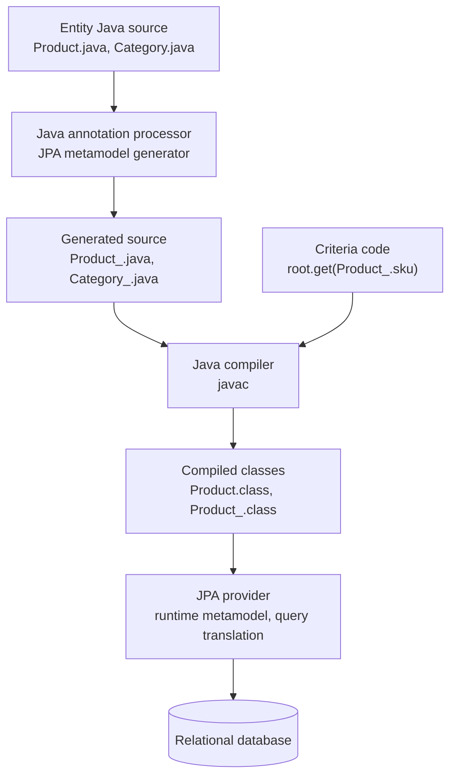
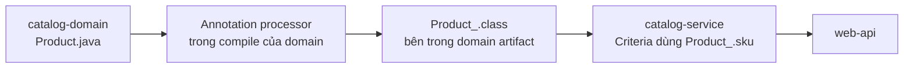

# Quản lý mô hình siêu dữ liệu tĩnh cùng quá trình biên dịch

Khi làm việc với **Criteria API** trong JPA, chúng ta thường xây truy vấn bằng các đối tượng Java thay vì viết toàn bộ JPQL dưới dạng chuỗi. Tuy nhiên, Criteria API vẫn cho phép chỉ định tên thuộc tính bằng chuỗi:

```java
Root<Product> product = query.from(Product.class);
Predicate condition = cb.equal(product.get("sku"), "KB-100");
```

Đoạn code trông có vẻ an toàn hơn việc nối JPQL, nhưng `"sku"` vẫn chỉ là **chuỗi**. Nếu đổi tên thuộc tính Java từ `sku` sang `productCode` mà quên sửa query, Java compiler không biết lỗi đó. Ứng dụng có thể chỉ thất bại khi truy vấn được tạo hoặc chạy trên JPA provider.

JPA cung cấp **static metamodel** (mô hình siêu dữ liệu tĩnh) để giảm rủi ro. Thay vì viết `product.get("sku")`, ta dùng:

```java
Root<Product> product = query.from(Product.class);
Predicate condition = cb.equal(
    product.get(Product_.sku), "KB-100");
```

`Product_` là một class chứa các tham chiếu thuộc tính JPA có kiểu Java, chẳng hạn `SingularAttribute<Product, String> sku`. Class này thường **được annotation processor sinh ra trong quá trình biên dịch** từ entity `Product`. Khi đổi tên, đổi kiểu hoặc xóa thuộc tính, build sẽ nhận diện được nhiều loại lỗi ngay ở bước compile thay vì đợi chạy truy vấn.

Bài học này giải thích cách static metamodel hoạt động, cách tổ chức **annotation processing trong Maven/Gradle**, cách IDE và CI nhìn thấy generated sources, cũng như cách dùng metamodel trong Criteria API để tạo truy vấn an toàn hơn. Đây là nội dung của chương **Criteria API** thuộc module **Data Persistence Relational Access ORM JPA**.

## 1. Static metamodel là gì?

**Metamodel** là mô hình mô tả các loại entity, thuộc tính persistent, quan hệ, khóa và các đặc điểm mapping mà JPA quản lý.

Có hai cách tiếp cận liên quan:

1. **Runtime metamodel**: ứng dụng đọc metadata lúc chạy qua `EntityManager.getMetamodel()` và các interface thuộc `jakarta.persistence.metamodel`.
2. **Static metamodel**: chương trình có các Java class như `Product_`, `Category_` được sinh/khai báo trước để các truy vấn Criteria có thể tham chiếu thuộc tính với kiểm tra kiểu ở thời điểm biên dịch.

Ví dụ runtime:

```java
Metamodel model = em.getMetamodel();
EntityType<Product> productType = model.entity(Product.class);
Attribute<? super Product, ?> attr =
    productType.getAttribute("sku");
System.out.println(attr.getName()); // sku
```

Đoạn trên đọc metadata bằng API JPA lúc chạy. Nó vẫn có chuỗi `"sku"` ở nơi tra cứu. Còn static metamodel cung cấp:

```java
Product_.sku
```

với thông tin kiểu được biểu diễn trong chữ ký Java:

```java
public static volatile SingularAttribute<Product, String> sku;
```

### Tên gọi “static” không có nghĩa metadata bất biến hoàn toàn

Từ **static** ở đây chủ yếu nói tới **cấu trúc class/field được biết tại compile time**. Các field metamodel kiểu `SingularAttribute` thường được khai báo `public static volatile` và được JPA provider gán metadata tương ứng khi khởi tạo persistence unit. Đừng nhầm chúng với các hằng số `public static final` đã biết giá trị từ khi compile.

Một processor có thể sinh thêm hằng chuỗi:

```java
public static final String SKU = "sku";
```

Nhưng chi tiết hằng tên thuộc tính, annotation `@Generated` hoặc format mã nguồn khác nhau giữa processor/phiên bản. **Phần dùng cho typed Criteria API là trường metamodel có kiểu** như `Product_.sku`, không phải hằng chuỗi `Product_.SKU`.

## 2. Vấn đề mà static metamodel giải quyết

So sánh:

| Tiêu chí | Criteria dùng tên chuỗi | Criteria dùng static metamodel |
|---|---|---|
| Truy cập thuộc tính | `root.get("unitPrice")` | `root.get(Product_.unitPrice)` |
| Đổi tên thuộc tính Java | Compiler không phát hiện chuỗi cũ | Generated class thay đổi, chỗ tham chiếu cũ dễ báo lỗi compile |
| Kiểu trả về từ path | Có thể cần suy luận/ép kiểu tường minh | `SingularAttribute<Product, BigDecimal>` cung cấp thông tin kiểu |
| Autocomplete | IDE gợi ý chuỗi hạn chế | IDE gợi ý field của `Product_` |
| Quan hệ entity | `root.join("category")` | `root.join(Product_.category)` |
| Tên cột database | Không dùng trực tiếp | Cũng không dùng trực tiếp |
| Phải cấu hình code generation? | Không | Thường có, qua annotation processor |
| Bảo đảm mọi truy vấn hợp lệ? | Không | **Cũng không**, chỉ giúp bắt nhiều lỗi cấu trúc/kiểu sớm |

Static metamodel đặc biệt hữu ích khi:

- Có nhiều Criteria queries với bộ lọc động.
- Entity và association thay đổi thường xuyên trong quá trình phát triển.
- Các truy vấn xuyên nhiều quan hệ và có nhiều phép JOIN.
- IDE cần autocomplete có kiểu thay cho chuỗi thuộc tính dễ viết sai.
- Team muốn build/CI phát hiện lỗi tham chiếu entity trước khi chạy ứng dụng.

Nó không thay thế tests, ràng buộc database, kiểm soát transaction, phân quyền hay đánh giá SQL execution plan.

## 3. Toàn bộ luồng từ entity source đến câu query



Quá trình được chia thành hai thời điểm:

**Compile time**

1. Java compiler đọc source entity và cấu hình annotation processor.
2. Processor đọc annotation JPA như `@Entity`, `@Id`, `@ManyToOne` và các persistent attributes.
3. Processor sinh những file Java `EntityName_.java`.
4. Các file generated này được biên dịch cùng code ứng dụng, giúp `Product_.sku` có mặt trên classpath của module.

**Runtime**

1. JPA provider khởi tạo persistence unit và runtime metamodel.
2. Provider liên kết metadata runtime với các static metamodel fields nếu được cấu hình/hỗ trợ theo đặc tả.
3. Criteria API dùng các metadata/path để biểu diễn query.
4. Provider dịch query thành SQL phù hợp với mapping và database.

**Điểm quan trọng:** annotation processor **không gửi SQL**, không mở database và không chạy EntityManager trong quá trình sinh class. Nó hoạt động ở **build time** dựa trên source/compiled elements mà compiler cho phép đọc.

## 4. Ví dụ entity xuyên suốt

Ta xây một domain catalogue nhỏ với:

- `AuditedEntity`: mapped superclass chứa thời gian tạo.
- `Product`: entity chứa SKU, tên, giá, trạng thái, category và tags.
- `Category`: entity chứa tên danh mục.
- `ProductDimensions`: embeddable lưu kích thước.

Tập entity này đủ để giải thích các loại metamodel attribute: singular, association, collection, inherited attribute và embedded type.

### 4.1. `AuditedEntity`

```java
package example.domain;

import jakarta.persistence.Column;
import jakarta.persistence.MappedSuperclass;
import java.time.Instant;

@MappedSuperclass
public abstract class AuditedEntity {

    @Column(name = "created_at", nullable = false,
            updatable = false)
    private Instant createdAt = Instant.now();

    protected AuditedEntity() {}

    public Instant getCreatedAt() {
        return createdAt;
    }
}
```

`@MappedSuperclass` không phải entity query root, nhưng các thuộc tính persistent được các entity subclass kế thừa. Static metamodel cũng có thể được sinh cho mapped superclass, ví dụ `AuditedEntity_`.

### 4.2. `Category`

```java
package example.domain;

import jakarta.persistence.Column;
import jakarta.persistence.Entity;
import jakarta.persistence.GeneratedValue;
import jakarta.persistence.GenerationType;
import jakarta.persistence.Id;
import jakarta.persistence.Table;

@Entity
@Table(name = "categories")
public class Category {

    @Id
    @GeneratedValue(strategy = GenerationType.SEQUENCE)
    private Long id;

    @Column(name = "name", nullable = false, length = 150)
    private String name;

    protected Category() {}

    public Long getId() { return id; }
    public String getName() { return name; }
}
```

### 4.3. `ProductDimensions`

```java
package example.domain;

import jakarta.persistence.Embeddable;
import java.math.BigDecimal;

@Embeddable
public class ProductDimensions {

    private BigDecimal widthCm;
    private BigDecimal heightCm;

    protected ProductDimensions() {}

    public ProductDimensions(
            BigDecimal widthCm, BigDecimal heightCm) {
        this.widthCm = widthCm;
        this.heightCm = heightCm;
    }

    public BigDecimal getWidthCm() { return widthCm; }
    public BigDecimal getHeightCm() { return heightCm; }
}
```

Với `@Embeddable`, metadata về các trường embedded có thể được dùng khi xây path tiếp nối từ một entity.

### 4.4. `Product`

```java
package example.domain;

import jakarta.persistence.*;
import java.math.BigDecimal;
import java.util.HashSet;
import java.util.Set;

@Entity
@Table(name = "products")
public class Product extends AuditedEntity {

    @Id
    @GeneratedValue(strategy = GenerationType.SEQUENCE)
    private Long id;

    @Column(name = "sku", nullable = false,
            unique = true, length = 80)
    private String sku;

    @Column(name = "name", nullable = false, length = 200)
    private String name;

    @Column(name = "unit_price", nullable = false,
            precision = 15, scale = 2)
    private BigDecimal unitPrice;

    @Column(name = "active", nullable = false)
    private boolean active = true;

    @Version
    private long version;

    @ManyToOne(fetch = FetchType.LAZY, optional = false)
    @JoinColumn(name = "category_id", nullable = false)
    private Category category;

    @Embedded
    private ProductDimensions dimensions;

    @ElementCollection
    @CollectionTable(
        name = "product_tags",
        joinColumns = @JoinColumn(name = "product_id")
    )
    @Column(name = "tag")
    private Set<String> tags = new HashSet<>();

    @Transient
    private String presentationCache;

    protected Product() {}

    public Product(
            String sku, String name, BigDecimal unitPrice,
            Category category) {
        this.sku = sku;
        this.name = name;
        this.unitPrice = unitPrice;
        this.category = category;
    }

    public Long getId() { return id; }
    public String getSku() { return sku; }
    public String getName() { return name; }
    public BigDecimal getUnitPrice() { return unitPrice; }
    public boolean isActive() { return active; }
    public Category getCategory() { return category; }
    public ProductDimensions getDimensions() { return dimensions; }
    public Set<String> getTags() { return tags; }
}
```

Ở đây annotation `@Id` đặt trên field, nên entity sử dụng **field access** theo quy tắc mặc định của JPA. Processor cần đọc persistent fields, không chỉ đọc public getters.

**Không có nghĩa mọi field đều persistent:** `presentationCache` có `@Transient`, nên nó không được đưa vào static metamodel persistent attributes. Nếu thay sang property access bằng `@Access(AccessType.PROPERTY)`, cần xem lại vị trí mapping annotation và tập thuộc tính persistent.

## 5. Những class `Product_`, `Category_` được sinh như thế nào?

Một JPA metamodel annotation processor đọc `Product.java` và sinh một class trong **cùng package**:

```text
src/main/java/example/domain/Product.java
                      |
                      v
annotation processor
                      |
                      v
build/generated/.../example/domain/Product_.java
```

Ví dụ **đại diện về cấu trúc** (không phải nội dung phải giống từng ký tự trên mọi processor):

```java
package example.domain;

import jakarta.persistence.metamodel.SetAttribute;
import jakarta.persistence.metamodel.SingularAttribute;
import jakarta.persistence.metamodel.StaticMetamodel;
import java.math.BigDecimal;

@StaticMetamodel(Product.class)
public abstract class Product_ extends AuditedEntity_ {

    public static volatile SingularAttribute<Product, Long> id;
    public static volatile SingularAttribute<Product, String> sku;
    public static volatile SingularAttribute<Product, String> name;
    public static volatile SingularAttribute<Product, BigDecimal> unitPrice;
    public static volatile SingularAttribute<Product, Boolean> active;
    public static volatile SingularAttribute<Product, Long> version;

    public static volatile SingularAttribute<Product, Category> category;
    public static volatile SingularAttribute<
        Product, ProductDimensions> dimensions;

    public static volatile SetAttribute<Product, String> tags;
}
```

Vì `Product extends AuditedEntity`, metamodel `Product_` có thể kế thừa `AuditedEntity_`:

```java
package example.domain;

import jakarta.persistence.metamodel.MappedSuperclassType;
import jakarta.persistence.metamodel.SingularAttribute;
import jakarta.persistence.metamodel.StaticMetamodel;
import java.time.Instant;

@StaticMetamodel(AuditedEntity.class)
public abstract class AuditedEntity_ {
    public static volatile SingularAttribute<
        AuditedEntity, Instant> createdAt;
}
```

Lưu ý: import `MappedSuperclassType` ở ví dụ không cần thiết cho trường `createdAt`; interface này thuộc runtime metamodel, còn annotation `@StaticMetamodel` chỉ liên kết class metamodel với loại persistent được mô tả. Code generated thực tế thường có import và annotation khác tùy processor.

`Category_`:

```java
package example.domain;

import jakarta.persistence.metamodel.SingularAttribute;
import jakarta.persistence.metamodel.StaticMetamodel;

@StaticMetamodel(Category.class)
public abstract class Category_ {
    public static volatile SingularAttribute<Category, Long> id;
    public static volatile SingularAttribute<Category, String> name;
}
```

`ProductDimensions_`:

```java
package example.domain;

import jakarta.persistence.metamodel.SingularAttribute;
import jakarta.persistence.metamodel.StaticMetamodel;
import java.math.BigDecimal;

@StaticMetamodel(ProductDimensions.class)
public abstract class ProductDimensions_ {
    public static volatile SingularAttribute<
        ProductDimensions, BigDecimal> widthCm;
    public static volatile SingularAttribute<
        ProductDimensions, BigDecimal> heightCm;
}
```

### 5.1. Dấu gạch dưới cuối tên class

Quy ước canonical static metamodel của JPA gắn hậu tố `_` vào tên class gốc:

```text
Product           -> Product_
Category          -> Category_
ProductDimensions -> ProductDimensions_
AuditedEntity     -> AuditedEntity_
```

Chúng nằm trong cùng package với class được mô tả, giúp code truy cập và import dễ dàng. Hậu tố này không phải tên bảng hoặc alias query.

### 5.2. Không tự viết hoặc chỉnh sửa file generated bằng tay

Thông thường, `Product_.java` là **đầu ra của build**, không phải source code do developer bảo trì trực tiếp.

Nếu chỉnh tay:

```java
// Trong Product_ generated:
public static volatile SingularAttribute<Product, String> sku;
```

rồi sửa thành một field khác, lần build tiếp theo có thể ghi đè toàn bộ thay đổi. Cách đúng là sửa **entity mapping** hoặc cấu hình processor để metamodel được sinh lại.

## 6. Hiểu các interface thuộc `jakarta.persistence.metamodel`

Static metamodel dùng các type trong `jakarta.persistence.metamodel` để biểu diễn từng loại persistent attribute.

| Mapping trong entity | Kiểu static metamodel thường gặp | Ý nghĩa |
|---|---|---|
| `String name` | `SingularAttribute<Product, String>` | Thuộc tính đơn |
| `BigDecimal unitPrice` | `SingularAttribute<Product, BigDecimal>` | Thuộc tính đơn có kiểu số |
| `boolean active` | `SingularAttribute<Product, Boolean>` | Primitive được biểu diễn bằng wrapper trong generic |
| `@ManyToOne Category category` | `SingularAttribute<Product, Category>` | Association đơn tới entity |
| `@Embedded Dimensions dimensions` | `SingularAttribute<Product, Dimensions>` | Thuộc tính embedded đơn |
| `@OneToMany List<OrderLine> lines` | `ListAttribute<Order, OrderLine>` | Collection dạng List |
| `@ManyToMany Set<Group> groups` | `SetAttribute<User, Group>` | Collection dạng Set |
| `@ElementCollection Set<String> tags` | `SetAttribute<Product, String>` | Collection basic elements |
| `@ElementCollection Map<String,String> prefs` | `MapAttribute<Customer, String, String>` | Collection dạng Map |
| `Collection<Address> addresses` | `CollectionAttribute<Customer, Address>` | Collection chung |

### 6.1. `SingularAttribute<Owner, Value>`

```java
SingularAttribute<Product, BigDecimal>
```

Hai generic parameters có ý nghĩa:

- `Product`: persistent type **sở hữu** attribute.
- `BigDecimal`: kiểu Java của **giá trị** attribute.

Vì vậy, với:

```java
Path<BigDecimal> price = root.get(Product_.unitPrice);
```

compiler có cơ sở để xác định `price` là expression của `BigDecimal`.

### 6.2. `SetAttribute<Owner, Element>`

```java
SetAttribute<Product, String> tags;
```

Nó biểu diễn tập những giá trị `String` thuộc `Product`. Khi join collection:

```java
SetJoin<Product, String> tagJoin =
    root.join(Product_.tags);
```

Compiler biết alias join có element type `String`. Không phải mọi collection join đều trả một entity; `@ElementCollection Set<String>` tạo element path kiểu `String`.

### 6.3. `ListAttribute` và `MapAttribute`

```java
ListAttribute<PurchaseOrder, OrderLine> lines;

MapAttribute<Customer, String, String> preferences;
```

`ListAttribute` dùng cho persistent List, `MapAttribute` gồm **owner**, **key type** và **value type**. Criteria API có các join tương ứng như `ListJoin`, `SetJoin`, `MapJoin` để đọc collection elements hoặc map keys.

### 6.4. `PluralAttribute`

Các collection metamodel attributes có điểm chung là `PluralAttribute`. Những type chuyên biệt (`CollectionAttribute`, `SetAttribute`, `ListAttribute`, `MapAttribute`) mô tả cách collection được ánh xạ. Khi xây reusable Criteria utilities, có thể dùng abstractions này, nhưng đừng ép mọi collection thành `ListAttribute` vì nó sẽ làm mất sự khác biệt của `Set`/`Map`.

## 7. Lợi ích kiểm tra kiểu của compiler

Không có static metamodel:

```java
Path<Object> value = root.get("unitPrice");
```

Hoặc:

```java
root.get("unitPrise"); // Lỗi chính tả nhưng là chuỗi Java hợp lệ.
```

Với static metamodel:

```java
Path<BigDecimal> value = root.get(Product_.unitPrice);
```

Nếu đổi `Product.unitPrice` thành `Product.price` và chạy lại annotation processing, field `Product_.unitPrice` không còn tồn tại. Compiler có thể báo:

```text
cannot find symbol:
  variable unitPrice
  location: class Product_
```

Đây là **lợi ích trực tiếp nhất**: một thay đổi entity mapping khiến code query liên quan trở nên lỗi compile thay vì lỗi runtime âm thầm.

### 7.1. Kiểm tra kiểu giữa path và biến nhận

```java
Path<BigDecimal> pricePath = root.get(Product_.unitPrice);
```

Nếu cố gán:

```java
Path<String> pricePath = root.get(Product_.unitPrice);
```

compiler có thể báo lỗi kiểu generic vì `unitPrice` được mô tả là `BigDecimal`. Khi truy cập bằng chuỗi, API có thể không có đủ thông tin kiểu từ chính tên thuộc tính và dễ buộc developer dùng unchecked cast.

### 7.2. Kiểm tra association type

```java
Join<Product, Category> category =
    root.join(Product_.category);
```

Nếu category field đổi sang một entity class khác, chữ ký `SingularAttribute<Product, Category>` cũng thay đổi, làm nhiều thao tác Criteria không tương thích được phát hiện lúc compile.

### 7.3. Giới hạn: type-safe không có nghĩa query luôn đúng

Compiler không tự biết:

- Một `JOIN` có tạo quá nhiều hàng trùng không.
- Query có dùng transaction và flush mode thích hợp không.
- Database có index phục vụ điều kiện WHERE không.
- Một `LEFT JOIN` cộng WHERE có vô tình loại row null không.
- Một `getSingleResult()` có gặp 0 hoặc nhiều kết quả không.
- Dữ liệu thuộc tenant nào hoặc user có quyền xem không.
- HQL/JPQL translation của provider có bug hoặc không hỗ trợ tính năng cụ thể không.

Static metamodel giúp **kiểm tra cấu trúc và kiểu Java của path**, không phải chứng minh tính đúng đắn tổng thể của query hay business rule.

## 8. Criteria query cơ bản dùng generated metamodel

Yêu cầu: lấy các `Product` còn active, giá tối thiểu 100, sắp xếp theo tên rồi ID.

```java
import jakarta.persistence.EntityManager;
import jakarta.persistence.TypedQuery;
import jakarta.persistence.criteria.CriteriaBuilder;
import jakarta.persistence.criteria.CriteriaQuery;
import jakarta.persistence.criteria.Predicate;
import jakarta.persistence.criteria.Root;
import java.math.BigDecimal;
import java.util.List;
import example.domain.Product;
import example.domain.Product_;

public List<Product> findActiveProducts(
        EntityManager em, BigDecimal minPrice) {

    CriteriaBuilder cb = em.getCriteriaBuilder();
    CriteriaQuery<Product> cq = cb.createQuery(Product.class);
    Root<Product> product = cq.from(Product.class);

    Predicate active = cb.isTrue(
        product.get(Product_.active));
    Predicate price = cb.greaterThanOrEqualTo(
        product.get(Product_.unitPrice), minPrice);

    cq.select(product)
      .where(cb.and(active, price))
      .orderBy(
          cb.asc(product.get(Product_.name)),
          cb.asc(product.get(Product_.id))
      );

    TypedQuery<Product> query = em.createQuery(cq);
    return query.getResultList();
}
```

Phân tích:

1. `cb.createQuery(Product.class)` xác định kiểu kết quả.
2. `cq.from(Product.class)` tạo query root là entity `Product`.
3. `product.get(Product_.active)` biểu diễn boolean path có mapping.
4. `product.get(Product_.unitPrice)` biểu diễn `BigDecimal` path.
5. `cb.greaterThanOrEqualTo` làm việc với các kiểu `Comparable` phù hợp.
6. `ORDER BY` dùng những metamodel attributes đã được compiler biết tên.
7. `getResultList()` trả danh sách có thể rỗng, không cần bắt `NoResultException` cho trường hợp không có sản phẩm.

**Không có SQL ở compile time:** Criteria API và JPA provider mới xử lý query lúc runtime. Static metamodel chỉ làm tham chiếu thuộc tính an toàn hơn.

## 9. JOIN association bằng `Product_.category`

Yêu cầu: lấy những product thuộc category tên chứa “computer”.

```java
CriteriaBuilder cb = em.getCriteriaBuilder();
CriteriaQuery<Product> cq = cb.createQuery(Product.class);
Root<Product> product = cq.from(Product.class);

Join<Product, Category> category =
    product.join(Product_.category, JoinType.INNER);

Predicate nameMatches = cb.like(
    cb.lower(category.get(Category_.name)),
    "%computer%");

cq.select(product)
  .where(nameMatches)
  .orderBy(cb.asc(product.get(Product_.id)));

List<Product> results = em.createQuery(cq).getResultList();
```

Ở đây:

- `Product_.category` là một `SingularAttribute<Product, Category>`.
- `Join<Product, Category>` mô tả join từ `Product` sang `Category`.
- `Category_.name` là thuộc tính của target entity.
- Compiler giúp tránh dùng nhầm metamodel của entity khác vào path `category`.

Nếu category là optional và muốn giữ cả product chưa có category, có thể dùng `JoinType.LEFT`. Nhưng khi đặt `WHERE lower(category.name) LIKE ...`, điều kiện WHERE có thể loại những product với category null. Đây là **semantics JOIN**, không phải vấn đề của metamodel.

### 9.1. Không dùng `Product_.category` thay cho `Category_.name`

`Product_.category` dẫn tới entity `Category`. Sau khi join, muốn đọc name phải dùng metamodel của **target**:

```java
category.get(Category_.name);
```

Không dùng:

```java
category.get(Product_.name); // Attribute owner sai.
```

Một trong các lợi ích của generic attribute types là compiler thường có khả năng nhận ra sự không tương thích giữa owner type và path.

## 10. Truy vấn collection bằng `SetAttribute`

`Product.tags` là:

```java
@ElementCollection
private Set<String> tags;
```

Processor có thể sinh:

```java
public static volatile SetAttribute<Product, String> tags;
```

Muốn tìm product có tag `"sale"`:

```java
CriteriaBuilder cb = em.getCriteriaBuilder();
CriteriaQuery<Product> cq = cb.createQuery(Product.class);
Root<Product> product = cq.from(Product.class);

SetJoin<Product, String> tag =
    product.join(Product_.tags, JoinType.INNER);

cq.select(product)
  .distinct(true)
  .where(cb.equal(tag, "sale"));

List<Product> products = em.createQuery(cq).getResultList();
```

Giải thích:

- `SetJoin<Product, String>` có element type `String`.
- Một product có nhiều tags có thể tạo nhiều SQL join rows.
- `distinct(true)` diễn đạt yêu cầu mỗi product xuất hiện một lần trong danh sách entity root.
- `cb.equal(tag, "sale")` xét giá trị của element trong collection.

Với association collection entity, dùng `SetJoin<Owner, TargetEntity>` rồi tham chiếu metamodel thuộc target entity để truy vấn sâu hơn.

### 10.1. Không gọi `get()` trên Set như một thuộc tính singular

```java
// Không coi SetAttribute như SingularAttribute<String>.
// Root/Join APIs phân biệt collection join với single-valued path.
```

Đây là lợi ích của metamodel: `SetAttribute` thể hiện ngay trong Java type rằng dữ liệu là collection, gợi ý dùng `join` hoặc `isMember` thích hợp thay vì giả định có một giá trị scalar duy nhất.

## 11. Embedded object và metamodel của embeddable

`Product.dimensions` có type `ProductDimensions`. Khi sinh metamodel:

```java
public static volatile SingularAttribute<
    Product, ProductDimensions> dimensions;
```

`ProductDimensions_.widthCm` có type `BigDecimal`:

```java
public static volatile SingularAttribute<
    ProductDimensions, BigDecimal> widthCm;
```

Criteria path:

```java
Path<BigDecimal> widthPath = product
    .get(Product_.dimensions)
    .get(ProductDimensions_.widthCm);
```

Yêu cầu lọc product rộng ít nhất 50 cm:

```java
Predicate wide = cb.greaterThanOrEqualTo(
    product.get(Product_.dimensions)
           .get(ProductDimensions_.widthCm),
    new BigDecimal("50.00"));
```

`@Embeddable` không phải entity có identity riêng. Static metamodel của embeddable mô tả các persistent attributes có thể được truy cập qua embedded path, nhưng không biến embeddable thành root entity `FROM ProductDimensions`.

### 11.1. Overriding database columns không làm đổi tên metamodel

Nếu entity dùng `@AttributeOverride`:

```java
@Embedded
@AttributeOverrides({
    @AttributeOverride(
        name = "widthCm",
        column = @Column(name = "package_width_cm")
    )
})
private ProductDimensions dimensions;
```

Criteria vẫn dùng:

```java
ProductDimensions_.widthCm
```

vì đó là **tên persistent Java attribute**, không phải tên cột `package_width_cm`. Processor metamodel làm việc với mô hình entity; provider sau đó áp dụng column mapping để sinh SQL.

## 12. Inherited attributes và metamodel của `@MappedSuperclass`

`Product extends AuditedEntity`, và `AuditedEntity` chứa `createdAt`. Khi generator hỗ trợ canonical metamodel, cấu trúc có thể là:

```text
AuditedEntity
  └── Product

AuditedEntity_
  └── Product_
```

Từ code Criteria:

```java
cq.orderBy(
    cb.desc(product.get(Product_.createdAt)),
    cb.desc(product.get(Product_.id)));
```

`Product_.createdAt` có thể được tham chiếu vì `Product_` kế thừa static member của `AuditedEntity_`.

Generic type của inherited attribute:

```java
SingularAttribute<AuditedEntity, Instant>
```

vẫn được Criteria API chấp nhận trên `Root<Product>` thông qua chữ ký hỗ trợ các attribute của supertypes.

### 12.1. Entity inheritance cũng có hierarchy metamodel

Ví dụ:

```java
@Entity
@Inheritance(strategy = InheritanceType.JOINED)
public abstract class Payment {
    @Id private Long id;
    private BigDecimal amount;
}

@Entity
public class CardPayment extends Payment {
    private String cardBrand;
}
```

Generated types về ý tưởng:

```java
@StaticMetamodel(Payment.class)
public abstract class Payment_ {
    public static volatile SingularAttribute<Payment, Long> id;
    public static volatile SingularAttribute<
        Payment, BigDecimal> amount;
}

@StaticMetamodel(CardPayment.class)
public abstract class CardPayment_ extends Payment_ {
    public static volatile SingularAttribute<
        CardPayment, String> cardBrand;
}
```

Static metamodel phân biệt inherited attributes và subtype-only attributes. Khi query polymorphic từ `Root<Payment>`, muốn truy cập `CardPayment_.cardBrand` cần narrowing hợp lệ (ví dụ `CriteriaBuilder.treat`), không thể đơn giản giả định mọi `Payment` đều có trường `cardBrand`.

## 13. `ListAttribute` với quan hệ một-nhiều

Giả sử có:

```java
@Entity
public class PurchaseOrder {
    @Id
    private Long id;

    @OneToMany(mappedBy = "order")
    private List<OrderLine> lines = new ArrayList<>();
}

@Entity
public class OrderLine {
    @Id
    private Long id;

    @ManyToOne(fetch = FetchType.LAZY)
    private PurchaseOrder order;

    private int quantity;
}
```

Processor sinh field đại diện:

```java
public static volatile ListAttribute<
    PurchaseOrder, OrderLine> lines;
```

Query những order có ít nhất một line có `quantity >= 3`:

```java
CriteriaBuilder cb = em.getCriteriaBuilder();
CriteriaQuery<PurchaseOrder> cq =
    cb.createQuery(PurchaseOrder.class);

Root<PurchaseOrder> order = cq.from(PurchaseOrder.class);
ListJoin<PurchaseOrder, OrderLine> line =
    order.join(PurchaseOrder_.lines);

cq.select(order)
  .distinct(true)
  .where(cb.ge(line.get(OrderLine_.quantity), 3));

List<PurchaseOrder> orders =
    em.createQuery(cq).getResultList();
```

`OrderLine_.quantity` mô tả attribute của element entity. Nếu đổi tên `quantity` trong entity, bước annotation processing và compile sẽ giúp phát hiện những query còn dùng tên cũ.

### 13.1. `ListAttribute` không đồng nghĩa `@OrderColumn`

Việc entity dùng `List<OrderLine>` khiến metamodel có `ListAttribute`; nhưng nó **không tự bảo đảm** thứ tự SQL của query kết quả hoặc buộc schema có order column. `@OrderColumn`, `@OrderBy` và `ORDER BY` của JPQL/Criteria có vai trò riêng.

Nếu nghiệp vụ cần sắp xếp root `PurchaseOrder`, vẫn phải đặt `cq.orderBy(...)` theo yêu cầu.

## 14. `MapAttribute` và `MapJoin`

Giả sử `Customer` lưu cấu hình dạng key/value:

```java
@Entity
public class Customer {
    @Id
    private Long id;

    @ElementCollection
    @CollectionTable(
        name = "customer_preferences",
        joinColumns = @JoinColumn(name = "customer_id"))
    @MapKeyColumn(name = "preference_key")
    @Column(name = "preference_value")
    private Map<String, String> preferences =
        new HashMap<>();
}
```

Generated field:

```java
public static volatile MapAttribute<
    Customer, String, String> preferences;
```

Criteria query tìm những customer có `preferences["locale"] = "vi-VN"`:

```java
CriteriaBuilder cb = em.getCriteriaBuilder();
CriteriaQuery<Customer> cq = cb.createQuery(Customer.class);
Root<Customer> customer = cq.from(Customer.class);

MapJoin<Customer, String, String> pref =
    customer.join(Customer_.preferences);

cq.select(customer)
  .distinct(true)
  .where(cb.and(
      cb.equal(pref.key(), "locale"),
      cb.equal(pref.value(), "vi-VN")
  ));

List<Customer> results = em.createQuery(cq).getResultList();
```

`MapJoin` có:

- `key()`: expression của map key.
- `value()`: expression của map value.
- `entry()`: entry expression ở những tình huống được API hỗ trợ.

Metamodel generic ghi rõ `MapAttribute<Customer, String, String>`, giúp tránh nhầm một collection `Map` thành `Set` hay một scalar `String`.

## 15. Constructor projection với metamodel

Không phải truy vấn nào cũng cần trả managed entity. Một trang liệt kê catalogue có thể chỉ cần ID, SKU và tên.

DTO:

```java
package example.api;

public record ProductRow(Long id, String sku, String name) {}
```

Criteria:

```java
CriteriaBuilder cb = em.getCriteriaBuilder();
CriteriaQuery<ProductRow> cq =
    cb.createQuery(ProductRow.class);

Root<Product> product = cq.from(Product.class);

cq.select(cb.construct(
        ProductRow.class,
        product.get(Product_.id),
        product.get(Product_.sku),
        product.get(Product_.name)
    ))
  .orderBy(cb.asc(product.get(Product_.name)));

List<ProductRow> rows = em.createQuery(cq).getResultList();
```

Ưu điểm:

- Các field của entity được tham chiếu qua metamodel.
- Query chỉ lấy các giá trị cần thiết thay vì tải toàn bộ entity graph.
- DTO không được quản lý bởi persistence context, nên không phát sinh dirty checking trên kết quả.

**Giới hạn:** `cb.construct(ProductRow.class, ...)` vẫn phụ thuộc vào constructor của DTO và kiểu/thứ tự biểu thức được chọn. Compiler không phải lúc nào kiểm tra đầy đủ tính tương thích của constructor projection ngay khi biên dịch. Một mismatch có thể bị phát hiện khi query được xây/thực thi bởi provider. Vì vậy vẫn cần integration tests cho projections.

## 16. Sắp xếp động mà không dùng chuỗi thuộc tính từ client

API thường nhận:

```text
GET /products?sort=name&direction=asc
```

Không nên đưa thẳng `sort` từ HTTP vào:

```java
root.get(sortFromRequest);
```

Thứ nhất, lỗi chính tả chỉ lộ runtime. Thứ hai, người dùng có thể yêu cầu thuộc tính không được API cho phép sắp xếp, kể cả những field nội bộ.

Hãy map input sang các metamodel attributes đã được whitelist:

```java
public enum ProductSort {
    NAME, PRICE, CREATED_AT
}
```

```java
public Order toOrder(
        CriteriaBuilder cb,
        Root<Product> root,
        ProductSort sort,
        boolean ascending) {

    Expression<? extends Comparable<?>> expression =
        switch (sort) {
            case NAME -> root.get(Product_.name);
            case PRICE -> root.get(Product_.unitPrice);
            case CREATED_AT -> root.get(Product_.createdAt);
        };

    return ascending
        ? cb.asc(expression)
        : cb.desc(expression);
}
```

`Order` ở đây là `jakarta.persistence.criteria.Order`, không phải một domain entity tên Order. Với code generic/dynamic nâng cao, chữ ký `Expression<? extends Comparable<?>>` có thể cần điều chỉnh theo API compiler và phiên bản JDK; cách thay thế đơn giản là đặt `cb.asc/desc` trực tiếp trong từng nhánh switch.

Một phiên bản ít generic hơn:

```java
public jakarta.persistence.criteria.Order orderBy(
        CriteriaBuilder cb,
        Root<Product> root,
        ProductSort sort,
        boolean asc) {

    return switch (sort) {
        case NAME -> asc
            ? cb.asc(root.get(Product_.name))
            : cb.desc(root.get(Product_.name));
        case PRICE -> asc
            ? cb.asc(root.get(Product_.unitPrice))
            : cb.desc(root.get(Product_.unitPrice));
        case CREATED_AT -> asc
            ? cb.asc(root.get(Product_.createdAt))
            : cb.desc(root.get(Product_.createdAt));
    };
}
```

Cách này dài hơn một ít nhưng rất rõ ràng. Khi đổi tên field, generated metamodel đổi và code build sẽ phát hiện. Quan trọng hơn, chỉ các trường được API cho phép mới có thể được chọn.

### 16.1. Type safety và security là hai việc khác nhau

`Product_.name` bảo đảm query tham chiếu một field persistent được biết tại compile time; nó **không tự bảo đảm** người gọi có quyền xem hoặc sort theo field đó. Whitelist và tenant/authorization predicates vẫn phải tồn tại ở tầng ứng dụng.

## 17. Annotation processing: cơ chế nằm ở đâu trong Java compiler?

JPA static metamodel generator thường là một **annotation processor** theo API chuẩn của Java compiler (JSR 269). Một processor đọc thông tin về các annotation/type/field khi `javac` xử lý source.

Luồng khái niệm:

```text
Product.java, Category.java
        |
        v
javac annotation-processing rounds
        |
        +-- metamodel processor xem @Entity/@Embeddable/@MappedSuperclass
        |
        +-- sinh Product_.java, Category_.java, ...
        |
        +-- compiler nhận generated source trong round kế tiếp
        |
        v
Product.class, Category.class, Product_.class, Category_.class
```

Một processor có thể được đóng gói trong một artifact riêng của JPA provider. Nó được khai báo ở **annotation processor path**, không phải nhất thiết ở runtime classpath của ứng dụng.

### 17.1. Vì sao không viết một chương trình Java tạo file trong `main()`?

Annotation processing được build tool/compiler gọi **trước khi application chạy**. Nó đọc metadata nguồn và sinh Java source; không cần boot server, không cần DB, không cần thực thi `ProductRepository`.

Một chương trình tự quét class và tạo `Product_.java` lúc runtime sẽ xuất hiện quá muộn để Java compiler của chính source đó tham chiếu được `Product_.sku`. Đây là lý do cần tích hợp **generation vào compilation lifecycle**.

### 17.2. `javax.annotation.processing` và `jakarta.persistence` là hai chuyện khác nhau

Trong Jakarta Persistence hiện đại:

```java
import jakarta.persistence.Entity;
import jakarta.persistence.metamodel.SingularAttribute;
```

Trong Java compiler, API annotation processing vẫn thuộc Java SE:

```java
import javax.annotation.processing.Processor;
import javax.annotation.processing.AbstractProcessor;
```

Không nên thấy chữ `javax.annotation.processing` rồi kết luận processor đó sinh metamodel `javax.persistence`. Namespace của **compiler processing API** không giống namespace của **JPA annotation và metamodel API**.

Phải kiểm tra artifact processor đang dùng hỗ trợ đúng namespace của entity mapping.

## 18. Cấu hình Maven để sinh static metamodel

Với Maven, cách thường gặp là khai báo processor cho `maven-compiler-plugin`.

Ví dụ minh họa cho dự án **Hibernate ORM 6.x + Jakarta Persistence**:

```xml
<properties>
    <maven.compiler.release>17</maven.compiler.release>
    <!-- Phiên bản này do dependency management của dự án xác định. -->
    <hibernate.version>6.6.0.Final</hibernate.version>
</properties>

<dependencies>
    <dependency>
        <groupId>org.hibernate.orm</groupId>
        <artifactId>hibernate-core</artifactId>
        <version>${hibernate.version}</version>
    </dependency>
</dependencies>

<build>
    <plugins>
        <plugin>
            <groupId>org.apache.maven.plugins</groupId>
            <artifactId>maven-compiler-plugin</artifactId>
            <version>3.13.0</version>
            <configuration>
                <release>${maven.compiler.release}</release>
                <annotationProcessorPaths>
                    <path>
                        <groupId>org.hibernate.orm</groupId>
                        <artifactId>hibernate-jpamodelgen</artifactId>
                        <version>${hibernate.version}</version>
                    </path>
                </annotationProcessorPaths>
            </configuration>
        </plugin>
    </plugins>
</build>
```

Trong snippet trên:

- `hibernate-core` là thư viện runtime ORM của ví dụ.
- `hibernate-jpamodelgen` là annotation processor tạo static metamodel được sử dụng trong dòng Hibernate ORM 6.x.
- `maven-compiler-plugin` chạy `javac` và cung cấp processor path.
- `maven.compiler.release` xác định mức Java API/language/bytecode mục tiêu.
- Generated classes được tạo trong build output, rồi có thể được compiler biên dịch cùng source sử dụng chúng.

**Phiên bản chỉ nhằm minh họa cấu hình Maven 3.x**. Với dự án thực tế, chọn versions tương thích theo BOM/parent và Java version đang dùng; không sao chép số phiên bản cũ nếu hệ thống đã nâng cấp.

### 18.1. Hibernate 7 và các artifact processor mới

Khi dùng các dòng Hibernate mới hơn, tên artifact dành cho annotation processing có thể thay đổi. Hibernate ORM 7 sử dụng artifact **`org.hibernate.orm:hibernate-processor`** cho chức năng processor mới; không nên mặc định mọi phiên bản Hibernate đều tiếp tục dùng cùng artifact `hibernate-jpamodelgen`.

Quy trình chọn dependency:

1. Xác định Hibernate ORM version thật trong dependency graph.
2. Chọn annotation processor tương thích với **dòng phiên bản Hibernate đó**.
3. Bảo đảm processor hỗ trợ `jakarta.persistence` nếu entity dùng Jakarta namespace.
4. Cấu hình processor path tường minh trong Maven compiler.
5. Thực hiện clean compile và kiểm tra file generated tồn tại.

Tên artifact và các tính năng tăng cường có thể thay đổi theo phiên bản provider; không trộn processor của một dòng Hibernate rất mới với runtime/API của một dòng khác chỉ vì Maven vẫn resolve được.

### 18.2. Thư mục generated sources với Maven

Thường gặp:

```text
target/
  generated-sources/
    annotations/
      example/
        domain/
          Product_.java
          Category_.java
          ProductDimensions_.java
          AuditedEntity_.java
  classes/
    example/
      domain/
        Product.class
        Product_.class
```

Đây là output path thường gặp, **không phải một đường dẫn cố định của đặc tả JPA**. Cấu hình Maven/plugin có thể đổi vị trí, và IDE có thể hiển thị generated source root riêng.

### 18.3. Lệnh build

```bash
mvn clean compile
```

Khi compilation thành công, những class như `Product_` phải có mặt ở compiled classes nếu source entity được processor xử lý đúng và các class được compiler nhận.

```bash
mvn clean test
```

Lệnh này thường chạy cả compile và test. Nếu query Criteria tham chiếu field đã đổi tên, compile có thể thất bại trước khi unit test bắt đầu.

## 19. Cấu hình Gradle để sinh static metamodel

Với Gradle Java project, sử dụng dependency configuration **`annotationProcessor`**.

Ví dụ Groovy DSL cho Hibernate ORM 6.x:

```groovy
plugins {
    id 'java'
}

java {
    toolchain {
        languageVersion = JavaLanguageVersion.of(17)
    }
}

def hibernateVersion = '6.6.0.Final'

dependencies {
    implementation "org.hibernate.orm:hibernate-core:${hibernateVersion}"

    annotationProcessor(
        "org.hibernate.orm:hibernate-jpamodelgen:${hibernateVersion}"
    )
}
```

Với Hibernate ORM 7, thay processor dependency theo artifact/phiên bản mà dòng Hibernate đó cung cấp, chẳng hạn `hibernate-processor`.

### 19.1. Vì sao cần `annotationProcessor` thay vì chỉ `implementation`?

Hai dependency configurations có trách nhiệm khác nhau:

| Gradle configuration | Vai trò |
|---|---|
| `implementation` | Các dependency ứng dụng cần cho compile/runtime ở phạm vi phù hợp |
| `compileOnly` | Dependency chỉ cần lúc compile, không đưa vào runtime packaging theo cách thông thường |
| `annotationProcessor` | Các processor được Java compile task chạy để sinh source/metadata |
| `testAnnotationProcessor` | Processor dành riêng cho source của test set nếu cần |

Thêm processor vào `implementation` không phải cách cấu hình chuẩn để Gradle chắc chắn chạy annotation processing. Hãy đặt nó trên **processor path** được JavaCompile task sử dụng.

### 19.2. Generated source path của Gradle

Thông thường:

```text
build/
  generated/
    sources/
      annotationProcessor/
        java/
          main/
            example/
              domain/
                Product_.java
                Category_.java
  classes/
    java/
      main/
        example/
          domain/
            Product.class
            Product_.class
```

`compileJava` có thể tạo generated classes trong cùng compile lifecycle. Ở cấu hình Gradle Java hiện đại thông thường, **không cần thêm generated directory làm source directory thủ công** chỉ để javac nhận generated source của chính task ấy.

Trái lại, khai báo:

```groovy
sourceSets.main.java.srcDir(
    'build/generated/sources/annotationProcessor/java/main'
)
```

một cách máy móc có thể gây trùng source, build cycle hoặc nhầm lẫn ownership giữa generated output và input. Chỉ cấu hình source set bổ sung khi thật sự có một **task sinh source riêng** được mô hình hóa rõ và nối dependency đúng.

### 19.3. Lệnh build

```bash
./gradlew clean compileJava
```

Trên Windows với Gradle wrapper có thể dùng:

```powershell
.\gradlew.bat clean compileJava
```

Sau đó kiểm tra generated source directory và compiled class output theo convention/build customization của dự án.

## 20. IDE hiển thị generated sources như thế nào?

Một tình huống thường gặp: **command line build thành công**, nhưng IDE gạch đỏ `Product_` vì IDE chưa biết generated sources root hoặc chưa bật annotation processing.

### 20.1. IntelliJ IDEA

Những điểm cần xem xét:

- Dự án đang dùng Maven hay Gradle làm source of truth?
- IDE import/sync project có nhận dependencies và annotation processor path không?
- Annotation processing có được bật cho module theo cơ chế hiện tại của IDE không?
- Generated source directory có được IDE đánh dấu/nhận diện là generated source root không?
- IDE đang dùng đúng JDK/toolchain và đúng module classpath không?

Thực hành:

1. Chạy clean compile bằng Maven/Gradle bên ngoài IDE.
2. Xác nhận `Product_.java` thực sự được tạo.
3. Reload/sync Maven hoặc Gradle project trong IDE.
4. Để IDE sử dụng cấu hình build của dự án thay vì sửa classpath thủ công không đồng bộ.

Không nên tự copy `Product_.java` vào `src/main/java` chỉ để IDE hết gạch đỏ; đây có thể che giấu lỗi annotation processing thật và tạo duplicate source.

### 20.2. Eclipse và công cụ khác

Eclipse/JDT có cơ chế annotation processing và generated source folders riêng. Nếu Maven/Gradle clean compile thành công nhưng IDE báo thiếu metamodel, cần kiểm tra khả năng import processor configuration của IDE/plugin và source generation location.

**Nguyên tắc:** source code và build cấu hình trong repository phải là nguồn sự thật; IDE chỉ là một giao diện giúp developer làm việc với build đó.

## 21. JDK, javac và việc khám phá annotation processor

Một processor có thể được javac phát hiện qua service registration và processor path, hoặc được build tool chỉ định rõ.

Trong các phiên bản JDK mới, chính sách tự động tìm/chạy annotation processors có thay đổi nhằm tránh vô tình thực thi processor không được khai báo. Vì vậy, **đừng dựa vào việc chỉ có processor JAR trên compile classpath**.

Hãy cấu hình:

- Maven: `annotationProcessorPaths` hoặc cơ chế processor dependency được phiên bản compiler plugin sử dụng.
- Gradle: `annotationProcessor`.
- Cấu hình processor tương ứng cho test sources nếu test module cũng có entity cần sinh metamodel.

### 21.1. Một số tùy chọn javac nên biết

| Tùy chọn | Ý nghĩa khái quát |
|---|---|
| `-processorpath` / `--processor-path` | Đường dẫn chứa annotation processors |
| `-processor` | Chỉ định processor class được chạy |
| `-s <directory>` | Nơi javac ghi generated Java source |
| `-proc:only` | Chỉ chạy annotation processing, không tạo class files như compile thông thường |
| `-proc:none` | Tắt annotation processing |
| `-XprintRounds` | In thông tin annotation processing rounds khi chẩn đoán |
| `-XprintProcessorInfo` | In thông tin processors được chạy |

Các tùy chọn và cơ chế default khác nhau theo JDK/compiler plugin version; thông thường dự án nên cấu hình qua Maven/Gradle thay vì truyền tham số javac bằng tay.

### 21.2. Vì sao `-proc:none` làm mất `Entity_`?

Nếu task compile dùng:

```text
-proc:none
```

thì annotation processor không chạy, nên generated metamodel Java sources không được tạo trong compilation đó. Nếu đã xóa generated outputs và code query cần `Product_`, compile có thể báo `cannot find symbol: Product_`.

Nếu file generated cũ vẫn còn trên classpath, build có thể chạy qua một cách nguy hiểm với **metamodel lỗi thời**. Hãy dùng clean build khi chẩn đoán.

## 22. `javax.persistence` và `jakarta.persistence`: chuyển namespace

Một lỗi phổ biến khi nâng cấp JPA là trộn:

```java
import javax.persistence.Entity;
```

với:

```java
import jakarta.persistence.metamodel.SingularAttribute;
```

Hai namespace thuộc các thế hệ API khác nhau. Ví dụ:

| Hệ sinh thái | Entity annotation | Metamodel attribute |
|---|---|---|
| JPA 2.x / Java EE cũ | `javax.persistence.Entity` | `javax.persistence.metamodel.SingularAttribute` |
| Jakarta Persistence 3.x | `jakarta.persistence.Entity` | `jakarta.persistence.metamodel.SingularAttribute` |

Khi migrate, phải đồng bộ:

1. Entity source imports.
2. JPA API dependency.
3. ORM provider và phiên bản.
4. Metamodel annotation processor.
5. Generated sources được sinh lại.
6. Các dependency bên ngoài có API `javax`/`jakarta`.

Nếu processor cũ tạo:

```java
import javax.persistence.metamodel.SingularAttribute;
```

trong khi ứng dụng dùng Jakarta Persistence 3.x, Criteria code có thể gặp lỗi compile **incompatible types**. Không sửa hàng loạt generated files bằng text replace thủ công để che giấu mismatch; phải chọn đúng processor và clean rebuild.

### 22.1. Không nhầm Java compiler package

Nhắc lại: `javax.annotation.processing` là Java SE processor API và có thể được dùng trong một processor sinh `jakarta.persistence.metamodel`. Điều cần nhất quán là **persistence API namespace** của entity, metamodel và ORM provider.

## 23. Annotation processor khác runtime ORM dependency

Về mặt vòng đời:

```text
Build machine / CI
  javac + processor JAR
       -> tạo Entity_.java
       -> biên dịch Entity_.class

Application runtime
  Entity.class + Entity_.class + ORM provider
       -> boot persistence unit
       -> tạo Criteria queries
```

Processor không cần được đóng gói vào application production runtime classpath chỉ để dùng các metamodel class đã compile.

Nhưng các **metamodel classes** tự chúng và API `jakarta.persistence.metamodel` mà chúng tham chiếu vẫn cần sẵn sàng ở compile/runtime theo cấu trúc deployment tương ứng. Nếu entity module build thành JAR, các `Product_.class` đã được compile sẽ đi theo artifact module theo cấu hình đóng gói Java thông thường.

### 23.1. Kiểm tra output JAR

Nếu module `catalog-domain` cung cấp entities và static metamodel:

```text
catalog-domain.jar
  example/domain/Product.class
  example/domain/Product_.class
  example/domain/Category.class
  example/domain/Category_.class
```

Module query khác có thể import:

```java
import example.domain.Product_;
```

với điều kiện JAR phụ thuộc có chứa compiled generated metamodel classes.

## 24. Multi-module project: processor đặt ở đâu?

Giả sử:

```text
shop/
  catalog-domain/
    src/main/java/example/domain/Product.java
    src/main/java/example/domain/Category.java

  catalog-service/
    src/main/java/example/service/ProductSearchService.java

  web-api/
    src/main/java/example/api/ProductController.java
```

`catalog-service` cần dùng:

```java
root.get(Product_.sku);
```

Tốt nhất để **module sở hữu entity** (`catalog-domain`) sinh và compile `Product_`, rồi xuất các class đó như một phần artifact của module.

Sơ đồ:



Điều này có lợi:

- Entity và metamodel cùng một version.
- Module service không cần tự quét lại source của domain để sinh model.
- Mỗi thay đổi entity đều nằm trong dependency artifact có model tương ứng.
- CI có thể compile module domain trước rồi compile service.

### 24.1. Lỗi thường gặp: đặt processor chỉ ở service module

Nếu `Product.java` thuộc `catalog-domain` và đã compile thành class, nhưng processor chỉ được khai báo trong `catalog-service`, không nên mặc định processor sẽ tự quét mọi dependency JAR và sinh đầy đủ metamodel cho chúng. Hành vi hỗ trợ classpath entity processing phụ thuộc processor/configuration.

Cấu hình ổn định hơn: **processor chạy khi biên dịch module chứa entity source**.

### 24.2. Đổi entity nhưng quên nâng version domain artifact

Giả sử service đã dùng `Product_.sku` từ `catalog-domain:1.0`. Domain `1.1` đổi `sku` thành `productCode`.

Nếu service chưa nâng dependency, nó vẫn compile với `1.0` và đang dựa vào model cũ. Static metamodel chỉ phát hiện drift **khi dependency graph thực sự sử dụng model mới**.

CI phải đảm bảo build các module với version đúng, tránh một module được build từ source mới nhưng phụ thuộc binary artifact cũ ở local repository.

### 24.3. Package visibility

Generated metamodel class thường cùng package với entity. Nếu sử dụng JPMS (Java Platform Module System), package exports và module dependencies phải cho phép module service nhìn thấy các generated types. Với classpath truyền thống, các `public` generated classes thường được import bình thường.

Không nên mở mọi package/exports chỉ để bypass một lỗi module path; cần xác định module graph và runtime reflection requirements của JPA provider riêng.

## 25. Incremental compilation và generated source bị lỗi thời

Trong phát triển hằng ngày, IDE/Gradle/Maven có thể build incremental. Một số thay đổi source được compile lại; những thay đổi khác có thể làm processor cần chạy lại cho nhiều entity.

Nguy cơ:

```text
Product.java đổi "sku" -> "productCode"

Product_.java cũ vẫn chứa:
    SingularAttribute<Product, String> sku

ProductSearchService.java vẫn gọi Product_.sku

Nếu build lỡ dùng generated class cũ:
    compile có thể không phát hiện drift.
```

Đây là lý do cần:

1. Để build tool quản lý generated outputs.
2. Không commit/generated source lẫn trong `src/main/java` theo cách che lỗi.
3. Chạy **clean build** để xác nhận mô hình được tái sinh.
4. Đảm bảo annotation processor hỗ trợ đúng chế độ incremental compile hoặc buộc regeneration phù hợp.
5. Cập nhật IDE project metadata sau khi sửa cấu hình build.

### 25.1. Build incremental không có nghĩa processor luôn chạy lại theo mọi thay đổi

Một processor có thể được build tool xem là *isolating* hay *aggregating* trong cơ chế incremental annotation processing của Gradle, hoặc không hỗ trợ một số tối ưu. Khả năng đó phụ thuộc processor version và build integration.

Không nên tự khai báo một processor là isolating nếu chưa được processor cung cấp đúng metadata; làm sai có thể khiến generated outputs không được invalidated chính xác.

### 25.2. Clean build là bước chẩn đoán, không phải câu trả lời cho mọi vấn đề

`./gradlew clean compileJava` hoặc `mvn clean compile` giúp loại generated output cũ rồi sinh lại. Nhưng nếu processor dependency bị sai, clean build vẫn không tạo `Product_`. Khi đó phải giải quyết cấu hình processor, namespace hoặc version chứ không chạy clean lặp vô hạn.

## 26. Có nên commit generated metamodel vào Git?

Có hai chiến lược, nhưng **chiến lược phổ biến với annotation processors là không commit** các file `Entity_.java` sinh trong `target/` hoặc `build/`.

### 26.1. Không commit generated output

Ưu điểm:

- Tránh thay đổi do máy developer/IDE khác nhau.
- Không có hai nguồn sự thật giữa `Product.java` và `Product_.java`.
- Tránh review noise khi đổi những annotation không làm thay đổi nghiệp vụ.
- CI buộc phải có processor configuration đủ để build từ source sạch.

Thông thường `target/` và `build/` đã nằm trong `.gitignore`.

### 26.2. Khi tổ chức chọn commit generated sources

Một số project có chính sách commit generated code (ví dụ vì công cụ build tiêu dùng generated outputs khác hoặc vì có pipeline generation được kiểm soát). Khi đó phải quy định:

- Generated directory riêng, không chỉnh tay.
- Một command tái sinh rõ ràng và version processor cố định.
- CI so sánh output sau regeneration với files committed để phát hiện stale sources.
- Tránh trùng class do compile lại generated source trong hai source sets.
- Có quy tắc review khi generated code thay đổi.

Không thể vừa coi generated source là code viết tay vừa tự động ghi đè nó theo mỗi build mà không định nghĩa ownership.

## 27. Dự án có cả Lombok và JPA processor

Lombok là một annotation processor/compiler integration khác có thể xuất hiện cùng JPA processor.

Ví dụ entity:

```java
@Entity
@Getter
@NoArgsConstructor(access = AccessLevel.PROTECTED)
public class Product {
    @Id
    private Long id;

    private String sku;
}
```

Với field access, persistent attributes được xác định theo field annotations và quy tắc JPA, nên static metamodel generator không nhất thiết phải đợi public getters được Lombok tạo ra. Nhưng nếu dùng **property access**, các persistent properties có thể phụ thuộc vào getter declarations mà processor/compiler integration phải nhìn thấy ở thời điểm thích hợp.

Các điểm cần chú ý:

- Đặt annotation processors đúng processor path.
- Nếu có nhiều processors, kiểm tra version tương thích và thứ tự/rounds khi compiler xử lý.
- Không mặc định Lombok làm JPA mapping đúng nếu entity thiếu constructor hợp lệ hoặc dùng final fields tùy tiện.
- Không tạo `equals/hashCode/toString` tự động tràn qua lazy associations mà chưa xét entity identity và vòng lặp quan hệ.

Static metamodel không thay cho quy tắc thiết kế entity của JPA.

## 28. Dự án Kotlin: KAPT và lưu ý với KSP

Khi entity được viết bằng Kotlin, Java annotation processors không nhất thiết nhận source Kotlin trực tiếp giống javac đọc source Java.

Một project Kotlin/JPA thường dùng cơ chế **KAPT** để tạo Java stubs và chạy annotation processors Java:

```kotlin
plugins {
    kotlin("jvm") version "<kotlin-version>"
    kotlin("kapt") version "<kotlin-version>"
}

dependencies {
    implementation("org.hibernate.orm:hibernate-core:<hibernate-version>")
    kapt("org.hibernate.orm:hibernate-jpamodelgen:<hibernate-6-version>")
}
```

Các chuỗi `<...>` trong ví dụ là placeholders và **phải thay bằng version thực**, với processor artifact đúng theo Hibernate version. Nếu dùng Hibernate mới hơn, dependency processor có thể là `hibernate-processor`.

Các điểm chính:

- KAPT giúp Java annotation processor nhận các stubs biểu diễn Kotlin declarations.
- **KSP không tự chạy mọi Java annotation processor**. Nếu processor hiện tại chỉ hỗ trợ KAPT/javac, chuyển từ KAPT sang KSP không đồng nghĩa sẽ tiếp tục sinh `Product_`.
- Các plugin Kotlin dành cho JPA/no-arg/all-open có thể cần thiết vì entity constructor/proxy requirements, nhưng đó là vấn đề khác với metamodel generation.
- Với mixed Java/Kotlin source sets, cần thiết kế task dependencies để generated model sẵn sàng cho source dùng nó.

Ví dụ Kotlin này nói về cách tích hợp toolchain, không yêu cầu dùng Kotlin cho một dự án Java thuần.

## 29. Metamodel của entity không đồng nghĩa metamodel của database

Static metamodel phản ánh **JPA persistent attributes**, không phải danh sách đầy đủ các database columns.

Ví dụ:

```java
@Column(name = "unit_price")
private BigDecimal unitPrice;
```

Metamodel dùng:

```java
Product_.unitPrice
```

không dùng:

```java
Product_.unit_price
```

Và nếu database có trigger/generated column chưa được mapping vào entity, static metamodel không tự đọc schema DB để thêm field. Annotation processor có thể chạy hoàn toàn **không cần kết nối database**.

### 29.1. `@Transient` bị loại khỏi persistent metamodel

```java
@Transient
private String presentationCache;
```

Không nên kỳ vọng:

```java
Product_.presentationCache
```

được sinh dưới dạng persistent attribute. Vì thuộc tính này không ánh xạ database theo JPA, nó không phù hợp để truy vấn trong Criteria.

### 29.2. Database column name đổi nhưng Java property giữ nguyên

Nếu migration đổi `unit_price` thành `price_amount` và entity sửa:

```java
@Column(name = "price_amount")
private BigDecimal unitPrice;
```

static metamodel vẫn có thể giữ field `Product_.unitPrice`. Query Criteria không cần sửa vì mapping property Java không đổi. Đây là một lợi ích của abstraction JPA: Criteria dựa trên domain model, không gắn trực tiếp tên cột.

### 29.3. Static metamodel không xác nhận schema thật

Annotation processor không biết chắc database production đã chạy migration tương ứng chưa. Metamodel compile thành công không chứng minh table/column/schema/unique index đã đúng. Vẫn cần database migrations và integration tests.

## 30. Runtime initialization của static metamodel fields

Đây là một điểm dễ bị bỏ sót: class `Product_` có thể **compile thành công**, nhưng các field kiểu `SingularAttribute` của nó không phải hằng giá trị được tạo bằng `new` trong source generated.

```java
public static volatile SingularAttribute<Product, String> sku;
```

JPA provider có trách nhiệm liên kết metadata runtime vào những static fields theo quy tắc metamodel khi persistence unit được khởi tạo. Vì vậy:

```java
// Đây không phải một object được khởi tạo bằng javac.
SingularAttribute<Product, String> attribute = Product_.sku;
```

Nếu dùng `Product_.sku` **trước khi provider khởi tạo persistence unit/metamodel tương ứng**, field có thể chưa được gán và việc sử dụng nó không an toàn.

Thông thường Criteria query được xây từ một `EntityManager` lấy từ `EntityManagerFactory` đã boot:

```java
EntityManager em = emf.createEntityManager();
CriteriaBuilder cb = em.getCriteriaBuilder();
// Product_.sku được dùng trong context có metadata runtime.
```

### 30.1. Tránh dùng static metamodel fields trong Java static initializer sớm

Sai về vòng đời khởi tạo:

```java
public class ProductQueries {
    static final SingularAttribute<Product, String> SKU =
        Product_.sku; // Có thể lấy null nếu JPA chưa boot.
}
```

Không nên cache attribute reference trong một static initializer chạy trước provider bootstrap.

Tốt hơn:

```java
public Predicate skuEquals(
        CriteriaBuilder cb,
        Root<Product> root,
        String sku) {
    return cb.equal(root.get(Product_.sku), sku);
}
```

để dùng attribute khi ứng dụng đã có `EntityManager`/`CriteriaBuilder` hợp lệ.

### 30.2. Nhiều persistence units

Nếu ứng dụng có nhiều persistence units, không nên tùy tiện dùng cùng entity/metamodel classes để mô tả các cấu hình mapping khác nhau mà không xem provider và deployment. Static fields không thay cho việc mỗi persistence unit sở hữu metadata runtime riêng. Thiết kế multi-PU cần kiểm tra mapping compatibility và tình huống provider injection trên thực tế.

## 31. JPA static metamodel và runtime metamodel khác nhau thế nào?

| Khía cạnh | Static metamodel | Runtime metamodel |
|---|---|---|
| Truy cập | `Product_.sku` | `em.getMetamodel().entity(Product.class).getAttribute("sku")` |
| Thời điểm class/type được biết | Compile time | Runtime |
| Thông tin kiểu trong source | Java generic types | Interface runtime metadata |
| Ai tạo/điền? | Annotation processor sinh class; provider gán metadata field khi boot | Provider xây metadata khi boot |
| Có cần annotation processing? | Thường có | Không cần tạo `Product_` để dùng runtime API |
| Khi entity đổi tên thuộc tính | Generated source đổi, code dùng field cũ có thể lỗi compile | Lookup chuỗi cũ có thể lỗi runtime |
| Phù hợp query dynamic theo tên admin nhập | Cần whitelist/logic mapping | Có thể introspect dynamic, nhưng cần kiểm soát quyền |
| Phù hợp Criteria code cố định theo domain model | Rất tốt | Có thể dùng nhưng nhiều tra cứu chuỗi hơn |

### 31.1. Runtime metamodel cho công cụ introspection

Ví dụ dựng danh sách persistent attribute names để hiển thị trong một công cụ quản trị nội bộ:

```java
EntityType<Product> entityType =
    em.getMetamodel().entity(Product.class);

for (Attribute<? super Product, ?> attribute
        : entityType.getAttributes()) {
    System.out.println(attribute.getName());
}
```

Nhưng đừng dùng danh sách đó làm “mọi thuộc tính user được phép truy vấn”. Runtime introspection có thể để lộ trường nội bộ hoặc dữ liệu nhạy cảm; API cần whitelist riêng.

### 31.2. Static metamodel cho code query được refactor thường xuyên

```java
root.get(Product_.sku);
root.get(Product_.name);
root.join(Product_.category);
```

Đây là trường hợp static metamodel giúp IDE rename/refactor và compiler nhận diện thuộc tính. Nó phù hợp cho reusable Specification/predicate builders.

## 32. Tái sử dụng Criteria predicates với metamodel

Một ứng dụng có nhiều bộ lọc product. Có thể tạo các helper:

```java
public final class ProductPredicates {
    private ProductPredicates() {}

    public static Predicate active(
            CriteriaBuilder cb, Root<Product> root) {
        return cb.isTrue(root.get(Product_.active));
    }

    public static Predicate minPrice(
            CriteriaBuilder cb, Root<Product> root,
            BigDecimal min) {
        return cb.greaterThanOrEqualTo(
            root.get(Product_.unitPrice), min);
    }

    public static Predicate nameContains(
            CriteriaBuilder cb, Root<Product> root,
            String keyword) {
        return cb.like(
            cb.lower(root.get(Product_.name)),
            "%" + keyword.toLowerCase(Locale.ROOT) + "%");
    }
}
```

Ví dụ import bổ sung: `jakarta.persistence.criteria.*`, `java.math.BigDecimal`, `java.util.Locale`.

Sử dụng:

```java
List<Predicate> filters = new ArrayList<>();
filters.add(ProductPredicates.active(cb, root));

if (minPrice != null) {
    filters.add(ProductPredicates.minPrice(cb, root, minPrice));
}

if (keyword != null && !keyword.isBlank()) {
    filters.add(ProductPredicates.nameContains(
        cb, root, keyword));
}

cq.where(cb.and(filters.toArray(Predicate[]::new)));
```

Chú ý:

- Không tái sử dụng `Predicate` hoặc `Root` từ **một CriteriaQuery khác**. Chúng gắn với query tree tương ứng.
- Helper nên nhận `Root<Product>` của query hiện tại.
- Cấu trúc predicate có thể dùng lại bằng **code**, chứ không phải cache các query node và lắp sang query khác.
- `LIKE` với input user cần xử lý wildcard `%`/`_` nếu yêu cầu là tìm chuỗi nguyên văn, dù giá trị được truyền dưới dạng parameter.

Đây là một hướng xây Specification pattern có type-safe attributes.

## 33. Static metamodel trong Spring Data JPA Specification

Spring Data JPA cung cấp `Specification<T>` để biểu diễn Criteria predicates có thể kết hợp.

Ví dụ:

```java
import org.springframework.data.jpa.domain.Specification;

public final class ProductSpecifications {

    private ProductSpecifications() {}

    public static Specification<Product> active() {
        return (root, query, cb) ->
            cb.isTrue(root.get(Product_.active));
    }

    public static Specification<Product> minPrice(
            BigDecimal minimum) {
        return (root, query, cb) ->
            cb.greaterThanOrEqualTo(
                root.get(Product_.unitPrice), minimum);
    }

    public static Specification<Product> inCategory(
            Long categoryId) {
        return (root, query, cb) ->
            cb.equal(
                root.join(Product_.category).get(Category_.id),
                categoryId);
    }
}
```

Repository:

```java
public interface ProductRepository
    extends JpaRepository<Product, Long>,
            JpaSpecificationExecutor<Product> {
}
```

Khi gọi:

```java
Specification<Product> filters =
    ProductSpecifications.active()
        .and(ProductSpecifications.minPrice(
            new BigDecimal("100.00")));

List<Product> results = repository.findAll(filters);
```

Thì Criteria code do Specification tạo có thể dùng static metamodel để giảm lỗi khi refactor entity.

**Lưu ý:** `Specification` là API riêng của Spring Data JPA, không nằm trong Jakarta Persistence core. Những phiên bản Spring Data khác nhau có thể có thay đổi về helper/composition hoặc quy tắc null specifications; hãy dựa vào API của phiên bản dự án. Quan niệm chung vẫn là có thể dùng `Product_` trong phần Criteria của Specification.

## 34. Generated metamodel trong CI

Một pipeline tối thiểu:

```text
Checkout repository
       |
       v
Resolve dependencies và annotation processors
       |
       v
Clean compile entities + metamodel
       |
       v
Compile Criteria queries sử dụng Entity_
       |
       v
Unit / integration tests
       |
       v
Package artifact
```

Các kiểm tra CI nên hướng tới:

1. Build từ source sạch, không phụ thuộc file trong `build/` hoặc `target/` còn sót từ máy developer.
2. Processor dependencies được khai báo trong build files, có thể resolve trên CI.
3. Compile trên JDK version đã quy định.
4. Các module tạo entity được compile trước module dùng generated class.
5. Schema migration/test environment tương thích với entity mappings.
6. Có integration tests cho những Criteria queries quan trọng.

Ví dụ Maven:

```bash
mvn -B clean verify
```

Ví dụ Gradle:

```bash
./gradlew clean build
```

Những lệnh này là **ví dụ quy trình CI**, không phải yêu cầu phải chạy khi viết tài liệu. Nếu build tool đã cấu hình chạy test/database container, các bước verify/build có thể cần dịch vụ phụ trợ tương ứng.

### 34.1. Tại sao compile fail sớm là một ưu điểm?

Giả sử developer đổi:

```java
private String sku;
```

thành:

```java
private String productCode;
```

và processor sinh lại `Product_.java`:

```java
public static volatile SingularAttribute<
    Product, String> productCode;
```

Các module còn tham chiếu `Product_.sku` sẽ fail compile. Đây là **feedback chủ động**: thay vì đợi một endpoint ít được dùng gây lỗi runtime sau khi deploy, CI phát hiện tham chiếu sai trong quá trình build.

### 34.2. Compile pass không thay thế integration test

Ngay cả khi metamodel và Criteria code compile, database production vẫn có thể thiếu cột, cấu hình collation khác, constraint không tương thích hoặc query plan chậm. Static metamodel chỉ kiểm soát một lớp hợp đồng của application.

## 35. Quan sát và chẩn đoán quá trình generation

Khi không tìm thấy `Product_`, nên phân biệt ba nơi có thể hỏng:

```text
1. Entity source không được processor nhận
       |
       v
2. Product_.java không được sinh
       |
       v
3. Product_.java có nhưng không được compile/đưa vào classpath
       |
       v
4. Product_.class có, nhưng IDE/module sử dụng không nhìn thấy
```

### 35.1. Processor không chạy

Dấu hiệu:

- Không có file generated trong output directory sau clean compile.
- Build log không cho thấy processor được chạy.
- `Product_` là unresolved symbol.

Nguyên nhân:

- Thiếu `annotationProcessor`/`annotationProcessorPaths`.
- Có tùy chọn `-proc:none`.
- Processor artifact không đúng phiên bản.
- IDE chạy compiler khác với Maven/Gradle được cấu hình.
- Source set/module chứa entity không được compile.

Hướng xử lý: kiểm tra build configuration và clean compile.

### 35.2. Processor chạy nhưng không nhận annotation

Ví dụ entity dùng:

```java
import jakarta.persistence.Entity;
```

trong khi processor được chọn chỉ hiểu:

```java
import javax.persistence.Entity;
```

Kết quả có thể không sinh model hoặc sinh model không tương thích. Đảm bảo đồng bộ phiên bản JPA API và processor.

### 35.3. Generated source tồn tại nhưng compiler không thấy

Ví dụ:

```text
build/generated/sources/annotationProcessor/java/main/
  example/domain/Product_.java
```

Nhưng module `catalog-service` vẫn báo:

```text
cannot find symbol: Product_
```

Kiểm tra:

- Module domain đã compile `Product_.class` chưa?
- Artifact/JAR domain có chứa `Product_.class` không?
- Service phụ thuộc đúng domain module/version không?
- IDE có nhận module dependencies và generated output không?
- Có hai phiên bản của `Product_` trên classpath gây class-shadowing không?

Không nên khắc phục bằng cách copy generated Java file thủ công giữa modules.

### 35.4. Generated model cũ

Dấu hiệu:

```text
Entity Product đã có productCode nhưng Product_ vẫn có sku.
```

Hướng xử lý:

1. Xem generated directory có thuộc build output hay bị commit vào source.
2. Kiểm tra processor task có chạy sau thay đổi entity không.
3. Clean compile.
4. Kiểm tra module/artifact cache và version.

### 35.5. Lỗi static field null lúc runtime

Dấu hiệu:

```text
Cannot invoke ... because Product_.sku is null
```

Nguyên nhân có thể là class metamodel đã compile nhưng provider chưa khởi tạo/inject runtime metadata tương ứng, hoặc provider/metamodel/configuration không khớp.

Hướng xử lý:

- Đảm bảo `EntityManagerFactory` khởi tạo thành công trước khi xây/đánh giá Criteria sử dụng static metamodel.
- Kiểm tra entity thực sự thuộc persistence unit.
- Kiểm tra log bootstrap của provider và version của generated classes.
- Không cache static fields trong class initializer chạy trước khi persistence unit boot.
- Với nhiều persistence units, kiểm tra mapping và provider boot order.

### 35.6. Duplicate class `Product_`

Có thể xảy ra nếu:

- Một copy `Product_.java` được commit trong `src/main/java`.
- Processor tiếp tục sinh một copy mới.
- Một thư mục generated output cũ bị add lại làm source input.
- Hai modules cung cấp class cùng fully qualified name.

Hướng xử lý là quy định ownership rõ: **một entity source → một generated model thuộc đúng module/build task**.

## 36. Những lỗi thường gặp và cách tránh

| Hiện tượng | Nguyên nhân thường gặp | Cách hiểu và xử lý |
|---|---|---|
| `Product_ cannot be resolved` | Processor chưa chạy hoặc output không trên classpath | Cấu hình processor, clean compile, sync IDE |
| `Product_.sku` vẫn có sau khi entity đổi tên | Metamodel generated bị stale | Tái sinh từ source sạch, kiểm tra incremental build |
| `javax.persistence.metamodel` không tương thích `jakarta.persistence` | Trộn processor/JPA API thế hệ khác nhau | Đồng bộ runtime, API, processor và generated sources |
| Có processor JAR nhưng không có file generated | Chỉ khai báo `implementation`, chưa bật processor path | Dùng `annotationProcessor`/`annotationProcessorPaths` |
| `Product_.presentationCache` không tồn tại | Field là `@Transient` | Không phải persistent attribute |
| `Product_.unit_price` không tồn tại | Dùng tên cột thay tên Java attribute | Dùng `Product_.unitPrice` |
| `root.join(Product_.sku)` lỗi compile | `sku` là singular basic attribute, không phải association | Dùng `root.get(Product_.sku)` |
| `category.get(Product_.name)` lỗi generic | Sai owner type | Dùng `Category_.name` |
| Build thành công nhưng SQL lỗi | Static model không xác nhận schema thực | Kiểm tra migration và integration tests |
| Criteria query trả nhiều parent trùng | JOIN collection gây row multiplication | `distinct(true)` hoặc query thích hợp |
| Metamodel field null runtime | Metadata chưa bootstrap/injected hoặc mismatch | Kiểm tra EMF/provider lifecycle |
| Query dynamic sort vẫn nhận field không cho phép | Chưa whitelist input | Mapping enum → metamodel attributes |
| JPA processor tạo thiếu thuộc tính getter | Access strategy/property annotations không nhất quán | Kiểm tra `@Access` và vị trí mapping |
| IDE đỏ nhưng command line build xanh | IDE chưa nhận annotation processing/generated root | Reload build project, xem compiler settings |
| CI fail nhưng máy local chạy | Local có generated outputs cũ | Clean build và khai báo dependency đầy đủ |
| Query module không thấy `Product_` | Processor đặt sai module hoặc JAR không đóng gói class | Sinh metamodel trong module sở hữu entity |
| Kotlin project không tạo metamodel | Java processor chưa được chạy qua KAPT phù hợp | Cấu hình kapt; không tự coi KSP tương đương |
| Hai bản `Product_` trùng nhau | Generated code bị đưa vào nhiều source roots | Chỉ một nơi sở hữu generated class |

## 37. Những hiểu nhầm cần tránh

### 37.1. “Criteria API tự động type-safe hoàn toàn”

Không. Criteria API có các overload dùng chuỗi:

```java
root.get("productCode");
```

Muốn kiểm tra thuộc tính tại compile time, nên dùng metamodel:

```java
root.get(Product_.productCode);
```

Tính type-safe phụ thuộc cách ứng dụng sử dụng API, không chỉ việc import `CriteriaBuilder`.

### 37.2. “Generated metamodel là database schema”

Không. `Product_.unitPrice` mô tả persistent attribute Java. Column name, index, DB type và constraint là các mapping/schema details khác.

### 37.3. “Annotation processor phải chạy ở runtime”

Không. Processor chạy trong build. Runtime có compiled metamodel classes và JPA provider metadata.

### 37.4. “File `Product_.java` là source do người lập trình phải sửa”

Không nên. Generated files là output của processor; sửa entity hoặc generator configuration.

### 37.5. “Có `Product_.sku` thì không cần test query”

Không. Static model không kiểm tra đủ SQL semantics, cardinality, permission, DB migration hay provider-specific behavior.

### 37.6. “Đưa processor vào `implementation` là đủ”

Không bảo đảm. Build tools hiện đại có processor path riêng; nên cấu hình tường minh.

### 37.7. “Thêm generated directory vào sourceSets là luôn tốt”

Không. Với annotation processing chạy trong chính JavaCompile task, build tool thường đã quản lý output; thêm output làm input không kiểm soát có thể tạo vòng hoặc duplicate.

### 37.8. “Mọi subclass đều có metamodel base giống nhau về generics”

Không nên tùy ý cast. Mỗi attribute gắn với declaring persistent type; inherited metamodel và Criteria API có các generic rules cho supertype. Với property riêng subtype phải narrowing/join đúng, không ép model của một entity khác vào root hiện tại.

## 38. Bài tập 1 — Sinh metamodel từ entity

Cho entity:

```java
@Entity
public class Book {
    @Id
    private Long id;
    private String title;
    private BigDecimal listPrice;
    @ManyToOne
    private Publisher publisher;
}
```

**Yêu cầu:**

1. Cấu hình annotation processor tương thích với JPA provider.
2. Clean compile project.
3. Xác định file `Book_.java` được sinh ở đâu.
4. Liệt kê generic types của `Book_.id`, `Book_.title`, `Book_.listPrice` và `Book_.publisher`.
5. Viết Criteria query tìm book có giá từ 100 trở lên, sắp theo title.

**Gợi ý:** các thuộc tính đơn có type `SingularAttribute<Book, T>`. Association `Publisher` vẫn là singular attribute nhưng giá trị của nó là một entity type.

## 39. Bài tập 2 — Refactor field và quan sát compile failure

Đổi `Book.title` thành `Book.displayTitle`.

**Thực hiện:**

1. Đổi Java field và mapping theo đúng access strategy.
2. Chạy annotation processing lại.
3. Kiểm tra generated model không còn `Book_.title`.
4. Giữ nguyên query Criteria tham chiếu `Book_.title`.
5. Quan sát compiler báo lỗi.
6. Sửa code thành `Book_.displayTitle` và compile lại.

**Mục tiêu:** thấy trực tiếp lợi ích của static metamodel trong quá trình refactor.

## 40. Bài tập 3 — Quan hệ và join typed

Cho `Book.publisher` là `@ManyToOne` và `Publisher.name` là `String`.

Viết query:

```java
CriteriaQuery<Book> cq = cb.createQuery(Book.class);
Root<Book> book = cq.from(Book.class);
Join<Book, Publisher> publisher = book.join(Book_.publisher);

cq.select(book)
  .where(cb.like(
      cb.lower(publisher.get(Publisher_.name)),
      "%press%"));
```

**Câu hỏi:** vì sao `book.join(Book_.publisher)` có thể trả `Join<Book, Publisher>` và vì sao không nên gọi `publisher.get(Book_.title)`?

## 41. Bài tập 4 — Collection metamodel

Thêm:

```java
@ElementCollection
private Set<String> keywords;
```

vào `Book`.

**Yêu cầu:** dự đoán kiểu của `Book_.keywords`, tạo `SetJoin<Book, String>` và query các book chứa keyword `"jpa"`. Giải thích vì sao một list hoặc set có thể làm nhân row khi JOIN, dù root query chọn `Book`.

## 42. Bài tập 5 — Multi-module build

Cho:

```text
library-domain/
  Book.java
  Publisher.java

library-search/
  BookSearchService.java
```

`library-search` cần import `Book_.class`.

**Yêu cầu:**

1. Quyết định module nào nên chạy metamodel processor.
2. Xác định artifact chứa `Book_.class`.
3. Tạo dependency từ search module tới domain module.
4. Clean build toàn project.
5. Giải thích vì sao chỉ chạy processor ở search module có thể không tạo model đúng cho source ở domain module.

## 43. Bài tập 6 — CI và generated source bị stale

Một developer commit `Book.java` đã đổi tên `title`, nhưng máy khác vẫn có `Book_.title` từ build cũ và chỉ compile incremental.

**Yêu cầu:**

- Đề xuất quy trình clean compile trên CI.
- Giải thích vì sao không commit output trong `target/`/`build/` theo chiến lược thông thường.
- Xác định cách kiểm tra generated classes trong domain JAR.
- Mô tả tại sao clean compile thất bại là tín hiệu hữu ích nếu query vẫn dùng field cũ.

## 44. Bài tập 7 — Chuyển `javax` sang `jakarta`

Một dự án cũ có:

```java
import javax.persistence.Entity;
import javax.persistence.metamodel.SingularAttribute;
```

Dự án mới chuyển sang:

```java
import jakarta.persistence.Entity;
import jakarta.persistence.metamodel.SingularAttribute;
```

**Yêu cầu:** lập danh sách những thành phần cần cập nhật để processor không tiếp tục sinh mã theo namespace cũ: entity imports, API dependency, ORM provider, processor dependency, generated outputs, compile and tests.

## 45. Bài tập 8 — Spring Data Specifications

Xây ba specifications:

```java
Specification<Book> publishedAfter(LocalDate date);
Specification<Book> cheaperThan(BigDecimal maxPrice);
Specification<Book> byPublisherName(String publisherName);
```

**Yêu cầu:** dùng `Book_` và `Publisher_` thay cho các chuỗi `"publishedAt"`, `"listPrice"` và `"publisher"`; kết hợp các điều kiện; kiểm tra kiểu trong compiler khi sửa tên field.

Đây là một bài thực hành mở; nếu entity chưa có `publishedAt` thì phải bổ sung mapping trước khi dùng `Book_.publishedAt`.

## 46. Bài tập 9 — Chẩn đoán IDE và command line không đồng nhất

Trong IntelliJ IDEA, `Book_` đỏ nhưng `./gradlew clean compileJava` thành công và có `Book_.class`.

**Yêu cầu:** phân biệt lỗi processor, lỗi compiled classpath và lỗi IDE import/sync. Không copy generated source vào `src/main/java`; hãy xác định generated source root, build tool settings và module dependency.

## 47. Câu hỏi tự kiểm tra

**1. Static metamodel của JPA là gì?**

Là các Java class/metamodel fields mô tả persistent types/attributes để Criteria API có thể tham chiếu thuộc tính bằng Java type thay vì chuỗi tên tự do.

**2. Vì sao class tên `Product_` có dấu gạch dưới?**

Đó là quy ước tên canonical metamodel class tương ứng với persistent class `Product`.

**3. `Product_.name` là tên cột database hay tên Java attribute?**

Nó biểu diễn persistent Java attribute `name`, không phải tên column vật lý.

**4. Khi nào `Product_.java` thường được sinh?**

Trong annotation processing của quá trình biên dịch entity source.

**5. Generated metamodel có cần kết nối database để được sinh không?**

Thông thường không. Processor đọc metadata Java/JPA ở compile time.

**6. `SingularAttribute<Product, BigDecimal>` có hai generic type đại diện cho gì?**

`Product` là owner persistent type, `BigDecimal` là Java value type.

**7. `@ElementCollection Set<String> tags` được biểu diễn bằng loại attribute nào?**

Thường là `SetAttribute<Product, String>`.

**8. `@ManyToOne Category category` được biểu diễn bằng gì?**

`SingularAttribute<Product, Category>`.

**9. `@Transient` có được sinh thành persistent metamodel attribute không?**

Không, vì đó không phải một JPA persistent attribute.

**10. Đổi tên `Product.sku` sang `productCode` có lợi gì khi dùng static metamodel?**

Sau khi processor sinh lại model, code dùng `Product_.sku` có thể fail compile, giúp phát hiện nơi cần refactor.

**11. Vì sao `root.get("sku")` kém an toàn hơn `root.get(Product_.sku)`?**

Chuỗi tên không được compiler kiểm tra theo field đã sinh từ entity; typed metamodel có thông tin Java type và tên field.

**12. Có nên chỉnh trực tiếp file `Product_.java` generated không?**

Không nên; generator có thể ghi đè ở lần build tiếp theo.

**13. Với Maven, processor thường được cấu hình ở đâu?**

Trong processor path của compiler plugin, ví dụ `annotationProcessorPaths`.

**14. Với Gradle Java, dùng configuration nào cho metamodel processor?**

`annotationProcessor`.

**15. `implementation` có luôn bảo đảm annotation processor sẽ chạy không?**

Không. Build tool thường có processor path riêng và chính sách discovery rõ ràng.

**16. Generated source path của Maven và Gradle có giống nhau không?**

Không bắt buộc. Maven thường dùng `target/generated-sources/annotations`; Gradle thường dùng `build/generated/sources/annotationProcessor/java/main`.

**17. Trong multi-module, nên sinh `Product_` tại module nào?**

Thông thường tại module sở hữu `Product.java`, rồi xuất compiled generated classes cho module tiêu dùng.

**18. `javax.annotation.processing` có đồng nghĩa với JPA `javax.persistence` không?**

Không. `javax.annotation.processing` là Java compiler API; JPA namespace là `javax.persistence` hoặc `jakarta.persistence` tùy thế hệ.

**19. Tại sao không thể trộn generated `javax.persistence.metamodel` với Criteria code `jakarta.persistence`?**

Đó là hai API types khác nhau, có thể gây compile/runtime incompatibility.

**20. Static metamodel có tự validate database schema không?**

Không. Nó dựa trên JPA mapping, còn schema thực cần migration/integration tests.

**21. `Product_.sku` có phải một hằng giá trị khởi tạo bởi javac không?**

Không nhất thiết; typed metadata fields thường là `public static volatile` và được provider gán metadata khi bootstrap.

**22. Có nên đọc `Product_.sku` trong static initializer chạy trước khi EntityManagerFactory được tạo không?**

Không nên; field có thể chưa được runtime metamodel gán.

**23. Có thể dùng static metamodel với `@Embedded` không?**

Có, qua path của embedded attribute và metamodel của embeddable.

**24. `ListAttribute` có tự bảo đảm SQL `ORDER BY` không?**

Không. Collection mapping và query ordering là hai vấn đề khác nhau.

**25. Static metamodel có tự giải quyết SQL JOIN nhân hàng hoặc N+1 không?**

Không. Nó cung cấp typed attributes; query semantics và fetch plan vẫn phải được thiết kế.

**26. Nếu JPA processor không sinh metamodel trong Kotlin, cần xem cơ chế gì?**

Tích hợp Java annotation processor qua KAPT hoặc cơ chế được processor hỗ trợ; KSP không tự thay thế mọi Java processor.

**27. CI nên build kiểu nào để phát hiện generated sources stale?**

Clean compile/verify từ source sạch với dependencies và processor được khai báo đầy đủ.

**28. Có nên đưa trường sort bất kỳ từ client vào `root.get(input)` không?**

Không nên. Nên whitelist những trường được cho phép và ánh xạ sang metamodel attributes.

**29. Query dùng `cb.construct()` có được compiler bảo đảm DTO constructor luôn hợp lệ không?**

Không hoàn toàn; vẫn cần kiểm tra constructor projection khi query được xây/chạy.

**30. Static metamodel có thay thế testing, validation và phân quyền không?**

Không. Nó cải thiện type safety của Criteria paths nhưng không giải quyết đầy đủ những trách nhiệm đó.

## 48. Checklist cho một module JPA dùng static metamodel

Trước khi xem một module là đã được tích hợp đúng, hãy kiểm tra theo tư duy thiết kế:

1. **Entity source** dùng namespace JPA thống nhất và mapping access strategy đúng.
2. **Processor dependency** tương thích với JPA API/ORM provider và được khai báo trên processor path.
3. **Generated source output** nằm trong build directory, không bị lẫn thành source viết tay.
4. **Compiled `Entity_.class`** thực sự có trong output artifact của module sở hữu entity.
5. **Module dependencies** cung cấp generated metamodel cho module xây query.
6. **IDE project sync** đọc cùng cấu hình Maven/Gradle với CLI build.
7. **Incremental build** không dựa vào stale generated classes; CI có clean compile.
8. **Runtime bootstrap** khởi tạo provider/metamodel trước khi code dùng các typed static fields.
9. **Criteria code** thực sự dùng `Entity_.attribute` cho các đường dẫn cần type safety, không quay về chuỗi tùy tiện.
10. **Dynamic filters/sort** có whitelist và authorization rõ ràng.
11. **Integration tests** kiểm tra query trên database thật hoặc môi trường tương thích, đặc biệt với joins, pagination và projections.
12. **Migration process** bảo đảm JPA mapping và schema database được đồng bộ độc lập với metamodel generation.

Danh sách này là các nguyên tắc giúp tổ chức build/workflow; việc QA nội dung và triển khai production còn phụ thuộc quy trình của từng dự án.

## 49. Tổng kết

Static metamodel là cầu nối giữa **mô hình entity của JPA** và **tính kiểm tra kiểu của Java compiler**. Thông qua annotation processing, các class như `Product_`, `Category_` và `ProductDimensions_` được sinh từ những persistent attributes đã khai báo. Criteria API có thể dùng `root.get(Product_.sku)`, `root.join(Product_.category)` hoặc `root.join(Product_.tags)` thay cho những chuỗi thuộc tính khó refactor.

Những nguyên tắc quan trọng:

1. **Static metamodel và runtime metamodel liên quan nhưng khác nhau.** Annotation processor sinh Java class trước khi ứng dụng chạy; provider khởi tạo metadata runtime khi persistence unit boot.
2. **Cấu hình annotation processing là một phần của build.** Maven dùng processor path, Gradle dùng `annotationProcessor`; chỉ thêm processor vào runtime dependencies không đủ để bảo đảm generation.
3. **Metamodel thuộc cùng vòng đời version với entity.** Trong multi-module project, module sở hữu entity thường nên sinh và đóng gói compiled metamodel classes tương ứng.
4. **Không chỉnh file generated bằng tay và không phụ thuộc generated outputs cũ.** Clean CI build giúp phát hiện refactor lỗi và cấu hình processor thiếu.
5. **`javax.persistence` và `jakarta.persistence` không được trộn tùy tiện.** Processor, JPA API, provider và generated types phải tương thích.
6. **`SingularAttribute`, `SetAttribute`, `ListAttribute`, `MapAttribute` biểu diễn kiểu dữ liệu ở compile time**, giúp tránh nhầm owner/value type và chọn đúng Criteria paths/joins.
7. **Static model cải thiện refactoring nhưng không chứng minh truy vấn đúng hoàn toàn.** Cần kiểm tra SQL, joins, cardinality, transaction, phân quyền, performance và database schema bằng phương pháp phù hợp.
8. **IDE và CI phải dựa vào cùng build configuration.** Nếu CLI clean compile thành công nhưng IDE không thấy `Entity_`, cần xử lý project sync/generated roots thay vì copy generated code vào source tree.

Khi quản lý đúng static metamodel xuyên suốt **source → annotation processor → generated classes → compilation → module artifact → runtime**, Criteria API trở thành một công cụ xây truy vấn vừa linh hoạt, vừa dễ bảo trì và có khả năng phát hiện nhiều lỗi mapping ngay trong vòng lặp phát triển phần mềm.
