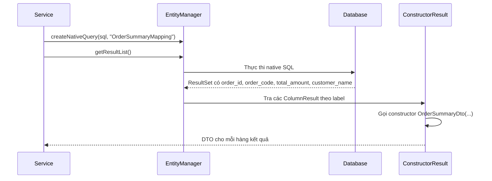
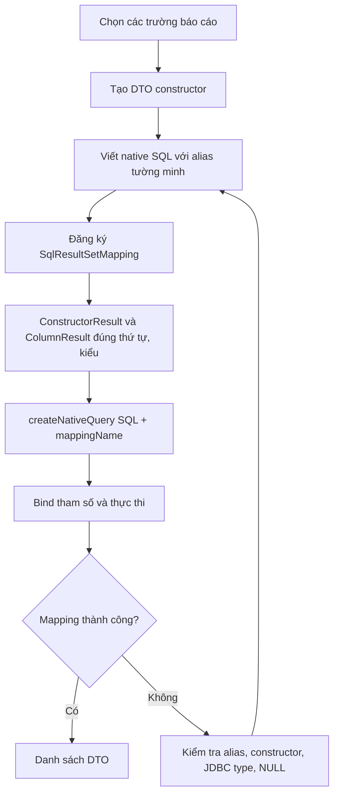

# Ánh xạ DTO bằng ConstructorResult trong Native SQL của JPA

Trong JPA, không phải truy vấn nào cũng phù hợp với JPQL. Khi cần cú pháp đặc thù của database, báo cáo tổng hợp, CTE, window functions hoặc một câu SQL đã được tối ưu bằng tay, ứng dụng có thể dùng **native SQL** thông qua `EntityManager.createNativeQuery(...)`.

Vấn đề xuất hiện khi câu SQL không trả về một entity đầy đủ mà chỉ chọn vài cột:

```sql
SELECT
    o.id AS order_id,
    o.order_code AS order_code,
    o.total_amount AS total_amount,
    c.display_name AS customer_name
FROM purchase_orders o
JOIN customers c ON c.id = o.customer_id
WHERE o.status = 'PAID';
```

Nếu gọi `createNativeQuery(sql)` mà không khai ánh xạ kết quả phù hợp, mỗi hàng thường được trả về dưới dạng `Object[]` khi chọn nhiều cột. Code phải tự nhớ vị trí và kiểu dữ liệu:

```java
Object[] row = (Object[]) query.getResultList().get(0);

Long orderId = ((Number) row[0]).longValue();
String orderCode = (String) row[1];
BigDecimal total = (BigDecimal) row[2];
String customerName = (String) row[3];
```

Cách này dễ sai khi đổi thứ tự SELECT, đổi tên cột hoặc JDBC driver trả kiểu số không đúng với phép ép kiểu. Với những truy vấn cần trả về một **DTO có cấu trúc rõ ràng**, JPA cung cấp cơ chế chuẩn:

- `@SqlResultSetMapping`: đặt tên cho cách ánh xạ kết quả native SQL.
- `@ConstructorResult`: yêu cầu JPA tạo đối tượng bằng một constructor.
- `@ColumnResult`: liên kết từng tham số constructor với một **tên cột hoặc alias** của SQL result set, có thể chỉ định kiểu Java mong muốn.

Đây chính là nội dung bài **“Ánh xạ DTO bằng ConstructorResult”**, thuộc chương **Native SQL** trong module **Data Persistence Relational Access ORM JPA**.

> **Nguyên tắc trọng tâm:** SQL phải trả các alias tương ứng với `@ColumnResult`; **thứ tự các `@ColumnResult` quyết định thứ tự tham số constructor**; kiểu dữ liệu phải tương thích với constructor DTO. Kết quả là những DTO thông thường, **không phải managed entity** được persistence context theo dõi.

Bài học trình bày ví dụ triển khai hoàn chỉnh, cơ chế đăng ký mapping, ánh xạ số liệu tổng hợp/JOIN, record/immutable DTO, xử lý NULL và kiểu JDBC, truy vấn có tham số, phân trang, Spring Data JPA, giới hạn portability, kiểm soát bảo mật và các lỗi thường gặp.

---

## 1. Trước hết: Native SQL khác JPQL như thế nào?

JPA cung cấp hai cách viết truy vấn:

**JPQL** sử dụng tên entity và thuộc tính Java:

```jpql
SELECT o
FROM PurchaseOrder o
JOIN o.customer c
WHERE o.status = :status
```

**Native SQL** sử dụng tên bảng, cột và cú pháp database:

```sql
SELECT o.id, o.order_code, c.display_name
FROM purchase_orders o
JOIN customers c ON c.id = o.customer_id
WHERE o.status = ?;
```

Trong Java:

```java
// JPQL
TypedQuery<PurchaseOrder> jpqlQuery =
    entityManager.createQuery(
        "select o from PurchaseOrder o where o.status = :status",
        PurchaseOrder.class
    );

// Native SQL
Query nativeQuery = entityManager.createNativeQuery(
    "select o.id, o.order_code " +
    "from purchase_orders o where o.status = ?"
);
```

Sự khác biệt có tác động đến ánh xạ kết quả:

| Khía cạnh | JPQL | Native SQL |
|---|---|---|
| Đối tượng mô tả dữ liệu | Entity/property Java | Bảng/cột SQL |
| Tên field | `o.orderCode` | `o.order_code` |
| Khả năng dùng dialect-specific syntax | Giới hạn theo JPQL/provider | Theo database mục tiêu |
| Tạo entity result | JPA hiểu mapping từ entity | Có thể chỉ định entity result hoặc SQL result set mapping |
| DTO constructor | `SELECT NEW package.Dto(...)` | `@SqlResultSetMapping` + `@ConstructorResult` |
| Kết quả không mapping nhiều scalar columns | Không cùng dạng native row | Thường là `Object[]` |
| Khả năng portable giữa databases | Thường cao hơn | Phụ thuộc cú pháp SQL/dialect |
| Quy tắc bind tham số | JPQL có named/positional chuẩn | Với native query, positional binding là lựa chọn portable; named native parameters phụ thuộc hỗ trợ provider |

**`@ConstructorResult` không chuyển câu SQL thành JPQL**. Nó chỉ định cách tạo Java object từ những giá trị **sau khi database đã chạy câu native SQL**.

## 2. DTO là gì và vì sao không trả entity cho mọi báo cáo?

**DTO (Data Transfer Object)** là đối tượng mang dữ liệu theo hợp đồng của một use case, ví dụ:

```text
OrderSummaryDto
├── orderId
├── orderCode
├── totalAmount
└── customerName
```

Một DTO đọc thường không cần:

- `@Entity` hoặc `@Table`;
- ID dành cho identity map của JPA;
- quan hệ `@ManyToOne`/`@OneToMany`;
- khả năng dirty checking;
- proxy hoặc lazy collection;
- hành vi `persist`/`merge` trực tiếp trên DTO.

Ví dụ endpoint liệt kê đơn đã thanh toán chỉ cần mã đơn, tổng tiền và tên khách hàng. Nếu đọc toàn bộ entity `PurchaseOrder` rồi truy cập `customer.displayName`, ứng dụng có thể tải thêm dữ liệu không cần hoặc gặp N+1. Một native SQL JOIN chọn đúng bốn cột và ánh xạ thẳng vào DTO sẽ bộc lộ rõ cấu trúc dữ liệu mà use case thực sự cần.

Không nên dùng entity chỉ vì JPA quen thuộc: **DTO phù hợp cho các màn hình báo cáo, danh sách, thống kê và API đọc ít cột**.

### DTO không thay thế nghiệp vụ cập nhật

Nếu người dùng sửa `dto.customerName` hay `dto.totalAmount`, JPA không tự UPDATE các bảng tương ứng. Muốn thay đổi database phải thực hiện một command/update trên managed entity hoặc thao tác SQL rõ ràng.

## 3. Mô hình ví dụ: khách hàng và đơn hàng

Giả sử database PostgreSQL có hai bảng:

```sql
CREATE TABLE customers (
    id BIGINT PRIMARY KEY,
    display_name VARCHAR(150) NOT NULL,
    region VARCHAR(30) NOT NULL
);

CREATE TABLE purchase_orders (
    id BIGINT PRIMARY KEY,
    order_code VARCHAR(50) NOT NULL UNIQUE,
    customer_id BIGINT NOT NULL,
    status VARCHAR(20) NOT NULL,
    total_amount NUMERIC(19, 2) NOT NULL,
    created_at TIMESTAMP NOT NULL,

    CONSTRAINT fk_purchase_order_customer
        FOREIGN KEY (customer_id) REFERENCES customers(id)
);
```

Ta dùng entity đơn giản:

```java
import jakarta.persistence.*;
import java.math.BigDecimal;
import java.time.LocalDateTime;

@Entity
@Table(name = "purchase_orders")
public class PurchaseOrder {

    @Id
    private Long id;

    @Column(name = "order_code", nullable = false)
    private String orderCode;

    @Column(name = "status", nullable = false)
    private String status;

    @Column(name = "total_amount", nullable = false)
    private BigDecimal totalAmount;

    @Column(name = "created_at", nullable = false)
    private LocalDateTime createdAt;

    @ManyToOne(fetch = FetchType.LAZY, optional = false)
    @JoinColumn(name = "customer_id", nullable = false)
    private Customer customer;

    protected PurchaseOrder() {}
}
```

Và:

```java
import jakarta.persistence.*;

@Entity
@Table(name = "customers")
public class Customer {

    @Id
    private Long id;

    @Column(name = "display_name", nullable = false)
    private String displayName;

    @Column(name = "region", nullable = false)
    private String region;

    protected Customer() {}
}
```

Mapping entity này đủ để JPA biết hai bảng liên hệ ra sao; **native SQL vẫn phải viết theo tên bảng/cột thật**.

Câu báo cáo đơn hàng:

```sql
SELECT
    o.id AS order_id,
    o.order_code AS order_code,
    o.total_amount AS total_amount,
    c.display_name AS customer_name
FROM purchase_orders o
JOIN customers c ON c.id = o.customer_id
WHERE o.status = 'PAID'
ORDER BY o.id DESC;
```

Đây là dữ liệu đầu vào cho DTO bốn thuộc tính.

---

## 4. Bước 1: tạo DTO với constructor rõ ràng

Tạo một class Java thuần:

```java
package com.example.orders.dto;

import java.math.BigDecimal;
import java.util.Objects;

public final class OrderSummaryDto {

    private final Long orderId;
    private final String orderCode;
    private final BigDecimal totalAmount;
    private final String customerName;

    public OrderSummaryDto(
            Long orderId,
            String orderCode,
            BigDecimal totalAmount,
            String customerName) {

        this.orderId = Objects.requireNonNull(orderId);
        this.orderCode = Objects.requireNonNull(orderCode);
        this.totalAmount = Objects.requireNonNull(totalAmount);
        this.customerName = Objects.requireNonNull(customerName);
    }

    public Long getOrderId() { return orderId; }
    public String getOrderCode() { return orderCode; }
    public BigDecimal getTotalAmount() { return totalAmount; }
    public String getCustomerName() { return customerName; }
}
```

Constructor có **bốn tham số** theo thứ tự:

1. `Long orderId`.
2. `String orderCode`.
3. `BigDecimal totalAmount`.
4. `String customerName`.

Đây sẽ là thứ tự mà `@ConstructorResult` cần cung cấp giá trị.

Tạo DTO immutable có vài lợi ích:

- Không vô tình bị sửa bởi các tầng sau.
- Không phải quản lý JPA lifecycle hay setters.
- Tên field thể hiện rõ hợp đồng dữ liệu.
- Dễ chuyển sang JSON response hoặc truyền giữa các tầng.
- Constructor là một chỗ tập trung kiểm tra invariants cần thiết.

Lưu ý: các kiểm tra `requireNonNull` chỉ đúng nếu SQL/mapping thật sự bảo đảm những cột không NULL. Với LEFT JOIN hoặc aggregate nullable, constructor phải cho phép NULL hoặc SQL phải cung cấp giá trị mặc định phù hợp.

## 5. Bước 2: đặt `@SqlResultSetMapping` trên entity được quản lý

JPA cần biết mapping trước khi chạy query. Ta đăng ký mapping tại một **managed type** được provider phát hiện khi xây dựng persistence unit, ví dụ entity `PurchaseOrder`.

```java
import jakarta.persistence.*;

@SqlResultSetMapping(
    name = "OrderSummaryMapping",
    classes = @ConstructorResult(
        targetClass = com.example.orders.dto.OrderSummaryDto.class,
        columns = {
            @ColumnResult(name = "order_id", type = Long.class),
            @ColumnResult(name = "order_code", type = String.class),
            @ColumnResult(name = "total_amount", type = java.math.BigDecimal.class),
            @ColumnResult(name = "customer_name", type = String.class)
        }
    )
)
@Entity
@Table(name = "purchase_orders")
public class PurchaseOrder {

    @Id
    private Long id;

    // Các field entity khác như phần trước.
}
```

Giải thích từng phần:

**`@SqlResultSetMapping(name = "OrderSummaryMapping")`** đăng ký một tên mapping có thể được tham chiếu khi gọi native query.

**`classes = @ConstructorResult(...)`** chỉ định kết quả được chuyển thành một object được tạo qua constructor.

**`targetClass = OrderSummaryDto.class`** là class đích cần khởi tạo, **không bắt buộc là entity JPA**.

**`columns = { ... }`** mô tả các giá trị truyền cho constructor, theo thứ tự xác định.

**`@ColumnResult(name = "order_id")`** yêu cầu đọc cột/label có tên `order_id` từ result set. SQL phải trả một alias hoặc label tương ứng.

**`type = Long.class`** yêu cầu kiểu Java cho giá trị cột theo khả năng chuyển đổi của JPA provider/JDBC.

Đặt annotation trên entity không có nghĩa DTO là một entity được Hibernate quản lý. Entity chỉ là nơi **đăng ký metadata**. DTO vẫn là Java object thông thường.

### Vì sao không đặt `@SqlResultSetMapping` chỉ trên DTO?

JPA discovery gắn với managed types của persistence unit. Nếu DTO không phải managed type và chỉ mang một annotation mapping, không có bảo đảm provider sẽ quét và đăng ký annotation ấy.

Một vị trí rõ ràng là entity liên quan đến query, chẳng hạn `PurchaseOrder`, hoặc một managed class phù hợp theo phiên bản Jakarta Persistence. Không cần biến DTO thành `@Entity` để có thể ánh xạ qua constructor.

### Tên mapping được dùng trong phạm vi nào?

`"OrderSummaryMapping"` là tên để tra cứu metadata trong persistence unit. Hãy chọn tên đủ phân biệt, ví dụ `OrderSummaryMapping`, `MonthlyRevenueMapping`, `CustomerLifetimeValueMapping`. Đừng tự tạo nhiều mapping cùng tên trong một persistence unit; xung đột metadata có thể khiến khởi động thất bại.

## 6. Bước 3: viết SQL có alias khớp với `ColumnResult.name`

SQL cần có các **column labels**:

```sql
SELECT
    o.id AS order_id,
    o.order_code AS order_code,
    o.total_amount AS total_amount,
    c.display_name AS customer_name
FROM purchase_orders o
JOIN customers c ON c.id = o.customer_id
ORDER BY o.id DESC;
```

Ánh xạ tương ứng:

| Vị trí constructor | SQL alias | `@ColumnResult` | Kiểu Java |
|---:|---|---|---|
| 1 | `order_id` | `name = "order_id"` | `Long` |
| 2 | `order_code` | `name = "order_code"` | `String` |
| 3 | `total_amount` | `name = "total_amount"` | `BigDecimal` |
| 4 | `customer_name` | `name = "customer_name"` | `String` |

Đây là hợp đồng quan trọng nhất giữa SQL và DTO.

### Nên dùng alias tường minh

Không nên dựa vào:

```sql
SELECT o.id, o.order_code, c.display_name
FROM purchase_orders o
JOIN customers c ON c.id = o.customer_id;
```

rồi cho rằng label luôn đúng theo mọi driver. Khi query join hai bảng đều có cột `id` hoặc `name`, label có thể trùng. Với expression `COUNT(*)`, `COALESCE(...)` hoặc `CASE`, tên cột tự sinh càng khó dự đoán.

Nên đặt alias dễ hiểu:

```sql
SELECT
    o.id AS order_id,
    c.id AS customer_id,
    COUNT(*) AS matching_order_count
...
```

Các alias cần được giữ nhất quán với `@ColumnResult(name = "...")`.

### Có cần đúng thứ tự cột trong SQL SELECT?

Nếu `ColumnResult` dùng **tên cột/alias**, điểm nối cốt lõi là label trong result set và metadata. Tuy nhiên, **thứ tự khai báo các `@ColumnResult`** là thứ tự tham số constructor mà JPA dùng. Nên giữ SELECT và mapping cùng thứ tự để giảm nhầm lẫn khi bảo trì, dù matching thường dựa trên label.

Không trông đợi JPA tự sắp constructor arguments theo tên field của DTO.

## 7. Bước 4: gọi `createNativeQuery(sql, mappingName)`

Sau khi mapping được đăng ký, gọi:

```java
import jakarta.persistence.EntityManager;
import jakarta.persistence.Query;
import java.util.List;

String sql = """
    SELECT
        o.id AS order_id,
        o.order_code AS order_code,
        o.total_amount AS total_amount,
        c.display_name AS customer_name
    FROM purchase_orders o
    JOIN customers c ON c.id = o.customer_id
    ORDER BY o.id DESC
    """;

Query query = entityManager.createNativeQuery(
    sql,
    "OrderSummaryMapping"
);

List<?> rows = query.getResultList();

List<OrderSummaryDto> orders = rows.stream()
    .map(OrderSummaryDto.class::cast)
    .toList();
```

Trong ví dụ:

- `createNativeQuery(sql, "OrderSummaryMapping")` dùng tên result set mapping đã đăng ký.
- `getResultList()` trả những object được ánh xạ theo mapping — với mapping constructor đơn giản, mỗi hàng là một `OrderSummaryDto`.
- API `Query` ở nhiều phiên bản JPA vẫn là loại không generic, nên ví dụ nhận `List<?>` rồi cast từng phần tử có kiểm tra runtime.
- `toList()` cần Java hiện đại (từ Java 16); với Java cũ có thể dùng `collect(Collectors.toList())`.

**Không nên dùng mù:**

```java
List<OrderSummaryDto> orders =
    (List<OrderSummaryDto>) query.getResultList();
```

vì phép cast generic của Java là unchecked; bản thân `List` không xác minh kiểu của từng phần tử. `OrderSummaryDto.class::cast` minh họa một cách kiểm tra kiểu khi map result.

### Constructor được gọi khi nào?

Database thực thi SQL, JDBC trả kết quả, JPA provider đọc column labels/values và tạo DTO theo constructor đã chỉ định.



Chỉ gọi `createNativeQuery` chưa chắc thực thi SQL ngay; thông thường câu lệnh được thực thi khi gọi terminal operation như `getResultList()`.

---

## 8. Ví dụ hoàn chỉnh với `@NamedNativeQuery`

Ngoài cách truyền chuỗi SQL trực tiếp ở service, có thể đặt tên cả **câu native SQL** bằng `@NamedNativeQuery`:

```java
import jakarta.persistence.*;

@Entity
@Table(name = "purchase_orders")
@SqlResultSetMapping(
    name = "OrderSummaryMapping",
    classes = @ConstructorResult(
        targetClass = com.example.orders.dto.OrderSummaryDto.class,
        columns = {
            @ColumnResult(name = "order_id", type = Long.class),
            @ColumnResult(name = "order_code", type = String.class),
            @ColumnResult(name = "total_amount", type = java.math.BigDecimal.class),
            @ColumnResult(name = "customer_name", type = String.class)
        }
    )
)
@NamedNativeQuery(
    name = "PurchaseOrder.summaryAll",
    query = """
        SELECT
            o.id AS order_id,
            o.order_code AS order_code,
            o.total_amount AS total_amount,
            c.display_name AS customer_name
        FROM purchase_orders o
        JOIN customers c ON c.id = o.customer_id
        ORDER BY o.id DESC
        """,
    resultSetMapping = "OrderSummaryMapping"
)
public class PurchaseOrder {
    @Id
    private Long id;

    protected PurchaseOrder() {}

    // Các field entity khác được lược.
}
```

Tại service:

```java
Query query =
    entityManager.createNamedQuery("PurchaseOrder.summaryAll");

List<OrderSummaryDto> results = ((List<?>) query.getResultList())
    .stream()
    .map(OrderSummaryDto.class::cast)
    .toList();
```

Hai tên có vai trò khác nhau:

- `PurchaseOrder.summaryAll`: tên **named native query**.
- `OrderSummaryMapping`: tên **result set mapping**.

`@NamedNativeQuery` liên kết hai metadata bằng `resultSetMapping = "OrderSummaryMapping"`. Query được đăng ký trong persistence unit, nên service không phải lặp chuỗi SQL nhiều nơi.

### Khi nào nên dùng NamedNativeQuery?

- SQL cố định, được nhiều service gọi lại.
- Muốn đặt truy vấn gần metadata của entity.
- Muốn tập trung mapping và SQL trong một vùng mã.
- Muốn tránh copy/paste chuỗi SQL dài giữa các phương thức.

Với một báo cáo rất phức tạp hoặc phụ thuộc nhiều biến thể SQL, giữ SQL ở custom repository có thể dễ tổ chức hơn. Cả hai vẫn dùng cùng mapping constructor.

## 9. `@ColumnResult` quyết định thứ tự tham số constructor

Giả sử constructor:

```java
public OrderSummaryDto(
    Long orderId,
    String orderCode,
    BigDecimal totalAmount,
    String customerName
) { ... }
```

Nhưng metadata khai sai thứ tự:

```java
@ConstructorResult(
    targetClass = OrderSummaryDto.class,
    columns = {
        @ColumnResult(name = "order_code", type = String.class),
        @ColumnResult(name = "order_id", type = Long.class),
        @ColumnResult(name = "total_amount", type = BigDecimal.class),
        @ColumnResult(name = "customer_name", type = String.class)
    }
)
```

JPA sẽ diễn giải tham số constructor theo thứ tự khai báo: trước hết là String orderCode, sau đó Long orderId. Nếu target chỉ có constructor `(Long, String, BigDecimal, String)`, việc khởi tạo DTO thường thất bại do không tìm được constructor signature tương thích.

**JPA không tự đối chiếu tên field `orderId` trong class DTO với SQL alias `order_id` để sửa thứ tự.** Mapping constructor là positional ở cấp metadata.

### Quy tắc bảo trì

Khi đổi DTO constructor, phải xem đồng thời:

1. Kiểu và thứ tự tham số constructor.
2. Danh sách `@ColumnResult`.
3. SQL aliases được trả về.
4. Các query khác dùng cùng mapping.
5. Các trường hợp NULL hoặc numeric type conversion.

Đừng chỉ đổi tên/thứ tự trường trong DTO rồi kỳ vọng mọi native query tự thích ứng.

## 10. Kiểu dữ liệu: SQL, JDBC và Java phải tương thích

Một ví dụ:

```sql
SELECT o.id AS order_id
FROM purchase_orders o;
```

Cột `BIGINT` thường tương ứng `Long` trong Java với driver phổ biến. Nhưng **kết quả của biểu thức SQL** có thể khác cột gốc.

Ví dụ:

```sql
SELECT COUNT(*) AS order_count
FROM purchase_orders;
```

Tùy database/driver/JPA provider, kiểu Java quan sát được của một native aggregate không mapping có thể là `Long`, `BigInteger` hoặc một loại `Number` khác. Không nên đoán chỉ từ “COUNT là số nguyên”.

Khi dùng constructor result:

```java
@ColumnResult(name = "order_count", type = Long.class)
```

ta yêu cầu provider chuyển đổi kết quả thành kiểu phù hợp với constructor `Long`, trong giới hạn mà provider/driver hỗ trợ.

### Ma trận kiểu dữ liệu thường gặp

| SQL / biểu thức | Java type thường phù hợp | Lưu ý |
|---|---|---|
| `BIGINT` | `Long` | Kiểm tra signed range và driver |
| `INTEGER` | `Integer` | Không dùng Long constructor nếu mapping trả Integer mà chưa chuyển đổi |
| `VARCHAR` / `TEXT` | `String` | Encoding/collation theo database |
| `NUMERIC(19,2)` / `DECIMAL` | `BigDecimal` | Tránh mất độ chính xác tiền tệ |
| `DOUBLE PRECISION` | `Double` | Không dùng cho tiền nếu cần độ chính xác thập phân tuyệt đối |
| `BOOLEAN` | `Boolean` | Một số database biểu diễn BOOLEAN khác nhau |
| `DATE` | `LocalDate` hoặc kiểu ngày JDBC | Phụ thuộc hỗ trợ của provider/driver |
| `TIMESTAMP` | `LocalDateTime` hoặc `Timestamp` | Cân nhắc mapping và timezone |
| `TIMESTAMP WITH TIME ZONE` | `OffsetDateTime` hoặc kiểu tương ứng | Khả năng chuyển đổi phụ thuộc driver/provider |
| `COUNT(*)` | `Long`/`BigInteger` trước khi ép kiểu | Dùng `@ColumnResult(type=...)` và kiểm tra thực tế |
| `SUM(NUMERIC)` | `BigDecimal` | SUM trên tập rỗng có thể NULL |
| `AVG(NUMERIC)` | `BigDecimal`/kiểu numeric do DB chọn | Không suy ra cùng kiểu với field ban đầu |
| `CASE` / `COALESCE` | Theo biểu thức SQL thực tế | Các nhánh có thể ảnh hưởng kiểu kết quả |

Bảng trên là gợi ý thiết kế, **không phải cam kết mọi provider đều tự chuyển kiểu**. Khi SQL dùng cast/aggregate phức tạp, hãy xác định type JDBC thực tế và chọn constructor tương thích.

## 11. `@ColumnResult(type = ...)` giúp gì và không giúp gì?

Ví dụ:

```java
@ColumnResult(name = "order_id", type = Long.class)
```

`type` cho provider biết kiểu Java cần dùng khi dựng constructor. Tuy nhiên:

- Nó không tạo ra alias SQL `order_id` nếu câu SELECT không trả alias đó.
- Nó không tự tạo constructor có signature tương ứng.
- Nó không biến mọi SQL type thành một Java type bất kỳ một cách chắc chắn.
- Nó không xử lý các quy tắc nghiệp vụ như overflow, scale, rounding.
- Nó không thay `AttributeConverter` một cách mặc định trong mọi native scalar mapping.
- Nó không tự convert String `"PAID"` thành một enum hoặc value object tùy biến nếu provider không hỗ trợ conversion đó.

Nếu type conversion không tương thích, sửa SQL/mapping hoặc chọn DTO constructor nhận kiểu phù hợp rồi chuyển đổi có kiểm soát trong tầng ứng dụng.

### Ví dụ chuyển số nguyên

Khi đọc từ một result set không mapped:

```java
Number rawCount = (Number) row[0];
long count = rawCount.longValue();
```

Cách này minh họa vì sao sử dụng `Number` có thể linh hoạt khi phải xử lý JDBC types khác nhau. Với `ConstructorResult`, thường nên khai type cụ thể và để provider nhận đúng kiểu; nếu conversion khác nhau nhiều giữa databases, cân nhắc một adapter đọc raw scalars thay vì ép mọi trường hợp vào một constructor duy nhất.

Không dùng `intValue()` nếu giá trị có thể vượt phạm vi `Integer`. Một báo cáo đếm hàng rất lớn nên dùng `Long`/`BigInteger` và kiểm tra overflow khi chuyển.

## 12. Constructor nguyên thủy hay wrapper?

DTO:

```java
public final class OrderCountDto {
    private final long customerId;
    private final long orderCount;

    public OrderCountDto(long customerId, long orderCount) {
        this.customerId = customerId;
        this.orderCount = orderCount;
    }
}
```

có thể phù hợp nếu SQL chắc chắn không trả NULL và provider chọn constructor tương thích với kiểu primitive. Tuy nhiên trong thực tế, **wrapper types** thường dễ xử lý hơn khi nhận dữ liệu qua reflection/conversion:

```java
public OrderCountDto(Long customerId, Long orderCount) { ... }
```

Với một LEFT JOIN, `customer_name` có thể NULL. Nếu DTO constructor nhận primitive cho cột nullable, quá trình khởi tạo có thể thất bại vì NULL không thể đưa vào primitive.

Nguyên tắc:

- Dùng wrapper nếu giá trị có thể NULL hoặc muốn xử lý nullable rõ ràng.
- Dùng primitive khi dữ liệu chắc chắn luôn có giá trị và provider hỗ trợ signature.
- Không chỉ dựa vào `@Column(nullable = false)` trong mapping entity để khẳng định mọi native expression đều không NULL.
- Với aggregate, nhớ `COUNT` thường trả 0 còn `SUM`/`AVG` trên tập không có hàng có thể trả NULL.

## 13. Ánh xạ dữ liệu tổng hợp: COUNT và SUM vào DTO

Một báo cáo muốn lấy:

- ID khách hàng;
- tên khách hàng;
- số đơn đã đặt;
- tổng giá trị đơn.

DTO:

```java
package com.example.orders.dto;

import java.math.BigDecimal;

public record CustomerSpendDto(
    Long customerId,
    String customerName,
    Long orderCount,
    BigDecimal totalAmount
) {}
```

SQL PostgreSQL minh họa:

```sql
SELECT
    c.id AS customer_id,
    c.display_name AS customer_name,
    COUNT(o.id) AS order_count,
    SUM(o.total_amount) AS total_amount
FROM customers c
LEFT JOIN purchase_orders o ON o.customer_id = c.id
GROUP BY c.id, c.display_name
ORDER BY c.id;
```

Mapping đặt trên một managed entity, ví dụ `Customer`:

```java
@SqlResultSetMapping(
    name = "CustomerSpendMapping",
    classes = @ConstructorResult(
        targetClass = CustomerSpendDto.class,
        columns = {
            @ColumnResult(name = "customer_id", type = Long.class),
            @ColumnResult(name = "customer_name", type = String.class),
            @ColumnResult(name = "order_count", type = Long.class),
            @ColumnResult(name = "total_amount", type = BigDecimal.class)
        }
    )
)
@Entity
@Table(name = "customers")
public class Customer {
    @Id
    private Long id;
    // Các field khác.
}
```

Gọi:

```java
Query query = em.createNativeQuery(
    """
    SELECT
        c.id AS customer_id,
        c.display_name AS customer_name,
        COUNT(o.id) AS order_count,
        SUM(o.total_amount) AS total_amount
    FROM customers c
    LEFT JOIN purchase_orders o ON o.customer_id = c.id
    GROUP BY c.id, c.display_name
    ORDER BY c.id
    """,
    "CustomerSpendMapping"
);

List<CustomerSpendDto> report = ((List<?>) query.getResultList())
    .stream()
    .map(CustomerSpendDto.class::cast)
    .toList();
```

### Vì sao `COUNT(o.id)` thay vì `COUNT(*)`?

Với LEFT JOIN, khách hàng không có đơn vẫn có thể tạo một hàng ghép với cột order NULL. `COUNT(*)` đếm hàng ghép đó, dẫn đến 1; `COUNT(o.id)` chỉ đếm những ID order thực sự không NULL, dẫn đến 0.

### `SUM` trên khách hàng chưa có đơn

SQL `SUM(o.total_amount)` có thể trả NULL khi không có order. Record `CustomerSpendDto` ở ví dụ cho phép `totalAmount` null về mặt kiểu. Nếu muốn 0, có thể dùng:

```sql
COALESCE(SUM(o.total_amount), CAST(0 AS NUMERIC(19, 2)))
    AS total_amount
```

Đây là cách biểu diễn SQL thông dụng; chi tiết kiểu số sau `COALESCE`/`CAST` vẫn cần kiểm tra với database đang dùng. Giữ alias `total_amount` như mapping ban đầu.

**Không tự đổi tên alias** thành `sum_total` mà quên cập nhật `@ColumnResult`.

## 14. Vì sao SUM bị nhân sai khi JOIN nhiều bảng?

Giả sử một order có ba `OrderLine`. Nếu báo cáo tổng doanh thu bằng:

```sql
SELECT
    c.id AS customer_id,
    SUM(o.total_amount) AS total_amount
FROM customers c
JOIN purchase_orders o ON o.customer_id = c.id
JOIN order_lines l ON l.order_id = o.id
GROUP BY c.id;
```

mỗi order có thể xuất hiện nhiều lần theo số lines, khiến `SUM(o.total_amount)` bị nhân lên.

Đây là lỗi **ngữ nghĩa SQL**, không phải lỗi `@ConstructorResult`. DTO mapping có thể hoàn toàn đúng kiểu và constructor nhưng nhận một con số **sai về nghiệp vụ**.

Giải pháp phụ thuộc use case:

- Không join tới lines nếu chỉ cần sum của orders.
- Tổng hợp lines theo order trước khi join, nếu cần.
- Dùng subquery/CTE thích hợp trong native SQL.
- Dùng một câu query riêng cho những số liệu độc lập nếu biểu diễn dễ hiểu hơn.
- Không dùng `SUM(DISTINCT o.total_amount)` một cách máy móc: hai order khác nhau có cùng tổng tiền sẽ bị gộp và tạo kết quả sai.

**ConstructorResult chỉ chuyển dữ liệu nhận được thành DTO; tính đúng đắn của phép tính vẫn do SQL và domain rule quyết định.**

## 15. Record Java có dùng được không?

Một DTO từ Java 16+:

```java
package com.example.orders.dto;

import java.math.BigDecimal;

public record OrderSummaryDto(
    Long orderId,
    String orderCode,
    BigDecimal totalAmount,
    String customerName
) {}
```

Record tự sinh canonical constructor với thứ tự như phần khai báo components. Vì vậy nếu provider hỗ trợ việc gọi constructor đó theo semantics JPA, `@ConstructorResult` có thể target record giống một class DTO immutable thông thường.

Mapping không đổi:

```java
@ConstructorResult(
    targetClass = OrderSummaryDto.class,
    columns = {
        @ColumnResult(name = "order_id", type = Long.class),
        @ColumnResult(name = "order_code", type = String.class),
        @ColumnResult(name = "total_amount", type = BigDecimal.class),
        @ColumnResult(name = "customer_name", type = String.class)
    }
)
```

Cần chú ý:

- Java version phải hỗ trợ record.
- Constructor signature vẫn phải tương thích.
- Nếu có compact constructor thực hiện validation, nó cũng sẽ chạy khi JPA khởi tạo DTO.
- Những khác biệt về hỗ trợ reflection/records giữa JPA provider và phiên bản framework cần được kiểm tra trong môi trường dự án.
- Nếu cần tính tương thích rộng với môi trường cũ, một `public class` có constructor công khai là lựa chọn dễ dự đoán.

Không coi việc DTO là record là lý do để bỏ qua SQL aliases hay type conversion.

## 16. Immutable DTO và validation trong constructor

DTO được tạo từ database có thể chứa dữ liệu chưa như kỳ vọng — nhất là khi dùng LEFT JOIN, dữ liệu legacy, các phép tính tổng hợp hoặc SQL migration chưa đồng bộ.

Ví dụ:

```java
public OrderSummaryDto(
        Long orderId,
        String orderCode,
        BigDecimal totalAmount,
        String customerName) {

    this.orderId = Objects.requireNonNull(orderId);
    this.orderCode = Objects.requireNonNull(orderCode);

    if (totalAmount == null || totalAmount.signum() < 0) {
        throw new IllegalArgumentException("Invalid order total");
    }

    this.totalAmount = totalAmount;
    this.customerName = customerName; // Có thể null khi LEFT JOIN.
}
```

Nếu constructor ném exception, JPA provider có thể bọc nó thành lỗi khởi tạo kết quả khi thực thi query. Điều này giúp phát hiện dữ liệu xấu, nhưng cũng làm cả báo cáo thất bại nếu một hàng không đạt invariant.

Hãy xác định chính sách:

- DTO báo cáo có cho phép customerName null không?
- SQL có cần `COALESCE` cho số liệu null không?
- Mọi field được SELECT đã có constraint đảm bảo không null chưa?
- Có cần biểu diễn dữ liệu legacy bị thiếu một cách tường minh?
- Có nên xử lý dữ liệu lỗi ở upstream thay vì constructor?

Không dùng `Objects.requireNonNull` cho tất cả cột một cách máy móc.

## 17. SQL alias và quy tắc chữ hoa/chữ thường

Ví dụ mapping:

```java
@ColumnResult(name = "customer_name", type = String.class)
```

SQL:

```sql
SELECT c.display_name AS customer_name
FROM customers c;
```

là một cặp dễ hiểu.

Nhưng:

```sql
SELECT c.display_name AS "CustomerName"
FROM customers c;
```

có thể giữ chữ hoa/thường theo cú pháp quoted identifier của database. Nếu mapping vẫn dùng `customer_name`, provider sẽ không tìm đúng column label.

Trong PostgreSQL, unquoted identifier thường được chuyển thành lowercase; ở các database khác, quy tắc khác. Với native SQL portable hơn:

- Chọn alias ngắn, tường minh, nhất quán, ví dụ `snake_case` lowercase.
- Tránh cùng một alias cho hai cột.
- Không đặt dấu nháy quanh alias khi không cần case-sensitive identifier.
- Nếu buộc dùng quoted alias, giữ mapping đúng tên/kiểu chữ mà JDBC trả về.
- Không dùng `SELECT *` làm hợp đồng kết quả của ConstructorResult.

Cần phân biệt **SQL result alias** với **tên Java field**. Chúng không nhất thiết giống nhau; `@ColumnResult` chính là chỗ nối giữa hai phía.

## 18. Tránh trùng tên cột khi JOIN

Một query không nên dùng:

```sql
SELECT o.id, c.id, o.order_code, c.display_name
FROM purchase_orders o
JOIN customers c ON c.id = o.customer_id;
```

vì hai cột `id` có thể có cùng label. Khi lấy một cột bằng tên `id`, kết quả có thể mơ hồ hoặc phụ thuộc driver/provider.

Viết lại:

```sql
SELECT
    o.id AS order_id,
    c.id AS customer_id,
    o.order_code AS order_code,
    c.display_name AS customer_name
FROM purchase_orders o
JOIN customers c ON c.id = o.customer_id;
```

Mapping vào DTO có hai ID nếu cần:

```java
@ConstructorResult(
    targetClass = OrderCustomerDto.class,
    columns = {
        @ColumnResult(name = "order_id", type = Long.class),
        @ColumnResult(name = "customer_id", type = Long.class),
        @ColumnResult(name = "order_code", type = String.class),
        @ColumnResult(name = "customer_name", type = String.class)
    }
)
```

DTO `OrderCustomerDto` trong ví dụ này là class giả định có constructor `(Long, Long, String, String)`.

**Alias của một SQL expression là một phần của hợp đồng mapping**, không đơn thuần là tên trang trí.

## 19. Trả dữ liệu từ `LEFT JOIN`: cột có thể NULL

Nếu quan hệ được phép thiếu Customer hoặc báo cáo dùng LEFT JOIN:

```sql
SELECT
    o.id AS order_id,
    o.order_code AS order_code,
    c.display_name AS customer_name
FROM purchase_orders o
LEFT JOIN customers c ON c.id = o.customer_id;
```

Khi không có Customer khớp, `customer_name` có thể NULL.

DTO:

```java
public record OrderCustomerView(
    Long orderId,
    String orderCode,
    String customerName
) {}
```

Mapping:

```java
@ConstructorResult(
    targetClass = OrderCustomerView.class,
    columns = {
        @ColumnResult(name = "order_id", type = Long.class),
        @ColumnResult(name = "order_code", type = String.class),
        @ColumnResult(name = "customer_name", type = String.class)
    }
)
```

Cách này cho phép Java reference `customerName` là null. Nếu nghiệp vụ muốn hiển thị `"(Chưa có)"`, có thể xử lý ở view/service hoặc bằng SQL `COALESCE(c.display_name, '(Chưa có)') AS customer_name`.

Trong model gốc `customer_id NOT NULL` và FK bắt buộc, nên sự vắng mặt Customer không xảy ra ở dữ liệu hợp lệ. Ví dụ LEFT JOIN nhằm minh họa vấn đề nullable của những report có association tùy chọn hoặc dữ liệu di sản.

## 20. `@ConstructorResult` không yêu cầu DTO có constructor không tham số

JPA entity yêu cầu constructor không tham số với quyền truy cập phù hợp. **DTO dùng `@ConstructorResult` không nhất thiết phải có no-arg constructor**.

Đây là trường hợp có chủ ý:

```java
public final class RevenueDto {

    private final String region;
    private final BigDecimal revenue;

    public RevenueDto(String region, BigDecimal revenue) {
        this.region = region;
        this.revenue = revenue;
    }

    public String getRegion() { return region; }
    public BigDecimal getRevenue() { return revenue; }
}
```

Mapping:

```java
@ConstructorResult(
    targetClass = RevenueDto.class,
    columns = {
        @ColumnResult(name = "region", type = String.class),
        @ColumnResult(name = "revenue", type = BigDecimal.class)
    }
)
```

Không cần:

```java
protected RevenueDto() {}
```

vì DTO không tham gia quy tắc khởi tạo entity của JPA. Điều quan trọng là constructor cần gọi có signature và khả năng truy cập phù hợp với provider; constructor `public` thường là phương án ít bất ngờ.

## 21. Một DTO có nhiều constructor

Giả sử:

```java
public class OrderSummaryDto {

    public OrderSummaryDto(Long id, String code) { ... }

    public OrderSummaryDto(
            Long id,
            String code,
            BigDecimal amount,
            String customerName) { ... }
}
```

`@ConstructorResult` không chọn constructor theo tên field hay tự điền các giá trị còn thiếu. Nó cần một constructor tương thích với:

- số lượng các `ColumnResult`;
- thứ tự các cột;
- kiểu được cung cấp;
- khả năng truy cập của constructor.

Nếu mapping liệt kê bốn cột, nó hướng tới constructor bốn tham số. Nếu chỉ liệt kê hai, nó hướng tới constructor hai tham số.

Để tránh hiểu nhầm, với DTO dành riêng cho một báo cáo, **một constructor canonical duy nhất** thường dễ bảo trì hơn nhiều overload cùng số tham số và kiểu gần giống.

## 22. Nhiều `@SqlResultSetMapping` trong một entity

Một entity có thể phục vụ nhiều report khác nhau. Có thể dùng container annotation `@SqlResultSetMappings`:

```java
@Entity
@SqlResultSetMappings({
    @SqlResultSetMapping(
        name = "OrderIdCodeMapping",
        classes = @ConstructorResult(
            targetClass = OrderIdCodeDto.class,
            columns = {
                @ColumnResult(name = "order_id", type = Long.class),
                @ColumnResult(name = "order_code", type = String.class)
            }
        )
    ),
    @SqlResultSetMapping(
        name = "OrderSummaryMapping",
        classes = @ConstructorResult(
            targetClass = OrderSummaryDto.class,
            columns = {
                @ColumnResult(name = "order_id", type = Long.class),
                @ColumnResult(name = "order_code", type = String.class),
                @ColumnResult(name = "total_amount", type = BigDecimal.class),
                @ColumnResult(name = "customer_name", type = String.class)
            }
        )
    )
})
public class PurchaseOrder {
    @Id
    private Long id;
}
```

Ví dụ giả định `OrderIdCodeDto` có constructor `(Long, String)`. Trong code thật, không khai hai định nghĩa `PurchaseOrder` khác nhau; đây là ví dụ để minh họa cách gom metadata.

Khi query:

```java
em.createNativeQuery(sqlA, "OrderIdCodeMapping");
em.createNativeQuery(sqlB, "OrderSummaryMapping");
```

mỗi query dùng mapping phù hợp với **tập alias và hình dạng kết quả mà SQL của nó trả về**.

Không có chuyện một mapping bốn cột tự bỏ qua hai `ColumnResult` khi SQL chỉ chọn hai cột.

## 23. Kết quả nhiều loại: `entities`, `classes` và `columns`

`@SqlResultSetMapping` không chỉ có `classes`. Nó còn hỗ trợ:

- `entities = { @EntityResult(...) }`: ánh xạ dữ liệu từ native result set sang entity.
- `classes = { @ConstructorResult(...) }`: tạo object qua constructor.
- `columns = { @ColumnResult(...) }`: lấy scalar values trực tiếp.

Ví dụ tổ hợp:

```java
@SqlResultSetMapping(
    name = "MixedOrderMapping",
    entities = @EntityResult(entityClass = PurchaseOrder.class),
    columns = @ColumnResult(name = "line_count", type = Long.class)
)
```

Khi kết quả gồm nhiều thành phần, mỗi hàng có thể được trả về dưới dạng `Object[]` chứa entity và scalar, thay vì một DTO đơn lẻ. Trình tự/loại phần tử phụ thuộc đặc tả mapping.

**Nếu mục tiêu là một DTO thuần nhất trên mỗi hàng**, chỉ khai một `ConstructorResult` cần thiết sẽ dễ dùng hơn, tránh phải xử lý hỗn hợp entity/scalar.

### Có thể có nhiều ConstructorResult?

Metadata cho phép mô tả nhiều constructor mappings trong một result set mapping. Khi có nhiều thành phần kết quả, đừng mặc định `getResultList()` trả từng instance của một class duy nhất; cách materialize từng row sẽ phản ánh nhiều phần tử.

Đối với báo cáo bình thường, ưu tiên một DTO có constructor rõ ràng, mỗi hàng tương ứng một object.

## 24. Không dùng `@EntityResult` khi chỉ cần DTO

Một số code chọn đầy đủ bảng:

```sql
SELECT o.* FROM purchase_orders o;
```

và gọi:

```java
em.createNativeQuery(sql, PurchaseOrder.class);
```

Đây là cách yêu cầu kết quả **entity**. Nó khác:

```java
em.createNativeQuery(sql, "OrderSummaryMapping");
```

Entity result liên quan persistence context, identity và lifecycle. DTO constructor result chỉ tạo dữ liệu:

| Khía cạnh | Entity result | ConstructorResult DTO |
|---|---|---|
| Target | `@Entity` | Class/record DTO thông thường |
| Có thể managed? | Có, trong persistence context | Không, với DTO không phải entity |
| Dirty checking khi thay đổi? | Có với managed entity | Không |
| Có lazy associations? | Theo mapping của entity | Không tự có |
| Cần đầy đủ cột mapping? | Tùy cách mapping entity result | Chỉ các cột mà constructor cần |
| Hợp đồng API ổn định? | Dễ bị ảnh hưởng mapping entity | Dễ giới hạn dữ liệu theo DTO |
| Dùng cho report aggregate? | Thường không tự nhiên | Rất phù hợp |

Nếu muốn vừa trả entity vừa trả một scalar aggregate, `@EntityResult` + `@ColumnResult` có thể có ích; nhưng hãy xác định rõ kết quả là row hỗn hợp, không phải DTO tự động.

## 25. `createNativeQuery(sql, ResultClass.class)` không đồng nghĩa ConstructorResult

Một nhầm lẫn dễ gặp:

```java
em.createNativeQuery(sql, OrderSummaryDto.class);
```

rồi cho rằng JPA sẽ nhìn bốn cột và tự gọi constructor `(Long,String,BigDecimal,String)`.

Overload `createNativeQuery(sql, resultClass)` trong JPA truyền thống đặc biệt thường dùng khi `resultClass` là **entity class**. Khả năng ánh xạ trực tiếp vào DTO không phải entity theo cách overload này có thể tùy phiên bản Jakarta Persistence và provider.

Với bài toán này, con đường rõ ràng theo mapping metadata là:

```java
em.createNativeQuery(sql, "OrderSummaryMapping");
```

và `@ConstructorResult(targetClass = OrderSummaryDto.class, ...)` tương ứng.

Không dựa vào khả năng tự bind constructor từ resultClass mà một bản Hibernate cụ thể cung cấp, nếu mục tiêu là một ví dụ portable về `ConstructorResult`.

## 26. Native SQL có tham số

Ví dụ chỉ lấy các đơn ở trạng thái PAID:

```sql
SELECT
    o.id AS order_id,
    o.order_code AS order_code,
    o.total_amount AS total_amount,
    c.display_name AS customer_name
FROM purchase_orders o
JOIN customers c ON c.id = o.customer_id
WHERE o.status = ?;
```

Java:

```java
Query query = em.createNativeQuery(
    sql,
    "OrderSummaryMapping"
);

query.setParameter(1, "PAID");

List<OrderSummaryDto> results = ((List<?>) query.getResultList())
    .stream()
    .map(OrderSummaryDto.class::cast)
    .toList();
```

Ở đây dấu `?` là placeholder trong native SQL, và `setParameter(1, ...)` gán **tham số vị trí thứ nhất** theo API JPA.

### Vì sao dùng positional parameter trong ví dụ portable?

Theo phạm vi tiêu chuẩn JPA, việc hỗ trợ **named parameters trong native SQL** không nhất thiết được đảm bảo đồng đều giữa mọi provider. Hibernate thường hỗ trợ cú pháp native `:status`:

```sql
WHERE o.status = :status
```

và:

```java
query.setParameter("status", "PAID");
```

nhưng cần xem đó là khả năng của provider/framework mục tiêu, không tự động suy rộng thành hỗ trợ portable cho mọi JPA implementation.

Trong câu JPQL, named parameters `:status` là tính năng chuẩn và phổ biến. Cần **phân biệt tham số trong JPQL với cú pháp bind của native SQL**.

### Không ghép input vào SQL

Sai:

```java
String sql =
    "select ... where o.order_code = '" + input + "'";
```

Đúng:

```java
String sql =
    "select ... where o.order_code = ?";

query.setParameter(1, input);
```

Với giá trị, bind parameter làm đầu vào được xử lý như **dữ liệu**, không phải một đoạn cú pháp SQL mới.

## 27. Native SQL có enum cần chú ý kiểu cột

Entity trong ví dụ mapping `status` là `String`, cột SQL `VARCHAR`. Khi dùng native SQL:

```sql
WHERE o.status = ?
```

có thể bind:

```java
query.setParameter(1, "PAID");
```

Nếu entity khác dùng `@Enumerated(EnumType.STRING)` và tham số của JPQL có kiểu enum, JPA provider biết mapping enum. Nhưng **native SQL là câu lệnh trên cột SQL**, nên cách bind enum có thể phụ thuộc provider, JDBC và kiểu cột.

Ví dụ với PostgreSQL custom enum type, bind `"PAID"` như VARCHAR đôi khi cần cast phù hợp hoặc cơ chế bind riêng. Không mặc định `setParameter(1, OrderStatus.PAID)` sẽ có cùng hành vi mọi database nếu native SQL đòi một vendor-specific SQL type.

Để giữ tính dự đoán:

- Biết chính xác kiểu SQL của cột.
- Chuyển giá trị domain sang kiểu database được chấp nhận.
- Dùng bind parameter, không ghép chuỗi.
- Nếu có custom SQL type, có thể cần provider-specific binding/cast và kiểm chứng trong môi trường thực tế.

## 28. ConstructorResult với filter ngày giờ

Ví dụ lọc đơn được tạo trong một khoảng:

```sql
SELECT
    o.id AS order_id,
    o.order_code AS order_code,
    o.total_amount AS total_amount,
    c.display_name AS customer_name
FROM purchase_orders o
JOIN customers c ON c.id = o.customer_id
WHERE o.created_at >= ?
  AND o.created_at < ?
ORDER BY o.created_at DESC, o.id DESC;
```

Java:

```java
LocalDateTime start =
    LocalDateTime.of(2026, 1, 1, 0, 0);

LocalDateTime end =
    LocalDateTime.of(2026, 2, 1, 0, 0);

Query q = em.createNativeQuery(sql, "OrderSummaryMapping");

q.setParameter(1, start);
q.setParameter(2, end);
```

Nếu driver/provider hỗ trợ `LocalDateTime` cho cột `TIMESTAMP`, cách này có thể chạy như mong muốn. Với legacy JDBC hoặc một số SQL dialect, có thể cần `java.sql.Timestamp.valueOf(start)` hoặc cách bind tương ứng.

Cần phân biệt:

- Tham số thời gian của predicate WHERE: dùng để lọc.
- Cột thời gian trong SELECT: nếu cần đưa vào DTO, phải thêm alias và `@ColumnResult` với kiểu tương ứng.
- Ranh giới thời gian: khoảng `[start, end)` thường giúp phân trang hoặc báo cáo không chồng lấn các ngày.
- Timezone: `LocalDateTime` không chứa timezone; một hệ thống dùng UTC phải xác định cách chuyển đổi đầu vào.

**`@ConstructorResult` không tự sửa sai lệch timezone hoặc precision của SQL.**

## 29. Đưa cột thời gian vào DTO

Nếu muốn thêm `createdAt`:

```java
public record OrderSummaryWithDateDto(
    Long orderId,
    String orderCode,
    BigDecimal totalAmount,
    String customerName,
    LocalDateTime createdAt
) {}
```

SQL:

```sql
SELECT
    o.id AS order_id,
    o.order_code AS order_code,
    o.total_amount AS total_amount,
    c.display_name AS customer_name,
    o.created_at AS created_at
...
```

Mapping minh họa:

```java
@ConstructorResult(
    targetClass = OrderSummaryWithDateDto.class,
    columns = {
        @ColumnResult(name = "order_id", type = Long.class),
        @ColumnResult(name = "order_code", type = String.class),
        @ColumnResult(name = "total_amount", type = BigDecimal.class),
        @ColumnResult(name = "customer_name", type = String.class),
        @ColumnResult(name = "created_at", type = LocalDateTime.class)
    }
)
```

Chọn `LocalDateTime` khi phù hợp mapping và driver. Nếu provider trả `Timestamp` và không hỗ trợ chuyển đổi tự động vào `LocalDateTime`, có thể dùng DTO nhận `Timestamp` rồi chuyển rõ ràng:

```java
LocalDateTime value = timestamp.toLocalDateTime();
```

Không cố sửa mọi lỗi kiểu ngày bằng ép kiểu không kiểm soát. Xem JDBC metadata và version của JPA provider.

## 30. Phân trang native query trả DTO

Một báo cáo có thể trả rất nhiều hàng. JPA `Query` hỗ trợ:

```java
Query q = em.createNativeQuery(
    sql,
    "OrderSummaryMapping"
);

q.setFirstResult(40);
q.setMaxResults(20);

List<OrderSummaryDto> page = ((List<?>) q.getResultList())
    .stream()
    .map(OrderSummaryDto.class::cast)
    .toList();
```

`setFirstResult(40)` bỏ qua 40 kết quả đầu, `setMaxResults(20)` lấy tối đa 20 kết quả tiếp theo. Provider/dialect chuyển thành cơ chế SQL pagination phù hợp.

### Bắt buộc có thứ tự ổn định

SQL nên có:

```sql
ORDER BY o.created_at DESC, o.id DESC
```

Nếu chỉ order by `created_at`, các hàng có thời điểm bằng nhau có thể đổi vị trí giữa các lần phân trang. Thêm ID làm tie-breaker giúp thứ tự có thể dự đoán hơn.

### Count query là bài toán khác

Nếu API cần `totalElements`, thực hiện query đếm:

```sql
SELECT COUNT(*)
FROM purchase_orders o
JOIN customers c ON c.id = o.customer_id
WHERE o.status = ?;
```

Đừng dùng mapping `OrderSummaryMapping` bốn cột cho một query chỉ trả COUNT. Dùng scalar native result hoặc một mapping một trường riêng.

Cũng không nên kỳ vọng danh sách DTO trang đầu tự cho biết số hàng toàn bộ database. Pagination và count là hai nhu cầu khác nhau.

## 31. Kết quả của native COUNT thường là `Number`

Một ví dụ đếm:

```java
Query countQuery = em.createNativeQuery(
    "SELECT COUNT(*) FROM purchase_orders WHERE status = ?"
);

countQuery.setParameter(1, "PAID");

Object raw = countQuery.getSingleResult();

long total = ((Number) raw).longValue();
```

Đây là ví dụ scalar, không dùng ConstructorResult vì chỉ cần một con số.

Khi `COUNT(*)` trả một giá trị rất lớn, kiểm tra giới hạn của `long` và kiểu thực tế của provider. `Number.longValue()` có thể mất dữ liệu nếu một numeric value lớn hơn phạm vi Long.

Nếu cần một DTO `StatisticsDto` vì query trả nhiều chỉ số, `ConstructorResult` lại có lợi:

```sql
SELECT
    COUNT(*) AS order_count,
    SUM(total_amount) AS revenue
FROM purchase_orders;
```

với mapping:

```java
@ConstructorResult(
    targetClass = StatisticsDto.class,
    columns = {
        @ColumnResult(name = "order_count", type = Long.class),
        @ColumnResult(name = "revenue", type = BigDecimal.class)
    }
)
```

`StatisticsDto` là DTO giả định có constructor `(Long, BigDecimal)` và xử lý revenue NULL khi bảng rỗng.

## 32. Khi nào dùng native SQL vì CTE hoặc window function?

Một nhu cầu báo cáo: lấy đơn mới nhất của từng khách hàng.

Trong PostgreSQL hoặc một database hỗ trợ window functions, có thể viết:

```sql
WITH ranked_orders AS (
    SELECT
        o.id,
        o.order_code,
        o.total_amount,
        o.customer_id,
        ROW_NUMBER() OVER (
            PARTITION BY o.customer_id
            ORDER BY o.created_at DESC, o.id DESC
        ) AS row_num
    FROM purchase_orders o
)
SELECT
    r.id AS order_id,
    r.order_code AS order_code,
    r.total_amount AS total_amount,
    c.display_name AS customer_name
FROM ranked_orders r
JOIN customers c ON c.id = r.customer_id
WHERE r.row_num = 1;
```

Câu này không phải JPQL portable truyền thống vì dùng CTE/window function; đây là lý do hợp lý để dùng **native SQL**.

Đáng chú ý, dù query có CTE phức tạp, **bốn alias cuối cùng vẫn giống OrderSummaryMapping**:

- `order_id`;
- `order_code`;
- `total_amount`;
- `customer_name`.

Vì thế có thể dùng lại mapping cũ:

```java
Query q = em.createNativeQuery(
    rankedSql,
    "OrderSummaryMapping"
);
```

**ConstructorResult không cần biết SQL bên trong dùng CTE, JOIN hay window function**. Nó chỉ cần kết quả cuối đúng các cột/kiểu đã khai.

Tuy nhiên khả năng chạy CTE/window function phụ thuộc database mục tiêu và SQL dialect. Result mapping portable không làm bản thân native SQL trở nên portable.

## 33. DTO cho kết quả `CASE WHEN`

Một report có thể trả một cột tính toán:

```sql
SELECT
    o.id AS order_id,
    CASE
        WHEN o.total_amount >= 1000000 THEN 'HIGH'
        ELSE 'NORMAL'
    END AS amount_band
FROM purchase_orders o;
```

DTO:

```java
public record OrderBandDto(Long orderId, String amountBand) {}
```

Mapping:

```java
@ConstructorResult(
    targetClass = OrderBandDto.class,
    columns = {
        @ColumnResult(name = "order_id", type = Long.class),
        @ColumnResult(name = "amount_band", type = String.class)
    }
)
```

JPA đọc **giá trị cuối cùng của SQL expression**, không cần biết nó là cột thật hay kết quả `CASE`. Chỉ cần alias và type tương thích.

Nếu muốn Java enum:

```java
public enum AmountBand { HIGH, NORMAL }
```

đừng mặc định provider sẽ chuyển một SQL string `"HIGH"` sang `AmountBand.HIGH` trong ConstructorResult ở mọi môi trường. Có thể:

- DTO nhận String rồi có method parse sang enum.
- Map qua service rõ ràng.
- Dùng provider-specific converter/type mechanism nếu dự án đã chuẩn hóa.

## 34. DTO có value object tùy biến

Ví dụ domain có:

```java
public record OrderCode(String value) {
    public OrderCode {
        if (value == null || value.isBlank()) {
            throw new IllegalArgumentException("Order code required");
        }
    }
}
```

Native result set trả cột `order_code` kiểu VARCHAR. Một ConstructorResult target DTO nhận `OrderCode` trực tiếp **không được bảo đảm** vì SQL scalar thường về String chứ không tự tạo value object.

Một cách dễ dự đoán:

```java
public record RawOrderDto(Long id, String orderCode) {
    public OrderCode codeValue() {
        return new OrderCode(orderCode);
    }
}
```

hoặc tạo một domain-oriented object ở service:

```java
RawOrderDto row = ...;
OrderCode code = new OrderCode(row.orderCode());
```

Khi cần mapping tùy biến mạnh, có thể dùng provider-specific result transformers hoặc mapper riêng. Nhưng phải gọi rõ đây là mở rộng bên ngoài contract portable của ConstructorResult.

## 35. Ánh xạ boolean và các biểu thức vendor-specific

Một SQL:

```sql
SELECT
    c.id AS customer_id,
    (c.region = 'HCM') AS local_customer
FROM customers c;
```

có thể trả SQL BOOLEAN trong PostgreSQL. Một DTO nhận `Boolean` thường hợp lý:

```java
public record CustomerFlagDto(Long customerId, Boolean localCustomer) {}
```

Mapping:

```java
@ConstructorResult(
    targetClass = CustomerFlagDto.class,
    columns = {
        @ColumnResult(name = "customer_id", type = Long.class),
        @ColumnResult(name = "local_customer", type = Boolean.class)
    }
)
```

Nhưng một số databases không có BOOLEAN biểu thức theo cùng cách, có thể trả `0/1`, `CHAR` hoặc kiểu đặc thù. Khi đó phải chọn SQL expression/CAST và Java type theo database, không dùng `Boolean.class` rồi mặc định JPA biến mọi dạng dữ liệu thành boolean.

Đây là điểm cần tách:

- **DTO mapping**: tên alias và type Java mục tiêu.
- **Dialect SQL**: biểu thức có hợp lệ và trả SQL type nào.
- **JDBC/provider conversion**: kiểu nào có thể chuyển được.

## 36. Phân biệt kết quả 0 hàng và NULL cột

Hai tình huống:

**Không có hàng thỏa query:**

```java
List<?> rows = query.getResultList();

if (rows.isEmpty()) {
    // Không có DTO nào.
}
```

**Có một hàng nhưng một cột NULL:**

```text
order_id = 100
order_code = "PO-100"
total_amount = 999000
customer_name = NULL
```

Trong tình huống thứ hai, JPA vẫn cố tạo một DTO; chỉ có constructor argument của `customerName` là null. Nếu constructor không chấp nhận, query có thể thất bại.

`getSingleResult()` có semantics khác:

```java
Object value = query.getSingleResult();
```

Nếu không có hàng, JPA thường ném `NoResultException`; nếu nhiều hơn một, có thể ném `NonUniqueResultException`. Không đồng nhất `NoResultException` với lỗi mapping thiếu cột hay constructor.

Một báo cáo `SELECT COUNT(*)` thường trả một hàng có giá trị 0 ngay cả khi bảng không có dữ liệu. Báo cáo `GROUP BY` trên bảng rỗng có thể trả **0 hàng**. Kết quả cần được hiểu theo SQL, không chỉ theo API mapping.

## 37. Mapping không được tự động “cắt bớt” theo SELECT

Giả sử mapping đòi bốn cột:

```text
order_id, order_code, total_amount, customer_name
```

Nhưng một method thay SQL thành:

```sql
SELECT
    o.id AS order_id,
    o.order_code AS order_code
FROM purchase_orders o;
```

Khi tiếp tục gọi:

```java
em.createNativeQuery(sql, "OrderSummaryMapping")
```

provider sẽ tìm những cột không có trong result set. Lỗi có thể xuất hiện khi đọc rows, khởi tạo DTO hoặc tại bước chuẩn bị mapping, tùy provider.

Đừng giả định JPA lấy hai cột rồi tự truyền `null` cho hai tham số constructor còn lại. **Hợp đồng mapping đã khai đủ bốn cột; SQL phải trả đủ.**

Nếu có hai hình dạng báo cáo, đăng ký hai mapping khác nhau hoặc thay thiết kế DTO.

## 38. Một mapping có thể tái sử dụng bởi nhiều SQL

Hai SQL khác nhau nhưng cùng các alias/kiểu:

```sql
-- SQL A: toàn bộ đơn
SELECT o.id AS order_id,
       o.order_code AS order_code,
       o.total_amount AS total_amount,
       c.display_name AS customer_name
FROM purchase_orders o
JOIN customers c ON c.id = o.customer_id;
```

```sql
-- SQL B: chỉ đơn tổng tiền cao
SELECT o.id AS order_id,
       o.order_code AS order_code,
       o.total_amount AS total_amount,
       c.display_name AS customer_name
FROM purchase_orders o
JOIN customers c ON c.id = o.customer_id
WHERE o.total_amount > ?;
```

có thể dùng chung:

```java
em.createNativeQuery(sqlA, "OrderSummaryMapping");
em.createNativeQuery(sqlB, "OrderSummaryMapping");
```

Miễn là mỗi SQL trả đúng tên/kiểu cột. Một mapping có thể được xem như **schema nhỏ của result set ở tầng Java**.

Tuy nhiên, nếu hai query có ý nghĩa nghiệp vụ khác nhau nhưng cùng hình dạng, đặt tên method/service rõ ràng; ánh xạ giống nhau không khiến hai báo cáo trở thành một use case.

## 39. Trường hợp cần ánh xạ nested DTO

Giả sử mong muốn:

```java
public record CustomerDto(Long id, String name) {}

public record OrderDto(
    Long id,
    String code,
    CustomerDto customer
) {}
```

Câu SELECT native trả các cột phẳng:

```text
order_id, order_code, customer_id, customer_name
```

`@ConstructorResult` chủ yếu mô tả việc lấy các giá trị cột rồi gọi **một constructor**. Không nên mặc định nó sẽ tự nhận hai cột customer và ghép thành một `CustomerDto` lồng bên trong trước khi gọi `OrderDto`.

Một phương án dễ hiểu là DTO phẳng:

```java
public record FlatOrderDto(
    Long orderId,
    String orderCode,
    Long customerId,
    String customerName
) {
    public OrderDto toNested() {
        return new OrderDto(
            orderId,
            orderCode,
            new CustomerDto(customerId, customerName)
        );
    }
}
```

Đăng ký ConstructorResult cho `FlatOrderDto`, sau đó map `toNested()` ở service. Nó tách rõ:

- lớp ánh xạ **SQL row → flat DTO**;
- lớp xây dựng **API/domain response graph**.

Điều này cũng giúp tránh trùng lặp object graph khi native SQL JOIN làm một customer xuất hiện trong nhiều hàng.

## 40. Tạo danh sách DTO con từ nhiều hàng JOIN

Một đơn có nhiều dòng, SQL:

```sql
SELECT
    o.id AS order_id,
    o.order_code AS order_code,
    l.id AS line_id,
    l.quantity AS quantity
FROM purchase_orders o
JOIN order_lines l ON l.order_id = o.id
ORDER BY o.id, l.id;
```

Mỗi hàng biểu diễn **một cặp order–line**, không phải một OrderDto chứa cả danh sách lines.

Nếu dùng ConstructorResult với DTO phẳng:

```java
public record OrderLineRowDto(
    Long orderId,
    String orderCode,
    Long lineId,
    Integer quantity
) {}
```

JPA sẽ tạo **một OrderLineRowDto cho mỗi hàng SQL**. Sau đó, service có thể group theo orderId để tạo cấu trúc nested:

```java
Map<Long, List<OrderLineRowDto>> byOrderId =
    rows.stream().collect(
        Collectors.groupingBy(
            OrderLineRowDto::orderId,
            LinkedHashMap::new,
            Collectors.toList()
        )
    );
```

Đoạn này giả định `rows` là `List<OrderLineRowDto>`, và imports `java.util.*`, `java.util.stream.Collectors`.

**`ConstructorResult` không phải framework tự lắp nested collections từ các hàng SQL.** Nếu cần toàn bộ aggregate entity có quan hệ, có thể cân nhắc entity mapping/fetch plan phù hợp; nếu cần response DTO, group trong service thường minh bạch hơn.

## 41. ConstructorResult và SQL `SELECT *`

Câu:

```sql
SELECT * FROM purchase_orders;
```

có nhược điểm lớn khi dùng DTO constructor mapping:

- Kết quả phụ thuộc schema đang có những cột nào.
- JOIN thêm bảng có thể gây trùng tên.
- Các phép rename column có thể âm thầm thay đổi label.
- Tải nhiều cột hơn DTO thực sự cần.
- Result mapping khó đọc nếu query không thể hiện alias của từng trường.

Ưu tiên:

```sql
SELECT
    o.id AS order_id,
    o.order_code AS order_code,
    o.total_amount AS total_amount,
    ...
```

với danh sách cột tường minh. Dấu `...` ở đây chỉ minh họa phần cần thêm; SQL khi thực thi phải có danh sách cột hợp lệ và đầy đủ.

Một report DTO là một hợp đồng ổn định; SELECT * khiến hợp đồng đó phụ thuộc không cần thiết vào mọi chi tiết schema.

## 42. Spring Data JPA và ConstructorResult

Trong Spring Data JPA, `JpaRepository` giúp làm việc với entity. Với native SQL trả DTO bằng `@SqlResultSetMapping`, một cách rõ ràng và dễ kiểm soát là dùng **custom repository implementation** có `EntityManager`.

Ví dụ interface:

```java
public interface OrderReportRepository {
    List<OrderSummaryDto> findPaidSummaries(int limit);
}
```

Implementation:

```java
@Repository
public class OrderReportRepositoryImpl
        implements OrderReportRepository {

    @PersistenceContext
    private EntityManager em;

    @Override
    @Transactional(readOnly = true)
    public List<OrderSummaryDto> findPaidSummaries(int limit) {
        if (limit <= 0 || limit > 500) {
            throw new IllegalArgumentException("Invalid limit");
        }

        String sql = """
            SELECT
                o.id AS order_id,
                o.order_code AS order_code,
                o.total_amount AS total_amount,
                c.display_name AS customer_name
            FROM purchase_orders o
            JOIN customers c ON c.id = o.customer_id
            WHERE o.status = ?
            ORDER BY o.id DESC
            """;

        Query query = em.createNativeQuery(
            sql,
            "OrderSummaryMapping"
        );

        query.setParameter(1, "PAID");
        query.setMaxResults(limit);

        List<?> values = query.getResultList();

        return values.stream()
            .map(OrderSummaryDto.class::cast)
            .toList();
    }
}
```

Đoạn code giả định imports Jakarta Persistence, Spring Repository/Transactional và DTO. Nó thể hiện trực tiếp tên mapping, SQL và cách nhận DTO.

### Tại sao không luôn dùng `@Query(nativeQuery = true)` trả DTO class?

Spring Data JPA có nhiều cơ chế projection: interface-based projections, DTO constructors, native query mappings và hỗ trợ khác nhau theo phiên bản. Một số trường hợp trả interface projection qua SQL aliases rất thuận tiện; một số phiên bản hỗ trợ chỉ định result set mapping từ repository annotation. Nhưng không nên giả định:

```java
@Query(value = "SELECT ...", nativeQuery = true)
List<OrderSummaryDto> findReport();
```

sẽ luôn tự khởi tạo bất kỳ DTO class nào theo ý muốn mà không cần mapping/constructor phù hợp.

**Khi mục tiêu bài học là ConstructorResult chuẩn JPA**, custom repository gọi `createNativeQuery(sql, mappingName)` giúp thể hiện rõ contract. Nếu dự án dùng annotation Spring Data chuyên biệt để chỉ định SQL result set mapping, phải đối chiếu phiên bản đang dùng thay vì copy cú pháp từ một phiên bản khác.

## 43. Spring Data interface projection là một lựa chọn khác

Một interface projection:

```java
public interface OrderSummaryView {
    Long getOrderId();
    String getOrderCode();
    BigDecimal getTotalAmount();
    String getCustomerName();
}
```

và repository native query với aliases tương ứng có thể được Spring Data ánh xạ qua proxy theo cơ chế projection riêng của framework, ví dụ:

```java
@Query(value = """
    SELECT
        o.id AS orderId,
        o.order_code AS orderCode,
        o.total_amount AS totalAmount,
        c.display_name AS customerName
    FROM purchase_orders o
    JOIN customers c ON c.id = o.customer_id
    """, nativeQuery = true)
List<OrderSummaryView> listViews();
```

Đây là **Spring Data projection**, không phải `@ConstructorResult` của JPA. Cách map alias và getter, phiên bản JDBC/provider, boolean/enum/numeric conversion có thể khác.

So sánh:

| Cách | Contract chính | Có DTO instance thật? | Đặc điểm |
|---|---|---|---|
| `@ConstructorResult` | Jakarta Persistence | Có, tạo qua constructor | Mapping tường minh alias/thứ tự/type |
| Interface projection Spring Data | Spring Data | Thường là proxy triển khai interface | Ít annotation hơn, phụ thuộc Spring Data |
| `SELECT NEW` trong JPQL | JPQL/JPA | Có | Không phải native SQL |
| Manual `Object[]` mapping | Java code | Có nếu tự tạo | Linh hoạt nhưng dễ nhầm vị trí |
| Provider result transformer | Provider API | Tùy cấu hình | Mạnh nhưng ít portable |

Chọn cách phù hợp với stack và nhu cầu bảo trì; đừng gọi tất cả các kỹ thuật này là ConstructorResult.

## 44. So sánh với JPQL constructor expression

Trong JPQL:

```jpql
SELECT NEW com.example.orders.dto.OrderSummaryDto(
    o.id,
    o.orderCode,
    o.totalAmount,
    c.displayName
)
FROM PurchaseOrder o
JOIN o.customer c
```

JPA nhận diện entity mapping và gọi constructor của DTO từ những expression trong `SELECT NEW`.

Trong native SQL:

```sql
SELECT
    o.id AS order_id,
    o.order_code AS order_code,
    o.total_amount AS total_amount,
    c.display_name AS customer_name
FROM purchase_orders o
JOIN customers c ON c.id = o.customer_id;
```

Ánh xạ DTO bằng `@SqlResultSetMapping + @ConstructorResult`.

| Khía cạnh | JPQL SELECT NEW | Native SQL ConstructorResult |
|---|---|---|
| Cú pháp query | Entity/property Java | Bảng/cột SQL |
| Chỉ định DTO | Trong chuỗi JPQL | Ở metadata mapping |
| Nguồn tham số constructor | Biểu thức theo thứ tự SELECT NEW | `@ColumnResult` theo thứ tự khai báo |
| Có thể dùng CTE/window SQL? | Không theo JPQL chuẩn truyền thống | Có nếu database hỗ trợ |
| Dễ di chuyển giữa database | Thường tốt hơn | SQL phụ thuộc database |
| Cần alias SQL riêng cho ColumnResult? | Không | Có, hoặc label tương ứng |
| DTO có managed không? | Không nếu target là DTO thường | Không nếu target là DTO thường |

Nếu JPQL đã biểu diễn query rõ ràng và chạy hiệu quả, không cần chuyển sang native SQL chỉ để dùng ConstructorResult. Native SQL nên được chọn vì có nhu cầu thực tế về SQL.

## 45. Một số lỗi mapping thường gặp

| Triệu chứng | Nguyên nhân khả dĩ | Hướng xử lý |
|---|---|---|
| `Unknown SqlResultSetMapping` / mapping not found | Tên mapping sai hoặc annotation chưa được scan | Kiểm tra entity metadata, persistence unit và tên mapping |
| Không tìm thấy column label | SQL thiếu alias hoặc alias khác `@ColumnResult.name` | Đặt alias đúng, tránh SELECT * |
| Constructor không tìm thấy | Sai số lượng, thứ tự, kiểu arguments | Đồng bộ DTO signature với columns |
| ClassCastException khi lấy kết quả | Mapping trả Object[]/scalar thay vì DTO như kỳ vọng | Kiểm tra số thành phần mapping và tên mapping |
| `BigInteger` vs `Long` mismatch | JDBC/provider trả native count kiểu khác | Khai `type` phù hợp, kiểm tra SQL/driver |
| Null cho primitive constructor param | LEFT JOIN/aggregate trả NULL | Dùng wrapper hoặc COALESCE trong SQL |
| SQL có `COUNT(*)` nhưng DTO nhận `Integer` | Kiểu/giới hạn số không phù hợp | Dùng Long/Number và kiểm soát overflow |
| SQL alias có chữ hoa/thường khác | Database fold identifiers hoặc quoted alias | Chuẩn hóa alias và mapping |
| Hai bảng đều có `id` không alias | Column label mơ hồ | Dùng `order_id`, `customer_id` |
| Java record báo lỗi constructor | Canonical constructor signature không khớp | Kiểm tra thứ tự/types và phiên bản provider |
| Query không trả customerName như mong muốn | JOIN/WHERE/LEFT JOIN khác ngữ nghĩa | Kiểm tra SQL logic, không chỉ mapping |
| SUM lớn gấp nhiều lần | JOIN to-many nhân hàng | Sửa aggregate query |
| DTO nhận dữ liệu nhưng sửa không lưu | DTO không phải managed entity | Cập nhật qua entity/command |
| Spring Data không convert DTO class | Projection không được cấu hình mapping phù hợp | Dùng EntityManager + ConstructorResult hoặc cơ chế projection phù hợp |
| SQL không chạy trên database khác | Native SQL dialect-specific | Kiểm tra portability, phân nhánh theo dialect |
| Mapping mới không có hiệu lực | Chỉ sửa annotation nhưng runtime chưa redeploy/rebuild metadata | Khởi động/triển khai lại đúng ứng dụng |
| Native parameter `:name` không được chấp nhận | Provider không hỗ trợ named native bind | Dùng positional binding portable |
| DTO sai giá trị thời gian | Timezone/precision/kiểu JDBC | Chuẩn hóa chính sách thời gian, xác minh mapping |
| Query paging bị xáo trộn | Thiếu ORDER BY ổn định | Dùng thêm khóa duy nhất làm tie-breaker |
| Mất thông tin NULL khi dùng default 0 | SQL COALESCE không đúng nghiệp vụ | Phân biệt unknown/absent với zero thực tế |

Lỗi ConstructorResult thường lộ ra **khi query được thực thi và materialize rows**, không nhất thiết tại lúc gọi `createNativeQuery()`. Stack trace có thể được Hibernate/EclipseLink bọc qua `PersistenceException` hoặc exception reflection/JDBC tương ứng.

## 46. Tách lỗi SQL khỏi lỗi mapping DTO

Có hai nhóm vấn đề cần phân biệt.

**Lỗi database/SQL:**

- Sai tên bảng/cột.
- Sai cú pháp CTE/window function theo dialect.
- Thiếu quyền SELECT.
- Tham số không tương thích SQL type.
- SQL timeout hoặc database unavailable.

**Lỗi constructor/result mapping:**

- Không tìm được tên result set mapping.
- SQL không trả alias đã khai.
- Sai số lượng/thứ tự `ColumnResult`.
- Kiểu Java không khớp constructor.
- Constructor ném exception do validation.
- Mapping chứa entity/scalar kết hợp nhưng code cast mỗi row thành DTO.

Một câu SQL chạy đúng trong DB console không chứng minh `@ConstructorResult` đúng. Ngược lại, mapping metadata đúng không chứng minh SQL tính doanh thu chính xác.

Khi chẩn đoán, nên nhìn riêng **SQL columns/alias**, **JDBC values/types** và **DTO constructor signature**.

## 47. Chiến lược kiểm tra hợp đồng mapping

Một ứng dụng có thể có integration tests với database thử nghiệm giống production. Những tình huống đáng kiểm tra:

1. SQL trả đúng aliases được khai trong `ColumnResult`.
2. Một hàng đầy đủ được tạo thành DTO đúng field.
3. Không có hàng trả về danh sách rỗng.
4. LEFT JOIN có NULL được DTO tiếp nhận theo chính sách.
5. `COUNT` lớn vẫn giữ kiểu và phạm vi số.
6. `SUM/AVG` có độ chính xác/scale mong muốn.
7. Record constructor hoạt động với provider/version đang dùng.
8. Query có CTE/window function chạy trên database mục tiêu.
9. Pagination có thứ tự ổn định.
10. Query dùng SQL parameters không ghép dữ liệu người dùng.
11. Thay đổi tên cột hoặc SQL alias làm lỗi được phát hiện rõ.
12. Các trường hợp JOIN một-nhiều không làm nhân số liệu tổng hợp.

Một ví dụ ý tưởng:

```java
@Test
void nativeReportMapsColumnsIntoDto() {
    List<OrderSummaryDto> result = reportRepository.findPaidSummaries(20);

    assertFalse(result.isEmpty());

    OrderSummaryDto first = result.get(0);

    assertNotNull(first.getOrderId());
    assertNotNull(first.getOrderCode());
    assertNotNull(first.getTotalAmount());
}
```

Đây là minh họa hướng kiểm thử, **không phải một test có thể chạy độc lập** vì cần chuẩn bị database, seed dữ liệu, repository và JUnit imports. Đừng dùng assertion `notNull` để che đi dữ liệu nullable thực mà use case phải xử lý.

## 48. Bảo mật native SQL khi trả DTO

Ánh xạ sang DTO giảm nguy cơ **vô tình trả thừa field entity** nhưng không tự làm query an toàn.

Ví dụ dữ liệu đa tenant (mô hình mở rộng có thêm cột `tenant_id`):

```sql
SELECT
    o.id AS order_id,
    o.order_code AS order_code,
    o.total_amount AS total_amount,
    c.display_name AS customer_name
FROM purchase_orders o
JOIN customers c ON c.id = o.customer_id
WHERE o.tenant_id = ?;
```

Trong code:

```java
query.setParameter(1, authenticatedTenantId);
```

Giá trị tenant ID phải lấy từ **ngữ cảnh tin cậy**, không chỉ dựa vào một field client tự gửi. Những nguy cơ khác:

- Query thiếu predicate authorization.
- WHERE tenant chỉ áp ở một bảng, nhưng JOIN tới dữ liệu tenant khác.
- Dynamic ORDER BY được ghép trực tiếp từ request.
- Log SQL binding ghi dữ liệu khách hàng nhạy cảm.
- Trả toàn bộ báo cáo mà không giới hạn số dòng.
- Cấp DB credentials có quyền SELECT quá rộng.
- Truy vấn chứa thông tin cá nhân mà DTO không nên tiết lộ.

### Parameter không thay tên cột, bảng hoặc toán tử SQL

Không nên viết:

```sql
ORDER BY ?
```

rồi gán một string như `"created_at"` và tưởng database sẽ coi nó là tên cột. Bind marker là **giá trị**, không phải SQL identifier.

Nếu cho client chọn sort field, dùng whitelist:

```java
String orderBy = switch (sortField) {
    case "createdAt" -> "o.created_at";
    case "totalAmount" -> "o.total_amount";
    default -> throw new IllegalArgumentException("Invalid sort");
};

String direction = descending ? " DESC" : " ASC";

String sql = baseSql + " ORDER BY " + orderBy + direction + ", o.id DESC";
```

Chỉ ghép những đoạn SQL **cố định do server định nghĩa**, không ghép nguyên chuỗi untrusted từ client.

## 49. Quan sát SQL và kiểu dữ liệu thực tế

Trong Spring Boot/Hibernate 6, có thể bật logging SQL ở môi trường phát triển:

```yaml
logging:
  level:
    org.hibernate.SQL: DEBUG
    org.hibernate.orm.jdbc.bind: TRACE
```

Lưu ý:

- Bind logging có thể chứa email, mã đơn, tên khách hàng, token và dữ liệu nhạy cảm.
- Không bật TRACE trên production một cách bừa bãi.
- SQL log giúp xem câu SQL phát đi nhưng không chứng minh constructor result đã map đúng.
- Cần quan sát giá trị ở DTO sau khi query chạy để phát hiện lỗi aliases/types.
- Câu SQL có thể được database optimizer thực hiện khác những gì người viết kỳ vọng; xem execution plan nếu cần tối ưu hiệu năng.

Khi dữ liệu nhiều, theo dõi:

- số rows đọc;
- tổng byte dữ liệu;
- thời gian query;
- số DTO được tạo;
- mức tiêu thụ bộ nhớ;
- việc tải các cột không dùng;
- index phù hợp với WHERE/JOIN/ORDER BY.

ConstructorResult giúp giảm logic chuyển đổi ở Java nhưng **không tự tối ưu một SQL query thiếu index hoặc phép JOIN không đúng**.

## 50. Có nên chọn `@ConstructorResult` cho mọi native query?

Không nhất thiết. Cân nhắc theo nhu cầu:

| Nhu cầu | Cách thường phù hợp |
|---|---|
| Một giá trị duy nhất, ví dụ COUNT | Scalar native query |
| Vài cột, một DTO ổn định | `@ConstructorResult` |
| Entity đầy đủ để cập nhật | Entity mapping/managed entity |
| Entity kèm scalar phụ | `@EntityResult + @ColumnResult` nếu cần |
| Projection theo getter trong Spring Data | Interface projection nếu stack hỗ trợ |
| JPQL biểu diễn đủ và rõ | `SELECT NEW ...` hoặc Criteria construct |
| Native SQL cực kỳ động, nhiều bộ cột tùy chọn | Có thể dùng mapper tùy biến hoặc nhiều mappings rõ ràng |
| Complex JSON/ARRAY/vendor-specific types | Provider-specific type mapping hoặc adapter |
| Object graph với nested collections | Row DTO rồi group/map trong service, hoặc chiến lược entity phù hợp |
| SQL có CTE/window function nhưng output phẳng | Native SQL + ConstructorResult rất phù hợp |

Một điểm cân bằng: ConstructorResult tạo hợp đồng mapping ở metadata tường minh, rất tốt cho **result set ổn định**. Nếu SQL projection thay đổi tùy request và có hàng chục tổ hợp cột, cố dùng một constructor cố định có thể làm thiết kế gượng ép.

## 51. Quy trình triển khai một native report bằng ConstructorResult

**Bước 1 — Định nghĩa use case.** Báo cáo trả những trường nào? Mỗi hàng biểu diễn đơn hàng, khách hàng hay một nhóm dữ liệu?

**Bước 2 — Chọn kiểu Java.** Xác định `Long`, `String`, `BigDecimal`, `LocalDateTime` và giá trị nullable.

**Bước 3 — Viết DTO.** Chọn public constructor hoặc record canonical constructor có thứ tự tham số chính xác.

**Bước 4 — Viết SQL.** Chọn đúng cột, JOIN, aggregate và WHERE; đặt alias độc nhất, dễ hiểu.

**Bước 5 — Đăng ký mapping.** Khai `@SqlResultSetMapping(name=...)` với một `@ConstructorResult` cho DTO.

**Bước 6 — Khai các `@ColumnResult`.** Giữ đúng alias, thứ tự constructor và type cần thiết.

**Bước 7 — Đặt mapping ở managed class được scan.** Đảm bảo entity chứa annotation thuộc persistence unit.

**Bước 8 — Thực thi query.** Dùng `createNativeQuery(sql, mappingName)` hoặc named native query với resultSetMapping.

**Bước 9 — Bind parameters.** Không ghép giá trị người dùng vào SQL; chú ý native parameter support của provider.

**Bước 10 — Xử lý kết quả.** Nhận danh sách DTO, xử lý kết quả rỗng và những field nullable.

**Bước 11 — Giới hạn dữ liệu.** Phân trang, ORDER BY ổn định, count query riêng nếu cần.

**Bước 12 — Kiểm tra dữ liệu thực tế.** Quan sát SQL aliases, JDBC types, numeric precision, aggregate semantics và kết quả trên database mục tiêu.

Một sơ đồ:



## 52. Bài tập thực hành

### Bài 1: DTO tối giản hai cột

Yêu cầu: trả ID và mã đơn.

DTO:

```java
public record OrderCodeDto(Long id, String code) {}
```

Mapping:

```java
@SqlResultSetMapping(
    name = "OrderCodeMapping",
    classes = @ConstructorResult(
        targetClass = OrderCodeDto.class,
        columns = {
            @ColumnResult(name = "order_id", type = Long.class),
            @ColumnResult(name = "order_code", type = String.class)
        }
    )
)
```

SQL:

```sql
SELECT id AS order_id, order_code AS order_code
FROM purchase_orders;
```

### Bài 2: Báo cáo tổng tiền theo vùng

DTO:

```java
public record RegionRevenueDto(
    String region,
    BigDecimal revenue
) {}
```

SQL:

```sql
SELECT
    c.region AS region,
    SUM(o.total_amount) AS revenue
FROM customers c
JOIN purchase_orders o ON o.customer_id = c.id
GROUP BY c.region;
```

Mapping có hai `@ColumnResult`: `region/String` và `revenue/BigDecimal`. Nếu một nhóm không có order, xem semantics JOIN/LEFT JOIN và NULL của SUM.

### Bài 3: Đếm khách hàng chưa có đơn

SQL:

```sql
SELECT
    COUNT(*) AS customer_count
FROM customers c
WHERE NOT EXISTS (
    SELECT 1 FROM purchase_orders o
    WHERE o.customer_id = c.id
);
```

Nếu chỉ cần một số đếm, scalar native result đủ. Nếu báo cáo có thêm nhiều cột như `region`, `customer_count`, dùng ConstructorResult sẽ rõ ràng hơn.

### Bài 4: Record sai thứ tự constructor

DTO:

```java
public record AmountDto(
    BigDecimal amount,
    Long orderId
) {}
```

Mapping sai:

```java
columns = {
    @ColumnResult(name = "order_id", type = Long.class),
    @ColumnResult(name = "total_amount", type = BigDecimal.class)
}
```

**Đáp án:** Đổi thứ tự `ColumnResult` thành `total_amount` trước, `order_id` sau; hoặc đổi thứ tự DTO components nếu hợp đồng DTO cho phép. Không chỉ đổi thứ tự SELECT mà giữ mapping sai.

### Bài 5: COUNT trả BigInteger trong một môi trường

DTO nhận `Long count` nhưng provider không tự chuyển.

**Đáp án:** Xem JDBC/provider type; khai `@ColumnResult(type=Long.class)` nếu hỗ trợ; hoặc để DTO nhận numeric type phù hợp rồi chuyển có kiểm soát và xem overflow. Không ép kiểu `(Long) raw` một cách mù quáng.

### Bài 6: Query có CTE nhưng DTO bị sai cột

Câu SQL cuối cùng trả `o.id AS id` trong khi mapping đòi `order_id`.

**Đáp án:** Sửa alias SQL cuối cùng thành `order_id` hoặc cập nhật mapping có chủ đích. Các alias trong CTE nội bộ không nhất thiết là alias của **result set cuối cùng**.

### Bài 7: Báo cáo đơn theo hai kiểu currency

Một SQL có các `total_amount` khác đơn vị tiền tệ.

**Đáp án:** ConstructorResult không tự chuẩn hóa currency. DTO nên mang thêm currency code hoặc query phải chuyển đổi đúng theo tỷ giá và quy tắc nghiệp vụ. Chỉ đổi kiểu về BigDecimal không đủ để đảm bảo số tiền so sánh được.

### Bài 8: API trả danh sách cùng số dòng con

Nếu native SQL JOIN nhiều dòng, mỗi order có thể xuất hiện nhiều lần.

**Đáp án:** Định nghĩa rõ mỗi row là order hay order-line. Nếu DTO phải một row/order, dùng GROUP BY/aggregate hoặc tách query; nếu DTO mỗi row/line, group trong service khi cần nested response.

---

## 53. Những điều cần ghi nhớ

1. **`@SqlResultSetMapping` đăng ký một tên ánh xạ kết quả native SQL** trong persistence unit.
2. **`@ConstructorResult` tạo DTO bằng constructor**, không biến DTO thường thành managed entity.
3. **`@ColumnResult.name` phải khớp cột/alias trong SQL result set**; alias tường minh là cách ít lỗi nhất.
4. **Thứ tự các `@ColumnResult` là thứ tự tham số constructor**, không dựa vào tên field của DTO.
5. **`@ColumnResult.type` giúp định hướng kiểu Java**, nhưng vẫn phụ thuộc khả năng chuyển đổi của JDBC/provider.
6. **Numeric aggregate, thời gian, enum, CASE và NULL cần xử lý đúng kiểu và ngữ nghĩa**.
7. **Có thể dùng lại một mapping cho nhiều SQL khác nhau** nếu kết quả cuối trả cùng tên/kiểu cột.
8. **Query trả nhiều bảng và nhiều hàng không tự thành nested object graph**; ConstructorResult tạo DTO theo từng hàng result set.
9. **`createNativeQuery(sql, mappingName)` là cách dùng tường minh**, khác với giả định `createNativeQuery(sql, Dto.class)` tự map mọi DTO.
10. **JPQL SELECT NEW, Spring Data interface projection và ConstructorResult là các cơ chế khác nhau**.
11. **Bind dữ liệu thay vì ghép input vào native SQL**, và dùng whitelist cho những phần cú pháp SQL động.
12. **Native SQL phụ thuộc database**, ngay cả khi metadata ConstructorResult thuộc JPA chuẩn.
13. **DTO chỉ chứa dữ liệu đọc**, không có dirty checking, không được sửa rồi kỳ vọng tự UPDATE.
14. **Chính xác của SQL aggregate và JOIN vẫn phải được bảo đảm**, ConstructorResult không sửa số liệu sai.
15. **Ưu tiên DTO/report có hình dạng ổn định**, alias được quản lý như một hợp đồng kỹ thuật.

## 54. Tổng kết

Khi truy vấn Native SQL trả về một bộ cột để hiển thị hoặc báo cáo, `@ConstructorResult` giúp đưa dữ liệu từ JDBC result set vào một DTO có ý nghĩa mà không phải rải các phép cast `Object[]` khắp code.

Toàn bộ ý tưởng có thể gói trong ba phần:

**DTO:**

```java
public record OrderSummaryDto(
    Long orderId,
    String orderCode,
    BigDecimal totalAmount,
    String customerName
) {}
```

**Ánh xạ:**

```java
@SqlResultSetMapping(
    name = "OrderSummaryMapping",
    classes = @ConstructorResult(
        targetClass = OrderSummaryDto.class,
        columns = {
            @ColumnResult(name = "order_id", type = Long.class),
            @ColumnResult(name = "order_code", type = String.class),
            @ColumnResult(name = "total_amount", type = BigDecimal.class),
            @ColumnResult(name = "customer_name", type = String.class)
        }
    )
)
```

**Native query:**

```java
Query query = em.createNativeQuery(
    """
    SELECT
        o.id AS order_id,
        o.order_code AS order_code,
        o.total_amount AS total_amount,
        c.display_name AS customer_name
    FROM purchase_orders o
    JOIN customers c ON c.id = o.customer_id
    """,
    "OrderSummaryMapping"
);

List<OrderSummaryDto> dtos =
    ((List<?>) query.getResultList()).stream()
        .map(OrderSummaryDto.class::cast)
        .toList();
```

Khi **SQL aliases**, **thứ tự `ColumnResult`**, **kiểu Java** và **constructor DTO** được thiết kế nhất quán, native query có thể trả kết quả rõ cấu trúc, dễ dùng và tách khỏi vòng đời entity. Điều quan trọng là luôn nhớ rằng **ConstructorResult giải quyết việc ánh xạ dữ liệu — không tự bảo đảm câu SQL đúng nghiệp vụ, tự tối ưu database hay biến DTO thành managed entity**.
