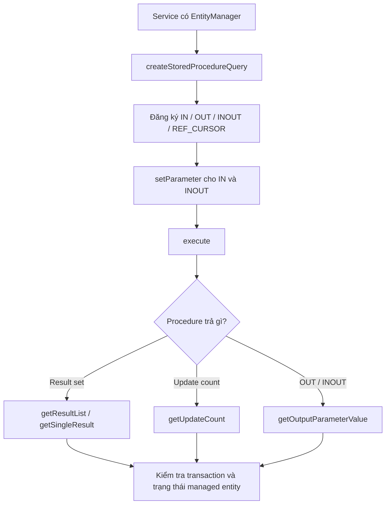
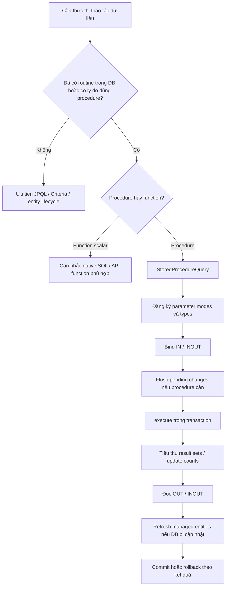

# Vai trò của StoredProcedureQuery trong JPA

Trong ứng dụng Java sử dụng JPA, phần lớn truy cập dữ liệu có thể được diễn đạt bằng `EntityManager.find()`, JPQL, Criteria API hoặc thao tác với các entity đang được quản lý. Tuy nhiên, nhiều hệ thống còn có **stored procedure** — thủ tục được định nghĩa và thực thi bên trong hệ quản trị cơ sở dữ liệu — để đóng gói những thao tác dữ liệu nhiều bước, các tính toán theo lô hoặc các quy tắc đã tồn tại từ trước.

JPA cung cấp interface **`StoredProcedureQuery`** để ứng dụng gọi những thủ tục đó bằng API thống nhất ở tầng persistence. Điểm mạnh của interface này không phải là biến SQL thủ tục thành JPQL, mà là giúp ứng dụng:

- Xác định **tên thủ tục** cần thực thi.
- **Đăng ký và truyền các tham số** đầu vào, đầu ra.
- Thực hiện thủ tục qua `execute()`.
- Đọc các giá trị `OUT`/`INOUT`, danh sách kết quả và số hàng bị ảnh hưởng.
- Kết hợp với cơ chế transaction, entity/result-set mapping và exception handling của JPA.
- Tổ chức metadata thủ tục bằng `@NamedStoredProcedureQuery` khi cần.

Ví dụ ngắn, giả sử database đã có procedure tên `award_loyalty_points` nhận ID khách hàng, số điểm cần cộng và trả tổng điểm mới:

```java
StoredProcedureQuery sp =
    entityManager.createStoredProcedureQuery("award_loyalty_points");

sp.registerStoredProcedureParameter(1, Long.class, ParameterMode.IN);
sp.registerStoredProcedureParameter(2, Integer.class, ParameterMode.IN);
sp.registerStoredProcedureParameter(3, Integer.class, ParameterMode.OUT);

sp.setParameter(1, customerId);
sp.setParameter(2, pointsToAdd);

sp.execute();

Number newBalance = (Number) sp.getOutputParameterValue(3);
```

Đây là hình dạng API cốt lõi. Trong ứng dụng thực tế, cần biết thủ tục có trả result set hoặc update count không, kiểu JDBC/provider xử lý thế nào và transaction bao quanh ra sao. Những điểm đó sẽ được triển khai chi tiết bên dưới.

> **Điều cần nhớ:** `StoredProcedureQuery` là **cầu nối JPA với stored procedure do database quản lý**. Nó không tự định nghĩa hoặc triển khai thủ tục, không khiến SQL của từng database trở nên portable, và không tự đồng bộ lại mọi managed entity đã bị thủ tục cập nhật trực tiếp ở database.

Bài học thuộc chương **Thủ tục lưu trữ** của module **Data Persistence Relational Access ORM JPA**. Các ví dụ dùng Jakarta Persistence (package `jakarta.persistence`); có ví dụ SQL cụ thể theo **MySQL 8** và giải thích sự khác biệt cần chú ý với PostgreSQL, Oracle, SQL Server.

---

## 1. Stored procedure là gì?

**Stored procedure** là một đơn vị chương trình lưu ở database, chứa các statement và đôi khi có biến, rẽ nhánh, vòng lặp, giao dịch hoặc xử lý lỗi theo ngôn ngữ thủ tục của hệ quản trị.

Một số use case:

1. Cập nhật trạng thái và số liệu cho nhiều bảng trong một nghiệp vụ.
2. Thực thi một phép xử lý dữ liệu theo lô gần database.
3. Gọi logic SQL đã có trong hệ thống legacy mà ứng dụng Java mới cần tái sử dụng.
4. Trả một hoặc nhiều result set để phục vụ báo cáo.
5. Tính một kết quả rồi trả qua tham số `OUT`.
6. Đóng gói thao tác nhạy cảm trong database, với quyền thực thi procedure được phân tách theo thiết kế bảo mật.

Ví dụ khái quát:

```text
Java service
    |
    | CALL award_loyalty_points(customerId, delta, OUT newPoints)
    v
Database procedure
    |
    +-- Kiểm tra tham số đầu vào
    +-- UPDATE loyalty_accounts
    +-- Đọc số điểm sau cập nhật
    +-- Gán OUT newPoints
    |
    v
Java nhận kết quả
```

Lưu ý: stored procedure chạy **trong database** theo quy tắc của DBMS. Một stored procedure có thể chứa cả thao tác đọc lẫn ghi; tên “procedure” không đồng nghĩa chỉ có SELECT.

### Phân biệt procedure và function

Trong nhiều database:

- **Procedure** thường được gọi bằng `CALL` hoặc cơ chế tương đương, có thể dùng `IN`/`OUT`/`INOUT`.
- **Function** thường được gọi như một biểu thức trả giá trị, chẳng hạn `SELECT some_function(...)`.
- Các DBMS khác nhau có quy tắc khác nhau đối với return value, result set, cursor và transaction control.

JPA `StoredProcedureQuery` nhắm tới thao tác gọi stored procedure. Không nên mặc định một database function bất kỳ sẽ gọi được theo cùng cách trên mọi provider. Khi cần gọi function đặc thù, có thể phải dùng JPQL function, native SQL hoặc JDBC tùy khả năng của stack.

## 2. Vị trí của StoredProcedureQuery trong các API truy cập dữ liệu

| Công cụ | Mục đích chính | Khi nào thường dùng |
|---|---|---|
| `EntityManager.find()` | Lấy entity theo khóa chính | CRUD/entity lifecycle |
| JPQL `Query`/`TypedQuery` | Truy vấn dựa trên entity và thuộc tính Java | Truy vấn nghiệp vụ ORM |
| Criteria API | Dựng query bằng cây biểu thức Java | Truy vấn động, filter phức tạp |
| `createNativeQuery()` | Thực thi một câu SQL native | CTE, window function, vendor SQL |
| **`StoredProcedureQuery`** | **Gọi stored procedure với tham số và kết quả** | Tái sử dụng logic database/procedure |
| JDBC `CallableStatement` | Gọi procedure ở mức JDBC | Khi cần kiểm soát JDBC/vendor features sâu hơn |

Những công cụ này **bổ sung cho nhau**, không có công cụ nào thay thế hoàn toàn các công cụ còn lại.

Nếu chỉ cần một SELECT đơn giản trên entity, JPQL thường dễ portable và ít metadata hơn. Nếu database đã có một procedure với ba tham số IN, một OUT và một result set, `StoredProcedureQuery` mô tả giao tiếp đó rõ hơn việc cố nhét `CALL ...` vào một chuỗi SQL thông thường.

## 3. Chu trình làm việc điển hình

Một lệnh gọi thường có các bước:



Một mẫu Java:

```java
StoredProcedureQuery procedure =
    entityManager.createStoredProcedureQuery("procedure_name");

procedure.registerStoredProcedureParameter(
    1, Long.class, ParameterMode.IN
);

procedure.setParameter(1, 10L);

boolean firstIsResultSet = procedure.execute();
```

Sau `execute()`, cách lấy dữ liệu phụ thuộc hợp đồng của procedure. Một procedure chỉ ghi và trả OUT sẽ khác procedure trả một result set. Nếu procedure trả nhiều result set và update count, cần duyệt các kết quả theo đúng thứ tự.

**Đừng đọc giá trị Boolean từ `execute()` như “procedure thành công hay thất bại”.** Đây là thông tin về hình dạng kết quả đầu tiên, không phải một mã thành công nghiệp vụ.

---

## 4. ParameterMode: bốn chế độ tham số

JPA khai `ParameterMode`:

```java
import jakarta.persistence.ParameterMode;
```

| Mode | Chiều dữ liệu | Đăng ký | Thao tác thông dụng |
|---|---|---|---|
| `IN` | Java → database | Có | `setParameter(...)` |
| `OUT` | Database → Java | Có | `getOutputParameterValue(...)` sau thực thi |
| `INOUT` | Hai chiều | Có | Gán đầu vào rồi đọc đầu ra |
| `REF_CURSOR` | Cursor/result set từ database | Có, khi DB/provider hỗ trợ | Đọc tập kết quả theo cơ chế driver/JPA |

### `IN`

Dùng khi procedure cần giá trị do caller cung cấp, ví dụ customer ID:

```java
sp.registerStoredProcedureParameter(
    1, Long.class, ParameterMode.IN
);

sp.setParameter(1, 100L);
```

### `OUT`

Dùng khi procedure trả một giá trị về cho caller:

```java
sp.registerStoredProcedureParameter(
    2, Integer.class, ParameterMode.OUT
);

// Không setParameter cho OUT thuần.

sp.execute();

Number value = (Number) sp.getOutputParameterValue(2);
```

Trong procedure thực tế có result sets/update counts, nên tiêu thụ các kết quả đó trước khi đọc output parameters khi driver/provider yêu cầu; quy trình chi tiết ở phần sau.

### `INOUT`

Nhận giá trị từ Java, có thể được procedure thay đổi rồi trả lại:

```java
sp.registerStoredProcedureParameter(
    1, Integer.class, ParameterMode.INOUT
);

sp.setParameter(1, 10);
sp.execute();

Number updated = (Number) sp.getOutputParameterValue(1);
```

### `REF_CURSOR`

Dùng khi thủ tục/database trả con trỏ đến tập hàng. `REF_CURSOR` phụ thuộc nhiều vào DBMS và driver; không nên giả định tất cả stored procedures trả SELECT result set đều bắt buộc cần REF_CURSOR.

---

## 5. Ví dụ thực tế: chuẩn bị bảng loyalty

Để thấy rõ vai trò của `OUT`, sử dụng MySQL 8 với bảng điểm khách hàng.

```sql
CREATE TABLE loyalty_accounts (
    customer_id BIGINT PRIMARY KEY,
    points INT NOT NULL DEFAULT 0,
    CONSTRAINT ck_loyalty_points_nonnegative
        CHECK (points >= 0)
);

INSERT INTO loyalty_accounts (customer_id, points)
VALUES (1001, 50), (1002, 0);
```

Quy tắc nghiệp vụ mẫu:

- Chỉ cộng số điểm nguyên dương.
- Tài khoản phải tồn tại.
- Cộng điểm vào giá trị đang lưu trong database.
- Trả số điểm mới qua tham số OUT.
- Nếu vi phạm điều kiện, procedure báo lỗi và transaction của caller cần xử lý phù hợp.

### Procedure MySQL

Trong MySQL CLI, `DELIMITER` là lệnh của client giúp nhập định nghĩa nhiều statement; nó **không phải một statement SQL chuẩn** và không đưa nguyên xi vào mọi migration tool.

```sql
DELIMITER //

CREATE PROCEDURE award_loyalty_points(
    IN p_customer_id BIGINT,
    IN p_increment INT,
    OUT p_new_points INT
)
BEGIN
    IF p_increment IS NULL OR p_increment <= 0 THEN
        SIGNAL SQLSTATE '45000'
            SET MESSAGE_TEXT = 'Increment must be positive';
    END IF;

    UPDATE loyalty_accounts
       SET points = points + p_increment
     WHERE customer_id = p_customer_id;

    IF ROW_COUNT() = 0 THEN
        SIGNAL SQLSTATE '45000'
            SET MESSAGE_TEXT = 'Loyalty account not found';
    END IF;

    SELECT points
      INTO p_new_points
      FROM loyalty_accounts
     WHERE customer_id = p_customer_id;
END//

DELIMITER ;
```

Đặc điểm quan trọng:

- `IN p_customer_id` nhận ID.
- `IN p_increment` nhận số điểm cộng thêm.
- `OUT p_new_points` trả số điểm mới.
- `UPDATE` thay đổi dữ liệu ngay trong transaction database của lời gọi.
- `SELECT ... INTO p_new_points` gán biến OUT, **không trả một result set độc lập** cho Java.
- `SIGNAL SQLSTATE '45000'` báo lỗi do procedure xác định, là cơ chế MySQL.
- Nếu cộng quá giới hạn cột INT, database có thể báo lỗi numeric/overflow; không nên bỏ qua.

Câu lệnh `CREATE PROCEDURE`, `SIGNAL`, `ROW_COUNT()` và `DELIMITER` là **đặc thù MySQL**. Phần JPA gọi procedure bên dưới có API tương tự với DBMS khác, nhưng DDL và behavior SQL phải điều chỉnh.

## 6. Gọi procedure bằng tham số theo vị trí

Một service JPA:

```java
import jakarta.persistence.EntityManager;
import jakarta.persistence.ParameterMode;
import jakarta.persistence.StoredProcedureQuery;

public int awardPoints(
        EntityManager em,
        long customerId,
        int increment) {

    if (increment <= 0) {
        throw new IllegalArgumentException(
            "Increment must be positive"
        );
    }

    StoredProcedureQuery sp =
        em.createStoredProcedureQuery("award_loyalty_points");

    sp.registerStoredProcedureParameter(
        1, Long.class, ParameterMode.IN
    );

    sp.registerStoredProcedureParameter(
        2, Integer.class, ParameterMode.IN
    );

    sp.registerStoredProcedureParameter(
        3, Integer.class, ParameterMode.OUT
    );

    sp.setParameter(1, customerId);
    sp.setParameter(2, increment);

    sp.execute();

    Object raw = sp.getOutputParameterValue(3);

    if (!(raw instanceof Number number)) {
        throw new IllegalStateException(
            "Procedure returned an unexpected point balance"
        );
    }

    return number.intValue();
}
```

Ví dụ dùng pattern matching `instanceof` của Java 16+; có thể viết kiểu cast truyền thống nếu dự án dùng Java cũ.

Đây là kịch bản procedure đơn giản có OUT và không trả SELECT result set ra ngoài. Một số provider/driver có yêu cầu về việc tiêu thụ update count trước khi đọc OUT; phần xử lý nhiều kết quả ở dưới mô tả mẫu tổng quát.

### Những điểm quan trọng

1. `createStoredProcedureQuery("award_loyalty_points")` nhận **tên procedure trong database**.
2. `registerStoredProcedureParameter(1, Long.class, IN)` khai tham số số 1.
3. Vị trí tham số JPA bắt đầu từ **1**, không từ 0.
4. `setParameter(1, customerId)` cung cấp giá trị cho IN số 1.
5. `OUT` số 3 chỉ được đọc **sau khi procedure được thực thi**.
6. Kiểu dữ liệu do driver/provider trả về có thể cần kiểm tra, không ép kiểu `(Integer)` mù quáng nếu driver trả một `Number` khác.
7. Lời gọi ghi dữ liệu phải đặt trong một **transaction hợp lệ** theo yêu cầu ứng dụng và JPA provider.

Không gọi `setParameter(3, ...)` cho `OUT` thuần, vì OUT không phải input do Java cung cấp.

## 7. So sánh tham số theo vị trí và theo tên

JPA có hai overload:

```java
registerStoredProcedureParameter(
    int position,
    Class type,
    ParameterMode mode
)
```

và:

```java
registerStoredProcedureParameter(
    String parameterName,
    Class type,
    ParameterMode mode
)
```

Ví dụ **theo tên**, nếu provider/driver/database hỗ trợ:

```java
StoredProcedureQuery sp =
    em.createStoredProcedureQuery("award_loyalty_points");

sp.registerStoredProcedureParameter(
    "p_customer_id", Long.class, ParameterMode.IN
);
sp.registerStoredProcedureParameter(
    "p_increment", Integer.class, ParameterMode.IN
);
sp.registerStoredProcedureParameter(
    "p_new_points", Integer.class, ParameterMode.OUT
);

sp.setParameter("p_customer_id", 1001L);
sp.setParameter("p_increment", 15);

sp.execute();

Number newPoints = (Number) sp.getOutputParameterValue(
    "p_new_points"
);
```

Lưu ý quan trọng: **hỗ trợ named procedure parameters phụ thuộc provider, driver và DBMS**. Việc JPA có overload nhận tên không có nghĩa mọi JDBC driver có thể bind tên trong thủ tục của mọi database.

Khi ưu tiên tính tương thích, dùng **positional registration** với thứ tự khớp khai báo procedure và kiểm tra trên DB thực tế thường dễ dự đoán hơn.

| Tiêu chí | Theo vị trí | Theo tên |
|---|---|---|
| Đăng ký | `registerStoredProcedureParameter(1, ...)` | `registerStoredProcedureParameter("p_id", ...)` |
| Bind đầu vào | `setParameter(1, value)` | `setParameter("p_id", value)` |
| Lấy output | `getOutputParameterValue(3)` | `getOutputParameterValue("p_result")` |
| Dễ đọc | Cần đối chiếu thứ tự signature | Rõ tên ý nghĩa hơn |
| Portability | Thường ít phụ thuộc khả năng bind tên của driver | Phụ thuộc hỗ trợ named parameters |
| Rủi ro | Sai vị trí và kiểu | Sai tên, case, support vendor |

Đừng trộn kiểu đăng ký theo vị trí với kiểu đăng ký theo tên trong cùng một lời gọi procedure rồi mong provider luôn quy đổi chính xác.

---

## 8. Ý nghĩa Boolean trả về của execute()

Interface `StoredProcedureQuery` có:

```java
boolean firstIsResultSet = sp.execute();
```

Giá trị trả về cho biết **kết quả đầu tiên** của procedure là một result set hay không, theo semantics của `StoredProcedureQuery`/JDBC:

- `true`: có result set ở vị trí kết quả hiện tại.
- `false`: kết quả hiện tại không phải result set; có thể là update count hoặc không có kết quả dạng hàng.

Sai lầm:

```java
boolean success = sp.execute();

if (!success) {
    throw new RuntimeException("Procedure failed");
}
```

Một procedure chỉ cập nhật dữ liệu và trả OUT có thể thực thi thành công nhưng `execute()` trả `false` vì không trả result set đầu tiên.

**Thành công hay thất bại được xác định bằng việc thực thi có exception, transaction có commit thành công và hợp đồng kết quả nghiệp vụ**, không bằng cách dùng Boolean của `execute()` như status code.

## 9. Đọc OUT sau khi procedure thực thi

Với procedure đơn giản chỉ trả OUT:

```java
sp.execute();

Object value = sp.getOutputParameterValue(3);
```

`getOutputParameterValue(...)` nhận:

- một **vị trí số nguyên**, nếu đã đăng ký bằng vị trí;
- một **tên String**, nếu đã đăng ký tên và stack hỗ trợ.

Ví dụ output có thể là `null` nếu procedure không gán giá trị hoặc trả NULL theo ngữ nghĩa. Vì thế:

```java
Object raw = sp.getOutputParameterValue(3);

if (raw == null) {
    // Xử lý hợp đồng trả NULL có chủ đích.
}
```

Không mặc định OUT luôn khác NULL chỉ vì register type là `Integer.class`; `Class<?>` mô tả kiểu cần bind chứ không tự tạo giá trị mặc định.

### Thứ tự tiêu thụ kết quả có thể quan trọng

Theo hợp đồng JPA và thực tế JDBC, khi procedure trả result sets hoặc update counts, **nên xử lý chúng trước khi đọc OUT/INOUT values**. Một số database/driver không cho đọc OUT trước khi các tập kết quả được đóng hoặc tiêu thụ.

Với những procedure trả nhiều loại kết quả, cần quy trình đầy đủ `execute → getResultList / getUpdateCount / hasMoreResults → getOutputParameterValue`. Không áp dụng ví dụ ngắn nhất cho mọi procedure phức tạp.

## 10. INOUT: biến đầu vào đồng thời là đầu ra

Giả sử procedure nhận một mức ưu đãi hiện có, tăng nó theo quy tắc database và trả giá trị cuối qua cùng parameter:

```java
StoredProcedureQuery sp =
    em.createStoredProcedureQuery("normalize_discount");

sp.registerStoredProcedureParameter(
    1, Integer.class, ParameterMode.INOUT
);

sp.setParameter(1, 12);

sp.execute();

Number normalized =
    (Number) sp.getOutputParameterValue(1);
```

Tên procedure `normalize_discount` là ví dụ giả định; database phải có procedure phù hợp để code chạy.

Sự khác nhau:

- Với `IN`, chỉ cung cấp đầu vào; không dùng `getOutputParameterValue` cho tham số đó.
- Với `OUT`, chỉ lấy đầu ra; không gán giá trị input.
- Với `INOUT`, **vừa gán trước execute vừa đọc sau execute**.

INOUT dễ hữu ích trong API legacy đã có signature từ trước. Với API mới, nhiều nhóm chọn IN + OUT tách biệt để làm rõ tham số nào là đầu vào, tham số nào là đầu ra.

## 11. Có nhiều OUT parameters thì sao?

Giả sử procedure trả:

- mã trạng thái xử lý;
- ID mới được tạo;
- số lượng bản ghi ảnh hưởng.

Registration:

```java
StoredProcedureQuery sp =
    em.createStoredProcedureQuery("run_month_end_job");

sp.registerStoredProcedureParameter(
    1, Long.class, ParameterMode.IN
);
sp.registerStoredProcedureParameter(
    2, Integer.class, ParameterMode.OUT
);
sp.registerStoredProcedureParameter(
    3, Long.class, ParameterMode.OUT
);
sp.registerStoredProcedureParameter(
    4, Integer.class, ParameterMode.OUT
);

sp.setParameter(1, monthId);
sp.execute();

Number statusCode =
    (Number) sp.getOutputParameterValue(2);

Number jobId =
    (Number) sp.getOutputParameterValue(3);

Number affected =
    (Number) sp.getOutputParameterValue(4);
```

`run_month_end_job` là procedure minh họa cần được triển khai trong DB nếu thực thi. Phần xử lý nhiều result sets/update counts vẫn phải được cân nhắc nếu procedure đó có trả về chúng.

Các OUT values đều là kết quả nghiệp vụ do database định nghĩa. Chúng **không tự mang cùng ý nghĩa** với `getUpdateCount()`:

- `OUT affected`: con số mà procedure chọn để trả.
- `getUpdateCount()`: update count của một statement/result hiện tại do cơ chế JDBC cung cấp.

Không đồng nhất hai khái niệm.

## 12. Thực thi thủ tục chỉ đọc và trả result set

Giả sử bảng đơn hàng đã tồn tại:

```sql
CREATE TABLE purchase_orders (
    id BIGINT PRIMARY KEY,
    customer_id BIGINT NOT NULL,
    order_code VARCHAR(50) NOT NULL,
    status VARCHAR(20) NOT NULL,
    total_amount DECIMAL(19,2) NOT NULL,
    created_at DATETIME NOT NULL
);
```

Một MySQL procedure trả những đơn PAID của khách hàng:

```sql
DELIMITER //

CREATE PROCEDURE list_paid_orders(
    IN p_customer_id BIGINT
)
BEGIN
    SELECT
        id,
        customer_id,
        order_code,
        status,
        total_amount,
        created_at
    FROM purchase_orders
    WHERE customer_id = p_customer_id
      AND status = 'PAID'
    ORDER BY created_at DESC, id DESC;
END//

DELIMITER ;
```

Khác ví dụ `SELECT ... INTO` phía trên, câu `SELECT ... FROM ...` ở đây trả **result set** cho caller.

Cách nhận kết quả trong JPA sẽ tùy vào việc ta muốn entity hay DTO. Phần kế tiếp trình bày hai trường hợp.

---

## 13. Ánh xạ result set trả về thành entity

Nếu các cột trong result set phù hợp mapping của entity `PurchaseOrder`, có thể yêu cầu JPA materialize các hàng thành entity:

```java
@Entity
@Table(name = "purchase_orders")
public class PurchaseOrder {

    @Id
    private Long id;

    @Column(name = "order_code", nullable = false)
    private String orderCode;

    @Column(name = "status", nullable = false)
    private String status;

    @Column(name = "total_amount", nullable = false)
    private BigDecimal totalAmount;

    @Column(name = "created_at", nullable = false)
    private LocalDateTime createdAt;

    @ManyToOne(fetch = FetchType.LAZY, optional = false)
    @JoinColumn(name = "customer_id", nullable = false)
    private Customer customer;

    protected PurchaseOrder() {}
}
```

Với `Customer` là entity đã map tới bảng tương ứng và có `@Id`.

Gọi:

```java
StoredProcedureQuery sp =
    em.createStoredProcedureQuery(
        "list_paid_orders",
        PurchaseOrder.class
    );

sp.registerStoredProcedureParameter(
    1, Long.class, ParameterMode.IN
);
sp.setParameter(1, customerId);

sp.execute();

List<PurchaseOrder> orders = ((List<?>) sp.getResultList())
    .stream()
    .map(PurchaseOrder.class::cast)
    .toList();
```

Ở đây:

- Overload `createStoredProcedureQuery(procedureName, resultClass)` chỉ định cách ánh xạ result set sang entity.
- Các cột cần thiết của entity, đặc biệt ID và FK được ánh xạ, phải xuất hiện ở result set theo yêu cầu provider.
- Nếu procedure trả nhiều result sets, code phải xác định result set hiện tại và cách mapping cho từng tập.
- Một result set entity mapping thường là đối tượng có thể tham gia persistence context, khác DTO thuần.
- `getResultList()` trả kết quả của **result set hiện tại**, không phải mặc định gom tất cả các result sets.

Không áp dụng entity mapping cho SQL chỉ trả hai cột nếu provider cần đầy đủ columns của entity. Với kết quả báo cáo ít cột, DTO mapping thường phù hợp hơn.

## 14. Ánh xạ result set procedure sang DTO

JPA hỗ trợ **`@SqlResultSetMapping`**, có thể được dùng cho native queries và cho result sets do stored procedure trả.

Ví dụ DTO:

```java
package com.example.orders.dto;

import java.math.BigDecimal;

public record PaidOrderRow(
    Long orderId,
    String orderCode,
    BigDecimal totalAmount
) {}
```

Đăng ký mapping trên một managed entity được persistence unit quét:

```java
@SqlResultSetMapping(
    name = "PaidOrderRowMapping",
    classes = @ConstructorResult(
        targetClass = com.example.orders.dto.PaidOrderRow.class,
        columns = {
            @ColumnResult(name = "order_id", type = Long.class),
            @ColumnResult(name = "order_code", type = String.class),
            @ColumnResult(
                name = "total_amount",
                type = java.math.BigDecimal.class
            )
        }
    )
)
@Entity
@Table(name = "purchase_orders")
public class PurchaseOrder {
    @Id
    private Long id;
    // Các field mapping khác.
}
```

Procedure trả các alias đúng mapping:

```sql
DELIMITER //

CREATE PROCEDURE list_paid_order_rows(
    IN p_customer_id BIGINT
)
BEGIN
    SELECT
        id AS order_id,
        order_code AS order_code,
        total_amount AS total_amount
    FROM purchase_orders
    WHERE customer_id = p_customer_id
      AND status = 'PAID'
    ORDER BY id DESC;
END//

DELIMITER ;
```

JPA:

```java
StoredProcedureQuery sp =
    em.createStoredProcedureQuery(
        "list_paid_order_rows",
        "PaidOrderRowMapping"
    );

sp.registerStoredProcedureParameter(
    1, Long.class, ParameterMode.IN
);
sp.setParameter(1, customerId);

sp.execute();

List<PaidOrderRow> rows =
    ((List<?>) sp.getResultList()).stream()
        .map(PaidOrderRow.class::cast)
        .toList();
```

Đặc điểm:

- `@ColumnResult.name` phải khớp **SQL alias/column label** trả ra.
- Thứ tự `@ColumnResult` quyết định thứ tự constructor arguments.
- DTO `PaidOrderRow` không trở thành managed entity.
- Không có dirty checking khi sửa DTO.
- SQL procedure phải thực sự trả result set có những cột phù hợp.

Đây là cách liên kết chủ đề StoredProcedureQuery với native SQL DTO mapping mà không biến DTO thành entity.

## 15. StoredProcedureQuery có thể dùng nhiều result-class mappings

JPA có các overload (tùy phiên bản API) cho stored procedure query để mô tả một hay nhiều result set:

```java
em.createStoredProcedureQuery(
    "procedure_name",
    SomeEntity.class
);

em.createStoredProcedureQuery(
    "procedure_name",
    "SomeSqlResultSetMapping"
);
```

Các overload dạng biến đối số có thể dùng nhiều classes hoặc nhiều result set mapping names khi procedure trả những result sets khác nhau. Cần đọc chính xác hợp đồng API và kiểm chứng hình dạng/từng thứ tự result sets mà DB trả.

Không nên giả định:

```java
em.createStoredProcedureQuery("procedure_name", OrderDto.class);
```

tự động chuyển bất kỳ tập cột SQL nào thành constructor DTO trong mọi JPA provider, nếu `OrderDto` không phải entity và không có mapping tường minh. Khi mục tiêu là portable DTO mapping, dùng `@SqlResultSetMapping + @ConstructorResult` như trên.

## 16. Procedure trả nhiều result sets và update counts

Một procedure có thể thực hiện:

```sql
UPDATE ...;
SELECT ...;
SELECT ...;
```

Tùy database/driver, caller có thể nhận:

1. Một update count.
2. Result set thứ nhất.
3. Result set thứ hai.
4. Một hoặc nhiều update counts khác.
5. Các giá trị OUT/INOUT.

JPA cung cấp:

```java
boolean hasCurrentResultSet = sp.execute();

List<?> currentRows = sp.getResultList();

int affectedRows = sp.getUpdateCount();

boolean nextIsResultSet = sp.hasMoreResults();
```

**Không gọi cả bốn phương thức theo đúng chuỗi này một cách vô điều kiện**, vì `getResultList()` chỉ hợp lệ khi result hiện tại thực sự là result set, còn `getUpdateCount()` dùng khi result hiện tại là update count.

### Cách đọc nhiều kết quả

Một pattern tổng quát:

```java
boolean isResultSet = sp.execute();

while (true) {
    if (isResultSet) {
        List<?> rows = sp.getResultList();

        // Xử lý result set hiện tại.
        consumeRows(rows);
    } else {
        int count = sp.getUpdateCount();

        if (count == -1) {
            // Không có update count hiện tại / đã hết kết quả.
            break;
        }

        consumeUpdateCount(count);
    }

    isResultSet = sp.hasMoreResults();
}

// Sau khi đã xử lý result sets/update counts,
// đọc những OUT/INOUT values nếu procedure có.
Object output = sp.getOutputParameterValue(3);
```

`consumeRows` và `consumeUpdateCount` là **phương thức minh họa** do ứng dụng cần định nghĩa. Lời gọi output ở cuối chỉ đúng nếu procedure đã đăng ký OUT ở vị trí 3.

Quan trọng:

- `execute() == false` **không phải** điều kiện kết thúc vòng lặp.
- `hasMoreResults() == false` cũng **không đủ** để kết luận hết mọi thứ: kết quả tiếp theo có thể là update count.
- `getUpdateCount() == -1` trong nhánh không có result set cho biết không còn update count ở vị trí hiện tại.
- Sau khi hoàn tất các result sets/update counts, mới đọc OUT/INOUT values.
- Một số driver/provider có hạn chế khi procedure trả nhiều result sets; hãy kiểm tra bằng integration test trên database thực tế.

Nếu procedure chỉ trả một result set và không có update counts cần quan tâm, code có thể đơn giản hơn nhiều. Pattern tổng quát dành cho **hợp đồng đa kết quả**, không phải yêu cầu mọi query phải viết vòng lặp dài.

## 17. Không nhầm update count với kết quả nghiệp vụ

Xét procedure:

```sql
UPDATE loyalty_accounts SET points = points + p_increment
WHERE customer_id = p_customer_id;
```

JDBC có thể báo một update count, nhưng procedure cũng có thể định nghĩa `OUT p_new_points`.

Hai kết quả khác nhau:

| Kết quả | Ý nghĩa |
|---|---|
| `getUpdateCount()` | Số hàng bị ảnh hưởng theo thông tin JDBC/result hiện tại |
| `getOutputParameterValue(...)` | Giá trị mà procedure chủ động gán vào OUT parameter |
| `getResultList()` | Các hàng của một result set mà procedure trả |
| `execute()` | Cho biết hình dạng kết quả đầu tiên, **không phải số hàng** |

Không dùng `getUpdateCount()` như tổng điểm mới, và không dùng OUT p_new_points như số hàng UPDATE trừ khi hợp đồng procedure quy định điều đó.

---

## 18. Đặt tên thủ tục bằng NamedStoredProcedureQuery

JPA hỗ trợ metadata `@NamedStoredProcedureQuery`, thường được đặt trên entity:

```java
import jakarta.persistence.*;

@Entity
@Table(name = "loyalty_accounts")
@NamedStoredProcedureQuery(
    name = "LoyaltyAccount.awardPoints",
    procedureName = "award_loyalty_points",
    parameters = {
        @StoredProcedureParameter(
            mode = ParameterMode.IN,
            type = Long.class
        ),
        @StoredProcedureParameter(
            mode = ParameterMode.IN,
            type = Integer.class
        ),
        @StoredProcedureParameter(
            mode = ParameterMode.OUT,
            type = Integer.class
        )
    }
)
public class LoyaltyAccount {

    @Id
    @Column(name = "customer_id")
    private Long customerId;

    @Column(name = "points", nullable = false)
    private Integer points;

    protected LoyaltyAccount() {}
}
```

Có hai tên:

- `name = "LoyaltyAccount.awardPoints"` là **tên metadata JPA**.
- `procedureName = "award_loyalty_points"` là **tên stored procedure ở database**.

Khi gọi:

```java
StoredProcedureQuery sp =
    em.createNamedStoredProcedureQuery(
        "LoyaltyAccount.awardPoints"
    );

sp.setParameter(1, 1001L);
sp.setParameter(2, 25);

sp.execute();

Number newPoints =
    (Number) sp.getOutputParameterValue(3);
```

Điểm khác so với đăng ký thủ công:

- `@StoredProcedureParameter` đã mô tả các tham số.
- Không cần đăng ký lại ba tham số bằng `registerStoredProcedureParameter(...)` trong mỗi lần gọi.
- Tên JPA giúp tái sử dụng procedure metadata, không cần lặp string procedure name ở nhiều service.

Nếu procedure thay đổi signature ở database, annotation và code bind cũng phải được cập nhật tương ứng. Đây không phải cơ chế tự đồng bộ database schema với Java.

### NamedStoredProcedureQuery với tên tham số

Nếu DB/provider hỗ trợ named registration, annotation có thể khai:

```java
@StoredProcedureParameter(
    name = "p_customer_id",
    mode = ParameterMode.IN,
    type = Long.class
)
```

và code:

```java
sp.setParameter("p_customer_id", 1001L);
```

Không mặc định đây là lựa chọn portable giữa mọi JDBC drivers; chọn positional registration khi stack hiện tại không hỗ trợ tên.

## 19. Metadata `resultClasses` và `resultSetMappings`

Một named stored procedure query có thể khai cách ánh xạ result sets.

Ví dụ entity result:

```java
@NamedStoredProcedureQuery(
    name = "PurchaseOrder.listPaid",
    procedureName = "list_paid_orders",
    resultClasses = {PurchaseOrder.class},
    parameters = {
        @StoredProcedureParameter(
            mode = ParameterMode.IN,
            type = Long.class
        )
    }
)
```

Ví dụ DTO SQL mapping:

```java
@NamedStoredProcedureQuery(
    name = "PurchaseOrder.listPaidRows",
    procedureName = "list_paid_order_rows",
    resultSetMappings = {"PaidOrderRowMapping"},
    parameters = {
        @StoredProcedureParameter(
            mode = ParameterMode.IN,
            type = Long.class
        )
    }
)
```

Trong trường hợp DTO, `PaidOrderRowMapping` cần được khai bằng `@SqlResultSetMapping` ở managed type thuộc persistence unit.

Khi thực thi:

```java
StoredProcedureQuery sp =
    em.createNamedStoredProcedureQuery(
        "PurchaseOrder.listPaidRows"
    );

sp.setParameter(1, customerId);
sp.execute();

List<PaidOrderRow> rows =
    ((List<?>) sp.getResultList()).stream()
        .map(PaidOrderRow.class::cast)
        .toList();
```

Nếu procedure trả nhiều result sets, cần cân nhắc thứ tự `resultClasses`/`resultSetMappings` và phương thức `hasMoreResults()`; không tưởng một khai báo mapping tự gom tất cả hàng từ mọi result sets thành một list duy nhất.

## 20. Gọi procedure thông qua Spring Data JPA

Trong Spring Data JPA có annotation `@Procedure` dành cho repository methods, giúp đóng gói một lời gọi stored procedure khi hình dạng tham số/kết quả phù hợp.

Ví dụ ý tưởng:

```java
public interface LoyaltyAccountRepository
        extends JpaRepository<LoyaltyAccount, Long> {

    @Procedure(name = "LoyaltyAccount.awardPoints")
    Integer awardPoints(
        Long customerId,
        Integer increment
    );
}
```

Tuy nhiên cần lưu ý:

- `@Procedure(name = "...")` trong Spring Data có thể tham chiếu tới **tên `@NamedStoredProcedureQuery`**.
- `@Procedure(procedureName = "...")` tham chiếu **tên procedure database** theo semantics Spring Data.
- Việc bind method arguments, tham số IN/OUT và return value phụ thuộc metadata, parameter names và khả năng của provider.
- Với nhiều OUT parameters, Spring Data có thể hỗ trợ map kết quả theo cơ chế riêng.
- Spring Data `@Procedure` không phải interface `StoredProcedureQuery` của Jakarta Persistence.
- Code repository cần được thiết kế và kiểm tra theo **phiên bản Spring Data JPA** đang dùng; không giả định một interface method tối giản gọi được mọi signature database.

Đối với procedure nhiều result sets hoặc OUT phức tạp, một **custom repository** sử dụng `EntityManager.createStoredProcedureQuery(...)` thường cho code rõ hơn và kiểm soát được trình tự đọc kết quả.

### Trường hợp cần can thiệp sâu

```java
@Repository
public class LoyaltyProcedureRepository {

    @PersistenceContext
    private EntityManager em;

    @Transactional
    public int award(long customerId, int delta) {
        StoredProcedureQuery sp =
            em.createStoredProcedureQuery(
                "award_loyalty_points"
            );

        sp.registerStoredProcedureParameter(
            1, Long.class, ParameterMode.IN
        );
        sp.registerStoredProcedureParameter(
            2, Integer.class, ParameterMode.IN
        );
        sp.registerStoredProcedureParameter(
            3, Integer.class, ParameterMode.OUT
        );

        sp.setParameter(1, customerId);
        sp.setParameter(2, delta);

        sp.execute();

        return ((Number) sp.getOutputParameterValue(3))
            .intValue();
    }
}
```

Đây là cách gọi trực tiếp của JPA dưới Spring, minh họa rõ các thao tác đã học. Với procedure có result sets/update counts, hoàn thiện logic tiêu thụ kết quả như phần 16.

---

## 21. StoredProcedureQuery trong transaction

Một thủ tục đọc dữ liệu có thể được gọi trong transaction read-only tùy thiết kế; thủ tục có UPDATE/INSERT/DELETE phải được xem như **thao tác ghi database**.

Ví dụ:

```java
@Service
public class LoyaltyService {

    private final LoyaltyProcedureRepository procedures;

    public LoyaltyService(LoyaltyProcedureRepository procedures) {
        this.procedures = procedures;
    }

    @Transactional
    public int awardPoints(long customerId, int delta) {
        if (delta <= 0) {
            throw new IllegalArgumentException(
                "Points must be positive"
            );
        }

        return procedures.award(customerId, delta);
    }
}
```

Dưới Spring transaction management thông thường, `@Transactional` xác định transaction boundary; repository tham gia vào transaction hiện tại với propagation mặc định nếu được gọi qua proxy tương ứng.

### Execute không có nghĩa đã commit

Khi:

```java
sp.execute();
```

thủ tục có thể đã thực thi UPDATE trong transaction. Nhưng nếu transaction chưa commit:

- Các thay đổi còn có thể rollback.
- Một lỗi xảy ra sau đó có thể khiến cả transaction thất bại.
- Database isolation quyết định transaction khác nhìn thấy dữ liệu khi nào.
- Một procedure có SQL transaction-control riêng có thể làm thay đổi mô hình này hoặc bị DBMS từ chối; không nên tùy tiện đưa `COMMIT` vào procedure được gọi từ JPA-managed transaction.

**Đừng lấy việc `execute()` trả về không ném lỗi làm bảo đảm tất cả thay đổi đã bền vững.** Commit và constraint cuối transaction vẫn phải thành công.

## 22. Flush trước khi gọi procedure: khi nào cần?

Giả sử trong cùng một persistence context:

```java
Customer customer = em.find(Customer.class, customerId);
customer.changeTier("GOLD");

// Sau đó gọi procedure phụ thuộc tier của Customer
// để tính loyalty points.
```

Thay đổi `customer.tier` mới ở trạng thái managed Java; SQL UPDATE có thể đang pending. Nếu procedure đọc trực tiếp bảng Customer, nó có thể thấy **giá trị cũ** nếu JPA chưa flush SQL UPDATE.

Một cách chủ động:

```java
customer.changeTier("GOLD");

em.flush(); // Đưa pending SQL xuống DB trong transaction.

StoredProcedureQuery sp =
    em.createStoredProcedureQuery("recalculate_loyalty");
// register / bind parameters ...

sp.execute();
```

Điểm cần biết:

- `flush()` không commit.
- Flush có thể đồng bộ **tất cả** pending changes trong persistence context, không chỉ Customer.
- Chế độ flush `AUTO` có thể khiến provider tự đồng bộ trước một số hoạt động; thời điểm chính xác với stored procedure, bảng tác động và native/JDBC calls không nên được giả định từ một query JPQL thông thường.
- Nếu procedure phụ thuộc vào các thay đổi pending, **explicit flush** tại ranh giới có chủ đích giúp làm rõ thứ tự.
- Nếu không có pending changes liên quan, không cần flush chỉ vì luôn chuẩn bị gọi procedure.

Không dùng `flush()` như một thủ thuật để “bắt buộc commit” trước procedure.

## 23. Dữ liệu managed entity có thể bị cũ sau procedure

Ví dụ bảng `loyalty_accounts` đang có `points = 50`.

Trong cùng EntityManager:

```java
LoyaltyAccount account =
    em.find(LoyaltyAccount.class, 1001L);

// points = 50
```

Sau đó gọi procedure:

```java
// Stored procedure UPDATE points lên 75.
awardPoints(...);
```

Database đã có thể nhận giá trị 75 trong transaction, nhưng **entity `account` trong persistence context có thể vẫn giữ points = 50**. Bởi vì:

- JPA dirty checking theo dõi những thay đổi thực hiện trên managed entity trong bộ nhớ.
- Procedure chạy SQL trực tiếp bên dưới provider, **không tự động cập nhật field Java trong mọi managed objects** đã đọc trước đó.
- First-level cache/persistence context có thể trả lại object cùng ID đang giữ state cũ.

Đây là một điểm khác biệt rất quan trọng giữa sửa entity qua domain methods và cập nhật trực tiếp ở database.

### `refresh()` sau procedure

Nếu cần đọc lại state mới cho một managed entity:

```java
LoyaltyAccount account =
    em.find(LoyaltyAccount.class, 1001L);

callAwardPointsProcedure(...);

em.refresh(account);

Integer updatedPoints = account.getPoints();
```

Giả định `getPoints()` tồn tại và procedure đã hoàn tất thao tác ghi trong transaction hiện tại. `refresh` yêu cầu reload database state vào managed entity.

Lưu ý: `refresh` có thể **ghi đè các thay đổi chưa flush** trên entity; nếu có pending changes, phải quyết định flush/rollback trước khi refresh theo nghiệp vụ.

### `clear()` và tải lại

Có thể:

```java
em.flush(); // Khi có pending changes cần giữ.
callStoredProcedure(...);
em.clear();

LoyaltyAccount reloaded =
    em.find(LoyaltyAccount.class, customerId);
```

`clear()` detach **toàn bộ managed entities** khỏi persistence context. Nó là công cụ mạnh, có thể làm mất những thay đổi chưa flush của entity khác; không dùng bừa chỉ để lấy một số điểm mới. Với một entity cụ thể, `refresh(account)` thường chính xác hơn nếu được sử dụng đúng lúc.

## 24. Có thể gọi procedure rồi tiếp tục sửa cùng managed entity không?

Ví dụ:

```java
LoyaltyAccount account = em.find(
    LoyaltyAccount.class, customerId
);

// Procedure cập nhật points trong database.
callAwardPointsProcedure(...);

// Account Java có thể vẫn giữ points cũ.
account.setSomeOtherField("X");
```

Nếu sau đó provider gửi UPDATE từ managed entity, có nguy cơ ghi đè cột points dựa trên state cũ, tùy mapping, dirty checking và SQL update strategy của provider.

Cần cẩn trọng:

- Nếu procedure và ORM cùng cập nhật những bảng/row trong một transaction, thiết kế **thứ tự** rõ ràng.
- Flush pending state trước khi procedure nếu procedure phụ thuộc vào nó.
- Sau procedure, refresh managed entities có liên quan khi cần sử dụng tiếp.
- Với một số operations có thể chọn không giữ những entity liên quan trong persistence context đồng thời.
- Dùng `@Version` hoặc chiến lược concurrency phù hợp khi có nhiều transaction cập nhật đồng thời.
- Không giả định procedure tự tăng version field mà JPA đang dùng, nếu procedure không được viết làm điều đó.

Một stored procedure **không phải một extension tự động của JPA dirty checking**.

## 25. Optimistic locking với @Version và procedure

Entity:

```java
@Version
@Column(name = "version", nullable = false)
private Long version;
```

Khi JPA cập nhật managed entity, provider có thể sinh SQL dạng:

```sql
UPDATE loyalty_accounts
SET points = ?, version = ?
WHERE customer_id = ? AND version = ?;
```

Nhưng khi procedure trực tiếp chạy:

```sql
UPDATE loyalty_accounts
SET points = points + p_increment
WHERE customer_id = p_customer_id;
```

nó **không tự động** bảo đảm cập nhật version theo cùng quy tắc optimistic locking của JPA.

Hệ quả:

- Transaction khác đang giữ managed entity có version cũ có thể không phát hiện được procedure đã thay dữ liệu nếu version không đổi.
- Những cập nhật tiếp theo có thể ghi đè state theo cách không mong muốn.
- Nếu procedure có nhiệm vụ cập nhật version, nó phải thực hiện đúng chiến lược/điều kiện version theo mô hình dữ liệu.
- Không tự đổi version trong Java object để “khớp” với database khi chưa hiểu provider.

Với dữ liệu có tranh chấp ghi, nên thiết kế procedure và JPA cùng sử dụng một chính sách concurrency nhất quán. Có thể dùng row lock/database atomic update, optimistic version check hoặc điều kiện WHERE có phiên bản, tùy yêu cầu.

## 26. Stored procedure và atomicity

Một lợi ích của procedure là nó có thể thực hiện nhiều SQL statements gần database, ví dụ:

```text
CALL settle_invoice:
  1. Kiểm tra hóa đơn chưa thanh toán
  2. Cập nhật invoice.status
  3. Thêm bản ghi ledger
  4. Ghi audit marker
```

Nhưng “nhiều SQL trong một procedure” **không tự đồng nghĩa đảm bảo atomicity trong mọi môi trường**. Atomicity còn phụ thuộc:

- Procedure có chạy trong một transaction thực sự không?
- DBMS có autocommit và transaction control như thế nào?
- Procedure có tự COMMIT/ROLLBACK không, và DBMS cho phép trong ngữ cảnh gọi hiện tại không?
- Có tác động ngoài database không?
- Có trigger hoặc operation dùng storage engine không transactional không?
- Ứng dụng có rollback transaction khi xảy ra exception không?

Nguyên tắc thiết kế với JPA-managed transaction: **tập trung transaction boundary tại service**, tránh những lời COMMIT nội bộ không được kiểm soát trong procedure nếu muốn toàn bộ use case rollback cùng nhau.

### Một transaction gồm entity changes và procedure

```java
@Transactional
public void settleOrder(Long orderId) {
    PurchaseOrder order = em.find(
        PurchaseOrder.class, orderId
    );

    if (order == null) {
        throw new IllegalArgumentException("Order not found");
    }

    order.markForSettlement();

    em.flush();

    StoredProcedureQuery sp =
        em.createStoredProcedureQuery("settle_invoice");

    sp.registerStoredProcedureParameter(
        1, Long.class, ParameterMode.IN
    );

    sp.setParameter(1, orderId);
    sp.execute();

    // Nếu procedure thay state của order,
    // refresh hoặc tải lại theo yêu cầu nghiệp vụ.
}
```

`PurchaseOrder.markForSettlement()` và procedure `settle_invoice` là ví dụ nghiệp vụ giả định; không phải API có thể chạy nếu domain/procedure chưa được định nghĩa.

---

## 27. Lỗi trong procedure và trạng thái transaction

Procedure có thể thất bại do:

- Vi phạm unique/foreign key/check constraints.
- Không tìm thấy dữ liệu cần cập nhật.
- Đầu vào không hợp lệ, được procedure báo bằng cơ chế DBMS.
- Deadlock hoặc lock timeout.
- Thiếu quyền EXECUTE procedure hoặc quyền trên đối tượng bên trong.
- Mismatch số lượng/kiểu tham số.
- Database connection bị mất.
- Lỗi trong SQL nội bộ.

JPA có thể ném `PersistenceException` hoặc exception provider-specific; Spring có thể dịch/bọc thành các loại `DataAccessException` hoặc transaction exceptions.

Ví dụ:

```java
@Transactional
public int award(long customerId, int delta) {
    StoredProcedureQuery sp =
        em.createStoredProcedureQuery("award_loyalty_points");

    // Đăng ký và bind tham số.

    sp.execute(); // Có thể ném RuntimeException.
    return ((Number) sp.getOutputParameterValue(3))
        .intValue();
}
```

Nếu `execute()` thất bại do SQL/JDBC, **không nên catch rồi tiếp tục sử dụng cùng transaction và EntityManager như thể không có lỗi**. Transaction có thể ở trạng thái rollback-only hoặc database transaction bị aborted, persistence context không còn đồng bộ.

Cách an toàn mặc định:

1. Để lỗi lan ra ranh giới transaction hoặc đánh dấu rollback phù hợp.
2. Rollback transaction thất bại.
3. Phân loại lỗi ở tầng ngoài, không tiết lộ SQL nội bộ.
4. Chỉ retry trong transaction mới khi nguyên nhân có thể phục hồi và nghiệp vụ cho phép.
5. Khi retry, lấy lại state cần thiết thay vì dựa vào managed objects của transaction đã lỗi.

## 28. Output status code và SQL exception không thay thế nhau

Một procedure có thể chọn trả:

```text
OUT status_code = 0    -> thành công
OUT status_code = 10   -> account không tồn tại
OUT status_code = 20   -> tăng điểm không hợp lệ
```

Đây là **hợp đồng nghiệp vụ riêng của procedure**, không phải enum JPA.

Một hướng sử dụng:

```java
int status = ((Number) sp.getOutputParameterValue(2))
    .intValue();

switch (status) {
    case 0 -> handleSuccess();
    case 10 -> handleMissingAccount();
    case 20 -> handleInvalidIncrement();
    default -> throw new IllegalStateException(
        "Unknown procedure status"
    );
}
```

Các method `handleSuccess`/`handleMissingAccount` là minh họa. Không phải procedure nào cũng dùng OUT status.

Cần phân biệt:

- **SQL exception**: execution thất bại theo database/provider, thường cần rollback.
- **OUT status code**: một giá trị mà procedure đã chủ động tính và trả; vẫn cần hiểu procedure có thực hiện ghi một phần trước khi trả code đó hay không.
- **Boolean của `execute()`**: hình dạng result set đầu tiên, không phải status.
- **Update count**: số hàng ảnh hưởng của một statement, không phải error code.

Nếu procedure trả status=10 nhưng đã cập nhật một phần dữ liệu trước đó, service phải quyết định rollback theo hợp đồng nghiệp vụ; không suy ra “có mã status” tức là database đã tự rollback.

## 29. REF_CURSOR và kết quả dưới dạng con trỏ

Một số DBMS (đặc biệt Oracle, PostgreSQL trong những cơ chế phù hợp) hỗ trợ trả tập hàng qua cursor hoặc reference cursor. JPA khai:

```java
ParameterMode.REF_CURSOR
```

Ví dụ **khung API**:

```java
StoredProcedureQuery sp =
    em.createStoredProcedureQuery(
        "find_orders_cursor",
        "PaidOrderRowMapping"
    );

sp.registerStoredProcedureParameter(
    1, Long.class, ParameterMode.IN
);

// Ví dụ type void.class được một số provider sử dụng
// cho REF_CURSOR; cần kiểm chứng theo DBMS/provider.
sp.registerStoredProcedureParameter(
    2, void.class, ParameterMode.REF_CURSOR
);

sp.setParameter(1, customerId);

sp.execute();

// Cách đọc result set/cursor chính xác
// phụ thuộc provider/driver và thủ tục thực tế.
List<?> rows = sp.getResultList();
```

**Không copy nguyên code này để gọi MySQL procedure `list_paid_orders` ở phần trước**. MySQL procedure SELECT result set thường không đòi khai `REF_CURSOR` như Oracle-style cursor OUT parameter.

Các lưu ý:

- DBMS phải có routine phù hợp và hỗ trợ cursor đó.
- Thứ tự đăng ký tham số, kiểu đăng ký `REF_CURSOR` và cách lấy result set phải theo driver/provider được sử dụng.
- Thời gian sống cursor có thể phụ thuộc transaction và connection.
- Cursor có thể chiếm tài nguyên database cho tới khi kết quả được tiêu thụ/đóng.
- Không đọc cursor sau khi transaction/connection đã đóng mà không có hỗ trợ cụ thể.
- Nếu muốn chỉ trả một danh sách hàng đơn giản, procedure SELECT result set có thể dễ dùng hơn trên DBMS hỗ trợ.

`REF_CURSOR` là khả năng hữu ích cho stored procedure có giao diện cursor, **không phải điều kiện bắt buộc của mọi StoredProcedureQuery**.

## 30. MySQL, PostgreSQL, Oracle, SQL Server: khác biệt quan trọng

| DBMS | Khả năng procedure thường gặp | Điểm phải kiểm tra |
|---|---|---|
| MySQL | `CREATE PROCEDURE`, `CALL`, IN/OUT/INOUT, SELECT result sets | Driver handling OUT parameters và update counts; `DELIMITER` chỉ là câu lệnh client |
| PostgreSQL | Có functions và procedures riêng; `CALL` cho procedure, `SELECT` cho function | Quy tắc OUT/INOUT, `refcursor`, implicit transaction và driver/provider mapping |
| Oracle | PL/SQL packages/procedures, OUT, REF CURSOR | Schema/package-qualified names, parameter registration, cursor type và dialect |
| SQL Server | Stored procedures với result sets, OUTPUT parameters và return status | JDBC output parameter handling, multiple results/update counts và named parameter support |

**Một method Java dùng StoredProcedureQuery có thể nhìn khá giống nhau nhưng routine ở database không có cùng signature/semantics.**

Ví dụ PostgreSQL function:

```sql
SELECT * FROM find_paid_orders(1001);
```

không phải tự động tương đương:

```sql
CALL find_paid_orders(1001);
```

vì hai câu có thể gọi các loại routine khác nhau. Khi chuyển từ MySQL procedure sang PostgreSQL function, không thể chỉ giữ nguyên tên và hy vọng `StoredProcedureQuery` làm toàn bộ phần chuyển đổi.

### Quản lý vendor-specific behavior

Tách:

- **Domain contract**: “cộng điểm”, “trả danh sách đơn”.
- **Persistence adapter**: JPA procedure call và mapping.
- **DDL/migrations**: định nghĩa procedure theo DBMS.
- **Integration tests**: xác minh driver/provider với DB đích.

Tránh để code controller biết tên procedure và tham số OUT cụ thể. Những chi tiết đó nên nằm ở repository/adapter.

---

## 31. StoredProcedureQuery có tạo procedure không?

Không. Ví dụ:

```java
em.createStoredProcedureQuery("award_loyalty_points");
```

chỉ tạo một Java query object trỏ tới procedure **được mong đợi đã tồn tại** trong database. JPA không viết DDL `CREATE PROCEDURE` để tạo nó.

Trong dự án thực tế, procedure thường được quản lý bằng:

- Flyway hoặc Liquibase migrations.
- Script SQL được triển khai theo version ứng dụng.
- Database deployment pipeline.
- Quy trình thay đổi schema có review.

Khi đổi signature của procedure:

```text
award_loyalty_points(IN customerId, IN increment, OUT points)
               ↓
award_loyalty_points(IN customerId, IN campaignId, IN increment, OUT points)
```

code đăng ký vị trí và kiểu phải đổi theo. Nếu không, có thể gặp lỗi “wrong number/type of arguments” hoặc nguy hiểm hơn là gán **đúng kiểu nhưng sai ý nghĩa** nếu các tham số trùng kiểu.

Một procedure name không phải một hợp đồng độc lập với version.

## 32. Schema và tên procedure

Một số database hỗ trợ procedure có schema hoặc package:

```text
loyalty.award_loyalty_points
billing.settlement_pkg.settle_invoice
```

JPA:

```java
em.createStoredProcedureQuery(
    "loyalty.award_loyalty_points"
);
```

Cách cung cấp tên đầy đủ, quy tắc quoting, case sensitivity và quyền search path phụ thuộc database/provider. Không đưa tên schema hay procedure từ input client thẳng vào code để thực thi.

Nếu ứng dụng đa tenant dùng schema per tenant, phải xác định chiến lược chọn schema **được kiểm soát** ở tầng persistence; không sử dụng concatenation không kiểm soát của user-supplied schema/procedure names.

## 33. StoredProcedureQuery không tự bảo vệ khỏi SQL injection trong procedure

Java gọi:

```java
sp.setParameter(1, customerId);
```

là bind giá trị, giúp không phải ghép input thành cú pháp lời gọi.

Nhưng bên trong procedure, vẫn có thể tồn tại SQL động nguy hiểm:

```sql
-- Ý tưởng không an toàn nếu ghép thẳng input vào SQL động:
SET @sql = CONCAT('SELECT * FROM orders WHERE code = ''',
                  p_code, '''');
```

Nếu procedure thực thi dynamic SQL do input ghép trực tiếp, injection vẫn có thể xảy ra **ở phía database**.

Quy tắc bảo mật:

1. Bind parameters ở tầng JPA.
2. Trong procedure, dùng static SQL hoặc tham số hóa dynamic SQL theo DBMS.
3. Kiểm tra quyền EXECUTE và quyền dữ liệu bên trong procedure.
4. Không nhận procedure name/schema/SQL text tự do từ request.
5. Giới hạn loại nghiệp vụ mà tài khoản database được phép thực hiện.
6. Kiểm soát lỗi SQL và log dữ liệu nhạy cảm.
7. Kiểm tra tenancy/authorization trước khi gọi procedure và bên trong DB khi thích hợp.

StoredProcedureQuery là lớp API, không phải cơ chế kiểm toán hoặc sandbox cho mọi SQL được thủ tục gọi.

## 34. Phân quyền truy cập dữ liệu trong procedure

Một service có thể gọi:

```java
awardPoints(customerId, delta);
```

Nhưng ai được quyền cộng điểm cho customerId?

Cần phân biệt:

- **Quyền API/user**: user có được cộng điểm không?
- **Quyền tài khoản DB**: connection user có quyền EXECUTE procedure không?
- **Quyền bên trong procedure**: procedure thực thi theo security model nào của DBMS?
- **Quyền dữ liệu theo tenant**: customerId có thuộc tenant được phép không?

Một procedure `award_loyalty_points` chỉ nhận `customerId` không tự biết user đã được xác thực ở web layer. Nếu ứng dụng truyền một customerId không được phép, procedure có thể vẫn cập nhật account đó nếu database policy không chặn.

Vì vậy, permission checks phải được thiết kế rõ ở application/domain hoặc database security layer. **Tham số hóa lời gọi không đồng nghĩa đã phân quyền nghiệp vụ.**

## 35. Các tình huống hiệu năng nên cân nhắc stored procedure

Stored procedure có thể đem lại lợi ích khi:

- Gom nhiều round trips Java–database thành một lời gọi.
- Thực hiện set-based operations trên nhiều hàng ngay trong DBMS.
- Tái sử dụng một query plan hoặc đoạn logic SQL phức tạp đã được tối ưu theo database.
- Thực hiện công việc dữ liệu theo lô và trả một kết quả gọn.
- Hạn chế tải toàn bộ entity graph vào JVM chỉ để tính một aggregate.

Nhưng cũng có chi phí:

- Dễ phụ thuộc vendor-specific syntax và deployment.
- Gỡ lỗi/quan sát khó hơn JPQL đối với một số đội ngũ.
- Versioning procedure và Java code phải phối hợp.
- Các thủ tục dài có thể giữ locks/transaction lâu.
- Quá nhiều logic ứng dụng trong database làm việc kiểm thử/phân quyền phức tạp.
- Dữ liệu cập nhật trực tiếp có thể khiến persistence context stale.
- Một procedure trả nhiều result sets lớn vẫn tốn mạng, bộ nhớ và tài nguyên JDBC.

**Không thể kết luận stored procedure luôn nhanh hơn JPQL hoặc native SQL.** Muốn quyết định, đo số round trips, số hàng xử lý, query plan, lock contention, thời gian transaction và chi phí vận hành trên workload đại diện.

## 36. StoredProcedureQuery hay JDBC CallableStatement?

Một lời gọi JDBC cổ điển có thể dùng:

```java
try (CallableStatement call = connection.prepareCall(
        "{call award_loyalty_points(?, ?, ?)}")) {

    call.setLong(1, customerId);
    call.setInt(2, increment);
    call.registerOutParameter(3, Types.INTEGER);

    call.execute();

    int points = call.getInt(3);
}
```

JPA:

```java
StoredProcedureQuery sp =
    em.createStoredProcedureQuery("award_loyalty_points");

sp.registerStoredProcedureParameter(
    1, Long.class, ParameterMode.IN
);
sp.registerStoredProcedureParameter(
    2, Integer.class, ParameterMode.IN
);
sp.registerStoredProcedureParameter(
    3, Integer.class, ParameterMode.OUT
);

sp.setParameter(1, customerId);
sp.setParameter(2, increment);
sp.execute();

Number points = (Number) sp.getOutputParameterValue(3);
```

So sánh:

| Tiêu chí | JPA StoredProcedureQuery | JDBC CallableStatement |
|---|---|---|
| Tích hợp EntityManager | Có | Phải tích hợp connection/transaction riêng |
| ParameterMode | `IN/OUT/INOUT/REF_CURSOR` | JDBC parameter APIs/Types |
| Entity/result set mapping | Tận dụng JPA mappings | Tự map hoặc dùng thư viện |
| Kiểm soát JDBC vendor details | Qua provider, có giới hạn | Sâu hơn |
| Portability SQL/procedure | Vẫn phụ thuộc database | Cũng phụ thuộc database |
| Dễ dùng trong ORM service | Thường thuận tiện | Cần cẩn trọng với connection/persistence context |
| Khi provider không hỗ trợ feature lạ | Có thể bị giới hạn | Có thể dùng JDBC trực tiếp |

Không gọi `connection.commit()` trực tiếp khi connection đang được transaction manager của Spring/JPA quản lý, trừ khi thật sự hiểu và có chủ đích phá/điều khiển transaction boundary.

Nếu JDBC phải được dùng từ một ứng dụng ORM, phối hợp connection, flush và persistence context một cách có kiểm soát. Không phải mọi trường hợp đều cần “unwrap” EntityManager để gọi JDBC.

---

## 37. Phân biệt stored procedure với database trigger

| Tiêu chí | Stored procedure | Trigger |
|---|---|---|
| Thời điểm thực thi | Thường do caller gọi rõ ràng | Tự kích hoạt khi có event dữ liệu tương ứng |
| Caller JPA | `StoredProcedureQuery` hoặc JDBC | Thường không gọi trực tiếp |
| Tham số | Có thể có IN/OUT/INOUT | Theo cơ chế trigger của DB |
| Kết quả | Có thể trả result sets/OUT | Không nhất thiết có result set cho caller |
| Theo dõi thay đổi | Phải hiểu SQL effects trên DB | Cũng có thể làm ORM state stale nếu trigger thay cột |
| Versioning | Migration của procedure | Migration của trigger |

Nếu một INSERT JPA kích hoạt trigger tính điểm, ứng dụng **không** cần gọi StoredProcedureQuery cho chính trigger đó. Nếu cần gọi explicit routine tính lại điểm, StoredProcedureQuery là lựa chọn khác.

Cả trigger lẫn procedure đều có thể thay dữ liệu ngoài dirty checking thông thường và cần cân nhắc refresh/version.

## 38. Giá trị trả về của function không phải OUT parameter của procedure

Ví dụ database function:

```sql
SELECT calculate_discount(1001, 500000);
```

Có thể trả một scalar. Đây là hình dạng query/function SQL, không nhất thiết có tham số OUT được đăng ký qua `ParameterMode.OUT`.

Nếu muốn đọc function scalar theo cơ chế SQL:

```java
Object raw = em.createNativeQuery(
    "SELECT calculate_discount(?, ?)"
)
.setParameter(1, customerId)
.setParameter(2, amount)
.getSingleResult();
```

Ví dụ này là **native SQL database-specific**, không phải StoredProcedureQuery. Cú pháp SQL và result type phụ thuộc DBMS.

Một số provider có cơ chế riêng để đăng ký function return parameter hoặc gọi function qua JDBC escape syntax. Đừng đồng nhất:

- SQL function return value;
- procedure OUT parameter;
- result set;
- SQL update count.

Thiết kế interface Java nên phản ánh đúng hợp đồng database routine.

## 39. Kiểu dữ liệu và NULL khi bind procedure parameters

Một procedure nhận BIGINT và DECIMAL:

```java
sp.registerStoredProcedureParameter(
    1, Long.class, ParameterMode.IN
);

sp.registerStoredProcedureParameter(
    2, BigDecimal.class, ParameterMode.IN
);
```

Nếu SQL yêu cầu decimal precision, bind `BigDecimal` phù hợp hơn `Double` khi xử lý tiền.

### NULL input

```java
sp.setParameter(2, null);
```

có thể gây vấn đề nếu provider/driver không suy ra đúng SQL type, hoặc procedure không cho phép NULL. Tùy database, có thể cần registered type rõ, cast/type-specific handling hoặc dùng giá trị mặc định ở contract procedure.

Quan trọng: **không truyền NULL một cách vô thức** cho tham số bắt buộc. Validate input ở Java trước khi gọi procedure, và đặt constraint/business check ở database khi cần.

### OUT NULL

Nếu procedure không gán OUT hoặc gán SQL NULL:

```java
Object raw = sp.getOutputParameterValue(3);
```

có thể là null. DTO/domain API phải quyết định nó có nghĩa gì. Không ép thành primitive int ngay bằng unboxing:

```java
Integer count = (Integer) raw;
int value = count; // Có thể NullPointerException.
```

### Kiểu số trả về

Nếu driver trả `BigDecimal` thay vì `Integer`, `((Number) raw).intValue()` là cách chuyển đổi đơn giản nhưng có nguy cơ mất phần thập phân/overflow. Với điểm nguyên có constraint rõ, dùng kiểu database/registration nhất quán; khi cần độ chính xác, dùng kiểm tra range/scale trước khi convert.

## 40. Tránh dùng procedure để vượt vòng đời entity

Một anti-pattern:

```java
// Order đang managed.
PurchaseOrder order = em.find(PurchaseOrder.class, orderId);

// Gọi procedure đổi trạng thái Order trong database.
callChangeOrderStatusProcedure(orderId, "PAID");

// Đọc trạng thái từ chính instance cũ, giả định đã được cập nhật.
String current = order.getStatus();
```

Ở đây `current` có thể vẫn là trạng thái trước procedure.

Nếu mục tiêu là cập nhật một managed entity đơn giản, thường chỉ cần:

```java
order.markPaid();
```

và dựa vào dirty checking/transaction. StoredProcedureQuery có giá trị khi logic thật sự được đặt trong DB hoặc có lý do rõ ràng để gọi routine.

Đừng chuyển mọi thao tác CRUD thành stored procedure chỉ vì procedure “mạnh hơn” hay “chắc chắn nhanh hơn”.

## 41. Thứ tự thao tác khi trộn JPA và procedure

Một workflow có cả managed updates và procedure nên có thứ tự rõ:

```text
BEGIN transaction
  1. Load managed entities cần kiểm tra.
  2. Xác thực business rules và quyền.
  3. Sửa entities qua domain methods.
  4. Flush nếu procedure phải thấy changes trước đó.
  5. Gọi stored procedure.
  6. Tiêu thụ result sets và OUT values.
  7. Refresh/reload entities do procedure thay đổi nếu cần.
  8. Commit transaction.
END
```

Không phải use case nào cũng cần đủ tám bước. Đây là cây quyết định:

- Procedure chỉ đọc bảng không bị JPA thay đổi? Có thể không cần explicit flush.
- Procedure ghi bảng không có entity managed liên quan? Có thể không cần refresh.
- Procedure chỉ trả report? Xử lý DTO/result set, không sửa entity state.
- Procedure và ORM cùng ghi một row? Phải kiểm soát version, flush, refresh và ordering.

Khi procedure rất dài hoặc có side effect bên ngoài, nên xem lại ranh giới transaction và kiến trúc bất đồng bộ thay vì giữ transaction database mở lâu.

## 42. Error handling và rollback trong Spring

Một service:

```java
@Transactional
public int awardPoints(long customerId, int increment) {
    return procedureRepository.award(customerId, increment);
}
```

Nếu procedure báo SQL exception và exception lan ra ngoài transactional method, Spring mặc định rollback đối với nhiều unchecked exceptions theo cơ chế transaction interceptor.

Không nên:

```java
@Transactional
public int awardPoints(long customerId, int increment) {
    try {
        return procedureRepository.award(customerId, increment);
    } catch (PersistenceException ex) {
        // Không an toàn: nuốt lỗi rồi coi transaction còn lành.
        return -1;
    }
}
```

Nguy cơ:

- JDBC transaction có thể đã aborted.
- Transaction bị đánh dấu rollback-only.
- Commit cuối cùng thất bại dù method trả -1.
- Persistence context có thể không còn nhất quán.
- Caller tưởng có “thành công một phần” trong khi thực tế rollback.

Cách thường an toàn: rollback transaction rồi **ngoài boundary** chuyển lỗi thành response nghiệp vụ. Với tình huống retry được, tạo **transaction mới** và bảo đảm idempotency.

### Thông điệp lỗi

Không expose nguyên SQL, stack trace, procedure body hoặc database credentials tới client. Có thể trả mã lỗi ổn định như:

```json
{
  "code": "LOYALTY_ACCOUNT_NOT_FOUND",
  "message": "Không tìm thấy tài khoản điểm phù hợp"
}
```

Để trả mã chính xác, nên phân biệt lỗi business procedure với lỗi database unknown bằng error mapping có cấu trúc, không chỉ tìm chuỗi tiếng Anh trong `SQLException.getMessage()`.

## 43. Kiểm soát thời gian chờ và resource usage

Một stored procedure có thể chạy lâu, giữ locks và connection lâu.

Ở JPA, `Query` hỗ trợ các hints, nhưng mức độ áp dụng timeout cho procedure phụ thuộc provider/JDBC driver/database:

```java
StoredProcedureQuery sp =
    em.createStoredProcedureQuery("rebuild_report");

sp.setHint(
    "jakarta.persistence.query.timeout",
    5000
);
```

Giá trị hint timeout thường được hiểu theo millisecond trong JPA, nhưng **provider có thể không hỗ trợ hoặc không thể cưỡng chế timeout chính xác ở mọi trường hợp**. Một procedure đang chờ lock/đang chạy SQL phía DB có thể có cơ chế timeout riêng.

Cần phân biệt:

- Query timeout ở ORM/JDBC.
- Transaction timeout ở Spring/transaction manager.
- Database statement timeout.
- Lock wait timeout.
- Network/socket timeout.

Không dựa vào một hint duy nhất để bảo đảm procedure luôn kết thúc trong đúng năm giây.

### Đóng tài nguyên

JPA quản lý connection và result resources trong vòng đời EntityManager/transaction, nhưng khi procedure trả cursor hoặc result sets lớn, hãy tiêu thụ dữ liệu có chủ đích. Không giữ một `StoredProcedureQuery`/cursor sống qua nhiều request hoặc sau khi transaction đã đóng.

`EntityManager` không thread-safe. Không cache một mutable `StoredProcedureQuery` instance để nhiều threads cùng thay tham số.

## 44. Những lỗi thường gặp khi dùng StoredProcedureQuery

| Triệu chứng | Nguyên nhân khả dĩ | Cách xử lý |
|---|---|---|
| Procedure không tìm thấy | Chưa deploy DDL, sai schema/tên/case | Kiểm tra migrations và procedureName |
| Sai số lượng tham số | Signature DB khác registration | Đồng bộ positions, modes, types |
| OUT parameter không đọc được | Chưa `execute()`, sai vị trí/mode hoặc chưa tiêu thụ results | Đọc đúng trình tự |
| `execute()` trả false nhưng DB đã ghi | False không có nghĩa thất bại | Kiểm tra exception và kết quả |
| `getResultList()` báo không có result set | Result hiện tại là update count hoặc procedure không SELECT | Kiểm tra `execute()`/`getUpdateCount()`/`hasMoreResults()` |
| Named parameter binding thất bại | DB/driver/provider không hỗ trợ tên | Dùng positional registration |
| ClassCastException từ OUT | JDBC trả Number subtype khác | Kiểm tra `Number` và conversion |
| DTO mapping không tìm thấy alias | Procedure SELECT thiếu alias SQL | Khai `@SqlResultSetMapping` và SQL nhất quán |
| Entity result thiếu field | Procedure không trả đủ columns của entity | SELECT các cột mapping cần hoặc dùng DTO |
| Giá trị managed entity vẫn cũ | Procedure UPDATE không cập nhật persistence context | `refresh`/reload đúng lúc |
| ORM ghi đè giá trị procedure vừa đổi | Entity managed stale và flush sau đó | Xác định flush/refresh/version strategy |
| Procedure không thấy cập nhật Java mới | Pending JPA changes chưa flush | Flush trước procedure khi cần |
| Version không tăng sau procedure | SQL trong procedure bỏ qua @Version | Thiết kế concurrency nhất quán |
| SQLException rồi tiếp tục transaction thất bại | Transaction aborted/rollback-only | Rollback và tạo context/transaction mới |
| Có nhiều kết quả nhưng chỉ đọc một | Procedure trả update count + nhiều result sets | Duyệt với `hasMoreResults()` |
| OUT trả null và bị NPE | Procedure không gán hoặc giá trị nullable | Kiểm tra null theo contract |
| Function không gọi được bằng procedure query | DB phân biệt function/CALL | Dùng API/SQL phù hợp loại routine |
| SQL chạy ở MySQL nhưng không ở PostgreSQL | Routine language/dialect khác | Triển khai migration và adapter phù hợp |
| Query timeout hint không có tác dụng | Provider/driver/DB không hỗ trợ | Kiểm tra timeout ở nhiều tầng |
| Lỗi quyền EXECUTE | Tài khoản DB thiếu privilege | Cấu hình quyền theo least privilege |
| Dữ liệu tenant khác bị đổi | Chỉ truyền ID, thiếu authorization | Ràng buộc tenant và quyền nghiệp vụ |
| Result set rất lớn gây bộ nhớ cao | Procedure SELECT không giới hạn | Phân trang/lọc/streaming theo driver phù hợp |
| Named query trỏ sai procedure | Nhầm `name` với `procedureName` | Tách tên metadata và tên DB |
| Bị lỗi khi gọi ở ngoài transaction | Procedure ghi dữ liệu nhưng không có transaction phù hợp | Đặt transaction boundary tại service |
| Nhiều threads thay cùng StoredProcedureQuery | Query object mutable không thread-safe | Tạo query mỗi lần gọi trong EntityManager phù hợp |

## 45. Bài tập đọc mã

### Tình huống A: `execute() == false`

```java
boolean result = sp.execute();

if (!result) {
    throw new IllegalStateException("Procedure failed");
}
```

**Vấn đề:** `false` chỉ cho biết kết quả hiện tại không phải result set. Nếu procedure chỉ update + OUT, lời gọi có thể đã thành công.

### Tình huống B: gọi `getOutputParameterValue` trước `execute()`

```java
Object out = sp.getOutputParameterValue(3);
sp.execute();
```

**Vấn đề:** Chưa thực thi procedure, output chưa có giá trị hợp lệ. Cần thực thi trước và đọc kết quả theo trình tự.

### Tình huống C: OUT parameter bị set như IN

```java
sp.registerStoredProcedureParameter(
    3, Integer.class, ParameterMode.OUT
);
sp.setParameter(3, 0);
```

**Vấn đề:** OUT thuần không nhận giá trị input. Không bind nó như IN; chỉ lấy output khi procedure hoàn tất.

### Tình huống D: sai tham số vị trí

Procedure signature:

```text
award_loyalty_points(customer_id BIGINT, increment INT, new_points OUT INT)
```

Java:

```java
sp.setParameter(1, increment);
sp.setParameter(2, customerId);
```

**Vấn đề:** Có thể gây type error hoặc nguy hiểm hơn là sai logic nếu tham số có kiểu tương thích. Phải đối chiếu **thứ tự khai báo ở DB**.

### Tình huống E: procedure cập nhật row đã managed

```java
LoyaltyAccount a = em.find(LoyaltyAccount.class, id);
callAwardPointsProcedure(id, 10);
System.out.println(a.getPoints());
```

**Vấn đề:** `a` có thể vẫn giữ số điểm cũ. `refresh(a)` khi cần thấy state database mới trong transaction và không có pending changes cần giữ.

### Tình huống F: procedure đọc state Java chưa flush

```java
order.markPaid();
callReportProcedure(order.getId());
```

**Vấn đề:** Procedure có thể đọc status cũ nếu SQL UPDATE chưa được flush. Cân nhắc `em.flush()` trước lời gọi theo đúng workflow.

### Tình huống G: REF_CURSOR trong một procedure MySQL SELECT

**Vấn đề:** Một procedure trả result set qua SELECT không đồng nghĩa cần đăng ký REF_CURSOR. Đọc result set theo contract của MySQL/JDBC/JPA; REF_CURSOR là tính năng cursor riêng của một số DBMS.

### Tình huống H: entity result nhưng chỉ SELECT ID

**Vấn đề:** JPA cần columns phù hợp để hydrate entity; truy vấn chỉ ID nên dùng scalar/DTO nếu không định tạo entity đầy đủ.

### Tình huống I: procedure trả update count và result set

**Vấn đề:** Không dùng `getResultList()` ngay khi `execute()` trả false. Kiểm tra current update count và di chuyển bằng `hasMoreResults()`.

### Tình huống J: procedure có COMMIT nội bộ

**Vấn đề:** Việc commit bên trong procedure có thể không được DBMS cho phép khi gọi trong JPA-managed transaction hoặc phá tính rollback toàn use case. Thiết kế transaction boundary nhất quán, kiểm chứng theo vendor.

## 46. Câu hỏi tự kiểm tra

**Câu 1.** StoredProcedureQuery có tự tạo database procedure không?

Không. Nó gọi một procedure đã được triển khai trong DB. DDL/migrations quản lý việc tạo và thay đổi procedure.

**Câu 2.** `INOUT` khác `OUT` thế nào?

`INOUT` vừa nhận đầu vào vừa trả đầu ra. `OUT` chỉ trả đầu ra.

**Câu 3.** Tham số procedure theo vị trí bắt đầu từ đâu?

Từ **1** trong JPA registration/binding, không phải 0.

**Câu 4.** `execute()` trả `false` có phải procedure thất bại?

Không. Nó biểu diễn hình dạng result hiện tại, không phải mã lỗi.

**Câu 5.** Có thể nhận entity từ result set của procedure không?

Có nếu result set và mapping phù hợp, ví dụ `createStoredProcedureQuery("name", PurchaseOrder.class)`.

**Câu 6.** Có thể nhận DTO từ result set không?

Có, thông qua `@SqlResultSetMapping + @ConstructorResult` và overload nhận tên mapping.

**Câu 7.** Tại sao cần `em.flush()` trước một số procedure?

Để procedure nhìn thấy những SQL changes đang pending trong persistence context khi hợp đồng nghiệp vụ yêu cầu, mà không cần commit trước.

**Câu 8.** Tại sao `em.refresh()` có thể cần sau procedure?

Vì SQL của procedure có thể cập nhật DB nhưng không tự thay state của managed entity đang tồn tại trong context.

**Câu 9.** JPA có bảo đảm named stored procedure parameters hoạt động trên mọi DB không?

Không nên giả định; cần kiểm chứng provider/driver và có thể ưu tiên positional registration.

**Câu 10.** Khi nào dùng JDBC `CallableStatement` thay vì StoredProcedureQuery?

Khi cần vendor/JDBC features sâu mà abstraction JPA không diễn đạt hoặc không hỗ trợ đúng, với việc quản lý connection/transaction cẩn thận.

## 47. Quy trình thiết kế một lời gọi stored procedure đáng tin cậy

Khi một service được giao gọi procedure, hãy làm theo chuỗi câu hỏi sau:

**1. Routine ở DB là procedure hay function?** Xác định cú pháp gọi và cơ chế return thực.

**2. Procedure name nằm ở schema/package nào?** Đảm bảo migration đã triển khai trên đúng database.

**3. Signature gồm những tham số nào?** Ghi rõ thứ tự, mode, SQL type, Java type, nullability.

**4. Procedure trả kết quả gì?** Chỉ OUT, một result set, nhiều result sets, update counts, hay cursor?

**5. Result set mapping nào phù hợp?** Entity đầy đủ, DTO qua SqlResultSetMapping, hay scalar values?

**6. Transaction do ai quản lý?** Tránh COMMIT nội bộ khi service cần atomicity của một transaction JPA.

**7. Procedure có đọc dữ liệu vừa thay đổi bằng JPA không?** Nếu có, quyết định flush trước.

**8. Procedure có ghi vào bảng của managed entities không?** Nếu có, quyết định refresh/reload/clear phù hợp và giữ @Version nhất quán.

**9. Các lỗi business/database được biểu diễn thế nào?** Exception, OUT status code, SQLSTATE/vendor codes?

**10. Tính portable quan trọng tới đâu?** Nếu dùng DB-specific procedures, tách adapter và migrations theo vendor.

**11. Có bảo mật theo tenant/user không?** Bind inputs, kiểm tra quyền và tránh SQL động không an toàn.

**12. Hiệu năng, timeout và lock thế nào?** Đo round trips, thời gian chạy, số hàng trả và contention.

**13. Có kiểm tra integration trên DB thật chưa?** Stored procedure behavior, OUT handling và cursor support phụ thuộc vendor/driver.

Sơ đồ quyết định:



## 48. Tổng kết

`StoredProcedureQuery` trong JPA có vai trò **tích hợp stored procedure database vào lớp persistence của ứng dụng Java**. Nó tập trung vào **lời gọi, tham số, kết quả và transaction coordination**, chứ không tự biến logic SQL trong procedure thành một phần của JPA dirty checking.

Cách sử dụng cơ bản:

```java
StoredProcedureQuery sp =
    em.createStoredProcedureQuery("award_loyalty_points");

sp.registerStoredProcedureParameter(
    1, Long.class, ParameterMode.IN
);
sp.registerStoredProcedureParameter(
    2, Integer.class, ParameterMode.IN
);
sp.registerStoredProcedureParameter(
    3, Integer.class, ParameterMode.OUT
);

sp.setParameter(1, customerId);
sp.setParameter(2, delta);

sp.execute();

Number newBalance =
    (Number) sp.getOutputParameterValue(3);
```

Các nguyên tắc quan trọng nhất:

1. **Procedure được tạo và quản lý bởi database**, không phải bởi `StoredProcedureQuery`.
2. **ParameterMode** mô tả chiều dữ liệu: IN, OUT, INOUT, REF_CURSOR.
3. **`execute()` trả Boolean về result set**, không phải cờ thành công nghiệp vụ.
4. **OUT values được đọc sau execute**; nếu có nhiều result sets/update counts, tiêu thụ chúng theo đúng trình tự.
5. **Result sets có thể ánh xạ thành entity hoặc DTO** với result mapping phù hợp.
6. **`@NamedStoredProcedureQuery` đăng ký lời gọi** để tránh lặp procedure metadata.
7. **Transaction phải được xác định rõ**: execute không thay commit, lỗi SQL thường cần rollback.
8. **Flush trước và refresh sau** khi procedure tương tác với state của những entity JPA đang được quản lý.
9. **JPA không làm SQL dialect portable**; signature/procedure/function/cursor support khác nhau giữa MySQL, PostgreSQL, Oracle và SQL Server.
10. **Bảo mật, concurrency và hiệu năng** vẫn là trách nhiệm thiết kế của ứng dụng và database.

Khi hiểu đúng các điểm trên, `StoredProcedureQuery` là công cụ hữu ích để khai thác stored procedures của hệ thống legacy hoặc các thao tác dữ liệu tập trung, đồng thời giữ được một ranh giới rõ ràng giữa **ORM-managed entities**, **database-executed logic** và **hợp đồng nghiệp vụ của service**.
