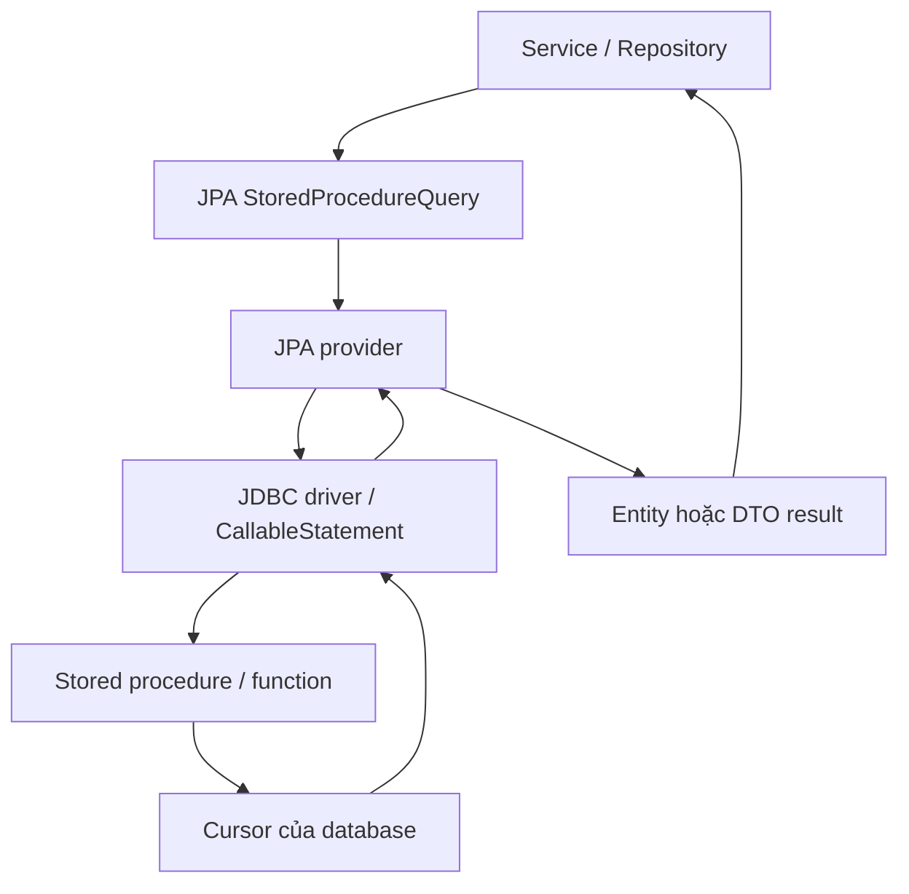

# Làm việc với REF_CURSOR khi hệ quản trị và provider hỗ trợ

Khi ứng dụng Java dùng JPA gọi **thủ tục lưu trữ** (*stored procedure*), kết quả không nhất thiết là một tham số số nguyên hoặc chuỗi. Một thủ tục có thể trả về **một tập hàng dữ liệu** thông qua tham số kiểu **`REF_CURSOR`**. Với database và JPA provider hỗ trợ cơ chế này, Jakarta Persistence cung cấp `StoredProcedureQuery` cùng `ParameterMode.REF_CURSOR` để truy cập kết quả ở mức JPA.

Ví dụ một hệ thống bán hàng có thủ tục nhận trạng thái đơn hàng và trả một cursor đến các đơn phù hợp:

```sql
-- Oracle PL/SQL: ví dụ chữ ký thủ tục.
PROCEDURE list_orders_by_status(
    p_status IN VARCHAR2,
    p_rows   OUT SYS_REFCURSOR
);
```

Ở phía Java:

```java
StoredProcedureQuery procedure =
    em.createStoredProcedureQuery(
        "list_orders_by_status", PurchaseOrder.class);

procedure.registerStoredProcedureParameter(
    "p_status", String.class, ParameterMode.IN);
procedure.registerStoredProcedureParameter(
    "p_rows", void.class, ParameterMode.REF_CURSOR);

procedure.setParameter("p_status", "PAID");

List<?> rows = procedure.getResultList();
```

Đoạn mã nêu được ý tưởng chính, nhưng **chưa đủ để bảo đảm chạy ở mọi hệ quản trị**. Khả năng đăng ký `REF_CURSOR`, tên/kiểu tham số, cách gọi procedure hoặc function, ánh xạ hàng, quản lý transaction và thời gian tồn tại của cursor đều phụ thuộc **database + JDBC driver + JPA provider + phiên bản**.

**Mục tiêu bài học:** hiểu REF_CURSOR thực chất là gì, lúc nào cần dùng, cách gọi và nhận kết quả qua `StoredProcedureQuery`, cách ánh xạ entity/DTO, xử lý nhiều cursor, sự khác nhau giữa Oracle và PostgreSQL, những giới hạn portability, vòng đời transaction và cursor, tối ưu dữ liệu lớn, bảo mật, kiểm thử và xử lý lỗi.

## 1. REF_CURSOR là gì?

Trong nhiều hệ quản trị, một **cursor** đại diện cho trạng thái truy cập một tập kết quả truy vấn. Thay vì trả một số lượng cố định giá trị scalar, thủ tục có thể **mở cursor** cho câu `SELECT` và chuyển một **tham chiếu cursor** cho caller.

Ý tưởng:

```text
Java application
    |
    | Gọi procedure với p_status = "PAID"
    v
Database stored procedure
    |
    | OPEN p_rows FOR
    |     SELECT ... FROM purchase_orders
    |     WHERE status = 'PAID'
    v
REF_CURSOR output parameter
    |
    | Driver/provider đọc các rows
    v
List<PurchaseOrder> hoặc ResultSet
```

Các điểm cần phân biệt:

- **Cursor** là cơ chế truy cập tập kết quả, thường có state gắn với database session/connection.
- **REF_CURSOR** là một tham chiếu tới cursor được truyền qua tham số hoặc giá trị trả về theo khả năng của DB.
- **JDBC `ResultSet`** là giao diện Java đọc hàng từ một kết quả; driver có thể biểu diễn dữ liệu cursor qua `ResultSet`.
- **JPA `getResultList()`** là giao diện nhận danh sách kết quả ánh xạ; nó không đồng nghĩa giữ nguyên một server-side cursor mở để Java đọc từng dòng.

**Không được đồng nhất `REF_CURSOR` với `List`.** REF_CURSOR thuộc mô hình tương tác với database; List là một collection trong JVM. JPA có thể chuyển kết quả cursor thành List, nhưng việc này có thể làm materialize nhiều hàng vào bộ nhớ.

## 2. Khi nào stored procedure trả REF_CURSOR là hợp lý?

Một số tình huống:

1. Database có **thủ tục nghiệp vụ đã tồn tại** trả tập hàng thông qua `SYS_REFCURSOR` (Oracle) hoặc `refcursor` (PostgreSQL).
2. Logic lọc/đối soát phải nằm trong database vì yêu cầu tổ chức, tối ưu hóa hoặc quyền truy cập.
3. Hệ thống cần gọi một quy trình có nhiều bước SQL rồi trả danh sách kết quả cho application.
4. Một thủ tục cần trả **nhiều tập kết quả** (nhiều cursor) hoặc kết hợp tập kết quả với `OUT` scalar.
5. Application đang tích hợp với một interface database được quản lý bởi nhóm khác, không thể tùy tiện chuyển thủ tục sang JPQL.

Ngược lại, nếu chỉ cần:

```sql
SELECT * FROM purchase_orders WHERE status = 'PAID';
```

và ứng dụng được quyền dùng JPA query trực tiếp, JPQL hoặc Criteria API thường **đơn giản và portable hơn**:

```java
List<PurchaseOrder> orders = em.createQuery(
        "select o from PurchaseOrder o " +
        "where o.status = :status " +
        "order by o.id",
        PurchaseOrder.class)
    .setParameter("status", "PAID")
    .getResultList();
```

Không nên tạo một procedure chỉ để đổi một query đơn giản thành code phức tạp hơn nếu không có lợi ích kỹ thuật/nghiệp vụ cụ thể.

## 3. Bốn thành phần quyết định REF_CURSOR có chạy được không

| Thành phần | Vai trò | Điều cần xác minh |
|---|---|---|
| **Database** | Cung cấp loại cursor và cú pháp procedure/function | Có `SYS_REFCURSOR`/`refcursor` không? Cursor sống bao lâu? |
| **JDBC driver** | Chuyển lời gọi JDBC, đăng ký OUT parameter và đọc kết quả | Hỗ trợ `CallableStatement`/`REF_CURSOR` thế nào? |
| **JPA provider** | Triển khai `StoredProcedureQuery` và mapping kết quả | Có hỗ trợ `ParameterMode.REF_CURSOR` với DB/driver này không? |
| **Application** | Quản lý transaction, tham số, mapping và cursor lifetime | Gọi đúng signature? Có tránh đọc cursor sau khi transaction kết thúc không? |

Một mã JPA dùng `ParameterMode.REF_CURSOR` có thể compile bình thường mà vẫn gặp exception lúc chạy vì database hoặc provider không hỗ trợ kết hợp cụ thể. **Compile thành công không phải bằng chứng interoperability**.

### Sơ đồ ba lớp



Sơ đồ là **luồng logic**, không khẳng định mọi provider nội bộ luôn dùng đúng một `CallableStatement` hay cùng cách fetch dữ liệu.

## 4. Các API JPA cần biết

Các lớp quan trọng:

```java
import jakarta.persistence.EntityManager;
import jakarta.persistence.StoredProcedureQuery;
import jakarta.persistence.ParameterMode;
import jakarta.persistence.NamedStoredProcedureQuery;
import jakarta.persistence.StoredProcedureParameter;
import jakarta.persistence.SqlResultSetMapping;
import jakarta.persistence.ConstructorResult;
import jakarta.persistence.ColumnResult;
```

| API | Trách nhiệm |
|---|---|
| `EntityManager.createStoredProcedureQuery(...)` | Tạo query gọi thủ tục theo tên |
| `EntityManager.createNamedStoredProcedureQuery(...)` | Tạo query từ định nghĩa `@NamedStoredProcedureQuery` |
| `registerStoredProcedureParameter(...)` | Đăng ký tham số, Java type và `ParameterMode` |
| `setParameter(...)` | Gán giá trị cho `IN`/`INOUT` |
| `execute()` | Thực thi stored procedure |
| `getResultList()` | Lấy tập kết quả hiện tại, thường ánh xạ thành List |
| `getSingleResult()` | Lấy đúng một kết quả theo semantics JPA |
| `hasMoreResults()` | Chuyển tới kết quả tiếp theo nếu có |
| `getUpdateCount()` | Đọc update count hiện tại, nếu có |
| `getOutputParameterValue(...)` | Đọc `OUT`/`INOUT` scalar theo quy tắc áp dụng |
| `@SqlResultSetMapping` | Khai báo mapping từ result columns sang entity/constructor DTO |

### 4.1. Các chế độ tham số

`ParameterMode` có các giá trị:

```java
ParameterMode.IN
ParameterMode.OUT
ParameterMode.INOUT
ParameterMode.REF_CURSOR
```

Phân biệt:

- `IN`: ứng dụng truyền dữ liệu vào procedure.
- `OUT`: procedure trả một giá trị scalar hoặc dữ liệu phù hợp qua tham số đầu ra.
- `INOUT`: vừa nhận giá trị vào vừa trả giá trị ra.
- `REF_CURSOR`: tham số đại diện cho **cursor/result set**, không phải một `OUT String` thông thường.

Với `REF_CURSOR`, quy ước đăng ký phổ biến của JPA là dùng `void.class`:

```java
sp.registerStoredProcedureParameter(
    "p_rows", void.class, ParameterMode.REF_CURSOR);
```

**Không thay bằng `List.class` hay `ResultSet.class` chỉ vì mong đợi List/ResultSet ở Java.** Tham số được đăng ký theo mode REF_CURSOR; mapping các hàng thuộc cấu hình kết quả của stored procedure query.

## 5. Mô hình dữ liệu dùng trong ví dụ

Giả sử hệ thống có bảng:

```sql
-- Minh họa schema kiểu Oracle.
CREATE TABLE PURCHASE_ORDERS (
    ID          NUMBER(19) PRIMARY KEY,
    ORDER_CODE  VARCHAR2(80) NOT NULL,
    STATUS      VARCHAR2(30) NOT NULL,
    CREATED_AT  TIMESTAMP NOT NULL
);

CREATE UNIQUE INDEX UQ_PURCHASE_ORDERS_CODE
    ON PURCHASE_ORDERS(ORDER_CODE);

CREATE INDEX IDX_PURCHASE_ORDERS_STATUS_ID
    ON PURCHASE_ORDERS(STATUS, ID);
```

Entity tương ứng:

```java
package example.order;

import jakarta.persistence.Column;
import jakarta.persistence.Entity;
import jakarta.persistence.Id;
import jakarta.persistence.Table;
import java.time.LocalDateTime;

@Entity
@Table(name = "PURCHASE_ORDERS")
public class PurchaseOrder {

    @Id
    @Column(name = "ID")
    private Long id;

    @Column(name = "ORDER_CODE", nullable = false)
    private String orderCode;

    @Column(name = "STATUS", nullable = false)
    private String status;

    @Column(name = "CREATED_AT", nullable = false)
    private LocalDateTime createdAt;

    protected PurchaseOrder() {}

    public Long getId() { return id; }
    public String getOrderCode() { return orderCode; }
    public String getStatus() { return status; }
    public LocalDateTime getCreatedAt() { return createdAt; }
}
```

Ví dụ chỉ phục vụ việc đọc kết quả. Ở một ứng dụng hoàn chỉnh, cách tạo ID, API tạo/sửa order, validation, optimistic locking và quan hệ tới `OrderLine` cần được thiết kế riêng.

Một số bản ghi:

| ID | ORDER_CODE | STATUS | CREATED_AT |
|---:|---|---|---|
| 101 | SO-101 | PAID | 2026-10-01 09:00:00 |
| 102 | SO-102 | PENDING | 2026-10-01 10:00:00 |
| 103 | SO-103 | PAID | 2026-10-02 11:00:00 |

Ta muốn một thủ tục nhận `p_status = 'PAID'` và trả hai hàng `101`, `103` dưới dạng cursor.

## 6. Oracle: tạo stored procedure trả `SYS_REFCURSOR`

Oracle PL/SQL hỗ trợ `SYS_REFCURSOR` để mô tả weakly typed REF CURSOR. Ví dụ:

```sql
CREATE OR REPLACE PROCEDURE list_orders_by_status(
    p_status IN  VARCHAR2,
    p_rows   OUT SYS_REFCURSOR
)
AS
BEGIN
    OPEN p_rows FOR
        SELECT
            o.ID         AS ID,
            o.ORDER_CODE AS ORDER_CODE,
            o.STATUS     AS STATUS,
            o.CREATED_AT AS CREATED_AT
        FROM PURCHASE_ORDERS o
        WHERE o.STATUS = p_status
        ORDER BY o.ID;
END;
/
```

Giải thích:

1. `p_status` là tham số `IN` kiểu chuỗi.
2. `p_rows` là tham số `OUT SYS_REFCURSOR`.
3. `OPEN p_rows FOR SELECT ...` mở cursor để caller có thể đọc kết quả.
4. Procedure không cần gọi `COMMIT` cho truy vấn đọc này.
5. Danh sách cột được chọn tương thích với mapping entity `PurchaseOrder` trong ví dụ.

Dấu `/` trên dòng riêng là cú pháp thực thi PL/SQL block trong một số client như SQL*Plus/SQLcl, không phải nội dung thân procedure cần đưa vào JDBC call string.

### 6.1. Vì sao không dùng `SELECT *`?

Trong stored procedure kết hợp ORM mapping, liệt kê cột tường minh giúp:

- Kiểm soát shape của cursor output.
- Tránh thêm cột ngoài dự kiến khi schema đổi.
- Biết alias trả về cho `@SqlResultSetMapping`.
- Tránh phụ thuộc thứ tự cột vật lý.
- Giảm khả năng vô tình trả dữ liệu nhạy cảm.

Với entity mapping, cần đảm bảo cursor trả các cột mà provider cần để dựng managed entity. Thiếu ID hoặc các cột persistent cần thiết có thể dẫn tới lỗi mapping hay trạng thái không đầy đủ.

### 6.2. Khi không có dữ liệu

Nếu không có `PURCHASE_ORDERS.STATUS = p_status`, cursor có thể trả **0 hàng**. Điều đó **không phải lỗi stored procedure**, và ở JPA `getResultList()` thông thường trả List rỗng khi cursor/result set hợp lệ nhưng không có row.

Phải phân biệt:

```text
Procedure thành công, cursor chứa 0 hàng
    -> Danh sách rỗng

Procedure không tồn tại / signature sai / driver lỗi
    -> Exception
```

Đừng bắt mọi `PersistenceException` rồi trả `List.of()`, vì như vậy sẽ che lỗi database thành “không tìm thấy đơn hàng”.

## 7. Gọi Oracle REF_CURSOR bằng `StoredProcedureQuery`

Ví dụ Java với JPA provider/Oracle JDBC hỗ trợ REF_CURSOR:

```java
import jakarta.persistence.EntityManager;
import jakarta.persistence.ParameterMode;
import jakarta.persistence.StoredProcedureQuery;
import java.util.ArrayList;
import java.util.List;

public class OrderProcedureRepository {

    private final EntityManager em;

    public OrderProcedureRepository(EntityManager em) {
        this.em = em;
    }

    public List<PurchaseOrder> findByStatus(String status) {
        StoredProcedureQuery sp =
            em.createStoredProcedureQuery(
                "list_orders_by_status", PurchaseOrder.class);

        sp.registerStoredProcedureParameter(
            "p_status", String.class, ParameterMode.IN);

        sp.registerStoredProcedureParameter(
            "p_rows", void.class, ParameterMode.REF_CURSOR);

        sp.setParameter("p_status", status);

        List<?> raw = sp.getResultList();
        List<PurchaseOrder> result =
            new ArrayList<>(raw.size());

        for (Object item : raw) {
            result.add((PurchaseOrder) item);
        }

        return result;
    }
}
```

Trong ví dụ:

- `createStoredProcedureQuery("list_orders_by_status", PurchaseOrder.class)` chỉ định procedure và cách ánh xạ result rows sang entity.
- `p_status` được đăng ký `IN`.
- `p_rows` được đăng ký `REF_CURSOR`.
- `getResultList()` là đường lấy kết quả ở tầng JPA khi provider hỗ trợ REF_CURSOR query.
- `StoredProcedureQuery` không phải `TypedQuery<PurchaseOrder>`; kết quả API có thể là `List<?>` nên code minh họa chuyển phần tử sang kiểu entity mong muốn.

**Quan trọng:** việc gọi `getResultList()` có thể kích hoạt thực thi procedure nếu chưa được thực thi. Không cần mặc định gọi cả `execute()` và `getResultList()` chỉ để tạo ra **hai lần chạy procedure**; với cùng query object, `execute()` rồi lấy kết quả là trình tự hợp lệ khi cần kiểm soát nhiều result sets. Luôn đọc API/provider docs để hiểu các bước thực thi.

### 7.1. Gọi tường minh `execute()`

```java
StoredProcedureQuery sp =
    em.createStoredProcedureQuery(
        "list_orders_by_status", PurchaseOrder.class);

sp.registerStoredProcedureParameter(
    "p_status", String.class, ParameterMode.IN);
sp.registerStoredProcedureParameter(
    "p_rows", void.class, ParameterMode.REF_CURSOR);
sp.setParameter("p_status", "PAID");

sp.execute();
List<?> rows = sp.getResultList();
```

Phương thức `execute()` trả boolean liên quan tới loại **kết quả đầu tiên**; nó không phải phép kiểm tra “procedure có chạy thành công” theo kiểu `true = thành công`, `false = thất bại`. Khi procedure chỉ có output scalar hoặc update count, kết quả boolean có thể là `false` dù thực thi thành công.

### 7.2. Vì sao truyền `void.class`?

Trong JPA, tham số `REF_CURSOR` dùng `ParameterMode.REF_CURSOR`. Kiểu `void.class` thể hiện đây không phải một tham số Java scalar theo loại `Integer`, `String` hay `Long`. Entity/DTO mapping được chỉ định cho **rows nhận về**, không được khai báo bằng cách coi `p_rows` là `List.class`.

### 7.3. Có bắt buộc đặt tên tham số không?

Không nhất thiết. JPA cho phép đăng ký **theo tên** hoặc **theo vị trí**, nhưng sự hỗ trợ/cách liên kết tên có thể phụ thuộc provider/driver và procedure metadata.

Ví dụ đăng ký theo vị trí:

```java
StoredProcedureQuery sp =
    em.createStoredProcedureQuery(
        "list_orders_by_status", PurchaseOrder.class);

sp.registerStoredProcedureParameter(
    1, String.class, ParameterMode.IN);
sp.registerStoredProcedureParameter(
    2, void.class, ParameterMode.REF_CURSOR);

sp.setParameter(1, "PAID");
List<?> rows = sp.getResultList();
```

**Các vị trí JPA procedure parameters bắt đầu từ 1.** Không trộn lẫn named và positional registration trong cùng query một cách tùy tiện. Nếu provider hỗ trợ named binding không đầy đủ với procedure của database, positional registration là phương án cần thử và kiểm chứng.

## 8. Tạo định nghĩa bằng `@NamedStoredProcedureQuery`

Khi cùng một procedure được nhiều service sử dụng, annotation giúp đặt cấu hình tại entity mapping thay vì đăng ký lặp ở từng repository.

```java
import jakarta.persistence.Entity;
import jakarta.persistence.NamedStoredProcedureQuery;
import jakarta.persistence.ParameterMode;
import jakarta.persistence.StoredProcedureParameter;
import jakarta.persistence.Table;

@Entity
@Table(name = "PURCHASE_ORDERS")
@NamedStoredProcedureQuery(
    name = "PurchaseOrder.findByStatus",
    procedureName = "list_orders_by_status",
    resultClasses = PurchaseOrder.class,
    parameters = {
        @StoredProcedureParameter(
            name = "p_status",
            mode = ParameterMode.IN,
            type = String.class
        ),
        @StoredProcedureParameter(
            name = "p_rows",
            mode = ParameterMode.REF_CURSOR,
            type = void.class
        )
    }
)
public class PurchaseOrder {
    // @Id và các mapped fields như đã khai báo.
}
```

Ví dụ trên rút gọn thân entity để tập trung vào metadata. Khi áp dụng thật, giữ **một định nghĩa entity hoàn chỉnh** với `@Id` và các mapping fields, không tạo thêm một class `PurchaseOrder` trùng tên.

Gọi:

```java
StoredProcedureQuery sp =
    em.createNamedStoredProcedureQuery(
        "PurchaseOrder.findByStatus");

sp.setParameter("p_status", "PAID");

List<?> rows = sp.getResultList();
```

### 8.1. `name` và `procedureName` không cùng ý nghĩa

| Thuộc tính | Ý nghĩa |
|---|---|
| `name` | Tên định danh của named stored procedure query trong JPA |
| `procedureName` | Tên procedure thật ở database, có thể cần schema/package qualification |
| `parameters` | Chữ ký tham số mà JPA sử dụng |
| `resultClasses` | Entity class(es) dùng để map result sets theo cơ chế phù hợp |
| `resultSetMappings` | Tên các mapping result set đã định nghĩa |

Ví dụ tên JPA `PurchaseOrder.findByStatus` không bắt buộc tồn tại trong database. Database nhận `list_orders_by_status`.

### 8.2. Gọi procedure trong schema hoặc package

Tùy database:

```text
SALES.list_orders_by_status
SALES.PKG_ORDERS.list_orders_by_status
```

Tên schema/package có thể cần được đặt trong `procedureName` hoặc cấu hình schema theo quy tắc provider/driver. Không tự chuyển một tên Oracle package sang cú pháp PostgreSQL; hai hệ quản trị có mô hình schema/procedure khác nhau.

## 9. Ánh xạ cursor result thành managed entity

Khi truyền `PurchaseOrder.class`:

```java
em.createStoredProcedureQuery(
    "list_orders_by_status", PurchaseOrder.class);
```

provider sẽ cố ánh xạ các row của cursor thành entity `PurchaseOrder` dựa trên metadata ORM. Cần chú ý:

1. **ID phải có**: entity cần primary key để xác định identity.
2. **Tên cột/alias** phải phù hợp mapping mà provider sử dụng.
3. **Kiểu JDBC** (NUMBER, VARCHAR2, TIMESTAMP, ...) phải chuyển thành Java types được mapping.
4. Entity đã tồn tại trong persistence context có thể được trả dưới **cùng managed instance** theo identity map.
5. Dữ liệu trả về cần đủ để xây entity hợp lệ; không chọn tùy tiện chỉ hai cột của entity có mười cột rồi coi đó là một entity đã nạp đầy đủ.

### 9.1. Đừng dùng partial SELECT rồi map thành entity đầy đủ

Ví dụ có vấn đề:

```sql
OPEN p_rows FOR
    SELECT ID, ORDER_CODE
    FROM PURCHASE_ORDERS
    WHERE STATUS = p_status;
```

Trong khi `PurchaseOrder` còn mapping `STATUS` và `CREATED_AT`. Provider có thể báo thiếu column hoặc xử lý theo cách không portable.

Nếu chỉ cần ID và mã đơn, hãy dùng **DTO mapping** thay vì ép một partial row thành managed entity.

### 9.2. Entity đã managed trước khi gọi procedure

```java
PurchaseOrder order = em.find(PurchaseOrder.class, 101L);

List<?> rows = callStoredProcedure();
```

Nếu cursor chứa row ID 101 và provider ánh xạ thành entity trong cùng persistence context, JPA identity semantics sẽ ảnh hưởng object được trả về. Đừng mặc định database row từ cursor tự **ghi đè** mọi field của entity đã managed trước đó. Cần hiểu `refresh`, `clear` hoặc context mới nếu nghiệp vụ bắt buộc đọc lại state mới nhất.

Việc ánh xạ kết quả thủ tục không làm mất các quy tắc về transaction, dirty checking, versioning và first-level cache của JPA.

## 10. Ánh xạ REF_CURSOR thành DTO bằng `@SqlResultSetMapping`

Không phải lúc nào ứng dụng cũng muốn managed entities. Báo cáo read-only thường chỉ cần:

```text
ID, ORDER_CODE, STATUS
```

Ta định nghĩa DTO:

```java
package example.order;

public record OrderSummary(
    Long id,
    String orderCode,
    String status
) {}
```

Và result set mapping trên một managed class:

```java
import jakarta.persistence.ColumnResult;
import jakarta.persistence.ConstructorResult;
import jakarta.persistence.Entity;
import jakarta.persistence.SqlResultSetMapping;

@Entity
@SqlResultSetMapping(
    name = "OrderSummaryMapping",
    classes = @ConstructorResult(
        targetClass = OrderSummary.class,
        columns = {
            @ColumnResult(name = "ID", type = Long.class),
            @ColumnResult(
                name = "ORDER_CODE", type = String.class),
            @ColumnResult(
                name = "STATUS", type = String.class)
        }
    )
)
public class PurchaseOrder {
    // Entity đầy đủ, bao gồm @Id và mapping fields.
}
```

Gọi:

```java
StoredProcedureQuery sp =
    em.createStoredProcedureQuery(
        "list_orders_by_status",
        "OrderSummaryMapping");

sp.registerStoredProcedureParameter(
    "p_status", String.class, ParameterMode.IN);
sp.registerStoredProcedureParameter(
    "p_rows", void.class, ParameterMode.REF_CURSOR);

sp.setParameter("p_status", "PAID");

List<?> raw = sp.getResultList();
List<OrderSummary> summaries = new ArrayList<>();

for (Object item : raw) {
    summaries.add((OrderSummary) item);
}
```

**Lưu ý:**

- `OrderSummary` là Java DTO, không phải entity được managed.
- `@ConstructorResult` yêu cầu constructor phù hợp với **thứ tự và kiểu** `@ColumnResult`.
- Cursor phải trả alias `ID`, `ORDER_CODE`, `STATUS` theo mapping; cách driver cung cấp tên/case của column labels cần được xác nhận.
- Oracle `NUMBER` có thể được driver biểu diễn khác nhau theo mapping; chỉ định `type = Long.class` hỗ trợ ý định chuyển đổi nhưng vẫn nên kiểm thử với driver/provider thực tế.
- Không nên giả định provider nào cũng hỗ trợ mọi tổ hợp REF_CURSOR và constructor projection giống nhau; với giới hạn cụ thể có thể dùng JDBC mapping thủ công.

### 10.1. Kết hợp named query và DTO mapping

```java
@NamedStoredProcedureQuery(
    name = "PurchaseOrder.summariesByStatus",
    procedureName = "list_orders_by_status",
    resultSetMappings = "OrderSummaryMapping",
    parameters = {
        @StoredProcedureParameter(
            name = "p_status",
            type = String.class,
            mode = ParameterMode.IN
        ),
        @StoredProcedureParameter(
            name = "p_rows",
            type = void.class,
            mode = ParameterMode.REF_CURSOR
        )
    }
)
```

Với cách này, service chỉ cần gọi `createNamedStoredProcedureQuery` và đặt input. Các metadata có thể đặt cùng entity với `@SqlResultSetMapping` để tránh code Java lặp, nhưng vẫn phải theo dõi thay đổi chữ ký procedure ở database.

## 11. `getResultList()` không phải API duy nhất để lấy dữ liệu

Stored procedure có thể tạo:

- Một result set từ REF_CURSOR.
- Nhiều result sets từ nhiều REF_CURSOR hoặc statement.
- Update counts.
- `OUT` scalar như tổng số dòng hoặc trạng thái xử lý.

`StoredProcedureQuery` có các API:

```java
boolean firstIsResultSet = sp.execute();
List<?> current = sp.getResultList();
boolean nextIsResultSet = sp.hasMoreResults();
int count = sp.getUpdateCount();
Object value = sp.getOutputParameterValue("p_total");
```

Các dòng trên chỉ **minh họa tên API**, không phải trình tự gọi được phép áp dụng tùy tiện trong mọi trường hợp. Ta phải tuân thủ **vị trí loại kết quả đang hiện hành** và phải đọc hết những results cần thiết trước khi lấy `OUT` scalar theo quy tắc portable.

### 11.1. `getSingleResult()` với cursor

Nếu procedure thật sự trả **chính xác một** hàng, JPA có `getSingleResult()` với semantics một kết quả. Nhưng một cursor báo cáo thường có **0..N hàng**, vì vậy `getResultList()` phù hợp hơn.

| Số row trong result set | `getResultList()` | `getSingleResult()` |
|---|---|---|
| 0 | List rỗng | `NoResultException` |
| 1 | List 1 phần tử | Trả một kết quả |
| Nhiều hơn 1 | List nhiều phần tử | `NonUniqueResultException` |

Kết quả trên giả định provider đã xử lý cursor thành một JPA result set hợp lệ. Nếu chính cursor/procedure không được hỗ trợ, API có thể ném exception kỹ thuật trước khi đến logic 0/1/N.

## 12. Thủ tục có nhiều `REF_CURSOR`

Một thủ tục có thể trả hai danh sách: orders đã thanh toán và orders chưa thanh toán.

Ví dụ Oracle:

```sql
CREATE OR REPLACE PROCEDURE list_order_groups(
    p_paid_rows    OUT SYS_REFCURSOR,
    p_pending_rows OUT SYS_REFCURSOR
)
AS
BEGIN
    OPEN p_paid_rows FOR
        SELECT ID, ORDER_CODE, STATUS, CREATED_AT
        FROM PURCHASE_ORDERS
        WHERE STATUS = 'PAID'
        ORDER BY ID;

    OPEN p_pending_rows FOR
        SELECT ID, ORDER_CODE, STATUS, CREATED_AT
        FROM PURCHASE_ORDERS
        WHERE STATUS = 'PENDING'
        ORDER BY ID;
END;
/
```

Đăng ký theo thứ tự:

```java
StoredProcedureQuery sp =
    em.createStoredProcedureQuery(
        "list_order_groups", PurchaseOrder.class);

sp.registerStoredProcedureParameter(
    "p_paid_rows", void.class, ParameterMode.REF_CURSOR);
sp.registerStoredProcedureParameter(
    "p_pending_rows", void.class, ParameterMode.REF_CURSOR);

sp.execute();

List<?> first = sp.getResultList();
boolean hasAnotherResultSet = sp.hasMoreResults();
List<?> second = hasAnotherResultSet
    ? sp.getResultList()
    : List.of();
```

Ví dụ trên trình bày **cách xử lý theo chuỗi kết quả** trên provider nhận nhiều REF_CURSOR theo JPA. Chỉ dùng `List.of()` cho “không có result set thứ hai” khi đó là outcome được thiết kế; với thủ tục hợp đồng bắt buộc hai cursor, việc thiếu cursor là lỗi tương thích cần điều tra, không nên mặc định nuốt thành list rỗng.

### 12.1. Thứ tự registration quan trọng

Trong mô hình JPA stored procedure, **các result sets từ REF_CURSOR parameters được trả theo thứ tự đăng ký REF_CURSOR**. Vì vậy, nếu caller mong:

```text
1. paid orders
2. pending orders
```

thì registration phải nhất quán với contract. Khi đổi chữ ký procedure hoặc thứ tự parameter, cần cập nhật code và integration tests, không dựa vào kiểu phần tử giống nhau để đoán ý nghĩa từng list.

### 12.2. Khi hai cursor có shape khác nhau

Ví dụ cursor thứ nhất trả `PurchaseOrder`, cursor thứ hai trả thống kê:

```text
Cursor 1: ID, ORDER_CODE, STATUS, CREATED_AT
Cursor 2: STATUS, TOTAL_COUNT
```

Không thể áp dụng cùng `PurchaseOrder.class` mapping cho cả hai nếu result shapes không tương thích. Cần khai báo result-set mappings thích hợp nếu JPA provider hỗ trợ từng kết quả, hoặc dùng JDBC cho trường hợp yêu cầu điều khiển thứ tự/mapping phức tạp.

Một giải pháp thiết kế khác là tách thành hai procedures độc lập hoặc trả scalar `OUT` cho count và REF_CURSOR cho danh sách. Chọn cách nào phụ thuộc hợp đồng DB và yêu cầu tính nhất quán transaction.

## 13. Xử lý result sets, update counts và scalar OUT cùng lúc

Một procedure có thể thực hiện DML rồi trả cursor và tổng số dòng. Lúc đó không nên giả định mọi kết quả đều là List.

Một vòng xử lý kết quả phổ biến:

```java
boolean isResultSet = sp.execute();

while (true) {
    if (isResultSet) {
        List<?> rows = sp.getResultList();
        // Xử lý result set hiện tại.
    } else {
        int updateCount = sp.getUpdateCount();
        if (updateCount == -1) {
            break; // Không còn result set/update count.
        }
        // Ghi nhận updateCount nếu nghiệp vụ cần.
    }

    isResultSet = sp.hasMoreResults();
}

// Sau khi đọc hết results/update counts cần thiết:
Object output = sp.getOutputParameterValue("p_total");
```

**Điều kiện:** `sp` phải được tạo và đăng ký đúng parameters/mappings cho procedure thật. Với stored procedure trả REF_CURSOR, thứ tự và hình thức provider expose những cursor results có thể cần kiểm thử; ví dụ trên minh họa giao thức kết quả JPA nói chung.

### 13.1. `execute() == false` không phải lỗi

Nếu kết quả đầu tiên là update count hoặc chỉ có OUT parameters, `execute()` có thể trả `false`. Không viết:

```java
if (!sp.execute()) {
    throw new IllegalStateException("Procedure failed");
}
```

để xác định procedure chạy thành công. Lỗi thực thi thường được provider báo qua exception. Giá trị boolean phản ánh **loại kết quả đầu tiên**, không phải mã thành công của nghiệp vụ.

### 13.2. Khi nào đọc `OUT` scalar?

Với JPA stored procedures, để bảo đảm portability, cần tiêu thụ các result sets và update counts trước khi đọc output parameter values, trừ khi hợp đồng/provider có quy định phù hợp. `OUT` scalar không phải cách mặc định lấy danh sách REF_CURSOR ở tầng JPA.

Với REF_CURSOR, hướng truy cập chuẩn ở `StoredProcedureQuery` là các API kết quả như `getResultList()`; không mặc định ép `getOutputParameterValue("p_rows")` thành `java.sql.ResultSet` như khi dùng JDBC thô.

## 14. Gọi REF_CURSOR qua JDBC khi JPA không hỗ trợ đủ

JPA rất tiện khi cần mapping entity và tích hợp persistence context. Nhưng khi thủ tục:

- Có cursor signature đặc thù.
- Dùng function return value thay vì OUT parameter theo provider không hỗ trợ.
- Trả nhiều loại kết quả phức tạp.
- Cần điều khiển fetch/cursor behavior ở mức driver.
- Không thể ánh xạ result set ổn định thành entity/DTO theo provider.

thì **JDBC `CallableStatement`** là lựa chọn thực tế.

Với Oracle JDBC hiện đại, ý tưởng:

```java
import java.sql.CallableStatement;
import java.sql.Connection;
import java.sql.ResultSet;
import java.sql.Types;
import java.util.ArrayList;
import java.util.List;
import javax.sql.DataSource;

public List<OrderSummary> findByStatusJdbc(
        DataSource dataSource, String status)
        throws java.sql.SQLException {

    List<OrderSummary> rows = new ArrayList<>();

    try (Connection connection = dataSource.getConnection();
         CallableStatement stmt = connection.prepareCall(
             "{ call list_orders_by_status(?, ?) }")) {

        stmt.setString(1, status);
        stmt.registerOutParameter(2, Types.REF_CURSOR);
        stmt.execute();

        try (ResultSet rs = (ResultSet) stmt.getObject(2)) {
            while (rs.next()) {
                rows.add(new OrderSummary(
                    rs.getLong("ID"),
                    rs.getString("ORDER_CODE"),
                    rs.getString("STATUS")
                ));
            }
        }
    }

    return rows;
}
```

Với một số **Oracle JDBC driver cũ**, người ta có thể gặp API/cursor type riêng như `oracle.jdbc.OracleTypes.CURSOR` thay cho `Types.REF_CURSOR`. Đây là chi tiết **driver-specific**, không nên viết thành quy tắc chung cho tất cả JDBC drivers.

### 14.1. Phân biệt JDBC `ResultSet` và JPA result list

| JDBC | JPA |
|---|---|
| `CallableStatement` đăng ký `OUT` cursor | `StoredProcedureQuery` đăng ký `ParameterMode.REF_CURSOR` |
| Có thể gọi `getObject(index)` để lấy `ResultSet` theo driver | Dùng `getResultList()`/nhiều result APIs |
| Tự map từng row sang DTO | Có thể dùng entity/result set mapping |
| Tự quản lý JDBC resources hoặc theo transaction manager | Provider quản lý phần lớn tài nguyên persistence |
| Có kiểm soát JDBC fetch settings theo driver | JPA API không bảo đảm cursor streaming chung |
| Không tự tạo managed entity trong persistence context | Entity mapping có thể trả managed entities |

Không đưa một JDBC `Connection`/`ResultSet` ra khỏi scope của transaction/connection rồi dùng sau khi connection đóng.

### 14.2. Có nên gọi `em.unwrap(Connection.class)`?

Đừng mặc định `EntityManager.unwrap(Connection.class)` portable. `unwrap` chỉ thành công khi provider hỗ trợ unwrap tới type được yêu cầu. Với Spring, có thể dùng connection/transaction infrastructure được framework quản lý; với Hibernate có thể có API riêng để thực thi JDBC work.

Nếu dùng JDBC trong cùng nghiệp vụ JPA:

- Phải đảm bảo **cùng transaction** khi cần atomicity.
- Không tự `commit()` connection mà container/transaction manager đang quản lý.
- Nếu JDBC thay đổi dữ liệu cùng các JPA managed entities, phải xử lý flush/stale persistence context đúng cách.

## 15. PostgreSQL: `refcursor` khác Oracle `SYS_REFCURSOR` ở đâu?

PostgreSQL có kiểu `refcursor`. Một function có thể mở cursor và trả về một **tên/handle cursor** còn hiệu lực trong phạm vi transaction/session thích hợp. Điều này không đồng nghĩa việc JPA provider nào cũng có thể gọi function đó bằng `StoredProcedureQuery` như một Oracle procedure có OUT `SYS_REFCURSOR`.

### 15.1. Ví dụ function PostgreSQL trả refcursor

```sql
CREATE OR REPLACE FUNCTION list_orders_cursor(
    p_status text
)
RETURNS refcursor
LANGUAGE plpgsql
AS $$
DECLARE
    c refcursor;
BEGIN
    OPEN c FOR
        SELECT id, order_code, status
        FROM purchase_orders
        WHERE status = p_status
        ORDER BY id;

    RETURN c;
END;
$$;
```

Về mặt SQL, ta có thể minh họa gọi cùng transaction:

```sql
BEGIN;

SELECT list_orders_cursor('PAID');
-- Kết quả là tên cursor, ví dụ "<unnamed portal 1>".

-- FETCH cần đúng tên cursor đang tồn tại trong transaction.
-- Dạng ví dụ nếu function cấp một tên cố định "orders_cursor":
-- FETCH ALL FROM orders_cursor;

COMMIT;
```

Ví dụ trên minh họa sự khác nhau giữa **nhận cursor name** và **nhận các rows của cursor**. Đừng hard-code một tên portal được database tự tạo; khi thao tác thủ công, phải lấy đúng tên từ kết quả function hoặc đặt tên cursor có chủ đích.

### 15.2. PostgreSQL JDBC function example

Theo cách làm thường gặp với PostgreSQL JDBC, một function trả `refcursor` có thể được truy cập qua `CallableStatement`. **`Types.OTHER`** thường được dùng khi đăng ký giá trị trả về `refcursor` với các phiên bản PgJDBC được tài liệu hóa theo cách này:

```java
import java.sql.CallableStatement;
import java.sql.Connection;
import java.sql.ResultSet;
import java.sql.Types;
import java.util.ArrayList;
import java.util.List;
import javax.sql.DataSource;

public List<OrderSummary> findPostgresCursor(
        DataSource dataSource, String status)
        throws java.sql.SQLException {

    List<OrderSummary> result = new ArrayList<>();

    try (Connection connection = dataSource.getConnection()) {
        connection.setAutoCommit(false);

        try (CallableStatement stmt =
                 connection.prepareCall(
                     "{ ? = call list_orders_cursor(?) }")) {

            stmt.registerOutParameter(1, Types.OTHER);
            stmt.setString(2, status);
            stmt.execute();

            try (ResultSet rs = (ResultSet) stmt.getObject(1)) {
                while (rs.next()) {
                    result.add(new OrderSummary(
                        rs.getLong("id"),
                        rs.getString("order_code"),
                        rs.getString("status")
                    ));
                }
            }
        }

        connection.commit();
    }

    return result;
}
```

Đây là **ví dụ dành riêng cho chức năng function trả refcursor với PgJDBC có hỗ trợ cách gọi đó**, không phải công thức JPA portable. JDBC escape syntax và `escapeSyntaxCallMode` có thể ảnh hưởng cách driver gọi function hoặc procedure; cần kiểm tra driver version/configuration khi triển khai.

### 15.3. Tại sao `autoCommit=false` quan trọng với PostgreSQL?

PostgreSQL cursor thông thường có vòng đời gắn với transaction. Nếu transaction kết thúc trước khi caller đọc cursor, cursor có thể không còn tồn tại. Vì vậy:

```text
Mở transaction
    |
    v
Gọi function mở refcursor
    |
    v
Đọc ResultSet / FETCH khi transaction còn mở
    |
    v
Đóng cursor / statement
    |
    v
COMMIT hoặc ROLLBACK
```

Không tạo cursor ở một connection rồi cố FETCH bằng connection khác. Trong connection pool, hai lần lấy connection độc lập không được phép mặc định cùng database session.

### 15.4. Không mặc định PostgreSQL REF_CURSOR = streaming hiệu quả

Một số triển khai PgJDBC khi trả `refcursor` dưới dạng `ResultSet` có thể **lấy toàn bộ rows về phía client** thay vì fetch từng lô theo `fetchSize` như developer mong. Nếu mục tiêu là RAM thấp khi đọc hàng triệu hàng, cần kiểm tra cơ chế driver/provider thực tế. Với PostgreSQL, một câu `SELECT` thông thường kèm JDBC cursor/fetch size trong transaction có thể phù hợp hơn so với function trả refcursor cho một yêu cầu streaming thuần túy.

### 15.5. PostgreSQL function và procedure không giống nhau

Ở PostgreSQL:

- Function có thể được gọi theo cách `SELECT function(...)` và trả scalar/refcursor/set.
- Procedure được gọi bằng `CALL procedure(...)`, có quy tắc riêng về tham số và transaction.

Không chuyển nguyên:

```java
em.createStoredProcedureQuery("list_orders_by_status")
```

từ Oracle sang PostgreSQL và giả định một function `RETURNS refcursor` có cùng chữ ký, cùng cách nhận result sets và cùng mapping. Mức hỗ trợ JPA/provider cho PostgreSQL function/procedure cần được **xác minh bằng integration test**.

## 16. Hệ quản trị khác có thể trả result set theo cách khác

Không phải mọi stored procedure trả dữ liệu đều dùng OUT `REF_CURSOR`.

Ví dụ, một số hệ quản trị/driver cung cấp result sets trực tiếp từ câu `SELECT` chạy trong stored procedure, rồi JDBC truy cập qua:

```java
statement.execute();
statement.getResultSet();
statement.getMoreResults();
```

Trong những trường hợp đó, đăng ký một tham số `ParameterMode.REF_CURSOR` khi procedure không có tham số như vậy là **sai chữ ký**.

**Tách hai câu hỏi:**

1. Procedure có trả result set không?
2. Result set đó có được trả **qua một REF_CURSOR parameter** hay qua cơ chế result sets thông thường của driver?

JPA `StoredProcedureQuery` có hỗ trợ xử lý result sets và update counts, nhưng `ParameterMode.REF_CURSOR` chỉ thích hợp khi chữ ký procedure/database sử dụng cursor parameter tương ứng.

## 17. Transaction và vòng đời cursor

REF_CURSOR liên quan mật thiết tới **database session, connection và transaction**, nhưng quy tắc chính xác khác nhau giữa hệ quản trị.

Những nguyên tắc chung:

- Mở cursor và đọc nó nên nằm trong **một đơn vị công việc được quản lý rõ ràng**.
- Với hệ quản trị như PostgreSQL, cursor thông thường có thể bị đóng khi transaction kết thúc.
- Một JPA provider có thể tiêu thụ cursor khi tạo `List`; kết quả List sau đó là Java data, không nhất thiết còn giữ database cursor.
- Không thiết kế API trả cursor handle hoặc JDBC `ResultSet` qua HTTP rồi mong dùng nó sau request.
- Với một procedure có DML, phải quản lý commit/rollback của transaction đúng quy tắc application.

### 17.1. Ví dụ transaction ở tầng service

Trong ứng dụng Spring:

```java
import org.springframework.stereotype.Service;
import org.springframework.transaction.annotation.Transactional;

@Service
public class OrderReportService {
    private final OrderProcedureRepository repository;

    public OrderReportService(
            OrderProcedureRepository repository) {
        this.repository = repository;
    }

    @Transactional(readOnly = true)
    public List<OrderSummary> report(String status) {
        return repository.findSummariesByStatus(status);
    }
}
```

`findSummariesByStatus` là method repository ứng dụng tự định nghĩa theo mẫu `@SqlResultSetMapping` ở trên. Annotation `@Transactional(readOnly = true)` giúp mô tả một read-oriented transaction trong Spring, nhưng không được xem là rào chắn tuyệt đối ngăn procedure ghi database. Một procedure tự thực hiện DML cần được phân loại như một write operation, và transaction policy phải phản ánh điều đó.

### 17.2. Jakarta EE/JTA

Với container-managed transaction, gọi procedure trong method có JTA transaction phù hợp:

```java
@Stateless
public class OrderReportBean {
    @PersistenceContext
    private EntityManager em;

    public List<?> report(String status) {
        StoredProcedureQuery sp =
            em.createStoredProcedureQuery(
                "list_orders_by_status", PurchaseOrder.class);
        // Register REF_CURSOR + IN, set parameter, getResultList.
        return sp.getResultList();
    }
}
```

Đoạn trên chỉ phác thảo vị trí transaction/container; khi triển khai thật phải đăng ký tham số và `setParameter` trước `getResultList()` như ví dụ đầy đủ. Với EJB container-managed transactions, method thường chạy trong transaction mặc định `REQUIRED` khi được container gọi đúng cách.

### 17.3. Vì sao không `commit` bên trong stored procedure tùy tiện?

Nếu application có transaction bao trùm nhiều thao tác (ví dụ ghi audit và gọi procedure), một lệnh `COMMIT` nằm trong procedure có thể phá vỡ giả định atomicity hoặc bị database cấm trong ngữ cảnh gọi nhất định. Thiết kế stored procedure nên thống nhất **ai sở hữu transaction boundary**.

Hướng thực hành thông thường: để service/transaction manager của ứng dụng quản lý commit/rollback khi gọi procedure, trừ khi có hợp đồng đặc thù được thiết kế rõ cho database đó.

## 18. Cursor trả 1 triệu hàng: có thực sự tiết kiệm bộ nhớ không?

Một hiểu lầm:

> “Dùng REF_CURSOR thì Java chắc chắn chỉ giữ một hàng tại một thời điểm.”

Không đúng.

```java
List<?> rows = sp.getResultList();
```

API này trả **List**. Provider có thể đọc và materialize các hàng trong memory, thậm chí tạo managed entity objects cho từng hàng. Với hàng triệu đơn hàng, kết quả có thể gây:

- Heap pressure hoặc `OutOfMemoryError`.
- Persistence context giữ nhiều managed instances.
- JDBC result processing kéo dài.
- Network transfer lớn.
- Transaction/connection bị giữ lâu.
- Latency của request vượt giới hạn.

Ngay cả JDBC `ResultSet` cũng không phải cam kết fetch từng row ở DB; driver có thể prefetch/materialize dữ liệu tùy loại cursor và cấu hình.

### 18.1. Khuyến nghị: phân trang ngay trong procedure

Oracle procedure có thể nhận `p_limit` và `p_after_id`:

```sql
CREATE OR REPLACE PROCEDURE list_orders_page(
    p_status   IN  VARCHAR2,
    p_after_id IN  NUMBER,
    p_limit    IN  NUMBER,
    p_rows     OUT SYS_REFCURSOR
)
AS
BEGIN
    OPEN p_rows FOR
        SELECT
            ID, ORDER_CODE, STATUS, CREATED_AT
        FROM PURCHASE_ORDERS
        WHERE STATUS = p_status
          AND ID > p_after_id
        ORDER BY ID
        FETCH FIRST p_limit ROWS ONLY;
END;
/
```

Đây là mẫu keyset pagination cho Oracle hỗ trợ cú pháp row-limiting clause trong SQL tĩnh PL/SQL. Trong một số phiên bản/cấu hình, biểu thức `FETCH FIRST p_limit ROWS ONLY` có hạn chế cú pháp/bind và có thể cần biến thể như `ROWNUM`/subquery; phải kiểm tra phiên bản Oracle đang sử dụng.

Ở Java:

```java
StoredProcedureQuery sp =
    em.createStoredProcedureQuery(
        "list_orders_page", PurchaseOrder.class);

sp.registerStoredProcedureParameter(
    "p_status", String.class, ParameterMode.IN);
sp.registerStoredProcedureParameter(
    "p_after_id", Long.class, ParameterMode.IN);
sp.registerStoredProcedureParameter(
    "p_limit", Integer.class, ParameterMode.IN);
sp.registerStoredProcedureParameter(
    "p_rows", void.class, ParameterMode.REF_CURSOR);

sp.setParameter("p_status", "PAID");
sp.setParameter("p_after_id", 100L);
sp.setParameter("p_limit", 100);

List<?> page = sp.getResultList();
```

**Kiểm tra input** trước khi gọi procedure:

- `p_limit` phải thuộc khoảng hợp lý (ví dụ 1..500).
- `p_after_id` phải không âm theo mô hình ID.
- Thứ tự phải xác định (`ORDER BY ID`).
- Nếu filter thay đổi trong lúc phân trang, các hàng có thể xuất hiện/biến mất; xử lý theo yêu cầu nhất quán của ứng dụng.

### 18.2. Keyset vs offset

| Kiểu phân trang | Cách hoạt động | Trade-off |
|---|---|---|
| Offset | Bỏ qua N rows, lấy M rows | Dễ dùng, offset sâu có thể tốn chi phí |
| Keyset/cursor-based page | Lấy rows sau một khóa/sort tuple | Thường hiệu quả hơn cho duyệt tuần tự; cần cursor key đúng sort |
| Không phân trang | Trả toàn bộ từ procedure | Có thể phù hợp tập nhỏ nhưng rủi ro lớn khi dữ liệu tăng |

Tên “keyset cursor” trong phân trang ứng dụng không đồng nghĩa với **database `REF_CURSOR`**. Keyset pagination dựa trên điều kiện WHERE/sort key; REF_CURSOR là database cursor handle.

### 18.3. JDBC streaming phải được xác minh

`stmt.setFetchSize(100)` hoặc `rs.setFetchSize(100)` chỉ là **hint** theo JDBC, hiệu lực tùy driver và loại cursor. Không coi fetchSize là bằng chứng server chỉ giữ tối đa 100 hàng hay client luôn dùng memory cố định.

## 19. Kiểu dữ liệu và tên cột phải tương thích

Stored procedure là một contract giữa database và ứng dụng. Ngoài tên procedure, cần thống nhất **shape của mỗi cursor**.

Ví dụ Oracle:

| Oracle column/type | Java type thường dùng | Điều cần chú ý |
|---|---|---|
| `NUMBER(19)` | `Long` | Driver có thể dùng `BigDecimal` ở JDBC thô; kiểm tra chuyển kiểu |
| `VARCHAR2` | `String` | Encoding, nullability, độ dài |
| `TIMESTAMP` | `LocalDateTime` | Không tự mang timezone; mapping phụ thuộc JDBC/provider |
| `DATE` | `LocalDate`/`LocalDateTime` tùy mapping | Oracle DATE có phần thời gian; cần kiểm tra semantics |
| `CHAR(1)` | `String` hoặc converter | Không tự coi mọi ký tự Y/N là boolean chuẩn |
| `CLOB` | `String`/`Clob` tùy mapping | LOB có tài nguyên và chi phí đọc |

### 19.1. Thứ tự cột có quan trọng không?

Với `@ColumnResult`/constructor mapping, **thứ tự trong annotation** quyết định đối số constructor. Tên/alias cho biết đọc cột nào, nhưng vị trí các `@ColumnResult` trong khai báo mapping tương ứng với constructor parameters.

```java
public record OrderSummary(Long id, String code, String status) {}
```

Mapping:

```java
@ConstructorResult(
    targetClass = OrderSummary.class,
    columns = {
        @ColumnResult(name = "ID", type = Long.class),
        @ColumnResult(name = "ORDER_CODE", type = String.class),
        @ColumnResult(name = "STATUS", type = String.class)
    }
)
```

Đổi thứ tự `ORDER_CODE` và `STATUS` trong mapping có thể tạo DTO gán sai ý nghĩa dù cả hai đều là `String`. Compiler có thể không phát hiện. Đây là lý do cần integration test kết quả thực tế.

### 19.2. Nullability và kiểu primitive

Nếu cursor trả giá trị `NULL` cho một trường, DTO constructor dùng primitive `long`/`int` có thể gây vấn đề tùy mapping. Dùng nullable wrapper khi dữ liệu cho phép NULL:

```java
public record OrderStatistics(
    String status,
    Long totalCount
) {}
```

Nếu `totalCount` theo SQL `COUNT` thì có thể là `0` chứ không nhất thiết null; không đồng nhất “không có hàng” với “aggregate bằng null”.

## 20. Tham số theo tên và theo vị trí: bẫy tương thích

Hai cách gọi:

```java
sp.registerStoredProcedureParameter(
    "p_status", String.class, ParameterMode.IN);
sp.setParameter("p_status", "PAID");
```

và:

```java
sp.registerStoredProcedureParameter(
    1, String.class, ParameterMode.IN);
sp.setParameter(1, "PAID");
```

đều có chỗ đứng trong JPA. Nhưng với procedure có nhiều OUT cursors, driver có thể nhạy cảm với **parameter position** và tên tham số do database lưu theo quy tắc identifier case/schema.

Một số nguyên tắc:

1. Đăng ký tất cả parameters cần thiết trước khi execute.
2. Dùng đúng `IN`, `OUT`, `INOUT` và `REF_CURSOR`.
3. Nếu khai báo theo vị trí, giữ đúng thứ tự chữ ký database.
4. Không truyền Java value cho `REF_CURSOR` như một input parameter.
5. Nếu named registration thất bại, kiểm tra hỗ trợ driver/provider trước khi đổi sang positional.
6. Khi schema thay đổi chữ ký procedure, cập nhật application và tests.

### 20.1. Procedure overload

Oracle và một số database hỗ trợ overload trong package hoặc nhiều chữ ký tương tự. Nếu có hai procedures cùng tên nhưng khác số/type parameters, việc JPA provider/JDBC chọn overload cần được kiểm chứng. Khi cần, tránh overload mơ hồ hoặc gọi bằng schema/package-qualified name và signature tương ứng.

## 21. Bảo mật: thủ tục không tự an toàn chỉ vì nằm trong DB

Stored procedure có thể được dùng như boundary kiểm soát quyền, nhưng chỉ hiệu quả khi thiết kế đúng.

### 21.1. Truyền input qua bind parameters

Đúng:

```java
sp.setParameter("p_status", status);
```

Không nối input từ request thành tên procedure hoặc SQL động tùy tiện:

```java
String sql = "SELECT ... WHERE STATUS = '" + userInput + "'";
```

Nếu stored procedure dùng dynamic SQL bên trong, nó cũng phải sử dụng bind variables/validation theo database, không xây câu SQL bằng nối chuỗi không an toàn.

### 21.2. Phạm vi tenant và quyền truy cập

Một stored procedure không tự áp dụng **mọi bộ lọc JPA** như tenant filters, soft-delete conditions hoặc Hibernate-specific filters cho SQL bên trong. Nếu yêu cầu chỉ trả orders của tenant hiện tại, procedure phải có điều kiện tương ứng hoặc database phải thực thi row-level security phù hợp.

Ví dụ chữ ký:

```sql
PROCEDURE list_orders_for_tenant(
    p_tenant_id IN NUMBER,
    p_status    IN VARCHAR2,
    p_rows      OUT SYS_REFCURSOR
);
```

Nhưng không tin trực tiếp `p_tenant_id` do client gửi. Application phải xác định tenant từ authenticated context, và database role/grants/RLS phải được xem xét riêng theo chính sách bảo mật.

### 21.3. Quyền thực thi và quyền đọc bảng

Database có thể phân biệt:

- Quyền `EXECUTE` trên procedure.
- Quyền `SELECT` trên bảng.
- Quyền theo owner/invoker/definer security semantics.

Không giả định rằng một procedure có quyền truy cập bảng theo definer context sẽ tự an toàn với mọi input. Cần review lệnh SQL bên trong, quyền tham số, ranh giới tenant và schema object resolution.

### 21.4. Không log dữ liệu nhạy cảm

Khi debug REF_CURSOR, có thể log:

```text
procedure=list_orders_by_status, durationMs=42, rowCount=100
```

nhưng không mặc định log toàn bộ result rows chứa thông tin người dùng, thanh toán hoặc dữ liệu nội bộ. Logging cần được giới hạn theo chính sách vận hành.

## 22. Dữ liệu đồng thời và mức nhất quán

Một cursor được mở trong transaction không tự bảo đảm một snapshot giống nhau trên mọi DB/transaction isolation level.

Ví dụ:

```text
T1: Gọi procedure mở cursor tìm orders STATUS='PAID'
T2: Cập nhật một order sang 'REFUNDED' và COMMIT
T1: Tiếp tục đọc cursor
```

Tập hàng mà T1 quan sát phụ thuộc database engine, isolation level và cách cursor được materialized/fetched. Không viết nghiệp vụ dựa vào giả định “REF_CURSOR luôn giữ một snapshot tại thời điểm OPEN” trên tất cả DB.

Nếu cần báo cáo có tính nhất quán cao:

- Xác định transaction isolation và semantics của DB.
- Xem xét snapshot/read consistency mà engine cung cấp.
- Đặt giới hạn thời gian cho transaction dài.
- Dùng checkpoint/reporting model riêng nếu cần dữ liệu bất biến.
- Với báo cáo nhiều cursors, xem liệu cả hai tập kết quả có được tính trong cùng một transaction/snapshot phù hợp không.

### 22.1. Optimistic locking

Đọc entity qua REF_CURSOR không thay thế `@Version`. Nếu sau đó cập nhật entity trong transaction khác, application vẫn cần cơ chế concurrency phù hợp.

### 22.2. Bulk DML trong procedure và persistence context

Nếu procedure thực hiện:

```sql
UPDATE PURCHASE_ORDERS
SET STATUS = 'ARCHIVED'
WHERE STATUS = 'PAID';
```

thì JPA provider không nhất thiết biết những managed `PurchaseOrder` đã được thay đổi ở database. Đây là vấn đề giống native SQL/bulk JPQL: persistence context có thể stale.

Một cách xử lý có chủ đích:

```java
em.flush();   // Nếu đang có pending changes cần đồng bộ.
callProcedureThatUpdatesOrders();
em.clear();   // Detach entities có nguy cơ stale.
```

`clear()` detach **toàn bộ** managed entities, không tự commit và không xóa mọi second-level cache. Chỉ sử dụng khi hiểu tác động; với thao tác DML lớn, đặt ở transaction/context riêng có thể dễ quản lý hơn.

## 23. Lỗi thường gặp khi làm việc với REF_CURSOR

| Dấu hiệu | Nguyên nhân thường gặp | Hướng xử lý |
|---|---|---|
| Procedure không tồn tại | Sai tên/schema/package hoặc không đủ quyền | Xác minh database object và grants |
| Wrong number/types of arguments | Đăng ký thiếu/thừa tham số, sai mode/type/order | Đối chiếu đúng signature |
| Không hỗ trợ `REF_CURSOR` | Database/driver/provider chưa hỗ trợ tổ hợp này | Kiểm chứng version; dùng JDBC nếu cần |
| Cursor không còn tồn tại | Transaction đã kết thúc hoặc connection khác | Đọc trong cùng transaction/connection |
| `getResultList()` không đọc được | Provider không expose cursor như kỳ vọng, thiếu mapping | Xem support matrix và cách xử lý results |
| `ClassCastException` khi cast row | Result shape/mapper không tạo entity/DTO như tưởng | Dùng `resultClasses`/`resultSetMappings` phù hợp |
| Missing column/identifier | Cursor SELECT thiếu ID hoặc cột entity cần | Trả đủ cột entity hoặc dùng DTO |
| Wrong column alias | `@ColumnResult` không trùng tên result column | Đồng bộ alias/mapping và case |
| Entity có dữ liệu cũ | Identity map hoặc procedure DML bypass context | Refresh/clear/context mới theo yêu cầu |
| OUT scalar chưa đọc được | Chưa consume result sets/update counts | Đọc results trước theo quy tắc JPA |
| `execute() == false` bị coi là lỗi | Nhầm boolean result kind với success/failure | Xử lý result kind và exceptions đúng |
| PostgreSQL cursor không chạy trong autocommit | Cursor đóng sau transaction | Tắt autocommit và giữ transaction tới khi đọc xong |
| PG function bị gọi như procedure Oracle | Khác biệt signature/driver invocation | Dùng API/call phù hợp DB |
| Memory tăng mạnh | `getResultList()` materialize rất nhiều entity | Phân trang ở procedure, DTO, giới hạn rows |
| Query chậm | Thiếu index, sort/join phức tạp, nhiều rows | Đo execution plan, tối ưu SQL/index |
| Dữ liệu sai tenant | Procedure bỏ qua bộ lọc JPA | Áp dụng tenant predicate/RLS rõ ràng |
| Resource leak | Không đóng JDBC `ResultSet`/`CallableStatement` | Dùng try-with-resources hoặc quản lý provider lifecycle |
| Query hoạt động trên dev, lỗi production | Driver/DB/JPA provider version khác | Integration tests trên ma trận triển khai thật |

### 23.1. Không có `ParameterMode.REF_CURSOR` trong dependency

Nếu compiler không nhận `REF_CURSOR`, ứng dụng có thể đang dùng JPA API quá cũ hoặc dependency không phải API mong muốn. JPA 2.1 đã đưa StoredProcedureQuery/REF_CURSOR vào API; với Jakarta Persistence hiện đại, package tương ứng là `jakarta.persistence`.

Không nên giải quyết bằng cách tạo enum `REF_CURSOR` riêng. Phải kiểm tra phiên bản và dependency graph.

### 23.2. Mismatched namespace

Nếu code import:

```java
import javax.persistence.StoredProcedureQuery;
```

trong khi project dùng Jakarta Persistence:

```java
import jakarta.persistence.StoredProcedureQuery;
```

có thể xảy ra lỗi compile/classpath hoặc không tương thích provider. Đồng bộ Jakarta API, ORM provider và dependency versions.

### 23.3. Không có result rows dù procedure chạy

Cần phân biệt:

1. Cursor thật sự rỗng theo điều kiện SQL.
2. Input status sai hoặc collation/case khác.
3. Procedure trả một cursor ở thứ tự khác.
4. Result-set mapping sai.
5. Query chạy dưới schema/tenant khác.
6. Transaction snapshot không thấy những rows mới ở transaction khác.

Đừng vội kết luận `getResultList()` lỗi; có thể procedure đang trả đúng một cursor rỗng.

## 24. Cách chẩn đoán theo từng tầng

### 24.1. Kiểm tra chữ ký database

Xác định:

- Procedure hay function?
- Tên schema/package?
- Thứ tự parameters?
- Kiểu `IN/OUT/INOUT/REF_CURSOR`?
- Result-set column names/types?
- Có quyền execute?

Nếu DB có nhiều phiên bản schema, cần xác nhận application thực sự kết nối đúng database/schema.

### 24.2. Kiểm tra JDBC driver

Trước khi đổ lỗi cho JPA provider, thử một lời gọi `CallableStatement` tối thiểu trên môi trường kiểm thử phù hợp. Nếu JDBC cũng không lấy được REF_CURSOR, vấn đề có thể nằm ở driver, driver configuration, transaction hoặc DB signature.

### 24.3. Kiểm tra JPA provider

Nếu JDBC chạy nhưng `StoredProcedureQuery` lỗi:

- Xác minh provider có hỗ trợ REF_CURSOR trên database/dialect đó không.
- Thử positional registration thay cho named registration khi phù hợp.
- Kiểm tra `void.class` và `ParameterMode.REF_CURSOR`.
- Kiểm tra entity/result-set mapping.
- Kiểm tra cách provider expose multiple results.

### 24.4. Quan sát SQL/driver calls

JPA logging có thể hiển thị tên procedure/call syntax nhưng không nhất thiết hiển thị toàn bộ SQL chạy **bên trong** procedure. Để phân tích hiệu năng, dùng database-side tracing/monitoring và execution plan phù hợp.

Không nên dựa vào số lượng SQL statements do ORM log để kết luận procedure chỉ thực thi một SELECT; procedure có thể chứa nhiều câu SQL và logic nhánh.

## 25. Kiểm thử tích hợp cho REF_CURSOR

REF_CURSOR là một trường hợp **cần integration test với database/driver/provider thật** hơn nhiều so với một JPQL query đơn giản. Mock `StoredProcedureQuery` không kiểm chứng được khả năng hỗ trợ cursor của driver.

### 25.1. Ma trận kiểm thử

| Test case | Dữ liệu | Kết quả mong đợi |
|---|---|---|
| Có 2 orders phù hợp | 2 `PAID` rows | List có 2 entities/DTO |
| Không có row | Status không tồn tại | List rỗng |
| Status null | Null input | Hành vi theo contract, không vô tình trả tất cả |
| Có nhiều rows | 10.000 rows | Không vượt giới hạn memory/time đã thiết kế |
| Cursor mapping thiếu cột | Procedure SELECT không đủ cột | Lỗi được báo rõ trong môi trường thử |
| Nhiều REF_CURSOR | Hai kết quả | Đúng thứ tự/mapping |
| Scalar OUT + REF_CURSOR | Count + list | Đọc đúng các outputs sau results |
| PostgreSQL thiếu transaction | Auto-commit bật | Phát hiện và điều chỉnh transaction model |
| Rollback | Procedure có DML | Database rollback đúng |
| Multi-tenant | Dữ liệu nhiều tenant | Không trả dữ liệu tenant khác |
| Provider/JDBC upgrade | Phiên bản mới | Hợp đồng procedure vẫn hoạt động |

### 25.2. Test tổng quát với JUnit

```java
@Test
void returnsPaidOrdersFromCursor() {
    // Chuẩn bị fixture trong database kiểm thử:
    // SO-101 PAID, SO-102 PENDING, SO-103 PAID.

    List<PurchaseOrder> rows =
        repository.findByStatus("PAID");

    assertEquals(2, rows.size());
    assertEquals(
        List.of(101L, 103L),
        rows.stream()
            .map(PurchaseOrder::getId)
            .toList());
}
```

Ví dụ là skeleton: phải khởi tạo repository/JPA, transaction và fixtures phù hợp với môi trường test. Không có nghĩa test trên H2 hoặc database in-memory thay thế hoàn toàn test với Oracle/PG cho tính năng REF_CURSOR đặc thù.

### 25.3. Kiểm tra khi nâng cấp provider

Đặc biệt với các tính năng stored procedures:

- Pin versions tương thích của ORM provider, JDBC driver và database.
- Kiểm thử lại khi nâng major version.
- Không chỉ kiểm tra “method không ném exception”; hãy xác thực **số rows, loại row, alias, thứ tự và transaction behavior**.
- Nếu dùng nhiều cursor, kiểm tra đúng mapping của từng cursor chứ không chỉ count tổng.

## 26. So sánh JPA, JDBC và JPQL cho bài toán trả danh sách

| Yêu cầu | JPQL/Criteria | JPA StoredProcedureQuery + REF_CURSOR | JDBC CallableStatement |
|---|---|---|---|
| Query đơn giản trên entity | Thường là lựa chọn tự nhiên | Có thể quá phức tạp | Có thể quá thấp tầng |
| Tích hợp procedure có sẵn | Không thay được mọi logic procedure | Rất phù hợp khi provider hỗ trợ | Phù hợp |
| Ánh xạ managed entity | Tự nhiên | Có thể ánh xạ | Phải tự map hoặc kết hợp cơ chế khác |
| DTO projection | Có | Có thể qua `SqlResultSetMapping` | Tự map ResultSet |
| REF_CURSOR đặc thù DB | Không trực tiếp | Qua `ParameterMode.REF_CURSOR` khi hỗ trợ | Qua driver-specific registration |
| Kiểm soát cursor/fetch | Do provider quản lý | Giới hạn ở API JPA | Chủ động hơn nhưng vẫn phụ thuộc driver |
| Portability | Tương đối cao | Thấp hơn, phụ thuộc DB/procedure/provider | Thấp hơn ở procedure call details |
| Quản lý tài nguyên | Provider/JPA | Provider/JPA | Application/framework phải đóng resources |
| Nhiều cursor phức tạp | Không trực tiếp | Có API multiple results, cần test | Có thể kiểm soát từng ResultSet |
| Database-specific features | Hạn chế theo JPQL | Có thể gọi SP đặc thù | Truy cập trực tiếp hơn |

**Không có lựa chọn thắng trong mọi trường hợp.** Khi database procedure là một hợp đồng bắt buộc và provider hỗ trợ tốt, `StoredProcedureQuery` giúp code JPA gọn hơn. Khi cursor API rất đặc thù hoặc cần đọc từng `ResultSet` bằng tay, JDBC có thể ít gây bất ngờ hơn.

## 27. Những hiểu lầm phổ biến

### 27.1. “Procedure trả result set thì phải đăng ký REF_CURSOR”

Không. Một số database trả result set trực tiếp từ procedure mà không dùng OUT cursor parameter. Phải đọc đúng **chữ ký/cơ chế** của DB.

### 27.2. “REF_CURSOR là loại `List<PurchaseOrder>` của Java”

Không. REF_CURSOR là tham chiếu tới kết quả ở database; JPA có thể chuyển nó thành List, nhưng đó là bước xử lý riêng.

### 27.3. “`void.class` nghĩa là procedure không trả dữ liệu”

Không. Ở `ParameterMode.REF_CURSOR`, `void.class` là cách khai báo kiểu cho cursor parameter; danh sách rows được lấy qua result APIs/mapping.

### 27.4. “Chạy được trên Oracle sẽ chạy nguyên mã trên PostgreSQL”

Không. Oracle `SYS_REFCURSOR` và PostgreSQL `refcursor` khác ở cú pháp và cách driver/provider gọi function/procedure, transaction lifetime và output handling.

### 27.5. “`execute()` trả false nghĩa là procedure lỗi”

Không. Boolean biểu diễn loại kết quả đầu tiên theo API, không phải thành công/thất bại nghiệp vụ.

### 27.6. “`getResultList()` luôn streaming”

Không. List có thể materialize toàn bộ kết quả và managed entity graph; với nhiều rows cần giới hạn/pagination và kiểm tra memory.

### 27.7. “Có cursor thì dữ liệu luôn nhất quán ở mọi isolation level”

Không. Visibility/snapshot phụ thuộc database, transaction và cursor semantics.

### 27.8. “JPA filters vẫn tự áp vào SQL bên trong procedure”

Không thể giả định. SQL trong procedure phải tự thực hiện predicate về tenant, soft delete hoặc security theo contract.

### 27.9. “Procedure chỉ đọc thì không cần quan tâm transaction”

Sai với những DB/cursor lifetimes yêu cầu transaction, đặc biệt PostgreSQL refcursor thông thường. Ngoài ra, transaction còn ảnh hưởng snapshot, connection và cleanup.

### 27.10. “JPA đã map entity thì entity luôn có dữ liệu tươi từ cursor”

Không. Persistence context identity map và state trước đó có thể ảnh hưởng Java object trả về; DML trong procedure còn có thể bypass dirty checking.

## 28. Quy trình thiết kế một integration REF_CURSOR

Trước khi viết code, nên lần lượt quyết định:

1. **Vì sao cần procedure?** Logic nghiệp vụ/đối soát, quyền truy cập hay hợp đồng legacy?
2. **Database thực sự trả gì?** OUT SYS_REFCURSOR, function RETURNS refcursor hay result set thông thường?
3. **Driver hỗ trợ bằng API nào?** `Types.REF_CURSOR`, `Types.OTHER` hay type riêng?
4. **JPA provider có hỗ trợ đúng tổ hợp DB/driver/version không?**
5. **Tham số nào là IN, OUT, INOUT, REF_CURSOR?** Theo tên hay vị trí?
6. **Cursor SELECT trả những column aliases/types nào?**
7. **Kết quả nên map entity hay DTO?** Có cần managed state và dirty checking không?
8. **Procedure trả một hay nhiều cursors?** Result order/mapping cần gì?
9. **Ai giữ transaction và connection?** Cursor cần được đọc ở đâu?
10. **Tối đa bao nhiêu rows?** Có limit/keyset pagination không?
11. **Bảo mật thế nào?** Database grants, tenant, SQL dynamic, data masking?
12. **Kiểm thử với database thật ở đâu?** Có test cho no data, multi-cursor, rollback, upgrades không?

Đây là luồng ra quyết định dựa trên hợp đồng hệ thống, không phải chỉ một checklist về cú pháp Java.

## 29. Bài tập 1 — Gọi Oracle SYS_REFCURSOR

Cho procedure:

```sql
PROCEDURE find_paid_orders(
    p_customer_id IN NUMBER,
    p_rows OUT SYS_REFCURSOR
);
```

**Yêu cầu:**

1. Viết `StoredProcedureQuery` đăng ký `p_customer_id` kiểu `Long.class`/`IN`.
2. Đăng ký `p_rows` kiểu `void.class`/`REF_CURSOR`.
3. Ánh xạ cursor thành `PurchaseOrder` hoặc DTO.
4. Trả danh sách rỗng khi không có row, không nuốt lỗi driver/provider.
5. Giải thích vì sao không nên mặc định dùng `getOutputParameterValue("p_rows")` ép sang `ResultSet` trong API JPA.

**Gợi ý:**

```java
StoredProcedureQuery sp =
    em.createStoredProcedureQuery(
        "find_paid_orders", PurchaseOrder.class);

sp.registerStoredProcedureParameter(
    "p_customer_id", Long.class, ParameterMode.IN);
sp.registerStoredProcedureParameter(
    "p_rows", void.class, ParameterMode.REF_CURSOR);

sp.setParameter("p_customer_id", 123L);
List<?> orders = sp.getResultList();
```

## 30. Bài tập 2 — Hai REF_CURSOR và một OUT scalar

Thủ tục:

```sql
PROCEDURE get_order_dashboard(
    p_paid OUT SYS_REFCURSOR,
    p_failed OUT SYS_REFCURSOR,
    p_total OUT NUMBER
);
```

**Yêu cầu:**

- Đăng ký hai `REF_CURSOR` và một `OUT` scalar.
- Mô tả thứ tự tiêu thụ result sets.
- Chỉ đọc output scalar theo trình tự an toàn của JPA.
- Quy định mapping của từng cursor.
- Xử lý nếu số result sets trả về không đúng hợp đồng.

**Câu hỏi:** Vì sao `p_total` không phải tham số `REF_CURSOR`? Vì sao không thể hiểu `execute() == false` là procedure thất bại?

## 31. Bài tập 3 — DTO mapping

Cho procedure trả các cột:

```text
ORDER_ID NUMBER(19)
ORDER_CODE VARCHAR2(80)
TOTAL_AMOUNT NUMBER(15,2)
```

**Yêu cầu:** tạo record `OrderTotal(Long id, String code, BigDecimal amount)`; định nghĩa `@SqlResultSetMapping` với `@ConstructorResult` và ba `@ColumnResult` đúng thứ tự/kiểu; gọi bằng `createStoredProcedureQuery(procedureName, mappingName)`.

**Gợi ý:** không ánh xạ một result shape thiếu nhiều cột thành managed `PurchaseOrder` chỉ để tránh tạo DTO.

## 32. Bài tập 4 — PostgreSQL transaction lifetime

Một PostgreSQL function trả `refcursor`; Java code:

```java
Connection con = dataSource.getConnection();
// con đang autoCommit=true
CallableStatement call = con.prepareCall(
    "{ ? = call list_orders_cursor(?) }");
```

**Yêu cầu:** giải thích vì sao cursor có thể biến mất khi transaction kết thúc; thiết kế lại logic để mở transaction, gọi function, đọc rows và đóng cursor trước khi commit. So sánh với việc dùng PgJDBC `Types.OTHER` cho function return `refcursor` và việc dùng Oracle JDBC `Types.REF_CURSOR`.

**Điểm rút ra:** REF_CURSOR là một hợp đồng của driver/database, không phải một loại dữ liệu Java portable hoàn toàn giống nhau.

## 33. Bài tập 5 — Tối ưu tập kết quả lớn

Procedure `list_all_order_lines` trả 3 triệu rows; service gọi:

```java
List<?> all = sp.getResultList();
```

**Yêu cầu:**

- Giải thích rủi ro heap, first-level persistence context và transaction dài.
- Đề xuất thêm `p_limit`, `p_after_id` vào chữ ký.
- Viết SQL theo `WHERE id > :lastId ORDER BY id` cho keyset paging.
- Phân biệt keyset paging với database REF_CURSOR.
- Trình bày vì sao `setFetchSize(100)` không tự bảo đảm driver xử lý streaming.

## 34. Bài tập 6 — Bảo mật tenant

Procedure:

```sql
PROCEDURE list_orders_by_status(
    p_status IN VARCHAR2,
    p_rows OUT SYS_REFCURSOR
);
```

Trong hệ thống multi-tenant, mỗi user chỉ được nhìn thấy orders thuộc tenant của mình.

**Yêu cầu:** thiết kế lại chữ ký hoặc database security context để áp dụng tenant restriction; giải thích vì sao Hibernate/JPA tenant filter không tự bảo vệ SQL chạy bên trong procedure; chỉ rõ nguồn tenant identity phải được kiểm tra từ authentication context.

## 35. Bài tập 7 — So sánh JDBC và JPA

Thực hiện cùng một Oracle procedure theo hai cách:

1. `StoredProcedureQuery` + `ParameterMode.REF_CURSOR` + `getResultList()`.
2. JDBC `CallableStatement` + `registerOutParameter` + `ResultSet`.

**So sánh:** khả năng mapping entity, thời gian tồn tại cursor, tài nguyên cần đóng, error handling, transaction integration, khả năng portability và trường hợp code nào dễ bảo trì hơn.

## 36. Bài tập 8 — Kiểm thử không có kết quả và lỗi

Thiết kế ít nhất bốn test:

- `PAID` có 2 rows.
- `CANCELLED` có 0 rows.
- Procedure name sai.
- Procedure đúng nhưng mapping result thiếu column ID.

**Yêu cầu:** phân biệt List rỗng hợp lệ với lỗi kỹ thuật. Không bắt mọi exception rồi trả list rỗng.

## 37. Câu hỏi tự kiểm tra

**1. REF_CURSOR là gì?**

Là một tham chiếu tới cursor/result set ở database, có thể được procedure/function trả cho caller theo cơ chế DB hỗ trợ.

**2. `SYS_REFCURSOR` thuộc database nào trong ví dụ?**

Oracle PL/SQL.

**3. PostgreSQL có kiểu tương ứng nào?**

`refcursor`, nhưng cơ chế function/procedure và JDBC khác Oracle.

**4. API JPA nào gọi stored procedure?**

`EntityManager.createStoredProcedureQuery` hoặc `createNamedStoredProcedureQuery`.

**5. Mode nào dùng cho cursor parameter trong JPA?**

`ParameterMode.REF_CURSOR`.

**6. Tại sao đăng ký REF_CURSOR thường dùng `void.class`?**

Đó là cách chỉ định Java type theo API JPA cho tham số cursor; kiểu dữ liệu của các hàng được điều khiển riêng bằng result mapping.

**7. `getResultList()` trả gì khi cursor hợp lệ nhưng không có rows?**

Một danh sách rỗng.

**8. `getResultList()` có đảm bảo streaming memory thấp?**

Không. Provider có thể materialize toàn bộ List và managed entities.

**9. Có phải mọi procedure trả result set đều cần OUT REF_CURSOR?**

Không. Một số database trả result sets trực tiếp.

**10. `execute() == false` có nghĩa stored procedure thất bại?**

Không. Nó phản ánh loại kết quả đầu tiên, không phải mã thành công.

**11. Với nhiều REF_CURSOR, thứ tự kết quả JPA dựa trên gì?**

Theo thứ tự đăng ký các REF_CURSOR parameters trong giao thức JPA phù hợp.

**12. Khi nào đọc scalar OUT parameter để portable?**

Sau khi tiêu thụ các result sets và update counts cần thiết.

**13. JPA entity result mapping cần tối thiểu điều gì quan trọng?**

Primary key và các mapped columns cần thiết có alias/types phù hợp để dựng entity hợp lệ.

**14. Nếu chỉ cần ba cột từ bảng lớn nên map entity hay DTO?**

DTO/projection thường phù hợp hơn khi không cần managed entity.

**15. `@SqlResultSetMapping` có thể dùng để làm gì?**

Mô tả cách map result columns sang entity hoặc constructor DTO theo cấu hình.

**16. Tại sao PostgreSQL refcursor thường yêu cầu transaction chưa kết thúc?**

Vì cursor thông thường có vòng đời gắn với transaction; commit có thể làm cursor không còn để FETCH.

**17. PgJDBC example dùng kiểu OUT nào cho function `RETURNS refcursor`?**

`Types.OTHER` trong cách gọi driver-specific đã minh họa; cần xác minh với version thực tế.

**18. Có thể trả JDBC `ResultSet` ra khỏi method sau khi đóng connection không?**

Không nên; nó gắn với tài nguyên database/statement/connection đang được dùng.

**19. Procedure có thể bỏ qua JPA tenant/soft-delete filter không?**

Có. SQL trong procedure phải tự áp dụng security predicates hoặc database policy.

**20. Procedure thực hiện UPDATE có tự cập nhật managed JPA entity trong context không?**

Không thể giả định. Persistence context có thể stale sau database-side DML.

**21. `setFetchSize(100)` có cam kết REF_CURSOR chỉ giữ 100 rows?**

Không. Nó là hint JDBC, phụ thuộc driver và cách cursor được triển khai.

**22. Có nên gọi COMMIT trong stored procedure khi JPA service sở hữu transaction?**

Thông thường không, trừ khi đó là hợp đồng đặc thù đã được thiết kế và hiểu rõ hậu quả.

**23. Vì sao cần integration tests trên database thật?**

Vì cursor modes, driver OUT registration, function/procedure calling convention và mapping support không hoàn toàn portable.

**24. Nếu JPA provider không hỗ trợ REF_CURSOR của DB, lựa chọn nào hợp lý?**

JDBC `CallableStatement` hoặc điều chỉnh database interface theo khả năng driver/provider.

**25. Nếu chỉ cần SELECT đơn giản trên entity, có luôn cần REF_CURSOR?**

Không. JPQL/Criteria thường đơn giản và portable hơn.

**26. Oracle dùng `Types.REF_CURSOR` trong JDBC example nhưng PG dùng `Types.OTHER`, vì sao?**

Vì cách driver đăng ký/biểu diễn cursor khác nhau; không có bảo đảm một type code dùng giống nhau ở mọi hệ quản trị.

**27. Tại sao `createStoredProcedureQuery("name", Entity.class)` có thể lỗi dù procedure chạy?**

Cursor result không có đúng cột/alias/kiểu cần cho entity mapping hoặc provider không hỗ trợ đường mapping đó.

**28. Khi xử lý nhiều cursors có nên gọi `getSingleResult()` cho mọi cursor?**

Không. Mỗi cursor có cardinality 0..N riêng; `getResultList()` thường phù hợp.

**29. Một lệnh gọi procedure ở DB có thể tốn nhiều SQL statements bên trong không?**

Có. ORM có thể chỉ log một call nhưng procedure có thể thực hiện nhiều SQL operations.

**30. Câu hỏi đầu tiên cần xác nhận trước khi dùng REF_CURSOR là gì?**

Database procedure/function thực sự có trả một REF_CURSOR theo chữ ký hay chỉ trả result set theo cơ chế khác.

## 38. Tổng kết

Làm việc với `REF_CURSOR` trong JPA là một bài toán phối hợp giữa **stored procedure interface của database**, **JDBC driver**, **JPA provider** và **transaction lifecycle**.

Các nguyên tắc cốt lõi:

1. **`REF_CURSOR` là cursor reference của database**, không phải một Java List; `getResultList()` chỉ là giao diện JPA nhận các rows đã được provider xử lý.
2. **JPA hỗ trợ `ParameterMode.REF_CURSOR` trong `StoredProcedureQuery`** khi kết hợp hệ quản trị/driver/provider cho phép. Đăng ký cursor parameter với `void.class` và khai báo entity hoặc result-set mapping riêng cho rows.
3. **Oracle `SYS_REFCURSOR` và PostgreSQL `refcursor` khác nhau** về cách gọi, vòng đời cursor và driver conventions; không sao chép nguyên code giữa hai DB mà thiếu kiểm thử.
4. **Một procedure trả result set chưa chắc dùng REF_CURSOR.** Đọc đúng chữ ký và cách driver expose results trước khi đăng ký tham số.
5. **Nhiều cursors, update counts và scalar OUT values cần thứ tự xử lý rõ ràng.** `execute()` trả boolean về loại kết quả, không báo thành công/thất bại.
6. **Entity mapping và DTO mapping có trade-off riêng.** Không map một partial row thành entity đầy đủ; dùng `@SqlResultSetMapping`/`@ConstructorResult` khi chỉ cần projection.
7. **Transaction/cursor lifetime phải được kiểm soát.** Đặc biệt với PostgreSQL, cần đọc cursor trong transaction/connection thích hợp và đóng resources đúng lúc.
8. **REF_CURSOR không tự bảo đảm streaming hiệu quả.** Với lượng dữ liệu lớn, giới hạn query, phân trang ở procedure và đo memory/SQL thực tế.
9. **Stored procedure không tự áp dụng mọi JPA filter/validation**. Bảo vệ tenant, quyền truy cập và dữ liệu nhạy cảm ở những tầng phù hợp.
10. **Integration test với database/driver/provider mục tiêu là điều kiện quan trọng** trước khi phụ thuộc vào REF_CURSOR trong production.

Khi quy định rõ *đầu vào của procedure*, *hình dạng từng cursor trả về*, *cách ánh xạ ở Java* và *ranh giới transaction*, bạn có thể sử dụng `StoredProcedureQuery` để tích hợp các stored procedures trả tập dữ liệu mà vẫn kiểm soát được correctness, hiệu năng và khả năng nâng cấp. Nếu một cơ chế cursor đặc thù không được JPA provider hỗ trợ, hãy dùng JDBC một cách có chủ đích thay vì cố ép một API portable làm điều nó không cam kết.
