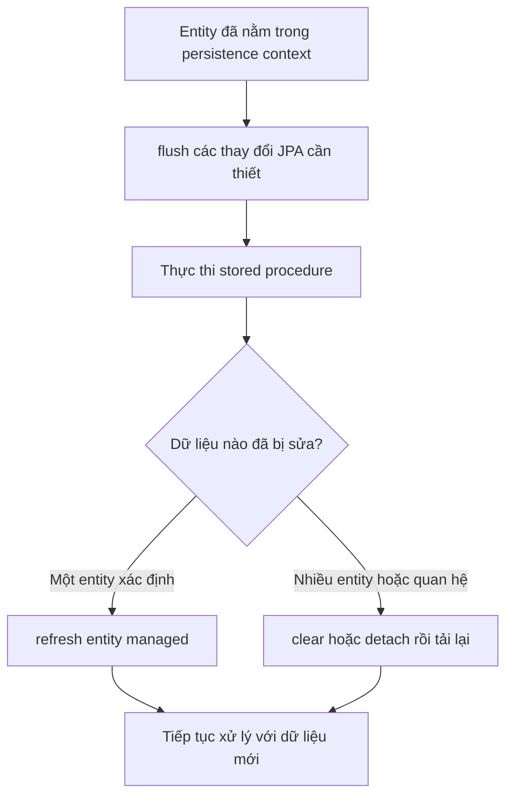

# Đồng bộ lại ngữ cảnh khi thủ tục thay đổi dữ liệu đã được quản lý

Trong ứng dụng dùng **Jakarta Persistence (JPA)**, một entity có thể đã được tải vào `EntityManager` và đang ở trạng thái *managed*, trong khi **stored procedure** (thủ tục lưu trữ) trực tiếp sửa những hàng dữ liệu tương ứng trong cơ sở dữ liệu. Khi đó, dữ liệu ở database đã thay đổi nhưng đối tượng Java mà ứng dụng đang giữ **không nhất thiết được cập nhật**. Để xử lý đúng, cần hiểu ranh giới giữa giao dịch, *persistence context* và các tầng cache, rồi chủ động đồng bộ ở thời điểm phù hợp.

## 1. Vấn đề: Database thay đổi nhưng entity vẫn giữ trạng thái cũ

*Persistence context* là tập các entity được một `EntityManager` quản lý, thường gắn với một transaction trong ứng dụng Spring. Với mỗi cặp loại entity và khóa chính, context duy trì một thực thể Java được quản lý và theo dõi thay đổi để thực hiện *dirty checking*. Đây cũng là **cache cấp một (first-level cache)**.

Ví dụ, ứng dụng tải đơn hàng `id = 42`:

```java
PurchaseOrder order = entityManager.find(PurchaseOrder.class, 42L);
System.out.println(order.getStatus()); // PENDING
```

Sau đó một thủ tục `sp_approve_order` cập nhật hàng tương ứng thành `APPROVED` bằng SQL bên trong database. Nếu thủ tục được gọi trong cùng transaction, trạng thái có thể trở thành:

| Vị trí | `status` | `version` (nếu dùng optimistic locking) |
| --- | --- | --- |
| Hàng trong database sau thủ tục | `APPROVED` | `6` |
| Đối tượng `order` đang managed | `PENDING` | `5` |

JPA biết các thay đổi thực hiện qua entity managed và các thao tác mà provider theo dõi. Tuy nhiên, provider **không thể mặc nhiên suy ra mọi tác động phụ bên trong stored procedure**. Việc gọi lại `find(PurchaseOrder.class, 42L)` trong cùng context cũng có thể trả về **chính đối tượng cũ**, vì `find()` ưu tiên entity đã được quản lý.

Hệ quả thường gặp:

- Đọc `order.getStatus()` nhận dữ liệu cũ dù thủ tục đã thành công.
- Quy tắc nghiệp vụ, phản hồi API hoặc phép tính kế tiếp dựa trên trạng thái cũ.
- Một lần `flush()` tiếp theo có thể ghi đè một phần thay đổi của thủ tục hoặc gây `OptimisticLockException` khi cột `@Version` đã tăng ở database.
- Quan hệ đã tải trước đó, danh sách con và cache cấp hai có thể vẫn chứa thông tin không còn chính xác.

> **Phân biệt:** `flush()` đẩy thay đổi *từ persistence context xuống database*. `refresh()` nạp lại trạng thái *từ database lên entity đang managed*. Hai thao tác giải quyết hai hướng đồng bộ khác nhau.

## 2. Trình tự an toàn quanh lời gọi stored procedure

Với thủ tục sửa một entity đã được tải, quy trình thường là:

1. Đảm bảo thao tác JPA và thủ tục cùng tham gia transaction dự kiến.
2. Gọi `entityManager.flush()` nếu có thay đổi đang chờ ghi mà thủ tục cần đọc hoặc xử lý. Việc flush tường minh làm thứ tự thao tác dễ kiểm soát.
3. Thực thi thủ tục và xử lý kết quả hoặc lỗi mà database trả về.
4. Dùng `entityManager.refresh(entity)` cho entity cụ thể, hoặc `clear()`/`detach()` rồi truy vấn lại nếu thay đổi trải rộng trên nhiều entity.
5. Xem xét vô hiệu hóa cache cấp hai và query cache khi thủ tục sửa dữ liệu vượt ngoài khả năng theo dõi của provider.
6. Chỉ tiếp tục xử lý nghiệp vụ bằng những entity hoặc kết quả truy vấn đã được đồng bộ.



Không nên giả định rằng gọi `execute()`, hoàn tất thủ tục hoặc commit transaction sẽ tự động thay thế mọi giá trị trong các entity Java đang managed. Cũng không nên dùng `flush()` lần thứ hai như một cách “đọc lại”: thao tác này không có chức năng làm mới dữ liệu.

## 3. Cách 1: `EntityManager.refresh()` cho một entity cụ thể

`refresh(entity)` tải lại trạng thái liên tục (*persistent state*) của entity được quản lý từ database và ghi đè các giá trị tương ứng trong đối tượng hiện tại. Đây là lựa chọn phù hợp khi biết rõ thủ tục sửa một hàng mà ứng dụng đang giữ.

Giả sử miền nghiệp vụ có entity sau:

```java
import jakarta.persistence.Entity;
import jakarta.persistence.EnumType;
import jakarta.persistence.Enumerated;
import jakarta.persistence.Id;
import jakarta.persistence.Table;
import jakarta.persistence.Version;

@Entity
@Table(name = "purchase_orders")
public class PurchaseOrder {
    @Id
    private Long id;

    @Version
    private long version;

    @Enumerated(EnumType.STRING)
    private OrderStatus status;

    protected PurchaseOrder() {}

    public OrderStatus getStatus() {
        return status;
    }
}
```

`OrderStatus` là enum của ứng dụng, ví dụ gồm `PENDING`, `APPROVED`, `REJECTED`. Một service gọi thủ tục rồi đồng bộ entity như sau:

```java
import jakarta.persistence.EntityManager;
import jakarta.persistence.EntityNotFoundException;
import jakarta.persistence.ParameterMode;
import jakarta.persistence.PersistenceContext;
import jakarta.persistence.StoredProcedureQuery;
import org.springframework.stereotype.Service;
import org.springframework.transaction.annotation.Transactional;

@Service
public class OrderApprovalService {
    @PersistenceContext
    private EntityManager entityManager;

    @Transactional
    public OrderStatus approve(Long orderId) {
        PurchaseOrder order = entityManager.find(PurchaseOrder.class, orderId);
        if (order == null) {
            throw new EntityNotFoundException("Order not found: " + orderId);
        }

        // Ghi các thay đổi JPA đang chờ trước khi chạy thủ tục.
        entityManager.flush();

        StoredProcedureQuery procedure =
                entityManager.createStoredProcedureQuery("sp_approve_order");
        procedure.registerStoredProcedureParameter(
                "p_order_id", Long.class, ParameterMode.IN);
        procedure.setParameter("p_order_id", orderId);
        procedure.execute();

        // Thủ tục đã sửa hàng trong DB; nạp lại entity đang managed.
        entityManager.refresh(order);
        return order.getStatus();
    }
}
```

Ví dụ giả định thủ tục tồn tại và hỗ trợ tham số tên `p_order_id`; cú pháp định nghĩa thủ tục, cách gọi và hỗ trợ tham số tên có thể khác nhau giữa database/JPA provider. Transaction do Spring quản lý bảo đảm các thao tác của service tham gia cùng transaction khi cấu hình datasource phù hợp. Thủ tục không nên tự thực hiện thao tác transaction làm phá vỡ phạm vi giao dịch mong muốn.

**Điểm cần lưu ý khi dùng `refresh()`:**

- Đối số phải là entity đang managed. Nếu entity đã `detach()` hoặc context đã `clear()`, cần `find()` lại trước khi `refresh()`; truyền đối tượng detached có thể gây `IllegalArgumentException`.
- `refresh()` **ghi đè thay đổi chưa flush** trên entity đó. Nếu muốn giữ thay đổi Java, phải sắp xếp thứ tự và flush có chủ đích trước khi làm mới.
- `refresh()` chỉ là thao tác làm mới entity mục tiêu theo ngữ nghĩa JPA và cấu hình cascade refresh. Không nên mặc định rằng mọi entity liên quan hoặc collection đã khởi tạo cũng được đồng bộ đầy đủ.
- Nếu thủ tục đã **xóa** hàng của entity, `refresh()` có thể thất bại vì hàng không còn tồn tại; nên xử lý trường hợp xóa bằng cách bỏ các tham chiếu cũ và truy vấn lại.
- Đọc lại chỉ nhìn thấy dữ liệu mà transaction hiện tại có quyền thấy theo mức cô lập của database. `refresh()` không vượt qua quy tắc transaction isolation.

## 4. Cách 2: `clear()` hoặc `detach()` rồi tải lại

Khi thủ tục cập nhật nhiều hàng, nhiều loại entity, thay đổi quan hệ, thêm/xóa dữ liệu con hoặc ảnh hưởng một tập kết quả truy vấn, việc `refresh()` từng entity có thể thiếu sót. Khi đó, thường dễ kiểm soát hơn nếu loại bỏ các đối tượng cũ khỏi context và truy vấn lại.

```java
@Transactional
public PurchaseOrder approveAndReload(Long orderId) {
    PurchaseOrder oldOrder = entityManager.find(PurchaseOrder.class, orderId);
    if (oldOrder == null) {
        throw new EntityNotFoundException("Order not found: " + orderId);
    }

    entityManager.flush();
    callApproveProcedure(orderId); // Hàm gọi stored procedure của ứng dụng.

    entityManager.clear();
    // oldOrder đã detached; không tiếp tục dùng nó để đọc trạng thái mới.
    return entityManager.find(PurchaseOrder.class, orderId);
}
```

`clear()` làm **mọi** entity trong context trở thành detached; các thay đổi chưa được flush có thể bị bỏ mất. Vì vậy, phải cân nhắc phạm vi context và gọi `flush()` trước nếu muốn giữ lại những thay đổi đã làm. Nếu chỉ cần bỏ một đối tượng, có thể dùng:

```java
entityManager.flush();
callApproveProcedure(orderId);

entityManager.detach(order);
PurchaseOrder reloaded = entityManager.find(PurchaseOrder.class, orderId);
```

`detach(order)` chỉ bỏ một entity khỏi context; các entity managed khác có thể vẫn cũ. Ngoài ra, biến `order` ban đầu vẫn trỏ đến **đối tượng detached cũ**. Khi dùng `clear()` hoặc `detach()`, phải truyền đối tượng **mới được tải** cho các phần xử lý tiếp theo.

Nếu thủ tục sửa bảng con, một danh sách `order.getItems()` đã tải hoặc một aggregate liên quan, cần tải lại đúng những phần dữ liệu đó. Có thể dùng truy vấn mới sau `clear()`, kết hợp `JOIN FETCH` hoặc `EntityGraph` khi ứng dụng cần một tập quan hệ cụ thể. Việc gọi `refresh(order)` đơn lẻ không phải cam kết rằng toàn bộ đồ thị đối tượng đều được tải lại.

## 5. Phân biệt persistence context với cache cấp hai

Ứng dụng có thể có thêm **second-level cache** dùng chung giữa các `EntityManager`, ví dụ khi Hibernate được cấu hình cache. Stored procedure cập nhật trực tiếp database có thể làm các cache này lỗi thời, nhất là khi provider không nhận biết bảng hay entity nào bị thay đổi.

| Công cụ | Phạm vi tác động | Điều **không** thực hiện |
| --- | --- | --- |
| `entityManager.flush()` | Ghi thay đổi JPA đang chờ xuống database | Không nạp lại dữ liệu do thủ tục sửa |
| `entityManager.refresh(entity)` | Nạp lại một entity đang managed | Không làm mới mặc định mọi entity khác |
| `entityManager.detach(entity)` | Loại một entity khỏi context hiện tại | Không xóa toàn bộ context hoặc cache cấp hai |
| `entityManager.clear()` | Loại tất cả entity khỏi context hiện tại | Không tự xóa cache cấp hai |
| `entityManagerFactory.getCache().evict(type, id)` | Loại bản cache cấp hai của một entity khi cache được hỗ trợ | Không thay đổi entity đang managed trong context hiện tại |

Nếu biết thủ tục sửa đơn hàng `42`, có thể vô hiệu hóa bản cache cấp hai tương ứng trước lần tải lại:

```java
entityManager.flush();
callApproveProcedure(orderId);

entityManager.getEntityManagerFactory()
             .getCache()
             .evict(PurchaseOrder.class, orderId);

entityManager.clear();
PurchaseOrder freshOrder = entityManager.find(PurchaseOrder.class, orderId);
```

JPA cung cấp `Cache.evict(Class, id)`, `Cache.evict(Class)` và `Cache.evictAll()` để xóa cache entity ở các mức rộng dần. **Chỉ xóa những gì cần thiết** vì `evictAll()` có thể làm giảm hiệu quả cache trên toàn ứng dụng. Cache cấp hai và query cache là những cơ chế khác nhau: nếu bật query cache của Hibernate hoặc một provider khác, việc vô hiệu hóa kết quả truy vấn sau thay đổi trực tiếp có thể cần API/cấu hình riêng của provider. Không giả định `Cache.evict()` của JPA tự xử lý mọi query cache.

Việc `clear()` rồi `find()` cũng chưa đủ nếu dữ liệu cũ vẫn có thể đến từ cache cấp hai. Ngược lại, chỉ `evict()` cache cấp hai cũng không cập nhật đối tượng Java vẫn đang managed trong context hiện tại. Trong hệ thống có cache, thường phải xem xét **cả hai tầng**.

## 6. Khi thủ tục tác động đến `@Version` và optimistic locking

Một entity dùng `@Version` thường được JPA kiểm tra phiên bản để phát hiện cập nhật đồng thời. Ví dụ thủ tục thay đổi trạng thái đơn hàng:

```sql
-- SQL minh họa; cú pháp thủ tục cụ thể tùy hệ quản trị CSDL.
UPDATE purchase_orders
SET status = 'APPROVED',
    version = version + 1
WHERE id = :order_id;
```

Giả sử entity managed còn `version = 5`, trong database đã thành `6`. Nếu tiếp tục sửa entity cũ rồi flush, câu lệnh cập nhật có thể không khớp phiên bản và JPA báo `OptimisticLockException`. Trường hợp này cho thấy nguy cơ dùng trạng thái managed đã cũ; **không nên vô hiệu hóa optimistic locking để né lỗi**.

Nếu thủ tục chủ động thay đổi dữ liệu của entity có `@Version`, cần thống nhất quy tắc phiên bản với các cập nhật JPA. Việc cập nhật cột `version` trong thủ tục phải phù hợp với kiểu dữ liệu và cơ chế khóa lạc quan đang dùng; thủ tục tự viết cũng cần điều kiện kiểm tra phiên bản khi có thể xảy ra cạnh tranh ghi. Sau thủ tục, `refresh()` hoặc tải lại giúp entity lấy phiên bản mới, nhưng **không thay thế việc kiểm soát xung đột** trong SQL của thủ tục.

Nếu thủ tục **không** cập nhật `version` dù đã sửa các cột JPA quản lý, hệ thống có nguy cơ bỏ lỡ xung đột hoặc ghi đè dữ liệu theo thời điểm khác. Đó là lỗi thiết kế phối hợp giữa JPA và thủ tục, không thể xử lý triệt để chỉ bằng cách gọi `refresh()`.

## 7. Chọn chiến lược theo phạm vi thay đổi

| Tình huống | Cách xử lý thường phù hợp |
| --- | --- |
| Thủ tục sửa các cột của một entity đang managed | `flush()` nếu cần, gọi thủ tục, sau đó `refresh(entity)` |
| Thủ tục sửa hàng loạt entity cùng loại | `flush()`, gọi thủ tục, cân nhắc `clear()` và truy vấn lại tập dữ liệu cần dùng |
| Thủ tục thêm/xóa hàng con hoặc thay đổi mối quan hệ | Vô hiệu hóa các tham chiếu/collection cũ và tải lại graph cần thiết |
| Thủ tục sửa dữ liệu có cache cấp hai | Evict entity/region liên quan, đồng thời làm mới hoặc xóa persistence context |
| Thủ tục sửa dữ liệu được query cache lưu | Áp dụng cơ chế vô hiệu hóa query cache theo provider |
| Thủ tục xóa hàng của entity đang managed | Bỏ tham chiếu managed cũ, truy vấn lại và xử lý khả năng không tìm thấy hàng |
| Thủ tục chỉ đọc, không sửa dữ liệu | Thường không cần làm mới entity chỉ vì thủ tục được gọi |

Không dùng `merge()` như một cách “đọc lại từ database”. `merge()` sao chép trạng thái của một entity detached vào entity managed và có thể khiến dữ liệu cũ được ghi trở lại database khi flush. Để lấy trạng thái mới, hãy dùng `refresh()` hoặc tải lại sau khi loại bỏ trạng thái cũ khỏi context.

## 8. Các lỗi thường gặp và cách phòng tránh

**Lỗi 1 — Gọi lại `find()` nhưng vẫn thấy dữ liệu cũ.** Trong cùng persistence context, `find()` có thể trả về entity đã managed. Hãy `refresh(entity)` hoặc `clear()`/`detach()` rồi `find()` lại, đồng thời xét cache cấp hai nếu bật.

**Lỗi 2 — Gọi `refresh()` trước khi flush thay đổi cần lưu.** `refresh()` có thể ghi đè những giá trị mới chỉ tồn tại trong Java. Hãy xác định rõ thay đổi nào cần lưu trước thủ tục, gọi `flush()` ở điểm phù hợp và chỉ sau đó đồng bộ từ database.

**Lỗi 3 — Chỉ làm mới entity cha khi thủ tục đã sửa danh sách con.** Một collection đã khởi tạo có thể giữ trạng thái cũ. Cần làm mới hoặc tải lại tập quan hệ thực sự bị tác động; trong trường hợp phức tạp, `clear()` rồi truy vấn aggregate là phương án dễ kiểm soát.

**Lỗi 4 — Xóa cache cấp hai nhưng không xóa context hiện tại.** Entity managed vẫn là đối tượng cũ. Phải làm mới/bỏ đối tượng ở cấp một tương ứng.

**Lỗi 5 — Dùng `clear()` khi còn nhiều thay đổi chưa flush.** Những thay đổi chưa được ghi có thể mất đi, và tất cả entity cũ đều detached. Chỉ `clear()` tại điểm transaction phù hợp và dùng lại các entity vừa được tải.

**Lỗi 6 — Cho rằng chạy xong thủ tục đồng nghĩa dữ liệu đã commit.** Thủ tục chạy thành công và transaction commit là hai sự kiện khác nhau. Nếu thủ tục tham gia transaction đang mở, các thay đổi thường chỉ commit khi transaction kết thúc; kết quả quan sát được từ transaction khác còn phụ thuộc isolation và commit.

**Lỗi 7 — Dùng `@Modifying(clearAutomatically = true)` như một bảo đảm chung cho mọi thủ tục.** Thuộc tính này chủ yếu phục vụ các phương thức Spring Data JPA có `@Modifying` thực thi câu lệnh cập nhật/xóa; không nên suy ra mọi phương thức `@Procedure` sẽ tự clear/refresh persistence context. Với stored procedure, hãy kiểm soát đồng bộ rõ ràng trong service và theo hành vi provider thực tế.

## 9. Nguyên tắc thiết kế cho ứng dụng thực tế

Lý tưởng nhất, mỗi lời gọi thủ tục có **hợp đồng tác động dữ liệu** rõ ràng: bảng hoặc entity nào được sửa, có thay đổi `@Version` không, có thêm/xóa bản ghi quan hệ không, có tự quản lý transaction không và cache nào có thể bị ảnh hưởng. Từ hợp đồng đó, service chọn đúng phạm vi refresh hoặc invalidation.

Giữ thao tác **flush → gọi thủ tục → đồng bộ → xử lý tiếp** gần nhau giúp tránh dùng nhầm tham chiếu cũ. Nếu thủ tục sửa dữ liệu trên diện rộng, nên thiết kế transaction ngắn, tải lại những gì thực sự cần cho bước tiếp theo và hạn chế giữ nhiều entity managed quá lâu. Khi thủ tục tác động đến các dòng mà nhiều transaction cùng cập nhật, kết hợp xử lý phiên bản, khóa và isolation ở tầng database/JPA; đồng bộ persistence context không tự giải quyết mọi tình huống đồng thời.

Khi viết kiểm thử tích hợp cho một thủ tục, nên tạo tình huống entity đã được `find()` **trước khi** gọi thủ tục, rồi kiểm chứng trạng thái **sau khi** `refresh()` hoặc tải lại. Cần kiểm tra cả trường hợp thủ tục thay đổi quan hệ, phiên bản và dữ liệu được cache nếu những cơ chế đó được bật; chỉ test bằng cách tạo `EntityManager` mới từ đầu có thể bỏ sót lỗi stale state trong context đang sử dụng.

**Ghi nhớ:** JPA quản lý trạng thái của entity trong persistence context, còn stored procedure có thể thay đổi database ngoài tầm quan sát trực tiếp của cơ chế dirty checking. Khi hai cơ chế cùng thao tác trên một dữ liệu, ứng dụng phải chủ động xác định thời điểm flush, làm mới trạng thái managed và vô hiệu hóa cache liên quan để những bước nghiệp vụ sau sử dụng dữ liệu nhất quán.
