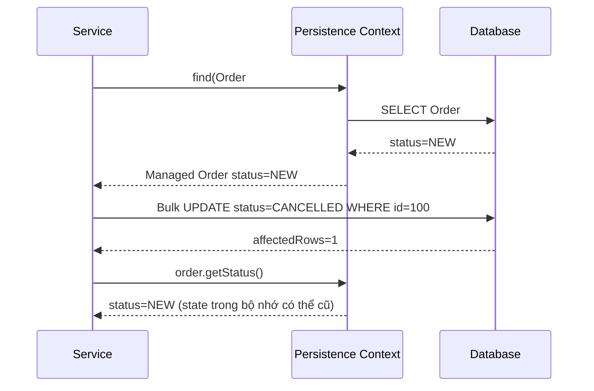

# Tạo truy vấn thay đổi bằng CriteriaUpdate và CriteriaDelete

Khi học JPA, chúng ta thường thay đổi dữ liệu thông qua **managed entity**: gọi `find()`, sửa thuộc tính, rồi để cơ chế **dirty checking** phát sinh SQL `UPDATE` khi flush. Việc xóa cũng thường dùng `EntityManager.remove(entity)`. Cách này rất phù hợp khi nghiệp vụ cần kiểm tra từng entity, chạy callback, áp dụng cascade và kiểm soát optimistic locking.

Nhưng nếu cần **đổi trạng thái hàng nghìn đơn hàng** hoặc **xóa những bản ghi đã hết hạn** theo một bộ điều kiện, việc tải từng entity vào bộ nhớ rồi sửa/xóa không phải lúc nào cũng hợp lý. JPA có hai API Criteria dành riêng cho **bulk data modification**:

- **`CriteriaUpdate<T>`**: xây câu lệnh cập nhật nhiều hàng của một entity type.
- **`CriteriaDelete<T>`**: xây câu lệnh xóa nhiều hàng của một entity type.

Cả hai thuộc Jakarta Persistence Criteria API, cho phép mô tả điều kiện thay đổi dữ liệu bằng Java thay vì ghép chuỗi JPQL.

Ví dụ ngắn:

```java
CriteriaBuilder cb = entityManager.getCriteriaBuilder();

CriteriaUpdate<PurchaseOrder> update =
    cb.createCriteriaUpdate(PurchaseOrder.class);

Root<PurchaseOrder> order = update.from(PurchaseOrder.class);

update.set(order.get("status"), OrderStatus.ARCHIVED);
update.where(cb.equal(order.get("status"), OrderStatus.CANCELLED));

int affectedRows = entityManager
    .createQuery(update)
    .executeUpdate();
```

Và xóa:

```java
CriteriaDelete<PurchaseOrder> delete =
    cb.createCriteriaDelete(PurchaseOrder.class);

Root<PurchaseOrder> target = delete.from(PurchaseOrder.class);

delete.where(cb.equal(target.get("status"), OrderStatus.ARCHIVED));

int deletedRows = entityManager
    .createQuery(delete)
    .executeUpdate();
```

Hai đoạn trên minh họa cú pháp, **chưa đủ điều kiện để dùng an toàn trong production**. Cần transaction, điều kiện giới hạn phạm vi dữ liệu, kiểm tra khóa ngoại và hiểu hệ quả đối với persistence context.

> **Nguyên tắc trọng tâm:** `CriteriaUpdate`/`CriteriaDelete` thực thi bulk SQL trực tiếp qua database. Chúng **không đi qua cơ chế thay đổi/xóa từng managed entity**, nên không tự đồng bộ trạng thái của những entity đã được nạp, không tự thực hiện JPA lifecycle callbacks/cascade theo từng entity và không mặc nhiên áp dụng optimistic version checking giống dirty checking.

Bài này thuộc chương **Truy vấn thay đổi** của module **Data Persistence Relational Access ORM JPA**. Chúng ta sẽ xây dựng truy vấn thay đổi đúng kiểu, tránh xóa/cập nhật diện rộng ngoài ý muốn, xử lý dữ liệu cũ trong persistence context, ràng buộc khóa ngoại, concurrency, phân quyền nhiều tenant, truy vấn động, Spring Data JPA và các lỗi thường gặp.

---

## 1. Khi nào nên dùng CriteriaUpdate hoặc CriteriaDelete?

Giả sử ứng dụng thương mại điện tử có hàng trăm nghìn đơn hàng. Một nghiệp vụ định kỳ yêu cầu:

> “Đánh dấu các đơn `CANCELLED` tạo trước một mốc thời gian thành `ARCHIVED`.”

Cách sửa từng entity:

```java
List<PurchaseOrder> orders = entityManager.createQuery(
    """
    select o
    from PurchaseOrder o
    where o.status = :status
      and o.createdAt < :cutoff
    """,
    PurchaseOrder.class
)
.setParameter("status", OrderStatus.CANCELLED)
.setParameter("cutoff", cutoff)
.getResultList();

for (PurchaseOrder order : orders) {
    order.archive();
}
```

Đây là cách hợp lý nếu `archive()` thực hiện logic nghiệp vụ theo từng entity, hệ thống cần callbacks hoặc có các side effects đặc biệt. Nhưng nó có thể tốn:

- Bộ nhớ để materialize nhiều entities.
- Thời gian tải entity từ database về JVM.
- Chi phí dirty checking và SQL per-row, dù batching có thể giảm số round trips.
- Chi phí khởi tạo association nếu domain method sử dụng quan hệ.
- Thời gian giữ nhiều managed objects trong persistence context.

Một bulk update:

```java
CriteriaUpdate<PurchaseOrder> change =
    cb.createCriteriaUpdate(PurchaseOrder.class);

Root<PurchaseOrder> o = change.from(PurchaseOrder.class);

change.set(o.get("status"), OrderStatus.ARCHIVED)
      .where(
          cb.equal(o.get("status"), OrderStatus.CANCELLED),
          cb.lessThan(o.<LocalDateTime>get("createdAt"), cutoff)
      );

int changed = entityManager
    .createQuery(change)
    .executeUpdate();
```

có thể dịch thành SQL dạng:

```sql
UPDATE purchase_orders
SET status = 'ARCHIVED'
WHERE status = 'CANCELLED'
  AND created_at < ?;
```

Database xử lý theo tập hàng thỏa điều kiện, thường không cần tải từng `PurchaseOrder` vào application.

**Đổi lại:** bulk update không gọi `archive()` trên từng entity, không tự chạy callback JPA hay tăng version. Vì vậy nó phù hợp khi việc cập nhật có thể biểu diễn an toàn bằng một câu SQL set-based.

### Bảng quyết định nhanh

| Yêu cầu | Thao tác thường phù hợp |
|---|---|
| Sửa một entity và chạy domain rules | Managed entity + dirty checking |
| Cần `@PreUpdate` hoặc entity listener theo từng bản ghi | Managed entity |
| Cập nhật hàng loạt theo điều kiện | `CriteriaUpdate` hoặc JPQL bulk UPDATE |
| Xóa hàng loạt theo điều kiện | `CriteriaDelete` hoặc JPQL bulk DELETE |
| Cần `CascadeType.REMOVE`/`orphanRemoval` theo entity | `remove()`/domain operation phù hợp |
| Cần cập nhật số lượng tồn kho atomically | Bulk UPDATE với điều kiện và phép tính ở DB |
| Cần `ORDER BY / LIMIT` trong DELETE vendor-specific | Native SQL theo database hoặc chọn IDs trước |
| Muốn query động nhưng không ghép chuỗi JPQL | Criteria API |
| Chỉ xóa một entity theo ID, có các callback/cascade | `find()` + `remove()` hoặc API repository phù hợp |

**Không dùng bulk DML chỉ vì code ngắn hơn.** Chọn dựa trên tác động dữ liệu và ràng buộc của nghiệp vụ.

## 2. Mô hình entity xuyên suốt

Ta dùng một entity đơn hàng có các trường cần thiết:

```java
import jakarta.persistence.*;
import java.math.BigDecimal;
import java.time.LocalDateTime;
import java.util.ArrayList;
import java.util.List;

@Entity
@Table(name = "purchase_orders")
public class PurchaseOrder {

    @Id
    private Long id;

    @Column(name = "tenant_id", nullable = false)
    private String tenantId;

    @Enumerated(EnumType.STRING)
    @Column(name = "status", nullable = false)
    private OrderStatus status;

    @Column(name = "total_amount", nullable = false)
    private BigDecimal totalAmount;

    @Column(name = "created_at", nullable = false)
    private LocalDateTime createdAt;

    @Column(name = "updated_at", nullable = false)
    private LocalDateTime updatedAt;

    @Column(name = "deleted_at")
    private LocalDateTime deletedAt;

    @Version
    @Column(name = "version", nullable = false)
    private Long version;

    @ManyToOne(fetch = FetchType.LAZY, optional = false)
    @JoinColumn(name = "customer_id", nullable = false)
    private Customer customer;

    @OneToMany(mappedBy = "order")
    private List<OrderLine> lines = new ArrayList<>();

    protected PurchaseOrder() {}

    public Long getId() { return id; }
    public String getTenantId() { return tenantId; }
    public OrderStatus getStatus() { return status; }
    public Long getVersion() { return version; }
    public LocalDateTime getUpdatedAt() { return updatedAt; }

    public void archive() {
        if (status != OrderStatus.CANCELLED) {
            throw new IllegalStateException(
                "Only cancelled orders can be archived"
            );
        }
        status = OrderStatus.ARCHIVED;
        updatedAt = LocalDateTime.now();
    }
}
```

Enum:

```java
public enum OrderStatus {
    NEW,
    PAID,
    CANCELLED,
    ARCHIVED
}
```

Entity liên quan:

```java
@Entity
@Table(name = "customers")
public class Customer {
    @Id
    private Long id;

    @Column(name = "active", nullable = false)
    private boolean active;

    protected Customer() {}
}
```

```java
@Entity
@Table(name = "order_lines")
public class OrderLine {
    @Id
    private Long id;

    @ManyToOne(fetch = FetchType.LAZY, optional = false)
    @JoinColumn(name = "order_id", nullable = false)
    private PurchaseOrder order;

    protected OrderLine() {}
}
```

SQL schema rút gọn:

```sql
CREATE TABLE customers (
    id BIGINT PRIMARY KEY,
    active BOOLEAN NOT NULL
);

CREATE TABLE purchase_orders (
    id BIGINT PRIMARY KEY,
    tenant_id VARCHAR(100) NOT NULL,
    status VARCHAR(30) NOT NULL,
    total_amount NUMERIC(19, 2) NOT NULL,
    created_at TIMESTAMP NOT NULL,
    updated_at TIMESTAMP NOT NULL,
    deleted_at TIMESTAMP NULL,
    version BIGINT NOT NULL,
    customer_id BIGINT NOT NULL,
    FOREIGN KEY (customer_id) REFERENCES customers(id)
);

CREATE TABLE order_lines (
    id BIGINT PRIMARY KEY,
    order_id BIGINT NOT NULL,
    FOREIGN KEY (order_id) REFERENCES purchase_orders(id)
);
```

`tenantId` được đưa vào để nhắc rằng bulk update/delete phải **giới hạn phạm vi dữ liệu được phép tác động**, nhất là trong hệ thống đa tenant. Trong ứng dụng thật, giá trị tenant phải lấy từ security context đáng tin cậy.

Các ví dụ tiếp theo giả định:

```java
EntityManager em = ...;
CriteriaBuilder cb = em.getCriteriaBuilder();
```

và đang ở transaction thích hợp nếu truy vấn có thao tác ghi.

## 3. Criteria API SELECT khác bulk UPDATE/DELETE ở đâu?

Criteria SELECT:

```java
CriteriaQuery<PurchaseOrder> cq =
    cb.createQuery(PurchaseOrder.class);

Root<PurchaseOrder> o = cq.from(PurchaseOrder.class);

cq.select(o).where(cb.equal(o.get("status"), OrderStatus.NEW));

List<PurchaseOrder> orders =
    em.createQuery(cq).getResultList();
```

Criteria UPDATE:

```java
CriteriaUpdate<PurchaseOrder> cu =
    cb.createCriteriaUpdate(PurchaseOrder.class);

Root<PurchaseOrder> o = cu.from(PurchaseOrder.class);

cu.set(o.get("status"), OrderStatus.CANCELLED);
cu.where(cb.equal(o.get("status"), OrderStatus.NEW));

int affected = em.createQuery(cu).executeUpdate();
```

Criteria DELETE:

```java
CriteriaDelete<PurchaseOrder> cd =
    cb.createCriteriaDelete(PurchaseOrder.class);

Root<PurchaseOrder> o = cd.from(PurchaseOrder.class);

cd.where(cb.equal(o.get("status"), OrderStatus.ARCHIVED));

int deleted = em.createQuery(cd).executeUpdate();
```

| Đặc điểm | `CriteriaQuery<T>` | `CriteriaUpdate<T>` | `CriteriaDelete<T>` |
|---|---|---|---|
| Tác vụ | Đọc dữ liệu | Cập nhật hàng loạt | Xóa hàng loạt |
| Khởi tạo | `createQuery(T.class)` | `createCriteriaUpdate(T.class)` | `createCriteriaDelete(T.class)` |
| Entity gốc | `from(T.class)` | `from(T.class)` | `from(T.class)` |
| Chọn dữ liệu | `select/multiselect` | Không có SELECT | Không có SELECT |
| Thay giá trị | Không có `set` DML | `set(Path, value/expression)` | Không có SET |
| Điều kiện | `where` | `where` | `where` |
| Thực thi | `getResultList/getSingleResult` | `executeUpdate` | `executeUpdate` |
| Kết quả thông thường | Entity/DTO/scalar | Số hàng bị ảnh hưởng | Số hàng bị xóa |
| Entity callbacks/cascade từng entity | Không áp dụng trực tiếp cho SELECT | Bị bỏ qua | Bị bỏ qua |
| Có thể tạo JOIN tùy ý như SELECT? | Có theo Criteria SELECT | Bulk DML bị giới hạn | Bulk DML bị giới hạn |

**Không gọi `getResultList()` trên bulk UPDATE/DELETE**. Truy vấn thay đổi thông thường không trả danh sách entity; API chính để thực thi là `executeUpdate()`.

## 4. Các interface nền tảng

Những kiểu quan trọng:

```java
CriteriaBuilder
CriteriaUpdate<T>
CriteriaDelete<T>
Root<T>
Path<X>
Predicate
ParameterExpression<X>
Query
```

Cú pháp:

```java
CriteriaBuilder cb = em.getCriteriaBuilder();

CriteriaUpdate<PurchaseOrder> update =
    cb.createCriteriaUpdate(PurchaseOrder.class);

Root<PurchaseOrder> root =
    update.from(PurchaseOrder.class);
```

`CriteriaUpdate<T>` mô tả **loại entity mục tiêu**; `Root<T>` được tạo từ chính update đó, chứ không nên lấy từ một `CriteriaQuery` SELECT độc lập.

Tương tự:

```java
CriteriaDelete<PurchaseOrder> delete =
    cb.createCriteriaDelete(PurchaseOrder.class);

Root<PurchaseOrder> root =
    delete.from(PurchaseOrder.class);
```

Nhiều người quen với SELECT và cố viết:

```java
CriteriaQuery<PurchaseOrder> select =
    cb.createQuery(PurchaseOrder.class);

Root<PurchaseOrder> selectRoot =
    select.from(PurchaseOrder.class);

// Sai ý tưởng: tái sử dụng selectRoot bên trong
// một CriteriaUpdate khác không có cùng query tree.
```

Các node Criteria thuộc cây query của chúng; khi tạo update/delete, **hãy xây root và predicate trong đúng cây**.

## 5. Tạo CriteriaUpdate theo từng bước

Yêu cầu:

> “Chuyển các đơn NEW thuộc một tenant sang CANCELLED, đồng thời cập nhật thời điểm sửa.”

```java
public int cancelNewOrders(
        String tenantId,
        LocalDateTime now) {

    CriteriaBuilder cb = em.getCriteriaBuilder();

    CriteriaUpdate<PurchaseOrder> update =
        cb.createCriteriaUpdate(PurchaseOrder.class);

    Root<PurchaseOrder> o = update.from(PurchaseOrder.class);

    update.set(o.get("status"), OrderStatus.CANCELLED);
    update.set(o.get("updatedAt"), now);

    update.where(
        cb.equal(o.get("tenantId"), tenantId),
        cb.equal(o.get("status"), OrderStatus.NEW),
        cb.isNull(o.get("deletedAt"))
    );

    return em.createQuery(update).executeUpdate();
}
```

Đọc từng bước:

1. Lấy `CriteriaBuilder` từ `EntityManager`.
2. Khởi tạo `CriteriaUpdate<PurchaseOrder>`.
3. Gọi `update.from(PurchaseOrder.class)` để xác định entity mục tiêu.
4. Dùng `set(...)` mô tả cột/thuộc tính cần thay.
5. Dùng `where(...)` mô tả tập bản ghi được phép thay đổi.
6. Gọi `em.createQuery(update).executeUpdate()` để chạy bulk DML.

SQL có thể gần như:

```sql
UPDATE purchase_orders
SET status = 'CANCELLED', updated_at = ?
WHERE tenant_id = ?
  AND status = 'NEW'
  AND deleted_at IS NULL;
```

Đây là SQL minh họa; provider/dialect tự chọn cách bind, quoting và câu SQL thực tế.

### Cảnh báo quan trọng về phương thức trên

Phương thức chưa khai `@Transactional` và chưa validate tenant/time: trong ứng dụng cần bổ sung transaction boundary và kiểm tra quyền. Không nên gọi trực tiếp từ HTTP controller mà bỏ qua security context.

## 6. `set()` hoạt động như thế nào?

Các dạng thường gặp trong `CriteriaUpdate`:

```java
update.set(root.get("status"), OrderStatus.ARCHIVED);
update.set(root.get("updatedAt"), now);
```

Hoặc dùng overload nhận tên attribute:

```java
update.set("status", OrderStatus.ARCHIVED);
```

Khi dùng `Root.get(...)`, code biểu diễn đường dẫn của thuộc tính trong entity mục tiêu.

### Với Path được định kiểu

```java
Path<OrderStatus> statusPath =
    root.get("status");

update.set(statusPath, OrderStatus.ARCHIVED);
```

Trong Java generic inference, khi cần có thể viết:

```java
Path<LocalDateTime> updatedAtPath =
    root.<LocalDateTime>get("updatedAt");

update.set(updatedAtPath, now);
```

Tại sao dùng kiểu tường minh?

- Giúp overload resolution của Java rõ ràng.
- Hạn chế tình trạng truyền nhầm giá trị không tương thích.
- Cải thiện khả năng IDE hỗ trợ refactor.
- Có ích khi truyền expression số học/SQL functions vào `set`.

### Không cập nhật tất cả thuộc tính

`CriteriaUpdate` chỉ cập nhật những field đã được chỉ định bằng `set`, khác với việc một số ORM strategies có thể gửi SQL update nhiều cột từ managed entity.

Một truy vấn:

```java
update.set(root.get("status"), OrderStatus.CANCELLED);
```

không tự cập nhật `updatedAt`, `version` hay các cột audit khác chỉ vì entity có mapping tương ứng. Nếu nghiệp vụ muốn cập nhật chúng, phải thiết kế tường minh.

## 7. Gán giá trị từ expression, không chỉ literal

`set()` còn chấp nhận một Criteria expression.

Ví dụ tính cộng số tiền dịch vụ cố định trong một trường hợp nghiệp vụ đã được kiểm soát:

```java
BigDecimal adjustment = new BigDecimal("5000.00");

CriteriaUpdate<PurchaseOrder> update =
    cb.createCriteriaUpdate(PurchaseOrder.class);

Root<PurchaseOrder> o = update.from(PurchaseOrder.class);

Path<BigDecimal> amount =
    o.<BigDecimal>get("totalAmount");

update.set(
    amount,
    cb.sum(amount, adjustment)
);

update.where(
    cb.equal(o.get("tenantId"), tenantId),
    cb.equal(o.get("status"), OrderStatus.NEW)
);

int changed = em.createQuery(update).executeUpdate();
```

Ý nghĩa SQL:

```sql
UPDATE purchase_orders
SET total_amount = total_amount + ?
WHERE tenant_id = ?
  AND status = 'NEW';
```

**Cảnh báo nghiệp vụ:** thực tế không nên tùy tiện thay tổng tiền đơn hàng đã xác nhận hoặc tính giá bằng phép cộng không có chứng từ. Ví dụ chỉ minh họa expression trong bulk update. Trường hợp thực tế phù hợp hơn có thể là tồn kho, counter hoặc điểm thưởng.

Các hàm thường dùng:

```java
cb.sum(numericExpression, number)
cb.diff(numericExpression, number)
cb.prod(numericExpression, number)
cb.quot(numericExpression, number)
cb.coalesce(expression, defaultValue)
cb.selectCase()
```

Khả năng dùng biểu thức phải khớp kiểu field và SQL mà provider có thể sinh. Với decimal/currency, xác định precision, scale và overflow tại database.

## 8. Ví dụ tồn kho: cập nhật số lượng atomically

Một entity bổ sung:

```java
@Entity
@Table(name = "products")
public class Product {

    @Id
    private Long id;

    @Column(name = "tenant_id", nullable = false)
    private String tenantId;

    @Column(name = "stock", nullable = false)
    private Integer stock;

    @Version
    @Column(name = "version", nullable = false)
    private Long version;

    protected Product() {}
}
```

Yêu cầu:

> “Trừ tồn kho `quantity` cho Product nếu tồn kho hiện tại đủ, chỉ trong tenant được cấp quyền.”

```java
@Transactional
public boolean reserveStock(
        String tenantId,
        long productId,
        int quantity) {

    if (quantity <= 0) {
        throw new IllegalArgumentException(
            "Quantity must be positive"
        );
    }

    CriteriaBuilder cb = em.getCriteriaBuilder();

    CriteriaUpdate<Product> update =
        cb.createCriteriaUpdate(Product.class);

    Root<Product> p = update.from(Product.class);

    Path<Integer> stock = p.<Integer>get("stock");

    update.set(
        stock,
        cb.diff(stock, quantity)
    );

    update.where(
        cb.equal(p.get("id"), productId),
        cb.equal(p.get("tenantId"), tenantId),
        cb.ge(stock, quantity)
    );

    int count = em.createQuery(update).executeUpdate();

    return count == 1;
}
```

SQL logic:

```sql
UPDATE products
SET stock = stock - ?
WHERE id = ?
  AND tenant_id = ?
  AND stock >= ?;
```

Ưu điểm:

- Việc kiểm tra và giảm stock diễn ra trong **một statement atomically** theo semantics database.
- Hai request cạnh tranh không cần làm trình tự “SELECT stock; tính lại; UPDATE stock” trong Java, vốn dễ tạo lost update.
- `executeUpdate() == 1` cho biết target row đã được cập nhật.
- `count == 0` có thể nghĩa là không tìm thấy product, sai tenant hoặc stock không đủ; không thể tự biết nguyên nhân nếu chỉ dựa vào count.

**Giới hạn:** JPA bulk update **không tự tăng trường `@Version`** của Product. Nếu hệ thống còn cập nhật Product qua managed entities và trông đợi optimistic locking, cần thiết kế versioning phù hợp (phần sau).

## 9. Dùng `where()` để giới hạn phạm vi

Ví dụ:

```java
update.where(
    cb.equal(o.get("tenantId"), tenantId),
    cb.equal(o.get("status"), OrderStatus.CANCELLED),
    cb.lessThan(o.<LocalDateTime>get("createdAt"), cutoff)
);
```

Các `Predicate` truyền cùng một lời gọi thường được kết hợp theo AND semantics.

Tương đương:

```java
Predicate byTenant =
    cb.equal(o.get("tenantId"), tenantId);

Predicate byStatus =
    cb.equal(o.get("status"), OrderStatus.CANCELLED);

Predicate oldEnough =
    cb.lessThan(
        o.<LocalDateTime>get("createdAt"),
        cutoff
    );

update.where(cb.and(byTenant, byStatus, oldEnough));
```

### Gọi `where()` nhiều lần có thể thay điều kiện trước

Dễ sai:

```java
update.where(cb.equal(o.get("tenantId"), tenantId));

// Lời gọi mới thay WHERE restriction đã có.
update.where(cb.equal(o.get("status"), OrderStatus.NEW));
```

Nếu không giữ predicate đầu tiên, query có thể **mất điều kiện tenant** và cập nhật diện rộng.

Đúng:

```java
List<Predicate> filters = new ArrayList<>();

filters.add(cb.equal(o.get("tenantId"), tenantId));
filters.add(cb.equal(o.get("status"), OrderStatus.NEW));

update.where(filters.toArray(new Predicate[0]));
```

**Không bao giờ dựa vào việc nhiều lần gọi `where()` sẽ tự nối AND**. Tạo một danh sách predicates rồi áp dụng một lần, hoặc chủ động xây `cb.and(...)`.

## 10. Không có WHERE: tác động toàn bộ bảng mục tiêu

Một CriteriaUpdate không có predicate giới hạn:

```java
CriteriaUpdate<PurchaseOrder> update =
    cb.createCriteriaUpdate(PurchaseOrder.class);

Root<PurchaseOrder> o = update.from(PurchaseOrder.class);

update.set(o.get("status"), OrderStatus.ARCHIVED);

em.createQuery(update).executeUpdate();
```

về mặt ngữ nghĩa có thể tương đương:

```sql
UPDATE purchase_orders
SET status = 'ARCHIVED';
```

Một CriteriaDelete không có WHERE:

```java
CriteriaDelete<PurchaseOrder> delete =
    cb.createCriteriaDelete(PurchaseOrder.class);

delete.from(PurchaseOrder.class);

em.createQuery(delete).executeUpdate();
```

có thể tương đương **xóa toàn bộ các hàng** ở bảng/entity mục tiêu, nếu database constraints cho phép.

Vì thế bulk DML là API có sức ảnh hưởng cao. Những biện pháp phòng vệ:

1. Bắt buộc tenant/owner boundary trong truy vấn multi-tenant.
2. Validate tham số lọc và policy trước khi chạy.
3. Không cho request tùy ý chọn tên entity/field để đổi.
4. Khi cần xóa diện rộng, có thể yêu cầu dry run/approval theo quy trình vận hành.
5. Log số hàng dự kiến và số hàng thực tế ở mức metadata không nhạy cảm.
6. Dùng transaction, giới hạn batch, kế hoạch rollback.
7. Đừng tạo `cb.conjunction()` làm WHERE mặc định rồi nhầm rằng đó là điều kiện an toàn: nó có nghĩa TRUE, tương tự không lọc.

## 11. Tạo CriteriaDelete theo từng bước

Yêu cầu:

> “Xóa vĩnh viễn các đơn đã ARCHIVED, quá thời hạn lưu trữ, thuộc tenant hiện tại.”

Ví dụ Criteria:

```java
@Transactional
public int deleteExpiredArchivedOrders(
        String tenantId,
        LocalDateTime retentionCutoff) {

    CriteriaBuilder cb = em.getCriteriaBuilder();

    CriteriaDelete<PurchaseOrder> delete =
        cb.createCriteriaDelete(PurchaseOrder.class);

    Root<PurchaseOrder> o =
        delete.from(PurchaseOrder.class);

    delete.where(
        cb.equal(o.get("tenantId"), tenantId),
        cb.equal(o.get("status"), OrderStatus.ARCHIVED),
        cb.lessThan(
            o.<LocalDateTime>get("createdAt"),
            retentionCutoff
        )
    );

    return em.createQuery(delete).executeUpdate();
}
```

SQL minh họa:

```sql
DELETE FROM purchase_orders
WHERE tenant_id = ?
  AND status = 'ARCHIVED'
  AND created_at < ?;
```

**Đây là ví dụ cú pháp, không phải khuyến nghị xóa ngay trong hệ thống tài chính.** Bảng `order_lines` đang có foreign key trỏ tới `purchase_orders`. Xóa parent có thể thất bại nếu vẫn còn dòng hàng hoặc các bảng khác tham chiếu order.

Ở nghiệp vụ thực tế, phải xem retention policy, legal hold, audit, payment history và dữ liệu con trước khi quyết định hard delete.

## 12. Phân biệt xóa từng entity và bulk CriteriaDelete

Hai cách khác nhau:

**Xóa từng managed entity:**

```java
PurchaseOrder order =
    em.find(PurchaseOrder.class, id);

if (order != null) {
    em.remove(order);
}
```

**Bulk delete:**

```java
CriteriaDelete<PurchaseOrder> cd =
    cb.createCriteriaDelete(PurchaseOrder.class);

Root<PurchaseOrder> o = cd.from(PurchaseOrder.class);

cd.where(cb.equal(o.get("id"), id));

em.createQuery(cd).executeUpdate();
```

Mặc dù cùng có thể xóa một row, semantics không giống nhau:

| Đặc điểm | `em.remove(entity)` | `CriteriaDelete` |
|---|---|---|
| Cần entity instance? | Có | Không |
| Đi qua managed entity lifecycle? | Có | Không theo từng entity |
| `@PreRemove/@PostRemove` | Có theo lifecycle contract | Không chạy cho từng entity bị bulk delete |
| `CascadeType.REMOVE` | Có khi mapping phù hợp | Không chạy JPA cascade từng entity |
| `orphanRemoval` | Theo quản lý relationship | Không tự kích hoạt |
| Optimistic `@Version` | Theo chiến lược provider/JPA | Không tự check/increment như remove entity |
| Dữ liệu trong persistence context | Entity bị chuyển trạng thái removed | Entity đã loaded có thể vẫn managed/stale |
| Số hàng mục tiêu | Thường một entity | Một hoặc nhiều hàng theo WHERE |
| Mục tiêu chính | Domain lifecycle | Set-based physical deletion |

Nếu cần xóa cùng các quan hệ theo domain rules, không chuyển sang CriteriaDelete chỉ để tránh load entity mà bỏ qua cascade/orphanRemoval.

## 13. Bulk operations không gọi entity lifecycle callbacks

Các callback quen thuộc:

```java
@PreUpdate
public void beforeUpdate() {
    updatedAt = LocalDateTime.now();
}

@PreRemove
public void beforeRemove() {
    auditService.recordDeletion(id);
}
```

Ví dụ trên chỉ minh họa callback; không nên tùy tiện thực hiện external service side effects trong entity listener mà không hiểu transaction/cấu hình DI.

Khi update entity qua dirty checking, `@PreUpdate` có thể được thực thi theo lifecycle.

Khi:

```java
em.createQuery(criteriaUpdate).executeUpdate();
```

JPA **không đi qua từng entity instance** để gọi `@PreUpdate`.

Khi:

```java
em.createQuery(criteriaDelete).executeUpdate();
```

JPA **không gọi `@PreRemove`/`@PostRemove` trên từng entity bị xóa** như `em.remove()`.

Hệ quả:

- Nếu `updatedAt` được thiết lập ở `@PreUpdate`, bulk update phải chủ động cập nhật nó.
- Nếu audit được tạo ở entity callbacks, bulk DML sẽ bỏ qua audit theo cơ chế đó.
- Nếu soft-delete của dự án nằm trong entity listener, bulk delete có thể xóa thật thay vì chạy logic soft-delete.
- Các DB triggers vẫn có thể chạy khi SQL UPDATE/DELETE được thực thi, vì đó là cơ chế của **database**, độc lập với JPA callbacks.

**Bulk update/delete là một đường ghi dữ liệu riêng cần được thiết kế audit và invariants riêng.**

## 14. Cảnh báo quan trọng: persistence context có thể giữ state cũ

Giả sử:

```java
PurchaseOrder order = em.find(PurchaseOrder.class, orderId);

System.out.println(order.getStatus()); // NEW
```

Trong **cùng transaction**, chạy bulk update:

```java
CriteriaUpdate<PurchaseOrder> cu =
    cb.createCriteriaUpdate(PurchaseOrder.class);

Root<PurchaseOrder> o = cu.from(PurchaseOrder.class);

cu.set(o.get("status"), OrderStatus.CANCELLED)
  .where(cb.equal(o.get("id"), orderId));

em.createQuery(cu).executeUpdate();
```

Database có thể đã lưu `CANCELLED` trong transaction, nhưng Java object `order` **vẫn có thể trả `NEW`**:

```java
System.out.println(order.getStatus()); // Có thể vẫn là NEW.
```

Nguyên nhân:

- JPA quản lý `order` trong first-level cache/persistence context.
- Bulk update sinh SQL trực tiếp, không đi qua setter của object đang managed.
- JPA không tự cập nhật mọi object trong identity map theo các hàng SQL đã đổi.

Sơ đồ:



Đây là một trong những khác biệt quan trọng nhất giữa **CriteriaUpdate** và **dirty checking**.

## 15. Flush trước bulk DML khi có pending changes

Giả sử entity Order đang managed và code đã sửa:

```java
order.changeSomeProperty("X");
```

nhưng SQL UPDATE từ dirty checking chưa được gửi xuống database. Sau đó gọi bulk update trên cùng bảng:

```java
em.createQuery(criteriaUpdate).executeUpdate();
```

Thứ tự SQL có thể ảnh hưởng kết quả. Chế độ flush `AUTO` có thể khiến provider đồng bộ trước truy vấn thay đổi theo các quy tắc nhất định, nhưng khi nghiệp vụ cần **một thứ tự rõ ràng**, nên chủ động:

```java
em.flush();

int affected = em.createQuery(criteriaUpdate)
    .executeUpdate();
```

`flush()`:

- Đẩy các SQL pending từ managed entities xuống database trong transaction.
- **Không commit** transaction.
- Có thể phát sinh lỗi constraint hoặc optimistic locking trước bulk operation.
- Có thể flush nhiều entity khác trong persistence context, không chỉ một object.

Không gọi `flush()` như “một lệnh commit nhỏ”. Nếu transaction rollback, các thay đổi flush vẫn có thể bị rollback.

## 16. Clear sau bulk DML: dùng đúng lúc

Nếu không cần tiếp tục dùng các managed entities đã loaded, có thể:

```java
em.flush();

int affected = em.createQuery(criteriaUpdate)
    .executeUpdate();

em.clear();
```

Thứ tự này có ý nghĩa:

1. `flush()` bảo đảm các thay đổi Java pending được đồng bộ trước bulk.
2. `executeUpdate()` chạy câu UPDATE/DELETE set-based.
3. `clear()` **detach toàn bộ entities** trong persistence context, để những lần `find()` tiếp theo có thể tải state mới.

Những nguy cơ của `clear()`:

- Entity references mà code giữ trước đó trở thành detached.
- Các thay đổi chưa flush có thể bị mất khỏi persistence context.
- Những quan hệ LAZY trên detached entities có thể không tải được sau khi context đóng.
- Nếu code tiếp tục sửa các detached objects, JPA không tự dirty-check chúng.

Không xem `clear()` là một nút “refresh mọi object” ngay tại chỗ. Nó **xóa trạng thái quản lý**, không cập nhật các Java references cũ. Nếu cần tiếp tục dùng một entity cụ thể, `refresh()` có thể phù hợp hơn.

## 17. Refresh một entity sau bulk update

Nếu bạn còn cần làm việc với một managed entity:

```java
PurchaseOrder order =
    em.find(PurchaseOrder.class, orderId);

em.flush();

int affected = em.createQuery(criteriaUpdate)
    .executeUpdate();

if (affected > 0) {
    em.refresh(order);
}

OrderStatus current = order.getStatus();
```

`refresh(order)` đọc lại database state vào entity đang managed, giúp tránh dùng thuộc tính cũ nếu bulk update đã thay chính hàng đó.

**Lưu ý:**

- `refresh()` có thể ghi đè pending changes chưa flush trên entity đó.
- Nếu bulk delete đã xóa hàng của `order`, refresh có thể thất bại vì hàng không còn; không refresh một entity đã bị xóa.
- Không phải mọi bulk update đều tác động tới entity hiện đang giữ; nếu cần kiểm tra, dùng affected rows và predicate ID phù hợp.
- Nếu có cache cấp hai (second-level cache), provider có thể invalidation theo cơ chế riêng; không coi `refresh` một entity là giải pháp đầy đủ cho mọi cache layer.
- Khi query có nhiều entity khác liên quan bị thay đổi, phải thiết kế lại lifecycle rõ ràng.

## 18. CriteriaUpdate có tự tăng @Version không?

**Không.** JPA bulk UPDATE không tự thực hiện optimistic locking version management giống cập nhật managed entity.

Entity:

```java
@Version
@Column(name = "version", nullable = false)
private Long version;
```

Cập nhật managed entity:

```java
PurchaseOrder order =
    em.find(PurchaseOrder.class, orderId);

order.archive();

// Khi flush, provider có thể cập nhật version,
// và dùng version cũ trong WHERE để phát hiện xung đột.
```

Bulk update:

```java
CriteriaUpdate<PurchaseOrder> update =
    cb.createCriteriaUpdate(PurchaseOrder.class);

Root<PurchaseOrder> o = update.from(PurchaseOrder.class);

update.set(o.get("status"), OrderStatus.ARCHIVED);
update.where(cb.equal(o.get("id"), orderId));

em.createQuery(update).executeUpdate();
```

Theo semantics JPA bulk DML, **version của entity không bắt buộc tự tăng và cũng không có version check tự động**.

Nếu những transaction khác đang giữ cùng entity với version cũ, hệ thống có thể bỏ qua cơ chế phát hiện conflict mà business logic mong đợi.

## 19. Thêm version check và version increment một cách tường minh

Một phương án cho update **theo đúng một ID và expected version**:

```java
@Transactional
public boolean archiveIfUnchanged(
        String tenantId,
        long orderId,
        long expectedVersion,
        LocalDateTime now) {

    CriteriaBuilder cb = em.getCriteriaBuilder();

    CriteriaUpdate<PurchaseOrder> cu =
        cb.createCriteriaUpdate(PurchaseOrder.class);

    Root<PurchaseOrder> o = cu.from(PurchaseOrder.class);

    Path<Long> version = o.<Long>get("version");

    cu.set(o.get("status"), OrderStatus.ARCHIVED);
    cu.set(o.get("updatedAt"), now);

    cu.set(
        version,
        cb.sum(version, 1L)
    );

    cu.where(
        cb.equal(o.get("id"), orderId),
        cb.equal(o.get("tenantId"), tenantId),
        cb.equal(o.get("status"), OrderStatus.CANCELLED),
        cb.equal(version, expectedVersion)
    );

    int count = em.createQuery(cu).executeUpdate();

    return count == 1;
}
```

SQL logic:

```sql
UPDATE purchase_orders
SET status = 'ARCHIVED',
    updated_at = ?,
    version = version + 1
WHERE id = ?
  AND tenant_id = ?
  AND status = 'CANCELLED'
  AND version = ?;
```

Nếu `count == 0`, có thể là:

- Không tìm thấy order.
- Sai tenant.
- Order không còn CANCELLED.
- Version đã khác, tức là có một bản cập nhật khác xảy ra.
- Một ràng buộc bổ sung khác không thỏa.

Cần có quy tắc nghiệp vụ để phân biệt nguyên nhân nếu API phải trả lỗi cụ thể. Không mặc định `count == 0` luôn là `OptimisticLockException`; bulk query không tự ném exception đó theo semantics version check của managed entity.

### Giới hạn của cách tự tăng version

- Chỉ phù hợp khi field `version` là numeric được phép tăng theo cách này; các chiến lược version timestamp hoặc vendor-generated version cần xử lý khác.
- Provider không tự gắn việc tăng version với các entity managed đã loaded; vẫn phải refresh/clear khi cần.
- Hành vi của một bulk update đồng thời trên nhiều rows khác với update từng entity có `@Version`.
- Mọi write path khác (native SQL, procedure, ORM updates) phải tuân thủ cùng concurrency policy.
- Không áp dụng mã này máy móc cho entity đã có trigger tăng version nếu dẫn đến double increment.

**Điều quan trọng là chính sách concurrency thống nhất**, không chỉ một expression `version + 1`.

## 20. So sánh version checking với điều kiện nghiệp vụ

Nhiều bulk updates có thể tránh một số race bằng cách đưa **trạng thái hiện tại mong đợi** vào WHERE:

```java
cu.set(o.get("status"), OrderStatus.CANCELLED);

cu.where(
    cb.equal(o.get("id"), orderId),
    cb.equal(o.get("status"), OrderStatus.NEW)
);
```

Với hai transaction cùng cố đổi từ NEW sang CANCELLED:

- Một transaction có thể đổi thành công.
- Transaction sau có thể thấy status không còn NEW và cập nhật 0 hàng.
- Đây là một dạng conditional update hữu ích.

Nhưng nếu trạng thái chuyển đổi phức tạp hoặc các field khác cũng thay đổi, chỉ lọc theo status không thay thế hoàn toàn optimistic version checking.

Một nguyên tắc chung cho bulk commands quan trọng:

> Đưa **các điều kiện tiên quyết** của nghiệp vụ vào chính câu UPDATE/DELETE, kiểm tra affected rows và bảo đảm transaction/lock phù hợp.

## 21. CriteriaDelete và @Version

Bulk DELETE:

```java
CriteriaDelete<PurchaseOrder> cd =
    cb.createCriteriaDelete(PurchaseOrder.class);

Root<PurchaseOrder> o = cd.from(PurchaseOrder.class);

cd.where(cb.equal(o.get("id"), orderId));

int removed = em.createQuery(cd).executeUpdate();
```

không tự áp dụng version check của việc `em.remove(managedEntity)`.

Nếu người dùng chỉ được xóa phiên bản đã nhìn thấy:

```java
cd.where(
    cb.equal(o.get("id"), orderId),
    cb.equal(o.get("tenantId"), tenantId),
    cb.equal(o.get("version"), expectedVersion),
    cb.equal(o.get("status"), OrderStatus.ARCHIVED)
);
```

và kiểm tra `removed == 1`.

Tuy nhiên, việc xóa vật lý vẫn có thể bị FK chặn. Không nên trả HTTP 200 “đã xóa” chỉ vì predicate được xây đúng: phải đợi `executeUpdate()` và commit hoàn tất.

## 22. Một CriteriaUpdate thường chỉ tác động một entity root

Trong Criteria SELECT, có thể:

```java
Root<PurchaseOrder> o = selectQuery.from(PurchaseOrder.class);
Join<PurchaseOrder, Customer> c = o.join("customer");
```

Nhưng Criteria bulk UPDATE/DELETE **không hỗ trợ cùng phạm vi JOIN như SELECT**. Theo JPQL bulk DML, thao tác trực tiếp có **một entity target/root**, và không thể dùng JOIN tùy ý trong phần UPDATE/DELETE.

Ví dụ **không nên coi portable**:

```java
CriteriaUpdate<PurchaseOrder> cu =
    cb.createCriteriaUpdate(PurchaseOrder.class);

Root<PurchaseOrder> o = cu.from(PurchaseOrder.class);

// Không dùng như một Criteria SELECT bình thường:
Join<PurchaseOrder, Customer> c = o.join("customer");

// Sau đó filter theo c.active...
```

Một số provider có thể từ chối cú pháp, hoặc có thể triển khai những extension không portable. Nếu cần lọc theo entity liên quan, cân nhắc:

- Subquery trong WHERE (nếu grammar/provider/database hỗ trợ).
- Lọc qua khóa ngoại/ID có mapping rõ.
- Chọn IDs bằng Criteria SELECT trước rồi bulk UPDATE/DELETE theo IDs.
- JPQL/native SQL thích hợp theo yêu cầu và tính portable.

Đừng giả định bulk UPDATE có thể cập nhật hai entity/table khác nhau trong một cây Criteria.

## 23. Subquery trong WHERE của CriteriaUpdate

Một yêu cầu:

> “Archive các đơn CANCELLED của những khách hàng đã bị vô hiệu hóa.”

Không tạo `Join<PurchaseOrder, Customer>` trực tiếp trên root bulk update; thay bằng `EXISTS`:

```java
CriteriaBuilder cb = em.getCriteriaBuilder();

CriteriaUpdate<PurchaseOrder> cu =
    cb.createCriteriaUpdate(PurchaseOrder.class);

Root<PurchaseOrder> o = cu.from(PurchaseOrder.class);

Subquery<Long> sq = cu.subquery(Long.class);
Root<Customer> c = sq.from(Customer.class);

sq.select(c.<Long>get("id"))
  .where(
      cb.equal(c, o.get("customer")),
      cb.isFalse(c.<Boolean>get("active"))
  );

cu.set(o.get("status"), OrderStatus.ARCHIVED);

cu.where(
    cb.equal(o.get("tenantId"), tenantId),
    cb.equal(o.get("status"), OrderStatus.CANCELLED),
    cb.exists(sq)
);

int affected = em.createQuery(cu).executeUpdate();
```

Cấu trúc:

```text
CriteriaUpdate<PurchaseOrder>
├── Root PurchaseOrder o
├── SET status = ARCHIVED
└── WHERE
    ├── o.tenantId = :tenantId
    ├── o.status = CANCELLED
    └── EXISTS (
          SELECT c.id FROM Customer c
          WHERE c = o.customer AND c.active = false
        )
```

Đây là cách mô tả quan hệ trong **WHERE subquery** mà không đưa JOIN vào target của bulk update.

### Cảnh báo portability

Subquery trong CriteriaUpdate/CriteriaDelete WHERE là khả năng của Criteria API, nhưng SQL do provider sinh cần được kiểm chứng theo DBMS. Một số database có hạn chế khi subquery tham chiếu chính bảng đang bị thay đổi hoặc khi có correlated target references. **Không suy từ “Criteria compile được” rằng mọi dialect thực thi được**.

## 24. Subquery trong CriteriaDelete

Một yêu cầu an toàn hơn “xóa mọi order ARCHIVED” là:

> “Chỉ xóa order ARCHIVED đã hết hạn và không còn OrderLine tham chiếu.”

```java
CriteriaBuilder cb = em.getCriteriaBuilder();

CriteriaDelete<PurchaseOrder> cd =
    cb.createCriteriaDelete(PurchaseOrder.class);

Root<PurchaseOrder> o = cd.from(PurchaseOrder.class);

Subquery<Long> sq = cd.subquery(Long.class);
Root<OrderLine> line = sq.from(OrderLine.class);

sq.select(line.<Long>get("id"))
  .where(cb.equal(line.get("order"), o));

cd.where(
    cb.equal(o.get("tenantId"), tenantId),
    cb.equal(o.get("status"), OrderStatus.ARCHIVED),
    cb.lessThan(
        o.<LocalDateTime>get("createdAt"), cutoff
    ),
    cb.not(cb.exists(sq))
);

int deleted = em.createQuery(cd).executeUpdate();
```

Ý nghĩa: xóa order nếu **không tồn tại OrderLine** thuộc order đó.

SQL minh họa:

```sql
DELETE FROM purchase_orders o
WHERE o.tenant_id = ?
  AND o.status = 'ARCHIVED'
  AND o.created_at < ?
  AND NOT EXISTS (
      SELECT 1
      FROM order_lines l
      WHERE l.order_id = o.id
  );
```

Dù đã thêm `NOT EXISTS`:

- Có thể còn **bảng khác** có FK đến PurchaseOrder.
- Một transaction khác có thể tạo dòng hàng tham chiếu trước lúc delete được thực thi; constraint/locking sẽ quyết định tính hợp lệ.
- Không được thay thế FK database bằng kiểm tra `NOT EXISTS` ở ứng dụng.
- Một số dialect hỗ trợ cú pháp DELETE alias khác nhau; provider quyết định SQL cuối.
- Khi còn dữ liệu audit/history, nghiệp vụ có thể **không được phép hard delete**.

## 25. Bulk DELETE không tự thực hiện JPA CascadeType.REMOVE

Giả sử:

```java
@OneToMany(
    mappedBy = "order",
    cascade = CascadeType.REMOVE,
    orphanRemoval = true
)
private List<OrderLine> lines;
```

Với:

```java
em.remove(order);
```

JPA có thể thực hiện cascade remove tới những OrderLine theo mapping.

Với:

```java
CriteriaDelete<PurchaseOrder> delete =
    cb.createCriteriaDelete(PurchaseOrder.class);
```

**JPA không materialize từng PurchaseOrder để đi qua collection lines và cascade REMOVE**.

Hệ quả:

- Database FK `order_lines.order_id → purchase_orders.id` có thể từ chối xóa parent nếu còn lines.
- Nếu database định nghĩa `ON DELETE CASCADE`, database có thể xóa child theo **DB constraint**, không phải JPA cascade callbacks.
- Provider-specific soft delete/cascade listeners không được bảo đảm tham gia.
- `orphanRemoval = true` không phải một lệnh SQL cascade tự động cho bulk delete.

Không dùng CriteriaDelete khi nghiệp vụ bắt buộc phải gọi `@PreRemove` trên mỗi OrderLine hay thực hiện side effects khi xóa từng child.

## 26. Xóa con trước, rồi xóa cha: cần transaction

Nếu nghiệp vụ cho phép **xóa vĩnh viễn** các orders và lines sau retention, một hướng là:

1. Lấy danh sách order IDs đủ điều kiện, có kiểm tra tenant và retention.
2. Trong transaction, xóa những OrderLine thuộc tập IDs.
3. Xóa các PurchaseOrder tương ứng.
4. Giữ các database constraints làm lớp bảo vệ cuối.
5. Kiểm tra race, locking, số hàng và việc xóa các bảng con khác.

Ví dụ SQL logic:

```sql
DELETE FROM order_lines
WHERE order_id IN (?, ?, ?);

DELETE FROM purchase_orders
WHERE id IN (?, ?, ?)
  AND tenant_id = ?
  AND status = 'ARCHIVED';
```

Có thể tạo CriteriaDelete riêng cho OrderLine và PurchaseOrder theo các IDs. **Hai statements không tự atomic nếu không có transaction**; cũng cần bảo vệ tránh xóa lines của một order mà sau đó condition parent không còn thỏa.

Nếu mục tiêu là chỉ xóa parent sau khi chắc chắn không còn child, cần hiểu cách kiểm tra lại điều kiện và chọn transaction isolation/lock thích hợp.

**Không nên xóa dữ liệu tài chính/đơn hàng thật theo ví dụ này khi chưa có chính sách retention và yêu cầu kiểm toán rõ ràng.**

## 27. Soft delete bằng CriteriaUpdate

Nhiều hệ thống muốn **ẩn** bản ghi thay vì xóa vật lý. Có thể biểu diễn soft delete bằng field `deletedAt`:

```java
@Transactional
public int softDeleteOrder(
        String tenantId,
        Long orderId,
        LocalDateTime now) {

    CriteriaBuilder cb = em.getCriteriaBuilder();

    CriteriaUpdate<PurchaseOrder> cu =
        cb.createCriteriaUpdate(PurchaseOrder.class);

    Root<PurchaseOrder> o = cu.from(PurchaseOrder.class);

    cu.set(o.get("deletedAt"), now);
    cu.set(o.get("updatedAt"), now);

    cu.where(
        cb.equal(o.get("id"), orderId),
        cb.equal(o.get("tenantId"), tenantId),
        cb.isNull(o.get("deletedAt"))
    );

    return em.createQuery(cu).executeUpdate();
}
```

SQL logic:

```sql
UPDATE purchase_orders
SET deleted_at = ?,
    updated_at = ?
WHERE id = ?
  AND tenant_id = ?
  AND deleted_at IS NULL;
```

Lợi ích:

- Không vi phạm FK chỉ vì parent row bị xóa vật lý.
- Có thể giữ lịch sử cho các yêu cầu nghiệp vụ.
- Điều kiện `deleted_at IS NULL` giúp operation thường có tính idempotent theo hướng “chỉ đánh dấu một lần”.

**Cảnh báo:** chỉ cập nhật `deletedAt` không tự đảm bảo toàn ứng dụng ẩn row đó. Các SELECT/JPQL/Criteria, repository methods, unique constraints, scheduled jobs và native SQL vẫn phải tuân theo chính sách soft delete.

Nếu dự án dùng Hibernate-specific `@SQLDelete`/`@Where`/`@SoftDelete` (tùy phiên bản), bulk CriteriaDelete vẫn không nên được coi là lời gọi lifecycle của provider soft-delete rule. Cần xác minh chính sách tương ứng.

## 28. Soft delete, unique constraints và dữ liệu lịch sử

Giả sử bảng PurchaseOrder có unique constraint `order_code`. Khi soft delete một order, hàng vẫn tồn tại. Nếu tạo order mới với cùng mã, unique constraint có thể chặn.

Các lựa chọn tùy nghiệp vụ và database:

- Không cho tái sử dụng mã.
- Sử dụng unique key bao gồm tenant và một trạng thái phù hợp.
- Database partial unique index trên hàng chưa soft-delete (nếu DB hỗ trợ).
- Tách archived data sang bảng lịch sử.
- Định nghĩa lại quy tắc duy nhất theo domain.

`CriteriaUpdate` không tự sửa vấn đề schema constraint này. Nó chỉ thay đổi cột theo predicate.

## 29. Bulk update không tự đồng bộ @UpdateTimestamp/audit fields

Một số dự án dùng Hibernate `@UpdateTimestamp` hoặc callback:

```java
@PreUpdate
void setUpdatedAt() {
    updatedAt = LocalDateTime.now();
}
```

Khi bulk update không chạy qua từng entity, không nên kỳ vọng mọi audit field được tự cập nhật theo cùng đường như managed entity.

Hãy set rõ:

```java
cu.set(o.get("status"), OrderStatus.ARCHIVED);
cu.set(o.get("updatedAt"), now);
```

Nếu audit cần thêm `updatedBy`:

```java
cu.set(o.get("updatedBy"), authenticatedUserId);
```

Ví dụ này giả định entity thật có field `updatedBy`. Giá trị phải đến từ authentication context, không chỉ từ parameter do client gửi.

Nếu cần audit event cho mỗi order được thay, bulk update trả một **count**, không trả IDs trước/sau theo contract chuẩn JPA. Có thể cần chọn IDs trước, dùng database triggers, audit table hoặc chiến lược outbox/integration phù hợp; xử lý race/transaction trong thiết kế đó.

## 30. Sử dụng ParameterExpression thay vì nhúng literal

Một CriteriaUpdate có thể chứa parameters như Criteria SELECT:

```java
CriteriaBuilder cb = em.getCriteriaBuilder();

CriteriaUpdate<PurchaseOrder> cu =
    cb.createCriteriaUpdate(PurchaseOrder.class);

Root<PurchaseOrder> o = cu.from(PurchaseOrder.class);

ParameterExpression<String> tenantParam =
    cb.parameter(String.class, "tenant");

ParameterExpression<OrderStatus> fromParam =
    cb.parameter(OrderStatus.class, "fromStatus");

ParameterExpression<OrderStatus> toParam =
    cb.parameter(OrderStatus.class, "toStatus");

cu.set(o.<OrderStatus>get("status"), toParam);

cu.where(
    cb.equal(o.get("tenantId"), tenantParam),
    cb.equal(o.get("status"), fromParam)
);

Query query = em.createQuery(cu);

query.setParameter("tenant", tenantId);
query.setParameter("fromStatus", OrderStatus.NEW);
query.setParameter("toStatus", OrderStatus.CANCELLED);

int affected = query.executeUpdate();
```

Ở đây:

- Parameter declarations thuộc cây Criteria.
- `em.createQuery(cu)` trả `Query` thích hợp cho bulk DML.
- `setParameter(...)` cung cấp dữ liệu lúc thực thi.
- Named parameters không bị nối trực tiếp thành cú pháp SQL.
- JPA provider dịch Criteria update sang SQL có bind markers phù hợp.

### Tại sao parameter có lợi?

- Tách cấu trúc query khỏi dữ liệu.
- Tránh injection ở vị trí giá trị.
- Rõ kiểu Java như enum/Long/LocalDateTime.
- Dễ dùng cùng một cấu trúc query cho nhiều giá trị.
- Đỡ phụ thuộc cách quote/escape string literal trong JPQL.

Tuy nhiên, parameter **không thay tên field, entity hay toán tử**. Nếu người dùng muốn chọn trường nào được cập nhật, phải whitelist các trường được phép và xây Criteria tương ứng.

## 31. CriteriaDelete có parameters

Ví dụ:

```java
CriteriaBuilder cb = em.getCriteriaBuilder();

CriteriaDelete<PurchaseOrder> cd =
    cb.createCriteriaDelete(PurchaseOrder.class);

Root<PurchaseOrder> o = cd.from(PurchaseOrder.class);

ParameterExpression<String> tenant =
    cb.parameter(String.class, "tenant");

ParameterExpression<LocalDateTime> cutoff =
    cb.parameter(LocalDateTime.class, "cutoff");

cd.where(
    cb.equal(o.get("tenantId"), tenant),
    cb.equal(o.get("status"), OrderStatus.ARCHIVED),
    cb.lessThan(
        o.<LocalDateTime>get("createdAt"),
        cutoff
    )
);

Query q = em.createQuery(cd);

q.setParameter("tenant", tenantId);
q.setParameter("cutoff", retentionCutoff);

int removed = q.executeUpdate();
```

Một CriteriaDelete được khai bằng Java không tránh được database FK errors hay business permission rules; đó là trách nhiệm của transaction và thiết kế nghiệp vụ.

## 32. UPDATE động: chỉ set những thuộc tính được yêu cầu

Một API admin có thể cho phép cập nhật:

- status;
- updatedAt;
- một số field cho phép.

Mẫu builder:

```java
public int updateSelectedFields(
        String tenantId,
        Long orderId,
        OrderStatus newStatus,
        LocalDateTime newUpdatedAt) {

    if (newStatus == null && newUpdatedAt == null) {
        throw new IllegalArgumentException(
            "No fields to update"
        );
    }

    CriteriaBuilder cb = em.getCriteriaBuilder();

    CriteriaUpdate<PurchaseOrder> cu =
        cb.createCriteriaUpdate(PurchaseOrder.class);

    Root<PurchaseOrder> o = cu.from(PurchaseOrder.class);

    if (newStatus != null) {
        cu.set(o.get("status"), newStatus);
    }

    if (newUpdatedAt != null) {
        cu.set(o.get("updatedAt"), newUpdatedAt);
    }

    cu.where(
        cb.equal(o.get("id"), orderId),
        cb.equal(o.get("tenantId"), tenantId)
    );

    return em.createQuery(cu).executeUpdate();
}
```

Điều cần nhớ:

- Không tạo update không có assignment: cần ít nhất một `set(...)` hợp lệ.
- `null` trong ví dụ nghĩa “không thay đổi”, **không phải gán SQL NULL**.
- Nếu API cần hỗ trợ “đặt trường thành NULL”, cần một kiểu biểu diễn có ba trạng thái: không gửi, gửi null, gửi giá trị.
- Các field được phép thay nên do server định nghĩa, không dựng tùy tiện từ key/value client.
- Nên có domain transition validation trước khi cho phép chuyển status bất kỳ.

Một API generic “set bất kỳ field nào theo tên từ request” có thể khiến người dùng sửa `tenantId`, `version`, hoặc dữ liệu tài chính — cần thiết kế whitelist và phân quyền chặt.

## 33. Gán SQL NULL bằng CriteriaUpdate

Giả sử muốn xóa `deletedAt` để khôi phục một soft-deleted order:

```java
CriteriaUpdate<PurchaseOrder> cu =
    cb.createCriteriaUpdate(PurchaseOrder.class);

Root<PurchaseOrder> o = cu.from(PurchaseOrder.class);

cu.set(
    o.<LocalDateTime>get("deletedAt"),
    cb.nullLiteral(LocalDateTime.class)
);

cu.where(
    cb.equal(o.get("id"), orderId),
    cb.equal(o.get("tenantId"), tenantId),
    cb.isNotNull(o.get("deletedAt"))
);
```

`cb.nullLiteral(LocalDateTime.class)` giúp biểu diễn giá trị NULL với type cụ thể, hữu ích khi Java overload hoặc provider cần biết kiểu.

Có thể có overload `set(path, null)`, nhưng với Java generics, null dễ gây mơ hồ hoặc type inference kém; expression typed NULL thường rõ ràng hơn.

**Khôi phục soft-deleted entity** cần quyết định nghiệp vụ: FK, unique index, quyền restore và việc các child có cũng được soft-delete hay không. Không chỉ set `deletedAt = NULL` một cách vô điều kiện.

## 34. CriteriaUpdate và phép CASE theo nghiệp vụ

Ví dụ đánh dấu đơn NEW hay CANCELLED dựa trên tổng tiền khi thực thi một lệnh điều chỉnh (chỉ minh họa cú pháp):

```java
CriteriaBuilder cb = em.getCriteriaBuilder();

CriteriaUpdate<PurchaseOrder> cu =
    cb.createCriteriaUpdate(PurchaseOrder.class);

Root<PurchaseOrder> o = cu.from(PurchaseOrder.class);

Expression<OrderStatus> nextStatus =
    cb.<OrderStatus>selectCase()
      .when(
          cb.greaterThanOrEqualTo(
              o.<BigDecimal>get("totalAmount"),
              new BigDecimal("1000000")
          ),
          OrderStatus.PAID
      )
      .otherwise(OrderStatus.NEW);

cu.set(
    o.<OrderStatus>get("status"),
    nextStatus
);

cu.where(cb.equal(o.get("tenantId"), tenantId));
```

SQL logic có thể có:

```sql
UPDATE purchase_orders
SET status = CASE
    WHEN total_amount >= 1000000 THEN 'PAID'
    ELSE 'NEW'
END
WHERE tenant_id = ?;
```

**Cảnh báo:** mẫu này không phải nghiệp vụ thanh toán thực tế; không được coi “đơn trên một triệu là PAID” nếu không có giao dịch thanh toán. Nó minh họa khả năng `set(path, Expression)` với `CASE`.

Nếu expression dùng enum, đảm bảo provider xử lý mapping `@Enumerated(EnumType.STRING)` chính xác trong bối cảnh CASE và kiểu SQL. Khi một dialect không hỗ trợ phép ánh xạ mong muốn, thử nghiệm trên provider/database đích hoặc dùng một biểu thức đơn giản hơn.

## 35. Static metamodel cho CriteriaUpdate/Delete

String-based paths:

```java
o.get("status");
o.get("createdAt");
```

dễ viết nhưng lỗi gõ sai tên field có thể chỉ xuất hiện ở runtime.

Với JPA static metamodel (do annotation processor sinh), có thể dùng:

```java
Path<OrderStatus> status =
    o.get(PurchaseOrder_.status);

Path<LocalDateTime> createdAt =
    o.get(PurchaseOrder_.createdAt);

cu.set(status, OrderStatus.ARCHIVED);

cu.where(cb.lessThan(createdAt, cutoff));
```

Các lớp `PurchaseOrder_` và attribute metadata cần được sinh bởi tooling phù hợp với Jakarta Persistence; không tự cho rằng chúng tồn tại trong dự án chưa cấu hình metamodel processor.

Ưu điểm:

- Compiler biết kiểu thuộc tính.
- Dễ refactor khi đổi tên field.
- Ít lỗi chuỗi magic trong query.
- IDE autocomplete tốt hơn.

Tuy vậy, **static metamodel không thay các ràng buộc nghiệp vụ**: vẫn cần tenant filters, transaction và version checks.

## 36. Transaction là yêu cầu của bulk DML

JPA bulk UPDATE/DELETE cần một transaction phù hợp để chạy trong môi trường transaction-managed.

Ví dụ Spring:

```java
@Service
public class OrderMaintenanceService {

    @PersistenceContext
    private EntityManager em;

    @Transactional
    public int archiveOldOrders(
            String tenantId,
            LocalDateTime cutoff) {

        CriteriaBuilder cb = em.getCriteriaBuilder();

        CriteriaUpdate<PurchaseOrder> cu =
            cb.createCriteriaUpdate(PurchaseOrder.class);

        Root<PurchaseOrder> o = cu.from(PurchaseOrder.class);

        cu.set(o.get("status"), OrderStatus.ARCHIVED);
        cu.set(o.get("updatedAt"), LocalDateTime.now());

        cu.where(
            cb.equal(o.get("tenantId"), tenantId),
            cb.equal(o.get("status"), OrderStatus.CANCELLED),
            cb.lessThan(
                o.<LocalDateTime>get("createdAt"), cutoff
            )
        );

        return em.createQuery(cu).executeUpdate();
    }
}
```

Khi không có active transaction hợp lệ, `executeUpdate()` có thể ném `TransactionRequiredException` theo JPA.

### `@Transactional(readOnly = true)` không phù hợp cho ghi

`@Transactional(readOnly = true)` là **gợi ý/cấu hình transaction cho tác vụ đọc**, không phải một quyền SQL được database bảo đảm theo mọi stack. Dù có provider cho phép DML trong một số cấu hình, không nên dựa vào điều đó.

Đối với `CriteriaUpdate` và `CriteriaDelete`, dùng một write transaction phù hợp và kiểm soát propagation/rollback theo nghiệp vụ.

### Tự gọi method nội bộ và Spring proxy

Nếu `@Transactional` áp ở một method nhưng được gọi qua `this.method()` từ chính instance đó, Spring proxy-based interception có thể không áp transaction như dự định. Nên cấu trúc service boundaries rõ ràng, gọi qua bean được Spring quản lý hoặc dùng transaction management được cấu hình đúng.

## 37. ExecuteUpdate trả gì?

Ví dụ:

```java
int changed = em.createQuery(cu).executeUpdate();
```

Trong JPA, `executeUpdate()` trả số entity instances/rows bị tác động theo semantics bulk update/delete mà provider báo.

Với target `PurchaseOrder`, nó không phải:

- Số lượng SQL statements đã thực thi.
- Số lượng lifecycle callback được gọi.
- Tổng các rows bị trigger hoặc DB cascade thay đổi ở những bảng khác.
- Danh sách entity IDs.
- Bảo đảm transaction đã commit thành công.

Ví dụ nếu `changed == 12`, ứng dụng biết câu bulk DML báo đã tác động 12 bản ghi mục tiêu. Nó không có nghĩa toàn bộ bước nghiệp vụ đã commit (transaction vẫn có thể rollback).

### Khi count = 0

Có thể là:

- Không có row thỏa điều kiện.
- Sai tenant/ID.
- Trạng thái đã thay đổi.
- Mốc cutoff không còn phù hợp.
- Version conflict nếu dùng expectedVersion.
- Một bulk update idempotent đã được chạy trước đó.

Không mặc định `0` là exception. Thiết kế service phải quyết định khi nào 0 là thành công idempotent và khi nào cần lỗi nghiệp vụ.

## 38. Không có SELECT, ORDER BY hoặc LIMIT trong CriteriaUpdate/Delete chuẩn

Không thể viết kiểu:

```java
cu.orderBy(...);
cu.setMaxResults(100);
```

vì `CriteriaUpdate` không có API SELECT ordering/pagination như `CriteriaQuery`; `setMaxResults` là method ở `Query` nhưng không tạo ra một hợp đồng **DELETE/UPDATE LIMIT** portable cho bulk DML.

Câu SQL vendor-specific:

```sql
DELETE FROM purchase_orders
WHERE status = 'ARCHIVED'
ORDER BY created_at
LIMIT 100;
```

không phải tính năng portable của CriteriaDelete.

Nếu muốn xử lý theo lô:

1. Chọn một batch IDs bằng Criteria SELECT với `ORDER BY` + `setMaxResults`.
2. Chạy CriteriaUpdate/Delete có `WHERE id IN :ids` **và các predicates bảo vệ cần thiết**.
3. Commit/begin transaction mới theo batch nếu nghiệp vụ chấp nhận.
4. Lặp trong job/batch orchestration (không giữ entity manager hoặc transaction vô hạn).

Phần tiếp theo có ví dụ.

## 39. Xóa theo batch IDs

Bước đầu chọn IDs đủ điều kiện:

```java
CriteriaBuilder cb = em.getCriteriaBuilder();

CriteriaQuery<Long> idsQuery =
    cb.createQuery(Long.class);

Root<PurchaseOrder> o = idsQuery.from(PurchaseOrder.class);

idsQuery.select(o.<Long>get("id"));

idsQuery.where(
    cb.equal(o.get("tenantId"), tenantId),
    cb.equal(o.get("status"), OrderStatus.ARCHIVED),
    cb.lessThan(
        o.<LocalDateTime>get("createdAt"), cutoff
    )
);

idsQuery.orderBy(
    cb.asc(o.get("createdAt")),
    cb.asc(o.get("id"))
);

List<Long> ids = em.createQuery(idsQuery)
    .setMaxResults(batchSize)
    .getResultList();
```

Sau đó:

```java
if (ids.isEmpty()) {
    return 0;
}

CriteriaDelete<PurchaseOrder> cd =
    cb.createCriteriaDelete(PurchaseOrder.class);

Root<PurchaseOrder> target =
    cd.from(PurchaseOrder.class);

cd.where(
    target.get("id").in(ids),
    cb.equal(target.get("tenantId"), tenantId),
    cb.equal(target.get("status"), OrderStatus.ARCHIVED),
    cb.lessThan(
        target.<LocalDateTime>get("createdAt"), cutoff
    )
);

int deleted = em.createQuery(cd).executeUpdate();
```

Đoạn `return 0` nằm trong ngữ cảnh một phương thức xử lý; khi đưa vào project phải sắp xếp method phù hợp.

**Lưu ý quan trọng:**

- `ids` rỗng cần xử lý trước, không giả định `IN ()` luôn hợp lệ.
- `batchSize` nên được giới hạn (ví dụ 100–500 tùy DB).
- SELECT IDs và DELETE là hai statements; dữ liệu có thể đổi giữa hai bước, nên DELETE phải **lặp lại các điều kiện bảo vệ** chứ không chỉ dựa vào IDs.
- FK và retention constraints vẫn cần được đáp ứng.
- Nếu job muốn mỗi batch là một transaction, nên điều phối ở tầng ngoài, tránh tự giao dịch trong cùng một EntityManager.
- Khi chạy song song, có thể cần claim/locking strategy để hai workers không chọn cùng một batch.

## 40. Truy vấn UPDATE theo tập ID

Ví dụ cập nhật một tập đơn đã được xét duyệt:

```java
List<Long> approvedOrderIds = List.of(10L, 11L, 12L);

if (approvedOrderIds.isEmpty()) {
    return 0;
}

CriteriaUpdate<PurchaseOrder> cu =
    cb.createCriteriaUpdate(PurchaseOrder.class);

Root<PurchaseOrder> o = cu.from(PurchaseOrder.class);

cu.set(o.get("status"), OrderStatus.ARCHIVED);

cu.where(
    o.get("id").in(approvedOrderIds),
    cb.equal(o.get("tenantId"), tenantId),
    cb.equal(o.get("status"), OrderStatus.CANCELLED)
);

int updated = em.createQuery(cu).executeUpdate();
```

Không bind một chuỗi `"10,11,12"` vào `IN` với kỳ vọng provider tách nó thành IDs. Dùng collection `List<Long>` đúng kiểu.

Với danh sách rất lớn, giới hạn số bind parameters/IN list của database có thể trở thành vấn đề. Dùng batch IDs hợp lý, temporary table hoặc kỹ thuật database-specific khi cần.

## 41. Reuse predicates giữa content query, count query và bulk DML

Một sai lầm là giữ `Predicate` từ Criteria SELECT rồi gắn vào CriteriaUpdate:

```java
Root<PurchaseOrder> selectRoot = select.from(PurchaseOrder.class);
Predicate p = cb.equal(selectRoot.get("tenantId"), tenantId);

// Không tự động gắn p vào một CriteriaUpdate có Root khác.
```

Vì predicate tham chiếu node của cây SELECT, không đúng root của DML.

Có thể **tái sử dụng logic tạo predicate**, không tái sử dụng node object:

```java
private Predicate[] safeOrderFilters(
        CriteriaBuilder cb,
        Root<PurchaseOrder> root,
        String tenantId,
        OrderStatus status,
        LocalDateTime cutoff) {

    return new Predicate[] {
        cb.equal(root.get("tenantId"), tenantId),
        cb.equal(root.get("status"), status),
        cb.lessThan(
            root.<LocalDateTime>get("createdAt"),
            cutoff
        )
    };
}
```

Dùng cho DML:

```java
Root<PurchaseOrder> o = cu.from(PurchaseOrder.class);

cu.where(safeOrderFilters(
    cb, o, tenantId, OrderStatus.CANCELLED, cutoff
));
```

Và khi cần SELECT, gọi lại method với **Root của SELECT** tương ứng.

**Không dùng chung `Predicate`/`Root` qua các query trees** như thể chúng chỉ là string snippets. Provider có thể báo lỗi semantic/correlation hoặc tạo SQL sai.

## 42. Spring Data JPA: custom repository cho CriteriaUpdate/Delete

Với Spring Data, một repository interface:

```java
public interface PurchaseOrderRepository
        extends JpaRepository<PurchaseOrder, Long>,
                PurchaseOrderBulkRepository {
}
```

Một interface custom:

```java
public interface PurchaseOrderBulkRepository {

    int archiveCancelledBefore(
        String tenantId,
        LocalDateTime cutoff,
        LocalDateTime now
    );
}
```

Implementation:

```java
@Repository
public class PurchaseOrderBulkRepositoryImpl
        implements PurchaseOrderBulkRepository {

    @PersistenceContext
    private EntityManager em;

    @Override
    @Transactional
    public int archiveCancelledBefore(
            String tenantId,
            LocalDateTime cutoff,
            LocalDateTime now) {

        CriteriaBuilder cb = em.getCriteriaBuilder();

        CriteriaUpdate<PurchaseOrder> cu =
            cb.createCriteriaUpdate(PurchaseOrder.class);

        Root<PurchaseOrder> o =
            cu.from(PurchaseOrder.class);

        cu.set(o.get("status"), OrderStatus.ARCHIVED);
        cu.set(o.get("updatedAt"), now);

        cu.where(
            cb.equal(o.get("tenantId"), tenantId),
            cb.equal(o.get("status"), OrderStatus.CANCELLED),
            cb.lessThan(
                o.<LocalDateTime>get("createdAt"),
                cutoff
            )
        );

        return em.createQuery(cu).executeUpdate();
    }
}
```

Ví dụ dùng Spring Boot/Spring Data JPA với EntityManager được inject bởi `@PersistenceContext`.

### Transaction boundary đặt ở đâu?

Trong một kiến trúc service-oriented, thường thuận lợi hơn khi transaction nằm ở service:

```java
@Service
public class OrderArchiveService {

    private final PurchaseOrderBulkRepository bulk;

    public OrderArchiveService(
            PurchaseOrderBulkRepository bulk) {
        this.bulk = bulk;
    }

    @Transactional
    public int archive(
            String tenantId,
            LocalDateTime cutoff) {

        return bulk.archiveCancelledBefore(
            tenantId, cutoff, LocalDateTime.now()
        );
    }
}
```

Ở code thật, tránh chồng chéo transaction annotations không cần thiết; chọn nơi sở hữu unit-of-work. Ví dụ trên thể hiện hai cách tổ chức có thể dùng, không bắt buộc cả repository và service đều cần `@Transactional`.

## 43. `@Modifying` trên Spring Data @Query không phải CriteriaUpdate

Spring Data JPA có:

```java
@Modifying
@Query("""
    update PurchaseOrder o
    set o.status = :newStatus
    where o.tenantId = :tenantId
      and o.status = :oldStatus
    """)
int bulkChangeStatus(
    @Param("tenantId") String tenantId,
    @Param("oldStatus") OrderStatus oldStatus,
    @Param("newStatus") OrderStatus newStatus
);
```

Đây là **JPQL bulk UPDATE string**, không phải CriteriaUpdate object. Spring Data cần `@Modifying` để xử lý query UPDATE/DELETE khai bằng `@Query`.

Trong khi đó, custom repository dùng:

```java
em.createQuery(criteriaUpdate).executeUpdate();
```

đã gọi thẳng JPA Criteria DML. Không gắn `@Modifying` lên một `CriteriaUpdate` object.

Spring Data còn có:

```java
@Modifying(
    flushAutomatically = true,
    clearAutomatically = true
)
```

Các tùy chọn này tác động đến phương thức repository query được annotation quản lý, **không tự áp dụng cho mọi câu CriteriaUpdate trong custom repository**. Với custom Criteria, hãy điều phối `flush()`/`clear()` có chủ đích trong EntityManager/service.

## 44. Derived delete methods của Spring Data có thể khác bulk DELETE

Spring Data JPA hỗ trợ method names như:

```java
long deleteByStatus(OrderStatus status);
```

Nhưng việc một derived delete query được thực hiện bằng cách **load entities rồi remove từng entity** hay dùng bulk statement phụ thuộc contract Spring Data và cách khai phương thức. Đặc biệt, derived delete methods có thể áp dụng lifecycle semantics khác một `@Modifying @Query("delete ...")` rõ ràng.

Không suy từ tên `deleteBy...` rằng hành vi sẽ giống `CriteriaDelete`.

Khi correctness phụ thuộc callbacks, cascades, version và persistence context, cần phân biệt rõ:

- `repository.delete(entity)` / `em.remove(entity)`;
- derived delete repository methods;
- `@Modifying` bulk delete query;
- `CriteriaDelete`.

Nếu yêu cầu là **bulk physical deletion**, khai chiến lược rõ ràng trong repository, không dựa vào tên method để đoán SQL/lifecycle.

## 45. Lỗi khóa ngoại khi CriteriaDelete

Bảng OrderLine có FK:

```sql
FOREIGN KEY (order_id)
REFERENCES purchase_orders(id)
```

Nếu chạy:

```java
em.createQuery(criteriaDeleteOfOrders).executeUpdate();
```

trong khi còn lines, database có thể báo **foreign key violation**.

Tùy provider/framework, exception có thể là:

- `PersistenceException`;
- lỗi constraint của Hibernate;
- Spring `DataIntegrityViolationException`;
- một exception transaction/commit khác nếu DB defer constraint check.

Không giải quyết bằng cách tắt FK constraint cho tiện.

Các lựa chọn phải theo nghiệp vụ:

1. Không xóa parent khi còn liên kết.
2. Xóa các dependent rows đúng thứ tự trong cùng transaction.
3. Cấu hình database `ON DELETE CASCADE` nếu domain thật sự cho phép.
4. Dùng soft delete để giữ dữ liệu lịch sử.
5. Thiết kế archival/retention job riêng.

**JPA cascade metadata không tự chạy** khi CriteriaDelete phát ra bulk SQL.

## 46. Lỗi constraint khi CriteriaUpdate

Ví dụ CriteriaUpdate đặt một trường non-null thành NULL:

```java
cu.set(
    o.<String>get("tenantId"),
    cb.nullLiteral(String.class)
);
```

Nếu cột `tenant_id NOT NULL`, database từ chối.

Một ví dụ khác: cập nhật nhiều row cùng một unique value:

```java
cu.set(o.get("orderCode"), "DUPLICATE");
```

nếu `order_code` có unique constraint thì câu SQL có thể fail.

Trong mô hình ví dụ, `orderCode` chưa được liệt kê; ví dụ này giả định entity thật có field tương ứng, như các hệ thống đơn hàng thông thường.

Hãy nhớ:

- Criteria API giúp tạo syntax DML dựa trên mapping.
- Database vẫn kiểm tra NOT NULL/UNIQUE/FK/CHECK.
- Bean Validation được gọi trong vòng đời entity có thể **không được kích hoạt cho từng row bulk DML**.
- SQL triggers vẫn có thể chạy.
- Lỗi constraint cần rollback transaction phù hợp.

Không dựa vào validation của entity listener để bảo đảm ràng buộc dữ liệu khi dùng bulk update.

## 47. Không retry trong transaction đã lỗi

Ví dụ:

```java
try {
    em.createQuery(criteriaUpdate).executeUpdate();
} catch (RuntimeException ex) {
    // Không an toàn nếu tiếp tục lệnh DML khác
    // trong cùng transaction thất bại.
}
```

Nếu database báo lỗi constraint, deadlock hoặc serialization failure, transaction có thể đã ở trạng thái aborted/rollback-only. Không nên coi persistence context và transaction hiện tại vẫn dùng tốt.

Cách tiếp cận:

1. Để exception lan ra transaction boundary hoặc đánh dấu rollback.
2. Rollback transaction lỗi.
3. Phân loại lỗi transient và lỗi nghiệp vụ.
4. Nếu retry được, tạo **transaction mới** với dữ liệu đầu vào/idempotency rõ ràng.
5. Không giữ lại managed entities của transaction cũ để thực hiện retry như chưa có gì xảy ra.

Đối với xóa/cập nhật hàng loạt, retry phải chú ý rằng lần đầu có thể đã commit một phần **ở các transaction khác nhau** nếu job chia batch; cần cơ chế đánh dấu tiến độ/idempotency.

## 48. Concurrent bulk DML và race condition

Giả sử hai workers cùng tìm order đủ điều kiện archive.

Worker A:

```text
SELECT IDs [100, 101, 102]
```

Worker B:

```text
SELECT IDs [100, 101, 102]
```

Nếu cả hai chạy:

```sql
UPDATE purchase_orders
SET status = 'ARCHIVED'
WHERE id IN (...)
  AND status = 'CANCELLED';
```

thì một worker có thể cập nhật 3 hàng, worker kia cập nhật 0 hàng sau khi thấy status mới. Nếu operation idempotent, kết quả này có thể chấp nhận được.

Nhưng nếu update có dạng:

```sql
SET reward_points = reward_points + 10
```

hai workers chạy cùng job có thể cộng **hai lần** cho một bản ghi.

Giải pháp tùy nghiệp vụ:

- Dùng predicate trạng thái chuyển tiếp chỉ match một lần.
- Có job marker/idempotency key với unique constraint.
- Dùng database locks/claim workflow cho queue.
- Tách các batches theo partition/range.
- Quản lý transaction isolation và retry.
- Kiểm tra affected row count để biết lệnh có thật sự claim được hàng.

**Atomic UPDATE không tự bảo đảm operation idempotent.** Nó chỉ giúp mỗi statement được database thực thi với semantics giao dịch tương ứng.

## 49. Optimistic locking và write skew

Có những điều kiện nghiệp vụ phụ thuộc nhiều rows, ví dụ:

> “Chỉ xóa đơn nếu khách hàng vẫn còn ít nhất một đơn PAID.”

Dù CriteriaDelete có subquery trong WHERE, concurrency giữa nhiều transactions có thể tạo tình huống hai transaction đều đánh giá điều kiện theo snapshot khác nhau. Tùy isolation level, cả hai cùng xóa và phá một invariant xuyên nhiều rows.

Đây là bài toán **transaction isolation/locking và database constraints**, không được giải quyết chỉ bằng việc dùng Criteria API thay cho JPQL.

Nếu invariant rất quan trọng:

- Xem có thể biểu diễn bằng database constraint không.
- Dùng locking hoặc isolation mạnh hơn khi cần.
- Thiết kế một row đại diện/invariant owner cho optimistic locking.
- Dùng transaction/serialization retry đúng cách.
- Kiểm tra concurrency bằng integration tests trên DB thực tế.

Bulk update/delete phải được đánh giá như các thao tác SQL ghi dữ liệu, không như thao tác trên list Java đơn luồng.

## 50. Multi-tenant: luôn xác định phạm vi dữ liệu được phép thay

Trong hệ thống đa tenant, nguy hiểm:

```java
cu.where(
    cb.equal(o.get("status"), OrderStatus.CANCELLED)
);
```

vì nó có thể ảnh hưởng **mọi tenant**.

Bảo vệ:

```java
cu.where(
    cb.equal(o.get("tenantId"), authenticatedTenantId),
    cb.equal(o.get("status"), OrderStatus.CANCELLED)
);
```

Giá trị `authenticatedTenantId` phải đến từ request/authentication context đáng tin cậy, không từ tham số người dùng tự sửa.

Tuy nhiên, predicate tenant **không phải lớp bảo vệ duy nhất**:

- Kiểm tra role/quyền bulk operation.
- Giới hạn các trạng thái được phép chuyển.
- Kiểm tra số lượng dự kiến để tránh xóa toàn tenant do lỗi logic.
- Nếu database có row-level security, thiết kế/kiểm tra phù hợp.
- Đảm bảo subquery và related-table filters cũng không rò dữ liệu tenant khác.
- Quản lý audit identity cho mọi bulk command quan trọng.
- Không giả định Hibernate filters luôn được áp vào mọi dạng bulk DML; kiểm chứng provider và cấu hình.

Không dựa duy nhất vào mapping entity hoặc repository method name để “tự động” chặn cập nhật xuyên tenant.

## 51. Xử lý dữ liệu theo thời gian và timezone

Một job xóa dữ liệu cũ thường có điều kiện:

```java
cb.lessThan(
    o.<LocalDateTime>get("createdAt"), retentionCutoff
)
```

Cần xác định:

- `createdAt` lưu theo UTC hay local time?
- `LocalDateTime` không chứa timezone/offset.
- Một ngày retention là “trước 00:00 UTC” hay “trước 00:00 của vùng kinh doanh”?
- Cột có precision giây/microseconds nào?
- Điều kiện là `< cutoff` hay `<= cutoff` theo nghiệp vụ?
- Database có clock/timezone khác ứng dụng không?

Khi job được chạy theo ngày, dùng khoảng thời gian ranh giới rõ ràng và thống nhất. Nếu dữ liệu đã được lưu UTC theo quy ước, chuyển cutoff từ timezone nghiệp vụ sang UTC trước khi bind.

### Tránh lệch múi giờ

Sai tư duy:

> “Chỉ cần truyền `LocalDateTime.now()` là luôn đúng trên mọi server.”

Với ứng dụng chạy nhiều region/timezones, nên dùng một `Clock` hoặc chính sách thời gian thống nhất để test được:

```java
Instant now = clock.instant();
```

Sau đó map `Instant`/database timestamp theo cấu hình đã chọn. Với model minh họa dùng `LocalDateTime`, phải xác định rõ nó đại diện thời gian theo quy ước nào.

## 52. Cách kiểm tra SQL được sinh

Trong Hibernate 6/Spring Boot, có thể bật SQL logging ở môi trường phát triển:

```yaml
logging:
  level:
    org.hibernate.SQL: DEBUG
    org.hibernate.orm.jdbc.bind: TRACE
```

Với CriteriaUpdate/Delete, quan sát:

1. SQL thực tế có `UPDATE` hay `DELETE` đúng bảng mục tiêu không?
2. WHERE có tenant filter không?
3. Các điều kiện status/cutoff có đầy đủ không?
4. SET có cập nhật đúng cột và biểu thức số học không?
5. Có phần join/subquery gây cú pháp không tương thích dialect không?
6. Số hàng bị ảnh hưởng theo `executeUpdate()` là bao nhiêu?
7. Còn managed entities stale sau thao tác không?
8. Các SELECT sau bulk có lấy dữ liệu mới hay vẫn từ first-level cache?
9. Cột version, updatedAt và audit có thay đúng yêu cầu không?
10. Database constraints/triggers có gây exception khi execute/commit không?

**Không bật bind TRACE logs bừa bãi trong production**, vì chúng có thể chứa IDs, tenant data, financial amounts hoặc thông tin nhạy cảm.

Việc thấy một câu SQL UPDATE trong log **chưa chứng minh đã commit thành công**: transaction vẫn có thể rollback sau đó.

## 53. Index và hiệu năng của bulk DML

Ví dụ:

```sql
UPDATE purchase_orders
SET status = 'ARCHIVED'
WHERE tenant_id = ?
  AND status = 'CANCELLED'
  AND created_at < ?;
```

Một index có thể cân nhắc:

```sql
CREATE INDEX idx_order_archive_candidates
ON purchase_orders(tenant_id, status, created_at);
```

Nhưng cần kiểm tra với database thật vì:

- Một index tăng chi phí ghi và dung lượng.
- Bulk UPDATE thay status khiến index maintenance cũng tốn chi phí.
- Một query thay đổi phần lớn bảng có thể chọn full scan hiệu quả hơn.
- Locks, transaction log/WAL, replication lag và vacuum có thể trở thành nút thắt.
- Các database có cơ chế MVCC khác nhau.

Với DELETE nhiều hàng, chi phí còn gồm:

- FK checks và dependent-row locks.
- Index cleanup.
- Triggers.
- Transaction log.
- Table/index bloat.
- Retention of old row versions cho snapshot readers.

**Bulk không đồng nghĩa “không tốn tài nguyên”.** Nó giảm chi phí quản lý entity ở JVM nhưng dồn công việc vào database; cần đo dưới workload phù hợp.

## 54. Batch jobs và giới hạn giao dịch

Một bulk DELETE xóa hàng triệu hàng trong một transaction có thể:

- Giữ locks rất lâu.
- Tạo transaction log lớn.
- Tăng replication lag.
- Gây deadlock/timeout với transaction khác.
- Làm rollback rất tốn kém khi có lỗi ở cuối.
- Làm hệ thống đọc/ghi chậm trong giờ cao điểm.

Chia batch theo IDs/cutoff là cách thường được cân nhắc, nhưng cần:

- Giới hạn batch size.
- Thiết kế tiến độ/idempotency.
- Ghi nhận failures và retry.
- Chọn số worker phù hợp.
- Cân nhắc isolation, lock contention.
- Bảo đảm mỗi batch vẫn thỏa constraints và permission.
- Không xóa dữ liệu có legal hold hoặc retention exception.
- Có khả năng dừng job khi số hàng thay đổi bất thường.

Nếu bài toán là xóa một khoảng thời gian rất lớn và schema đã phân vùng, partition maintenance có thể phù hợp hơn từng DELETE, nhưng đó là cơ chế database-specific ngoài phạm vi CriteriaDelete.

## 55. CriteriaUpdate và @GeneratedValue hoặc khóa chính

Bulk DML không phải API thích hợp để:

- Tạo entity mới (INSERT).
- Thay giá trị primary key của những rows đang có.
- Dời quan hệ owning side theo cách cần cascade/invariants.
- Đặt generated identity mới bằng `set(id, ...)`.

JPA Criteria API chuẩn có `CriteriaUpdate` và `CriteriaDelete` cho bulk modifications; không nên suy rằng nó cung cấp cơ chế Criteria INSERT portable tương tự.

Khi muốn tạo mới dữ liệu, dùng `persist()` hoặc native SQL/bulk insert strategy phù hợp. Khi cần thay association, cần cân nhắc FK và consistency của cả object graph, chứ không chỉ một trường.

## 56. Không nhầm bulk DELETE với TRUNCATE

Hai thao tác SQL khác nhau:

```sql
DELETE FROM purchase_orders WHERE ...;
```

và:

```sql
TRUNCATE TABLE purchase_orders;
```

`CriteriaDelete` mô tả **DELETE theo điều kiện**, không phải một API `TRUNCATE`.

`TRUNCATE` là SQL DDL/administrative operation ở nhiều database, có tính năng locking, logging, FK checks, identity reset và transaction semantics khác nhau.

Không dùng `CriteriaDelete` chỉ để “xóa sạch bảng thật nhanh” mà không xét hệ quả, và không thay nó bằng `TRUNCATE` trong production nếu business/audit/constraints chưa cho phép.

## 57. Không có returning DTO chuẩn từ CriteriaUpdate/Delete

Trong một số database có:

```sql
UPDATE purchase_orders
SET status = 'ARCHIVED'
WHERE ...
RETURNING id, status;
```

hoặc DELETE RETURNING. Nhưng **CriteriaUpdate/CriteriaDelete chuẩn JPA không có API portable để trả về từng row** dưới dạng DTO/ResultList.

`executeUpdate()` trả một số đếm.

Nếu nghiệp vụ cần IDs hoặc old/new values:

- SELECT IDs trước rồi DML, kèm xử lý race/transaction.
- Ghi audit/outbox bằng DB trigger hoặc workflow có kiểm soát.
- Dùng native SQL với `RETURNING` khi DB/provider hỗ trợ.
- Đổi sang cập nhật managed entities nếu cần callback/domain event theo từng row.

Không giả định `em.createQuery(criteriaUpdate).getResultList()` là cách lấy RETURNING.

## 58. Tiếp cận CQRS: bulk command tách khỏi read model

Một cách tổ chức:

```text
Read model:
  SELECT bằng JPQL/Criteria/DTO

Command:
  Cập nhật managed entity cho domain rules
  hoặc CriteriaUpdate/Delete cho set-based change

Database:
  Constraints, indexes, transaction isolation
```

Ví dụ API “archive expired orders” là một command. Nó nên có:

- Authorization rõ.
- Cutoff/tenant cụ thể.
- Transaction boundary.
- Affected count.
- Audit/monitoring.
- Chính sách rollback/retry.

Không thiết kế như một method tìm danh sách rồi âm thầm thay dữ liệu trong getter.

Criteria bulk DML có thể là thành phần của command handler, nhưng **không thay thế việc định nghĩa business invariants**.

## 59. Ví dụ hoàn chỉnh: archive theo batch với đồng bộ persistence context

Giả sử có service:

```java
import jakarta.persistence.*;
import jakarta.persistence.criteria.*;
import org.springframework.stereotype.Service;
import org.springframework.transaction.annotation.Transactional;
import java.time.LocalDateTime;

@Service
public class ArchiveService {

    @PersistenceContext
    private EntityManager em;

    @Transactional
    public int archiveCancelled(
            String authenticatedTenantId,
            LocalDateTime cutoff,
            LocalDateTime now) {

        if (authenticatedTenantId == null ||
                authenticatedTenantId.isBlank()) {
            throw new IllegalArgumentException(
                "Tenant is required"
            );
        }

        if (cutoff == null || now == null) {
            throw new IllegalArgumentException(
                "Time parameters are required"
            );
        }

        CriteriaBuilder cb = em.getCriteriaBuilder();

        CriteriaUpdate<PurchaseOrder> cu =
            cb.createCriteriaUpdate(PurchaseOrder.class);

        Root<PurchaseOrder> o = cu.from(PurchaseOrder.class);

        cu.set(o.get("status"), OrderStatus.ARCHIVED);
        cu.set(o.get("updatedAt"), now);

        cu.where(
            cb.equal(
                o.get("tenantId"), authenticatedTenantId
            ),
            cb.equal(
                o.get("status"), OrderStatus.CANCELLED
            ),
            cb.isNull(o.get("deletedAt")),
            cb.lessThan(
                o.<LocalDateTime>get("createdAt"),
                cutoff
            )
        );

        // Chỉ cần explicit flush khi muốn đảm bảo thứ tự
        // giữa thay đổi entity pending và câu bulk DML.
        em.flush();

        int affected = em.createQuery(cu).executeUpdate();

        // Chỉ dùng clear khi unit of work không còn phụ thuộc
        // vào managed entities đang được giữ.
        em.clear();

        return affected;
    }
}
```

Lưu ý quan trọng về ví dụ:

- Trên entity có `@Version`, bulk query trên **không tự tăng version**. Phải bổ sung chính sách versioning nếu cần optimistic locking nhất quán.
- `em.clear()` detach tất cả entities, nên cần kiểm tra caller không mong tiếp tục thay những instances cũ trong cùng transaction.
- Với batch theo tenant, tenant phải lấy từ authentication context đáng tin cậy ở caller/adapter.
- Phần service không giới hạn số rows ảnh hưởng; với dataset lớn, chuyển sang batch IDs/job như phần trước.
- Audit per-row vẫn cần cơ chế riêng nếu nghiệp vụ yêu cầu.
- `@Transactional` phải được áp qua cơ chế transaction management thực sự.

Ví dụ này minh họa **bộ khung**; phần kiểm soát concurrency/retention/audit cụ thể cần được thêm theo contract hệ thống.

## 60. Ví dụ hoàn chỉnh: xóa phần dữ liệu test an toàn

Để minh họa CriteriaDelete trong một trường hợp ít FK hơn, giả sử entity `TestEvent` độc lập, không có children:

```java
@Entity
@Table(name = "test_events")
public class TestEvent {

    @Id
    private Long id;

    @Column(name = "tenant_id", nullable = false)
    private String tenantId;

    @Column(name = "created_at", nullable = false)
    private LocalDateTime createdAt;

    @Column(name = "temporary", nullable = false)
    private boolean temporary;

    protected TestEvent() {}
}
```

Xóa những test events tạm thời hết hạn:

```java
@Transactional
public int deleteExpiredTemporaryEvents(
        String tenantId,
        LocalDateTime cutoff) {

    CriteriaBuilder cb = em.getCriteriaBuilder();

    CriteriaDelete<TestEvent> cd =
        cb.createCriteriaDelete(TestEvent.class);

    Root<TestEvent> e = cd.from(TestEvent.class);

    cd.where(
        cb.equal(e.get("tenantId"), tenantId),
        cb.isTrue(e.<Boolean>get("temporary")),
        cb.lessThan(
            e.<LocalDateTime>get("createdAt"), cutoff
        )
    );

    return em.createQuery(cd).executeUpdate();
}
```

Dù bảng không có child trong ví dụ, thao tác vẫn cần:

- Permission xóa của tenant.
- Transaction.
- Retention policy.
- Kiểm tra count bất thường.
- Đảm bảo TestEvent không có các side effects/callbacks bắt buộc.

Đây là tình huống CriteriaDelete thường thuận lợi hơn một domain aggregate phức tạp như PurchaseOrder.

## 61. Những lỗi thường gặp

| Triệu chứng | Nguyên nhân thường gặp | Cách xử lý |
|---|---|---|
| `TransactionRequiredException` | Gọi bulk DML không có write transaction | Đặt transaction boundary đúng |
| `createQuery(criteriaUpdate).getResultList()` lỗi | Bulk DML không phải SELECT | Dùng `executeUpdate()` |
| UPDATE ảnh hưởng tất cả tenant | Không có WHERE/tenant predicate hoặc WHERE bị ghi đè | Build predicates một lần và bắt buộc tenant |
| `where()` gọi hai lần làm mất điều kiện trước | Criteria restriction bị thay | Gộp qua `cb.and`/một danh sách |
| Query chạy nhưng entity Java vẫn giữ state cũ | Bulk DML bỏ qua persistence context state | `refresh` hoặc `clear` đúng lúc |
| Thay đổi Java pending bị lost sau `clear` | Chưa flush trước khi detach | Xác định flush order, không clear bừa |
| `@PreUpdate` không chạy | Bulk update không đi qua callback từng entity | Cập nhật audit riêng hoặc dùng managed entities |
| `@PreRemove` không chạy | Bulk delete không qua lifecycle remove | Chọn đúng loại deletion |
| `@Version` không tăng | Bulk update không tự optimistic versioning | Thiết kế version check/increment tường minh |
| Xóa parent bị FK violation | Không tự cascade JPA children | Giữ FK, xóa children theo chính sách hoặc soft delete |
| Hibernate `@SQLDelete` không được áp như mong muốn | CriteriaDelete bypass entity remove | Dùng soft-delete update riêng |
| CriteriaUpdate root join gây syntax exception | Bulk DML không có JOIN như SELECT | Dùng subquery hoặc lọc IDs |
| Query update có nhiều roots bị lỗi | Bulk DML chỉ có một target | Chỉ gọi `from(targetEntity)` tương ứng |
| Update với SET rỗng bị lỗi | Không có assignment | Validate có ít nhất một field được thay |
| Gán sai kiểu enum/date/number | Path và value type không tương thích | Bind đúng kiểu Java/mapping |
| DTO RETURNING không có | Criteria DML không trả result set chuẩn | Dùng count hoặc native RETURNING |
| DELETE ORDER BY LIMIT không có | Không thuộc CriteriaDelete chuẩn | Chọn IDs trước rồi delete theo batch |
| Retry vẫn gặp transaction aborted | Tiếp tục dùng transaction đã fail | Rollback rồi retry transaction mới |
| Count = 0 nhưng không biết nguyên nhân | Predicate chứa nhiều điều kiện | Xác định policy; query lại an toàn khi cần |
| Trong DB đúng nhưng test đơn vị sai | Dùng mock thay vì database cho transaction/concurrency | Có integration tests phù hợp |
| Xóa rất chậm | FK checks, locks, WAL, không có index | Đo query plan, chia batch, cân nhắc retention |
| ORM ghi đè sau bulk update | Managed entity stale bị flush sau đó | Flush trước, clear/refresh sau, quản lý version |
| Bulk update kiểm soát điều kiện đúng nhưng vẫn mất dữ liệu | Race hoặc isolation không đủ | Concurrency model/constraints/locking |
| UPDATE audit sai | Timestamp/provider callback không chạy | SET updatedAt/updatedBy hoặc audit job riêng |

## 62. Bài tập thực hành

### Bài 1. Đổi trạng thái đơn

Yêu cầu: chuyển mọi đơn NEW của tenant `"shop-A"` sang CANCELLED.

```java
CriteriaUpdate<PurchaseOrder> cu =
    cb.createCriteriaUpdate(PurchaseOrder.class);

Root<PurchaseOrder> o = cu.from(PurchaseOrder.class);

cu.set(o.get("status"), OrderStatus.CANCELLED);

cu.where(
    cb.equal(o.get("tenantId"), "shop-A"),
    cb.equal(o.get("status"), OrderStatus.NEW)
);

int affected = em.createQuery(cu).executeUpdate();
```

**Câu hỏi:** tại sao phải có điều kiện status ban đầu? Vì nó bảo vệ không chuyển các đơn PAID/ARCHIVED ngoài ý định và giúp lệnh có tính điều kiện.

### Bài 2. Xóa có cutoff

Yêu cầu: xóa TestEvent temporary cũ hơn ngày quy định.

```java
CriteriaDelete<TestEvent> cd =
    cb.createCriteriaDelete(TestEvent.class);

Root<TestEvent> e = cd.from(TestEvent.class);

cd.where(
    cb.isTrue(e.<Boolean>get("temporary")),
    cb.lessThan(
        e.<LocalDateTime>get("createdAt"),
        cutoff
    ),
    cb.equal(e.get("tenantId"), tenantId)
);

int deleted = em.createQuery(cd).executeUpdate();
```

**Câu hỏi:** nếu không có transaction? `executeUpdate()` có thể ném `TransactionRequiredException`.

### Bài 3. Hai lời gọi where

```java
cu.where(cb.equal(o.get("tenantId"), tenantId));
cu.where(cb.equal(o.get("status"), OrderStatus.NEW));
```

**Sai ở đâu?** Lời gọi thứ hai có thể thay thế restriction của lần đầu. Gộp hai predicate trong một `where(...)`.

### Bài 4. Entity vừa nạp vẫn có status cũ

Sau khi bulk update thay `status`, gọi getter trên managed entity vẫn trả trạng thái trước đó.

**Giải thích:** Bulk không tự đồng bộ persistence context. Dùng `refresh(entity)` khi cần tiếp tục làm việc với chính object đó, hoặc `flush() → executeUpdate() → clear()` khi muốn detach toàn context và tải lại về sau.

### Bài 5. @Version không tăng

Nếu chuyển sang bulk update nhưng vẫn yêu cầu optimistic locking:

**Cách tiếp cận:** dùng `WHERE version = expectedVersion` và `SET version = version + 1` tường minh, rồi kiểm tra affected count. Đánh giá cả các write paths khác.

### Bài 6. DELETE không gọi @PreRemove

Yêu cầu nghiệp vụ ghi một audit event khi xóa từng entity.

**Giải thích:** CriteriaDelete không kích hoạt lifecycle callback cho từng entity. Dùng entity removal với listener hợp lệ hoặc thiết kế database/outbox auditing dành riêng cho bulk DML.

### Bài 7. Delete parent có children

Một order có ba OrderLine. CriteriaDelete PurchaseOrder theo ID báo FK error.

**Giải thích:** Database FK chặn xóa; JPA `CascadeType.REMOVE` không chạy. Cần giữ order, dùng soft delete, hoặc xóa children theo chính sách trong transaction trước khi xóa parent.

### Bài 8. Trừ tồn kho

Yêu cầu: nếu stock ≥ quantity thì trừ và báo thành công.

**Cách tiếp cận:** `set(stock, cb.diff(stock, quantity))` cùng `WHERE stock >= quantity` và ID/tenant; kiểm tra `executeUpdate()==1`, không select stock rồi trừ ở Java ngoài transaction.

### Bài 9. DML cần JOIN customer

Yêu cầu: update orders của inactive customers.

**Cách tiếp cận:** WHERE subquery `EXISTS` qua Customer, hoặc chọn IDs trước, tránh dựa vào root JOIN của Criteria SELECT trong bulk DML.

### Bài 10. Xóa theo LIMIT 100

**Giải thích:** CriteriaDelete không có DELETE LIMIT portable. Chọn 100 IDs có ORDER BY trước, sau đó delete với `id IN :ids` cùng predicates bảo vệ và transaction/batching đúng.

## 63. Các câu hỏi tự kiểm tra

**1. `CriteriaUpdate` được tạo bằng API nào?**

```java
cb.createCriteriaUpdate(MyEntity.class)
```

**2. `CriteriaDelete` được tạo bằng API nào?**

```java
cb.createCriteriaDelete(MyEntity.class)
```

**3. Lấy Root của CriteriaUpdate như thế nào?**

```java
Root<MyEntity> root = update.from(MyEntity.class);
```

**4. Để chạy query, gọi `getResultList()` hay `executeUpdate()`?**

Dùng `executeUpdate()`.

**5. Affected count có nghĩa transaction đã commit chưa?**

Chưa; transaction có thể rollback về sau.

**6. Bulk update có gọi `@PreUpdate` không?**

Không theo lifecycle của từng entity.

**7. Bulk delete có chạy `CascadeType.REMOVE` không?**

Không theo JPA entity cascade; database `ON DELETE CASCADE` là cơ chế khác.

**8. Bulk update có tự tăng `@Version` không?**

Không. Phải thiết kế version checking/increment nếu cần.

**9. Entity đã loaded có tự thay status khi bulk update cùng hàng không?**

Không được bảo đảm; có thể stale trong persistence context.

**10. Có thể root JOIN như SELECT không?**

Không nên coi đó là bulk Criteria DML portable; dùng subquery/IDs.

**11. Làm thế nào để xóa 100 hàng đầu tiên?**

Chọn IDs theo query có ORDER BY + limit, rồi bulk delete theo IDs kèm điều kiện bảo vệ.

**12. Điều kiện nào bắt buộc trong multi-tenant bulk command?**

Phải có dữ liệu xác thực quyền và điều kiện giới hạn tenant/owner đúng nghiệp vụ, chứ không chỉ điều kiện status.

## 64. Tổng kết

Khi cần cập nhật hoặc xóa theo tập hàng, JPA Criteria API cung cấp hai đối tượng thay đổi dữ liệu:

**Bulk UPDATE:**

```java
CriteriaBuilder cb = em.getCriteriaBuilder();

CriteriaUpdate<PurchaseOrder> cu =
    cb.createCriteriaUpdate(PurchaseOrder.class);

Root<PurchaseOrder> o = cu.from(PurchaseOrder.class);

cu.set(o.get("status"), OrderStatus.ARCHIVED);

cu.where(
    cb.equal(o.get("tenantId"), tenantId),
    cb.equal(o.get("status"), OrderStatus.CANCELLED)
);

int updated = em.createQuery(cu).executeUpdate();
```

**Bulk DELETE:**

```java
CriteriaDelete<TestEvent> cd =
    cb.createCriteriaDelete(TestEvent.class);

Root<TestEvent> e = cd.from(TestEvent.class);

cd.where(
    cb.equal(e.get("tenantId"), tenantId),
    cb.isTrue(e.<Boolean>get("temporary"))
);

int deleted = em.createQuery(cd).executeUpdate();
```

Các quy tắc then chốt:

1. **`CriteriaUpdate` dùng `set()` + `where()`; `CriteriaDelete` dùng `where()`; cả hai thực thi bằng `executeUpdate()`.**
2. **Bulk DML không tải và sửa/xóa từng managed entity**, nên không tự chạy entity callbacks, cascade removal hay optimistic locking version management.
3. **Persistence context có thể giữ dữ liệu cũ** sau bulk; cân nhắc `flush` trước và `refresh/clear` sau theo từng use case.
4. **Luôn có transaction và WHERE giới hạn phạm vi**, đặc biệt tenant/permissions và trạng thái hiện tại.
5. **Không giả định JOIN, ORDER BY, LIMIT hoặc RETURNING của SQL native đều có trong Criteria DML chuẩn**; khi cần, chọn subquery, IDs theo batch hoặc SQL đặc thù có kiểm soát.
6. **Database constraints vẫn là lớp bảo vệ cuối**; FK, NOT NULL, UNIQUE, CHECK và lock/isolation không bị Criteria API vô hiệu hóa.
7. **Kiểm tra affected count, version và idempotency**, nhất là khi có concurrent writers hoặc batch jobs.
8. **Chọn managed entity operations khi cần domain lifecycle**, chọn bulk Criteria khi nghiệp vụ thật sự thích hợp với set-based update/delete.

Hiểu đúng **CriteriaUpdate và CriteriaDelete** giúp người học xây dựng các truy vấn thay đổi linh hoạt, hiệu quả về mặt truyền dữ liệu và rõ ràng về điều kiện; đồng thời tránh những sai sót nghiêm trọng liên quan đến **transaction, persistence context, optimistic locking, quan hệ và quyền truy cập dữ liệu**.
