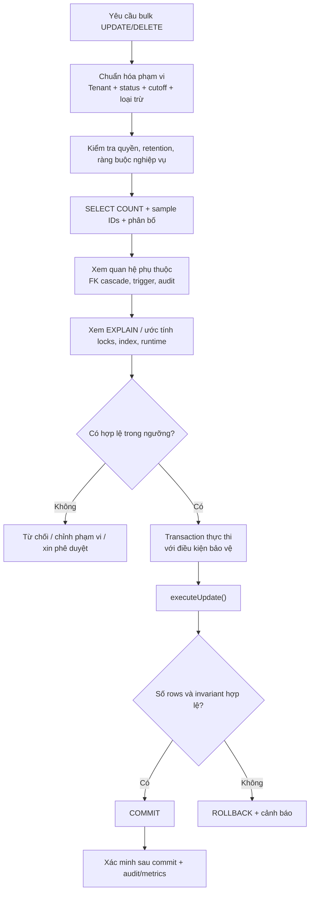
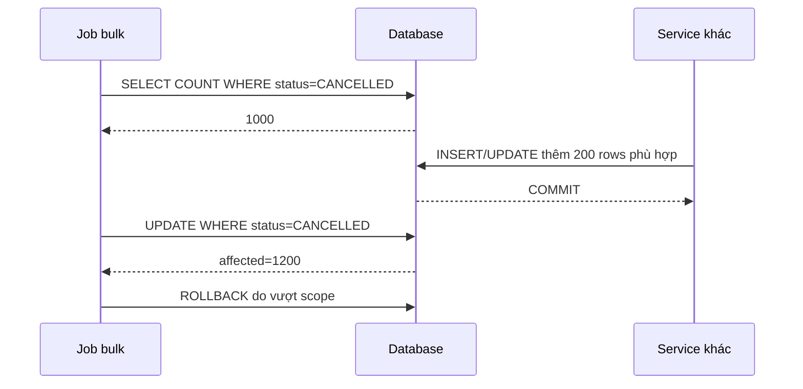

# Kiểm tra phạm vi dữ liệu trước thao tác cập nhật hoặc xóa lớn

Một câu lệnh `UPDATE` hoặc `DELETE` thiếu một điều kiện `WHERE` có thể tác động đến **toàn bộ bảng**. Nhưng nguy hiểm hơn là câu lệnh **có WHERE, chạy thành công, không báo lỗi và vẫn tác động đến nhiều dữ liệu hơn nghiệp vụ cho phép**. Trong hệ thống dùng JPA, rủi ro này đặc biệt đáng chú ý khi sử dụng **JPQL bulk update/delete**, Criteria API mutation hoặc native SQL: các thao tác này xử lý dữ liệu ở mức tập hàng, không đi qua vòng đời từng entity như `find()` rồi `remove()` hay thay đổi thuộc tính managed object.

Ví dụ nghiệp vụ: một hệ thống chỉ muốn chuyển **đơn hàng đã hủy của tenant A, tạo trước thời hạn lưu trữ** sang trạng thái lưu trữ. Câu JPQL:

```java
em.createQuery(
    "update PurchaseOrder o " +
    "set o.status = :archived " +
    "where o.status = :cancelled")
  .setParameter("archived", OrderStatus.ARCHIVED)
  .setParameter("cancelled", OrderStatus.CANCELLED)
  .executeUpdate();
```

có thể đúng cú pháp nhưng **sai phạm vi**: nó không kiểm tra tenant, thời hạn, các đơn đang bị giữ bởi quy định pháp lý hoặc trạng thái nghiệp vụ phụ khác. Nếu ứng dụng có hàng triệu đơn, số hàng bị sửa có thể rất lớn.

Cách tiếp cận an toàn là xem một thao tác thay đổi hàng loạt như **một kế hoạch có thể kiểm chứng**: xác định tập mục tiêu, **xem trước bằng SELECT/COUNT**, đánh giá các tác động trực tiếp và gián tiếp, đặt ngưỡng/điều kiện bảo vệ khi thực thi, quản lý transaction và xác minh kết quả trước khi commit.

**Mục tiêu bài học:** xây được một quy trình kiểm tra phạm vi trước bulk mutation trong JPA; hiểu khác biệt giữa preview và thực thi; sử dụng JPQL/Criteria để đếm, lấy mẫu, khóa phạm vi và cập nhật/xóa; nhận diện race condition, foreign-key cascade, trigger, soft delete, stale persistence context và optimistic locking; thiết kế cơ chế rollback, batching, phê duyệt và kiểm thử phù hợp với dữ liệu lớn.

## 1. “Phạm vi dữ liệu” là gì?

Phạm vi (*scope*) của một thao tác cập nhật/xóa không chỉ là số hàng:

- **Đối tượng:** entity hoặc bảng nào là mục tiêu trực tiếp?
- **Phân vùng nghiệp vụ:** tenant, tổ chức, chi nhánh, tài khoản hoặc project nào?
- **Trạng thái:** chỉ các đơn `CANCELLED` hay cả đơn đang xử lý?
- **Thời điểm:** tạo trước ngày nào, theo múi giờ nào và có tính cả mốc ranh giới không?
- **Điều kiện loại trừ:** đơn đang bị giữ (*legal hold*), đã phát hành hóa đơn hay chưa hết thời gian retention?
- **Quan hệ:** có child rows, join tables hoặc dữ liệu ở hệ thống ngoài DB phụ thuộc vào entity?
- **Quy mô:** bao nhiêu root entities, bao nhiêu rows ở các bảng liên quan, khối lượng index/log/locks ước tính?
- **Thời gian:** dữ liệu có thể thay đổi giữa lúc kiểm tra và lúc thực thi không?
- **Tác động vận hành:** query có thể khóa bao nhiêu hàng, mất bao lâu và làm gián đoạn chức năng nào?

Một định nghĩa phạm vi đầy đủ phải trả lời được **“đúng những ai/điều gì được phép thay đổi?”**, không chỉ “bao nhiêu hàng sẽ đổi?”.

### 1.1. Ba loại phạm vi cần phân biệt

| Loại | Ví dụ | Vì sao phải kiểm tra |
|---|---|---|
| **Mục tiêu trực tiếp** | 8.000 hàng `purchase_orders` cần xóa | `executeUpdate()` thường chỉ phản ánh đối tượng của bulk DML |
| **Tác động do ràng buộc DB** | 75.000 `order_lines` bị xóa theo FK `ON DELETE CASCADE` | Hệ quả không nhất thiết nằm trong số rows mà JPQL báo |
| **Tác động nghiệp vụ ngoài DB** | Search index, object storage, event consumer, audit/retention | Transaction database không tự hoàn tác mọi side effect bên ngoài |

**Một câu DELETE parent xóa 8.000 đơn có thể khiến số bản ghi biến mất trong database lớn hơn nhiều so với 8.000.** Khi lập kế hoạch, phải tính toàn bộ *dependency graph*, không dựa vào một lệnh `COUNT` trên bảng cha.

## 2. Mô hình ví dụ: đơn hàng nhiều tenant

Giả sử ứng dụng SaaS lưu đơn hàng của nhiều tenant trong cùng schema.

### 2.1. Entity `PurchaseOrder`

```java
package example.order;

import jakarta.persistence.*;
import java.time.Instant;

@Entity
@Table(
    name = "purchase_orders",
    indexes = {
        @Index(
            name = "idx_orders_tenant_status_created",
            columnList = "tenant_id,status,created_at,id"
        )
    }
)
public class PurchaseOrder {

    @Id
    @GeneratedValue(strategy = GenerationType.SEQUENCE)
    private Long id;

    @Column(name = "tenant_id", nullable = false, length = 64)
    private String tenantId;

    @Column(name = "status", nullable = false, length = 30)
    @Enumerated(EnumType.STRING)
    private OrderStatus status;

    @Column(name = "created_at", nullable = false)
    private Instant createdAt;

    @Column(name = "updated_at")
    private Instant updatedAt;

    @Column(name = "legal_hold", nullable = false)
    private boolean legalHold;

    @Version
    private long version;

    protected PurchaseOrder() {}

    public Long getId() { return id; }
    public String getTenantId() { return tenantId; }
    public OrderStatus getStatus() { return status; }
    public Instant getCreatedAt() { return createdAt; }
    public boolean isLegalHold() { return legalHold; }
}
```

Enum:

```java
package example.order;

public enum OrderStatus {
    DRAFT,
    PAID,
    SHIPPED,
    CANCELLED,
    ARCHIVED
}
```

Ví dụ bổ sung entity con:

```java
@Entity
@Table(name = "order_lines")
public class OrderLine {
    @Id
    private Long id;

    @ManyToOne(fetch = FetchType.LAZY, optional = false)
    @JoinColumn(name = "order_id", nullable = false)
    private PurchaseOrder order;

    @Column(name = "sku", nullable = false)
    private String sku;

    protected OrderLine() {}
}
```

Giả sử còn bảng `invoices`, `refunds` và `order_audit`, có quan hệ tới `purchase_orders`. Việc xóa đơn **có được phép làm mất các bảng này không** là quyết định nghiệp vụ và pháp lý riêng, không được tự suy ra từ foreign key.

### 2.2. Một tập dữ liệu minh họa

| ID | tenant_id | status | created_at (UTC) | legal_hold |
|---:|---|---|---|---|
| 101 | TENANT_A | CANCELLED | 2025-01-01 | false |
| 102 | TENANT_A | CANCELLED | 2025-03-01 | true |
| 103 | TENANT_A | PAID | 2025-02-01 | false |
| 104 | TENANT_B | CANCELLED | 2025-01-01 | false |
| 105 | TENANT_A | CANCELLED | 2026-10-01 | false |
| 106 | TENANT_A | CANCELLED | 2025-01-15 | false |

Yêu cầu nghiệp vụ:

> Chỉ lưu trữ những đơn hàng của `TENANT_A` có trạng thái `CANCELLED`, tạo trước `2026-01-01T00:00:00Z` và **không bị legal hold**.

Với ví dụ trên, **ID 101 và 106** là hai mục tiêu. ID 102 bị loại bởi `legal_hold`, ID 104 thuộc tenant khác, ID 105 chưa đủ cũ.

Đây là một ví dụ cho thấy chỉ điều kiện `status = CANCELLED` là **chưa đủ**.

## 3. Bulk mutation trong JPA hoạt động khác entity lifecycle

JPA có hai cách thay đổi dữ liệu với ý nghĩa rất khác nhau.

### 3.1. Thay đổi managed entity

```java
PurchaseOrder order =
    em.find(PurchaseOrder.class, orderId);

// Giả sử domain có method phù hợp:
order.markArchived(now);
// Dirty checking ghi thay đổi khi flush/commit.
```

Khi thao tác qua managed entity:

- Provider theo dõi state trong persistence context.
- `@PreUpdate`, `@PostUpdate` và lifecycle callbacks có thể được áp dụng theo hợp đồng JPA.
- `@Version` có thể tham gia optimistic locking.
- Domain method có thể kiểm tra invariant.
- Relationship cascade phù hợp được xử lý theo lifecycle tương ứng.

### 3.2. JPQL bulk UPDATE

```java
int affected = em.createQuery(
        "update PurchaseOrder o " +
        "set o.status = :archived " +
        "where o.tenantId = :tenantId " +
        "and o.status = :cancelled")
    .setParameter("archived", OrderStatus.ARCHIVED)
    .setParameter("tenantId", "TENANT_A")
    .setParameter("cancelled", OrderStatus.CANCELLED)
    .executeUpdate();
```

Bulk JPQL được thực thi ở **mức tập entity mục tiêu** thông qua database update statement(s), **không duyệt lần lượt từng managed entity để gọi setter/domain method**.

### 3.3. JPQL bulk DELETE

```java
int affected = em.createQuery(
        "delete from PurchaseOrder o " +
        "where o.tenantId = :tenantId " +
        "and o.status = :status " +
        "and o.createdAt < :cutoff")
    .setParameter("tenantId", "TENANT_A")
    .setParameter("status", OrderStatus.CANCELLED)
    .setParameter("cutoff", cutoff)
    .executeUpdate();
```

Đây không phải lệnh tương đương hoàn toàn với:

```java
for (PurchaseOrder order : orders) {
    em.remove(order);
}
```

Các bulk mutation thường:

- **Không kích hoạt lifecycle callbacks** như `@PreUpdate`/`@PreRemove` cho từng entity bị ảnh hưởng.
- **Không thực hiện JPA cascade REMOVE/orphanRemoval** trên từng phần tử như thao tác entity lifecycle.
- **Không tự đồng bộ những managed instances đã được nạp** trong persistence context.
- **Không tự áp dụng optimistic locking từng entity theo `@Version`** như đường cập nhật managed entity thông thường.
- Có thể vẫn kích hoạt **database foreign keys, triggers, constraints và locks**, vì SQL thực thi ở DB.

Vì vậy, kiểm tra trước bulk mutation cần rộng hơn việc kiểm tra một vòng lặp Java.

### 3.4. API bulk mutation cần transaction

`executeUpdate()` là operation thay đổi dữ liệu, cần transaction phù hợp. Với resource-local EntityManager:

```java
EntityTransaction tx = em.getTransaction();
tx.begin();
try {
    int affected = query.executeUpdate();
    tx.commit();
} catch (RuntimeException ex) {
    if (tx.isActive()) {
        tx.rollback();
    }
    throw ex;
}
```

Đoạn này minh họa transaction boundary; trong Spring hoặc Jakarta EE/JTA, service/container thường quản lý transaction, không tự gọi `em.getTransaction()` trên container-managed `EntityManager`.

## 4. Quy trình “preview trước, mutate sau”

Một luồng an toàn nên trông như sau:



Một bản preview **không phải lời hứa rằng dữ liệu sẽ đứng yên**. Trong khi người vận hành xem số lượng, transaction khác vẫn có thể chèn, sửa hoặc xóa các bản ghi. Bởi vậy:

1. Preview giúp **hiểu và phê duyệt** ý định.
2. Predicate trong câu mutation là **hàng rào thực thi trực tiếp**.
3. Transaction/locking/isolation và kiểm tra `affected` quyết định hành vi khi dữ liệu thay đổi.
4. Xác minh sau commit và audit cho phép phát hiện tác động thực tế.

Không được thay thế bước 2 và 3 chỉ bằng một màn hình xác nhận hiển thị “sẽ sửa 10.000 đơn”.

## 5. Viết điều kiện `WHERE` trước khi viết `UPDATE` hoặc `DELETE`

Với dữ liệu ví dụ, điều kiện chuẩn:

```sql
WHERE tenant_id = :tenant_id
  AND status = :cancelled
  AND created_at < :cutoff
  AND legal_hold = FALSE
```

Các predicate có vai trò:

| Điều kiện | Bảo vệ gì? |
|---|---|
| `tenant_id = :tenant_id` | Không tác động tenant khác |
| `status = :cancelled` | Không chạm PAID/SHIPPED |
| `created_at < :cutoff` | Giữ lại dữ liệu chưa đủ tuổi |
| `legal_hold = FALSE` | Không tác động hồ sơ đang bị giữ |

### 5.1. Dùng tham số hóa

Tốt:

```java
"where o.tenantId = :tenantId " +
"and o.createdAt < :cutoff"
```

và:

```java
query.setParameter("tenantId", tenantId);
query.setParameter("cutoff", cutoff);
```

Không nối trực tiếp input từ request:

```java
String jpql = "delete from PurchaseOrder o " +
              "where o.tenantId = '" + tenantFromHttp + "'";
```

Named parameters giảm rủi ro injection và lỗi escape, đồng thời khiến preview và execution có thể dùng cùng bộ giá trị đầu vào rõ ràng.

### 5.2. Kiểm soát thời gian và timezone

Ví dụ:

```java
Instant cutoff =
    Instant.parse("2026-01-01T00:00:00Z");
```

`Instant` biểu diễn mốc thời gian tuyệt đối. Nếu retention được định nghĩa là “trước đầu ngày địa phương”, hãy chuyển đúng múi giờ nghiệp vụ sang `Instant` trước khi query.

Ví dụ “trước 01/01” và “đến hết ngày 01/01” không phải cùng điều kiện:

```sql
created_at < :startOfJan1
```

so với:

```sql
created_at < :startOfJan2
```

Sử dụng **ranh giới nửa mở** thường rõ ràng hơn kiểu `<= 23:59:59.999`, vì độ chính xác timestamp giữa Java/DB có thể khác.

### 5.3. Null và logic ba giá trị

Nếu `legalHold` là nullable trong schema cũ, điều kiện:

```sql
legal_hold = FALSE
```

không tự động lấy rows có `NULL`. Phải định nghĩa rõ: `NULL` có nghĩa “không bị giữ”, “không biết” hay dữ liệu lỗi?

Nếu không chắc, **mặc định loại khỏi destructive mutation** để không xóa hồ sơ chưa có thông tin xác thực.

### 5.4. Đừng lấy tenant từ input chưa được xác thực

`tenantId` phải đến từ authenticated/authorized context hoặc một administrative operation có quyền và phạm vi được xác minh. Việc có `WHERE o.tenantId = :tenantId` không giúp bảo mật nếu client có thể tự gửi tenant ID của người khác.

## 6. Bước kiểm tra thứ nhất: `COUNT` cùng predicate

Trước bulk mutation:

```java
long candidateCount = em.createQuery(
        "select count(o) " +
        "from PurchaseOrder o " +
        "where o.tenantId = :tenantId " +
        "and o.status = :status " +
        "and o.createdAt < :cutoff " +
        "and o.legalHold = false",
        Long.class)
    .setParameter("tenantId", "TENANT_A")
    .setParameter("status", OrderStatus.CANCELLED)
    .setParameter("cutoff", cutoff)
    .getSingleResult();
```

`COUNT` trả `Long`. Nếu không có bản ghi phù hợp, kết quả thường là `0L`, không phải một `NoResultException` cho query aggregate không `GROUP BY`.

### 6.1. Đếm trước giúp ích gì?

- Phát hiện thao tác **0 row** do sai input.
- Phát hiện tác động quá lớn so với dự kiến.
- Đưa ra ngưỡng yêu cầu phê duyệt.
- Ước lượng thời gian/khối lượng công việc.
- Cung cấp số liệu cho báo cáo vận hành trước thay đổi.

### 6.2. Đếm trước không bảo đảm chính xác lúc thực thi

Nếu preview lúc 10:00 trả `2.000` rows và mutation chạy lúc 10:05, trong 5 phút có thể xuất hiện rows mới đủ điều kiện. Ngay cả khi COUNT và UPDATE nằm cùng transaction, dưới một số isolation level như READ COMMITTED, dữ liệu nhìn thấy giữa các statement cũng có thể khác.

**COUNT là phép quan sát; WHERE + transaction mới là cơ chế kiểm soát lúc thực thi.**

### 6.3. `COUNT` trên JOIN phải chú ý duplicate

Sai khi không hiểu multiplicity:

```java
Long n = em.createQuery(
        "select count(o) " +
        "from PurchaseOrder o join o.lines l " +
        "where l.sku = :sku",
        Long.class)
    .setParameter("sku", "A-001")
    .getSingleResult();
```

Nếu một order có hai lines cùng SKU, JOIN có thể tạo hai rows. Muốn đếm **số order duy nhất**:

```java
Long n = em.createQuery(
        "select count(distinct o.id) " +
        "from PurchaseOrder o join o.lines l " +
        "where l.sku = :sku",
        Long.class)
    .setParameter("sku", "A-001")
    .getSingleResult();
```

Không dùng số join rows để so sánh với affected count của một UPDATE/DELETE trên root entity nếu không tính đúng cardinality.

## 7. Bước kiểm tra thứ hai: lấy mẫu ID và các thuộc tính quan trọng

COUNT giúp biết quy mô, nhưng không giúp biết **những đơn cụ thể** có đúng là đối tượng được phép thay đổi không.

Query lấy mẫu:

```java
List<PurchaseOrder> sample = em.createQuery(
        "select o from PurchaseOrder o " +
        "where o.tenantId = :tenantId " +
        "and o.status = :status " +
        "and o.createdAt < :cutoff " +
        "and o.legalHold = false " +
        "order by o.createdAt asc, o.id asc",
        PurchaseOrder.class)
    .setParameter("tenantId", "TENANT_A")
    .setParameter("status", OrderStatus.CANCELLED)
    .setParameter("cutoff", cutoff)
    .setMaxResults(20)
    .getResultList();
```

Đây là một sample **có thứ tự xác định**: 20 bản ghi cũ nhất, có tie-breaker ID.

### 7.1. DTO projection thay vì tải entity

Với job chỉ kiểm tra:

```java
package example.order;

import java.time.Instant;

public record OrderCandidate(
    Long id,
    String tenantId,
    OrderStatus status,
    Instant createdAt
) {}
```

JPQL:

```java
List<OrderCandidate> sample = em.createQuery(
        "select new example.order.OrderCandidate(" +
        "o.id, o.tenantId, o.status, o.createdAt) " +
        "from PurchaseOrder o " +
        "where o.tenantId = :tenantId " +
        "and o.status = :status " +
        "and o.createdAt < :cutoff " +
        "and o.legalHold = false " +
        "order by o.createdAt, o.id",
        OrderCandidate.class)
    .setParameter("tenantId", "TENANT_A")
    .setParameter("status", OrderStatus.CANCELLED)
    .setParameter("cutoff", cutoff)
    .setMaxResults(20)
    .getResultList();
```

DTO không tạo managed entity cho mỗi candidate và chỉ lấy các trường cần review. Cấu trúc `select new` cần constructor phù hợp và tên class đầy đủ.

### 7.2. Chỉ lấy 20 bản ghi đầu không đủ cho phân bố

Nếu query có 100.000 rows, 20 dòng đầu theo `createdAt` chưa đại diện cho tất cả. Nên xem thêm:

- Một mẫu cuối theo thời gian hoặc ID.
- Phân bố theo trạng thái, tenant, ngày/tháng.
- Giá trị tối thiểu/tối đa của trường thời gian.
- Số lượng ngoại lệ/đối tượng bị giữ.
- Những nhóm có rủi ro cao, chẳng hạn order có invoice.

### 7.3. Đừng đưa dữ liệu nhạy cảm vào log preview

Preview cho người có quyền có thể hiển thị ID và vài thuộc tính nghiệp vụ. Nhưng không dump toàn bộ địa chỉ, thông tin thanh toán hay dữ liệu cá nhân vào chat/log/ticket chỉ để “xem có đúng không”. Chỉ lưu các trường cần thiết và áp dụng retention/redaction cho log.

## 8. Bước kiểm tra thứ ba: phân tích phân bố và ngoại lệ

Một COUNT tổng có thể che khuất tình trạng filter sai ở một nhóm nhỏ.

Ví dụ đếm theo status:

```java
List<Object[]> byStatus = em.createQuery(
        "select o.status, count(o) " +
        "from PurchaseOrder o " +
        "where o.tenantId = :tenantId " +
        "and o.createdAt < :cutoff " +
        "group by o.status",
        Object[].class)
    .setParameter("tenantId", "TENANT_A")
    .setParameter("cutoff", cutoff)
    .getResultList();
```

Đây là thống kê **rộng hơn** tập mục tiêu, dùng để người vận hành nhìn thấy có bao nhiêu đơn PAID/SHIPPED/CANCELLED trước cutoff. Nó giúp phát hiện việc vô tình bỏ sót `status` trong mutation. Vì query có `GROUP BY`, kết quả có thể có nhiều nhóm; dùng `getResultList()`, không `getSingleResult()`.

### 8.1. Đếm số hồ sơ bị loại bởi legal hold

```java
Long heldCount = em.createQuery(
        "select count(o) from PurchaseOrder o " +
        "where o.tenantId = :tenantId " +
        "and o.status = :status " +
        "and o.createdAt < :cutoff " +
        "and o.legalHold = true",
        Long.class)
    .setParameter("tenantId", "TENANT_A")
    .setParameter("status", OrderStatus.CANCELLED)
    .setParameter("cutoff", cutoff)
    .getSingleResult();
```

Người vận hành có thể thấy: “2.000 đơn đủ điều kiện, 75 đơn cùng trạng thái/thời gian nhưng đang legal hold”. Những số liệu loại trừ này thường quan trọng ngang với candidate count.

### 8.2. Đếm child rows liên quan

Giả sử `OrderLine` có relation `order`:

```java
Long lineCount = em.createQuery(
        "select count(l) from OrderLine l " +
        "where l.order.tenantId = :tenantId " +
        "and l.order.status = :status " +
        "and l.order.createdAt < :cutoff " +
        "and l.order.legalHold = false",
        Long.class)
    .setParameter("tenantId", "TENANT_A")
    .setParameter("status", OrderStatus.CANCELLED)
    .setParameter("cutoff", cutoff)
    .getSingleResult();
```

Nếu job dự định **xóa** các order và foreign key `order_lines.order_id` là `ON DELETE CASCADE`, lineCount là một ước lượng quan trọng của khối lượng xóa gián tiếp.

Nhưng đây vẫn là COUNT quan sát tại thời điểm truy vấn; số lượng thật có thể thay đổi do concurrent writes hoặc database trigger.

## 9. Mẫu khai báo phạm vi rõ ràng bằng Java

Đừng để mỗi service tự nối các điều kiện khác nhau. Có thể chuẩn hóa tham số:

```java
package example.order;

import java.time.Instant;

public record ArchiveScope(
    String tenantId,
    OrderStatus sourceStatus,
    Instant createdBefore
) {
    public ArchiveScope {
        if (tenantId == null || tenantId.isBlank()) {
            throw new IllegalArgumentException("Tenant is required");
        }
        if (sourceStatus == null || createdBefore == null) {
            throw new IllegalArgumentException(
                "Status and cutoff are required");
        }
        if (sourceStatus != OrderStatus.CANCELLED) {
            throw new IllegalArgumentException(
                "Only CANCELLED orders may be archived");
        }
    }
}
```

Đối với một phạm vi cụ thể, `ArchiveScope` mô tả **ý định**. Nó không tự chứng minh người dùng có quyền với tenant; authorization vẫn cần đặt ở service.

### 9.1. Một WHERE clause dùng chung

Để giảm rủi ro preview và mutation khác điều kiện, có thể định nghĩa một fragment **tĩnh, chỉ do developer kiểm soát**:

```java
private static final String ARCHIVE_WHERE =
    " where o.tenantId = :tenantId " +
    "and o.status = :sourceStatus " +
    "and o.createdAt < :createdBefore " +
    "and o.legalHold = false";
```

Sau đó:

```java
String countJpql =
    "select count(o) from PurchaseOrder o" + ARCHIVE_WHERE;

String updateJpql =
    "update PurchaseOrder o " +
    "set o.status = :archivedStatus" + ARCHIVE_WHERE;
```

**Được nối chuỗi với fragment cố định nội bộ**, vì không có input chưa tin cậy được nhúng vào cú pháp. Mọi giá trị dữ liệu đi qua `setParameter`.

### 9.2. Cùng một snapshot predicate không có nghĩa cùng một snapshot dữ liệu

Dù `countJpql` và `updateJpql` dùng đúng một WHERE string, chúng vẫn là **hai database statements**. Các concurrent transaction có thể làm tập matching thay đổi. Đây là khác biệt giữa **đồng nhất predicate** và **đồng nhất tập row theo thời gian**.

### 9.3. Khi dùng Criteria API

Có thể xây WHERE từ một phương thức nhận `Root/CriteriaBuilder` và trả Predicate mới. **Không tái sử dụng một instance `Predicate` hoặc `Root` từ `CriteriaQuery` trong `CriteriaUpdate/CriteriaDelete` khác**; mỗi query có cây biểu thức và root riêng. Các helper chỉ tái sử dụng **logic dựng điều kiện**, không tái sử dụng node của query tree.

## 10. Dry-run là gì, và không phải là gì?

Một **dry-run** trong bulk mutation là chế độ:

- Thực hiện những SELECT/COUNT/EXPLAIN cần thiết.
- Trả một **preview plan**: phạm vi, số candidates, mẫu IDs, ngoại lệ, cảnh báo quan hệ.
- **Không gửi SQL UPDATE/DELETE** thay đổi dữ liệu thật.
- Cho người vận hành xác nhận kế hoạch trước khi thực thi.

Ví dụ response:

```json
{
  "mode": "PREVIEW",
  "operation": "ARCHIVE_CANCELLED_ORDERS",
  "scope": {
    "tenantId": "TENANT_A",
    "status": "CANCELLED",
    "createdBefore": "2026-01-01T00:00:00Z",
    "legalHold": false
  },
  "candidateCount": 2000,
  "sampleIds": [101, 106, 208, 311],
  "exclusionSummary": {
    "legalHoldCount": 75
  },
  "requiresApproval": true
}
```

Đây là JSON minh họa dữ liệu của kế hoạch, không phải REST API bắt buộc của JPA.

### 10.1. Dry-run không phải “chạy DELETE rồi ROLLBACK”

Một số đội thử thực thi:

```sql
BEGIN;
DELETE FROM purchase_orders WHERE ...;
ROLLBACK;
```

Trong nhiều database, rollback sẽ phục hồi transactional data changes; nhưng **không được coi đây là dry-run an toàn tuyệt đối**:

- Câu DELETE vẫn có thể khóa hàng và tiêu thụ tài nguyên lớn.
- Transaction log/undo và thời gian chạy vẫn bị phát sinh.
- Database sequences hoặc những side effect không transactional có thể không rollback theo cách mong muốn.
- Trigger/procedure có thể tương tác với hệ thống ngoài database hoặc các cơ chế side effect khác.
- Trong môi trường có concurrent workloads, test vẫn gây contention.

Để **xem trước phạm vi**, dùng SELECT/COUNT thay vì thực thi destructive SQL rồi hy vọng rollback. Nếu cần rehearsal thực sự, ưu tiên database snapshot/staging phù hợp.

### 10.2. Phân biệt dry-run với EXPLAIN

**Dry-run** là chế độ nghiệp vụ không mutate. **EXPLAIN** là công cụ database xem kế hoạch thực thi SQL. Nó hữu ích nhưng không thay COUNT, sample, quyền truy cập hay dependency review.

## 11. Cảnh báo quan trọng: preview và execution có thể lệch

Giả sử:

```text
10:00:00  Preview COUNT => 10.000 orders
10:00:10  Người vận hành xác nhận
10:00:12  Một service khác tạo thêm 500 orders phù hợp
10:00:13  UPDATE ... WHERE ... tác động 10.500 orders
```

Việc xem trước 10.000 không ngăn mutation ảnh hưởng 10.500.

Ngược lại:

```text
10:00:00  Preview COUNT => 10.000
10:00:12  3.000 orders đổi trạng thái sang SHIPPED
10:00:13  UPDATE ... WHERE status=CANCELLED => 7.000
```

Nếu mutation giữ `status=CANCELLED` trong WHERE, nó có thể tránh cập nhật những order đã đổi trạng thái. Đó là lý do **business preconditions phải nằm trong SQL mutation** chứ không chỉ nằm ở bước preview.

### 11.1. Ba loại drift

| Drift | Ví dụ | Nguy cơ |
|---|---|---|
| **Thêm candidates** | Row mới trở nên đủ điều kiện | Actual affected > preview |
| **Mất candidates** | Status thay đổi, row bị xóa | Actual affected < preview |
| **Thay thế tập IDs** | Một số ID rời scope, ID khác vào scope, tổng count vẫn bằng nhau | Count khớp nhưng **không cùng tập đối tượng** |

Điểm thứ ba đặc biệt quan trọng: **`affected == previewCount` không chứng minh đúng những IDs đã được phê duyệt**.

### 11.2. Các mức kiểm soát tăng dần

1. **Predicate bảo vệ đầy đủ**: tenant/status/cutoff/flags nằm ngay trong UPDATE/DELETE.
2. **Đếm lại ngay trước execution**: giảm thời gian lệch, không loại bỏ hoàn toàn race.
3. **Giới hạn tác động tối đa và kiểm tra affected trong transaction**: rollback khi vượt ngưỡng.
4. **Snapshot danh sách IDs được duyệt**: câu mutation chỉ được phép tác động những IDs đó, phù hợp khi danh sách có quy mô cho phép.
5. **Locking/isolation/workflow state**: dùng khi cần kiểm soát đồng thời mạnh hơn.
6. **Phê duyệt theo manifest của các IDs/hash**: giảm nguy cơ thao tác sai tập, nhưng vẫn cần đối chiếu với DB lúc thực thi.

Không có một chiến thuật duy nhất đáp ứng mọi kích thước dữ liệu và yêu cầu concurrency.

## 12. Kiểm tra ngưỡng an toàn trước và sau `executeUpdate()`

Một chính sách đơn giản:

- Không chấp nhận 0 rows nếu đó là thao tác cần có dữ liệu.
- Nếu dự kiến nhiều hơn 50.000 rows, cần approval cao hơn hoặc chia batch.
- Nếu số rows thực tế **vượt ngưỡng tuyệt đối**, rollback.
- Nếu số rows thực tế **khác số rows kế hoạch** ngoài tolerance được phê duyệt, rollback/cảnh báo.

Ví dụ:

```java
public record BulkGuard(
    long minRows,
    long maxRows,
    long expectedRows
) {
    public BulkGuard {
        if (minRows < 0 || maxRows < minRows
                || expectedRows < 0) {
            throw new IllegalArgumentException(
                "Invalid guard bounds");
        }
    }
}
```

Trước execution:

```java
if (previewCount < guard.minRows()
        || previewCount > guard.maxRows()) {
    throw new IllegalStateException(
        "Preview outside approved range");
}
```

Sau execution (nhưng **trước COMMIT**):

```java
int affected = query.executeUpdate();

if (affected < guard.minRows()
        || affected > guard.maxRows()) {
    throw new IllegalStateException(
        "Unexpected mutation scope: " + affected);
}
```

Trong một transaction được framework quản lý, việc ném runtime exception ra khỏi transaction boundary thường khiến Spring rollback theo default policy. Nếu code bắt exception rồi **nuốt lỗi và tiếp tục commit**, cơ chế guard sẽ mất ý nghĩa.

### 12.1. Không chỉ kiểm tra ngưỡng trước UPDATE

`COUNT` trước execution có thể khớp 10.000, nhưng mutation thực tế là 10.500 vì drift. Do đó cần kiểm tra `affected` khi transaction còn có thể rollback.

### 12.2. Không áp ngưỡng rowCount một cách thiếu nghiệp vụ

Đối với job archive định kỳ, affected = 0 có thể hoàn toàn hợp lệ. Với job sửa sai dữ liệu gồm đúng 13 IDs theo incident ticket, affected != 13 lại có thể là dấu hiệu phải dừng. Guard cần tùy **operation type** và risk appetite, không áp một ngưỡng cứng cho mọi batch.

### 12.3. Affected count không đủ để biết tác động gián tiếp

`executeUpdate()` của JPA bulk mutation phản ánh số entity instances/rows theo hợp đồng bulk operation, **không phải tổng tất cả rows đã bị xóa vì foreign key cascade, triggers hoặc database logic khác**. Phải tính gián tiếp bằng bước review riêng.

## 13. Ví dụ service Spring thực hiện bulk UPDATE với guard

Một thiết kế dùng Spring `@Transactional`. Đoạn code sau thể hiện trình tự quan trọng; validation/authorization thực tế được bổ sung ở service boundary.

```java
package example.order;

import jakarta.persistence.EntityManager;
import jakarta.persistence.PersistenceContext;
import org.springframework.stereotype.Service;
import org.springframework.transaction.annotation.Transactional;
import java.time.Instant;

@Service
public class OrderArchiveService {

    @PersistenceContext
    private EntityManager em;

    private static final String WHERE =
        " where o.tenantId = :tenantId " +
        "and o.status = :oldStatus " +
        "and o.createdAt < :cutoff " +
        "and o.legalHold = false";

    @Transactional
    public int archiveApproved(
            ArchiveScope scope,
            long approvedExpected,
            long maximumRows,
            Instant now) {

        if (maximumRows < 1
                || approvedExpected < 1
                || approvedExpected > maximumRows) {
            throw new IllegalArgumentException(
                "Invalid approval limits");
        }

        // Nếu trước đó có pending managed changes liên quan:
        em.flush();

        long count = em.createQuery(
                "select count(o) from PurchaseOrder o" + WHERE,
                Long.class)
            .setParameter("tenantId", scope.tenantId())
            .setParameter("oldStatus", scope.sourceStatus())
            .setParameter("cutoff", scope.createdBefore())
            .getSingleResult();

        if (count != approvedExpected || count > maximumRows) {
            throw new IllegalStateException(
                "Scope changed before mutation: " + count);
        }

        int affected = em.createQuery(
                "update PurchaseOrder o " +
                "set o.status = :newStatus, " +
                "o.updatedAt = :now" + WHERE)
            .setParameter("newStatus", OrderStatus.ARCHIVED)
            .setParameter("now", now)
            .setParameter("tenantId", scope.tenantId())
            .setParameter("oldStatus", scope.sourceStatus())
            .setParameter("cutoff", scope.createdBefore())
            .executeUpdate();

        if (affected != approvedExpected
                || affected > maximumRows) {
            // Runtime exception -> Spring transaction rollback
            // nếu đi ra khỏi transactional method theo policy.
            throw new IllegalStateException(
                "Unexpected affected rows: " + affected);
        }

        // Bulk JPQL bypasses the managed entity state.
        em.clear();
        return affected;
    }
}
```

### 13.1. Điều kiện để ví dụ an toàn

**Không coi code trên là toàn bộ một hệ thống approval production.** Nó giả định:

- `ArchiveScope` đến từ request đã được xác thực/phê duyệt.
- `approvedExpected` và `maximumRows` được lấy từ **approval record đáng tin**, không tự do do client điền.
- Method được gọi **qua Spring transaction proxy**, không phải tự gọi `this.archiveApproved()` khiến `@Transactional` có thể không được áp dụng như dự kiến.
- Transaction manager thực sự quản lý `EntityManager` được inject.
- Không có nghiệp vụ nào phụ thuộc vào per-entity `@PreUpdate`/`@Version` tự động trên bulk update.
- Những managed changes khác đã được flush hoặc transaction sử dụng persistence context độc lập trước khi `clear()`.
- Đã chọn chiến lược xử lý drift hợp lý. So sánh COUNT/affected **không đảm bảo IDs không bị thay thế**.

### 13.2. Tại sao `em.flush()` trước bulk?

Nếu một transaction có những thay đổi managed entities trước bulk, dữ liệu chờ flush có thể ảnh hưởng scope. `em.flush()` đồng bộ pending changes theo transactional semantics trước khi SELECT/UPDATE; nó **không commit**.

Không nên gọi `clear()` khi còn unflushed managed changes không muốn mất; `clear()` detach tất cả entity khỏi persistence context.

### 13.3. Vì sao `em.clear()` sau bulk?

Các entity đã managed trước đó có thể giữ `status=CANCELLED` dù database đã update thành `ARCHIVED`. `clear()` detach toàn context để tránh tiếp tục dùng managed state đã lỗi thời.

Nếu cần giữ những managed entities không liên quan hoặc cần tiếp tục một workflow phức tạp, **dùng một persistence context/transaction riêng cho bulk mutation** hoặc cân nhắc refresh/eviction có chủ đích thay vì clear toàn bộ context một cách máy móc.

### 13.4. Cần xác minh trước commit?

Nếu ứng dụng phải kiểm tra một invariant trong DB sau mutation, có thể chạy SELECT trong cùng transaction sau `executeUpdate()` trước khi trả về. Nhưng phải nhớ persistence context có thể stale; dùng `clear()` trước khi query lại hoặc dùng phương pháp đọc database phù hợp. Check `affected` và postcondition không thay thế việc xem các DB constraints/triggers.

## 14. Tính nguyên tử của một bulk statement và transaction

Một bulk mutation thường là một hoặc nhiều database statements do provider sinh ra. Khi đặt trong transaction:

```text
BEGIN
  SELECT COUNT(...)
  UPDATE ... WHERE ...
  CHECK affected + postconditions
  COMMIT / ROLLBACK
```

Nếu guard phát hiện affected vượt ngưỡng, application có thể rollback transaction, giúp tránh lưu các thay đổi dữ liệu transactional.

Tuy nhiên, “rollback” không có nghĩa:

- Không có row lock/log/IO nào đã phát sinh.
- Mọi email, HTTP call hoặc broker publish phát từ trigger/application đều tự rollback.
- Một migration/DDL hoặc DB-specific autonomous transaction luôn nằm cùng rollback boundary.

Không gửi side effects bên ngoài transaction ngay trong lúc đang thử bulk mutation nếu kết quả có thể bị rollback. Với sự kiện phải phát sau commit, dùng **transactional outbox** hoặc workflow tương đương.

### 14.1. Transaction quá lớn cũng có rủi ro

Một transaction xóa 3 triệu rows có thể:

- Giữ locks lâu.
- Tạo nhiều WAL/redo/undo.
- Gây replication lag.
- Ảnh hưởng cleanup/vacuum/GC của database.
- Chặn giao dịch người dùng khác.
- Làm tăng khả năng deadlock hoặc timeout.

Một guard chặn xóa “quá nhiều” không đủ nếu transaction đã tạo tác động tài nguyên lớn trước khi guard đọc được `affected`. Vì vậy preview, EXPLAIN, batching hoặc maintenance window nên được thiết kế **trước khi thực thi**.

## 15. Race condition giữa kiểm tra và thay đổi

Đây là dạng *time-of-check to time-of-use* (TOCTOU):



Trong ví dụ, transaction guard có thể rollback khi count sai. Nhưng nếu job phê duyệt “chỉ 1000 IDs cụ thể” và giữa hai bước một số IDs thay thế nhau, `affected=1000` không chứng minh tập IDs vẫn đúng.

### 15.1. Phương án A — Dùng điều kiện bảo vệ ngay trong mutation

```java
"update PurchaseOrder o " +
"set o.status = :newStatus " +
"where o.tenantId = :tenantId " +
"and o.status = :expectedStatus " +
"and o.createdAt < :cutoff " +
"and o.legalHold = false"
```

Đây là mức tối thiểu cho bulk mutation: không cập nhật row nếu nó không còn thỏa business condition tại thời điểm statement thực thi.

### 15.2. Phương án B — Chỉ mutate tập IDs đã phê duyệt

Khi phạm vi giới hạn:

```java
List<Long> approvedIds = List.of(101L, 106L, 208L);

int affected = em.createQuery(
        "update PurchaseOrder o " +
        "set o.status = :archived " +
        "where o.id in :approvedIds " +
        "and o.tenantId = :tenantId " +
        "and o.status = :cancelled " +
        "and o.legalHold = false")
    .setParameter("archived", OrderStatus.ARCHIVED)
    .setParameter("approvedIds", approvedIds)
    .setParameter("tenantId", "TENANT_A")
    .setParameter("cancelled", OrderStatus.CANCELLED)
    .executeUpdate();
```

Điều này giới hạn **đối tượng có thể bị update** theo một manifest IDs, đồng thời giữ các điều kiện bất biến hiện tại.

Nhưng:

- Danh sách `IN` có giới hạn tham số/kích thước tùy database.
- Tập IDs lớn nên được chia batch hoặc đưa vào staging table có quản lý.
- Approval phải gắn với đúng tenant/operation/cutoff, tránh reuse ngoài phạm vi.
- Một ID bị xóa/đổi status có thể khiến `affected` nhỏ hơn số IDs.
- Nếu row có cùng ID nhưng ý nghĩa dữ liệu đã bị thay thế theo cách khác, ID đơn thuần có thể không đủ; cần version hoặc immutable identity policy.

### 15.3. Phương án C — Khóa row trước khi cập nhật

JPA có:

```java
List<PurchaseOrder> selected = em.createQuery(
        "select o from PurchaseOrder o " +
        "where o.tenantId = :tenantId " +
        "and o.status = :status " +
        "and o.createdAt < :cutoff " +
        "and o.legalHold = false",
        PurchaseOrder.class)
    .setParameter("tenantId", "TENANT_A")
    .setParameter("status", OrderStatus.CANCELLED)
    .setParameter("cutoff", cutoff)
    .setLockMode(LockModeType.PESSIMISTIC_WRITE)
    .getResultList();
```

Việc khóa những rows đã chọn có thể giảm nguy cơ **chúng bị sửa/xóa** bởi transaction khác trước mutation.

Nhưng nó:

- Có thể tạo rất nhiều locks khi số candidates lớn.
- Không mặc định chặn **phantom rows** mới xuất hiện đủ điều kiện trong mọi DB/isolation level.
- Không thay thế row-level authorization/invariant.
- Có thể không phù hợp cho thao tác hàng trăm nghìn rows.
- Cần transaction thực sự và database/provider hỗ trợ mode khóa tương ứng.

Không dùng pessimistic locking như một “mẹo miễn phí để làm COUNT chính xác”.

### 15.4. Phương án D — Transaction isolation mạnh hơn

`REPEATABLE READ` hoặc `SERIALIZABLE` có thể cung cấp bảo đảm nhất quán cao hơn, tùy DB. Nhưng cơ chế cụ thể khác nhau:

- Snapshot transaction có thể ổn định việc đọc nhưng không mặc định ngăn mọi writer mới.
- Isolation kiểu serializable có thể phát hiện xung đột và yêu cầu retry.
- Kiểm tra/khóa tập lớn ở isolation mạnh có thể làm tăng contention.

**Không thể khẳng định “bọc COUNT và DELETE trong cùng transaction là tuyệt đối không race”** khi chưa chỉ rõ DB, isolation và cách chọn hàng.

## 16. `@Version` và optimistic locking bị ảnh hưởng thế nào?

Entity:

```java
@Version
private long version;
```

Khi sửa managed entity, provider thường dùng version:

```sql
UPDATE purchase_orders
SET status = ?, version = ?
WHERE id = ? AND version = ?;
```

Điều này giúp phát hiện khi state đã thay đổi bởi transaction khác.

**Bulk JPQL UPDATE/DELETE không tự kiểm tra và tăng `@Version` từng entity theo semantics thông thường.** Vì vậy, query:

```java
em.createQuery(
    "update PurchaseOrder o " +
    "set o.status = :archived " +
    "where o.status = :cancelled")
  .executeUpdate();
```

không tự phát hiện rằng những order cụ thể đã được một transaction khác sửa version như một vòng lặp entity updates.

### 16.1. Có thể thêm điều kiện version khi sửa một ID

```java
int updated = em.createQuery(
        "update PurchaseOrder o " +
        "set o.status = :archived, " +
        "o.version = o.version + 1 " +
        "where o.id = :id " +
        "and o.version = :expectedVersion " +
        "and o.status = :cancelled")
    .setParameter("archived", OrderStatus.ARCHIVED)
    .setParameter("id", orderId)
    .setParameter("expectedVersion", expectedVersion)
    .setParameter("cancelled", OrderStatus.CANCELLED)
    .executeUpdate();

if (updated != 1) {
    throw new IllegalStateException(
        "Order changed or no longer eligible");
}
```

Mẫu này minh họa **explicit version predicate** với version dạng số. Cần bảo đảm mapping/version type và provider hỗ trợ biểu thức phù hợp. Với nhiều IDs có version khác nhau, cách truyền các cặp `(id, expectedVersion)` phức tạp hơn rất nhiều; có thể cần staging table hoặc xử lý từng entity nếu optimistic locking quan trọng.

### 16.2. Tăng version không tự tạo đầy đủ optimistic locking

Nếu một bulk update chỉ:

```java
set o.version = o.version + 1
```

nhưng không kiểm tra expected version cho từng row, nó có thể giúp các transaction managed-entity khác phát hiện stale version sau đó, nhưng **không tự ngăn bulk job ghi đè thay đổi trước đó trên mọi row**. Cần phân biệt:

- **Version bump**: cập nhật giá trị version.
- **Version predicate**: chỉ update khi version đang bằng giá trị mong đợi.
- **Business predicate**: chỉ update khi trạng thái/tenant/cutoff vẫn hợp lệ.

Ba thứ phục vụ mục tiêu khác nhau.

### 16.3. Callback và audit

`@PreUpdate`/`@PreRemove` của từng entity không chạy như đường lifecycle bình thường đối với bulk DML. Nếu dự án dựa vào listener để đặt `updatedAt` hoặc ghi audit, bulk query phải xử lý tác động tương đương **một cách có chủ đích**.

Ví dụ ở service trên đã set `o.updatedAt = :now`. Nếu có quy tắc audit phức tạp trên mỗi entity, một bulk statement có thể không còn phù hợp.

## 17. Persistence context sau bulk mutation

Ví dụ:

```java
PurchaseOrder order = em.find(PurchaseOrder.class, 101L);
// order.getStatus() == CANCELLED

em.createQuery(
        "update PurchaseOrder o " +
        "set o.status = :archived where o.id = :id")
    .setParameter("archived", OrderStatus.ARCHIVED)
    .setParameter("id", 101L)
    .executeUpdate();

// order có thể vẫn trả CANCELLED trong persistence context.
System.out.println(order.getStatus());
```

Bulk JPQL thay đổi hàng database mà không phải bằng setter/domain method của object `order` đã managed. Provider không tự buộc Java instance phải phản ánh SQL mới.

### 17.1. Khi nào gọi `flush()` và `clear()`?

Một pattern thường gặp:

```java
em.flush(); // Đồng bộ pending managed changes cần thiết.

int affected = bulkQuery.executeUpdate();

em.clear(); // Detach managed entities có thể stale.
```

**Nhưng không áp dụng máy móc**:

- `flush()` có thể phát các SQL thay đổi khác đang chờ, cần hiểu scope transaction.
- `clear()` detach **toàn context**; những object code phía sau giữ tham chiếu sẽ thành detached.
- Nếu trước `clear()` có unflushed changes, chúng có thể không còn được persistence context theo dõi.
- `clear()` không xóa second-level cache của provider hay cache ngoài ứng dụng.
- Với provider có caching, native SQL, trigger hoặc DB cascades, cần thiết kế invalidation riêng khi thích hợp.

Một service chỉ làm bulk mutation trong transaction/context riêng dễ quản lý hơn khi nhiều entity khác không cần được giữ managed.

### 17.2. Đọc lại sau mutation

Nếu cần chắc chắn một ID đã chuyển sang `ARCHIVED`, sau bulk:

```java
em.clear();
PurchaseOrder refreshed =
    em.find(PurchaseOrder.class, 101L);
```

Đây là thao tác đọc lại trong context không còn managed instance cũ. Tuy nhiên, nó vẫn chạy trong transaction/isolation hiện tại; kết quả và visibility phải được hiểu theo DB semantics.

## 18. Xóa parent có thể kéo theo child: đếm toàn bộ tác động

Giả sử database có:

```sql
ALTER TABLE order_lines
ADD CONSTRAINT fk_order_lines_order
FOREIGN KEY (order_id)
REFERENCES purchase_orders(id)
ON DELETE CASCADE;
```

Với DB hỗ trợ FK action này, một câu:

```sql
DELETE FROM purchase_orders
WHERE tenant_id = 'TENANT_A'
  AND status = 'CANCELLED'
  AND created_at < TIMESTAMP '2026-01-01 00:00:00'
  AND legal_hold = FALSE;
```

có thể xóa **root orders** cùng **mọi order_lines đang tham chiếu**. Nếu `order_lines` còn có bảng `line_adjustments` với cascade khác, chuỗi xóa có thể tiếp tục nhiều tầng.

### 18.1. `CascadeType.REMOVE` không chạy theo JPQL bulk DELETE

Mapping Java:

```java
@OneToMany(
    mappedBy = "order",
    cascade = CascadeType.REMOVE
)
private List<OrderLine> lines;
```

không có nghĩa JPQL:

```java
em.createQuery(
    "delete from PurchaseOrder o where o.status = :cancelled")
  .setParameter("cancelled", OrderStatus.CANCELLED)
  .executeUpdate();
```

sẽ duyệt từng `OrderLine` và thực hiện JPA lifecycle cascade. Nếu database **không** có FK `ON DELETE CASCADE` và lines vẫn tham chiếu parent, bulk DELETE có thể thất bại do referential integrity.

### 18.2. Khác biệt với `ON DELETE CASCADE` của database

| Đặc điểm | JPA cascade REMOVE | Database FK ON DELETE CASCADE |
|---|---|---|
| Kích hoạt bởi `em.remove(parent)` theo mapping | Có | Có thể, nếu parent row thực sự bị DB xóa |
| Kích hoạt bởi JPQL bulk DELETE | Không lan lifecycle | Có thể, vì DB thực hiện parent DELETE |
| `@PreRemove` trên child | Theo JPA entity lifecycle | Không được gọi bởi DB |
| Row count của `executeUpdate()` bao gồm child rows? | Không nên dựa vào | Không nên dựa vào |
| Có thể làm child managed stale? | Provider có xử lý lifecycle được cascade | Có nguy cơ rõ khi DB xóa ngoài JPA |

### 18.3. Đếm quan hệ phụ thuộc trước xóa

Phải xác định:

- Số `OrderLine` thuộc candidate orders.
- Số invoice/refund/audit rows tham chiếu candidate orders.
- FK nào là `RESTRICT` hoặc `NO ACTION`, FK nào là `CASCADE`.
- Trigger nào xóa/ghi những bảng khác.
- Dữ liệu nào buộc giữ theo retention.
- Có ứng dụng/service ngoài DB đang dùng các bản ghi này không.

Nếu không đọc schema thật, một phép `count(o)` **không đủ** để quyết định an toàn xóa root.

## 19. Soft delete: thao tác UPDATE với phạm vi khác DELETE vật lý

Một số hệ thống giữ lịch sử bằng cách đánh dấu:

```java
@Column(name = "deleted_at")
private Instant deletedAt;
```

và bulk:

```java
int affected = em.createQuery(
        "update PurchaseOrder o " +
        "set o.deletedAt = :now " +
        "where o.tenantId = :tenantId " +
        "and o.status = :cancelled " +
        "and o.createdAt < :cutoff " +
        "and o.deletedAt is null " +
        "and o.legalHold = false")
    .setParameter("now", now)
    .setParameter("tenantId", tenantId)
    .setParameter("cancelled", OrderStatus.CANCELLED)
    .setParameter("cutoff", cutoff)
    .executeUpdate();
```

Điều kiện `deletedAt is null` giúp mutation có xu hướng **idempotent**: chạy lại không sửa những rows đã được đánh dấu. Nhưng tính idempotent tổng thể còn phụ thuộc side effects/audit và điều kiện khác.

### 19.1. Soft delete không kích hoạt DB ON DELETE CASCADE

`ON DELETE CASCADE` hoạt động khi database thực hiện `DELETE` row được tham chiếu. Cập nhật `deleted_at` là `UPDATE`; các child rows không tự bị xóa do FK ON DELETE CASCADE.

Nếu có requirement ẩn child khi parent soft-deleted, query/filter hoặc workflow soft-delete của child phải được thiết kế riêng.

### 19.2. Soft delete cũng cần scope review

Soft delete thường dễ đảo ngược hơn physical delete, nhưng vẫn có thể:

- Làm dữ liệu biến mất khỏi UI/query.
- Gây sai báo cáo tài chính hoặc tính toán tồn kho.
- Bỏ qua JPA callbacks trong bulk UPDATE.
- Làm các managed entities stale.
- Ảnh hưởng uniqueness/partial indexes ở database.

Không xem soft delete là thao tác vô hại chỉ vì rows vẫn còn trong DB.

## 20. Native SQL và Criteria API mutations

Ngoài JPQL, JPA còn hỗ trợ **CriteriaUpdate** và **CriteriaDelete**, còn database-specific logic có thể dùng native SQL.

### 20.1. `CriteriaUpdate`

```java
CriteriaBuilder cb = em.getCriteriaBuilder();
CriteriaUpdate<PurchaseOrder> update =
    cb.createCriteriaUpdate(PurchaseOrder.class);

Root<PurchaseOrder> order =
    update.from(PurchaseOrder.class);

update
    .set("status", OrderStatus.ARCHIVED)
    .where(cb.and(
        cb.equal(order.get("tenantId"), tenantId),
        cb.equal(order.get("status"), OrderStatus.CANCELLED),
        cb.lessThan(order.get("createdAt"), cutoff),
        cb.isFalse(order.get("legalHold"))
    ));

int affected = em.createQuery(update).executeUpdate();
```

Ví dụ dùng overload thuộc tính chuỗi để tự chứa; nếu dự án có JPA static metamodel đã sinh, có thể dùng typed attributes như `PurchaseOrder_.status`, `PurchaseOrder_.tenantId`.

**Cảnh báo:** CriteriaUpdate cũng là bulk mutation. Nó không tự đi qua entity lifecycle/`@Version` chỉ vì dùng API Criteria.

### 20.2. `CriteriaDelete`

```java
CriteriaBuilder cb = em.getCriteriaBuilder();
CriteriaDelete<PurchaseOrder> delete =
    cb.createCriteriaDelete(PurchaseOrder.class);

Root<PurchaseOrder> order =
    delete.from(PurchaseOrder.class);

delete.where(cb.and(
    cb.equal(order.get("tenantId"), tenantId),
    cb.equal(order.get("status"), OrderStatus.CANCELLED),
    cb.lessThan(order.get("createdAt"), cutoff),
    cb.isFalse(order.get("legalHold"))
));

int affected = em.createQuery(delete).executeUpdate();
```

Không có nghĩa CriteriaDelete sẽ thực hiện `em.remove` từng row. **Nó là bulk delete**.

### 20.3. Hạn chế của mutation queries

Các bulk JPQL/Criteria mutation có giới hạn so với SELECT:

- JPQL bulk `UPDATE`/`DELETE` áp dụng cho một root entity target trong câu lệnh.
- Không dùng cú pháp `JOIN` ở UPDATE/DELETE như SELECT một cách tùy tiện; một số điều kiện có thể được diễn đạt bằng subquery, tùy JPQL version/provider.
- `CriteriaUpdate/CriteriaDelete` không dùng nhiều roots/joins theo kiểu SELECT thông thường.
- Không giả định `setMaxResults()` trên `Query` là cách portable để giới hạn số rows của một JPQL bulk DELETE; giới hạn kết quả chỉ có ý nghĩa rõ ràng với queries trả result sets.
- Những extension như `UPDATE ... RETURNING`, `DELETE ... USING` hoặc `ORDER BY ... LIMIT` trong mutation là **database-specific** hoặc provider-specific, không phải JPQL portable.

Nếu cần giới hạn 500 IDs mỗi batch, hãy **SELECT 500 IDs trước** rồi mutation với `WHERE id IN :ids` và các guards bổ sung.

### 20.4. Native SQL có thể mạnh hơn nhưng khó kiểm soát hơn

```java
int affected = em.createNativeQuery(
        "UPDATE purchase_orders " +
        "SET status = :archived " +
        "WHERE tenant_id = :tenantId " +
        "AND status = :cancelled " +
        "AND created_at < :cutoff " +
        "AND legal_hold = false")
    .setParameter("archived", "ARCHIVED")
    .setParameter("tenantId", tenantId)
    .setParameter("cancelled", "CANCELLED")
    .setParameter("cutoff", cutoff)
    .executeUpdate();
```

Với native SQL, input enum có thể cần giá trị lưu database (ví dụ string `"ARCHIVED"`), thay vì Java enum object; điều này phụ thuộc driver/provider binding.

Native SQL có thể dùng tính năng đặc thù của database, nhưng dễ gắn chặt với schema/SQL dialect và vẫn bypass JPA lifecycle, context synchronization. Quy trình kiểm tra scope càng quan trọng.

## 21. Xây COUNT + sample + mutation từ Criteria một cách nhất quán

Criteria API có thể giảm việc nối chuỗi khi filter động, nhưng cần chú ý **mỗi query có root/predicate riêng**.

Ví dụ hàm dựng predicate trên root thuộc `PurchaseOrder`:

```java
private static Predicate eligible(
        CriteriaBuilder cb,
        Root<PurchaseOrder> root,
        ArchiveScope scope) {

    return cb.and(
        cb.equal(root.get("tenantId"), scope.tenantId()),
        cb.equal(root.get("status"), scope.sourceStatus()),
        cb.lessThan(
            root.get("createdAt"), scope.createdBefore()),
        cb.isFalse(root.get("legalHold"))
    );
}
```

COUNT:

```java
CriteriaBuilder cb = em.getCriteriaBuilder();
CriteriaQuery<Long> countQuery = cb.createQuery(Long.class);
Root<PurchaseOrder> countRoot =
    countQuery.from(PurchaseOrder.class);

countQuery
    .select(cb.count(countRoot))
    .where(eligible(cb, countRoot, scope));

long count =
    em.createQuery(countQuery).getSingleResult();
```

DELETE:

```java
CriteriaDelete<PurchaseOrder> delete =
    cb.createCriteriaDelete(PurchaseOrder.class);
Root<PurchaseOrder> deleteRoot =
    delete.from(PurchaseOrder.class);

delete.where(eligible(cb, deleteRoot, scope));
int affected = em.createQuery(delete).executeUpdate();
```

Hai queries **dùng chung logic Java**, nhưng mỗi query nhận Predicate node riêng từ hàm `eligible`. Đây là cách thiết kế tốt hơn việc lưu một Predicate static rồi ghép vào nhiều query trees.

### 21.1. Thêm điều kiện optional

Nếu business cho phép lọc theo category, region hoặc lastUpdated, dùng danh sách predicates:

```java
List<Predicate> predicates = new ArrayList<>();
predicates.add(eligible(cb, root, scope));

if (regionId != null) {
    predicates.add(cb.equal(
        root.get("regionId"), regionId));
}

Predicate where =
    cb.and(predicates.toArray(Predicate[]::new));
```

Snippet giả định `PurchaseOrder` có persistent attribute `regionId`. Nếu entity không có, cần bổ sung mapping trước khi dùng; không coi field chỉ xuất hiện trong Criteria query là thuộc tính tồn tại.

**Không để điều kiện bắt buộc tenant/status/cutoff trở thành optional** chỉ vì builder nhận nhiều filter động.

## 22. Kiểm tra chi phí database bằng execution plan

Trước khi xóa hàng triệu rows, cần biết database có thể tìm candidates bằng cách nào.

Một query phù hợp để EXPLAIN:

```sql
SELECT id
FROM purchase_orders
WHERE tenant_id = :tenant_id
  AND status = :status
  AND created_at < :cutoff
  AND legal_hold = FALSE
ORDER BY id;
```

Đối với PostgreSQL, có thể dùng:

```sql
EXPLAIN
SELECT id
FROM purchase_orders
WHERE tenant_id = 'TENANT_A'
  AND status = 'CANCELLED'
  AND created_at < TIMESTAMP '2026-01-01 00:00:00'
  AND legal_hold = FALSE
ORDER BY id;
```

Với database khác, syntax và cách hiển thị plan có thể khác.

### 22.1. Những yếu tố cần xem

- Index có phù hợp với bộ lọc tenant/status/time không?
- Database quét bao nhiêu rows so với số candidates?
- Có sort lớn do `ORDER BY` hay không?
- Có join/subquery không được tối ưu?
- Nếu dùng DELETE, FK check có cần tìm child rows và index trên cột FK không?
- Tác động đến transaction log, locks, replication và maintenance window ra sao?
- Có trigger làm thêm SQL ngoài câu lệnh đang xem không?

### 22.2. Không dùng `EXPLAIN ANALYZE DELETE` như một preview vô hại

Trên PostgreSQL, `EXPLAIN ANALYZE` **thực thi câu lệnh** để đo thời gian và số rows thực tế. Vì vậy:

```sql
EXPLAIN ANALYZE DELETE FROM purchase_orders WHERE ...;
```

là thao tác destructive nếu chạy trên production và không có transaction/rollback được kiểm soát. Ngay cả khi rollback, nó vẫn có chi phí locks, log và side effects có thể không transactional.

Khi cần xem plan mà không thực thi mutation, sử dụng `EXPLAIN` không `ANALYZE` theo cú pháp của database; còn để đo thời gian thực tế hãy dùng môi trường thử nghiệm hoặc rehearsal có kiểm soát.

### 22.3. Index không thể chọn chỉ từ cú pháp WHERE

Một index:

```sql
CREATE INDEX idx_orders_tenant_status_created
ON purchase_orders(tenant_id, status, created_at, id);
```

có thể hỗ trợ một số filter/sort patterns, nhưng hiệu quả còn phụ thuộc phân bố dữ liệu, selectivity, table statistics và execution plan. Index cũng làm tăng chi phí ghi. Không thêm index tùy tiện cho mọi query cleanup; cần xem workload và database thực tế.

## 23. Xóa/cập nhật theo batch khi phạm vi quá lớn

Giả sử preview xác nhận 2 triệu orders cần archive. Một transaction UPDATE toàn bộ có thể gây locks và transaction log rất lớn.

Có thể chia batch:

1. Chọn tối đa 500 IDs phù hợp.
2. Update/Delete **chỉ các IDs đó** với guard.
3. Commit batch.
4. Ghi checkpoint và lặp lại.

### 23.1. SELECT IDs theo thứ tự ổn định

```java
List<Long> ids = em.createQuery(
        "select o.id from PurchaseOrder o " +
        "where o.tenantId = :tenantId " +
        "and o.status = :status " +
        "and o.createdAt < :cutoff " +
        "and o.legalHold = false " +
        "order by o.id",
        Long.class)
    .setParameter("tenantId", tenantId)
    .setParameter("status", OrderStatus.CANCELLED)
    .setParameter("cutoff", cutoff)
    .setMaxResults(500)
    .getResultList();
```

Nếu danh sách rỗng, batch loop có thể kết thúc.

### 23.2. UPDATE theo IDs và giữ điều kiện an toàn

```java
int affected = em.createQuery(
        "update PurchaseOrder o " +
        "set o.status = :archived " +
        "where o.id in :ids " +
        "and o.tenantId = :tenantId " +
        "and o.status = :cancelled " +
        "and o.createdAt < :cutoff " +
        "and o.legalHold = false")
    .setParameter("archived", OrderStatus.ARCHIVED)
    .setParameter("ids", ids)
    .setParameter("tenantId", tenantId)
    .setParameter("cancelled", OrderStatus.CANCELLED)
    .setParameter("cutoff", cutoff)
    .executeUpdate();
```

**Nếu `ids` rỗng, không phát mutation**. `IN :ids` với list rỗng có thể không có semantics/syntax portable trên mọi provider.

### 23.3. Tránh offset paging để duyệt tập đang thay đổi

Nguy hiểm:

```text
SELECT candidates OFFSET 0 LIMIT 500
UPDATE 500 rows -> chúng không còn thỏa status=CANCELLED
SELECT candidates OFFSET 500 LIMIT 500
```

Vì tập candidates vừa co lại, `OFFSET 500` có thể **bỏ qua 500 hàng tiếp theo**.

Có thể chọn:

- Luôn query **batch đầu** của các candidates còn lại.
- Dùng keyset `WHERE id > :lastId` nếu ID tăng/immutable và nghiệp vụ cho phép.
- Chụp trước manifest IDs vào staging table có trạng thái processed.

### 23.4. Transaction riêng cho từng batch

Để giảm thời gian giữ locks, một batch thường nên có transaction riêng:

```text
Batch 1: BEGIN -> select IDs -> update -> verify -> COMMIT
Batch 2: BEGIN -> select IDs -> update -> verify -> COMMIT
...
```

Nhưng điều này **không còn atomicity cho toàn bộ job**. Nếu batch 1 đã commit và batch 2 thất bại, rollback batch 2 **không hoàn tác batch 1**. Vì vậy cần:

- Operation idempotent hoặc có cơ chế resume.
- Checkpoint/manifest và trạng thái job.
- Tính toán tổng affected qua batches.
- Business chấp nhận trạng thái hoàn thành một phần hoặc có compensating workflow.
- Chặn tạo/sửa dữ liệu mới nếu job cần snapshot ổn định.

### 23.5. Không giả định `@Transactional` tự tạo transaction mới qua self-invocation

Trong Spring proxy mode, phương thức `this.processBatch()` được gọi nội bộ cùng object có thể bỏ qua transaction interceptor. Nếu mỗi batch cần transaction riêng, có thể đặt method đó trong một Spring bean khác hoặc dùng transaction infrastructure phù hợp và kiểm thử boundary thực tế.

## 24. Lưu snapshot IDs và manifest phê duyệt

Đối với mutation rủi ro cao, một bản ghi approval chỉ ghi:

```text
tenant = TENANT_A
status = CANCELLED
count = 100000
```

là chưa đủ để bảo đảm người vận hành phê duyệt **chính xác tập IDs nào**.

Một cơ chế mạnh hơn:

```text
bulk_job
  job_id
  operation
  tenant_id
  cutoff
  candidate_count
  approved_by
  approved_at
  status

bulk_job_target
  job_id
  order_id
  expected_version (nếu có)
  processing_status
```

Những bảng này là **thiết kế minh họa**, không bắt buộc cho mọi ứng dụng.

### 24.1. Lợi ích manifest

- Cố định danh sách IDs mà người có quyền đã review.
- Có thể resume theo checkpoint.
- Hỗ trợ đối soát trước/sau mutation.
- Cho phép tách batches ổn định mà không phải truy vấn lại một tập `WHERE` luôn thay đổi.
- Có thể lưu `expectedVersion`/status gốc để tăng kiểm soát concurrency.

### 24.2. Manifest vẫn cần validation khi thực thi

Giả sử ID 101 có trong manifest nhưng đã đổi sang `PAID` hoặc bị `legalHold = true`. Câu UPDATE vẫn phải kiểm tra lại business predicate. **Không coi danh sách đã phê duyệt như quyền bỏ qua invariant hiện tại.**

### 24.3. Hash không thay cho lưu danh sách cần thiết

Có thể lưu hash của manifest để phát hiện danh sách bị sửa ngoài ý muốn. Nhưng hash/count không cung cấp đầy đủ thông tin để retry từng ID, điều tra sai lệch hoặc tạo compensation. Khi cần audit chính xác, nên lưu manifest/đối soát trong hệ thống tin cậy và xử lý dữ liệu nhạy cảm theo chính sách.

## 25. Phân biệt hard delete, soft delete và archive

Ba thao tác có thể có tên tương tự “dọn dữ liệu cũ” nhưng hậu quả khác nhau:

| Chiến lược | Ví dụ | Có mất row ngay? | Có thể hoàn nguyên? |
|---|---|---|---|
| **Hard delete** | `DELETE FROM purchase_orders` | Có | Chỉ nhờ rollback chưa commit hoặc khôi phục/backup phù hợp |
| **Soft delete** | `UPDATE SET deleted_at = now()` | Không | Có thể đảo cờ nếu schema/logic cho phép |
| **Archive** | `status = ARCHIVED` hoặc chuyển dữ liệu sang kho lưu trữ | Tùy thiết kế | Tùy quy trình lưu trữ |

### 25.1. Archive không nhất thiết là UPDATE status

Một quy trình archive có thể:

1. Sao chép dữ liệu sang bảng/kho lưu trữ.
2. Kiểm tra tổng số rows, checksum và dependency.
3. Đánh dấu archived.
4. Chỉ xóa physical rows sau khi xác minh retention/restore.

Không được đồng nhất `status=ARCHIVED` với “đã sao lưu an toàn” nếu chưa có kho archive thực tế.

### 25.2. Retention theo đối tượng

Ví dụ order có invoice đã phát hành. Kể cả khi order trạng thái CANCELLED cũ hơn 2 năm, hồ sơ invoice có thể cần được giữ lâu hơn theo chính sách pháp lý/tài chính. Điều kiện `legalHold=false` chỉ là một thành phần; hệ thống có thể cần thêm:

```text
NOT EXISTS invoice còn thời hạn lưu
NOT EXISTS refund đang xử lý
NOT EXISTS dispute chưa giải quyết
```

Nếu không thể chứng minh điều kiện loại trừ an toàn, nên **chặn hard delete** hoặc thiết kế archive/soft delete phù hợp.

## 26. Dependency graph và foreign keys

Trước DELETE, hãy xem các bảng theo đồ thị:

```text
PurchaseOrder
   |
   +--> OrderLine
   |       |
   |       +--> LineAdjustment
   |
   +--> Invoice
   |
   +--> Refund
   |
   +--> OrderAudit
```

Mỗi cạnh có thể có một chính sách:

- `ON DELETE CASCADE`: xóa rows tham chiếu.
- `ON DELETE RESTRICT/NO ACTION`: chặn xóa nếu còn rows liên quan (chi tiết thời điểm check tùy DB).
- `ON DELETE SET NULL`: thay FK bằng null nếu được phép.
- Không có FK nhưng vẫn có liên hệ nghiệp vụ hoặc external service.

### 26.1. Một SQL DELETE có thể xóa hơn dự kiến

Giả sử:

```text
1000 PurchaseOrder
5000 OrderLine
10000 LineAdjustment
```

Nếu các FK dùng cascade, một bulk DELETE tác động 1000 root rows có thể kéo theo xóa hàng nghìn rows khác. `executeUpdate()` không phải báo cáo toàn bộ cây.

### 26.2. Xóa có thể bị chặn thay vì cascade

Nếu `invoices.order_id` có FK RESTRICT, xóa một order đã có invoice có thể thất bại. Điều đó có thể là **ràng buộc nghiệp vụ chủ đích**, không phải lỗi cần khắc phục bằng cách bật ON DELETE CASCADE bừa bãi.

### 26.3. Trigger có thể làm tác động khác SQL trực tiếp

Database trigger có thể ghi audit, sửa bảng khác, hoặc chặn DML. Cần xem trigger definitions/schema, không chỉ JPA annotations. Application JPA lifecycle callbacks và database triggers là hai cơ chế khác nhau.

### 26.4. Dữ liệu ngoài database

Một order có thể có:

- File hóa đơn trên object storage.
- Document trong search index.
- Event projection ở service khác.
- Cache phân tán.

DB transaction không tự rollback các side effects ngoài DB; vì vậy job dọn dữ liệu cần outbox/cleanup workflow và cơ chế retry/compensation phù hợp.

## 27. Bảo mật và kiểm soát quyền chạy bulk job

Chỉ vì application có database account cho phép DELETE không có nghĩa mọi user được phép yêu cầu DELETE tùy ý.

### 27.1. Phân quyền theo thao tác và phạm vi

Tách:

- Người có quyền **preview**.
- Người có quyền **đề xuất**.
- Người có quyền **phê duyệt**.
- Job/service identity có quyền **thực thi**.

Với dữ liệu nhạy cảm hoặc khối lượng lớn, có thể áp dụng quy tắc **two-person approval**.

### 27.2. Không để client quyết định guard tối đa

Sai:

```json
{
  "tenantId": "TENANT_A",
  "maxRows": 999999999,
  "approved": true
}
```

Một request do client gửi không tự trở thành authority để cập nhật hàng loạt. `approved`, `maxRows` và scope phải gắn với approval record, policy/role và job identity ở server.

### 27.3. Audit nên ghi gì?

Ít nhất:

- Operation/job ID, loại UPDATE hay DELETE.
- Actor/service đã yêu cầu và người phê duyệt.
- Tenant và predicate parameters (đã redacted nếu nhạy cảm).
- Preview count, sample/manifest reference.
- Thời điểm preview/approval/execution.
- Actual affected rows và số rows gián tiếp nếu có cơ chế đo.
- Transaction outcome, batch progress, retry counts.
- Link tới backup/snapshot hoặc incident ticket nếu cần.

Không log nguyên dữ liệu cá nhân/secret chỉ để chứng minh job đã chạy.

## 28. Môi trường thử nghiệm và kế hoạch rollback

Trước production mutation lớn:

1. Thử trên **database test/staging có schema tương đồng**.
2. Dùng dữ liệu đủ đại diện về volume và dependency.
3. Xác minh FK/trigger/schema migrations.
4. Đo execution plan/locks/transaction duration.
5. Kiểm tra batch behavior và resume.
6. Kiểm tra quyền truy cập, audit và postconditions.
7. Xác định backup/PITR/snapshot phù hợp với RPO/RTO của hệ thống.

### 28.1. Rollback transaction khác recovery sau commit

**Trước commit:** nếu mutation nằm trong một database transaction và chưa có side effect không transactional, rollback có thể hoàn tác những thay đổi DML transactional.

**Sau commit:** rollback transaction đã kết thúc **không còn là lựa chọn**. Khôi phục có thể cần backup/point-in-time recovery, restore bảng/rows, version history hoặc compensating workflow. Những phương án này có chi phí và rủi ro riêng.

### 28.2. Cần định nghĩa “khôi phục thành công” trước khi xóa

Ví dụ:

```text
Nếu job xóa nhầm 200.000 orders,
bao lâu có thể phục hồi các order và child rows?
Có khôi phục được transaction relations và FK?
Có làm mất thay đổi hợp lệ được ghi sau thời điểm backup?
Có cần khôi phục search index/caches/outbox?
```

Nếu không có kế hoạch recovery đáng tin cậy cho hard delete không thể đảo ngược, cân nhắc soft delete, archive hoặc từng bước canary nhỏ trước.

### 28.3. Canary batch

Với job mới:

- Chạy một batch nhỏ được phê duyệt.
- Xác minh không chạm tenant khác, không xóa legal hold, không gây lỗi FK.
- Kiểm tra latency, locks, DB logs và downstream effects.
- Sau đó tăng batch size nếu phù hợp.

Canary làm giảm rủi ro vận hành, nhưng không biến một predicate sai thành đúng. Bước review scope vẫn bắt buộc.

## 29. Postcondition: xác minh sau khi mutation chạy

Một job không nên chỉ kết thúc với:

```text
executeUpdate() returned 10000
```

Cần kiểm tra mục tiêu nghiệp vụ:

### 29.1. Với UPDATE `CANCELLED → ARCHIVED`

Kiểm tra:

- Trong phạm vi yêu cầu, số rows còn trạng thái CANCELLED có giảm như mong đợi không?
- Các rows ngoài tenant/cutoff/legal hold có bị đổi trạng thái không?
- `updatedAt` hoặc tracking fields có được cập nhật theo quy định?
- `@Version`/callbacks không chạy có gây ảnh hưởng workflow khác không?
- Search/cache/report downstream có cần đồng bộ không?

### 29.2. Với DELETE

Kiểm tra:

- Candidate IDs đã được xử lý đúng.
- Không còn orphan rows trái foreign key policy.
- Audit/retention records vẫn còn nếu phải giữ.
- Job tổng hợp affected direct/indirect đúng cách.
- Database không còn lock/replication lag bất thường sau job.

### 29.3. Xác minh trong transaction và sau commit

Kiểm tra trước commit giúp rollback khi phát hiện sai lệch. Kiểm tra sau commit xác nhận trạng thái hiển thị cho hệ thống và vận hành. Hai loại kiểm tra bổ sung nhau, không thể thay thế hoàn toàn.

## 30. Thiết kế một runbook cho người vận hành

Một runbook có thể tổ chức như sau:

| Giai đoạn | Hành động | Kết quả cần lưu |
|---|---|---|
| **Định nghĩa** | Chọn operation, tenant, status, cutoff, loại trừ | Scope/approval request |
| **Preview** | COUNT, sample IDs, phân bố ngoại lệ | Preview report |
| **Phụ thuộc** | Đọc FK/trigger/retention và đếm child rows | Dependency impact report |
| **Hiệu năng** | EXPLAIN, index/lock/resource estimate | Execution plan notes |
| **Phê duyệt** | Kiểm tra quyền, maxRows, manifest/version | Approval ID |
| **Canary** | Chạy batch nhỏ trong transaction | Row count, postconditions |
| **Thực thi** | Mutation guard, affected check, rollback khi lệch | Job log/checkpoints |
| **Xác minh** | Kiểm tra IDs/status/FK/audit/tenant | Verification report |
| **Đóng job** | Ghi kết quả, metrics, backup reference | Final status |

### 30.1. Lưu cả predicate và giá trị cụ thể

Một ticket ghi:

```text
DELETE old orders
```

không thể audit tốt. Cần thể hiện ít nhất:

```text
Operation: ARCHIVE_CANCELLED_ORDERS
Tenant: TENANT_A
Old status: CANCELLED
New status: ARCHIVED
Created before: 2026-01-01T00:00:00Z
Exclude: legal_hold = true
Approved max rows: 3000
Preview count: 2000
Execution transaction/batch plan: ...
```

Không nhất thiết ghi raw SQL có toàn bộ literal values nhạy cảm; có thể lưu SQL template và parameter record được bảo vệ.

### 30.2. Khóa phạm vi khi chạy nhiều lần

Nếu hai scheduler chạy cùng cleanup job một lúc, chúng có thể đua nhau lấy IDs và tạo metrics sai hoặc lock contention. Có thể dùng job lease/lock, unique job key, database advisory lock (nếu hỗ trợ) hoặc workflow status để tránh hai thực thi cùng scope.

Job-level lock không thay thế transaction guards, và database-specific advisory locks không phải tính năng portable của JPA.

## 31. Ví dụ sự cố: quên tenant trong câu UPDATE

Tình huống:

```java
long preview = em.createQuery(
        "select count(o) from PurchaseOrder o " +
        "where o.tenantId = :tenantId " +
        "and o.status = :status",
        Long.class)
    .setParameter("tenantId", "TENANT_A")
    .setParameter("status", OrderStatus.CANCELLED)
    .getSingleResult();
```

Preview = 2.000.

Nhưng mutation:

```java
int affected = em.createQuery(
        "update PurchaseOrder o " +
        "set o.status = :archived " +
        "where o.status = :cancelled")
    .setParameter("archived", OrderStatus.ARCHIVED)
    .setParameter("cancelled", OrderStatus.CANCELLED)
    .executeUpdate();
```

Actual = 20.000.

**Lỗi ở đây không phải JPQL syntax.** Sai là preview và mutation **khác predicate**. Nếu mutation và guard cùng nằm trong transaction, kiểm tra `affected > maxRows` trước commit có thể giúp rollback.

Giải pháp bền vững:

- Canonicalize scope builder/WHERE fragment.
- Test rằng query chứa tenant guard.
- Không cho phép caller “bỏ tenant” bằng null parameter.
- Authorization ở service layer.
- Guard actual affected trong transaction.

### 31.1. Sai khác COUNT nhưng affected vẫn trùng

Một tình huống khó hơn: 2.000 rows đã duyệt, sau đó 10 rows rời scope và 10 rows khác vào scope. Actual vẫn = 2.000. Vì vậy **count equality là một signal**, không phải proof về exact IDs.

Nếu exact IDs bắt buộc, dùng manifest/cập nhật theo IDs đã duyệt cùng preconditions hoặc isolation/locking phù hợp.

## 32. Ví dụ sự cố: xóa dữ liệu có FK cascade

Preview:

```text
COUNT purchase_orders = 150
```

DB schema:

```sql
FOREIGN KEY (order_id)
REFERENCES purchase_orders(id)
ON DELETE CASCADE
```

Mỗi order có trung bình 40 lines; một số lines còn có adjustments.

Thực thi:

```java
int affected = em.createQuery(
        "delete from PurchaseOrder o " +
        "where o.tenantId = :tenantId " +
        "and o.status = :status")
    .setParameter("tenantId", tenantId)
    .setParameter("status", OrderStatus.CANCELLED)
    .executeUpdate();
```

`affected = 150` không chứng minh chỉ 150 rows biến mất. Nếu FK cascade hợp lệ, có thể có hàng nghìn child rows bị xóa.

Giải pháp:

1. Đếm/ước lượng child rows của đúng candidate set trước thực thi.
2. Review từng FK action và trigger.
3. Xác nhận child lifecycle/retention cho phép hard delete.
4. Phê duyệt theo **tổng tác động** thay vì chỉ root count.
5. Khi cần audit chính xác, lưu manifest/changelog ở tầng phù hợp.

## 33. Ví dụ sự cố: mất cập nhật do bulk bypass `@Version`

Giả sử:

```text
T1: tải Order #101 version=4, status=CANCELLED
T2: bulk UPDATE status=ARCHIVED, không tăng version
T1: sửa Order #101 và flush
```

Nếu bulk update không thay version, T1 có thể không nhận ra rằng một bulk operation đã thay đổi row theo cơ chế optimistic locking thông thường. Tùy mapping/provider và SQL sinh ra, T1 có nguy cơ ghi đè một số state.

Giải pháp cần xét:

- Dùng managed-entity updates khi cần callback/version cho từng entity.
- Bổ sung version predicate và version increment cho mutation phù hợp.
- Dùng business status preconditions để tránh chuyển trạng thái sai.
- Tách transaction/workflow để không đồng thời bulk update trên tập đang được service khác sửa.
- Kiểm thử concurrency thực tế.

Không mặc định bật `@Version` trên entity là mọi bulk DML từ mọi nơi đều được kiểm soát.

## 34. Ví dụ sự cố: batch offset làm bỏ sót dữ liệu

Pseudo-code sai:

```java
int offset = 0;
while (true) {
    List<Long> ids = selectEligibleIds(offset, 500);
    if (ids.isEmpty()) break;

    archiveIds(ids); // Các rows vừa cập nhật không còn eligible.
    offset += 500;
}
```

Nếu các batch làm tập eligible co lại, lần sau `OFFSET 500` có thể bỏ qua 500 rows còn lại đầu tiên.

Đúng hơn có thể là:

```java
while (true) {
    List<Long> ids = selectFirst500EligibleIds();
    if (ids.isEmpty()) break;

    archiveIds(ids); // Transaction riêng nếu được thiết kế.
}
```

hoặc keyset:

```java
long lastId = 0L;
while (true) {
    List<Long> ids = selectEligibleIdsAfter(lastId, 500);
    if (ids.isEmpty()) break;

    archiveIds(ids);
    lastId = ids.get(ids.size() - 1);
}
```

**Cả hai là thiết kế sơ lược.** Cần chặn concurrent inserts/updates nếu job phải đạt một snapshot cố định hoặc kết thúc đúng một tập IDs đã duyệt. Nếu chọn keyset, phải có thứ tự ID rõ, khóa immutable và xử lý retries/checkpoints.

## 35. Kiểm thử một bulk mutation nguy hiểm

Không chỉ unit test câu JPQL string. Hãy chuẩn bị các fixtures thể hiện ranh giới nghiệp vụ.

### 35.1. Ma trận kiểm thử

| Test case | Dữ liệu | Kỳ vọng |
|---|---|---|
| Đúng scope | TENANT_A, CANCELLED, cũ, no hold | Được cập nhật |
| Sai tenant | TENANT_B, CANCELLED, cũ | Không được cập nhật |
| Sai status | TENANT_A, PAID | Không được cập nhật |
| Quá mới | TENANT_A, CANCELLED, gần đây | Không được cập nhật |
| Legal hold | TENANT_A, CANCELLED, old, hold=true | Không được cập nhật |
| Không có candidates | Không row matching | Job xử lý theo policy, không tự mở rộng scope |
| COUNT vượt ngưỡng | Nhiều rows matching | Từ chối trước mutation |
| Actual vượt ngưỡng | Dữ liệu thay đổi giữa preview/execution | Rollback |
| Concurrent status change | Row đổi sang SHIPPED | Predicate ngăn mutate |
| `@Version` | Entity bị cập nhật đồng thời | Đảm bảo version strategy đúng |
| Context đã có managed entity | Entity được nạp trước bulk | Không tiếp tục dùng stale instance |
| FK cascade | Child rows liên quan | Tác động nằm trong kế hoạch |
| FK restrict | Parent có invoice | Không phá retention; lỗi được xử lý |
| Batch retry | Batch đã commit một phần | Không cập nhật sai/lặp side effects |
| Audit/outbox | Thao tác thành công/thất bại | Có record đúng transaction outcome |

### 35.2. Skeleton JUnit integration test

```java
@Test
void archiveOnlyEligibleRows() {
    // Fixtures:
    // 101: TENANT_A CANCELLED old no hold
    // 102: TENANT_A CANCELLED old legal hold
    // 103: TENANT_A PAID old
    // 104: TENANT_B CANCELLED old
    // 105: TENANT_A CANCELLED recent

    ArchiveScope scope = new ArchiveScope(
        "TENANT_A",
        OrderStatus.CANCELLED,
        Instant.parse("2026-01-01T00:00:00Z"));

    int affected = archiveService.archiveApproved(
        scope, 1L, 10L, Instant.now());

    assertEquals(1, affected);

    // Đọc lại DB/context mới và xác minh 101 đã ARCHIVED,
    // các IDs 102..105 vẫn giữ trạng thái cũ.
}
```

Đây là **test skeleton** cần repository/fixtures/transaction infrastructure của dự án. Với tests có `@Transactional` tự rollback cuối test, cần hiểu code đang gọi transaction service qua proxy và verify trong context đúng để không bị đánh lừa bởi identity map.

### 35.3. Test race không đơn giản bằng mock

Để kiểm tra concurrency:

- Dùng hai transactions/connections độc lập.
- Có điểm đồng bộ giữa COUNT và UPDATE.
- T1 preview; T2 thay đổi một row; T1 mutate.
- Xác nhận guard, rollback hoặc conflict behavior.
- Chạy trên RDBMS/isolation tương đương production.

Một unit test mock `EntityManager` không chứng minh được row locks, MVCC, transaction isolation hoặc FK cascade.

## 36. Các lỗi thường gặp

| Hiện tượng | Nguyên nhân | Hướng xử lý |
|---|---|---|
| UPDATE tác động mọi tenant | Thiếu `tenantId` trong WHERE | Bảo vệ tenant trong mutation, không chỉ preview |
| DELETE quá nhiều rows | Predicate quá rộng/thiếu cutoff | COUNT/sample/guard và rollback |
| COUNT khớp nhưng sai IDs | Tập candidates thay đổi, count vẫn bằng nhau | Manifest IDs hoặc concurrency strategy mạnh hơn |
| Preview hiển thị 0 bất thường | Sai status, timezone, scope | Kiểm tra input và query trước thực thi |
| `executeUpdate()` báo ít hơn preview | Concurrent writes hoặc query filter khác | Xem drift, version, timestamps, rollback policy |
| `executeUpdate()` báo nhiều hơn preview | New candidates hoặc WHERE khác | Guard maxRows và transactional rollback |
| Child rows biến mất ngoài dự kiến | FK `ON DELETE CASCADE`/trigger | Review schema/dependencies |
| Bulk DELETE lỗi FK | Ràng buộc RESTRICT/NO ACTION còn child | Không tùy tiện bật cascade; xử lý lifecycle/retention |
| `@PreUpdate` không chạy | Bulk JPQL bypass entity lifecycle | Đưa logic audit vào workflow tương ứng |
| `@Version` không đổi | Bulk DML không tự version từng entity | Explicit strategy hoặc managed entity updates |
| Java entity vẫn báo status cũ | Persistence context stale | Flush/clear/context mới hoặc refresh có chủ đích |
| Job giữ locks quá lâu | Transaction quá lớn | Batching, index, maintenance window |
| Batch bỏ sót records | Offset trên tập đang co lại | Keyset/chọn batch đầu/manifest |
| Query nhanh trên dev, chậm production | Data volume/index/statistics khác | EXPLAIN và load test trên dữ liệu đại diện |
| “Dry-run” vẫn khóa bảng | Dùng DELETE rồi ROLLBACK | Preview bằng SELECT/COUNT, không execute destructive statement |
| `setMaxResults` không giới hạn DELETE | Bulk mutation không theo result pagination | Select IDs trước rồi mutate IDs |
| Multiple job instances cùng chạy | Thiếu lease/lock/job status | Job orchestration idempotent |
| Audit ghi thành công dù rollback | Event phát trước commit | Transactional outbox/after-commit workflow |
| Restore không có child rows | Backup/recovery thiếu dependency graph | Thiết kế full recovery scope trước hard delete |
| Client tự nâng `maxRows` | Authorization/approval đặt sai tầng | Server-owned policy/approval |

### 36.1. Sai: dùng `delete from PurchaseOrder` không WHERE

```java
em.createQuery("delete from PurchaseOrder")
  .executeUpdate();
```

Đây là lệnh xóa toàn bộ entity roots, có nguy cơ cực lớn. Chỉ dùng khi **hành động xóa toàn bộ đã được phê duyệt có chủ đích**, chẳng hạn reset test database biệt lập, và phải hiểu đầy đủ foreign keys/triggers. Không dùng làm cleanup production mặc định.

### 36.2. Sai: cho rằng một lần COUNT là đủ

```java
long before = countEligible();
// 5 phút và nhiều transactions khác...
int affected = deleteEligible();
```

Phải xem COUNT là preview và đặt guards ngay trong DELETE. Nếu cần đúng IDs, lưu manifest/locking phù hợp.

### 36.3. Sai: dùng `setMaxResults(500)` để giới hạn bulk DELETE

```java
em.createQuery("delete from PurchaseOrder o where ...")
  .setMaxResults(500)
  .executeUpdate();
```

Đây không phải cách portable đảm bảo chỉ xóa 500 root rows. Chọn 500 IDs trước, rồi DELETE theo IDs với các điều kiện bảo vệ.

### 36.4. Sai: dùng `getSingleResult()` cho preview danh sách

```java
PurchaseOrder one = em.createQuery(
    "select o from PurchaseOrder o where ...",
    PurchaseOrder.class
).getSingleResult();
```

Nếu tập có 0 hoặc nhiều results, sẽ ném `NoResultException`/`NonUniqueResultException`. Preview cần danh sách sample `getResultList()` và COUNT aggregate riêng.

### 36.5. Sai: coi `affected == approvedCount` là kiểm chứng tuyệt đối

Count có thể trùng nhưng IDs khác; hoặc database cascade xóa child rows ngoài con số đó. Cần so sánh manifest/invariants và phân tích side effects.

### 36.6. Sai: dùng `clear()` để “sửa mọi cache”

`em.clear()` detach first-level managed entities. Nó không xóa mọi second-level cache hay cache hệ thống bên ngoài. Với native/bulk changes, cần review invalidation theo provider và kiến trúc.

## 37. Bài tập thực hành

### Bài 1 — Viết một scope an toàn

Cho bảng:

```text
PurchaseOrder(id, tenantId, status, createdAt, legalHold)
```

**Yêu cầu:** viết JPQL preview và UPDATE chỉ chuyển `CANCELLED` sang `ARCHIVED` cho tenant hiện tại, tạo trước cutoff và không bị legal hold. Dùng named parameters; không nối trực tiếp tenant/cutoff input vào JPQL string.

**Gợi ý:**

```sql
where o.tenantId = :tenantId
  and o.status = :status
  and o.createdAt < :cutoff
  and o.legalHold = false
```

### Bài 2 — COUNT và mẫu 20 IDs

Viết hai query từ cùng scope:

1. `select count(o)` để lấy số candidates.
2. `select o.id ... order by o.createdAt, o.id` với `setMaxResults(20)`.

Giải thích vì sao cần cả số lượng và mẫu đại diện, và vì sao sample đầu theo thời gian không phản ánh toàn bộ distribution.

### Bài 3 — Phát hiện thiếu tenant

Preview lọc `TENANT_A`, nhưng mutation chỉ lọc `status=CANCELLED`.

**Yêu cầu:** xác định lỗi, viết lại query, bổ sung guard trước/sau execution và đề xuất integration test chứng minh tenant B không bị đổi.

### Bài 4 — Race giữa preview và mutation

T1 preview 100 rows. T2 thêm 30 rows thỏa điều kiện. T1 thực thi.

**Câu hỏi:**

- Vì sao actual có thể là 130?
- Guard xử lý thế nào?
- Nếu count vẫn bằng 100 nhưng IDs thay đổi thì sao?
- Cách dùng manifest IDs hoặc lock/isolation cải thiện điều gì và còn giới hạn nào?

### Bài 5 — Hard delete và FK cascade

Một parent có 12 lines, mỗi line có 3 adjustments. Có `ON DELETE CASCADE` qua hai tầng.

**Yêu cầu:** tính tổng các nhóm rows có nguy cơ bị xóa khi DELETE một parent; phân biệt `executeUpdate()` affected root count và tổng xóa gián tiếp; đề xuất các COUNT queries và dependency review.

### Bài 6 — Batch 500 IDs

Viết job chọn 500 `PurchaseOrder.id` đủ điều kiện mỗi lượt, rồi UPDATE theo `IN :ids` với tenant/status/cutoff guards. Giải thích vì sao `OFFSET += 500` có thể làm bỏ sót rows sau mỗi batch.

### Bài 7 — `@Version` với bulk update

Cho `PurchaseOrder` có version. Hai giao dịch cùng thay đổi một row.

**Yêu cầu:** giải thích tại sao bulk JPQL không tự tạo per-entity optimistic lock; viết query cho một ID với `where version=:expected` và cập nhật version dạng số; giải thích tại sao cách này khó mở rộng nguyên xi cho hàng trăm nghìn IDs có version khác nhau.

### Bài 8 — Soft delete

Thiết kế bulk UPDATE đánh dấu `deletedAt` cho đơn cũ, chỉ khi `deletedAt is null`. Kiểm tra tính idempotent và giải thích vì sao FK `ON DELETE CASCADE` không kích hoạt.

### Bài 9 — Execution plan

Tạo index phù hợp cho scope tenant/status/createdAt trên DB thử nghiệm. So sánh plan khi có/không có index, xem rows scan, sort và cost. Giải thích tại sao `EXPLAIN ANALYZE DELETE` có thể gây thay đổi dữ liệu thật.

### Bài 10 — Criteria API

Viết `CriteriaQuery<Long>` đếm candidates và `CriteriaUpdate<PurchaseOrder>` cập nhật cùng scope. Tạo helper dựng Predicate mới cho mỗi root; không tái sử dụng một Predicate object giữa hai query trees.

### Bài 11 — Incident recovery

Giả sử một job xóa nhầm 20.000 rows và đã commit.

**Yêu cầu:** xác định điều gì không thể giải quyết bằng `rollback()`; lập danh sách backup/PITR/child rows/search index/outbox cần kiểm tra; đề xuất cách giảm xác suất sự cố bằng approval + manifest + canary.

### Bài 12 — Đọc số affected

Preview có 500 root orders, database xóa thêm 4.000 lines và 10.000 adjustments qua FK cascade. `executeUpdate()` trả 500.

**Câu hỏi:** số 500 có sai không? Để lập báo cáo tác động, cần nguồn dữ liệu hoặc phép đếm nào khác?

## 38. Câu hỏi tự kiểm tra

**1. Vì sao không thể chỉ nhìn một `WHERE` có vẻ hợp lý rồi thực thi?**

Vì WHERE có thể thiếu tenant, cutoff, trạng thái, exclusions hoặc điều kiện business khác; cần xem trước tập mục tiêu và các tác động gián tiếp.

**2. API JPA nào thực hiện JPQL bulk UPDATE/DELETE?**

`Query.executeUpdate()` trong một transaction phù hợp.

**3. `getResultList()` có tác dụng gì trong preview?**

Trả danh sách candidate rows/DTO mẫu; khi không có dữ liệu trả list rỗng.

**4. `COUNT` trả kiểu nào?**

Thông thường `Long` trong JPQL.

**5. `COUNT` có group by có thể trả nhiều rows không?**

Có, mỗi group một kết quả; dùng `getResultList()` nếu nhiều groups hợp lệ.

**6. Khi JOIN child, `count(o)` có thể đếm trùng không?**

Có. Dùng `count(distinct o.id)` nếu cần đếm root entities duy nhất.

**7. `setMaxResults(500)` có bảo đảm UPDATE/DELETE chỉ sửa 500 rows không?**

Không theo semantics portable của JPQL bulk mutation; phải chọn IDs rồi mutation có guard.

**8. Preview 2.000 rows có bảo đảm actual UPDATE là 2.000 không?**

Không. Dữ liệu có thể thay đổi do concurrent transactions hoặc query predicates khác nhau.

**9. Nếu affected == previewCount thì đã chắc chắn đúng tập IDs chưa?**

Chưa. Có thể 10 IDs rời scope và 10 IDs khác vào scope.

**10. Tại sao phải đặt tenant predicate trong chính UPDATE/DELETE?**

Để DB chỉ thao tác trên tenant được phép tại thời điểm execution, không phụ thuộc một preview trước đó.

**11. `@PreUpdate` có chạy trên từng entity khi JPQL bulk UPDATE không?**

Không theo entity lifecycle semantics thông thường.

**12. JPA `CascadeType.REMOVE` có chạy theo JPQL bulk DELETE không?**

Không. Bulk DML không duyệt entity graph để cascade lifecycle.

**13. Database `ON DELETE CASCADE` có thể vẫn chạy khi bulk DELETE không?**

Có, vì FK action do DB thực hiện khi parent row bị DELETE.

**14. `executeUpdate()` có đếm mọi child rows bị FK cascade xóa không?**

Không nên suy ra như vậy; cần review và đo tác động gián tiếp riêng.

**15. Bulk UPDATE có tự tăng `@Version` như managed entity update không?**

Không theo mặc định JPA bulk DML; cần chiến lược explicit nếu concurrency yêu cầu.

**16. Vì sao persistence context có thể stale sau bulk?**

SQL thay row DB trực tiếp, nhưng managed Java objects có thể giữ state cũ.

**17. `em.clear()` có commit transaction không?**

Không. Nó detach entities khỏi first-level persistence context.

**18. `em.clear()` có evict mọi second-level cache không?**

Không. Cache eviction/invalidation cần được xử lý riêng khi thích hợp.

**19. Tại sao dùng COUNT và UPDATE trong cùng transaction vẫn có thể gặp race?**

Vì isolation/locking quy định visibility và concurrent writes; không phải mọi transaction đều dùng snapshot/serialization bảo đảm tập matching bất biến.

**20. `PESSIMISTIC_WRITE` trên sample rows có chặn mọi phantom row mới không?**

Không được giả định, tùy DB/isolation và phạm vi khóa; nó chủ yếu bảo vệ những rows được khóa.

**21. Một batch đã commit có bị rollback khi batch sau thất bại không?**

Không. Mỗi transaction có commit/rollback riêng; cần checkpoint và chính sách resume/compensation.

**22. Vì sao OFFSET pagination có thể bỏ sót khi đang UPDATE candidates?**

Vì tập thỏa điều kiện thu nhỏ giữa các batches, khiến offset bỏ qua những rows chưa xử lý.

**23. Dry-run nên thực hiện UPDATE rồi rollback không?**

Không nên coi đó là cách preview vô hại; ưu tiên SELECT/COUNT/EXPLAIN không destructive.

**24. `EXPLAIN ANALYZE DELETE` có thực thi DELETE trên PostgreSQL không?**

Có. Nó chạy statement để đo execution; phải đặc biệt thận trọng trên production.

**25. Soft delete có kích hoạt FK `ON DELETE CASCADE` không?**

Không, vì nó là UPDATE thay vì physical DELETE parent row.

**26. `@Version` tự bảo vệ JPQL bulk DELETE khỏi ghi đè concurrent modifications không?**

Không theo per-entity optimistic-lock semantics thông thường.

**27. Có nên cho client tự quyết định `maxRows` và `approved=true` không?**

Không. Đó là authorization/approval policy phía server.

**28. Sau khi hard DELETE đã commit, gọi `rollback()` có phục hồi dữ liệu không?**

Không. Cần restore/backup/PITR hoặc workflow compensation thích hợp.

**29. Trong job nguy hiểm, vì sao manifest IDs hữu ích hơn chỉ ghi count?**

Vì nó mô tả tập mục tiêu cụ thể, hỗ trợ đối soát/retry/batching và kiểm soát drift.

**30. Vì sao integration test cần database thực tế/tương đương?**

Vì FK cascades, triggers, locking, MVCC, execution plan và transaction behavior không được kiểm chứng đầy đủ bằng mock.

## 39. Checklist trước khi cho phép bulk mutation

Trước lúc nhấn “Execute”, người chịu trách nhiệm cần có câu trả lời rõ:

1. **Operation:** UPDATE, DELETE, soft delete hay archive? Tác dụng có thể đảo ngược không?
2. **Đúng tenant:** query chứa tenant/organization boundary ở **mutation WHERE**?
3. **Đúng trạng thái:** các state transitions được phép là gì?
4. **Đúng thời gian:** cutoff/timezone và ranh giới có chính xác?
5. **Loại trừ:** legal hold, invoice, dispute, refund, retention và security constraints đã được xét?
6. **Preview:** COUNT, mẫu IDs, phân bố và outliers đã được xem?
7. **Predicate consistency:** preview và mutation dùng cùng business conditions?
8. **Concurrency:** dữ liệu có thay đổi giữa preview/approval/execution không; có cần manifest/locking/isolation?
9. **Cardinality:** COUNT có bị JOIN nhân row không?
10. **Relationship effects:** FK CASCADE/RESTRICT, triggers, child counts, external dependencies?
11. **JPA semantics:** bulk bypass callbacks, cascade, @Version và làm context stale?
12. **Hiệu năng:** index/EXPLAIN/locks/WAL/replication/timeouts và maintenance window?
13. **Ngưỡng:** min/max/expected rows được lưu server-side và kiểm tra trước/sau DML?
14. **Transaction:** có rollback path thực sự; exception có được propagate đúng không?
15. **Batch:** nếu chia nhỏ, đã có checkpoint, idempotency và policy partial completion?
16. **Approval:** actor/service có quyền; scope/manifest đã được người có thẩm quyền duyệt?
17. **Recovery:** đã biết cách phục hồi sau commit nếu xảy ra lỗi?
18. **Verification:** có postconditions, audit, metrics, monitoring và tests phù hợp?

Không phải mọi thao tác nhỏ đều cần quy trình phê duyệt phức tạp. Nhưng **khi mức độ destructive, phạm vi nhiều tenant hoặc số lượng bản ghi tăng**, các câu hỏi này nên trở thành tiêu chí bắt buộc của một bulk job an toàn.

## 40. Tổng kết

Kiểm tra phạm vi dữ liệu trước khi cập nhật/xóa lớn là một hoạt động **bảo vệ tính đúng đắn của dữ liệu và vận hành hệ thống**, không chỉ là viết thêm một câu `SELECT COUNT(*)`.

Những nguyên tắc quan trọng nhất:

1. **Định nghĩa phạm vi đầy đủ:** tenant, trạng thái, thời điểm, business exclusions và quan hệ dữ liệu phải rõ ràng trước mutation.
2. **Preview bằng COUNT + danh sách mẫu + thống kê phân bố:** biết không chỉ “bao nhiêu” mà còn “những ai” và “vì sao”.
3. **Giữ điều kiện bảo vệ trong chính UPDATE/DELETE:** đừng chỉ kiểm tra ở SELECT trước đó rồi thực thi một câu mutation rộng hơn.
4. **Preview không đóng băng dữ liệu:** có thể có TOCTOU/race, phantom hoặc tập IDs thay thế dù count không đổi.
5. **Guard số lượng trước và sau `executeUpdate()`**, kiểm tra trước commit để có thể rollback khi vượt phạm vi được phê duyệt.
6. **Hiểu bulk DML của JPA:** JPQL/Criteria bulk mutations bypass per-entity callbacks/cascade/optimistic locking và không tự đồng bộ persistence context.
7. **Xem tác động gián tiếp:** FK `ON DELETE CASCADE`, triggers, child rows, audit, retained records và downstream systems có thể làm hậu quả lớn hơn affected root count.
8. **Thiết kế batching có chủ đích:** không dùng OFFSET trên một candidate set đang co lại; biết rõ các batches đã commit không tự rollback cùng nhau.
9. **Đánh giá chi phí trước khi xóa:** EXPLAIN, index, locks, WAL/redo, replication và khả năng phục hồi đều quan trọng.
10. **Lưu approval/manifest/audit phù hợp mức rủi ro:** số lượng row không thay thế được thông tin exact target set và quyền thực thi.

Một bulk mutation đáng tin cậy có thể tóm tắt bằng bốn câu hỏi: **Tôi định thay đổi chính xác những rows nào? Có bằng chứng nào cho thấy đó là tập đúng? Điều gì có thể thay đổi giữa lúc kiểm tra và lúc ghi? Tôi sẽ phát hiện và phục hồi thế nào nếu kết quả khác dự kiến?**

Khi trả lời được cả bốn câu hỏi bằng scope rõ ràng, query kiểm chứng, transaction guards và quy trình vận hành phù hợp, JPA bulk UPDATE/DELETE trở thành công cụ hiệu quả mà vẫn có thể kiểm soát rủi ro đối với dữ liệu lớn.
