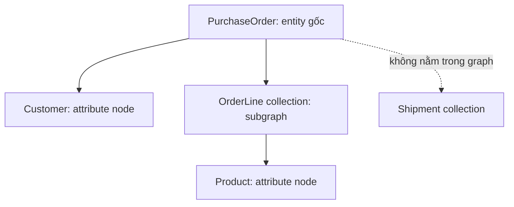
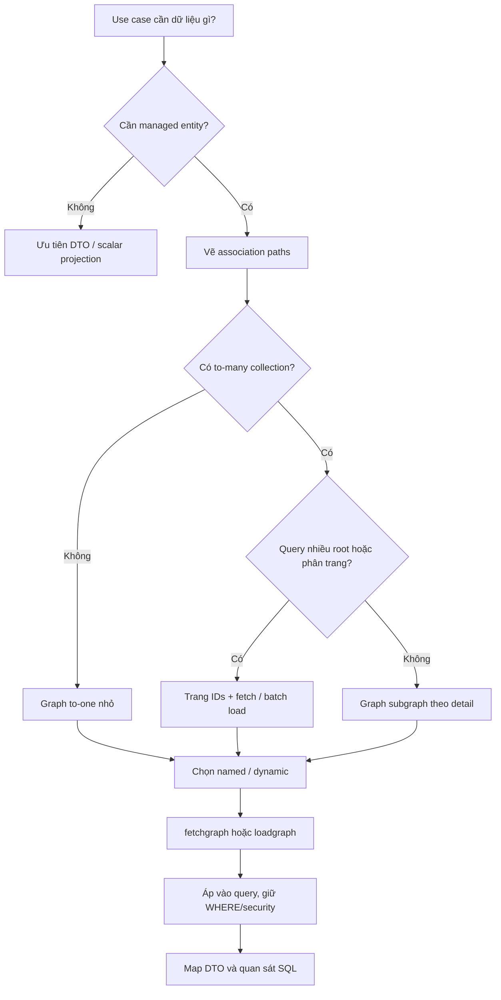

# Tạo entity graph và subgraph theo trường hợp sử dụng

Trong ứng dụng Java sử dụng JPA, cùng một entity có thể được đọc cho nhiều mục đích khác nhau. Màn hình **danh sách đơn hàng** chỉ cần mã đơn, trạng thái và tên khách hàng; màn hình **chi tiết đơn hàng** cần thêm các dòng hàng và sản phẩm; còn một tác vụ **đối soát** có thể chỉ cần số liệu, không cần tải object graph.

Nếu luôn tải mọi association, truy vấn có thể nặng, tạo nhiều hàng SQL và tiêu tốn bộ nhớ. Nếu để tất cả association tải lười mà không lên kế hoạch, ứng dụng dễ gặp **N+1 queries** hoặc lỗi truy cập dữ liệu sau khi persistence context đóng.

JPA cung cấp **Entity Graph** để mô tả **kế hoạch tải dữ liệu (*fetch plan*) theo từng trường hợp sử dụng** mà không cần thay đổi vĩnh viễn mapping entity:

- **`EntityGraph<T>`**: mô tả những thuộc tính của entity gốc cần được fetch.
- **`Subgraph<X>`**: mô tả tiếp những thuộc tính của entity liên quan, có thể lồng nhiều tầng.
- **`@NamedEntityGraph`** và **`@NamedSubgraph`**: khai báo fetch plan có tên, tái sử dụng được.
- **Dynamic entity graph**: tạo graph bằng Java tại runtime.
- **`jakarta.persistence.fetchgraph`** và **`jakarta.persistence.loadgraph`**: hai hint áp dụng fetch plan với ngữ nghĩa khác nhau.
- **`EntityManager.find(...)`**, JPQL, Criteria API và Spring Data JPA có thể dùng graph để tải entity theo nhu cầu.

Ví dụ ngắn:

```java
EntityGraph<PurchaseOrder> graph =
    entityManager.createEntityGraph(PurchaseOrder.class);

graph.addAttributeNodes("customer");

Subgraph<OrderLine> lines = graph.addSubgraph("lines");
lines.addAttributeNodes("product");

PurchaseOrder order = entityManager.find(
    PurchaseOrder.class,
    orderId,
    Map.of("jakarta.persistence.fetchgraph", graph)
);
```

Ở ví dụ này, fetch plan yêu cầu tải:

```text
PurchaseOrder
├── customer
└── lines [collection]
    └── product
```

**Đây là yêu cầu về trạng thái dữ liệu cần được tải, không phải cam kết provider sẽ luôn thực thi bằng đúng một câu SQL JOIN.** Cách Hibernate, EclipseLink hoặc JPA provider khác thực hiện có thể khác nhau theo mapping, dialect và cấu hình.

> **Tư duy quan trọng nhất:** Entity Graph trả lời câu hỏi **“Use case này cần những association nào được tải?”**. Nó **không thay thế `WHERE`**, không phân quyền, không tự tạo DTO, không bảo đảm một SQL duy nhất, và không khiến việc fetch nhiều collection trở nên miễn phí.

Bài học thuộc chương **Kế hoạch tải** của module **Data Persistence Relational Access ORM JPA**. Chúng ta sẽ xây dựng model minh họa, thiết kế graph theo list/detail/report, khai báo named graph và subgraph, dùng dynamic graph, so sánh `fetchgraph`/`loadgraph`, tránh N+1 và các bẫy phân trang, đồng thời thực hành trong JPQL, Criteria API và Spring Data JPA.

---

## 1. Tại sao kế hoạch tải phải theo use case?

Giả sử hệ thống có ba màn hình:

**Màn hình danh sách đơn hàng**

- ID, mã đơn, trạng thái, ngày tạo.
- Tên khách hàng.
- Không cần danh sách OrderLine.

**Màn hình chi tiết đơn hàng**

- Các thông tin như danh sách.
- Toàn bộ OrderLine và Product tương ứng.
- Có thể cần lịch sử giao hàng tùy tính năng.

**Báo cáo tổng doanh thu**

- Tổng tiền theo ngày hoặc theo khách hàng.
- Không cần tạo hàng nghìn entity PurchaseOrder và load các associations.

Nếu mapping mọi quan hệ là EAGER để phục vụ màn hình chi tiết, truy vấn danh sách và báo cáo cũng có nguy cơ tải quá nhiều. Nếu chỉ dùng LAZY mà không có fetch plan cho màn hình chi tiết, các vòng lặp truy cập association có thể tạo N+1.

Một giải pháp linh hoạt:

| Use case | Loại kết quả | Fetch plan |
|---|---|---|
| Danh sách đơn | Entity + mapper hoặc DTO projection | Chỉ customer nếu thật sự cần object |
| Chi tiết một đơn | Entity và graph lồng | Customer, lines, lines.product |
| Danh sách 100 đơn có phân trang | Trang IDs/DTO rồi load có chọn lọc | Tránh fetch collection trực tiếp trong query phân trang |
| Báo cáo doanh thu | DTO/scalar aggregate | Không cần entity graph |
| Xử lý trạng thái một đơn | Managed entity và association cần thiết | Graph nhỏ theo domain operation |
| Xuất dữ liệu nhiều đơn | Streaming/batch/DTO | Không fetch graph rộng không giới hạn |

Entity Graph hỗ trợ **thay đổi chiến lược tải theo từng query** mà không bắt buộc thay annotation mapping để phục vụ mọi use case.

## 2. Mô hình entity sử dụng xuyên suốt

Giả sử mô hình quan hệ:

```text
Customer (1) ───────── (N) PurchaseOrder (1) ──────── (N) OrderLine
   │                          │                            │
   ├── displayName             ├── orderCode                 ├── quantity
   └── region                  ├── status                    └── product (N:1)
                               ├── createdAt                       │
                               └── shipments (1:N)                 v
                                                                Product
                                                                  ├── sku
                                                                  └── name
```

Hai collection `PurchaseOrder.lines` và `PurchaseOrder.shipments` được tách để thấy rủi ro **fetch nhiều to-many associations**.

Entity `Customer`:

```java
import jakarta.persistence.*;

@Entity
@Table(name = "customers")
public class Customer {

    @Id
    private Long id;

    @Column(name = "display_name", nullable = false)
    private String displayName;

    @Column(name = "region", nullable = false)
    private String region;

    protected Customer() {}

    public Long getId() { return id; }
    public String getDisplayName() { return displayName; }
    public String getRegion() { return region; }
}
```

Entity `Product`:

```java
import jakarta.persistence.*;

@Entity
@Table(name = "products")
public class Product {

    @Id
    private Long id;

    @Column(name = "sku", nullable = false, unique = true)
    private String sku;

    @Column(name = "product_name", nullable = false)
    private String name;

    protected Product() {}

    public Long getId() { return id; }
    public String getSku() { return sku; }
    public String getName() { return name; }
}
```

Entity `OrderLine`:

```java
import jakarta.persistence.*;

@Entity
@Table(name = "order_lines")
public class OrderLine {

    @Id
    private Long id;

    @ManyToOne(fetch = FetchType.LAZY, optional = false)
    @JoinColumn(name = "order_id", nullable = false)
    private PurchaseOrder order;

    @ManyToOne(fetch = FetchType.LAZY, optional = false)
    @JoinColumn(name = "product_id", nullable = false)
    private Product product;

    @Column(name = "quantity", nullable = false)
    private Integer quantity;

    protected OrderLine() {}

    public Long getId() { return id; }
    public Product getProduct() { return product; }
    public Integer getQuantity() { return quantity; }
}
```

Entity `Shipment`:

```java
import jakarta.persistence.*;
import java.time.LocalDateTime;

@Entity
@Table(name = "shipments")
public class Shipment {

    @Id
    private Long id;

    @ManyToOne(fetch = FetchType.LAZY, optional = false)
    @JoinColumn(name = "order_id", nullable = false)
    private PurchaseOrder order;

    @Column(name = "tracking_code", nullable = false)
    private String trackingCode;

    @Column(name = "shipped_at")
    private LocalDateTime shippedAt;

    protected Shipment() {}

    public Long getId() { return id; }
    public String getTrackingCode() { return trackingCode; }
}
```

Entity chính:

```java
import jakarta.persistence.*;
import java.math.BigDecimal;
import java.time.LocalDateTime;
import java.util.ArrayList;
import java.util.List;

@Entity
@Table(name = "purchase_orders")
public class PurchaseOrder {

    @Id
    private Long id;

    @Column(name = "order_code", nullable = false)
    private String orderCode;

    @Enumerated(EnumType.STRING)
    @Column(name = "status", nullable = false)
    private OrderStatus status;

    @Column(name = "total_amount", nullable = false)
    private BigDecimal totalAmount;

    @Column(name = "created_at", nullable = false)
    private LocalDateTime createdAt;

    @ManyToOne(fetch = FetchType.LAZY, optional = false)
    @JoinColumn(name = "customer_id", nullable = false)
    private Customer customer;

    @OneToMany(mappedBy = "order")
    private List<OrderLine> lines = new ArrayList<>();

    @OneToMany(mappedBy = "order")
    private List<Shipment> shipments = new ArrayList<>();

    protected PurchaseOrder() {}

    public Long getId() { return id; }
    public String getOrderCode() { return orderCode; }
    public OrderStatus getStatus() { return status; }
    public BigDecimal getTotalAmount() { return totalAmount; }
    public LocalDateTime getCreatedAt() { return createdAt; }
    public Customer getCustomer() { return customer; }
    public List<OrderLine> getLines() { return lines; }
    public List<Shipment> getShipments() { return shipments; }
}
```

Enum:

```java
public enum OrderStatus {
    NEW, PAID, CANCELLED, ARCHIVED
}
```

Các class đã được lược constructor nghiệp vụ, setter và annotation khác không liên quan. Các đoạn Java dùng `jakarta.persistence` và `java.util` tương ứng, giả định `EntityManager em` được cấp trong transaction/persistence context thích hợp.

## 3. Tầng database và object graph khác nhau

SQL thường được thực thi trên bảng:

```sql
SELECT o.*, c.*
FROM purchase_orders o
JOIN customers c ON c.id = o.customer_id
WHERE o.id = ?;
```

JPA thì trả về object:

```text
PurchaseOrder#100
    customer → Customer#10
    lines → collection<OrderLine>
    shipments → collection<Shipment>
```

Một SQL JOIN chỉ chứng minh database kết hợp bảng cho câu truy vấn. Nó **không tự chứng minh** rằng thuộc tính Java `order.customer` hoặc `order.lines` đã được provider khởi tạo đầy đủ, trừ khi truy vấn/fetch plan có semantics cần thiết.

Ngược lại, Entity Graph mô tả các thuộc tính cần được fetch nhưng không bắt buộc provider phải dùng một JOIN duy nhất: provider có thể dùng secondary SELECT hoặc batching tùy triển khai.

Đây là hai lớp cần phân biệt:

- **Hình dạng query SQL**: các bảng/điều kiện và số hàng được đọc.
- **Hình dạng object graph**: các entity và association đã được load cho use case.

## 4. Nhắc lại LAZY và EAGER

Mapping JPA có các mặc định quan trọng:

| Association | Fetch mặc định theo JPA |
|---|---|
| `@ManyToOne` | `EAGER` |
| `@OneToOne` | `EAGER` |
| `@OneToMany` | `LAZY` |
| `@ManyToMany` | `LAZY` |
| `@ElementCollection` | `LAZY` |

`EAGER` chỉ định dữ liệu cần được tải eagerly; nó **không hứa provider phải dùng JOIN**. `LAZY` là chiến lược trì hoãn, và một số trường hợp cần bytecode enhancement/proxy hoặc hỗ trợ riêng từ provider để đạt đúng hiệu quả mong muốn.

Trong model của bài, quan hệ to-one được khai rõ:

```java
@ManyToOne(fetch = FetchType.LAZY)
private Customer customer;
```

để có thể thiết kế fetch plan theo từng query.

### Vì sao không đổi mọi quan hệ thành EAGER?

Nếu mặc định EAGER ở tầng mapping:

- Truy vấn danh sách có thể load quá nhiều.
- Entity graphs lớn xuất hiện cả khi chỉ cần một field.
- Khi không có fetch join phù hợp, provider có thể thực hiện secondary SELECT.
- Truy vấn báo cáo và entity hydration có thể chậm.
- Hình dạng dữ liệu trả về bị ràng buộc mạnh vào mapping.

Cách thường dùng là **mapping tiết kiệm + fetch plan phù hợp từng use case**. Nhưng không áp dụng LAZY máy móc mà bỏ qua nhu cầu đọc thông tin ngay trong transaction.

## 5. N+1 queries phát sinh thế nào?

Ví dụ:

```java
List<PurchaseOrder> orders = em.createQuery(
    "select o from PurchaseOrder o where o.status = :status",
    PurchaseOrder.class
)
.setParameter("status", OrderStatus.PAID)
.getResultList();

for (PurchaseOrder order : orders) {
    System.out.println(
        order.getCustomer().getDisplayName()
    );
}
```

Nếu `customer` chưa được load, provider có thể tạo:

```sql
SELECT * FROM purchase_orders WHERE status = 'PAID';

SELECT * FROM customers WHERE id = 10;
SELECT * FROM customers WHERE id = 11;
SELECT * FROM customers WHERE id = 12;
-- ...
```

Truy vấn đầu lấy các orders; những truy vấn sau tải Customer khi code truy cập association. Đây là dạng **N+1**.

Không nhất thiết có chính xác N truy vấn bổ sung vì first-level/second-level cache và việc nhiều orders cùng tham chiếu một Customer có thể giảm số SELECT, nhưng nguy cơ tăng số round trips theo số association được truy cập vẫn tồn tại.

Một Entity Graph chỉ fetch `customer` có thể giúp người đọc nhận được dữ liệu cần dùng mà không kích hoạt các lazy loads riêng lẻ ngoài dự kiến.

## 6. Entity Graph: khai những thuộc tính cần tải

Cách đơn giản nhất:

```java
import jakarta.persistence.EntityGraph;

EntityGraph<PurchaseOrder> graph =
    em.createEntityGraph(PurchaseOrder.class);

graph.addAttributeNodes("customer");
```

Graph:

```text
PurchaseOrder
└── customer
```

Nó mô tả việc tải Customer cho mỗi PurchaseOrder được trả về khi graph được áp dụng.

Chú ý:

- `addAttributeNodes("customer")` sử dụng **tên thuộc tính Java**, không dùng `customer_id` của database.
- Attribute phải được ánh xạ trong entity type của graph.
- Graph chưa tự chạy SQL. Nó là metadata runtime dùng khi `find()` hoặc query được thực thi.
- Không cần thay `fetch = FetchType.LAZY` trên mapping.
- Graph không thêm điều kiện `customer.region = ...`; filter phải nằm trong JPQL/Criteria riêng.

## 7. Tạo graph động bằng `createEntityGraph()`

Một ví dụ hoàn chỉnh:

```java
import jakarta.persistence.EntityGraph;
import jakarta.persistence.EntityManager;
import jakarta.persistence.TypedQuery;
import java.util.List;

public List<PurchaseOrder> findPaidWithCustomer(
        EntityManager em) {

    EntityGraph<PurchaseOrder> graph =
        em.createEntityGraph(PurchaseOrder.class);

    graph.addAttributeNodes("customer");

    TypedQuery<PurchaseOrder> query = em.createQuery(
        """
        select o
        from PurchaseOrder o
        where o.status = :status
        order by o.createdAt desc, o.id desc
        """,
        PurchaseOrder.class
    );

    query.setParameter("status", OrderStatus.PAID);
    query.setHint("jakarta.persistence.fetchgraph", graph);

    return query.getResultList();
}
```

Khi code gọi `getCustomer().getDisplayName()` cho các orders sau query, Customer là một association đã được yêu cầu fetch theo graph.

Đây là **fetch plan động (*dynamic graph*)** vì Java tạo graph tại thời điểm gọi method; không phải một graph có tên cố định trong annotation.

### Khi nào dynamic graph phù hợp?

- Có nhiều biến thể điều kiện hiển thị.
- Fetch plan phụ thuộc một tập tính năng được phép, ví dụ danh sách có/không có tên customer.
- Muốn tách việc tạo graph vào factory/helper.
- Muốn thử nghiệm một graph mới mà không khai thêm annotation tên riêng.
- Cần lắp subgraph theo cấu hình do server kiểm soát.

Nhưng không nên nhận trực tiếp chuỗi attribute paths tùy ý từ HTTP request rồi đưa vào `addAttributeNodes`; phần sau giải thích vì sao.

## 8. Một graph chỉ fetch to-one

Use case **danh sách đơn hàng** cần Customer nhưng không cần OrderLine:

```java
EntityGraph<PurchaseOrder> listGraph =
    em.createEntityGraph(PurchaseOrder.class);

listGraph.addAttributeNodes("customer");
```

Áp dụng:

```java
List<PurchaseOrder> list = em.createQuery(
    """
    select o
    from PurchaseOrder o
    where o.status = :status
    order by o.createdAt desc, o.id desc
    """,
    PurchaseOrder.class
)
.setParameter("status", OrderStatus.PAID)
.setHint("jakarta.persistence.fetchgraph", listGraph)
.setMaxResults(20)
.getResultList();
```

Vì Customer là **to-one** của PurchaseOrder, fetch này thường không nhân số hàng root theo kích thước collection.

Tuy vậy, không có bảo đảm SQL luôn chỉ có một JOIN; provider có thể chọn cơ chế tải khác. Ngoài ra, fetch Customer không tự fetch `lines` hoặc `shipments`.

## 9. Subgraph là gì?

Một Entity Graph cho root PurchaseOrder có thể muốn đi sâu qua association:

```text
PurchaseOrder
└── lines
    └── product
```

Ở đây `lines` là một collection chứa `OrderLine`. Nếu chỉ thêm:

```java
graph.addAttributeNodes("lines");
```

JPA được yêu cầu fetch các phần tử OrderLine, nhưng **không nhất thiết** fetch `OrderLine.product` nếu Product là LAZY và không được khai trong graph.

Để tải Product của từng OrderLine, ta tạo **Subgraph<OrderLine>**:

```java
Subgraph<OrderLine> lineGraph =
    graph.addSubgraph("lines");

lineGraph.addAttributeNodes("product");
```

Subgraph là **mô tả fetch plan của entity ở một association cấp dưới**, không phải một query SELECT độc lập.

## 10. Tạo EntityGraph với Subgraph hai tầng

Use case **chi tiết một đơn hàng** cần Customer, Lines, và Product mỗi line.

```java
import jakarta.persistence.EntityGraph;
import jakarta.persistence.Subgraph;

EntityGraph<PurchaseOrder> detailGraph =
    em.createEntityGraph(PurchaseOrder.class);

detailGraph.addAttributeNodes("customer");

Subgraph<OrderLine> lineGraph =
    detailGraph.addSubgraph("lines");

lineGraph.addAttributeNodes("product");
```

Cây:



Khi dùng fetchgraph hint, `shipments` không được chỉ định eager theo graph, còn `customer`, `lines` và `lines.product` được yêu cầu fetch.

### Áp dụng cho một Order bằng find

```java
PurchaseOrder order = em.find(
    PurchaseOrder.class,
    orderId,
    Map.of("jakarta.persistence.fetchgraph", detailGraph)
);
```

Ví dụ sử dụng trong service:

```java
String customerName =
    order.getCustomer().getDisplayName();

for (OrderLine line : order.getLines()) {
    String sku = line.getProduct().getSku();
    System.out.println(sku + ": " + line.getQuantity());
}
```

Đây là cách fetch toàn bộ graph **mà use case thật sự dùng**. Nếu UI không cần Product, bỏ `lineGraph.addAttributeNodes("product")` để giảm dữ liệu cần tải.

## 11. Subgraph nhiều tầng và ranh giới tải dữ liệu

Giả sử `Product` có association `category`, và màn hình chi tiết cần cả tên category. Mở rộng model:

```java
@ManyToOne(fetch = FetchType.LAZY)
@JoinColumn(name = "category_id")
private Category category;
```

Khi đó:

```java
Subgraph<OrderLine> lines =
    detailGraph.addSubgraph("lines");

Subgraph<Product> products =
    lines.addSubgraph("product");

products.addAttributeNodes("category");
```

Cây:

```text
PurchaseOrder
└── lines [Subgraph<OrderLine>]
    └── product [Subgraph<Product>]
        └── category
```

`Category` trong ví dụ là entity giả định phải được khai báo thực tế trước khi code biên dịch.

Điểm cần phân biệt:

- `lines.addAttributeNodes("product")`: yêu cầu fetch Product nhưng không liệt kê các association sâu hơn.
- `lines.addSubgraph("product")`: yêu cầu fetch Product và cho phép mô tả sâu những thuộc tính của Product.
- Một subgraph có thể lồng tiếp subgraph khác theo model.
- Mỗi tầng tăng độ sâu dữ liệu tải, có thể ảnh hưởng SQL và bộ nhớ.

Không tạo một graph “fetch hết mọi thứ” vì graph rất sâu có thể mở rộng qua nhiều association gây truy vấn khó kiểm soát.

## 12. `addAttributeNodes` và `addSubgraph` khác nhau như thế nào?

| API | Mục đích | Ví dụ |
|---|---|---|
| `graph.addAttributeNodes("customer")` | Fetch attribute của root | Customer của Order |
| `graph.addSubgraph("lines")` | Fetch association và định nghĩa tiếp graph cho phần tử | Lines → ... |
| `subgraph.addAttributeNodes("product")` | Fetch attribute của phần tử thuộc subgraph | Product của Line |
| `subgraph.addSubgraph("product")` | Định nghĩa sâu hơn trên Product | Product → Category |
| `graph.addAttributeNodes("status")` | Chỉ định basic attribute | Thường không cần nếu basic vốn eager |
| `graph.addAttributeNodes("shipments")` | Fetch collection | Cẩn trọng khi query nhiều root |

Khi thêm subgraph cho association, association đó được đưa vào kế hoạch fetch. Bạn không cần tạo một subgraph chỉ để fetch một thuộc tính to-one nếu không muốn định nghĩa sâu hơn.

### Tại sao cần Subgraph?

Nếu EntityGraph chỉ có danh sách attribute names phẳng, không thể diễn tả chính xác “tải Customer nhưng không tải Customer.orders” hoặc “tải OrderLine và Product nhưng không tải Product.reviews”. Subgraph cho phép xác định **hình dạng fetch theo từng nhánh**, tránh bật EAGER toàn cục.

## 13. Không nhất thiết mọi attribute cần xuất hiện trong graph

Các trường scalar cơ bản như:

```java
private Long id;
private String orderCode;
private BigDecimal totalAmount;
private LocalDateTime createdAt;
```

thường được fetch theo mapping cơ bản và provider behavior, không cần liệt kê từng field mỗi lần tạo graph.

Entity Graph tập trung nhiều nhất vào **association paths**, đặc biệt:

- to-one association được cấu hình LAZY;
- collection LAZY mà một use case cụ thể cần tải;
- nested association của các phần tử trong collection.

Tuy nhiên, Entity Graph cũng có semantics với basic attributes và embeddables. Nếu dự án dùng `@Basic(fetch = LAZY)` cho một field lớn như `@Lob`, cần hiểu đặc tả và khả năng bytecode enhancement của provider. **Entity Graph không phải công cụ SELECT đúng vài cột theo kiểu DTO projection**.

## 14. Khai báo named graph bằng annotation

Dynamic graph phù hợp cho sự linh hoạt. Khi một fetch plan được sử dụng lặp lại, có thể khai báo **`@NamedEntityGraph`** ngay trên entity:

```java
import jakarta.persistence.*;

@Entity
@Table(name = "purchase_orders")
@NamedEntityGraph(
    name = "PurchaseOrder.list",
    attributeNodes = {
        @NamedAttributeNode("customer")
    }
)
public class PurchaseOrder {
    @Id
    private Long id;

    @ManyToOne(fetch = FetchType.LAZY)
    private Customer customer;

    // Các thuộc tính khác được lược.
}
```

Tên `PurchaseOrder.list` là **tên metadata JPA**, không phải tên bảng hay câu truy vấn.

Lấy graph:

```java
EntityGraph<PurchaseOrder> graph =
    em.getEntityGraph("PurchaseOrder.list");
```

Áp dụng cho query:

```java
TypedQuery<PurchaseOrder> query =
    em.createQuery(
        "select o from PurchaseOrder o where o.status = :status",
        PurchaseOrder.class
    );

query.setParameter("status", OrderStatus.PAID);
query.setHint("jakarta.persistence.fetchgraph", graph);
```

Lưu ý: ví dụ class annotation đã rút gọn, trong project thật chỉ có **một định nghĩa PurchaseOrder** chứa đầy đủ các field cần thiết.

## 15. Khai báo nhiều named graphs trên cùng entity

Cùng PurchaseOrder có thể có hai fetch plans:

- `PurchaseOrder.list`: Customer.
- `PurchaseOrder.detail`: Customer, Lines và Product.

Dùng `@NamedEntityGraphs`:

```java
@Entity
@Table(name = "purchase_orders")
@NamedEntityGraphs({
    @NamedEntityGraph(
        name = "PurchaseOrder.list",
        attributeNodes = {
            @NamedAttributeNode("customer")
        }
    ),
    @NamedEntityGraph(
        name = "PurchaseOrder.detail",
        attributeNodes = {
            @NamedAttributeNode("customer"),
            @NamedAttributeNode(
                value = "lines",
                subgraph = "lineWithProduct"
            )
        },
        subgraphs = {
            @NamedSubgraph(
                name = "lineWithProduct",
                type = OrderLine.class,
                attributeNodes = {
                    @NamedAttributeNode("product")
                }
            )
        }
    )
})
public class PurchaseOrder {

    @Id
    private Long id;

    // Các thuộc tính và mapping như model phía trên.
}
```

Trong graph detail:

- `@NamedAttributeNode("customer")` fetch Customer.
- `@NamedAttributeNode(value="lines", subgraph="lineWithProduct")` chọn collection Lines và liên kết tới named subgraph.
- `@NamedSubgraph(name="lineWithProduct", ...)` mô tả các attribute cần fetch của `OrderLine`.
- `@NamedAttributeNode("product")` trong subgraph yêu cầu fetch Product.

**`lineWithProduct` chỉ là tên tham chiếu subgraph bên trong khai báo graph**, không phải một `@NamedEntityGraph` độc lập để tự gọi trực tiếp bằng `em.getEntityGraph("lineWithProduct")`.

## 16. So sánh named graph và dynamic graph

| Tiêu chí | `@NamedEntityGraph` | Dynamic `createEntityGraph` |
|---|---|---|
| Khai báo ở đâu? | Annotation/metadata managed entity | Java runtime |
| Được đặt tên tái sử dụng? | Có | Có thể tự giữ object hoặc factory method |
| Phù hợp | Use case ổn định: list, detail, export | Use case có các lựa chọn được phép |
| Subgraph | `@NamedSubgraph` | `addSubgraph(...)` |
| Dễ phát hiện bằng IDE | Tên graph là string, metadata ở entity | Logic ngay cạnh code sử dụng |
| Thay đổi theo request | Không tiện nếu quá nhiều biến thể | Linh hoạt hơn |
| Rủi ro | Nhiều annotation dài, khó đọc | Build graph quá rộng hoặc động không kiểm soát |
| Mối quan hệ với query | Được gắn qua query hint/find | Tương tự |

Named graph thường phù hợp khi toàn ứng dụng có một số **hình dạng dữ liệu đọc rõ ràng**. Dynamic graph phù hợp khi ứng dụng chọn một biến thể fetch plan dựa trên chức năng, nhưng nên quản lý qua service/factory để tránh lặp logic.

## 17. Áp dụng named graph trong EntityManager.find()

Ví dụ màn hình detail:

```java
import java.util.Map;

EntityGraph<PurchaseOrder> graph =
    em.getEntityGraph("PurchaseOrder.detail");

PurchaseOrder order = em.find(
    PurchaseOrder.class,
    orderId,
    Map.of("jakarta.persistence.fetchgraph", graph)
);
```

`find(Class, id, properties)` nhận một map các hints/properties của JPA. Với graph hint, provider biết fetch plan khi tìm entity.

Nếu `orderId` không tồn tại, `find()` trả `null`. Khi viết API, phải xử lý not found:

```java
if (order == null) {
    throw new EntityNotFoundException(
        "Order not found: " + orderId
    );
}
```

Ví dụ này chưa bao gồm điều kiện tenant/authorization: `find()` theo ID **không tự lọc theo tenant** chỉ vì fetch graph được sử dụng. Với hệ thống multi-tenant, cần một query có predicate tenant hoặc cơ chế isolation tin cậy.

## 18. Áp dụng graph vào JPQL query

```java
EntityGraph<PurchaseOrder> graph =
    em.getEntityGraph("PurchaseOrder.list");

TypedQuery<PurchaseOrder> query = em.createQuery(
    """
    select o
    from PurchaseOrder o
    where o.status = :status
    order by o.createdAt desc, o.id desc
    """,
    PurchaseOrder.class
);

query.setParameter("status", OrderStatus.PAID);
query.setHint("jakarta.persistence.fetchgraph", graph);
query.setMaxResults(50);

List<PurchaseOrder> page = query.getResultList();
```

Trong ví dụ:

- `WHERE` lọc các order PAID.
- `ORDER BY` sắp thứ tự kết quả.
- `setMaxResults(50)` giới hạn kết quả query.
- `fetchgraph` chỉ định Customer cần được fetch cùng order.
- Vì graph chỉ có to-one Customer, nó tránh rủi ro điển hình của fetch collection trong pagination.

**Entity Graph không tự bổ sung WHERE, ORDER BY hoặc LIMIT.** Nếu query gốc chọn sai tập order, graph không sửa được logic đó.

## 19. Áp dụng graph vào Criteria API

Một CriteriaQuery SELECT:

```java
import jakarta.persistence.*;
import jakarta.persistence.criteria.*;
import java.util.List;

CriteriaBuilder cb = em.getCriteriaBuilder();

CriteriaQuery<PurchaseOrder> cq =
    cb.createQuery(PurchaseOrder.class);

Root<PurchaseOrder> root =
    cq.from(PurchaseOrder.class);

cq.select(root)
  .where(cb.equal(
      root.get("status"),
      OrderStatus.PAID
  ))
  .orderBy(
      cb.desc(root.get("createdAt")),
      cb.desc(root.get("id"))
  );

EntityGraph<PurchaseOrder> graph =
    em.getEntityGraph("PurchaseOrder.list");

TypedQuery<PurchaseOrder> query =
    em.createQuery(cq);

query.setHint("jakarta.persistence.fetchgraph", graph);
query.setMaxResults(50);

List<PurchaseOrder> orders = query.getResultList();
```

Graph và CriteriaQuery có vai trò khác nhau:

- **Criteria** xác định các rows/entity nào cần lấy và thứ tự.
- **EntityGraph** xác định các association cần fetch cho những entities được lấy.

Dùng cả hai không có nghĩa mọi điều kiện Criteria đều được đưa vào fetch graph hoặc ngược lại.

## 20. `fetchgraph` có ý nghĩa gì?

Hint chuẩn Jakarta Persistence:

```java
query.setHint(
    "jakarta.persistence.fetchgraph",
    graph
);
```

Ngữ nghĩa **fetch graph** ở mức JPA:

- Những attribute được liệt kê trong graph được xử lý theo fetch graph, yêu cầu eagerly fetched.
- Những attribute không nằm trong graph được xem như lazy theo ngữ nghĩa fetchgraph, trừ các yêu cầu đặc biệt của đặc tả và khả năng provider có thể fetch thêm dữ liệu.
- Khi một association có subgraph, fetch plan của entity liên quan được mô tả bởi subgraph đó.
- Các entity IDs/version thuộc những dữ liệu cần thiết để quản lý entity vẫn có quy tắc tải riêng.

Ví dụ:

```text
Entity mapping:
  customer: LAZY
  lines: LAZY
  shipments: LAZY

Fetch graph:
  customer
  lines → product

Yêu cầu:
  customer: fetch
  lines: fetch
  product của mỗi line: fetch
  shipments: không được yêu cầu eager bởi graph
```

### Không hiểu `fetchgraph` là “SELECT đúng các cột graph”

Đặc tả cho phép provider fetch thêm trạng thái so với tối thiểu được yêu cầu. Ngoài ra, basic fields, identifier, version, proxy/enhancement và cache có semantics riêng.

Do đó:

- Không dựa vào fetchgraph để che trường bí mật khỏi SQL.
- Không dùng fetchgraph làm hợp đồng JSON response.
- Không giả định một attribute không liệt kê **chắc chắn** không có mặt trong memory.
- Không dùng `fetchgraph` thay cho DTO projection nếu chỉ cần 3 cột.

## 21. `loadgraph` có ý nghĩa gì?

Hint:

```java
query.setHint(
    "jakarta.persistence.loadgraph",
    graph
);
```

Ngữ nghĩa **load graph**:

- Những attributes được khai trong graph được yêu cầu eagerly fetched.
- Những attributes **không nằm trong graph** giữ fetch behavior theo mapping/default fetch plan của entity.

Điều này khác fetchgraph trong trường hợp entity có những association `EAGER` không được liệt kê.

Ví dụ model mở rộng:

```java
@ManyToOne(fetch = FetchType.EAGER)
private SalesChannel salesChannel;
```

Giả sử graph chỉ khai Customer.

| Attribute | Mapping | Fetchgraph liệt kê Customer | Loadgraph liệt kê Customer |
|---|---|---|---|
| `customer` | LAZY | Được yêu cầu eager | Được yêu cầu eager |
| `lines` | LAZY | Không yêu cầu eager | Theo mapping LAZY |
| `salesChannel` | EAGER | Không nằm trong tập eager tối thiểu của graph | Vẫn theo mapping EAGER |
| `orderCode` | Basic mặc định eager | Subject to fetch-graph/basic semantics | Theo mapping/basic semantics |

`SalesChannel` ở đây là association giả định dùng để phân biệt hai hints; class và mapping chưa được thêm vào model gốc.

### Lựa chọn nào tốt hơn?

- Dùng `fetchgraph` khi muốn mô tả một graph eager **có chủ đích**, ít phụ thuộc vào những EAGER mappings ngoài ý muốn.
- Dùng `loadgraph` khi muốn **bổ sung** những associations cần tải mà vẫn giữ mapping defaults của entity.
- Với các providers/versions, khả năng thực tế xử lý EAGER associations khi dùng fetchgraph có thể khác; quan sát SQL và initialization state trong integration tests.

Đặc tả yêu cầu cách fetch theo graph nhưng không bảo đảm provider chỉ dùng đúng những JOIN/SELECT mà người viết suy ra từ bảng.

## 22. Bảng so sánh fetchgraph và loadgraph

| Câu hỏi | `fetchgraph` | `loadgraph` |
|---|---|---|
| Attribute trong graph được tải eagerly? | Có | Có |
| Attribute không trong graph nhưng mapping LAZY? | Không được graph yêu cầu eager | Theo LAZY |
| Attribute không trong graph nhưng mapping EAGER? | Fetchgraph định nghĩa phạm vi eager tối thiểu; provider có thể fetch thêm | Theo EAGER mapping |
| Dùng cho read model được xác định rõ? | Thường phù hợp | Có thể |
| Dùng để bổ sung một vài associations vào mapping hiện tại? | Có, nhưng semantics khác | Rất tự nhiên |
| Có bảo đảm ít câu SQL nhất? | Không | Không |
| Có thay đổi annotation entity lâu dài? | Không | Không |
| Có lọc children trong collection? | Không | Không |
| Có thay thế transaction/DTO/authorization? | Không | Không |

Hai hint này tác động tới **cách fetch object state**, không tác động trực tiếp tới tính đúng đắn của một predicate WHERE.

## 23. Ưu tiên graph nhỏ theo use case

Một cách đặt tên:

```text
PurchaseOrder.list
PurchaseOrder.detail
PurchaseOrder.detailWithShipments
PurchaseOrder.customerSupport
```

Ví dụ:

**PurchaseOrder.list**

```text
PurchaseOrder
└── customer
```

**PurchaseOrder.detail**

```text
PurchaseOrder
├── customer
└── lines
    └── product
```

**PurchaseOrder.detailWithShipments**

```text
PurchaseOrder
├── customer
├── lines
│   └── product
└── shipments
```

Kế hoạch cuối cùng có hai collections (lines và shipments), do đó cần thận trọng về tích số hàng SQL và provider limitations.

Graph nên phản ánh **đúng dữ liệu của một use case cụ thể**. Không tạo một graph “allAssociations” rồi tái sử dụng cho mọi endpoint chỉ để tránh nghĩ đến lazy loading.

## 24. Đóng gói graph trong một factory

Khi có dynamic graphs, có thể tạo helper:

```java
public final class OrderGraphs {

    private OrderGraphs() {}

    public static EntityGraph<PurchaseOrder> list(
            EntityManager em) {

        EntityGraph<PurchaseOrder> graph =
            em.createEntityGraph(PurchaseOrder.class);

        graph.addAttributeNodes("customer");

        return graph;
    }

    public static EntityGraph<PurchaseOrder> detail(
            EntityManager em) {

        EntityGraph<PurchaseOrder> graph =
            list(em);

        Subgraph<OrderLine> lineGraph =
            graph.addSubgraph("lines");

        lineGraph.addAttributeNodes("product");

        return graph;
    }
}
```

Sử dụng:

```java
EntityGraph<PurchaseOrder> graph =
    OrderGraphs.detail(em);

TypedQuery<PurchaseOrder> query =
    em.createQuery(
        "select o from PurchaseOrder o where o.id = :id",
        PurchaseOrder.class
    );

query.setParameter("id", orderId);
query.setHint("jakarta.persistence.fetchgraph", graph);
```

Lợi ích:

- Mỗi graph có một tên/use case rõ ràng trong code.
- Dễ sửa fetch plan một chỗ.
- Không phải copy cùng attribute paths giữa service methods.
- Có thể tạo graph mới cho từng lời gọi để tránh mutation state ngoài ý muốn.
- Giúp code review dễ nhìn thấy khi một endpoint bắt đầu fetch thêm collection.

Nếu dùng named graph metadata, việc tạo factory như trên có thể không cần. Chọn một cách tổ chức nhất quán.

## 25. Dynamic graph không nên nhận attribute paths tùy ý từ client

Nguy hiểm:

```java
// Không nên nhận trực tiếp giá trị người dùng
// như một danh sách association paths để fetch.
for (String attribute : request.getFetchFields()) {
    graph.addAttributeNodes(attribute);
}
```

Rủi ro:

- Người dùng yêu cầu fetch các association không được phép hiển thị.
- Graph quá sâu khiến SQL/DB load rất nhiều.
- Có thể kích hoạt nhiều collections và Cartesian explosion.
- Tên thuộc tính sai gây exception.
- Fetch fields của persistence model bị lộ như một API công khai.
- Dữ liệu được tải dù DTO/authorization không cần.

Một hướng tốt hơn:

```java
public enum OrderView {
    LIST,
    DETAIL
}
```

```java
EntityGraph<PurchaseOrder> graph =
    switch (view) {
        case LIST -> OrderGraphs.list(em);
        case DETAIL -> OrderGraphs.detail(em);
    };
```

Client chỉ chọn **một trong các use cases được server cho phép**, còn code server quyết định graph. Việc client chọn DETAIL vẫn cần kiểm tra quyền xem order và dữ liệu liên quan.

## 26. Entity Graph không lọc hàng trong collection

Giả sử PurchaseOrder có ba OrderLine:

```text
Order#100
├── Line#1 → Product SKU-A
├── Line#2 → Product SKU-B
└── Line#3 → Product SKU-A
```

Màn hình yêu cầu:

> “Tìm các orders có ít nhất một SKU-A, nhưng khi xem chi tiết phải hiển thị **toàn bộ lines**.”

Entity Graph:

```java
Subgraph<OrderLine> lines =
    graph.addSubgraph("lines");

lines.addAttributeNodes("product");
```

**Không có điều kiện `SKU = A` bên trong graph.** Graph chỉ khai những associations cần tải.

Nếu cần **lọc các orders** có SKU-A, dùng JPQL/Criteria predicate thích hợp, chẳng hạn `EXISTS`:

```jpql
SELECT o
FROM PurchaseOrder o
WHERE EXISTS (
    SELECT line.id
    FROM OrderLine line
    WHERE line.order = o
      AND line.product.sku = :sku
)
```

Sau đó áp graph detail lên query để tải lines của những orders thỏa điều kiện.

Không nhầm:

- **Filter** xác định **orders nào** nằm trong result.
- **Entity graph** xác định **những associations nào** của các orders đó được tải.

## 27. Tránh tạo “filtered collection” bằng fetch join có điều kiện

Một ý tưởng dễ sai là kết hợp `JOIN FETCH o.lines` với `WHERE line.product.sku = :sku` rồi coi `o.lines` là collection đầy đủ.

Nếu một provider chấp nhận cách query này và khởi tạo collection chỉ với các lines đã lọc, ứng dụng có thể hiểu nhầm tập kết quả đó là toàn bộ relationship. Khi entity còn managed, những chỉnh sửa collection sau đó có thể trở nên nguy hiểm.

Một thiết kế rõ nghĩa hơn:

- Dùng `EXISTS` để lọc root entities theo child condition.
- Dùng Entity Graph để fetch **toàn bộ collection** khi use case chi tiết thực sự cần.
- Nếu UI chỉ muốn **các lines phù hợp SKU**, query OrderLine trực tiếp thành DTO đã lọc, **không hứa** rằng `PurchaseOrder.lines` đã được khởi tạo đầy đủ.

Entity Graph không cung cấp API chuẩn để thêm WHERE vào từng `Subgraph` nhằm lọc những phần tử collection.

## 28. So sánh Entity Graph với JPQL JOIN FETCH

Một fetch join tường minh:

```jpql
SELECT o
FROM PurchaseOrder o
JOIN FETCH o.customer
WHERE o.status = :status
```

Một query dùng graph:

```jpql
SELECT o
FROM PurchaseOrder o
WHERE o.status = :status
```

và:

```java
query.setHint("jakarta.persistence.fetchgraph", graph);
```

Trong trường hợp graph chỉ có Customer, cả hai có thể đáp ứng nhu cầu tải Customer.

| Khía cạnh | `JOIN FETCH` | Entity Graph |
|---|---|---|
| Fetch plan đặt ở đâu? | Trong JPQL query | Tách thành annotation/runtime metadata |
| Có thể đổi graph mà không sửa WHERE? | Cần đổi câu JPQL | Dễ dàng hơn |
| Có thể khai nested associations? | Viết nhiều fetch joins | Subgraph |
| SQL phải chính xác một JOIN? | Không cam kết kế hoạch cuối của provider | Không cam kết |
| Phụ thuộc vào loại query? | SELECT entity phù hợp | SELECT/find entity phù hợp |
| Có nguy cơ fetch collection quá lớn? | Có | Có |
| Phù hợp named reusable fetch plan? | Có qua named query | Có qua @NamedEntityGraph |

**Entity Graph không phải “JOIN FETCH nhanh hơn”**. Nó là cách khai báo fetch plan khác, thường giúp tách chính sách lấy dữ liệu khỏi điều kiện truy vấn.

## 29. JOIN thường và FETCH khác nhau

Criteria API cho phép:

```java
Join<PurchaseOrder, Customer> customerJoin =
    root.join("customer", JoinType.INNER);
```

để lọc:

```java
cq.where(cb.equal(
    customerJoin.get("region"), "HCM"
));
```

Nhưng ordinary `join()` không bắt buộc khởi tạo `root.customer` cho kết quả entity.

Cách kết hợp đúng có thể là:

```java
Join<PurchaseOrder, Customer> customer =
    root.join("customer", JoinType.INNER);

cq.where(cb.equal(customer.get("region"), "HCM"));

TypedQuery<PurchaseOrder> query =
    em.createQuery(cq);

query.setHint(
    "jakarta.persistence.fetchgraph",
    OrderGraphs.list(em)
);
```

Lúc này:

- Criteria JOIN phục vụ **predicate region**.
- Entity Graph yêu cầu **Customer được tải**.

Provider có thể sử dụng cùng SQL JOIN hoặc sinh thêm SQL/joins; phải quan sát câu SQL thực tế thay vì suy từ số method Java được gọi.

## 30. Subgraph trên to-many có nguy cơ nhân số hàng SQL

Giả sử:

```text
Order#100 có 3 lines.
Order#101 có 5 lines.
Order#102 có 1 line.
```

Nếu provider triển khai fetch graph của `lines` bằng JOIN, SQL result set có thể có:

```text
Order#100 + Line#1
Order#100 + Line#2
Order#100 + Line#3
Order#101 + Line#4
...
Order#101 + Line#8
Order#102 + Line#9
```

Ba orders nhưng chín hàng SQL.

Khi fetch `lines.product`, Product là to-one của Line, thường không làm nhân hàng thêm theo số Product trên mỗi Line, nhưng làm tăng số cột và dữ liệu cần tải.

**Tải collection không đồng nghĩa chỉ trả một hàng SQL cho một entity root.** Provider phải ghép các hàng về object graph, và việc đó có chi phí JDBC, CPU, RAM.

### Trường hợp phù hợp

- Trang detail có một order và một số lines vừa phải.
- Một batch nhỏ các orders đã được xác định.
- Cần thao tác trên toàn bộ collection trong transaction.

### Trường hợp cần tránh

- Danh sách hàng nghìn orders.
- API phân trang trực tiếp kèm collection graph.
- Xuất dữ liệu hàng triệu dòng mà chỉ dùng vài trường.
- Fetch nhiều collections có kích thước lớn cùng lúc.

## 31. Vấn đề phân trang với graph chứa collection

Ví dụ rủi ro:

```java
EntityGraph<PurchaseOrder> graph =
    OrderGraphs.detail(em);

List<PurchaseOrder> page = em.createQuery(
    """
    select o
    from PurchaseOrder o
    order by o.createdAt desc, o.id desc
    """,
    PurchaseOrder.class
)
.setHint("jakarta.persistence.fetchgraph", graph)
.setFirstResult(0)
.setMaxResults(20)
.getResultList();
```

Graph detail chứa `lines` to-many. Nếu provider thực hiện bằng SQL JOIN, một PurchaseOrder có nhiều lines tạo nhiều hàng SQL.

SQL `LIMIT 20` tác động tới hàng SQL có thể cắt giữa collection hoặc tạo ít hơn 20 distinct orders. Để giữ kết quả graph đầy đủ, provider có thể:

- Phân trang ở bộ nhớ sau khi tải nhiều rows, làm chậm và tốn RAM.
- Áp dụng một chiến lược load phụ khác.
- Báo warning hoặc lỗi với cấu hình provider.
- Dùng execution strategy riêng tùy phiên bản.

Với Hibernate, có cấu hình phát hiện pagination kèm collection fetch:

```properties
hibernate.query.fail_on_pagination_over_collection_fetch=true
```

Cấu hình này đặc thù Hibernate; cách khai trong Spring Boot/version cần đối chiếu môi trường đang dùng.

**Không kết luận pagination an toàn chỉ vì không viết `JOIN FETCH` tường minh.** Graph có to-many association có thể dẫn đến cùng loại vấn đề khi provider chọn JOIN loading.

## 32. Chiến lược hai bước: phân trang root IDs rồi fetch graph

Khi cần **20 orders mới nhất kèm đầy đủ lines**, một pattern là:

1. Query chỉ lấy IDs của root với thứ tự ổn định và pagination.
2. Query lần hai fetch entity graph cho đúng các IDs đó, **không phân trang** trên kết quả fetch collection.
3. Sắp lại theo thứ tự ID của trang vì `IN (:ids)` không đảm bảo giữ thứ tự.

### Bước A: lấy IDs của trang

```java
List<Long> ids = em.createQuery(
    """
    select o.id
    from PurchaseOrder o
    where o.status = :status
    order by o.createdAt desc, o.id desc
    """,
    Long.class
)
.setParameter("status", OrderStatus.PAID)
.setFirstResult(pageIndex * pageSize)
.setMaxResults(pageSize)
.getResultList();
```

### Bước B: fetch graph cho tập IDs

```java
if (ids.isEmpty()) {
    return List.of();
}

EntityGraph<PurchaseOrder> graph =
    OrderGraphs.detail(em);

List<PurchaseOrder> fetched = em.createQuery(
    """
    select distinct o
    from PurchaseOrder o
    where o.id in :ids
    """,
    PurchaseOrder.class
)
.setParameter("ids", ids)
.setHint("jakarta.persistence.fetchgraph", graph)
.getResultList();
```

Phần `return List.of()` giả định đoạn code nằm trong một phương thức trả list, không phải đoạn standalone ở cấp class.

### Bước C: giữ thứ tự trang

```java
Map<Long, PurchaseOrder> byId = fetched.stream()
    .collect(Collectors.toMap(
        PurchaseOrder::getId,
        Function.identity()
    ));

List<PurchaseOrder> orderedPage = ids.stream()
    .map(byId::get)
    .filter(Objects::nonNull)
    .toList();
```

Đoạn này dùng `java.util.Map`, `Objects`, `java.util.function.Function` và `java.util.stream.Collectors`.

Vì trang IDs đã được xác định trước, truy vấn thứ hai tải graph cho đúng tập root đó.

### Giới hạn

- Có **hai SQL/query phases**, không phải một transaction snapshot tự động.
- Dữ liệu có thể thay đổi giữa hai statements dưới isolation level thường gặp.
- Danh sách IDs lớn có thể vượt giới hạn bind parameters của database.
- Sort phải ổn định, ví dụ `createdAt DESC, id DESC`.
- Với một số hệ thống, keyset pagination có thể tốt hơn offset cao.
- Fetch hai collections cùng lúc vẫn có thể gây nổ hàng SQL dù IDs đã được giới hạn.

Mục tiêu của pattern là **không phân trang trực tiếp trên kết quả JOIN của collection**, chứ không bảo đảm mọi bài toán query đều trở nên rẻ.

## 33. Count query không nên dùng fetch graph chứa collections

Khi xây API phân trang, cần:

- Content: các đơn của trang hiện tại.
- Total: tổng số đơn thỏa filter.

Query đếm:

```java
Long total = em.createQuery(
    """
    select count(o)
    from PurchaseOrder o
    where o.status = :status
    """,
    Long.class
)
.setParameter("status", OrderStatus.PAID)
.getSingleResult();
```

Không áp graph detail cho query `count(o)`:

```java
// Không cần thiết và có thể bị provider từ chối.
countQuery.setHint(
    "jakarta.persistence.fetchgraph",
    detailGraph
);
```

Một count query không trả PurchaseOrder entities để liên kết dữ liệu fetched; việc tải Customer/Lines/Product không có ý nghĩa khi kết quả chỉ là Long.

Nếu count phải lọc theo collection, dùng `EXISTS` hoặc `COUNT(DISTINCT o)` với JOIN theo semantics, **không phải fetch collection**.

## 34. `DISTINCT` có giải quyết mọi vấn đề fetch collection không?

Một JPQL query:

```jpql
SELECT DISTINCT o
FROM PurchaseOrder o
WHERE o.status = :status
```

kèm graph có collection có thể giúp biểu diễn mong muốn mỗi PurchaseOrder xuất hiện một lần trong danh sách kết quả.

Nhưng:

- `DISTINCT` không loại bỏ nhu cầu đọc dữ liệu của tất cả OrderLine để fetch toàn collection.
- SQL vẫn có thể có nhiều hàng cho một order.
- Provider có thể khử trùng lặp entity results trong ORM thay vì chỉ ở SQL.
- Nó không làm SQL LIMIT/OFFSET trên kết quả fetch collection trở nên an toàn mặc định.
- Nó không chữa Cartesian product khi fetch nhiều collections.
- Nếu query dùng scalar/DTO projection hoặc ordering phức tạp, semantics DISTINCT cần được xét riêng.

**DISTINCT quản lý tính duy nhất của kết quả, không tự quản lý kích thước graph hay chi phí hydrate.**

## 35. Fetch hai collections có thể tạo Cartesian explosion

Giả sử một PurchaseOrder có:

- 5 lines.
- 4 shipments.

Graph:

```java
EntityGraph<PurchaseOrder> graph =
    OrderGraphs.detail(em);

graph.addAttributeNodes("shipments");
```

Nếu provider join fetch cả `lines` và `shipments`, SQL có thể tạo đến:

```text
5 lines × 4 shipments = 20 rows cho một PurchaseOrder
```

Với 100 orders, số hàng có thể rất lớn. Từ đó tăng:

- dữ liệu truyền qua JDBC;
- CPU để xử lý trùng ID;
- bộ nhớ persistence context;
- khả năng duplicate collection elements;
- thời gian sort/deduplication;
- độ phức tạp SQL execution plan.

Trong Hibernate, fetch đồng thời nhiều bags có thể gây `MultipleBagFetchException`. Đây là lỗi/giới hạn đặc thù Hibernate, không phải một exception mà mọi JPA provider phải ném.

**Đừng đổi tất cả `List` thành `Set` chỉ để tránh lỗi multiple bags.** Việc đổi collection type phải theo ngữ nghĩa domain; tích số hàng SQL vẫn có thể xảy ra.

## 36. Khi cần nhiều collections, tải chúng có kiểm soát

Màn hình chi tiết có cả lines và shipments. Một hướng:

1. Lấy PurchaseOrder với graph gồm Customer và Lines → Product.
2. Tải Shipments bằng query khác hoặc batch fetching theo tập order IDs.
3. Map tất cả sang DTO trong transaction.
4. Tránh một câu SQL fetch hai collections lớn cùng lúc.

Ví dụ query shipments:

```java
List<Shipment> shipments = em.createQuery(
    """
    select s
    from Shipment s
    where s.order.id = :orderId
    order by s.id
    """,
    Shipment.class
)
.setParameter("orderId", orderId)
.getResultList();
```

Hoặc nếu chỉ cần tracking codes, trả DTO/scalars thay vì toàn Shipment entities.

Ưu điểm không phải “một query luôn chậm hơn hai query”, mà là **kiểm soát cardinality**: hai query riêng có thể truyền 5 + 4 hàng thay vì 5 × 4 khi join hai collections.

Tất nhiên, số round trips tăng; đo trên workload thật để cân bằng. Với nhiều orders, batch loading có thể hiệu quả hơn mỗi order một query.

## 37. Entity Graph không thay thế DTO projection

Danh sách đơn chỉ cần:

```text
orderId, orderCode, customerName, totalAmount
```

Một DTO:

```java
public record OrderSummaryDto(
    Long orderId,
    String orderCode,
    String customerName,
    BigDecimal totalAmount
) {}
```

JPQL constructor expression:

```jpql
SELECT NEW com.example.dto.OrderSummaryDto(
    o.id,
    o.orderCode,
    c.displayName,
    o.totalAmount
)
FROM PurchaseOrder o
JOIN o.customer c
WHERE o.status = :status
```

Truy vấn này trả DTO, không cần tạo managed PurchaseOrder và eager-fetch Customer để rồi map lại.

### Khi nào DTO là lựa chọn tốt hơn?

- API chỉ cần một vài cột.
- Trả rất nhiều rows.
- Không cần cập nhật entity sau khi đọc.
- Muốn tránh serialize object graph.
- Query có aggregate, GROUP BY, projection phức tạp.
- Cần phản hồi ổn định độc lập với mapping entity.

Entity Graph phù hợp khi use case **cần entity và những associations của nó**, không phải khi chỉ cần vài scalar values.

## 38. Entity Graph không thay đổi cách SELECT lọc dữ liệu

Một query:

```jpql
SELECT o
FROM PurchaseOrder o
WHERE o.status = :status
```

kết hợp graph detail vẫn **chỉ** lấy những orders thỏa `status`. Nó không tự lọc thêm theo Customer.region, Product.sku hoặc authorization.

Nếu cần lọc theo Customer:

```jpql
SELECT o
FROM PurchaseOrder o
JOIN o.customer c
WHERE c.region = :region
  AND o.status = :status
```

Graph có thể fetch Customer sau khi query chọn đúng orders.

**Graph không tạo WHERE predicates**, cũng không biến collection association thành một danh sách đã lọc theo request.

Điều này quan trọng vì một số developer nhầm “chỉ khai customer trong graph” với “chỉ lấy orders có customer”. Fetch plan không thay thế join/filter semantics.

## 39. Spring Data JPA: dùng `@EntityGraph` có tên

Spring Data JPA cung cấp annotation `org.springframework.data.jpa.repository.EntityGraph`, giúp áp graph ngay trên repository method.

Ví dụ:

```java
import org.springframework.data.jpa.repository.EntityGraph;
import org.springframework.data.jpa.repository.JpaRepository;
import org.springframework.data.jpa.repository.Query;
import org.springframework.data.repository.query.Param;
import java.util.List;

public interface PurchaseOrderRepository
        extends JpaRepository<PurchaseOrder, Long> {

    @EntityGraph(
        value = "PurchaseOrder.list",
        type = EntityGraph.EntityGraphType.FETCH
    )
    @Query("""
        select o
        from PurchaseOrder o
        where o.status = :status
        order by o.createdAt desc, o.id desc
        """)
    List<PurchaseOrder> findListWithCustomer(
        @Param("status") OrderStatus status
    );
}
```

Trong đoạn này:

- `@EntityGraph` của **Spring Data** tham chiếu tên graph JPA đã khai.
- `EntityGraph.EntityGraphType.FETCH` ở đây là enum lồng trong annotation Spring Data, không phải class `jakarta.persistence.EntityGraph`.
- `@Query` quy định điều kiện/trình tự.
- Kết quả là danh sách managed entities với fetch plan áp dụng theo graph.

Không nhầm hai loại EntityGraph: **JPA EntityGraph là đối tượng metadata runtime**, còn **Spring Data @EntityGraph là annotation trên repository method**.

## 40. Spring Data JPA: ad hoc `attributePaths`

Spring Data cũng hỗ trợ khai paths ngay trên method, không cần named JPA graph:

```java
public interface PurchaseOrderRepository
        extends JpaRepository<PurchaseOrder, Long> {

    @EntityGraph(attributePaths = {
        "customer",
        "lines.product"
    })
    @Query("""
        select o
        from PurchaseOrder o
        where o.id = :id
        """)
    List<PurchaseOrder> findDetail(
        @Param("id") Long id
    );
}
```

Trong Spring Data JPA, dotted path như `"lines.product"` có thể được dùng để dựng ad hoc graph theo association path.

Nếu chỉ cần một order theo ID, method có thể thiết kế trả `Optional<PurchaseOrder>` hoặc `List<PurchaseOrder>` tùy hợp đồng; trong ví dụ trên dùng List để không trộn logic xử lý optional vào minh họa fetch.

Ưu điểm:

- Ngắn gọn.
- Fetch plan nằm gần repository query.
- Không cần `@NamedEntityGraph` riêng cho một method nhỏ.

Hạn chế:

- Strings có thể sai khi refactor.
- Nhiều methods dễ copy path không nhất quán.
- Không phù hợp khi graph quá sâu/phức tạp.
- Nếu dùng trên phương thức trả `Page<PurchaseOrder>` với `lines` to-many, nguy cơ phân trang vẫn tồn tại.

## 41. Spring Data Page với graph to-many: cần thận trọng

Một repository method kiểu:

```java
@EntityGraph(attributePaths = {
    "customer",
    "lines.product"
})
Page<PurchaseOrder> findByStatus(
    OrderStatus status,
    Pageable pageable
);
```

có thể dẫn tới pagination với fetched collection. Một số provider sẽ cảnh báo hoặc phân trang sau khi tải dữ liệu rộng.

Không nghĩ rằng Spring Data Page tự giải quyết vấn đề chỉ nhờ tách count query. **Content query** vẫn có thể fetch collection và tạo nhiều SQL rows.

Các lựa chọn:

- Dùng graph chỉ fetch Customer trên Page query.
- Lấy trang root IDs rồi fetch details theo IDs.
- Sử dụng DTO projection cho trang list.
- Tải lines riêng theo các Order IDs trong trang.
- Dùng batch fetching khi phù hợp.

Query count cũng cần được xem xét; không áp graph detail vào count một cách máy móc.

## 42. Khi nào dùng named graph trong Spring Data?

Một guideline:

- **Use case ổn định và lặp lại ở nhiều repository/service** → `@NamedEntityGraph`.
- **Một method đơn giản cần một vài paths** → `@EntityGraph(attributePaths=...)`.
- **Fetch plan phụ thuộc điều kiện runtime được server kiểm soát** → EntityManager dynamic graph/custom repository.
- **Chỉ trả vài trường** → projection DTO/interface projection.
- **Cần graph chứa nhiều collections trên Page** → xem lại thiết kế, thường nên tách query.

Việc dùng annotation Spring Data không thay đổi semantics JPA graph; nó chỉ giúp cấu hình fetch hint thông qua repository abstraction.

## 43. Entity Graph và native SQL

`createNativeQuery(...)` trả kết quả từ SQL do developer viết. Một native query có thể map entity hoặc DTO bằng result set mapping, nhưng không nên mặc định Entity Graph hint có cùng khả năng hoặc hiệu quả trên mọi kiểu native SQL result.

Entity Graph chuẩn được thiết kế cho **fetch plan của entity load/query**. Với native SQL:

- SQL đã quyết định bảng/cột và cách JOIN.
- Nếu trả DTO/scalar, graph không có owner entity để fetch associations.
- Nếu trả entity, khả năng áp graph/hint và hydrate nested associations cần được kiểm chứng theo provider/version.
- Với yêu cầu SQL đặc thù, có thể chọn native query trả DTO hoặc query riêng để tải associations.

Khi mục tiêu là tính portable giữa JPA providers, **ưu tiên dùng Entity Graph trên `find()`, JPQL hoặc Criteria entity queries**, là những use cases được chuẩn JPA mô tả rõ ràng hơn.

## 44. Graph và persistence context đã chứa entity

Ví dụ:

```java
PurchaseOrder order =
    em.find(PurchaseOrder.class, orderId);

// Một lúc sau muốn graph detail với lines/product.
PurchaseOrder again = em.find(
    PurchaseOrder.class,
    orderId,
    Map.of("jakarta.persistence.fetchgraph", detailGraph)
);
```

Trong cùng persistence context, `order` và `again` có thể là **cùng managed instance** theo identity map. Không nên mặc định lần `find()` thứ hai bắt buộc reload tất cả association đúng như lúc entity chưa từng được load.

Điều này quan trọng khi:

- Unit of work kéo dài.
- Có nhiều service gọi `find()` cùng ID.
- Query được thực thi sau khi object đã có trong first-level cache.
- Một association đã được load hoặc đang mang state cũ.

Nếu cần reload entity với graph và bảo đảm tính nhất quán, có thể cân nhắc `refresh()` với properties khi phù hợp provider/spec:

```java
em.refresh(
    order,
    Map.of("jakarta.persistence.fetchgraph", detailGraph)
);
```

Nhưng `refresh()` có thể **ghi đè thay đổi chưa flush**. Không dùng nó như một thủ thuật ép fetch graph tùy tiện. Tốt hơn là thiết kế unit of work và fetch plan **đúng từ điểm đọc dữ liệu**, thay vì yêu cầu reload giữa lúc đang chỉnh sửa entity.

## 45. Graph không giải quyết mọi trường hợp LazyInitializationException

Ví dụ:

```java
PurchaseOrder order = orderService.findForList(orderId);

// Persistence context đã đóng.
order.getLines().size();
```

Nếu list graph chỉ fetch Customer, `lines` vẫn có thể LAZY và chưa load. Với Hibernate, truy cập collection sau khi session đóng có thể ném `LazyInitializationException`.

Không nên phản ứng bằng cách:

- Bật EAGER cho tất cả relationships.
- Tự động dùng graph detail cho mọi query.
- Giữ database transaction mở suốt serialization nếu không có nhu cầu/kiểm soát rõ.
- Dựa vào Open Session in View để che query design kém.

Cách hợp lý:

1. Xác định response cần những field nào.
2. Chọn graph/DTO phù hợp **trong service transaction**.
3. Map sang DTO trước khi rời service boundary.
4. Chỉ fetch association mà DTO/use case thực sự dùng.

Entity Graph là một phần của **kế hoạch tải có chủ đích**, không phải phép bảo đảm mọi lazy getter ở mọi nơi đều an toàn.

## 46. Map sang DTO ngay trong service

Một DTO detail:

```java
public record OrderLineView(
    Long id,
    String sku,
    Integer quantity
) {}

public record OrderDetailView(
    Long id,
    String orderCode,
    String customerName,
    List<OrderLineView> lines
) {}
```

Service:

```java
@Transactional(readOnly = true)
public OrderDetailView getDetail(Long orderId) {

    EntityGraph<PurchaseOrder> graph =
        OrderGraphs.detail(em);

    PurchaseOrder order = em.find(
        PurchaseOrder.class,
        orderId,
        Map.of("jakarta.persistence.fetchgraph", graph)
    );

    if (order == null) {
        throw new EntityNotFoundException(
            "Order not found"
        );
    }

    List<OrderLineView> items = order.getLines()
        .stream()
        .map(line -> new OrderLineView(
            line.getId(),
            line.getProduct().getSku(),
            line.getQuantity()
        ))
        .toList();

    return new OrderDetailView(
        order.getId(),
        order.getOrderCode(),
        order.getCustomer().getDisplayName(),
        items
    );
}
```

Ví dụ này giả định package/import Java và Spring transaction đã được cấu hình. Với multi-tenant, phải kiểm tra quyền xem order trước khi trả detail; `find()` chỉ theo ID không thay thế authorization.

Lợi ích:

- Entity graph được sử dụng trong persistence context hợp lệ.
- DTO có cấu trúc rõ, không vô tình serialize toàn bộ entity graph.
- Tránh vòng tham chiếu hai chiều `Order ↔ Line`.
- Không trả proxy/hibernate-specific types trực tiếp ra API.
- Fetch plan và hợp đồng response được thiết kế cùng nhau.

## 47. Không mặc định Entity Graph bảo đảm thứ tự collection

Graph:

```java
graph.addSubgraph("lines")
     .addAttributeNodes("product");
```

yêu cầu fetch Lines/Product, nhưng **không sắp xếp Lines theo ID**.

Nếu thứ tự trong UI là bắt buộc, cần thiết kế:

- `@OrderBy("id ASC")` hoặc mapping `@OrderColumn` phù hợp;
- sort trong DTO mapper nếu collection đã được load và dữ liệu không quá lớn;
- truy vấn riêng có `ORDER BY` rõ ràng;
- hoặc trường `displayOrder` trong domain.

Không suy từ thứ tự SQL JOIN bất kỳ rằng `order.getLines()` luôn sắp xếp giống nhau giữa các lần chạy.

Tương tự, EntityGraph không tạo `ORDER BY o.createdAt` cho danh sách root. Query vẫn phải xác định thứ tự riêng.

## 48. Entity Graph không quyết định transaction hoặc locking

Một graph detail không có nghĩa:

- Các rows được khóa.
- Kết quả là một snapshot bất biến.
- Một transaction khác không thể thêm OrderLine.
- Không xảy ra phantom reads.
- Entity được tự động version-check tại thời điểm đọc.
- Dữ liệu được phép xem theo tenant.

Các công cụ khác giải quyết những câu hỏi đó:

- `@Transactional`, isolation level.
- `LockModeType.OPTIMISTIC` hoặc `PESSIMISTIC_WRITE` khi phù hợp.
- Database FK/UNIQUE/CHECK constraints.
- Authorization/tenant predicates.
- `@Version` và domain invariants.
- Query result freshness, cache policy.

Fetch plan không phải concurrency control.

## 49. Entity Graph và security/PII

Giả sử Product có thông tin nội bộ, hoặc Customer có địa chỉ, email và dữ liệu nhạy cảm. Thêm Customer vào graph có thể làm provider tải trạng thái Customer, bao gồm các basic fields theo fetch semantics.

Vì vậy:

- **Không dùng graph làm cơ chế giới hạn cột được phép xem.**
- Không trả entity trực tiếp ra API khi chỉ muốn công khai một phần field.
- Không để client tự chọn graph/attributes tùy ý.
- Kiểm tra tenant/authorization trước khi trả dữ liệu.
- Dùng DTO projection hoặc mapper để kiểm soát chính xác output fields.
- Cẩn thận với SQL/bind logging nếu chứa dữ liệu nhạy cảm.
- Graph detail cho admin và graph cho user không thay thế phân quyền.

Một graph có vẻ nhỏ nhưng vẫn có thể tải dữ liệu nhạy cảm qua một to-one association; việc có được trả dữ liệu đó hay không là quyết định của API/service, không phải JPA graph.

## 50. Graph và second-level cache

JPA có first-level cache trong persistence context; Hibernate hoặc provider có thể hỗ trợ second-level cache ở phạm vi ứng dụng.

Khi áp Entity Graph:

- Một số attributes/entities có thể đã nằm trong cache.
- Một số cần database SELECT thêm.
- Kế hoạch SQL thực tế tùy vào cache hit/miss và provider.
- Entity Graph không bảo đảm mọi dữ liệu luôn được đọc trực tiếp từ database.
- Graph không tự vô hiệu hóa stale second-level cache nếu dữ liệu bị thay bên ngoài ORM.

Khi đánh giá hiệu năng, so sánh cả cold cache và warm cache. Nếu hệ thống có native bulk DML/stored procedure thay dữ liệu, cân nhắc cache invalidation và refresh theo chiến lược provider.

**Không kết luận graph A nhanh hơn graph B chỉ từ một lần chạy khi cache tình cờ đã nóng.**

## 51. Lỗi fetch quá sâu và vòng quan hệ hai chiều

Model có:

```text
PurchaseOrder.lines
    → OrderLine.order
        → PurchaseOrder.lines
            → ...
```

Nếu dynamic graph được tạo bằng cách tự động duyệt mọi relation, code có thể tạo cấu trúc graph quá sâu hoặc vòng lặp trong logic xây graph.

EntityGraph là metadata có các attribute nodes được khai tường minh; bản thân JPA không yêu cầu bạn duyệt ngược cả object graph.

Một quy tắc thực hành:

- Xác định **độ sâu tối đa** fetch cho use case.
- Không đưa quan hệ ngược lại `OrderLine.order` nếu đang load Lines từ chính Order.
- Dùng DTO để cắt vòng quan hệ khi trả API.
- Giới hạn số collection.
- Không làm graph builder đệ quy không kiểm soát dựa trên reflection mọi field.

Graph vừa đủ dùng thường tốt hơn graph cố bao trùm toàn bộ domain model.

## 52. Kế hoạch tải cho màn hình danh sách

Giả sử UI hiển thị 20 orders:

```text
| Order Code | Created | Status | Customer |
```

Lựa chọn A — Entity Graph nhỏ:

```java
EntityGraph<PurchaseOrder> graph =
    OrderGraphs.list(em);

List<PurchaseOrder> orders = em.createQuery(
    """
    select o
    from PurchaseOrder o
    where o.status = :status
    order by o.createdAt desc, o.id desc
    """,
    PurchaseOrder.class
)
.setParameter("status", status)
.setHint("jakarta.persistence.fetchgraph", graph)
.setMaxResults(20)
.getResultList();
```

Sau đó map sang DTO trong service.

Lựa chọn B — DTO projection:

```jpql
SELECT NEW com.example.dto.OrderSummaryDto(
    o.id,
    o.orderCode,
    c.displayName,
    o.totalAmount
)
FROM PurchaseOrder o
JOIN o.customer c
WHERE o.status = :status
ORDER BY o.createdAt DESC, o.id DESC
```

Nếu UI chỉ cần vài cột, DTO projection có thể ít overhead hơn. Nếu service cần tiếp tục thao tác trên managed PurchaseOrder/Customer, graph nhỏ có thể hợp lý.

**Không có một lựa chọn đúng cho mọi use case.** Chọn theo dữ liệu cần dùng và chi phí thực tế.

## 53. Kế hoạch tải cho màn hình chi tiết

Một màn hình detail trả:

```text
OrderDetailView
├── ID / code / status
├── Customer.displayName
└── Lines[]
    ├── quantity
    └── Product.sku / Product.name
```

Graph:

```java
EntityGraph<PurchaseOrder> graph =
    OrderGraphs.detail(em);
```

Truy vấn một ID:

```java
PurchaseOrder order = em.find(
    PurchaseOrder.class,
    orderId,
    Map.of("jakarta.persistence.fetchgraph", graph)
);
```

Vì chỉ một root order, collection fetch có thể phù hợp nếu số lượng lines vừa phải. Nếu một order có hàng chục nghìn lines, ngay cả màn hình detail cũng không nên load toàn bộ; lúc đó nên **phân trang chính OrderLine** và trả các phần dữ liệu có chọn lọc.

Graph to-many không cung cấp pagination **bên trong collection**, nên phải thay đổi thiết kế query/API khi collection rất lớn.

## 54. Kế hoạch tải cho màn hình hỗ trợ khách hàng

Một nhân viên hỗ trợ có thể cần:

- Order và Customer;
- trạng thái Shipment gần nhất;
- không cần Product details.

Không nhất thiết dùng graph detail đã có nếu nó tải toàn bộ Lines/Product.

Một phương án:

```java
EntityGraph<PurchaseOrder> supportGraph =
    em.createEntityGraph(PurchaseOrder.class);

supportGraph.addAttributeNodes("customer");
```

Sau đó lấy Shipment gần nhất bằng query riêng:

```java
List<Shipment> latest = em.createQuery(
    """
    select s
    from Shipment s
    where s.order.id = :orderId
    order by s.shippedAt desc, s.id desc
    """,
    Shipment.class
)
.setParameter("orderId", orderId)
.setMaxResults(1)
.getResultList();
```

Mục tiêu: không fetch toàn bộ `shipments` nếu UI chỉ hiển thị một sự kiện gần nhất. EntityGraph chỉ nói **fetch association**; nó không nói “lấy đúng một phần tử mới nhất trong collection”.

Tách truy vấn giúp use case được diễn đạt chính xác hơn.

## 55. Kế hoạch tải cho export/báo cáo lớn

Một export hàng triệu đơn có thể chỉ cần:

```text
orderCode, totalAmount, customerName, status
```

Nếu dùng graph detail, Hibernate có thể hydrate PurchaseOrder, Customer, Lines, Product cho **mọi row**, gây quá tải bộ nhớ.

Thay bằng DTO/scalar projection, streaming theo khả năng provider hoặc batch/keyset pagination:

```jpql
SELECT NEW com.example.dto.ExportOrderDto(
    o.orderCode,
    o.totalAmount,
    c.displayName,
    o.status
)
FROM PurchaseOrder o
JOIN o.customer c
WHERE o.createdAt >= :start
  AND o.createdAt < :end
ORDER BY o.id
```

DTO `ExportOrderDto` là class giả định có constructor phù hợp, cần khai thật để thực thi.

Đối với export lớn, còn phải quan tâm:

- Giới hạn bộ nhớ ứng dụng.
- JDBC fetch size/streaming.
- Transaction snapshot và isolation.
- Batching/chunk boundaries.
- Tốc độ đọc/ghi file.
- Authorization và che dữ liệu nhạy cảm.

Entity Graph không phải công cụ tối ưu cho mọi dạng báo cáo.

## 56. Tạo named graph với subtype/subgraph: khái niệm nâng cao

Trong mô hình có inheritance, cùng một association có thể tham chiếu tới base entity nhưng runtime chứa nhiều subtype.

Ví dụ:

```text
PaymentMethod
├── CardPaymentMethod
└── BankTransferMethod
```

Một số khả năng của JPA Entity Graph cho phép khai subgraph theo **managed subtype** hoặc bổ sung những attributes đặc thù theo polymorphic mapping; chi tiết API/annotation và khả năng áp dụng tùy phiên bản Jakarta Persistence.

Nguyên tắc thiết kế:

- Root graph phải tương thích với managed entity type.
- Subgraph chỉ có thể mô tả attributes phù hợp entity/embeddable type ở nhánh đó.
- Không khai `addSubgraph("nonExistingProperty")` rồi mong provider bỏ qua.
- Với inheritance sâu, kiểm thử việc fetch subtype associations trên provider/dialect thật.
- Nếu response khác nhau hoàn toàn theo subtype, DTO/mapping theo use case có thể dễ bảo trì hơn một graph đa hình quá lớn.

Bài toán thường gặp hơn trong ứng dụng là to-one/to-many subgraph; chỉ dùng polymorphic graph khi model thực sự có nhu cầu.

## 57. Map-valued association và key subgraph

JPA Entity Graph cũng có khả năng mô tả sâu đối với **map-valued attributes**; trong những mapping mà map key là managed entity, có thể cần graph dành cho **map key**, khác với graph dành cho map value.

Các API có dạng:

```java
graph.addSubgraph("someMapAssociation");

// Với map key phù hợp để tạo subgraph:
graph.addKeySubgraph("someMapAssociation");
```

Điều kiện quan trọng:

- Mapping thật phải có `Map<K,V>` được JPA quản lý.
- Subgraph dành cho value hay key phải phù hợp type của phần tử.
- Không thể kỳ vọng `addKeySubgraph` làm việc với một key scalar `String` như thể String là entity có associations.
- Số phần tử map vẫn có thể làm tăng lượng dữ liệu cần tải.

Ví dụ chỉ minh họa API; model PurchaseOrder cơ bản trong bài không khai Map association. Không thêm key subgraph nếu domain không có use case cần đọc nested associations của entity key.

## 58. Khi graph không được áp dụng như mong đợi

Một số triệu chứng:

**A. Sau query vẫn có SELECT khi đọc Product**

Có thể graph chỉ có `lines` mà chưa có `lines.product`:

```java
graph.addAttributeNodes("lines");
// Chưa khai subgraph product.
```

Giải pháp:

```java
Subgraph<OrderLine> lines = graph.addSubgraph("lines");
lines.addAttributeNodes("product");
```

**B. Graph đúng nhưng vẫn thấy nhiều câu SQL**

Không nhất thiết là lỗi. JPA graph mô tả fetch requirements; provider có thể dùng nhiều SELECT, batching hoặc cache. Đo số round trips và so sánh với baseline.

**C. Query rất chậm sau khi thêm graph**

Graph mới fetch một collection lớn hoặc nhiều collections gây nhân số hàng/bộ nhớ. Giảm graph hoặc tách queries.

**D. Phân trang query list đột nhiên chậm**

Graph to-many làm provider cần xử lý pagination trong RAM. Đổi sang graph to-one/DTO/two-phase IDs.

**E. `IllegalArgumentException` khi tạo graph**

Có thể tên attribute sai hoặc không phải relationship/managed type phù hợp cho subgraph. Kiểm tra mapping, static metamodel và path.

**F. `getEntityGraph(name)` không tìm thấy**

Named graph annotation chưa nằm trên managed entity của persistence unit, tên sai hoặc chưa deploy lại metadata.

**G. JSON response lộ nhiều field hơn cần thiết**

Entity được serialize trực tiếp; fetch graph không phải security filter. Dùng DTO rõ hợp đồng.

**H. Fetchgraph không làm EAGER association biến mất khỏi SQL**

Provider được phép tải thêm state/strategy phụ thuộc mapping/version. Không dựa vào graph để loại bỏ hoàn toàn mọi fetch; đo và xem behavior của provider.

## 59. Quan sát SQL và kiểm tra N+1

Với Hibernate/Spring Boot trong môi trường phát triển, có thể cấu hình logging:

```yaml
logging:
  level:
    org.hibernate.SQL: DEBUG
    org.hibernate.orm.jdbc.bind: TRACE
```

Cảnh báo: SQL bind logging có thể ghi email, ID khách hàng hoặc dữ liệu nhạy cảm. Không bật ở production không kiểm soát.

Khi thử graph list/detail, quan sát:

1. Có bao nhiêu SQL statements từ lúc query tới lúc map DTO?
2. Sau khi duyệt `getCustomer()` có phát sinh SELECT bổ sung không?
3. Sau khi duyệt `getLines()` có phát sinh SELECT bổ sung không?
4. Mỗi `line.getProduct()` có tạo N+1 không?
5. Result set JOIN có bao nhiêu rows so với số root entities?
6. Có fetch thêm `shipments` dù use case không cần?
7. Pagination được thực hiện ở database hay bộ nhớ?
8. Có cảnh báo `MultipleBagFetchException` hoặc pagination over collection fetch?
9. SQL có bị lặp các columns lớn nhiều lần không?
10. Hiệu quả khác thế nào giữa cold/warm cache?

Một graph hợp lý thường làm giảm N+1 nhưng không nhất thiết giảm số lượng bytes trong mọi trường hợp. Cần đánh giá đồng thời **số statement, số hàng, kích thước dữ liệu và thời gian thực thi**.

## 60. N+1 không chỉ xảy ra ở Customer

Một query đã fetch Customer:

```java
graph.addAttributeNodes("customer");
```

có thể loại bỏ N+1 khi đọc Customer nhưng vẫn còn:

```java
for (PurchaseOrder order : orders) {
    for (OrderLine line : order.getLines()) {
        System.out.println(line.getProduct().getSku());
    }
}
```

Có thể phát sinh N+1 ở tầng Lines và Product nếu chúng không có trong graph, hoặc trả về nhiều collection loads.

Không chữa N+1 bằng cách mỗi lần thấy SQL thêm thì fetch mọi association. Hỏi:

- Use case có thật sự cần Lines/Product cho danh sách này không?
- Có thể trả DTO projection thay vì hydrate collection?
- Có thể batch load Lines theo order IDs?
- Có cần phân trang Lines riêng?
- Có thể chỉ fetch Lines/Product trong detail của một order?

Cách giải quyết đúng là **chọn hình dạng dữ liệu cho use case**, không mở rộng graph vô hạn.

## 61. Graph và batch fetching

Các provider như Hibernate có thể hỗ trợ batch loading của LAZY associations, ví dụ thông qua `@BatchSize` hoặc cấu hình default batch fetch size.

Ý tưởng:

```text
Thay vì:
  SELECT lines WHERE order_id = 1
  SELECT lines WHERE order_id = 2
  SELECT lines WHERE order_id = 3
  ...

Có thể batch:
  SELECT lines WHERE order_id IN (1, 2, 3, ...)
```

**Batch fetching không phải Entity Graph.**

- Graph nói association nào cần eager cho query.
- Batch fetching nói cách gom những association loads thành batches khi truy cập.
- Hai cơ chế có thể bổ sung cho nhau.

Với danh sách nhiều orders và cần Lines nhưng không muốn JOIN fetch collection ngay trong paginated query, batch fetching/secondary query có thể là chiến lược thích hợp.

Cần đo database thực tế vì batch size quá lớn cũng tăng SQL parameter count và memory.

## 62. Graph và quản lý cache của nhiều request

Không nên cache một `EntityManager` hoặc `Stored graph builder` mutable toàn cục để nhiều threads đồng thời sửa:

```java
// Thiết kế không nên dùng nếu các request cùng mutate graph:
static EntityGraph<PurchaseOrder> SHARED_MUTABLE_GRAPH;
```

EntityManager không thread-safe, còn cấu trúc dynamic graph có thể được sửa qua `addAttributeNodes()/addSubgraph()`.

Thay vào đó:

- Dùng named graph metadata có tên rõ ràng.
- Hoặc tạo một dynamic graph mới theo request/use case.
- Nếu muốn reuse cấu trúc, reuse **factory method** thay vì mutate cùng graph từ nhiều luồng.
- Không cache managed entity từ request này rồi dùng ở EntityManager khác như thể vẫn managed.
- Nếu có second-level cache, xử lý nó theo hợp đồng provider, không bằng cách giữ Java object references vô thời hạn.

Entity Graph là metadata về **fetch plan**, không phải cơ chế session sharing.

## 63. So sánh EntityGraph, DTO, Fetch Join và Batch Loading

| Phương án | Tốt khi | Rủi ro/giới hạn |
|---|---|---|
| Dynamic EntityGraph | Fetch plan thay đổi theo vài use cases | Path strings, có thể vô tình fetch quá rộng |
| `@NamedEntityGraph` | Graph ổn định, dùng lặp lại | Metadata dài, tên dễ sai |
| JPQL `JOIN FETCH` | Query cố định cần một vài associations | Fetch logic gắn chặt với JPQL; to-many pagination |
| Criteria `fetch()` | Criteria query cần fetch plan cố định | Fetch không phải Join Path portable; khó count query |
| EntityGraph + Criteria | Query động và fetch plan tách rời | Cần quản lý cả query tree và graph |
| DTO projection | Chỉ cần vài fields/aggregate | Không có managed entity graph để sửa |
| Batch fetching | Nhiều lazy associations cần load theo nhóm | Provider-specific configuration, vẫn có thêm round trips |
| Query IDs rồi fetch graph | Trang root kèm collection | Hai query phases, cần sắp lại IDs |
| Query riêng cho child | Child list lớn hoặc chỉ cần subset | Nhiều truy vấn, cần phối hợp transaction |

Không có một “best practice” duy nhất cho mọi màn hình. **Kết quả đúng, chi phí SQL và khả năng bảo trì** mới là tiêu chí.

## 64. Quy trình thiết kế graph theo trường hợp sử dụng

Trước khi viết `addAttributeNodes`, trả lời những câu hỏi:

**Bước 1 — Xác định loại output**

Trả managed entity để xử lý nghiệp vụ, DTO cho API, hay scalar aggregate?

**Bước 2 — Xác định root entity**

Ví dụ màn hình đơn hàng chọn `PurchaseOrder`, không chọn `Customer` rồi fetch toàn bộ orders chỉ để tìm một order.

**Bước 3 — Vẽ association paths thật sự được đọc**

Mẫu:

```text
PurchaseOrder
├── customer.displayName
└── lines[]
    ├── quantity
    └── product.sku
```

**Bước 4 — Chia to-one và to-many**

To-one fetch thường dễ kiểm soát cardinality hơn; to-many fetch có thể tăng số SQL rows.

**Bước 5 — Chọn named hoặc dynamic graph**

Graph dùng nhiều lần → named. Graph linh hoạt theo feature → dynamic factory với các biến thể được kiểm soát.

**Bước 6 — Chọn fetchgraph hay loadgraph**

Muốn graph eager tối thiểu có chủ đích → fetchgraph. Muốn bổ sung vào defaults → loadgraph.

**Bước 7 — Gắn graph vào find/JPQL/Criteria/Spring Data**

Đừng quên giữ WHERE, ORDER BY và authorization trong query/service.

**Bước 8 — Kiểm tra pagination**

Graph có to-many? Cân nhắc hai query phases hoặc batch loading.

**Bước 9 — Map sang DTO nếu trả API**

Không serialize nguyên entity graph không kiểm soát.

**Bước 10 — Đo SQL thực tế**

Xem statements, rows, duplicates, cache và latency với dữ liệu đại diện.

Sơ đồ:



## 65. Những lỗi thường gặp và cách khắc phục

| Triệu chứng | Nguyên nhân có thể | Cách xử lý |
|---|---|---|
| Graph không tìm thấy theo tên | Annotation chưa được scan hoặc sai tên | Kiểm tra managed entity, tên graph và persistence unit |
| `addSubgraph("product")` báo lỗi | Product không phải attribute của root hiện tại | Tạo subgraph từ `lines` trước |
| `addAttributeNodes("customer_id")` lỗi | Dùng tên cột SQL thay vì field Java | Dùng `"customer"` |
| Customer vẫn tạo N+1 | Query không gắn hint hoặc graph thiếu Customer | Kiểm tra hint và SQL |
| Product vẫn tạo N+1 | Chỉ fetch Lines, chưa fetch Product | Thêm `lines.product` subgraph |
| Fetchgraph không giảm số SELECT như kỳ vọng | Provider dùng secondary selects/cache | Quan sát execution strategy, không giả định một JOIN |
| Graph detail làm query list chậm | Fetch Lines to-many cho quá nhiều orders | Dùng graph list/DTO |
| Page chứa thiếu root hoặc paginate trong RAM | Fetch collection cùng pagination | Hai giai đoạn IDs + fetch/batch |
| COUNT query báo lỗi | Áp fetch graph cho query chỉ trả Long | Không áp graph cho count |
| `MultipleBagFetchException` | Hibernate cố fetch nhiều bag collections | Tách collections, không đổi List thành Set bừa |
| Duplicate result entities | Collection JOIN làm nhân rows | DISTINCT khi cần, thiết kế query đúng cardinality |
| Graph chỉ fetch Lines khớp SKU theo kỳ vọng sai | Entity graph không lọc collection | Dùng EXISTS filter root; query child riêng nếu cần subset |
| LazyInitializationException sau service | Graph thiếu association dùng sau transaction | Fetch đúng lúc và map DTO trong service |
| JSON trả thừa fields/vòng lặp | Serialize entity graph trực tiếp | DTO response rõ hợp đồng |
| fetchgraph vs loadgraph cho kết quả khác | EAGER mapping không được khai trong graph | Hiểu semantics và kiểm tra provider |
| Không đổi được default LAZY/EAGER trong mapping | Graph là per-query plan, không thay annotation | Chọn graph/hint đúng nơi |
| `getEntityGraph(...)` trên tên subgraph lỗi | NamedSubgraph không phải top-level graph | Lấy tên NamedEntityGraph chứa nó |
| Graph lồng sâu gây memory spike | Fetch nhiều tầng không giới hạn | Giảm chiều sâu, chia query |
| Graph không cập nhật dữ liệu đã load như mong đợi | Entity đã managed trong first-level cache | Thiết kế load từ đầu, refresh khi an toàn |
| Test local nhanh nhưng production chậm | Cache ấm, dataset nhỏ, cardinality khác | Integration/performance tests đại diện |
| Graph dùng với DTO native SQL không có tác dụng | Không có owner entity fetch | Dùng DTO mapping/projection phù hợp |
| Không giữ đúng thứ tự Lines | Graph không sắp xếp collection | `@OrderBy`/query riêng/sort DTO |
| Lộ dữ liệu tenant khác | Graph không lọc theo tenant | Query/security predicate và DB isolation |
| AttributePaths Spring Data lỗi khi refactor | String path không được đổi theo field | Kiểm tra mapping/integration tests |
| Graph chứa hai collections lớn | Cartesian explosion | Batch/separate queries |

## 66. Bài tập 1: graph cho danh sách

Yêu cầu: tìm 20 orders PAID mới nhất, hiển thị tên Customer, không cần Lines.

Đáp án:

```java
EntityGraph<PurchaseOrder> graph =
    em.createEntityGraph(PurchaseOrder.class);

graph.addAttributeNodes("customer");

List<PurchaseOrder> result = em.createQuery(
    """
    select o
    from PurchaseOrder o
    where o.status = :status
    order by o.createdAt desc, o.id desc
    """,
    PurchaseOrder.class
)
.setParameter("status", OrderStatus.PAID)
.setHint("jakarta.persistence.fetchgraph", graph)
.setMaxResults(20)
.getResultList();
```

Vì chỉ fetch to-one Customer, không tự đưa Lines to-many vào paginated query.

## 67. Bài tập 2: graph cho chi tiết

Yêu cầu: lấy một PurchaseOrder, Customer, Lines và Product của mỗi Line.

Đáp án:

```java
EntityGraph<PurchaseOrder> graph =
    em.createEntityGraph(PurchaseOrder.class);

graph.addAttributeNodes("customer");

Subgraph<OrderLine> lines =
    graph.addSubgraph("lines");

lines.addAttributeNodes("product");

PurchaseOrder detail = em.find(
    PurchaseOrder.class,
    id,
    Map.of("jakarta.persistence.fetchgraph", graph)
);
```

Một graph hai tầng là đủ: root PurchaseOrder và subgraph OrderLine có node Product.

## 68. Bài tập 3: khai báo named graph tương đương

Yêu cầu: đổi dynamic detail graph sang metadata.

Đáp án rút gọn:

```java
@NamedEntityGraph(
    name = "PurchaseOrder.detail",
    attributeNodes = {
        @NamedAttributeNode("customer"),
        @NamedAttributeNode(
            value = "lines",
            subgraph = "linesWithProduct"
        )
    },
    subgraphs = {
        @NamedSubgraph(
            name = "linesWithProduct",
            attributeNodes = {
                @NamedAttributeNode("product")
            }
        )
    }
)
```

Khai annotation trên một managed entity thích hợp, sau đó `em.getEntityGraph("PurchaseOrder.detail")`.

## 69. Bài tập 4: fetchgraph so với loadgraph

Giả sử:

```text
customer: LAZY
shipments: LAZY
salesChannel: EAGER
```

Graph chỉ khai Customer.

**Câu hỏi:** điểm khác khi dùng `fetchgraph` và `loadgraph`?

**Trả lời:** cả hai yêu cầu fetch Customer. Loadgraph vẫn tôn trọng EAGER của salesChannel theo mapping; fetchgraph mô tả tập eager tối thiểu từ graph, dù provider có thể fetch thêm state. Shipments không được yêu cầu eager trong cả hai nếu mapping là LAZY.

## 70. Bài tập 5: tìm order có SKU-A và tải toàn bộ lines

Yêu cầu: chọn những orders có ít nhất một SKU-A nhưng trả đủ Lines (không chỉ SKU-A).

**Gợi ý đáp án:**

```jpql
SELECT o
FROM PurchaseOrder o
WHERE EXISTS (
    SELECT l.id
    FROM OrderLine l
    WHERE l.order = o
      AND l.product.sku = :sku
)
```

Gắn graph detail có `lines.product` vào query. Điều kiện `EXISTS` lọc root; graph mô tả tải collection.

## 71. Bài tập 6: 20 orders kèm Lines

Một method `Page<PurchaseOrder>` dùng `@EntityGraph(attributePaths={"lines.product"})` quá chậm.

**Gợi ý đáp án:**

- Query trang 20 IDs với thứ tự ổn định.
- Query thứ hai `WHERE id IN :ids` với graph detail, không limit trên join to-many.
- Sắp lại list theo thứ tự IDs.
- Count query không chứa fetch.
- Nếu Lines rất lớn, chuyển sang batch/child pagination thay vì load toàn bộ.

## 72. Bài tập 7: hỗ trợ khách hàng chỉ cần Shipment mới nhất

**Câu hỏi:** Có nên graph toàn bộ `shipments` rồi lấy phần tử cuối?

**Trả lời:** Không nên nếu collection lớn. Graph không biểu diễn “chỉ Shipment mới nhất”. Lấy một Shipment bằng query riêng có `ORDER BY shippedAt DESC, id DESC` và `setMaxResults(1)`, hoặc DTO projection, phù hợp hơn.

## 73. Bài tập 8: API chỉ cần ba scalar fields

Use case chỉ cần Order ID, code và Customer name.

**Câu hỏi:** Dùng graph detail có tốt không?

**Trả lời:** Không. Dùng JPQL `SELECT NEW ...` hoặc Criteria `cb.construct(...)` để trả DTO trực tiếp, tránh hydrate cả Lines/Product.

## 74. Bài tập 9: gặp MultipleBagFetchException

Graph chứa `lines` và `shipments`, cả hai ánh xạ bằng List dạng bag trong Hibernate.

**Cách xử lý:** Chọn graph fetch một collection; tải collection còn lại bằng query/batch riêng; cân nhắc DTO. Không thay List bằng Set chỉ nhằm né exception nếu domain cần List.

## 75. Bài tập 10: graph không tự phân quyền

Một user truy cập `/orders/{id}` của tenant khác, service gọi `em.find(..., detailGraph)` theo ID và trả DTO.

**Vấn đề:** fetch graph không giới hạn tenant. Service phải xác minh quyền xem và dùng query có tenant predicate hoặc cơ chế tenant isolation đáng tin cậy. Khi chưa có quyền, không trả bất kỳ dữ liệu graph nào ra response.

## 76. Tổng kết

**Entity Graph** là công cụ quan trọng của kế hoạch tải JPA vì nó cho phép cùng một entity có những **fetch plans khác nhau theo từng trường hợp sử dụng**, thay vì cố định toàn bộ bằng `LAZY/EAGER` ở mapping.

Mẫu dynamic:

```java
EntityGraph<PurchaseOrder> graph =
    em.createEntityGraph(PurchaseOrder.class);

graph.addAttributeNodes("customer");

Subgraph<OrderLine> lines =
    graph.addSubgraph("lines");

lines.addAttributeNodes("product");

PurchaseOrder detail = em.find(
    PurchaseOrder.class,
    orderId,
    Map.of("jakarta.persistence.fetchgraph", graph)
);
```

Mẫu named graph:

```java
@NamedEntityGraph(
    name = "PurchaseOrder.detail",
    attributeNodes = {
        @NamedAttributeNode("customer"),
        @NamedAttributeNode(
            value = "lines",
            subgraph = "linesWithProduct"
        )
    },
    subgraphs = {
        @NamedSubgraph(
            name = "linesWithProduct",
            attributeNodes = {
                @NamedAttributeNode("product")
            }
        )
    }
)
```

Và các nguyên tắc không thể bỏ qua:

1. **EntityGraph mô tả những attributes cần được fetch**, không tự quyết định WHERE, ORDER BY, authorization hay SQL JOIN cụ thể.
2. **Subgraph mô tả association lồng nhiều tầng**, ví dụ `Order → Lines → Product`.
3. **Named graph** thích hợp cho fetch plans ổn định; **dynamic graph** thích hợp cho các biến thể được server kiểm soát.
4. **fetchgraph** và **loadgraph** có semantics khác nhau với attributes không được liệt kê, đặc biệt EAGER mappings.
5. **Graph to-one thường thuận tiện cho danh sách; graph to-many cần cân nhắc cardinality**, nhất là pagination và nhiều collections.
6. **Entity Graph không lọc phần tử collection**. Dùng predicate/subquery để chọn root, và query child riêng nếu cần danh sách con đã lọc.
7. **Đừng dùng graph cho count/DTO scalar projection** chỉ vì repository query khác có graph.
8. **N+1 cần được giải quyết theo use case**, không bằng cách fetch toàn bộ domain model.
9. **Dùng DTO tại service boundary** khi trả API để tránh lazy access, vòng quan hệ và rò rỉ dữ liệu.
10. **Đo SQL, bộ nhớ và số hàng thực tế** vì provider có quyền chọn chiến lược fetch khác nhau.

Nắm vững cách **tạo entity graph và subgraph theo trường hợp sử dụng** giúp developer thiết kế lớp persistence vừa tránh truy vấn thừa, vừa không tải graph quá rộng, giữ được ranh giới rõ giữa **dữ liệu cần tìm**, **dữ liệu cần tải** và **dữ liệu được phép trả cho người dùng**.
