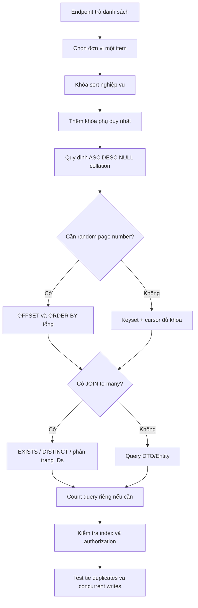

# Thiết kế thứ tự ổn định với khóa phụ duy nhất trong DTO và phân trang JPA

Trong một API trả danh sách đơn hàng, phần lớn developer đều biết cần phân trang bằng `Pageable`, `setFirstResult()` và `setMaxResults()`. Tuy nhiên, **phân trang đúng không chỉ là đặt LIMIT và OFFSET**: database phải biết **thứ tự đầy đủ, có thể xác định duy nhất** của từng bản ghi.

Ví dụ rất quen thuộc:

```sql
SELECT id, order_code, created_at
FROM purchase_orders
ORDER BY created_at DESC
LIMIT 20 OFFSET 20;
```

Câu SQL này *có* ORDER BY nhưng **chưa có thứ tự ổn định** nếu nhiều đơn có cùng `created_at`. Database được phép trả các hàng bằng nhau ở cột thời gian theo những thứ tự khác nhau. Khi chia trang, cùng một hàng có thể xuất hiện lại hoặc một hàng bị bỏ sót dù dữ liệu không hề thay đổi.

Một thiết kế rõ ràng hơn:

```sql
SELECT id, order_code, created_at
FROM purchase_orders
ORDER BY created_at DESC, id DESC
LIMIT 20 OFFSET 20;
```

Ở đây `id` là khóa chính duy nhất của `purchase_orders`, nên cặp `(created_at, id)` xác định **thứ tự tổng (*total ordering*)** cho từng hàng kết quả.

> **Nguyên tắc cốt lõi:** Mọi truy vấn có phân trang cần một thứ tự nhất quán và cuối cùng phải được **phân giải bằng một khóa phụ duy nhất (*unique tie-breaker*)**. Trong nhiều truy vấn entity, `ORDER BY createdAt DESC, id DESC` là mẫu đơn giản và hiệu quả. Khi result không còn một hàng trên một entity, phải chọn khóa duy nhất của **đúng đơn vị kết quả**.

Chủ đề **“Thiết kế thứ tự ổn định với khóa phụ duy nhất”** thuộc chương **DTO và phân trang** trong module **Data Persistence Relational Access ORM JPA**. Bài học trình bày các ví dụ SQL, JPQL, Criteria API, Spring Data JPA, DTO projection, OFFSET pagination, keyset/cursor pagination, index, xử lý NULL, DISTINCT/JOIN, concurrency và các tình huống kiểm thử thực tế.

---

## 1. “Thứ tự ổn định” nghĩa là gì?

Trong một query đọc dữ liệu, có hai khái niệm dễ bị nhầm.

**Thứ tự có xác định trong một trạng thái dữ liệu (*deterministic ordering*)**

Nếu các hàng và các khóa sắp xếp không thay đổi, cùng một câu query có ORDER BY đầy đủ phải sắp các hàng theo một trật tự xác định. Một **khóa phụ duy nhất** phá vỡ mọi trường hợp bằng nhau giữa các khóa sắp xếp chính.

**Tính ổn định khi dữ liệu thay đổi giữa các lần gọi (*cross-request consistency*)**

Ngay cả ORDER BY đầy đủ vẫn không ngăn một transaction khác INSERT, DELETE hoặc UPDATE các hàng giữa trang 1 và trang 2. Tập kết quả đã thay đổi, nên OFFSET có thể dịch vị trí bản ghi. Keyset pagination giảm một số vấn đề nhưng không tự tạo snapshot xuyên các HTTP requests.

Vì vậy:

- `ORDER BY created_at DESC`: thường **chưa đủ** để xác định thứ tự.
- `ORDER BY created_at DESC, id DESC`: xác định thứ tự khi `id` duy nhất.
- Dùng ORDER BY đầy đủ với OFFSET: đúng ở một trạng thái dữ liệu cố định, nhưng vẫn có dịch chuyển trang khi concurrent writes.
- Dùng ORDER BY đầy đủ với keyset/cursor: thường tốt hơn cho danh sách có dữ liệu mới được thêm liên tục, nhưng vẫn cần hiểu thay đổi khóa sort và isolation.

**Khóa phụ duy nhất là điều kiện thiết yếu cho sắp xếp xác định, không phải một khóa giao dịch bảo đảm snapshot.**

## 2. Bài toán thực tế: nhiều bản ghi có cùng thời gian

Giả sử các đơn hàng:

| ID | Mã đơn | created_at |
|---:|---|---|
| 105 | O-105 | 2026-04-10 09:00:00 |
| 104 | O-104 | 2026-04-10 09:00:00 |
| 103 | O-103 | 2026-04-10 09:00:00 |
| 102 | O-102 | 2026-04-10 09:00:00 |
| 101 | O-101 | 2026-04-09 17:00:00 |
| 100 | O-100 | 2026-04-09 16:00:00 |

Nếu chỉ:

```sql
ORDER BY created_at DESC
```

thì các IDs 105, 104, 103, 102 **bằng nhau về tiêu chí sort**. Database được phép xếp chúng theo bất kỳ thứ tự nào trong nhóm `2026-04-10 09:00:00`.

Ví dụ một lần truy vấn có thể tạo:

```text
105, 103, 104, 102, 101, 100
```

lần khác:

```text
102, 105, 104, 103, 101, 100
```

Nếu mỗi trang có 2 bản ghi:

- Request trang 1 theo thứ tự đầu: [105, 103].
- Request trang 2 theo thứ tự sau, OFFSET 2: [104, 103].

**ID 103 bị lặp**, còn ID 102 có nguy cơ không xuất hiện trong các trang mà client tiếp tục duyệt theo kịch bản khác.

Đây là lỗi **ngữ nghĩa ORDER BY**, không phụ thuộc dùng Hibernate, Spring Data hay JDBC.

### Thêm ID làm khóa phụ

```sql
ORDER BY created_at DESC, id DESC
```

cho thứ tự:

```text
105, 104, 103, 102, 101, 100
```

Với tập dữ liệu không thay đổi:

- Trang 1: [105, 104].
- Trang 2: [103, 102].
- Trang 3: [101, 100].

Mọi hàng có cùng `created_at` được xếp theo `id`, nên không còn hai hàng khác nhau có khóa sort bằng nhau.

## 3. Khóa sort chính và khóa phụ duy nhất

Một kế hoạch sắp xếp thường có dạng:

```text
[Tiêu chí nghiệp vụ] + [Tiêu chí phụ] + [Khóa duy nhất cuối]
```

Ví dụ:

```sql
ORDER BY priority DESC, created_at ASC, id ASC;
```

Ý nghĩa:

1. Ưu tiên cao nhất trước.
2. Trong cùng priority, đơn tạo sớm nhất trước.
3. Nếu cả priority và created_at cùng nhau, ID nhỏ hơn trước.

**Khóa phụ duy nhất** không nhất thiết là khóa được hiển thị cho người dùng. Nó có thể là ID nội bộ chỉ được đưa vào ORDER BY hoặc cursor để đảm bảo thứ tự.

### Một quy tắc toán học đơn giản

Nếu các hàng có các khóa:

```text
K(row) = (priority, createdAt, id)
```

và `id` duy nhất trên toàn bộ tập kết quả đang phân trang, thì hai hàng khác nhau không thể có **cùng toàn bộ tuple K**.

Nếu cột cuối không duy nhất, ví dụ `customer_id`, hai đơn của cùng khách hàng vẫn có thể có cả `createdAt` và `customer_id` trùng nhau. Vì thế:

```sql
ORDER BY created_at DESC, customer_id DESC
```

**không bảo đảm thứ tự tổng** của những đơn thuộc cùng customer.

## 4. Vì sao database không mặc định sắp theo PRIMARY KEY?

Một bảng có primary key `id` không đồng nghĩa:

```sql
SELECT *
FROM purchase_orders;
```

sẽ luôn trả theo ID.

Tương tự, câu:

```sql
SELECT *
FROM purchase_orders
WHERE status = 'PAID'
ORDER BY created_at DESC;
```

không tự thêm `id` vào các tiêu chí sort chỉ vì `id` là primary key.

Một số database có cấu trúc index hoặc physical storage khiến kết quả **trông giống** được sắp theo ID khi thử nghiệm nhỏ. Tuy nhiên:

- Query planner có thể đổi plan.
- Parallel execution có thể đổi thứ tự các hàng bằng nhau.
- Index có thể đổi sau migration.
- Statistics, vacuum, reindex, page splits có thể thay hành vi.
- OFFSET/LIMIT khác nhau có thể chọn plan khác nhau.

**Không dùng “tôi thấy DB luôn trả đúng” làm hợp đồng sắp xếp.** Chỉ ORDER BY tường minh mới mô tả thứ tự.

## 5. Entity mẫu: PurchaseOrder

Để minh họa JPA, ta dùng entity:

```java
import jakarta.persistence.*;
import java.math.BigDecimal;
import java.time.LocalDateTime;

@Entity
@Table(name = "purchase_orders")
public class PurchaseOrder {

    @Id
    private Long id;

    @Column(name = "tenant_id", nullable = false)
    private String tenantId;

    @Column(name = "order_code", nullable = false)
    private String orderCode;

    @Enumerated(EnumType.STRING)
    @Column(name = "status", nullable = false)
    private OrderStatus status;

    @Column(name = "total_amount", nullable = false)
    private BigDecimal totalAmount;

    @Column(name = "created_at", nullable = false)
    private LocalDateTime createdAt;

    @ManyToOne(fetch = FetchType.LAZY, optional = false)
    @JoinColumn(name = "customer_id", nullable = false)
    private Customer customer;

    protected PurchaseOrder() {}

    public Long getId() { return id; }
    public String getOrderCode() { return orderCode; }
    public OrderStatus getStatus() { return status; }
    public LocalDateTime getCreatedAt() { return createdAt; }
    public BigDecimal getTotalAmount() { return totalAmount; }
}
```

Enum:

```java
public enum OrderStatus {
    NEW, PAID, CANCELLED
}
```

Customer:

```java
@Entity
@Table(name = "customers")
public class Customer {

    @Id
    private Long id;

    @Column(name = "display_name", nullable = false)
    private String displayName;

    protected Customer() {}

    public String getDisplayName() { return displayName; }
}
```

DDL rút gọn:

```sql
CREATE TABLE customers (
    id BIGINT PRIMARY KEY,
    display_name VARCHAR(150) NOT NULL
);

CREATE TABLE purchase_orders (
    id BIGINT PRIMARY KEY,
    tenant_id VARCHAR(60) NOT NULL,
    order_code VARCHAR(60) NOT NULL,
    status VARCHAR(20) NOT NULL,
    total_amount NUMERIC(19,2) NOT NULL,
    created_at TIMESTAMP NOT NULL,
    customer_id BIGINT NOT NULL REFERENCES customers(id)
);
```

Trong bài, ID `PurchaseOrder.id` là **duy nhất toàn cục** vì là primary key của bảng. Nếu một hệ thống dùng khóa chính ghép `(tenant_id, local_id)`, phải điều chỉnh tie-breaker theo khóa ghép hoặc bảo đảm query luôn giới hạn một tenant.

## 6. OFFSET pagination hoạt động như thế nào?

Trong SQL PostgreSQL/MySQL:

```sql
SELECT id, order_code, created_at
FROM purchase_orders
WHERE tenant_id = ?
ORDER BY created_at DESC, id DESC
LIMIT 20 OFFSET 40;
```

Nghĩa là bỏ qua 40 hàng đầu tiên **sau khi sắp xếp**, rồi lấy tối đa 20 hàng.

Trong JPA, cách phân trang portable là:

```java
TypedQuery<PurchaseOrder> query = em.createQuery(
    """
    select o
    from PurchaseOrder o
    where o.tenantId = :tenantId
    order by o.createdAt desc, o.id desc
    """,
    PurchaseOrder.class
);

List<PurchaseOrder> page = query
    .setParameter("tenantId", tenantId)
    .setFirstResult(40)
    .setMaxResults(20)
    .getResultList();
```

`setFirstResult(40)` biểu diễn OFFSET; `setMaxResults(20)` biểu diễn page size. Provider tạo cú pháp SQL thích hợp với dialect.

Điểm quan trọng: **JPA không tự bổ sung khóa phụ duy nhất** khi gọi hai method trên. Người viết query chịu trách nhiệm tạo ORDER BY đầy đủ.

### Công thức OFFSET

Với trang được đánh số từ 0:

```text
offset = pageIndex × pageSize
```

Ví dụ:

| pageIndex | pageSize | offset |
|---:|---:|---:|
| 0 | 20 | 0 |
| 1 | 20 | 20 |
| 2 | 20 | 40 |
| 3 | 50 | 150 |

Phải validate `pageIndex >= 0`, `pageSize > 0` và giới hạn pageSize. Với API truyền số nguyên lớn, tính offset có thể overflow; `Math.multiplyExact(pageIndex, pageSize)` có thể giúp phát hiện trong Java nếu cả hai là int, nhưng không xử lý vấn đề hiệu năng của OFFSET rất lớn.

## 7. Thứ tự ổn định không chỉ là có ORDER BY

Ba truy vấn:

```sql
-- A: không có ORDER BY
SELECT * FROM purchase_orders LIMIT 20 OFFSET 20;

-- B: có ORDER BY nhưng chưa phá hòa
SELECT * FROM purchase_orders
ORDER BY created_at DESC LIMIT 20 OFFSET 20;

-- C: có thứ tự tổng nếu id duy nhất
SELECT * FROM purchase_orders
ORDER BY created_at DESC, id DESC
LIMIT 20 OFFSET 20;
```

| Query | Có thứ tự tường minh? | Có tie-breaker duy nhất? | Xác định thứ tự khi dữ liệu đứng yên? |
|---|---|---|---|
| A | Không | Không | Không được bảo đảm |
| B | Có, nhưng thiếu | Không | Không được bảo đảm giữa các hàng cùng thời gian |
| C | Có | Có | Có, theo các khóa sắp xếp |

Đừng suy rằng `ORDER BY created_at DESC` luôn đủ vì timestamp có độ chính xác cao. Hai giao dịch hoặc một batch INSERT vẫn có thể gán cùng thời điểm đến từng giây, millisecond hoặc microsecond.

Ngay cả ID tăng dần cũng **không thay thế** createdAt trong sort nếu nghiệp vụ muốn hiển thị theo thời gian. ID chỉ là khóa phá hòa trừ khi business xác định ID là thứ tự chính.

## 8. Chọn khóa phụ: ID, UUID, composite key

Một tie-breaker tốt cần:

1. **Duy nhất** trên tập hàng đang phân trang.
2. **Có thể sắp xếp** nhất quán trong database.
3. **Ổn định về giá trị** trong thời gian các trang được đọc, lý tưởng là immutable.
4. **Có index phù hợp** nếu query có tần suất/khối lượng lớn.
5. Không mang ý nghĩa nhạy cảm mà API công khai không được tiết lộ.

### Khóa chính Long

```sql
ORDER BY created_at DESC, id DESC
```

Đây là ví dụ thông dụng nhất.

### UUID

Nếu `id` là UUID, nó vẫn **duy nhất** và có thể dùng làm tie-breaker nếu database/dialect hỗ trợ so sánh và sort UUID một cách xác định:

```sql
ORDER BY created_at DESC, id DESC
```

Một UUID ngẫu nhiên không phản ánh thời gian tạo. Nhưng nó vẫn phá hòa; không nên tự suy rằng UUID lớn hơn là đơn tạo sau.

### Composite key

Giả sử ID chỉ duy nhất bên trong tenant và primary key là `(tenant_id, local_id)`.

Nếu query giới hạn đúng một tenant:

```sql
WHERE tenant_id = ?
ORDER BY created_at DESC, local_id DESC;
```

thì `local_id` là duy nhất **trong tập đang lọc**, đủ để phá hòa.

Nếu query tổng hợp nhiều tenants:

```sql
ORDER BY created_at DESC, tenant_id ASC, local_id DESC;
```

và tuple `(tenant_id, local_id)` phải thực sự duy nhất.

Không dùng `local_id` đơn lẻ để phá hòa trong query nhiều tenants nếu ID có thể lặp giữa tenants.

## 9. Thứ tự tổng phải xét theo **đơn vị kết quả**

Với query:

```sql
SELECT o.id, o.created_at
FROM purchase_orders o
ORDER BY o.created_at DESC, o.id DESC;
```

một hàng kết quả tương ứng một PurchaseOrder.

Nhưng:

```sql
SELECT o.id, l.id AS line_id
FROM purchase_orders o
JOIN order_lines l ON l.order_id = o.id
ORDER BY o.created_at DESC, o.id DESC;
```

một order có thể có **nhiều hàng kết quả** vì mỗi OrderLine khác nhau. `o.id` không duy nhất trên **các hàng JOIN**.

Nếu phân trang theo hàng OrderLine, khóa đầy đủ có thể là:

```sql
ORDER BY o.created_at DESC, o.id DESC, l.id DESC;
```

Nếu phân trang theo **orders**, không thể chỉ thêm `l.id` rồi xem như vấn đề đã giải quyết: phải chọn một row/order hoặc phân trang IDs của orders trước.

**Khóa phụ duy nhất phải duy nhất ở đúng mức kết quả cuối được phân trang**, không chỉ ở một bảng bên trong JOIN.

## 10. DTO projection trong JPQL

Một API list không cần trả managed entity. Định nghĩa DTO:

```java
package com.example.orders.dto;

import java.math.BigDecimal;
import java.time.LocalDateTime;

public record OrderSummaryDto(
    Long id,
    String orderCode,
    LocalDateTime createdAt,
    BigDecimal totalAmount,
    String customerName
) {}
```

JPQL:

```java
TypedQuery<OrderSummaryDto> query = em.createQuery(
    """
    select new com.example.orders.dto.OrderSummaryDto(
        o.id,
        o.orderCode,
        o.createdAt,
        o.totalAmount,
        c.displayName
    )
    from PurchaseOrder o
    join o.customer c
    where o.tenantId = :tenant
      and o.status = :status
    order by o.createdAt desc, o.id desc
    """,
    OrderSummaryDto.class
);

List<OrderSummaryDto> items = query
    .setParameter("tenant", tenantId)
    .setParameter("status", OrderStatus.PAID)
    .setFirstResult(0)
    .setMaxResults(20)
    .getResultList();
```

Đặc điểm:

- `SELECT NEW` tạo DTO theo constructor, không hydrate toàn bộ PurchaseOrder object graph.
- `ORDER BY o.createdAt DESC, o.id DESC` sắp **dòng kết quả** trước khi phân trang.
- DTO chứa cả `createdAt` và `id`, tiện dùng để tạo cursor nếu chọn keyset pagination.
- Mỗi order có một Customer, nên JOIN to-one không nhân hàng theo collection.
- `where o.tenantId = :tenant` là điều kiện bảo vệ dữ liệu ví dụ; việc lấy tenantId phải từ auth context đáng tin cậy.

Một DTO projection khác chỉ có orderCode và totalAmount **vẫn có thể ORDER BY o.id** trong JPQL trong nhiều bối cảnh, nhưng các biến thể `DISTINCT`, grouping hoặc SQL dialect có thể hạn chế việc ORDER BY một expression không có trong SELECT. Với cursor, nên mang những khóa sort trong internal row projection để xây token chính xác.

## 11. Vì sao DTO chứa ID dù UI không hiển thị ID?

Một trang list có thể chỉ hiển thị:

```text
Order code | Date | Customer | Amount
```

Nhưng server cần ID để phá hòa và để xây cursor.

Có thể tạo DTO nội bộ:

```java
public record OrderPageRow(
    Long id,
    String orderCode,
    LocalDateTime createdAt,
    String customerName,
    BigDecimal totalAmount
) {}
```

Sau đó chuyển sang API response công khai chỉ có các trường phù hợp:

```java
public record OrderItemResponse(
    String orderCode,
    LocalDateTime createdAt,
    String customerName,
    BigDecimal totalAmount
) {}
```

Cursor được server tạo từ `OrderPageRow.id` và `OrderPageRow.createdAt`. Client không nhất thiết phải nhìn thấy raw ID; cursor có thể là một token opaque có integrity protection theo yêu cầu.

**Dữ liệu dùng để sắp xếp, dữ liệu trả API và dữ liệu dùng để phân quyền là ba quyết định khác nhau.**

## 12. Criteria API với ORDER BY có tie-breaker

Ví dụ truy vấn động trả DTO:

```java
import jakarta.persistence.*;
import jakarta.persistence.criteria.*;

CriteriaBuilder cb = em.getCriteriaBuilder();

CriteriaQuery<OrderSummaryDto> cq =
    cb.createQuery(OrderSummaryDto.class);

Root<PurchaseOrder> order =
    cq.from(PurchaseOrder.class);

Join<PurchaseOrder, Customer> customer =
    order.join("customer", JoinType.INNER);

cq.select(cb.construct(
    OrderSummaryDto.class,
    order.<Long>get("id"),
    order.<String>get("orderCode"),
    order.<LocalDateTime>get("createdAt"),
    order.<BigDecimal>get("totalAmount"),
    customer.<String>get("displayName")
));

cq.where(
    cb.equal(order.get("tenantId"), tenantId),
    cb.equal(order.get("status"), OrderStatus.PAID)
);

cq.orderBy(
    cb.desc(order.get("createdAt")),
    cb.desc(order.get("id"))
);

List<OrderSummaryDto> page = em.createQuery(cq)
    .setFirstResult(0)
    .setMaxResults(20)
    .getResultList();
```

**Thứ tự trong `cq.orderBy(...)` là quan trọng.** JPA áp tiêu chí đầu tiên trước; các tiêu chí sau chỉ phân giải trường hợp bằng nhau ở những tiêu chí trước.

Nếu vô tình đảo:

```java
cq.orderBy(
    cb.desc(order.get("id")),
    cb.desc(order.get("createdAt"))
);
```

thì query có thứ tự xác định nhưng **sai thứ tự nghiệp vụ** nếu yêu cầu “mới nhất theo createdAt”.

## 13. Truy vấn Criteria động phải luôn kết thúc bằng khóa duy nhất

Giả sử UI cho phép sắp theo:

- `createdAt`.
- `totalAmount`.
- `customerName`.

Cần nối khóa phụ duy nhất vào mỗi phương án:

```java
List<jakarta.persistence.criteria.Order> ordering =
    new ArrayList<>();

switch (sortField) {
    case "createdAt" ->
        ordering.add(cb.desc(root.get("createdAt")));

    case "totalAmount" ->
        ordering.add(cb.desc(root.get("totalAmount")));

    case "customerName" -> {
        Join<PurchaseOrder, Customer> customer =
            root.join("customer", JoinType.INNER);

        ordering.add(
            cb.asc(customer.get("displayName"))
        );
    }

    default ->
        throw new IllegalArgumentException(
            "Unsupported sort field"
        );
}

ordering.add(cb.desc(root.get("id")));

cq.orderBy(ordering);
```

Đây là khung minh họa một Criteria query đã có `root` và `cq`, không phải method tự chạy độc lập. Import `java.util.ArrayList`, `java.util.List` khi dùng.

### Một điểm quan trọng

Nếu người dùng đã chọn sort bằng `id`, không nên tự bổ sung ID lần thứ hai một cách mù quáng. Hãy chuẩn hóa sort descriptor để:

- ID luôn xuất hiện **ít nhất một lần**.
- ID là tie-breaker cuối khi chưa là khóa duy nhất trước đó.
- Không có hai chỉ thị trái ngược kiểu `id ASC` và `id DESC` trong cùng ORDER BY.
- Với multi-column sort, không đổi thứ tự khóa nghiệp vụ của người dùng.

Và nhớ: user chỉ được chọn **các sort fields trong whitelist**, không đưa trực tiếp tên property/string SQL tùy ý vào query.

## 14. Spring Data JPA: Pageable không tự bảo đảm sort duy nhất

Một repository:

```java
public interface PurchaseOrderRepository
        extends JpaRepository<PurchaseOrder, Long> {

    Page<PurchaseOrder> findByStatusAndTenantId(
        OrderStatus status,
        String tenantId,
        Pageable pageable
    );
}
```

Caller:

```java
PageRequest.of(
    0,
    20,
    Sort.by(Sort.Direction.DESC, "createdAt")
);
```

chỉ sắp theo createdAt. Nó vẫn có thể có nhiều hàng bằng nhau.

Cách đơn giản:

```java
Pageable pageable = PageRequest.of(
    0,
    20,
    Sort.by(
        Sort.Order.desc("createdAt"),
        Sort.Order.desc("id")
    )
);
```

Dùng:

```java
Page<PurchaseOrder> page =
    repository.findByStatusAndTenantId(
        OrderStatus.PAID,
        tenantId,
        pageable
    );
```

`PageRequest` và `Sort` nằm trong `org.springframework.data.domain`.

**Spring Data phân trang giúp truyền OFFSET/LIMIT/ORDER BY**, nhưng không tự biết khóa nào duy nhất theo domain và không thay bạn định nghĩa sort policy.

## 15. Chuẩn hóa Pageable từ request

Nếu API nhận `sort=createdAt,desc`, server nên bổ sung tie-breaker nếu chưa có.

Một hàm minh họa:

```java
public Pageable stabilize(Pageable incoming) {
    int page = incoming.getPageNumber();
    int size = Math.min(incoming.getPageSize(), 100);

    Sort original = incoming.getSort();

    // Trong ứng dụng thật, validate whitelist tất cả field.
    boolean hasId = original.stream()
        .anyMatch(o -> o.getProperty().equals("id"));

    Sort stable = hasId
        ? original
        : original.and(Sort.by(Sort.Order.desc("id")));

    if (stable.isUnsorted()) {
        stable = Sort.by(Sort.Order.desc("id"));
    }

    return PageRequest.of(page, size, stable);
}
```

Lưu ý:

- `Pageable` phải thực sự paged; với `Pageable.unpaged()`, cần xử lý riêng vì gọi `getPageNumber()`/`getPageSize()` không phù hợp.
- Phải giới hạn `size > 0` và phân quyền sort fields.
- Nếu `original` chứa sort độc nhất khác ID theo domain, có thể không cần bổ sung ID, nhưng thêm một tie-breaker không xung đột vẫn thường rõ ràng.
- Khi `original` có `id ASC`, không tự thêm `id DESC`.
- Nếu API yêu cầu direction của tie-breaker đi theo direction chính, hãy xác định policy rõ, không phỏng đoán.
- Khi sort list rỗng, hàm trên thêm `id DESC` để có thứ tự xác định. Có thể muốn default `createdAt DESC, id DESC` thay vì chỉ ID.

Đây là skeleton cho chính sách sort, **chưa thay thế kiểm tra quyền và whitelist**.

## 16. Page, Slice và List có liên quan gì tới thứ tự?

Spring Data có các loại kết quả:

| Kiểu | Ý nghĩa | Lưu ý về thứ tự |
|---|---|---|
| `List<T>` với Pageable | Một tập item giới hạn | Vẫn cần sort đầy đủ |
| `Slice<T>` | Nội dung trang và tín hiệu còn trang tiếp | Vẫn cần sort đầy đủ |
| `Page<T>` | Nội dung, total count và metadata trang | Vẫn cần sort đầy đủ |
| Cursor/keyset result | Đi tiếp từ khóa cuối trang | Bắt buộc comparator/khóa sort nhất quán |

`Page<T>` không giải quyết tie-breaker chỉ vì có total count. Một count query có thể hoàn toàn chính xác mà các trang content vẫn có bản ghi lặp/bỏ sót do thứ tự chưa đầy đủ.

`Slice<T>` có thể giảm nhu cầu chạy COUNT tổng nhưng cũng không tự xử lý thứ tự của các hàng cùng `createdAt`.

## 17. Một ví dụ hoàn chỉnh: repository trả Page<DTO>

DTO:

```java
package com.example.orders.dto;

import java.math.BigDecimal;
import java.time.LocalDateTime;

public record OrderPageDto(
    Long id,
    String orderCode,
    LocalDateTime createdAt,
    BigDecimal totalAmount
) {}
```

Repository:

```java
public interface PurchaseOrderRepository
        extends JpaRepository<PurchaseOrder, Long> {

    @Query(
        value = """
            select new com.example.orders.dto.OrderPageDto(
                o.id, o.orderCode, o.createdAt, o.totalAmount
            )
            from PurchaseOrder o
            where o.tenantId = :tenantId
              and o.status = :status
            """,
        countQuery = """
            select count(o)
            from PurchaseOrder o
            where o.tenantId = :tenantId
              and o.status = :status
            """
    )
    Page<OrderPageDto> findPage(
        @Param("tenantId") String tenantId,
        @Param("status") OrderStatus status,
        Pageable pageable
    );
}
```

Service:

```java
Pageable pageable = PageRequest.of(
    pageIndex,
    Math.min(pageSize, 100),
    Sort.by(
        Sort.Order.desc("createdAt"),
        Sort.Order.desc("id")
    )
);

Page<OrderPageDto> result = repository.findPage(
    authenticatedTenantId,
    OrderStatus.PAID,
    pageable
);
```

Ở đây Spring Data thường áp sort của Pageable lên content query. Dù vậy, cách merge sort, rewrite query và hỗ trợ JPQL constructor expression có thể phụ thuộc phiên bản Spring Data; nên tránh khai ORDER BY xung đột trong annotation và `Pageable`.

Lợi ích:

- Content query chỉ trả đúng các trường DTO.
- Count query không fetch association.
- Service gắn sort policy tường minh và ổn định.
- Pagination metadata nằm trong `Page<OrderPageDto>`.

Nếu cần join to-many hoặc GROUP BY, count query không còn đơn giản `count(o)`; phần sau phân tích kỹ hơn.

## 18. Sort nhiều trường và thứ tự ưu tiên

Giả sử bảng có `priority` và `createdAt`:

```sql
ORDER BY priority DESC, created_at ASC, id ASC;
```

Ví dụ hai hàng cùng priority:

```text
priority=3, createdAt=08:00, id=20
priority=3, createdAt=08:00, id=21
```

vì ID ASC, ID 20 đứng trước 21.

Nếu có hai priority khác nhau, ID không ảnh hưởng vì tiêu chí priority đã phân giải thứ tự trước.

### Quy tắc so sánh từ trái sang phải

Một tuple:

```text
(priority, createdAt, id)
```

được so từ trái sang phải. Chỉ dùng thành phần tiếp theo khi những thành phần trước bằng nhau.

Đây là cơ sở để xây **keyset predicate** ở các phần tiếp theo. Nếu có n khóa sort, điều kiện “đứng sau cursor” phải phản ánh đầy đủ hướng ASC/DESC và vị trí ưu tiên của từng khóa.

## 19. Sắp xếp tăng/giảm hỗn hợp

Ví dụ:

```sql
ORDER BY status ASC, created_at DESC, id ASC;
```

Đây là thứ tự hợp lệ nếu ID duy nhất. Nhưng không thể xây cursor chỉ với:

```sql
WHERE created_at < :lastCreatedAt
  AND id > :lastId
```

vì `status` là khóa sort đầu tiên. Cũng không thể dùng tuple comparison đơn giản `(status, created_at, id) > (...)` nếu hướng ASC/DESC hỗn hợp theo thứ tự từ trái sang phải mà không có phép biến đổi đúng.

Một keyset cursor đầy đủ phải giữ:

```text
lastStatus, lastCreatedAt, lastId
```

và comparator phải phản ánh:

1. status ASC;
2. bên trong status, createdAt DESC;
3. nếu cùng status và createdAt, id ASC.

Việc thêm một ID ở cuối ORDER BY là cần thiết, nhưng **cũng phải dùng ID cùng toàn bộ các khóa trước khi xây cursor predicate**.

## 20. ASC và DESC của khóa phụ có bắt buộc giống khóa chính?

Không. Các ví dụ này đều tạo thứ tự tổng khi ID duy nhất:

```sql
ORDER BY created_at DESC, id DESC;
ORDER BY created_at DESC, id ASC;
```

Khác nhau chỉ trong nhóm có cùng createdAt:

- `id DESC`: ID lớn hơn trước.
- `id ASC`: ID nhỏ hơn trước.

Chọn theo UX/domain và giữ nhất quán ở:

- Content query.
- Cursor predicate.
- Index.
- Tests.
- Request/response contract.
- Link next/previous page.

Nếu API ban đầu dùng `createdAt DESC, id DESC` rồi một release đổi thành `createdAt DESC, id ASC`, những cursor cũ có thể không còn hợp lệ. Nên version cursor/sort contract khi cần.

## 21. NULL là một phần của hợp đồng sắp xếp

Nếu sort field có thể NULL, ví dụ `paidAt`:

```sql
ORDER BY paid_at DESC, id DESC;
```

thứ tự của NULL phụ thuộc DBMS/dialect khi không chỉ định rõ. PostgreSQL và các hệ quản trị khác có thể có mặc định khác nhau cho ASC/DESC.

Nếu business muốn **NULL cuối cùng**, với PostgreSQL có cú pháp:

```sql
ORDER BY paid_at DESC NULLS LAST, id DESC;
```

Nhưng `NULLS LAST` không được mọi dialect hỗ trợ giống nhau. Một cách SQL tương đối phổ biến là thêm CASE:

```sql
ORDER BY
    CASE WHEN paid_at IS NULL THEN 1 ELSE 0 END ASC,
    paid_at DESC,
    id DESC;
```

Nghĩa:

- Hàng có paidAt không-null trước.
- Hàng có paidAt NULL sau.
- Trong mỗi nhóm, id phá hòa.

**NULL cần được định nghĩa là một phần của thứ tự**, đặc biệt nếu muốn keyset pagination: SQL `<`/`>` với NULL trả UNKNOWN, nên cursor predicate đơn giản có thể làm mất nhóm NULL.

## 22. NULL trong Criteria API

Dùng Criteria `CASE` để đưa NULL về cuối:

```java
CriteriaBuilder cb = em.getCriteriaBuilder();

Expression<Integer> nullRank =
    cb.<Integer>selectCase()
      .when(cb.isNull(root.get("paidAt")), 1)
      .otherwise(0);

cq.orderBy(
    cb.asc(nullRank),
    cb.desc(root.get("paidAt")),
    cb.desc(root.get("id"))
);
```

Ví dụ giả định PurchaseOrder có field `paidAt` kiểu thời gian nullable; cần thêm mapping thật để code biên dịch.

Khi keyset pagination, phải xây predicate tương ứng cho:

1. nullRank;
2. paidAt khi không-null;
3. id;
4. cả trường hợp cursor nằm trong nhóm NULL.

Một cách đơn giản hơn cho những use cases mới là **chọn một trường sort NOT NULL** như createdAt, nếu đúng nghiệp vụ. Không dùng một sentinel `COALESCE(paid_at, '1900-01-01')` tùy tiện nếu sentinel có thể trùng với giá trị hợp lệ hoặc làm lệch kiểu/index.

## 23. Collation và sort theo tên

Một danh sách khách hàng:

```sql
ORDER BY display_name ASC, id ASC;
```

có ID duy nhất ở cuối, nên trong một bộ quy tắc collation ổn định, thứ tự được phân giải dù nhiều khách hàng cùng tên.

Nhưng sort text còn phụ thuộc:

- Collation của database/cột/query.
- Quy tắc chữ hoa/chữ thường và dấu.
- Unicode normalization.
- Thay đổi phiên bản collation hoặc môi trường DB.
- Biểu thức `LOWER(name)` nếu app muốn sort không phân biệt hoa thường.

Ví dụ:

```sql
ORDER BY LOWER(display_name) ASC, id ASC;
```

Nếu `"An"` và `"an"` có cùng `LOWER(...)`, ID phá hòa. Nếu tên thay đổi giữa các trang, row vẫn có thể di chuyển; ID không làm tên trở nên immutable.

### Khi dùng cursor

Cursor phải chứa **giá trị sort thực tế** mà comparator dùng, ví dụ `LOWER(display_name)`, chứ không chỉ displayName gốc nếu DB so sánh khác với ứng dụng Java.

Khi collation thay đổi, nên invalid/expire cursor đã sinh theo comparator cũ.

## 24. DISTINCT và thứ tự ổn định

Ví dụ query join OrderLine:

```jpql
SELECT DISTINCT o
FROM PurchaseOrder o
JOIN o.lines l
WHERE l.quantity > :minQuantity
ORDER BY o.createdAt DESC, o.id DESC
```

Ý định: mỗi order xuất hiện một lần, chỉ khi có ít nhất một line đủ số lượng.

Vấn đề cần xem:

- JOIN to-many tạo nhiều SQL rows cho cùng một order.
- `DISTINCT` biểu diễn loại trùng root result, nhưng SQL/dialect/provider có thể áp dụng khác nhau khi pagination, sorting, projection.
- Nếu `ORDER BY` dùng `l.quantity`, một order có nhiều quantities sẽ không có một giá trị sort duy nhất trừ khi định nghĩa aggregate hoặc quy tắc chọn child.

### Hướng thường rõ nghĩa hơn khi chỉ cần kiểm tra tồn tại

```jpql
SELECT o
FROM PurchaseOrder o
WHERE EXISTS (
    SELECT l.id
    FROM OrderLine l
    WHERE l.order = o
      AND l.quantity > :minQuantity
)
ORDER BY o.createdAt DESC, o.id DESC
```

Lúc này outer query có một dòng logic trên mỗi PurchaseOrder, không cần to-many JOIN để kiểm tra tồn tại.

**Thêm ID vào ORDER BY không sửa mọi vấn đề nhân hàng do JOIN.** Trước tiên phải quyết định mỗi hàng kết quả đại diện entity nào.

## 25. Vì sao JOIN FETCH collection và pagination nguy hiểm?

Một query:

```jpql
SELECT o
FROM PurchaseOrder o
LEFT JOIN FETCH o.lines
ORDER BY o.createdAt DESC, o.id DESC
```

và:

```java
query.setFirstResult(0);
query.setMaxResults(20);
```

có ORDER BY hoàn chỉnh nhưng vẫn có vấn đề: mỗi order có nhiều lines nên SQL result set có nhiều hàng cho một root.

Provider có thể:

- Phân trang trong bộ nhớ sau khi load nhiều hàng.
- Cảnh báo/throw khi pagination với collection fetch.
- Dùng SQL strategy đặc thù.
- Gặp vấn đề hiệu năng lớn.

**Tie-breaker duy nhất xử lý các hàng root có cùng sort key; nó không loại bỏ việc collection JOIN nhân hàng.**

Một lựa chọn thường dùng:

1. Query IDs của 20 orders theo `createdAt DESC, id DESC`.
2. Query lần hai load associations cho đúng IDs đó.
3. Sắp kết quả về đúng thứ tự trang IDs.

## 26. Trang IDs rồi fetch entity graph

Bước A: phân trang root IDs:

```java
List<Long> ids = em.createQuery(
    """
    select o.id
    from PurchaseOrder o
    where o.tenantId = :tenant
      and o.status = :status
    order by o.createdAt desc, o.id desc
    """,
    Long.class
)
.setParameter("tenant", tenantId)
.setParameter("status", OrderStatus.PAID)
.setFirstResult(pageIndex * pageSize)
.setMaxResults(pageSize)
.getResultList();
```

Bước B: load đầy đủ associations cho những IDs đã chọn:

```java
if (ids.isEmpty()) {
    return List.of();
}

EntityGraph<PurchaseOrder> detailGraph =
    em.createEntityGraph(PurchaseOrder.class);

detailGraph.addAttributeNodes("customer");
Subgraph<OrderLine> lineGraph =
    detailGraph.addSubgraph("lines");

List<PurchaseOrder> fetched = em.createQuery(
    """
    select distinct o
    from PurchaseOrder o
    where o.id in :ids
      and o.tenantId = :tenant
    """,
    PurchaseOrder.class
)
.setParameter("ids", ids)
.setParameter("tenant", tenantId)
.setHint("jakarta.persistence.fetchgraph", detailGraph)
.getResultList();
```

Bước C: sắp lại theo thứ tự IDs đã phân trang:

```java
Map<Long, PurchaseOrder> byId = fetched.stream()
    .collect(Collectors.toMap(
        PurchaseOrder::getId,
        Function.identity()
    ));

List<PurchaseOrder> ordered = ids.stream()
    .map(byId::get)
    .filter(Objects::nonNull)
    .toList();
```

Đoạn này giả định ở trong một method trả List; cần imports `java.util.*`, `java.util.function.Function`, `java.util.stream.Collectors`.

**Tại sao phải sắp lại?**

```sql
WHERE id IN (105, 104, 103)
```

không bảo đảm database trả theo đúng thứ tự tham số IN. Query thứ hai có thể trả [103, 105, 104]. Nếu không sắp lại, API response sẽ mất thứ tự trang mà query A đã tính.

### Giới hạn

Hai query không bảo đảm cùng một snapshot nếu dữ liệu thay đổi giữa chúng. Với ứng dụng đòi consistency mạnh, cần transaction/isolation phù hợp hoặc cơ chế snapshot/cursor riêng. Việc fetch graph nhiều collections vẫn có thể gây tích số hàng trong một tập IDs nhỏ.

## 27. Aggregate/GROUP BY: khóa phụ phải duy nhất theo nhóm

Ví dụ báo cáo doanh thu theo khách hàng:

```sql
SELECT
    c.id AS customer_id,
    c.display_name AS customer_name,
    SUM(o.total_amount) AS revenue
FROM customers c
JOIN purchase_orders o ON o.customer_id = c.id
GROUP BY c.id, c.display_name
ORDER BY revenue DESC, c.id ASC;
```

Ở đây **mỗi hàng output là một Customer**, không phải một PurchaseOrder. Vì vậy `c.id` là tie-breaker thích hợp, còn `o.id` không thể tự thêm tùy ý vào ORDER BY cho một GROUP BY theo customer trong SQL chuẩn.

Nếu group theo ngày và trạng thái:

```sql
SELECT
    CAST(created_at AS DATE) AS report_day,
    status,
    COUNT(*) AS order_count
FROM purchase_orders
GROUP BY CAST(created_at AS DATE), status
ORDER BY order_count DESC, report_day ASC, status ASC;
```

tuple `(report_day, status)` là khóa duy nhất của **mỗi nhóm**, vì chỉ có một row cho mỗi tổ hợp group keys. Trong trường hợp này không có một `id` entity đơn lẻ ứng với mỗi nhóm để thêm vào.

Nguyên tắc:

- Entity page → thường dùng entity ID.
- Customer aggregate page → dùng Customer ID.
- Grouped report → dùng toàn bộ khóa group hoặc một result key duy nhất.
- UNION/subquery/complex projection → phải xác định khóa duy nhất của **row kết quả cuối**.

## 28. ORDER BY một trường không thuộc SELECT với DISTINCT

Một số database có quy tắc hạn chế:

```sql
SELECT DISTINCT status
FROM purchase_orders
ORDER BY id DESC;
```

Vì nhiều IDs có cùng status, không có một ID duy nhất tương ứng mỗi row `status` sau DISTINCT. Nhiều SQL dialect cũng từ chối ORDER BY expression không được SELECT trong DISTINCT query.

Vấn đề không chỉ là cú pháp: **kết quả sau DISTINCT không có ngữ nghĩa sắp theo ID của một hàng bị gộp**.

Nếu muốn lấy trạng thái theo thứ tự một tiêu chí đại diện, phải chỉ định aggregate:

```sql
SELECT
    status,
    MAX(id) AS latest_order_id
FROM purchase_orders
GROUP BY status
ORDER BY latest_order_id DESC, status ASC;
```

Ở đây `status` là khóa group phá hòa; `latest_order_id` là metric sort.

Không chắp thêm `id` vào ORDER BY của mọi query chỉ vì một guideline chung. Phải xem kiểu result của query.

---

## 29. OFFSET có hạn chế gì ngay cả khi ORDER BY đúng?

Giả sử thứ tự hiện tại theo `created_at DESC, id DESC`:

```text
105, 104, 103, 102, 101, 100
```

Client lấy trang 1 size=2:

```text
[105, 104]
```

Ngay sau đó một transaction INSERT order mới 106 đứng trước 105:

```text
106, 105, 104, 103, 102, 101, 100
```

Client yêu cầu trang 2 bằng OFFSET 2:

```text
[104, 103]
```

**104 bị lặp** dù sort key hoàn chỉnh. Đây là **dịch chuyển vị trí vì dữ liệu thay đổi**, không phải lỗi tie-breaker.

Nếu một row ở trang trước bị DELETE, OFFSET có thể bỏ qua một row ở trang sau.

Điều này cho thấy:

- Thứ tự không xác định gây duplicate/missing **ngay cả khi dữ liệu đứng yên**.
- Concurrent INSERT/DELETE có thể gây duplicate/missing với OFFSET **dù ORDER BY tổng**.
- Hai vấn đề cần hai tầng giải pháp khác nhau.

Keyset/cursor pagination giúp xử lý đặc biệt tốt việc có hàng mới xuất hiện **trước điểm đã đọc**, nếu sort keys ổn định.

## 30. Keyset pagination là gì?

Thay vì hỏi:

> “Bỏ qua 40 hàng đầu tiên.”

keyset pagination hỏi:

> “Hãy trả 20 hàng **đứng sau** khóa cuối cùng của trang trước.”

Với sort:

```sql
ORDER BY created_at DESC, id DESC
```

giả sử item cuối trang 1:

```text
created_at = 2026-04-10 09:00:00
id = 104
```

Trang 2 nên lấy những hàng có tuple khóa nhỏ hơn tuple này theo thứ tự DESC:

```sql
SELECT id, order_code, created_at
FROM purchase_orders
WHERE tenant_id = ?
  AND (
       created_at < ?
       OR (created_at = ? AND id < ?)
  )
ORDER BY created_at DESC, id DESC
LIMIT 20;
```

Dấu `<` ở hai vị trí tương ứng với **DESC** (hàng có giá trị nhỏ hơn đứng sau).

Nếu có hàng ID 106 mới được thêm trước cursor, nó không ảnh hưởng điều kiện “sau (time,id) của ID 104”, giúp giảm lỗi dịch chuyển do INSERT mới ở đầu danh sách.

**Nhưng** nếu đã có row bị sửa createdAt để di chuyển qua ranh giới cursor, hoặc một row mới được chèn phía sau cursor, tập kết quả vẫn có thể thay đổi. Keyset không phải snapshot toàn cục.

## 31. Khóa phụ duy nhất là yêu cầu tự nhiên của cursor

Nếu cursor chỉ chứa `createdAt`:

```text
lastCreatedAt = 2026-04-10 09:00:00
```

và query trang sau:

```sql
WHERE created_at < :lastCreatedAt
ORDER BY created_at DESC
```

thì **những order khác có cùng createdAt với hàng cuối trang trước bị bỏ qua**.

Nếu đổi thành:

```sql
WHERE created_at <= :lastCreatedAt
```

thì những hàng thuộc trang trước có cùng timestamp có thể lặp lại.

Không thể khắc phục chính xác bằng một dấu `<`/`<=` khi khóa sort **không duy nhất**. Cần lưu cả tie-breaker:

```text
cursor = (lastCreatedAt, lastId)
```

và predicate:

```sql
WHERE created_at < :lastCreatedAt
   OR (created_at = :lastCreatedAt AND id < :lastId)
```

Đây là lý do khóa phụ duy nhất quan trọng đặc biệt trong keyset/cursor pagination.

## 32. Cách suy ra predicate cho hai khóa DESC

ORDER BY:

```sql
ORDER BY created_at DESC, id DESC
```

Hàng `A` đứng **sau** cursor `C` khi:

1. `A.createdAt < C.createdAt`; hoặc
2. `A.createdAt = C.createdAt` **và** `A.id < C.id`.

Biểu diễn logic:

```text
(A.createdAt < C.createdAt)
OR
(A.createdAt = C.createdAt AND A.id < C.id)
```

Bảng:

| A.createdAt | A.id | So với cursor (09:00, 104) | Có thuộc trang sau? |
|---|---:|---|---|
| 10:00 | 200 | Mới hơn | Không |
| 09:00 | 105 | Cùng giờ, ID lớn hơn | Không |
| 09:00 | 104 | Chính cursor | Không |
| 09:00 | 103 | Cùng giờ, ID nhỏ hơn | Có |
| 08:59 | 999 | Cũ hơn | Có |

Phép so sánh **strict** tránh đưa chính cursor vào kết quả.

Nếu sort ngược thành `createdAt ASC, id ASC`, điều kiện “sau” chuyển thành `>` ở cả hai trường.

## 33. JPQL keyset pagination

Ví dụ cursor gồm `LocalDateTime lastCreatedAt` và `Long lastId`.

```java
TypedQuery<OrderPageDto> query = em.createQuery(
    """
    select new com.example.orders.dto.OrderPageDto(
        o.id, o.orderCode, o.createdAt, o.totalAmount
    )
    from PurchaseOrder o
    where o.tenantId = :tenant
      and o.status = :status
      and (
           o.createdAt < :lastCreatedAt
           or (
               o.createdAt = :lastCreatedAt
               and o.id < :lastId
           )
      )
    order by o.createdAt desc, o.id desc
    """,
    OrderPageDto.class
);

List<OrderPageDto> nextItems = query
    .setParameter("tenant", tenantId)
    .setParameter("status", OrderStatus.PAID)
    .setParameter("lastCreatedAt", lastCreatedAt)
    .setParameter("lastId", lastId)
    .setMaxResults(20)
    .getResultList();
```

Đối với **trang đầu tiên**, không cần điều kiện cursor; sử dụng một JPQL query khác chỉ có filter và ORDER BY.

Tránh viết:

```jpql
(:lastCreatedAt IS NULL OR ...)
```

cho mọi trường hợp nếu không cần, vì native/JPQL typing và tối ưu query plan có thể phức tạp hơn. Tạo biến thể query trang đầu và trang kế tiếp thường rõ nghĩa và dễ kiểm thử.

## 34. Criteria API keyset pagination

Với `CriteriaBuilder`:

```java
CriteriaBuilder cb = em.getCriteriaBuilder();

CriteriaQuery<OrderPageDto> cq =
    cb.createQuery(OrderPageDto.class);

Root<PurchaseOrder> o = cq.from(PurchaseOrder.class);

Predicate byTenant =
    cb.equal(o.get("tenantId"), tenantId);

Predicate byStatus =
    cb.equal(o.get("status"), OrderStatus.PAID);

Path<LocalDateTime> createdAt =
    o.<LocalDateTime>get("createdAt");

Path<Long> id =
    o.<Long>get("id");

Predicate beforeTimestamp =
    cb.lessThan(createdAt, lastCreatedAt);

Predicate sameTimestampSmallerId =
    cb.and(
        cb.equal(createdAt, lastCreatedAt),
        cb.lessThan(id, lastId)
    );

Predicate afterCursor =
    cb.or(beforeTimestamp, sameTimestampSmallerId);

cq.select(cb.construct(
    OrderPageDto.class,
    id,
    o.get("orderCode"),
    createdAt,
    o.get("totalAmount")
));

cq.where(byTenant, byStatus, afterCursor);

cq.orderBy(
    cb.desc(createdAt),
    cb.desc(id)
);

List<OrderPageDto> page = em.createQuery(cq)
    .setMaxResults(pageSize)
    .getResultList();
```

Trong đoạn trên, `OrderPageDto` có constructor `(Long, String, LocalDateTime, BigDecimal)` như phần trước. Với `pageSize` cần giới hạn và validate dương ở service.

Nên **dùng cùng các Path expressions** cho cả `WHERE afterCursor` và `ORDER BY` để tránh lỗi đánh vần hoặc thay đổi nhầm sort keys.

## 35. Keyset cho ASC và mixed-direction

Với:

```sql
ORDER BY total_amount ASC, id ASC
```

predicate trang sau:

```sql
WHERE total_amount > :lastAmount
   OR (total_amount = :lastAmount AND id > :lastId)
```

Với hướng hỗn hợp:

```sql
ORDER BY created_at DESC, id ASC
```

predicate trang sau:

```sql
WHERE created_at < :lastCreatedAt
   OR (created_at = :lastCreatedAt AND id > :lastId)
```

Quy tắc:

- Khóa sort DESC → hàng **đứng sau** có giá trị **nhỏ hơn** ở tiêu chí đó, nếu các khóa trước bằng nhau.
- Khóa sort ASC → hàng **đứng sau** có giá trị **lớn hơn** ở tiêu chí đó.
- Khi đi tới khóa thứ hai, **mọi khóa trước phải bằng nhau**.
- Khóa cuối phải làm cho toàn bộ tuple duy nhất.

Khi có ba khóa hoặc nhiều hơn, biểu thức là tổng các nhánh lexicographic, không chỉ một phép AND của tất cả dấu so sánh.

## 36. Ba khóa sort trong keyset

ORDER BY:

```sql
ORDER BY priority DESC, created_at ASC, id ASC
```

Cursor:

```text
lastPriority, lastCreatedAt, lastId
```

Predicate trang sau:

```sql
WHERE
    priority < :lastPriority

    OR (
        priority = :lastPriority
        AND created_at > :lastCreatedAt
    )

    OR (
        priority = :lastPriority
        AND created_at = :lastCreatedAt
        AND id > :lastId
    )
```

Mỗi nhánh diễn tả:

1. Khác khóa đầu tiên và đứng sau.
2. Khóa đầu bằng nhau, khóa thứ hai đứng sau.
3. Hai khóa đầu bằng nhau, ID đứng sau.

Đây là **lexicographic comparison** theo bộ tiêu chí đã chọn.

Nếu bất kỳ khóa nào nullable, phải bổ sung logic null rank; cú pháp trên giả định các khóa đều NOT NULL.

### Tránh logic sai

Sai:

```sql
WHERE priority < :lastPriority
  AND created_at > :lastCreatedAt
  AND id > :lastId
```

Phép AND này quá chặt. Nhiều hàng có priority nhỏ hơn nhưng createdAt không lớn hơn sẽ bị loại, dù chúng đứng sau cursor theo ORDER BY.

## 37. Tuple comparison trong SQL có phải giải pháp gọn hơn?

Trên database hỗ trợ row-value comparisons, với tất cả DESC và các khóa NOT NULL, đôi khi có thể viết:

```sql
WHERE (created_at, id) < (:lastCreatedAt, :lastId)
ORDER BY created_at DESC, id DESC
```

Đây là cú pháp SQL tiện lợi trong một số dialect, ví dụ PostgreSQL. Tuy nhiên:

- Khả năng hỗ trợ tuple comparison khác nhau giữa DBMS và phiên bản.
- Thứ tự ASC/DESC hỗn hợp không thể đơn giản gộp toàn bộ dấu so sánh.
- NULL có semantics không trực quan.
- JPQL/Criteria portable không nên phụ thuộc cú pháp SQL tuple vendor-specific.
- Query planner/index behavior vẫn cần đo.

Trong bài về JPA portable, biểu thức `OR/AND` rõ ràng thường dễ áp dụng hơn.

## 38. Cursor pagination lấy `pageSize + 1` để tính hasNext

Với pageSize = 20, query lấy tối đa 21 rows:

```java
List<OrderPageDto> fetched = query
    .setMaxResults(pageSize + 1)
    .getResultList();

boolean hasNext = fetched.size() > pageSize;

List<OrderPageDto> items = hasNext
    ? fetched.subList(0, pageSize)
    : fetched;
```

Nếu `hasNext == true`, vẫn chỉ trả 20 items cho client. Cursor trang kế tiếp phải lấy từ **item cuối cùng đã trả**, không phải từ item 21 bị dùng để kiểm tra hasNext.

```java
OrderPageDto last = items.get(items.size() - 1);

Cursor next = hasNext
    ? new Cursor(last.createdAt(), last.id())
    : null;
```

Với trang rỗng, không đọc `items.get(-1)`.

### Lưu ý về giới hạn số lượng

Validate `pageSize > 0` và `pageSize <= MAX_PAGE_SIZE` trước khi cộng 1. Việc cộng 1 cũng cần tránh integer overflow nếu API có thể nhận `Integer.MAX_VALUE`.

## 39. Cấu trúc cursor nên chứa những gì?

Một cursor nội bộ tối thiểu cho sort `createdAt DESC, id DESC`:

```json
{
  "v": 1,
  "sort": "createdAt_desc_id_desc",
  "lastCreatedAt": "2026-04-10T09:00:00",
  "lastId": 104
}
```

Trong API thật, có thể cần thêm:

- Filter signature, để không dùng cursor trang PAID cho query CANCELLED.
- Tenant/user scope liên quan authorization.
- Cursor version để thay đổi cấu trúc an toàn.
- Expiry nếu muốn giới hạn vòng đời.
- Direction `next/previous`.
- Consistency watermark hoặc snapshot marker nếu bài toán có chính sách tương ứng.

Client nên coi cursor là **opaque token**. Không tự gán tin cậy cho giá trị lastId/lastCreatedAt do client gửi.

### Base64 không phải mã hóa hoặc chữ ký

Mã hóa JSON thành Base64 URL-safe chỉ giúp truyền token, không ngăn sửa dữ liệu. Nếu cursor ảnh hưởng truy cập dữ liệu hoặc hiệu năng, có thể:

- Ký token bằng HMAC.
- Dùng mã hóa xác thực nếu token chứa dữ liệu cần giấu.
- Hoặc lưu cursor server-side và chỉ trả một ID tra cứu ngẫu nhiên.

Dù token đã ký, server **vẫn phải áp predicate tenant và authorization từ security context**, không dùng thông tin trong cursor để cấp quyền.

## 40. Cursor phải mang đúng độ chính xác của sort key

Ví dụ cột PostgreSQL `TIMESTAMP(6)` có microseconds nhưng JSON serializer chỉ lưu tới giây:

```text
DB:     2026-04-10 09:00:00.123456
Cursor: 2026-04-10T09:00:00
```

Nếu lần sau bind cursor với phần thập phân bị mất, điều kiện `created_at = :lastCreatedAt` không còn so khớp đúng row cuối. Kết quả có thể bỏ sót hoặc lặp những hàng có cùng giây.

Nguyên tắc:

1. Cursor chứa **khóa sort thực tế sau khi database/JPA mapping**.
2. Không format timestamp để hiển thị rồi dùng lại làm cursor.
3. Bảo toàn precision/scale mà database so sánh.
4. Thống nhất UTC/timezone policy nếu dùng `Instant`, `OffsetDateTime` hoặc `LocalDateTime`.
5. Với decimal sort field, bảo toàn BigDecimal value và DB scale.
6. Không tính lại sort expression ở Java nếu database dùng collation/normalization khác.

Thời gian hiển thị cho UI và thời gian dùng để so sánh keyset có thể có **định dạng và yêu cầu độ chính xác khác nhau**.

## 41. Sắp xếp theo trường có thể thay đổi

Keyset pagination thường tốt nhất khi sort keys **immutable hoặc thay đổi hiếm**.

Với:

```sql
ORDER BY created_at DESC, id DESC
```

nếu `created_at` là thời gian tạo và không bao giờ được sửa, cursor khá tự nhiên.

Nhưng với:

```sql
ORDER BY updated_at DESC, id DESC
```

một row đã nằm ở trang sau có thể được UPDATE rồi di chuyển lên trước cursor. Client tiếp tục đi sau cursor sẽ không thấy row đó ở vị trí cũ. Ngược lại, một row ở trang trước bị update về thời gian cũ có thể xuất hiện lại ở trang sau.

**Unique tie-breaker không cố định vị trí của một row khi khóa sort chính thay đổi.**

Nếu yêu cầu là “duyệt đúng một lần mọi bản ghi tại thời điểm bắt đầu”, cần một chiến lược khác như:

- Snapshot transaction phù hợp với quy mô sử dụng.
- Materialized list/IDs được chụp tại thời điểm bắt đầu.
- Export job có watermark/consistency policy rõ ràng.
- Khóa sort immutable và upper-bound để thu hẹp tập thay đổi.

Không giữ một database transaction mở qua nhiều HTTP requests tùy tiện chỉ để có snapshot; đó có thể là thiết kế vận hành rủi ro.

## 42. Watermark cho danh sách có dữ liệu mới liên tục

Giả sử yêu cầu:

> “Duyệt những đơn tồn tại trước khi bắt đầu thao tác.”

Có thể bổ sung một giới hạn thời gian hoặc ID watermark:

```sql
WHERE created_at <= :snapshotCutoff
  AND (
       created_at < :lastCreatedAt
       OR (created_at = :lastCreatedAt AND id < :lastId)
  )
ORDER BY created_at DESC, id DESC
```

Nhưng phải hiểu giới hạn:

- `created_at <= :snapshotCutoff` loại các row có createdAt mới hơn cutoff.
- Nó **không ngăn** một giao dịch INSERT đến muộn với createdAt lùi về trước cutoff.
- Nó không khóa các row bị UPDATE/DELETE.
- Timestamp có thể do client đặt, không phản ánh commit order.
- Một giá trị ID tự tăng chưa chắc tương ứng commit order dưới concurrency.

Vì vậy watermark là một **chính sách lọc có điều kiện**, không tự tương đương snapshot isolation. Nếu cần nhất quán tuyệt đối, dùng cơ chế snapshot/materialization hoặc transaction isolation được lựa chọn có chủ đích.

## 43. Pagination lùi với cursor

Với sort hiển thị:

```sql
ORDER BY created_at DESC, id DESC
```

khi muốn lấy những items **đứng trước** cursor (gần phía đầu danh sách), điều kiện đảo dấu:

```sql
WHERE created_at > :firstCreatedAt
   OR (created_at = :firstCreatedAt AND id > :firstId)
```

Nhưng nếu giữ:

```sql
ORDER BY created_at DESC, id DESC
LIMIT 20
```

thì query có thể lấy 20 item **xa nhất về đầu**, không phải 20 item **gần cursor nhất**.

Một pattern đúng:

1. Lọc các rows đứng trước cursor bằng dấu `>`.
2. Sắp tạm theo **createdAt ASC, id ASC** để lấy 20 rows gần cursor nhất.
3. Đảo ngược list trong Java trước khi trả, để giữ thứ tự UI DESC.

SQL:

```sql
SELECT id, created_at, order_code
FROM purchase_orders
WHERE created_at > :firstCreatedAt
   OR (
       created_at = :firstCreatedAt
       AND id > :firstId
   )
ORDER BY created_at ASC, id ASC
LIMIT 20;
```

Sau khi lấy, reverse danh sách để client thấy `createdAt DESC, id DESC` như các trang khác.

Cursor cho trang trước thường lấy từ **item đầu tiên** của trang hiện tại, không phải item cuối.

## 44. Có thể nhảy trực tiếp tới trang số 1000 với keyset không?

OFFSET hỗ trợ giao diện “trang số 1000” trực tiếp:

```sql
LIMIT 20 OFFSET 19980
```

nhưng database có thể phải xử lý rất nhiều rows trước khi lấy đúng 20 hàng cuối. Chi phí tăng theo độ sâu OFFSET và query plan.

Keyset tối ưu cho thao tác:

- Next.
- Previous.
- Infinite scroll.
- Tiếp tục từ cursor.
- Đi theo dòng thời gian hoặc feed.

Nhưng không tự cho “đi tới trang số 1000” nếu không biết cursor ở đầu trang đó. Muốn random access, cần:

- OFFSET với giới hạn hợp lý.
- Bookmark/cursor index được tạo riêng.
- Thiết kế tìm kiếm/lọc để thu hẹp dữ liệu.
- Một mô hình page anchor theo domain.

Không thay mọi API Page bằng Cursor chỉ vì keyset nhanh hơn ở offset lớn. Chọn theo UX và workload.

## 45. OFFSET và keyset: so sánh

| Tiêu chí | OFFSET pagination | Keyset/cursor pagination |
|---|---|---|
| Có thể nhảy theo số trang | Có | Không trực tiếp |
| Cần ORDER BY tổng | Có | Có, đặc biệt quan trọng |
| Hiệu năng với trang rất sâu | Có thể giảm | Thường tốt nếu index phù hợp |
| Khi có INSERT ở đầu danh sách | Dễ dịch vị trí và lặp | Ít ảnh hưởng khi sort keys immutable |
| Khi có UPDATE làm đổi sort key | Vẫn có thể dịch/lặp | Vẫn có thể dịch/lặp |
| Cần total count để dùng | Không bắt buộc, Page thường có | Không bắt buộc |
| Cần lưu state cursor | Không | Có, các khóa sort cuối |
| Sort tùy ý nhiều trường | Khá dễ với Pageable | Comparator/cursor phức tạp hơn |
| NULL/collation | Cần định nghĩa | Cần định nghĩa và đưa vào cursor predicate |
| Kết hợp JOIN to-many | Cần kiểm soát duplicates | Cần kiểm soát duplicates |
| Snapshot xuyên requests | Không | Không |

Cả hai **đều cần khóa phụ duy nhất** để không có hàng đồng hạng không xác định.

## 46. Index phục vụ filter và ORDER BY

Ví dụ workload:

```sql
SELECT id, order_code, created_at
FROM purchase_orders
WHERE tenant_id = ?
  AND status = 'PAID'
ORDER BY created_at DESC, id DESC
LIMIT 20;
```

Một index đáng cân nhắc (PostgreSQL/MySQL phù hợp tùy DB):

```sql
CREATE INDEX idx_orders_tenant_status_created_id
ON purchase_orders(
    tenant_id,
    status,
    created_at DESC,
    id DESC
);
```

Lý do:

1. `tenant_id` và `status` là filter bằng giá trị.
2. `created_at` và `id` nằm trong ORDER BY.
3. Keyset predicate có thể tận dụng vị trí theo khóa cùng một cấu trúc index.
4. Cơ sở dữ liệu có cơ hội đọc một vùng index theo thứ tự mà không sort toàn bộ result.

Nhưng không bảo đảm index được chọn trong mọi query:

- Tập lọc quá lớn/nhỏ hoặc statistics khác nhau.
- DBMS có quy tắc index order khác.
- Các query có nhiều sort directions.
- Cột được INCLUDE hoặc covering index khác.
- Index maintenance làm chậm ghi.
- Query planner chọn seq scan/hash/sort vì lợi hơn.

**Index là ứng viên tối ưu, không phải thay thế ORDER BY hoặc phép đo query plan.**

## 47. Tại sao chỉ index `created_at` có thể chưa đủ?

Index:

```sql
CREATE INDEX idx_orders_created
ON purchase_orders(created_at DESC);
```

có thể hỗ trợ scan theo timestamp, nhưng query còn cần tie-breaker `id DESC`. Tùy DBMS, primary key có thể được lưu kèm trong secondary index hoặc không được sử dụng như thứ tự mà bạn mong muốn.

Nếu workload quan trọng và query plan cho thấy phải sort thêm, index bao gồm cả keys có thể phù hợp:

```sql
CREATE INDEX idx_orders_created_id
ON purchase_orders(created_at DESC, id DESC);
```

Dù vậy, đừng tạo index trùng lặp nếu database đã có index khác đáp ứng cùng workload. Xem `EXPLAIN`/statistics và quy tắc DBMS.

### Index không sửa sai logic

Ngay cả index rất tốt trên created_at cũng không khiến:

```sql
ORDER BY created_at DESC
```

thành thứ tự tổng theo đặc tả SQL. Database có thể tình cờ trả theo ID khi dùng index, nhưng query contract vẫn thiếu ID.

## 48. Spring Data Sort nhiều tiêu chí cần kiểm soát index

Request:

```text
sort=customerName,asc
sort=createdAt,desc
```

có thể dẫn tới:

```sql
ORDER BY c.display_name ASC, o.created_at DESC, o.id DESC
```

Index trên bảng `purchase_orders(created_at, id)` không thể tự đáp ứng toàn bộ thứ tự nếu khóa đầu là `customers.display_name` từ JOIN.

Các lựa chọn:

- Giới hạn sort fields cho API có tần suất lớn.
- Tạo indexes trên cột join/filter phù hợp.
- Chấp nhận sort ở DB cho trang nhỏ với plan hợp lý.
- Denormalized search/read model nếu nghiệp vụ cần sorting quy mô rất lớn.
- Dùng DTO/search infrastructure chuyên dụng.
- Không hứa keyset rất nhanh trên mọi sort expression tùy ý.

Độ ổn định và hiệu năng là **hai yêu cầu khác nhau**. ID cuối ORDER BY giúp correctness; index/query plan giúp performance.

## 49. Join to-one và sort theo tên khách hàng

Một query DTO:

```jpql
SELECT NEW com.example.orders.dto.OrderSummaryDto(
    o.id, o.orderCode, o.createdAt, o.totalAmount,
    c.displayName
)
FROM PurchaseOrder o
JOIN o.customer c
WHERE o.tenantId = :tenantId
ORDER BY c.displayName ASC, o.id ASC
```

Do Customer là to-one, query thường vẫn có một hàng per order, và ID là tie-breaker tổng.

Nhưng sort theo `c.displayName` đặt ra những câu hỏi:

- Nếu hai customers cùng tên, ID phân giải.
- Nếu tên được cập nhật giữa các trang, order có thể di chuyển.
- Nếu Customer nullable và dùng LEFT JOIN, cần quy tắc NULL.
- Nếu collation/case-insensitive sort được áp ở DB, keyset cursor phải dùng đúng expression/collation.
- Khi sử dụng Spring Data dynamic sort, phải whitelist đường dẫn `customer.displayName` và đảm bảo JOIN/query tương ứng.

Nếu UI thực ra muốn nhóm theo **Customer** và trong mỗi customer theo createdAt, thứ tự:

```sql
ORDER BY c.display_name ASC, c.id ASC, o.created_at DESC, o.id DESC
```

đặt các đơn của một Customer gần nhau hơn. Nhưng đây là **quy tắc UX khác**, cần xác định từ yêu cầu.

## 50. Grouped results với HAVING và cursor

Giả sử thống kê khách hàng theo tổng giá trị đơn:

```jpql
SELECT NEW com.example.dto.CustomerRevenueDto(
    c.id,
    c.displayName,
    SUM(o.totalAmount)
)
FROM PurchaseOrder o
JOIN o.customer c
GROUP BY c.id, c.displayName
HAVING SUM(o.totalAmount) > :minRevenue
ORDER BY SUM(o.totalAmount) DESC, c.id ASC
```

Ở đây khóa sort chính là **revenue aggregate**, tie-breaker là Customer ID. Nếu dùng keyset:

```text
lastRevenue, lastCustomerId
```

Predicate “đứng sau” cần được áp trên **nhóm** và aggregate, thường trong HAVING hoặc outer query phù hợp, chứ không phải tùy tiện viết WHERE trên `o.totalAmount` của từng Order.

Ví dụ SQL ý tưởng:

```sql
WITH summary AS (
    SELECT
        c.id AS customer_id,
        SUM(o.total_amount) AS revenue
    FROM customers c
    JOIN purchase_orders o ON o.customer_id = c.id
    GROUP BY c.id
)
SELECT customer_id, revenue
FROM summary
WHERE revenue < :lastRevenue
   OR (
       revenue = :lastRevenue
       AND customer_id > :lastCustomerId
   )
ORDER BY revenue DESC, customer_id ASC
LIMIT 20;
```

CTE ở ví dụ là native SQL có hỗ trợ phụ thuộc DBMS. Nó minh họa cách làm aggregate **trước**, rồi phân trang theo các khóa của result aggregate.

**Không dùng PurchaseOrder ID để phá hòa cho mỗi Customer aggregate row.** Phải dùng một khóa duy nhất tương ứng với nhóm được trả ra.

## 51. Thứ tự ổn định với bảng liên kết nhiều–nhiều

Giả sử một Product có nhiều Tags và query:

```jpql
SELECT p
FROM Product p
JOIN p.tags t
WHERE t.name IN :names
ORDER BY p.name ASC, p.id ASC
```

Nếu Product có hai tags khớp, JOIN có thể trả nhiều rows cùng Product. ID vẫn bằng nhau giữa những hàng duplicate ấy.

Để phân trang theo **products**:

- Dùng `SELECT DISTINCT p` với ý thức về SQL distinct/pagination.
- Hoặc dùng `WHERE EXISTS` kiểm tra tag matching.
- Hoặc phân trang Product IDs ở query đầu, rồi fetch tags theo IDs.
- Không dùng row duplicate làm đơn vị phân trang nếu API cần một Product mỗi item.

Điểm cốt lõi: **dữ liệu quan hệ có nhiều hàng khác nhau không đồng nghĩa một entity có nhiều vị trí trong danh sách API**. Hãy xác định đơn vị phân trang trước khi chọn tie-breaker.

## 52. Count query phải tách khỏi ORDER BY

Với API `Page<OrderPageDto>`:

- Content query cần ORDER BY đầy đủ.
- Count query cần số lượng items thỏa filter.
- Count query không cần ORDER BY, LIMIT hoặc fetch graph.

Ví dụ:

```jpql
SELECT COUNT(o)
FROM PurchaseOrder o
WHERE o.tenantId = :tenantId
  AND o.status = :status
```

Nếu content query dùng to-many JOIN chỉ để kiểm tra tồn tại, `COUNT(o)` có thể bị nhân hàng; cần `COUNT(DISTINCT o.id)` hoặc `EXISTS` theo nghĩa nghiệp vụ.

Thêm `ORDER BY o.id` vào COUNT không giúp trang ổn định; COUNT chỉ trả một số, không có danh sách rows để sort.

## 53. Tại sao update timestamp không nhất thiết là tie-breaker tốt?

Một số hệ thống dùng:

```sql
ORDER BY created_at DESC, updated_at DESC
```

và nghĩ hai timestamps đủ độc nhất.

Không có bảo đảm:

- Batch updates có thể tạo cùng updatedAt.
- Timestamps có precision giới hạn.
- Trigger có thể gán cùng giá trị.
- Cả createdAt và updatedAt có thể trùng cho nhiều rows.

Hơn nữa, updatedAt thường **thay đổi** theo thời gian, nên không phải khóa phụ lý tưởng cho cursor ổn định.

Dùng khóa định danh duy nhất cuối:

```sql
ORDER BY created_at DESC, updated_at DESC, id DESC
```

để phá hòa. Nếu business không cần updatedAt, loại nó ra để giảm độ phức tạp/cursor state.

## 54. UUID và thứ tự không liên quan creation time

Nếu entity sử dụng random UUID:

```java
@Id
private UUID id;
```

thì:

```sql
ORDER BY created_at DESC, id DESC
```

vẫn có thể tạo thứ tự tổng trên DB hỗ trợ UUID ordering.

Nhưng:

- UUID v4 không phản ánh thời gian.
- Không dùng `MAX(id)` làm “đơn mới nhất”.
- Thứ tự UUID có thể phụ thuộc type/storage/collation nếu lưu dạng string.
- Nếu cursor mang UUID, phải serialize/deserialize đúng format.
- Hiệu năng index của UUID khác Long và phụ thuộc generation strategy.

Khóa phụ chỉ cần đảm bảo **uniqueness và ordering phù hợp**, không phải mang ý nghĩa temporal.

## 55. Khóa chính ghép trong JPA

Một model có:

```java
@Embeddable
public class TenantOrderId
        implements java.io.Serializable {

    private String tenantId;
    private Long localId;

    // Constructor, equals/hashCode theo yêu cầu.
}
```

Entity:

```java
@Entity
public class TenantOrder {

    @EmbeddedId
    private TenantOrderId id;

    private LocalDateTime createdAt;
}
```

Trong Criteria:

```java
Root<TenantOrder> o = cq.from(TenantOrder.class);

cq.orderBy(
    cb.desc(o.get("createdAt")),
    cb.asc(o.get("id").get("tenantId")),
    cb.desc(o.get("id").get("localId"))
);
```

Nếu filter tenant bằng chính xác một ID tenant, `localId` có thể đủ phá hòa; nếu list nhiều tenants, cần tuple `tenantId + localId`.

**Đừng coi thuộc tính `@EmbeddedId` có thể được ORDER BY như một scalar duy nhất trên mọi provider/dialect** nếu mục tiêu là tính portable. Việc sort theo từng thành phần ID thường rõ nghĩa và dễ viết keyset predicate hơn.

## 56. Index và sort cho composite key

Với khóa chính `(tenant_id, local_id)` và query luôn lọc tenant:

```sql
SELECT ...
FROM tenant_orders
WHERE tenant_id = ?
ORDER BY created_at DESC, local_id DESC
LIMIT 20;
```

Index ứng viên:

```sql
CREATE INDEX idx_tenant_orders_created_local
ON tenant_orders(tenant_id, created_at DESC, local_id DESC);
```

Nếu query tổng hợp nhiều tenants:

```sql
ORDER BY created_at DESC, tenant_id ASC, local_id DESC;
```

cần kiểm tra index phù hợp với filter và thứ tự; không dùng index chỉ cho local_id mà kỳ vọng toàn bộ thứ tự được giữ.

Các quyết định index phải dựa trên workload, kích thước bảng và database planner.

## 57. Đánh giá hiệu năng OFFSET lớn

Câu:

```sql
SELECT id, created_at
FROM purchase_orders
ORDER BY created_at DESC, id DESC
LIMIT 20 OFFSET 100000;
```

có thể cần database duyệt/loại nhiều index entries hoặc rows trước khi trả đúng 20 kết quả. Nếu query thêm JOIN/filters, chi phí có thể lớn hơn.

Keyset:

```sql
SELECT id, created_at
FROM purchase_orders
WHERE created_at < :lastTime
   OR (
       created_at = :lastTime
       AND id < :lastId
   )
ORDER BY created_at DESC, id DESC
LIMIT 20;
```

thường có cơ hội tận dụng index range scan gần cursor.

**Không cam kết keyset luôn nhanh hơn**: với nhiều sort expressions, NULL logic, CTE, grouping, joins hoặc index không phù hợp, query plan vẫn có thể nặng. Đo bằng EXPLAIN và latency trên dataset đại diện.

## 58. Không dùng pagination trực tiếp sau khi lấy list Java lớn

Anti-pattern:

```java
List<PurchaseOrder> all = em.createQuery(
    "select o from PurchaseOrder o",
    PurchaseOrder.class
).getResultList();

all.sort(comparator);

List<PurchaseOrder> page =
    all.subList(offset, offset + pageSize);
```

Vấn đề:

- Tải toàn bộ entity vào JVM.
- Có thể gây OutOfMemoryError.
- Không tận dụng database index.
- Comparator Java có thể khác collation/NULL semantics của SQL.
- Dữ liệu có thể thay đổi trong DB khi đang xử lý.
- `subList` có thể vượt giới hạn list.

Với dữ liệu lớn, thực hiện sort và page **ở database**. Sau khi lấy page bằng SQL/JPQL, chỉ sort trong Java khi cần **phục hồi thứ tự đã được query đầu xác định**, ví dụ sau fetch bằng ID IN.

## 59. Keyset và quyền truy cập

Một API cursor:

```http
GET /orders?status=PAID&limit=20&cursor=...
```

không được coi cursor là một vé có quyền đọc dữ liệu.

Server phải:

1. Xác thực người gọi.
2. Lấy tenant/user scope từ ngữ cảnh tin cậy.
3. Kiểm tra cursor integrity và version nếu cần.
4. Kiểm tra cursor phù hợp filter/sort đang yêu cầu.
5. Áp lại tenant/authorization predicates ở **mọi trang**.
6. Chỉ trả DTO fields được phép.
7. Giới hạn pageSize và số requests theo chính sách.

Không đưa trực tiếp một giá trị tenantId nằm trong cursor vào query mà bỏ qua security context. Nếu cursor được ký nhưng bị lấy cắp từ user khác, chữ ký vẫn hợp lệ; nên bound cursor vào scope/user/tenant hoặc kiểm tra quyền độc lập.

## 60. Keyset và thay đổi filter giữa các trang

Trang đầu:

```text
status=PAID
ORDER BY createdAt DESC, id DESC
```

Client nhận cursor dựa trên hàng cuối. Sau đó gọi:

```text
status=CANCELLED&cursor=<cursor-cũ>
```

Nếu server cho phép, cursor không còn đại diện đúng vị trí trong một danh sách cùng điều kiện. Kết quả có thể có lỗ hổng thứ tự hoặc khó giải thích.

Policy đơn giản:

- Mỗi cursor gắn với **filter fingerprint**.
- Khi filter hoặc sort thay đổi, yêu cầu **quay lại trang đầu**.
- Cursor chứa phiên bản định nghĩa sort.
- Không cho client ghép cursor của hai endpoints khác nhau nếu semantics khác.

Có thể hash một canonical representation của filter/sort; phải chuẩn hóa giá trị theo cùng quy tắc (ví dụ thứ tự JSON keys, timezone, case/collation) nếu dùng nó để xác minh.

## 61. Test một thứ tự ổn định như thế nào?

Một bộ integration tests nên cố tình tạo **dữ liệu trùng sort key**:

```text
10 orders có cùng createdAt
IDs: 10, 9, 8, 7, 6, 5, 4, 3, 2, 1
Page size: 3
```

Khi dùng:

```sql
ORDER BY created_at DESC, id DESC
```

kỳ vọng:

- Trang 1: [10, 9, 8].
- Trang 2: [7, 6, 5].
- Trang 3: [4, 3, 2].
- Trang 4: [1].

Tests nên kiểm tra **toàn bộ IDs không trùng/không thiếu trong dataset đứng yên**, không chỉ kiểm tra mỗi trang có đúng 3 items.

Với keyset:

- Trang sau bắt đầu sau cursor [lastTime,lastId].
- Không lặp chính cursor.
- Không bỏ hàng cùng timestamp.
- `hasNext` đúng với pageSize+1.
- Cursor không dùng được khi sort/filter khác.
- Các khóa nullable có chính sách riêng.
- Lùi trang trả đúng thứ tự hiển thị.

### Đặc biệt: test với database thật

Một test H2 đơn giản có thể không mô phỏng chính xác collation, NULL ordering, index selection hoặc SQL planner của PostgreSQL/MySQL production. Với những query quan trọng, dùng integration tests trên DBMS thực tế hoặc môi trường tương đương.

## 62. Test concurrency khác test sort duy nhất

Có hai loại test khác nhau.

**Test deterministic ordering**

- Dataset cố định.
- Nhiều rows có cùng createdAt.
- Không có concurrent writes.
- Kỳ vọng đủ IDs theo đúng thứ tự.

**Test pagination khi concurrent writes**

- Lấy trang 1.
- Insert/delete/update rows.
- Lấy trang 2.
- Kiểm tra semantics mà API cam kết.

Không đặt kỳ vọng sai rằng cursor phải luôn trả đúng snapshot ban đầu khi người khác có thể sửa sort keys hoặc xóa row. Viết rõ contract:

- Feed “đi tới những rows đứng sau cursor theo state hiện tại”.
- Hay export “toàn bộ rows tồn tại tại một snapshot”.
- Hay danh sách order admin với paging có thể thay đổi theo thời gian.

Hai contract có thể yêu cầu kiến trúc khác nhau.

## 63. Phân trang một bảng rất lớn và thời gian tạo trùng nhau

Trong hệ thống ghi theo batch, hàng nghìn records có thể nhận cùng timestamp do:

- Dùng `now` một lần cho toàn batch.
- Database timestamp precision không đủ.
- Import dữ liệu legacy.
- Tạo sự kiện cùng thời điểm.
- Timezone conversion làm nhiều giá trị quy về cùng mốc.

Vì thế không nên đánh giá bằng mắt rằng “createdAt đủ chính xác rồi, khả năng trùng thấp”.

Ngay cả nếu xác suất trùng rất thấp, một hệ thống dữ liệu lớn có thể gặp trùng thường xuyên. **Khóa phụ duy nhất loại bỏ sự phụ thuộc vào xác suất**.

## 64. Common pitfalls: bảng lỗi thường gặp

| Triệu chứng | Nguyên nhân | Hướng xử lý |
|---|---|---|
| Trang 2 có record đã nằm ở trang 1, dữ liệu không đổi | Sort key không duy nhất | Thêm ID/composite unique tie-breaker |
| Thứ tự thay đổi sau khi tạo index | ORDER BY thiếu khóa phá hòa | Định nghĩa ORDER BY đầy đủ, không dựa physical order |
| `createdAt DESC` có ID trùng trong nhiều trang | Timestamp cùng giá trị | `createdAt DESC, id DESC` |
| Pageable được truyền nhưng kết quả vẫn không ổn định | Chỉ sort theo business field | Bổ sung unique tie-breaker ở service |
| Sort đảo chiều không như UI | Đặt ID trước business field | Giữ thứ tự tiêu chí: business trước, ID sau |
| Cursor chỉ có timestamp bỏ các rows cùng thời điểm | Không có unique key trong cursor | Mang cả timestamp và ID |
| Cursor ASC dùng dấu `<` | Comparator không khớp sort direction | Dùng dấu `>` cho các nhánh ASC |
| Mixed ASC/DESC bị mất rows | Dùng tuple comparison sai | Viết lexicographic OR branches đúng |
| Cursor trả item đầu trang trước | Dùng `<=`/`>=` thay strict comparator | Dùng `<`/`>` phù hợp |
| ID phá hòa nhưng JOIN vẫn tạo duplicates | To-many join tạo nhiều result rows per root | EXISTS/DISTINCT/IDs trước |
| `SELECT DISTINCT status ORDER BY id` lỗi | ID không có nghĩa sau DISTINCT | Dùng group key/aggregate phù hợp |
| Count đúng nhưng page vẫn lặp | Count không quyết định order | Sửa content query ORDER BY |
| 20 orders có ít hơn 20 khi fetch collection | Collection JOIN + pagination | Trang IDs rồi fetch associations |
| Query thứ hai `IN (:ids)` trả sai thứ tự | IN không giữ input list order | Sắp lại theo IDs của trang |
| Offset lặp khi có new INSERT | Rows dịch vị trí giữa requests | Keyset khi phù hợp, xác định consistency policy |
| Keyset vẫn lặp khi sort updatedAt | Sort key mutable | Dùng immutable key hoặc snapshot strategy |
| Trang không bao giờ trả hàng NULL | Cursor predicate không xử lý NULL | Quy định NULL rank và comparator |
| Tên có dấu sort khác nhau giữa DBs | Collation khác | Cố định/kiểm thử collation, giữ ID tie |
| Cursor timestamp bị làm tròn | Mất precision của DB sort key | Serialize chính xác sort value |
| ID chỉ duy nhất trong tenant nhưng query nhiều tenant | Tie-breaker chưa unique trên tập | Dùng composite key tuple |
| Cursor bị sửa để truy cập tenant khác | Tin cursor như authorization | Xác thực token và áp security predicates |
| INDEX vẫn sort nhiều | Index không khớp WHERE/ORDER BY | Xem EXPLAIN, cân nhắc composite index |
| OFFSET rất sâu chậm | DB phải bỏ qua nhiều entries | Keyset hoặc thay UX/filter |
| API cho sort theo field bất kỳ | Sort injection/độ phức tạp khó kiểm soát | Whitelist fields và directions |
| Không thể đi ngược đúng bằng cursor | Reverse comparator/order sai | Lọc trước cursor, đảo ORDER BY tạm rồi reverse list |
| Cursor cũ sau đổi sort policy bị lỗi | Không version cursor | Version và invalidate cũ |
| Dùng `id DESC` là “mới nhất” với UUID v4 | UUID không đại diện thời gian | Sort theo createdAt trước, UUID chỉ phá hòa |

## 65. Quy trình thiết kế thứ tự cho mỗi endpoint phân trang

**Bước 1 — Xác định đơn vị item**

Một PurchaseOrder, Customer, OrderLine, DTO aggregate hay một group row? Đây là điều kiện để chọn unique key.

**Bước 2 — Xác định sort chính theo nghiệp vụ**

Ví dụ ngày tạo mới nhất, số tiền cao nhất hoặc mức ưu tiên.

**Bước 3 — Bổ sung khóa phá hòa thực sự duy nhất**

Thường là entity ID; nếu composite key thì dùng đủ thành phần cần thiết.

**Bước 4 — Quy định direction, NULL và collation**

Đừng để các quy tắc này ngầm phụ thuộc database.

**Bước 5 — Thể hiện ORDER BY ở query**

JPQL, Criteria API, SQL hoặc Spring Data Sort đều phải mang đúng thứ tự.

**Bước 6 — Quyết định OFFSET hay keyset**

Cần random page navigation hay infinite scroll? Dữ liệu có biến động nhiều không? Sort keys có immutable không?

**Bước 7 — Nếu keyset, định nghĩa cursor/predicate đầy đủ**

Mang mọi sort key cần thiết; comparator WHERE phải đúng với ORDER BY, cả ASC/DESC/NULL.

**Bước 8 — Xử lý JOIN/DISTINCT/grouping**

Bảo đảm mỗi result item có một key duy nhất, không chỉ root entity có primary key.

**Bước 9 — Tối ưu index và phân quyền**

Thêm predicates tenant/authorization, cân nhắc index khớp filter và sort; không tin cursor thay quyền.

**Bước 10 — Kiểm thử trùng sort key và concurrency**

Dùng dataset trùng timestamps, test pagination, test query khi records thay đổi và xác định rõ những gì API cam kết.

Sơ đồ:



## 66. Bài tập 1: sửa ORDER BY chưa ổn định

Cho query:

```jpql
SELECT o
FROM PurchaseOrder o
WHERE o.status = :status
ORDER BY o.createdAt DESC
```

**Yêu cầu:** thiết kế phân trang theo thứ tự mới nhất với khóa phụ duy nhất.

Đáp án:

```jpql
SELECT o
FROM PurchaseOrder o
WHERE o.status = :status
ORDER BY o.createdAt DESC, o.id DESC
```

ID là primary key toàn cục nên có thể phá hòa cho các rows cùng createdAt.

## 67. Bài tập 2: Cursor có nhiều orders cùng timestamp

Dữ liệu:

```text
(09:00, 50)
(09:00, 49)
(09:00, 48)
(08:59, 70)
```

Sort: createdAt DESC, id DESC.

Trang 1 size 2: `(09:00,50)`, `(09:00,49)`.

**Cursor:** `(09:00,49)`.

**Predicate trang 2:**

```sql
WHERE created_at < '09:00'
   OR (created_at = '09:00' AND id < 49)
ORDER BY created_at DESC, id DESC
```

Kết quả: `(09:00,48)` rồi `(08:59,70)`.

Với SQL thật cần truyền timestamp đầy đủ, không chỉ string `'09:00'`; ví dụ rút gọn để nhìn comparator.

## 68. Bài tập 3: Mixed sort

Sort:

```sql
ORDER BY total_amount DESC, id ASC
```

Cursor: `(100000, 20)`.

**Yêu cầu:** chọn những hàng đứng sau cursor.

Đáp án:

```sql
WHERE total_amount < 100000
   OR (
       total_amount = 100000
       AND id > 20
   )
```

Đổi dấu ID thành `>` vì ID được sắp ASC dù totalAmount là DESC.

## 69. Bài tập 4: Grouped report

Báo cáo:

```sql
SELECT region, COUNT(*) AS total
FROM customers
GROUP BY region
ORDER BY total DESC;
```

**Yêu cầu:** làm thứ tự group rows xác định.

Đáp án:

```sql
SELECT region, COUNT(*) AS total
FROM customers
GROUP BY region
ORDER BY total DESC, region ASC;
```

Vì `region` là group key duy nhất của mỗi result row theo GROUP BY này. Nếu region nullable, phải định nghĩa NULL ordering phù hợp và xem semantics của database; vẫn chỉ có một group NULL.

Không thêm customer ID của một hàng bất kỳ vào ORDER BY sau GROUP BY theo region.

## 70. Bài tập 5: Tính đúng của OFFSET khi có INSERT

Thứ tự ban đầu: [9,8,7,6,5,4].

Page1 size3: [9,8,7]. Trước page2 có row 10 mới, thứ tự thành [10,9,8,7,6,5,4].

OFFSET 3 trả: [7,6,5] — 7 bị lặp.

**Câu hỏi:** đã có ORDER BY id DESC, vì sao vẫn lỗi?

**Đáp án:** ORDER BY đã xác định thứ tự, nhưng tập dữ liệu dịch chuyển giữa requests. Dùng keyset với `id < 7` trong trường hợp sort theo ID DESC có thể tiếp tục [6,5,4] mà không chịu INSERT 10 đứng trước cursor. Nhưng nếu có deletes/updates, phải xét consistency contract.

## 71. Bài tập 6: Truy vấn JOIN nhiều dòng cho một order

Một PurchaseOrder có 3 lines. Query join OrderLine nhưng API cần mỗi order một item.

**Câu hỏi:** thêm `ORDER BY o.createdAt DESC, o.id DESC, line.id DESC` có đủ không?

**Đáp án:** Không. Nó xác định thứ tự các **join rows**, nhưng có thể trả cùng order 3 lần. Cần query trả một row/order (EXISTS/DISTINCT/IDs) rồi mới phân trang theo root.

## 72. Bài tập 7: Thiết kế Spring Data Sort

Caller:

```java
PageRequest.of(
    1,
    20,
    Sort.by("totalAmount").descending()
);
```

**Vấn đề:** nhiều đơn có cùng totalAmount.

Đáp án:

```java
PageRequest.of(
    1,
    20,
    Sort.by(
        Sort.Order.desc("totalAmount"),
        Sort.Order.asc("id")
    )
);
```

Một cách khác là ID DESC nếu policy muốn. Chỉ cần direction được thống nhất với UX, query và cursor.

## 73. Bài tập 8: NULL ordering

Query sort theo paidAt nullable và ID.

**Câu hỏi:** vì sao có thể gặp khác biệt giữa hai database?

**Đáp án:** Mặc định vị trí NULL có thể khác; cần quy định NULLS FIRST/LAST theo dialect hoặc một CASE null rank. Với keyset, cursor predicate cũng phải xử lý nhóm NULL và strict comparison cùng ID.

## 74. Bài tập 9: Đổi sort sau khi nhận cursor

Client lấy cursor theo createdAt DESC/id DESC, sau đó yêu cầu totalAmount ASC.

**Đáp án:** Cursor cũ không còn đúng comparator. Server phải từ chối cursor không phù hợp hoặc bắt đầu từ trang đầu, không tái sử dụng lastCreatedAt/lastId làm vị trí trong sort mới.

## 75. Bài tập 10: API có composite ID

Một hệ thống mỗi tenant có local ID từ 1,2,3..., và query admin có thể xem nhiều tenants.

**Câu hỏi:** `ORDER BY createdAt DESC, localId DESC` đã duy nhất chưa?

**Đáp án:** Chưa. Hai tenants có thể có cùng localId và timestamp. Thêm tenantId làm thành phần khóa phụ: `ORDER BY createdAt DESC, tenantId ASC, localId DESC`, giả sử `(tenantId, localId)` duy nhất.

## 76. Checklist cho code review

Khi review một PR thêm phân trang, hãy hỏi:

- Query có ORDER BY không?
- Các khóa ORDER BY đã đủ duy nhất trên **kết quả cuối** chưa?
- Khóa chính/unique key nào được dùng để phá hòa?
- Sort directions/NULL order/collation có rõ?
- Nếu dùng Pageable, service có gắn sort policy hay chỉ tin request?
- Nếu dùng DTO, khóa cursor có trong internal projection không?
- Nếu JOIN to-many, mỗi item có bị lặp trước pagination không?
- Nếu count query có JOIN, số đếm có bị nhân không?
- Nếu fetch collection, pagination có đang thực hiện ở DB hay trong RAM?
- Nếu dùng keyset, cursor predicate có khớp 100% ORDER BY không?
- Nếu dùng DESC/ASC hỗn hợp, dấu so sánh có đúng từng tiêu chí không?
- Nếu sort key nullable, cursor có xử lý NULL không?
- Có index phù hợp với filter + ORDER BY không?
- Có tenant/authorization predicates ở mọi page không?
- Các khóa sort có bị cập nhật giữa các requests không?
- API đã mô tả consistency expectations khi concurrent writes chưa?
- Đã kiểm thử dữ liệu có các sort key trùng nhau chưa?

Checklist này giúp ngăn lỗi logic trước khi tối ưu SQL; một query nhanh nhưng trả page trùng/bỏ sót vẫn là query sai.

## 77. Tổng kết

**Thiết kế thứ tự ổn định với khóa phụ duy nhất** là nền tảng của mọi cơ chế phân trang dữ liệu quan hệ đáng tin cậy.

Với một bảng PurchaseOrder có `id` là primary key:

```sql
-- Thiếu tie-breaker: thứ tự chưa tổng.
ORDER BY created_at DESC

-- Thứ tự tổng trên tập đơn hàng:
ORDER BY created_at DESC, id DESC
```

Trong JPQL:

```jpql
SELECT o
FROM PurchaseOrder o
WHERE o.tenantId = :tenant
ORDER BY o.createdAt DESC, o.id DESC
```

Trong Criteria:

```java
cq.orderBy(
    cb.desc(root.get("createdAt")),
    cb.desc(root.get("id"))
);
```

Trong Spring Data:

```java
PageRequest.of(
    pageIndex,
    pageSize,
    Sort.by(
        Sort.Order.desc("createdAt"),
        Sort.Order.desc("id")
    )
);
```

Với keyset/cursor, phải dùng chính các khóa đó:

```sql
WHERE created_at < :lastCreatedAt
   OR (
       created_at = :lastCreatedAt
       AND id < :lastId
   )
ORDER BY created_at DESC, id DESC
LIMIT :pageSize;
```

Những điều quan trọng nhất:

1. **ORDER BY có thể chưa đủ nếu các khóa không duy nhất.** Thêm một khóa phụ unique để phá hòa.
2. **Khóa phụ duy nhất phải phù hợp đơn vị item**, không nhất thiết là primary key của một bảng JOIN bất kỳ.
3. **Tính xác định trong dataset tĩnh khác consistency qua nhiều requests**: concurrent INSERT/DELETE/UPDATE vẫn ảnh hưởng OFFSET và đôi khi cả keyset.
4. **Cursor phải chứa đầy đủ khóa sort và dùng comparator đúng hướng** cho ASC, DESC, mixed directions và NULL.
5. **DTO projection không tự giải quyết thứ tự; Pageable không tự biết khóa unique**. Hãy thiết kế ORDER BY ở tầng query/service.
6. **DISTINCT, GROUP BY và JOIN to-many cần được xử lý trước khi phân trang** để mỗi item có một vị trí rõ ràng.
7. **Phân trang với fetch collection thường cần tách query IDs và query fetch**; unique tie-breaker không giải quyết row multiplication.
8. **Index hỗ trợ hiệu năng, không thay thế hợp đồng ORDER BY**.
9. **Security predicates, cursor integrity và sort whitelist** phải được áp dụng trong mọi trang.
10. **Kiểm thử với các giá trị sort trùng nhau** là cách trực tiếp để phát hiện thiếu tie-breaker.

Khi thiết kế đúng thứ tự tổng, DTO và phân trang trong JPA sẽ tạo ra các kết quả nhất quán và dễ giải thích hơn, kể cả khi nhiều bản ghi có cùng thời gian, cùng mức ưu tiên hoặc cùng số tiền. Và khi cần duyệt dữ liệu lớn bằng cursor, **khóa phụ duy nhất chính là mắt xích nối ORDER BY với điều kiện “đọc tiếp sau hàng cuối cùng” một cách chính xác**.
