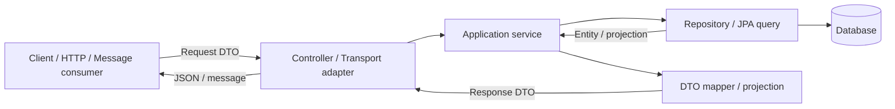
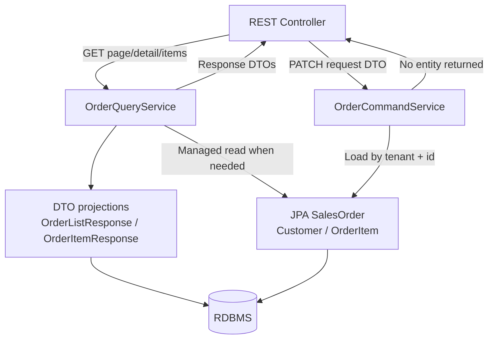

# Tránh trả đồ thị entity trực tiếp qua lớp giao tiếp ứng dụng

Khi xây ứng dụng với **JPA**, một entity không chỉ là đối tượng chứa dữ liệu. Nó còn gắn với những khái niệm quan trọng của ORM: **persistence context**, **lazy loading**, **identity map**, **dirty checking**, **quan hệ hai chiều**, **cơ chế fetch** và **transaction**. Trái lại, lớp giao tiếp ứng dụng như REST API, GraphQL, gRPC hay message event cần một **hợp đồng dữ liệu rõ ràng, có phạm vi và được kiểm soát**.

Vì vậy, một nguyên tắc thiết kế quan trọng là:

> **Không mặc định trả nguyên JPA entity hoặc toàn bộ entity graph từ service/repository ra API. Hãy tạo DTO (Data Transfer Object) theo đúng use case, tải trước những dữ liệu DTO cần và chỉ công bố những trường được phép.**

Một controller có vẻ rất gọn:

```java
@GetMapping("/orders/{id}")
public SalesOrder getOrder(@PathVariable Long id) {
    return repository.findById(id).orElseThrow();
}
```

nhưng có thể phát sinh hàng loạt vấn đề:

- Serializer đụng vào `@OneToMany(fetch = LAZY)` khi persistence context đã đóng → `LazyInitializationException` hoặc lỗi tương đương.
- Persistence context vẫn mở thì serializer tự kích hoạt **N+1 queries**, thậm chí tải hàng nghìn bản ghi ngoài dự kiến.
- `SalesOrder` có quan hệ ngược `OrderItem.order` → JSON đệ quy vô hạn.
- `Customer` chứa email, số điện thoại hoặc thông tin nội bộ mà endpoint không có quyền công bố.
- Trả một entity graph lớn khiến response chậm, memory tăng và contract API thay đổi mỗi khi entity mapping thay đổi.
- Dùng chính entity làm request body để `save/merge` còn mở ra nguy cơ **mass assignment/over-posting**.

Bài học này giải thích bản chất các rủi ro ấy và xây dựng kiến trúc **entity ở tầng persistence, DTO ở ranh giới giao tiếp, query/projection theo nhu cầu, phân trang có kiểm soát, mapping trong transaction**, cùng cách kiểm thử để bảo đảm tính đúng đắn, bảo mật và hiệu năng. Ngữ cảnh là chương **DTO và phân trang** thuộc module **Data Persistence Relational Access ORM JPA**.

## 1. Entity graph khác với API response như thế nào?

**Entity graph** trong nghĩa domain/ORM là mạng các entity và associations liên quan:

```text
SalesOrder
 ├── Customer
 │    ├── Address
 │    └── Account
 ├── OrderItem [0..N]
 │    └── Product
 │         └── Supplier
 ├── Payment [0..N]
 ├── Shipment [0..N]
 └── AuditRecord [0..N]
```

Trong JPA, một số quan hệ được nạp ngay, một số chỉ là proxy/lazy collection. **Cấu trúc Java object graph không đồng nghĩa toàn bộ dữ liệu đã nằm trong RAM**, và một getter có thể khiến provider truy vấn database.

**API response** là thông tin được ứng dụng chủ động công bố cho caller:

```json
{
  "id": 101,
  "orderNumber": "SO-101",
  "status": "PAID",
  "createdAt": "2026-10-01T09:00:00Z",
  "customer": {
    "id": 7,
    "displayName": "Minh Tran"
  },
  "itemCount": 3
}
```

Response trên không cần:

- Địa chỉ chi tiết của customer.
- Token, cờ nội bộ, ghi chú hỗ trợ, lịch sử audit.
- Toàn bộ products, suppliers và orders khác của customer.
- Mọi payment/line/shipment của order.
- Các proxy/metadata nội bộ của ORM.

Entity graph mô tả **khả năng đi từ object này sang object khác**; response DTO mô tả **những dữ liệu caller được nhận trong một operation cụ thể**.

### 1.1. Sơ đồ ranh giới kiến trúc



Đặc điểm cần giữ:

1. **Entities** được quản lý bên trong vùng persistence/application.
2. **DTO** được tạo ở một điểm rõ ràng trước khi rời application boundary.
3. Dữ liệu DTO phải được lấy có chủ đích qua projection/fetch plan phù hợp.
4. Quyền truy cập và tenant scope được kiểm tra **trước khi** dữ liệu được trả.
5. Serialization chỉ đọc DTO đã xây xong, không bị coi là nơi thực thi truy vấn.

## 2. Một mô hình entity dễ gây vấn đề

Ta dùng ví dụ bán hàng với một `SalesOrder` có customer, items và payments.

### 2.1. `SalesOrder`

```java
package example.sales.domain;

import jakarta.persistence.*;
import java.time.Instant;
import java.util.ArrayList;
import java.util.List;

@Entity
@Table(name = "sales_orders")
public class SalesOrder {

    @Id
    @GeneratedValue(strategy = GenerationType.SEQUENCE)
    private Long id;

    @Column(name = "tenant_id", nullable = false, updatable = false)
    private String tenantId;

    @Column(name = "order_number", nullable = false)
    private String orderNumber;

    @Enumerated(EnumType.STRING)
    @Column(nullable = false)
    private OrderStatus status;

    @Column(name = "created_at", nullable = false)
    private Instant createdAt;

    @ManyToOne(fetch = FetchType.LAZY, optional = false)
    @JoinColumn(name = "customer_id", nullable = false)
    private Customer customer;

    @OneToMany(mappedBy = "order", fetch = FetchType.LAZY)
    private List<OrderItem> items = new ArrayList<>();

    @OneToMany(mappedBy = "order", fetch = FetchType.LAZY)
    private List<Payment> payments = new ArrayList<>();

    @Version
    private long version;

    protected SalesOrder() {}

    public Long getId() { return id; }
    public String getTenantId() { return tenantId; }
    public String getOrderNumber() { return orderNumber; }
    public OrderStatus getStatus() { return status; }
    public Instant getCreatedAt() { return createdAt; }
    public Customer getCustomer() { return customer; }
    public List<OrderItem> getItems() { return items; }
    public List<Payment> getPayments() { return payments; }
    public long getVersion() { return version; }

    public void changeStatus(OrderStatus next) {
        // Một hệ thống thật cần kiểm tra state transition hợp lệ.
        this.status = next;
    }
}
```

Enum:

```java
package example.sales.domain;

public enum OrderStatus {
    DRAFT, PAID, SHIPPED, CANCELLED
}
```

### 2.2. `Customer` có trường không nên công bố

```java
package example.sales.domain;

import jakarta.persistence.*;
import java.util.ArrayList;
import java.util.List;

@Entity
@Table(name = "customers")
public class Customer {

    @Id
    private Long id;

    private String displayName;
    private String email;

    @Column(name = "internal_risk_score")
    private Integer internalRiskScore;

    @OneToMany(mappedBy = "customer", fetch = FetchType.LAZY)
    private List<SalesOrder> orders = new ArrayList<>();

    protected Customer() {}

    public Long getId() { return id; }
    public String getDisplayName() { return displayName; }
    public String getEmail() { return email; }
    public Integer getInternalRiskScore() {
        return internalRiskScore;
    }
    public List<SalesOrder> getOrders() { return orders; }
}
```

Trường `internalRiskScore` phục vụ quản trị/rủi ro nội bộ. Một API dành cho người mua không được tự động nhận trường này chỉ vì entity có public getter.

### 2.3. `OrderItem` và `Payment`

```java
package example.sales.domain;

import jakarta.persistence.*;
import java.math.BigDecimal;

@Entity
@Table(name = "order_items")
public class OrderItem {

    @Id
    private Long id;

    @ManyToOne(fetch = FetchType.LAZY, optional = false)
    @JoinColumn(name = "order_id", nullable = false)
    private SalesOrder order;

    private String productSku;
    private int quantity;
    private BigDecimal unitPrice;

    protected OrderItem() {}

    public Long getId() { return id; }
    public SalesOrder getOrder() { return order; }
    public String getProductSku() { return productSku; }
    public int getQuantity() { return quantity; }
    public BigDecimal getUnitPrice() { return unitPrice; }
}
```

```java
package example.sales.domain;

import jakarta.persistence.*;
import java.math.BigDecimal;

@Entity
@Table(name = "payments")
public class Payment {

    @Id
    private Long id;

    @ManyToOne(fetch = FetchType.LAZY, optional = false)
    @JoinColumn(name = "order_id", nullable = false)
    private SalesOrder order;

    private BigDecimal amount;
    private String method;
    private String providerReference;

    protected Payment() {}

    public Long getId() { return id; }
    public SalesOrder getOrder() { return order; }
    public BigDecimal getAmount() { return amount; }
    public String getMethod() { return method; }
    public String getProviderReference() {
        return providerReference;
    }
}
```

Mô hình này rất bình thường cho JPA persistence. Vấn đề nảy sinh khi **cố serialize trực tiếp toàn bộ các entity đó** thành response JSON.

## 3. Anti-pattern: controller trả `@Entity`

Ví dụ:

```java
@RestController
@RequestMapping("/api/orders")
public class OrderController {

    private final SalesOrderRepository repository;

    public OrderController(SalesOrderRepository repository) {
        this.repository = repository;
    }

    @GetMapping("/{id}")
    public SalesOrder get(@PathVariable Long id) {
        return repository.findById(id)
            .orElseThrow();
    }
}
```

Controller này cho JSON serializer thấy `SalesOrder` và các getter:

```text
getCustomer()
getItems()
getPayments()
getVersion()
...
```

Serializer (ví dụ Jackson trong Spring MVC) có thể duyệt qua chúng theo bean/property introspection, tùy cấu hình:

```text
SalesOrder.getCustomer()
  -> Customer.getOrders()
     -> SalesOrder.getCustomer()
        -> ...
```

Hoặc:

```text
SalesOrder.getItems()
  -> Hibernate lazy collection initialization
     -> SQL SELECT ...
```

Hoặc:

```text
SalesOrder.getCustomer()
  -> Customer.getInternalRiskScore()
     -> field nội bộ xuất hiện trong response
```

Không nên giả định rằng Hibernate proxy hay Jackson tự hiểu **ý định nghiệp vụ và quyền công bố thông tin**. Jackson nhìn thấy object properties; nó không biết endpoint “chỉ muốn đơn hàng và tên người mua”.

### 3.1. Thiết kế sai cả ở chiều nhận request

Một controller:

```java
@PutMapping("/{id}")
public SalesOrder update(
        @PathVariable Long id,
        @RequestBody SalesOrder request) {
    return repository.save(request);
}
```

còn nguy hiểm hơn:

- Caller có thể gửi fields không được phép sửa.
- `tenantId`, `status`, `customer`, `version` hoặc ID bị điều khiển ngoài ý định.
- `save`/`merge` của JPA không phải bộ kiểm tra authorization và không tự áp business state transitions.
- Nested collections trong request có thể dẫn tới cascading, replacement hoặc detached-state bugs.

Hai chiều **request** và **response** đều cần DTO riêng; “trả entity trực tiếp” và “nhận entity trực tiếp” đều gây coupling giữa persistence model và API contract.

## 4. Rủi ro thứ nhất: lazy loading khi serialization

JPA associations có thể được cấu hình:

```java
@OneToMany(mappedBy = "order", fetch = FetchType.LAZY)
private List<OrderItem> items;
```

Khi service lấy `SalesOrder`, `items` thường chưa được nạp. Sau khi transaction/persistence context đóng:

```text
Controller nhận SalesOrder
     |
     v
HTTP framework bắt đầu serialize JSON
     |
     v
Jackson gọi order.getItems()
     |
     v
Hibernate cần truy vấn DB để khởi tạo collection
     |
     v
Không còn Session/Persistence Context phù hợp
     |
     v
LazyInitializationException
```

Lỗi điển hình trong Hibernate:

```text
org.hibernate.LazyInitializationException:
failed to lazily initialize a collection of role:
example.sales.domain.SalesOrder.items
could not initialize proxy - no Session
```

Thông điệp cụ thể tùy Hibernate version và collection/proxy. Đây là lỗi Hibernate-specific; provider JPA khác có thể biểu hiện khác.

### 4.1. Nguyên nhân không phải “JPA bị hỏng”

Entity có lazy association cần một persistence context/Session phù hợp để khởi tạo. Nếu lớp giao tiếp đòi thêm dữ liệu **sau khi unit of work đã kết thúc**, kiến trúc đang để serialization quyết định fetch plan quá muộn.

### 4.2. Không chữa bằng EAGER ở tất cả associations

Một phản ứng:

```java
@OneToMany(fetch = FetchType.EAGER)
private List<OrderItem> items;
```

có thể làm mất lỗi lazy ở một tình huống, nhưng tạo nhiều truy vấn hoặc hàng JOIN không cần cho các use case khác. Đặc biệt, nhiều EAGER to-many collections có thể gây nhân số hàng SQL hoặc restriction như multiple bags trên Hibernate.

**Đúng hơn:** quyết định DTO cần fields nào, tải fields đó trong service boundary, rồi trả DTO không chứa lazy proxy.

## 5. Open EntityManager in View không phải giải pháp thiết kế API

Một số ứng dụng Spring Web sử dụng **Open EntityManager in View** (OEIV/OSIV). Cơ chế này có thể giữ persistence context gắn với request lâu hơn transaction service, tạo điều kiện cho lazy loading xảy ra khi view/serializer duyệt associations.

Vì vậy, một endpoint trả entity có thể:

```text
Ở máy A:
    trả JSON thành công (OSIV đang bật)

Ở máy B:
    LazyInitializationException (OSIV tắt)
```

Điều đó **không có nghĩa endpoint ở máy A đã tốt hơn**. Khi OSIV mở:

- Serializer có thể phát SQL mà controller/service không chủ động thiết kế.
- Các association lồng nhau có thể gây N+1 và tải dữ liệu rất rộng.
- Có thể xảy ra truy cập dữ liệu ngoài transaction nghiệp vụ đã kết thúc, ảnh hưởng cách nhìn về consistency.
- Request giữ tài nguyên persistence lâu hơn theo hành vi cấu hình.
- Cấu trúc JSON có thể phụ thuộc vào những getters/relations mới được thêm.

Trong một dự án Spring Boot có thể cấu hình:

```properties
spring.jpa.open-in-view=false
```

Đây là lựa chọn kiến trúc để không phụ thuộc vào lazy SQL trong lớp web; không phải setting bắt buộc của mọi hệ thống. Ngay cả khi OSIV được bật vì lý do khác, **service nên trả DTO đã được xây đủ dữ liệu** và serializer không nên truy cập entities.

### 5.1. Không áp `@Transactional` ở controller chỉ để serialize entity

`@Transactional` trên controller không tự là một hợp đồng bảo đảm serialization chạy bên trong transaction, vì việc ghi response body thường được framework thực hiện sau khi method controller trả kết quả. Cơ chế proxy/AOP, filter và request lifecycle khác nhau theo framework.

Thay vì kéo transaction tới HTTP rendering, nên:

```text
Service transaction:
    query + authorization + DTO mapping
    -> đóng transaction

Controller:
    trả DTO

HTTP serializer:
    chỉ serialize dữ liệu Java thuần
```

## 6. Rủi ro thứ hai: vòng lặp JSON do quan hệ hai chiều

Với:

```java
class SalesOrder {
    @OneToMany(mappedBy = "order")
    List<OrderItem> items;
}

class OrderItem {
    @ManyToOne
    SalesOrder order;
}
```

Object graph chứa chu trình:

```text
Order#101
  -> items[0]
     -> order #101
        -> items[0]
           -> order #101
              -> ...
```

Khi serializer đi theo mọi relation, nó có thể đệ quy đến khi phát sinh lỗi như StackOverflowError, lỗi mapping/serialization cycle hoặc JSON cực lớn, tùy serializer/configuration.

### 6.1. Vì sao domain cần hai chiều?

Trong persistence/domain, bidirectional relation có thể hữu ích:

- Từ order xem các items.
- Từ item truy cập order sở hữu.
- Thiết lập quan hệ để đồng bộ FK đúng.

Nhưng **API response không cần sao chép nguyên từng cạnh của object graph**. Một JSON detail có thể trả items, mỗi item chỉ cần ID/SKU/quantity chứ không cần nhúng lại toàn bộ order.

### 6.2. DTO làm graph trở thành cây có độ sâu hữu hạn

```json
{
  "id": 101,
  "orderNumber": "SO-101",
  "items": [
    {"id": 8001, "sku": "KB-10", "quantity": 2},
    {"id": 8002, "sku": "MS-20", "quantity": 1}
  ]
}
```

Những object `items` chỉ chứa dữ liệu cần cho người xem. Không có trường `item.order` dẫn ngược đến parent, nên không xuất hiện recursion ngoài ý muốn.

## 7. Rủi ro thứ ba: tải nhiều dữ liệu và N+1

Giả sử một endpoint trả 50 orders:

```java
@GetMapping
public List<SalesOrder> list() {
    return repository.findAll();
}
```

Nếu JSON serializer truy cập:

```text
order.customer.displayName
order.items
order.payments
```

thì với lazy associations provider có thể chạy:

```text
1 SELECT orders
50 SELECT customers   (ít hơn nếu customer trùng hoặc cache hit)
50 SELECT items
50 SELECT payments
```

Tổng có thể lên đến **151 SQL statements**, thay vì một kế hoạch được thiết kế có chủ đích. Số thực tế phụ thuộc cache, batch fetching, entity graph, provider và trạng thái persistence context.

### 7.1. Thêm cả hai collection vào JOIN FETCH cũng chưa chắc tốt

```sql
select distinct o
from SalesOrder o
left join fetch o.items
left join fetch o.payments
```

Nếu mỗi order có 10 items và 6 payments, query có thể sinh:

\[
50 \times 10 \times 6 = 3000
\]

SQL rows, dù danh sách chỉ cần 50 root orders. Với Hibernate, nhiều collections có bag semantics còn có thể dẫn đến `MultipleBagFetchException`.

### 7.2. Không ép serializer thành fetch planner

Nếu serializer được tự do truy cập bất kỳ association nào, việc thêm một getter mới trong entity có thể thay đổi đáng kể query behavior của endpoint mà không thay đổi code controller. Đây là **hiệu năng khó dự đoán**.

DTO giúp khai báo rõ:

```text
API order list:
    id, orderNumber, status, createdAt, customerName

API order detail:
    id, orderNumber, status, customer brief,
    các items được giới hạn hoặc lấy qua API riêng
```

Mỗi trường có một nguồn query/fetch plan cụ thể; serialization không gây SQL mới.

## 8. Rủi ro thứ tư: rò rỉ dữ liệu và quyền truy cập

Nếu entity `Customer` có:

```java
private String email;
private Integer internalRiskScore;
private String supportNote;
```

thì việc trả `SalesOrder.customer` có thể khiến các thuộc tính này được serialize nếu getter/field visibility cho phép. Không phải cứ user được xem order là được xem **tất cả** thông tin customer.

Một thay đổi persistence bình thường:

```java
// Developer thêm để phục vụ công việc hỗ trợ nội bộ.
private String investigationMemo;

public String getInvestigationMemo() {
    return investigationMemo;
}
```

có thể vô tình trở thành **thay đổi public API** nếu entity đang được trả trực tiếp.

### 8.1. DTO theo nguyên tắc allowlist

Thay vì ẩn một số field bằng danh sách loại trừ:

```java
@JsonIgnore
private String internalRiskScore;
```

hãy chọn rõ **những field được phép xuất hiện**:

```java
public record CustomerBriefResponse(
    Long id,
    String displayName
) {}
```

Ở đây, dù entity sau này có thêm `internalRiskScore` hay `investigationMemo`, kiểu `CustomerBriefResponse` **không tự thêm chúng vào JSON**.

### 8.2. DTO không thay thế authorization

Một DTO chỉ chứa `id` và `status` vẫn có thể rò rỉ dữ liệu nếu query cho phép đọc order của tenant khác. **DTO kiểm soát hình dạng dữ liệu; authorization kiểm soát ai được xem đối tượng nào.**

Ví dụ repository phải lọc:

```java
select o
from SalesOrder o
where o.id = :id
  and o.tenantId = :tenantId
```

Trong đó `tenantId` đến từ authenticated context/authorized scope, không tin tùy ý request parameter.

### 8.3. Response cho vai trò khác nhau

Một staff có thể được xem payment reference, còn người mua chỉ thấy trạng thái/tổng tiền. Tạo các DTO phù hợp:

```java
public record CustomerOrderResponse(
    Long id,
    String orderNumber,
    OrderStatus status
) {}

public record StaffOrderResponse(
    Long id,
    String orderNumber,
    OrderStatus status,
    String supportReference
) {}
```

Không nên dùng cùng một entity cho mọi role rồi hy vọng serializer tự đoán quyền dựa vào endpoint.

## 9. Rủi ro thứ năm: API contract bị khóa vào database model

Entity thường đổi vì:

- Thêm/move quan hệ.
- Đổi tên persistent property.
- Refactor inheritance/embedded object.
- Chuyển từ một bảng sang nhiều bảng.
- Bổ sung cache/audit/technical metadata.
- Đổi JPA provider hoặc lazy enhancement strategy.

Nếu HTTP response là JSON của entity, những thay đổi ấy có thể ảnh hưởng public field names, cấu trúc nested objects hoặc giá trị null/lazy ngay cả khi **yêu cầu API không thay đổi**.

### 9.1. DTO là lớp cách ly

Entity có thể:

```java
private String orderNumber;
```

API lại muốn:

```json
{
  "orderCode": "SO-101"
}
```

DTO giúp định nghĩa property theo contract API:

```java
public record OrderPublicResponse(
    Long id,
    String orderCode
) {}
```

Mapping:

```java
new OrderPublicResponse(
    entity.getId(),
    entity.getOrderNumber());
```

Sau đó đổi persistence field từ `orderNumber` sang `externalReference` có thể chỉ cần sửa mapper/query, **không buộc đổi JSON contract**.

### 9.2. DTO không nhất thiết là 1:1 với bảng

Một response có thể kết hợp:

- Columns từ nhiều entities.
- Giá trị tổng hợp `itemCount`.
- Format dữ liệu dành cho client.
- Link/ID tham chiếu tới resource khác.
- Trạng thái được suy diễn từ nhiều trường.

Đó là hợp đồng use case, không phải “entity nhưng bỏ annotation”.

## 10. DTO là gì? Phân biệt ba loại thường dùng

**Data Transfer Object (DTO)** là một kiểu dữ liệu dùng để truyền thông tin giữa các tầng/hệ thống theo hợp đồng đã chọn. Nó thường không chứa JPA mapping annotation và không được quản lý bởi EntityManager.

Trong thiết kế ứng dụng, nên phân biệt:

| Loại | Mục đích | Ví dụ |
|---|---|---|
| **Request DTO** | Nhận những trường caller được phép cung cấp | `CreateOrderRequest`, `UpdateOrderStatusRequest` |
| **Response DTO** | Công bố chính xác dữ liệu client cần | `OrderListResponse`, `OrderDetailResponse` |
| **Query projection DTO** | Nhận dữ liệu chọn lọc trực tiếp từ JPQL/Criteria/SQL | `OrderSummaryRow`, `ItemCountRow` |

Một class đôi khi có thể dùng vừa làm projection vừa làm response, nhưng không phải luôn là lựa chọn tốt. Khi query/domain và public API cần tiến hóa khác nhịp, tách projection nội bộ và response contract giúp tránh coupling.

### 10.1. Java `record` phù hợp cho DTO bất biến

Với Java 17+:

```java
package example.sales.api;

import java.time.Instant;
import example.sales.domain.OrderStatus;

public record OrderListResponse(
    Long id,
    String orderNumber,
    OrderStatus status,
    Instant createdAt,
    String customerName
) {}
```

`record` cung cấp constructor và accessors, biểu diễn snapshot dữ liệu. Nó không yêu cầu `@Entity` và không mang persistence context theo.

**Giới hạn:** record nông bất biến. Nếu record chứa `List` mutable, phần tử trong danh sách vẫn có thể bị sửa qua reference. Có thể dùng `List.copyOf(...)` tại constructor/mapping khi cần snapshot chắc chắn.

### 10.2. DTO không tự động bảo mật

Một record:

```java
public record UnsafeCustomerResponse(
    String email,
    String internalRiskScore
) {}
```

vẫn công bố dữ liệu nhạy cảm nếu developer chủ động đưa vào. DTO là công cụ **cho phép thiết kế allowlist và review**, không thay thế chính sách bảo mật, code review hay authorization.

## 11. Thiết kế response riêng cho list và detail

Một endpoint danh sách thường không cần tất cả chi tiết.

### 11.1. List response gọn

```java
public record OrderListResponse(
    Long id,
    String orderNumber,
    OrderStatus status,
    Instant createdAt,
    String customerName
) {}
```

Ví dụ JSON:

```json
{
  "id": 101,
  "orderNumber": "SO-101",
  "status": "PAID",
  "createdAt": "2026-10-01T09:00:00Z",
  "customerName": "Minh Tran"
}
```

Không có items/payments. List API có thể trả hàng chục bản ghi mà payload vẫn nhỏ và predictable.

### 11.2. Detail response có giới hạn

```java
import java.time.Instant;
import java.math.BigDecimal;
import java.util.List;

public record CustomerBriefResponse(
    Long id,
    String displayName
) {}

public record OrderItemResponse(
    Long id,
    String productSku,
    int quantity,
    BigDecimal unitPrice
) {}

public record PaymentBriefResponse(
    Long id,
    BigDecimal amount,
    String method
) {}

public record OrderDetailResponse(
    Long id,
    String orderNumber,
    OrderStatus status,
    Instant createdAt,
    CustomerBriefResponse customer,
    List<OrderItemResponse> itemPreview,
    long totalItemCount,
    boolean hasMoreItems,
    long version
) {}
```

Các record trên được trình bày cùng nhau để minh họa cấu trúc; trong Java thực tế, nhiều `public` top-level types cần nằm trong các source files tương ứng hoặc điều chỉnh visibility hợp lệ.

Điểm cần chú ý:

- `customer` chỉ chứa ID và displayName.
- `itemPreview` là **một tập giới hạn**, không được hiểu là toàn bộ items.
- `totalItemCount`/`hasMoreItems` giúp client biết còn dữ liệu.
- `version` có thể phục vụ optimistic locking cho write requests nếu API contract yêu cầu.
- Không trả `Payment` trực tiếp hoặc nhúng mọi payment vào detail mặc định; payment details có thể nằm ở endpoint/role riêng.

### 11.3. Không đặt tên field “items” nếu chỉ trả một phần mà không mô tả rõ

Nếu server trả 20 items đầu tiên trong 50 items nhưng đặt:

```json
{"items":[{"id":1}, {"id":2}]}
```

client có thể hiểu nhầm là order chỉ có 2 items. Các tên `itemPreview` hoặc một cấu trúc có metadata phân trang làm contract rõ hơn:

```json
{
  "itemPreview": [{"id": 1}, {"id": 2}],
  "totalItemCount": 50,
  "hasMoreItems": true
}
```

Trường hợp không cần preview, chỉ trả `itemCount` và link tới `/orders/{id}/items` cũng hợp lý.

## 12. Vì sao không bao giờ mặc định nhúng vô hạn collections?

Ví dụ một customer có 40.000 orders, mỗi order 20 items và 5 payments. Nếu trả:

```text
Customer
  -> all Orders
     -> all Items
     -> all Payments
```

số records có thể hàng triệu, chưa tính product details. Một endpoint đọc “customer” trở thành một phép export khổng lồ.

### 12.1. Đặt giới hạn theo level

Một hợp đồng hợp lý:

```text
GET /customers/7
    -> CustomerBriefResponse + orderCount

GET /customers/7/orders?page=0&size=20
    -> Page<OrderListResponse>

GET /orders/101
    -> OrderDetailResponse + itemPreview (tối đa 10)

GET /orders/101/items?page=0&size=50
    -> Page<OrderItemResponse>
```

**Độ sâu graph phải có giới hạn.** Đó không chỉ là vấn đề serialization; nó là quyết định về khả năng mở rộng và tính ổn định của API.

### 12.2. Child collection có thể rất lệch kích thước

Đừng giả định “mỗi order nhiều nhất 5 items” chỉ vì dữ liệu thử nghiệm như vậy. Cần xem p95/p99/max, đặt giới hạn hoặc thực thi phân trang trên child resource. Một vài outliers có thể gây OOM dù giá trị trung bình nhỏ.

### 12.3. Khi nào nhúng collection là hợp lý?

Nhúng một collection nhỏ và **có upper bound rõ** có thể tiện hơn gọi endpoint riêng. Ví dụ địa chỉ giao hàng đã được giới hạn bởi business rule, hoặc một enum-like list dưới 10 phần tử. Nhưng phải xuất phát từ business contract chứ không phải vì entity relation đã có sẵn.

## 13. Cách thứ nhất: projection trực tiếp từ JPQL sang DTO

Với list page, cách tối ưu thường là **không tải SalesOrder entities rồi mới map**, mà SELECT đúng những columns response cần.

JPQL constructor projection:

```java
List<OrderListResponse> result = em.createQuery(
        "select new example.sales.api.OrderListResponse(" +
        "o.id, o.orderNumber, o.status, " +
        "o.createdAt, c.displayName) " +
        "from SalesOrder o " +
        "join o.customer c " +
        "where o.tenantId = :tenantId " +
        "order by o.createdAt desc, o.id desc",
        OrderListResponse.class)
    .setParameter("tenantId", tenantId)
    .setMaxResults(20)
    .getResultList();
```

Giải thích:

1. `select new ...OrderListResponse(...)` tạo DTO theo constructor.
2. `join o.customer c` là **to-one join**, không tạo phép nhân to-many như join items/payments.
3. WHERE lọc tenant **ngay tại database**.
4. ORDER BY có tie-breaker ID để thứ tự ổn định hơn.
5. `setMaxResults(20)` giới hạn số parent list rows; không fetch to-many collection trong query.
6. Result là DTO, không phải managed `SalesOrder`, nên serializer không thể lén gọi `getItems()` trên entity.

### 13.1. Vì sao projection thường tiết kiệm hơn entity fetch?

Entity query:

```java
select o from SalesOrder o
```

có thể đọc nhiều mapped columns và tạo managed entities trong persistence context. Projection:

```java
select new ...OrderListResponse(
    o.id, o.orderNumber, o.status, o.createdAt, c.displayName)
```

chỉ yêu cầu những values cần thiết. Có thể giảm:

- Bytes truyền từ database.
- Số managed entities và dirty-checking overhead.
- Rủi ro serialization associations.
- Tải những fields không dùng.

**Đừng đánh đồng DTO projection với mọi phép SELECT chắc chắn nhanh hơn:** query plan, joins, index và volume vẫn quyết định. Lợi ích là shape rõ ràng, dễ kiểm soát.

### 13.2. Giới hạn constructor projection

JPQL `select new` yêu cầu:

- Tên class/constructor phù hợp.
- Thứ tự và kiểu arguments phù hợp.
- Các field là persistent attributes/expressions hợp lệ.

Compiler không phải lúc nào kiểm tra đủ JPQL string và constructor mapping tại compile time. Việc đổi constructor, kiểu trường hoặc provider có thể làm query lỗi runtime; cần integration tests.

### 13.3. Không trả `Map<String,Object>` tùy tiện khi có contract rõ

Tuple/map projection linh hoạt nhưng dễ làm contract yếu kiểu và khó refactor. Với response ổn định, một record/class DTO rõ các fields giúp API documentation, tests và client generation chính xác hơn.

## 14. Cách thứ hai: entity-to-DTO mapping ở service boundary

Nếu use case có nghiệp vụ trên managed entities hoặc cần truy cập một graph nhỏ đã biết, có thể nạp entity và map sang DTO trong transaction.

Manual mapper:

```java
public final class OrderMapper {
    private OrderMapper() {}

    public static CustomerBriefResponse toBrief(
            Customer customer) {
        return new CustomerBriefResponse(
            customer.getId(),
            customer.getDisplayName());
    }

    public static OrderItemResponse toItem(
            OrderItem item) {
        return new OrderItemResponse(
            item.getId(),
            item.getProductSku(),
            item.getQuantity(),
            item.getUnitPrice());
    }
}
```

### 14.1. Mapper không tự biết fetch plan

Đoạn:

```java
entity.getCustomer().getDisplayName()
```

có thể kích hoạt lazy loading nếu customer chưa được tải. Tương tự:

```java
entity.getItems().stream().map(...)
```

có thể nạp toàn bộ items, không phù hợp nếu có hàng chục nghìn items.

Vì vậy, **manual mapping không tự giải quyết N+1**. Nên thiết kế query để dữ liệu cần cho mapper đã được tải hoặc dùng direct projection.

### 14.2. Mapping nằm trong transaction/đơn vị công việc

```java
@Service
public class OrderQueryService {

    @PersistenceContext
    private EntityManager em;

    @Transactional(readOnly = true)
    public CustomerBriefResponse loadCustomer(Long customerId) {
        Customer customer = em.find(Customer.class, customerId);
        if (customer == null) {
            throw new ResourceNotFoundException();
        }
        return OrderMapper.toBrief(customer);
    }
}
```

Đây là một ví dụ kiến trúc: `ResourceNotFoundException` là exception do ứng dụng tự định nghĩa và map ra HTTP 404 theo policy. Với dữ liệu nhiều tenant, truy vấn cũng phải kiểm tra tenant/ownership thay vì chỉ `find` theo ID toàn cục.

DTO được tạo **trước khi method service kết thúc**. Sau đó controller chỉ serialize record chứa scalar values, không yêu cầu EntityManager mở.

### 14.3. Khi nào ưu tiên mapping thay projection?

- Use case cần gọi domain methods trên managed entity.
- Entity graph nhỏ, cố định, được kiểm soát.
- Query đã fetch đủ dữ liệu và không tạo multiplication lớn.
- Có business validations trước khi trả.

Khi use case là read-only list/reporting, direct DTO projection thường đơn giản và hiệu quả hơn.

## 15. Cách thứ ba: dùng mapping library như MapStruct

Khi có nhiều DTO, mapper thủ công có thể dài. Một library như **MapStruct** có thể sinh mapping code từ source annotations trong quá trình compile.

Ví dụ ý tưởng:

```java
import org.mapstruct.Mapper;
import org.mapstruct.Mapping;

@Mapper(componentModel = "spring")
public interface OrderSummaryMapper {

    @Mapping(
        target = "customerName",
        source = "customer.displayName"
    )
    OrderListResponse toListResponse(SalesOrder order);
}
```

MapStruct cần cấu hình dependency/annotation processor theo phiên bản dự án; đây **không phải API chuẩn của JPA**.

### 15.1. Mapper library không tự sửa lỗi fetch

`source = "customer.displayName"` có thể tương đương gọi getter trên lazy `Customer`. Nếu mapper chạy trên 100 `SalesOrder` mà chưa fetch customer, vẫn có nguy cơ N+1.

Một rule khác:

```java
@Mapping(target = "items", source = "items")
```

không tự động là ý tưởng tốt nếu items có thể rất lớn. Annotation không thay thế quyết định **DTO cần trường nào, dữ liệu được tải bằng query nào**.

### 15.2. Review generated mapper

Khi mapping entity-to-DTO:

- Tránh tự động map mọi property trùng tên vào public response nếu security contract yêu cầu allowlist.
- Chỉ map nested fields cần thiết.
- Không vô tình truy cập collection chưa được khởi tạo.
- Kiểm tra null mappings, enum changes và nested cycles.
- Dùng tests để xác minh chính xác trường xuất hiện trong JSON.

Lợi ích của mapper library là giảm boilerplate, không phải khiến entities tự động trở thành API-safe.

## 16. Thiết kế truy vấn detail không trả nguyên collection graph

Giả sử endpoint `GET /orders/{id}` muốn:

- Order metadata.
- Tên khách hàng.
- Preview tối đa 10 items.
- Tổng item count.

Có thể chia thành vài query **rõ ràng và có giới hạn**, trả một DTO.

### 16.1. Query root + to-one

```java
SalesOrder order = em.createQuery(
        "select o from SalesOrder o " +
        "join fetch o.customer " +
        "where o.id = :id " +
        "and o.tenantId = :tenantId",
        SalesOrder.class)
    .setParameter("id", orderId)
    .setParameter("tenantId", tenantId)
    .getSingleResult();
```

Vì `customer` là to-one, một `JOIN FETCH` tại đây thường không tạo phép nhân các tập hợp. Nếu không tìm thấy row, `getSingleResult()` ném `NoResultException`, nên service chuyển thành ứng xử 404 hoặc access denial theo security policy.

### 16.2. Query preview items bằng DTO

```java
List<OrderItemResponse> itemPreview = em.createQuery(
        "select new example.sales.api.OrderItemResponse(" +
        "i.id, i.productSku, i.quantity, i.unitPrice) " +
        "from OrderItem i " +
        "where i.order.id = :orderId " +
        "order by i.id asc",
        OrderItemResponse.class)
    .setParameter("orderId", orderId)
    .setMaxResults(10)
    .getResultList();
```

Chỉ truy vấn 10 items đầu, **không gọi `order.getItems()` để materialize toàn bộ collection rồi cắt List trong Java**.

### 16.3. Query count

```java
long totalItemCount = em.createQuery(
        "select count(i) from OrderItem i " +
        "where i.order.id = :orderId",
        Long.class)
    .setParameter("orderId", orderId)
    .getSingleResult();
```

`COUNT` chỉ tính items của order đã được xác minh ownership/tenant trước. Nếu database thiết kế child IDs toàn cục và query có thể bị gọi độc lập từ service khác, thêm tenant/ownership guard ở query child hoặc service authorization phù hợp.

### 16.4. Dựng response rõ ràng

```java
return new OrderDetailResponse(
    order.getId(),
    order.getOrderNumber(),
    order.getStatus(),
    order.getCreatedAt(),
    new CustomerBriefResponse(
        order.getCustomer().getId(),
        order.getCustomer().getDisplayName()),
    List.copyOf(itemPreview),
    totalItemCount,
    totalItemCount > itemPreview.size(),
    order.getVersion()
);
```

Điểm mạnh:

- Không serialize Hibernate proxies.
- Chỉ chọn customer fields được phép.
- Preview items có giới hạn SQL.
- JSON không chứa back-reference `OrderItem.order`.
- Không cần truy cập payments nếu endpoint không dùng.

### 16.5. Tách service transaction ra khỏi JSON serialization

Service:

```java
@Transactional(readOnly = true)
public OrderDetailResponse getOrderDetail(
        String tenantId, Long orderId) {
    // Query root + customer.
    // Query item preview và count.
    // Return response DTO.
}
```

Controller:

```java
@GetMapping("/{id}")
public OrderDetailResponse get(
        @PathVariable Long id) {
    String tenantId = authenticatedTenant();
    return queryService.getOrderDetail(tenantId, id);
}
```

`authenticatedTenant()` là ví dụ abstraction lấy tenant từ security context của ứng dụng, không phải một method chuẩn của Spring. Triển khai thật phải được kết nối với authentication/authorization infrastructure.

## 17. Cách lập API quan hệ theo resource và ID

Không phải relation nào cũng nên biểu diễn bằng object lồng nhau. Trong một hệ thống REST, một response có thể trả **ID tham chiếu** và liên kết tới endpoint tài nguyên riêng:

```json
{
  "id": 101,
  "orderNumber": "SO-101",
  "customerId": 7,
  "itemCount": 125,
  "links": {
    "items": "/api/orders/101/items",
    "customer": "/api/customers/7"
  }
}
```

Đây chỉ là một cấu trúc API minh họa; việc công bố link customer phải qua cùng chính sách authorization. Nó có ưu điểm:

- Order detail không phải trả mọi item.
- Items có thể phân trang riêng.
- Customer resource có contract/permissions riêng.
- Không nhân độ sâu JSON theo các quan hệ domain mới.
- Client chủ động chọn dữ liệu cần đọc.

### 17.1. Tránh JSON có độ sâu không xác định

Không thiết kế:

```text
Order -> Customer -> Orders -> Customers -> ...
```

Kể cả khi serializer được cấu hình xử lý cycle bằng object identity, payload vẫn có thể khó dùng, không ổn định và đòi nhiều database queries.

### 17.2. ID references không đủ cho mọi trường hợp

Đôi khi danh sách cần tên customer mà không muốn client gọi thêm N requests. Hãy **denormalize có kiểm soát ở response DTO**:

```java
public record OrderListResponse(
    Long id,
    String orderNumber,
    String customerName
) {}
```

Đây là một projection to-one nhẹ; không phải nhúng toàn bộ `Customer`.

### 17.3. Contract event/message cũng nên có DTO riêng

Nguyên tắc không chỉ áp dụng cho REST. Khi publish message:

```json
{
  "eventType": "OrderPaid",
  "eventVersion": 1,
  "orderId": 101,
  "tenantId": "TENANT_A",
  "occurredAt": "2026-10-01T09:00:00Z"
}
```

Một domain event payload có schema ổn định hơn việc serialize nguyên `SalesOrder`. Nhưng khi publish ra broker, cần quản lý transaction/outbox và data classification; DTO chỉ giải quyết cấu trúc payload, không tự giải quyết tính nhất quán của event delivery.

## 18. Phân trang là một phần của API contract

Không chỉ tránh trả nguyên entity graph, ứng dụng còn phải tránh trả **vô hạn số lượng root entities**. Một endpoint:

```java
@GetMapping("/orders")
public List<SalesOrder> list() {
    return repository.findAll();
}
```

vừa trả entities vừa không có giới hạn. Khi dữ liệu tăng từ 1.000 tới 10 triệu rows, endpoint có thể tăng latency, dùng nhiều heap, bị gateway timeout hoặc làm cạn connection pool.

Thiết kế nên chuyển sang:

```text
GET /api/orders?page=0&size=20
```

và trả những trường đã chọn:

```json
{
  "content": [
    {
      "id": 101,
      "orderNumber": "SO-101",
      "status": "PAID",
      "createdAt": "2026-10-01T09:00:00Z",
      "customerName": "Minh Tran"
    }
  ],
  "page": 0,
  "size": 20,
  "totalElements": 1042,
  "totalPages": 53,
  "hasNext": true
}
```

Trang dữ liệu này chứa **DTO**, không phải `Page<SalesOrder>` trực tiếp.

### 18.1. Metadata cần được diễn giải chính xác

| Trường | Ý nghĩa |
|---|---|
| `page` | Chỉ số trang, thường bắt đầu từ 0 ở Spring Data |
| `size` | Số phần tử tối đa/trang |
| `content` | Danh sách DTO của trang hiện tại |
| `totalElements` | Tổng số roots phù hợp filter tại thời điểm query count |
| `totalPages` | Số trang theo tổng rows và page size |
| `hasNext` | Còn trang sau theo cơ chế phân trang đang dùng |

Không nhất thiết mọi API cần `totalElements`. Nếu COUNT đắt hoặc dữ liệu biến động liên tục, có thể dùng **Slice** hoặc cursor/keyset pagination thay vì Page.

### 18.2. Giới hạn đầu vào là bắt buộc

Đặt:

```text
page >= 0
1 <= size <= 100
sort chỉ thuộc allowlist của API
```

Không để client yêu cầu `size=100000000` hoặc sort theo thuộc tính nhạy cảm, quan hệ to-many lớn.

## 19. Spring Data JPA: trả `Page<DTO>` thay vì `Page<Entity>`

Một ví dụ repository dùng JPQL constructor projection:

```java
package example.sales.persistence;

import example.sales.api.OrderListResponse;
import example.sales.domain.SalesOrder;
import org.springframework.data.domain.Page;
import org.springframework.data.domain.Pageable;
import org.springframework.data.jpa.repository.JpaRepository;
import org.springframework.data.jpa.repository.Query;
import org.springframework.data.repository.query.Param;

public interface SalesOrderRepository
        extends JpaRepository<SalesOrder, Long> {

    @Query(
        value = """
            select new example.sales.api.OrderListResponse(
                o.id, o.orderNumber, o.status,
                o.createdAt, c.displayName)
            from SalesOrder o
            join o.customer c
            where o.tenantId = :tenantId
            order by o.createdAt desc, o.id desc
            """,
        countQuery = """
            select count(o)
            from SalesOrder o
            where o.tenantId = :tenantId
            """
    )
    Page<OrderListResponse> findList(
        @Param("tenantId") String tenantId,
        Pageable pageable
    );
}
```

Ở đây:

- Query dữ liệu trả đúng fields của `OrderListResponse`.
- Query count độc lập, không fetch collection.
- `join o.customer c` là to-one, phù hợp với schema mẫu `customer` không optional.
- ORDER BY có `o.id` làm tie-breaker.
- `Pageable` quyết định offset/limit của danh sách roots.

**Lưu ý phiên bản:** đây là API Spring Data JPA, không phải Jakarta Persistence thuần. Annotation `@Query` có thể được Spring Data xử lý khác nhau theo phiên bản; integration test nên xác nhận constructor projection, countQuery và phân trang thực tế.

### 19.1. Service không trả `Page` framework trực tiếp ra public JSON

Ta có thể định nghĩa response wrapper có shape API chủ động kiểm soát:

```java
package example.sales.api;

import java.util.List;

public record PageResponse<T>(
    List<T> content,
    int page,
    int size,
    long totalElements,
    int totalPages,
    boolean hasNext
) {
    public PageResponse {
        content = List.copyOf(content);
    }
}
```

Service:

```java
@Transactional(readOnly = true)
public PageResponse<OrderListResponse> listOrders(
        String tenantId, int page, int size) {

    if (page < 0 || size < 1 || size > 100) {
        throw new IllegalArgumentException("Invalid pagination");
    }

    Page<OrderListResponse> result =
        repository.findList(
            tenantId,
            PageRequest.of(page, size));

    return new PageResponse<>(
        result.getContent(),
        result.getNumber(),
        result.getSize(),
        result.getTotalElements(),
        result.getTotalPages(),
        result.hasNext());
}
```

Các imports Spring Data tương ứng là `Page` và `PageRequest`; `@Transactional` là của `org.springframework.transaction.annotation.Transactional`.

Wrapper này tránh phụ thuộc vào JSON shape nội bộ của Spring `PageImpl`. Nó cũng cho phép thay cơ chế pagination trong service/repository mà giữ hợp đồng HTTP ổn định, nếu cần.

### 19.2. Vì sao không viết `repository.findAll(pageable)` rồi trả entity?

`Page<SalesOrder>` vẫn chứa managed/detached entities. Bản thân pagination **không giải quyết lazy loading, graph recursion hoặc data exposure**. Cần kiểm soát **cả shape lẫn số lượng**:

```text
Pageable -> giới hạn root count
DTO      -> giới hạn fields và nested graph
Query    -> giới hạn SQL rows/cột được tải
```

### 19.3. `Page.map` có thể dùng khi nào?

Nếu repository trả entity đã được tải phù hợp:

```java
Page<SalesOrder> page = repository.findByTenantId(...);
Page<OrderListResponse> mapped =
    page.map(orderMapper::toListResponse);
```

`Page.map` tạo page nội dung đã chuyển đổi, nhưng mapper có thể truy cập lazy relation. Để dùng an toàn:

1. Map khi persistence context còn phù hợp.
2. Dữ liệu mà mapper đọc được fetch đúng kế hoạch.
3. Không dùng to-many fetch join kèm pageable tùy tiện.
4. Đừng giả định map chỉ tác động in-memory nếu getter còn lazy.

Với list endpoint chỉ cần scalar fields, direct DTO projection thường rõ hơn.

## 20. `Page` hay `Slice`?

Spring Data phân biệt:

- `Page<T>`: nội dung trang cộng metadata tổng số, thường cần count query.
- `Slice<T>`: nội dung và thông tin có trang tiếp theo, không đòi tổng số đầy đủ.

### 20.1. Khi dùng `Page`

Phù hợp nếu UI cần:

```text
Trang 1/53
Tổng 1.042 đơn
Nhảy tới trang bất kỳ
```

Trade-off: cần query COUNT hoặc chiến lược đếm tương đương. Với filter/join phức tạp, count có thể tốn chi phí đáng kể.

### 20.2. Khi dùng `Slice`

Phù hợp cho:

```text
Xem 20 đơn tiếp theo
Load more
Infinite scroll
```

Nó có thể lấy thêm một phần tử để xác định `hasNext` mà không cần một COUNT riêng, theo cơ chế của Spring Data. DTO response:

```java
public record SliceResponse<T>(
    List<T> content,
    int page,
    int size,
    boolean hasNext
) {}
```

Không ghi `totalElements` nếu API không thật sự tính con số đó.

### 20.3. Offset, keyset và tính ổn định khi concurrent writes

Với:

```sql
order by o.createdAt desc, o.id desc
```

offset pagination có thể bị lặp/bỏ qua rows khi data thay đổi giữa các requests. Keyset pagination dùng key của row cuối trang:

```sql
where o.tenantId = :tenantId
  and (
      o.createdAt < :lastCreatedAt
      or (
          o.createdAt = :lastCreatedAt
          and o.id < :lastId
      )
  )
order by o.createdAt desc, o.id desc
```

với `setMaxResults(size)` có thể phù hợp khi đi tới trang tiếp theo trên dataset lớn. Nhưng keyset không tự cung cấp tổng số trang, và concurrent updates của sort key vẫn cần xem xét. Quan trọng hơn, **cả hai kiểu phân trang vẫn nên trả DTO, không phải entity graph**.

## 21. Bẫy phân trang cùng `JOIN FETCH` collection

Một query:

```java
List<SalesOrder> page = em.createQuery(
        "select distinct o from SalesOrder o " +
        "left join fetch o.items " +
        "where o.tenantId = :tenantId " +
        "order by o.createdAt desc",
        SalesOrder.class)
    .setParameter("tenantId", tenantId)
    .setMaxResults(20)
    .getResultList();
```

không phải cách portable để lấy **đúng 20 orders với đầy đủ items** bằng một câu SQL LIMIT. Vì mỗi order có N items, SQL JOIN tạo N rows/order. Nếu LIMIT cắt giữa các rows của một order, collection có thể bị thiếu dữ liệu; một số provider phải load nhiều rows rồi phân trang trong memory.

Với Hibernate, cấu hình:

```properties
hibernate.query.fail_on_pagination_over_collection_fetch=true
```

có thể giúp phát hiện một số trường hợp pagination over collection fetch. Đây là **Hibernate-specific**; thông điệp lỗi và phạm vi áp dụng phụ thuộc phiên bản.

### 21.1. Chiến lược hai giai đoạn

**Bước 1:** chọn parent IDs ở đúng độ hạt parent:

```java
List<Long> ids = em.createQuery(
        "select o.id from SalesOrder o " +
        "where o.tenantId = :tenantId " +
        "order by o.createdAt desc, o.id desc",
        Long.class)
    .setParameter("tenantId", tenantId)
    .setFirstResult(offset)
    .setMaxResults(pageSize)
    .getResultList();
```

**Bước 2:** query DTO của đúng IDs đó:

```java
if (ids.isEmpty()) {
    return List.of();
}

List<OrderListResponse> rows = em.createQuery(
        "select new example.sales.api.OrderListResponse(" +
        "o.id, o.orderNumber, o.status, " +
        "o.createdAt, c.displayName) " +
        "from SalesOrder o join o.customer c " +
        "where o.id in :ids and o.tenantId = :tenantId",
        OrderListResponse.class)
    .setParameter("ids", ids)
    .setParameter("tenantId", tenantId)
    .getResultList();
```

**Lưu ý:** SQL `IN :ids` không bảo đảm giữ thứ tự của `ids`. Nếu cần giữ nguyên thứ tự page, sắp xếp lại theo ID list ban đầu hoặc dùng ORDER BY thích hợp.

### 21.2. Khi detail cần hai tập hợp

Nếu cần cả `items` và `payments`:

1. Chọn page root IDs.
2. Query items cho đúng IDs bằng DTO projection.
3. Query payments cho đúng IDs theo quyền.
4. Group child DTOs theo `orderId` rồi gắn vào response DTOs.

Không cần JOIN FETCH cả hai to-many collections trong cùng SQL. Như vậy tránh nhân số hàng theo `items × payments`.

### 21.3. Không luôn phải dùng hai giai đoạn cho list projection

Nếu list query chỉ có root scalar + to-one columns như ví dụ `OrderListResponse` ở mục trước, có thể **phân trang ngay trên DTO projection**. Hai giai đoạn thường hữu ích khi cần child data, aggregate queries hoặc fetch strategies đặc thù. Không nên thêm phức tạp vào một list endpoint vốn đã có SQL shape an toàn.

## 22. Phân trang riêng cho child resource

Khi `OrderDetailResponse` không trả toàn bộ items, dùng endpoint:

```text
GET /api/orders/101/items?page=0&size=50
```

Service cần xác nhận caller **được phép xem order 101** rồi mới query items.

Ví dụ repository projection:

```java
@Query(
    value = """
        select new example.sales.api.OrderItemResponse(
            i.id, i.productSku, i.quantity, i.unitPrice)
        from OrderItem i
        where i.order.id = :orderId
        order by i.id asc
        """,
    countQuery = """
        select count(i)
        from OrderItem i
        where i.order.id = :orderId
        """
)
Page<OrderItemResponse> findItems(
    @Param("orderId") Long orderId,
    Pageable pageable
);
```

**Quan trọng:** đoạn này giả định authorization của order đã được service xử lý trước. Nếu có thể, đưa tenant/ownership vào chính query items:

```sql
where i.order.id = :orderId
  and i.order.tenantId = :tenantId
```

để phòng ngừa một đường gọi khác vô tình bỏ qua check. Client không được chọn tenant tùy ý.

### 22.1. Các fields của child DTO

`OrderItemResponse` chỉ có:

```text
id, productSku, quantity, unitPrice
```

Không có `order` back-reference, không có `Product.supplier` hay mọi stock records. Điều này giúp endpoint item page giữ payload nhỏ và không phát sinh graph serialization ngoài dự kiến.

### 22.2. Giới hạn page size vẫn áp dụng cho children

Ngay cả với một order, items có thể lên tới hàng nghìn. `setMaxResults(50)` ở query **không fetch collection** giúp database trả một số item DTO có giới hạn. Page count có thể lớn; nếu không cần total, dùng Slice.

## 23. Khi cần child counts hoặc sums, không cần tải cả collection

Trên trang list, UI có thể yêu cầu:

```text
Order SO-101 | 5 items | Paid 1.250.000 VND
```

Không cần `order.getItems().size()` và `order.getPayments()` trên từng order nếu database có thể aggregate.

### 23.1. Count items theo danh sách root IDs

```java
List<Object[]> counts = em.createQuery(
        "select i.order.id, count(i) " +
        "from OrderItem i " +
        "where i.order.id in :ids " +
        "group by i.order.id",
        Object[].class)
    .setParameter("ids", ids)
    .getResultList();
```

Kết quả là từng cặp:

```text
(orderId, itemCount)
```

Ứng dụng map nó thành `Map<Long, Long>` rồi ghép vào response rows; orders không có items sẽ không xuất hiện trong group query nên cần gán `0L` cho chúng.

### 23.2. Sum payments theo IDs

```java
List<Object[]> totals = em.createQuery(
        "select p.order.id, sum(p.amount) " +
        "from Payment p " +
        "where p.order.id in :ids " +
        "group by p.order.id",
        Object[].class)
    .setParameter("ids", ids)
    .getResultList();
```

Tổng `BigDecimal` có thể map vào DTO đúng nghiệp vụ tiền tệ. Nếu payment có nhiều loại trạng thái (authorized, captured, refunded), query aggregate phải lọc đúng trạng thái nghiệp vụ; `sum(p.amount)` của mọi payment không tự đồng nghĩa “đã thanh toán”.

### 23.3. Tránh JOIN hai collections để aggregate

Sai:

```sql
select o.id, count(i), sum(p.amount)
from SalesOrder o
left join o.items i
left join o.payments p
group by o.id
```

Nếu order có 4 items và 3 payments, SQL JOIN tạo 12 combinations, dễ làm `count(i)` và `sum(p.amount)` phình lên. `SUM(DISTINCT p.amount)` cũng không đúng tổng quát khi hai payments có cùng amount.

Giải pháp: aggregate **mỗi collection riêng** hoặc pre-aggregate theo root ID trước khi join bằng SQL/database capabilities phù hợp.

### 23.4. Bảo mật aggregate

Ngay cả count và total cũng có thể là dữ liệu nhạy cảm. Caller được xem order không nhất thiết được xem tổng thanh toán hoặc thống kê gian lận. DTO nào có `paidTotal` phải tuân thủ authorization riêng, không coi aggregate là vô hại.

## 24. Input DTO: chống over-posting và mass assignment

Ranh giới giao tiếp cần DTO **cả chiều ghi**. Một request:

```json
{
  "id": 101,
  "tenantId": "TENANT_B",
  "status": "PAID",
  "version": 0,
  "customer": {
    "id": 999,
    "internalRiskScore": 0
  }
}
```

không được phép tự động thay đổi tất cả properties của managed `SalesOrder`.

Anti-pattern:

```java
@PutMapping("/{id}")
public SalesOrder update(
        @PathVariable Long id,
        @RequestBody SalesOrder incoming) {
    return orderRepository.save(incoming);
}
```

Rủi ro:

1. `id` ở path và body có thể mâu thuẫn.
2. Caller có thể cố thay `tenantId`.
3. Status transition có thể bỏ qua quy tắc nghiệp vụ.
4. Nested customer/payments/items có thể được gán hoặc merge không mong muốn.
5. JPA cascade, orphan removal và dirty checking có thể làm những thay đổi không được dự kiến.
6. Tên fields API phụ thuộc trực tiếp vào entity model.

### 24.1. Chỉ định request DTO theo use case

Ví dụ chỉ cho phép đổi trạng thái:

```java
package example.sales.api;

import example.sales.domain.OrderStatus;
import jakarta.validation.constraints.NotNull;
import jakarta.validation.constraints.PositiveOrZero;

public record ChangeOrderStatusRequest(
    @NotNull OrderStatus nextStatus,
    @PositiveOrZero long expectedVersion
) {}
```

Ở đây:

- Không có `tenantId` từ caller để ghi.
- Không có `payments`, `customer`, `items`.
- `nextStatus` là field được công bố có chủ đích.
- `expectedVersion` giúp client gửi phiên bản mà họ đã đọc trước đó.

Bean Validation annotation thuộc `jakarta.validation`; ứng dụng cần validation provider và cấu hình framework thích hợp. Validation hình thức **không thay thế authorization hoặc business state machine**.

### 24.2. Controller nhận DTO, không nhận entity

```java
@PatchMapping("/{id}/status")
public ResponseEntity<Void> changeStatus(
        @PathVariable Long id,
        @Valid @RequestBody ChangeOrderStatusRequest request) {

    String tenantId = authenticatedTenant();
    commandService.changeStatus(tenantId, id, request);
    return ResponseEntity.noContent().build();
}
```

Ví dụ giả định `authenticatedTenant()` lấy tenant đã được xác minh từ security context. `@Valid` là Jakarta Bean Validation, `ResponseEntity` là Spring Web.

### 24.3. Service tải managed entity có quyền, rồi gọi domain method

```java
@Transactional
public void changeStatus(
        String tenantId,
        Long orderId,
        ChangeOrderStatusRequest request) {

    SalesOrder order = em.createQuery(
            "select o from SalesOrder o " +
            "where o.id = :id and o.tenantId = :tenantId",
            SalesOrder.class)
        .setParameter("id", orderId)
        .setParameter("tenantId", tenantId)
        .getSingleResult();

    if (order.getVersion() != request.expectedVersion()) {
        throw new ConflictException("Order was changed");
    }

    order.changeStatus(request.nextStatus());
    // Dirty checking/flush/commit của managed entity.
}
```

`ConflictException` là application exception cần mapping thành HTTP 409 theo policy. `changeStatus` trong entity mẫu là đơn giản hóa; nghiệp vụ thật phải kiểm tra transition (ví dụ SHIPPED không được quay lại DRAFT).

**Điểm concurrency quan trọng:** so sánh `expectedVersion` với entity đã đọc giúp phát hiện request dùng snapshot cũ, nhưng một transaction khác vẫn có thể sửa row **sau khi check**. `@Version` trên managed entity sẽ giúp phát hiện xung đột tại flush/commit theo optimistic-locking semantics. Cần xử lý exception và trả 409/response phù hợp; không coi một phép so sánh Java là đủ thay thế version check của database.

### 24.4. Đừng `merge()` cả entity do client gửi

`em.merge(incoming)` copy state của detached entity theo JPA semantics vào managed instance. Nó không hiểu danh sách fields caller được phép cập nhật, không tự biết tenant rule và không làm cho request trở nên an toàn.

Với API cập nhật, hướng thường đúng hơn:

```text
Request DTO
    -> validate
    -> authorize
    -> load managed aggregate by tenant/id
    -> domain method/update allowed fields
    -> commit
    -> response DTO (nếu cần)
```

## 25. Create request: không gửi nested entity graph từ client

Một create order request có thể biểu diễn bằng ID và dữ liệu cần thiết:

```java
public record NewOrderItemRequest(
    @NotBlank String productSku,
    @Positive int quantity
) {}

public record CreateOrderRequest(
    @NotNull Long customerId,
    @NotEmpty List<@Valid NewOrderItemRequest> items
) {}
```

Với Jakarta Bean Validation, các annotations `@NotBlank`, `@Positive`, `@NotNull`, `@NotEmpty`, `@Valid` cần imports và validation provider tương ứng. Đoạn ví dụ thể hiện cấu trúc request, không phải toàn bộ quy trình đặt hàng.

Service cần:

1. Xác minh authenticated tenant.
2. Kiểm tra customerId thuộc tenant/caller có quyền.
3. Tra product SKUs, kiểm tra giá/tồn kho/quy tắc nghiệp vụ ở server.
4. Tạo `SalesOrder` và `OrderItem` thông qua factory/domain methods thích hợp.
5. Persist theo transaction, dùng cascade phù hợp.
6. Trả DTO chứa ID/status, không trả toàn bộ aggregate mới managed.

Không tin trực tiếp client gửi `totalAmount`, `discount`, `paidStatus` hoặc `customer.tenantId` nếu những dữ liệu đó phải được tính/xác minh phía server.

### 25.1. Request DTO cũng cần giới hạn collection size

Ngay cả khi client không gửi entities, request vẫn có thể chứa:

```json
{
  "customerId": 7,
  "items": [ "... 500000 entries ..." ]
}
```

Đặt giới hạn kích thước request, số items, độ dài strings và validation. DTO không tự chống payload quá lớn.

### 25.2. PUT và PATCH cần semantics rõ

`PUT` thường biểu diễn việc thay thế một resource representation theo contract; `PATCH` mô tả cập nhật một phần. Không thể suy ra rằng mọi field `null` trong DTO phải được ghi thành NULL trong database:

- Field không được gửi.
- Field được gửi với null.
- Field được gửi để xóa giá trị.

ba tình huống có thể cần phân biệt. Với patch phức tạp, dùng request DTO/command type thể hiện rõ operation hoặc JSON Patch/Merge Patch có validation, không trực tiếp merge vào JPA entity graph.

## 26. Khai báo fetch plan theo response DTO

DTO nào cần thông tin nào nên quyết định query/fetch plan:

| DTO | Trường cần | Phương án fetch/query |
|---|---|---|
| `OrderListResponse` | Order scalar + customerName | JPQL constructor projection + to-one JOIN |
| `OrderDetailResponse` | Order + customer brief + 10 items | To-one JOIN/projection, item preview query riêng |
| `OrderItemResponse` page | Một item với SKU/quantity/price | Item DTO projection, pageable |
| `PaymentBriefResponse` page | Payment summary theo quyền | Payment DTO projection, permission check |
| `OrderCountResponse` | Count orders theo trạng thái | Aggregate query; không load order entities |
| `OrderExportRow` | Một tập fields lớn nhưng cố định | Paged DTO/read-only export, chunking |

### 26.1. FetchType là mapping default, không phải API contract

`fetch = FetchType.LAZY` là gợi ý/quy tắc nạp liên quan entity. API cần những dữ liệu nào được quyết định ở service/query.

### 26.2. Entity graph là công cụ, không phải response graph

`@EntityGraph` hoặc `EntityGraph<?>` có thể giúp bảo đảm một số association được tải trước khi mapper truy cập. Nhưng entity graph **không tự giới hạn public fields** và không bảo đảm provider chọn một SQL plan không gây row multiplication.

Đừng nhầm:

```text
EntityGraph (JPA) = kế hoạch nạp persistent attributes
Response DTO graph = cấu trúc JSON/transport contract
```

Hai graph có thể liên quan nhưng **không nên sao chép nguyên nhau**.

### 26.3. Tránh EAGER để chiều theo serializer

Nếu thêm một trường response mới, hãy cập nhật projection/fetch plan phù hợp cho endpoint đó; đừng tự động đổi quan hệ entity từ LAZY sang EAGER vì một màn hình cần thêm dữ liệu.

## 27. Vấn đề `@JsonIgnore`, `@JsonManagedReference` và `@JsonIdentityInfo`

Khi trả entity trực tiếp, nhiều dự án thêm Jackson annotations vào entity:

```java
@JsonIgnore
private List<OrderItem> items;
```

hoặc:

```java
@JsonManagedReference
private List<OrderItem> items;

// Ở OrderItem:
@JsonBackReference
private SalesOrder order;
```

hoặc:

```java
@JsonIdentityInfo(
    generator = ObjectIdGenerators.PropertyGenerator.class,
    property = "id"
)
public class SalesOrder { ... }
```

Các annotations này có thể điều khiển **serialization shape/cycle** của Jackson trong những trường hợp tương ứng. Tuy nhiên, chúng **không giải quyết đầy đủ** bài toán:

- `@JsonIgnore` có thể làm endpoint này thiếu field cần thiết, endpoint khác cần lại phải tạo cấu hình khác.
- `@JsonManagedReference`/`@JsonBackReference` khắc phục một kiểu cycle nhưng không kiểm soát query scope hoặc data permissions.
- `@JsonIdentityInfo` có thể biểu diễn relation qua IDs thay vì đệ quy, nhưng không tự loại bỏ associations không được phép hay SQL N+1.
- Annotation trên entity tạo coupling giữa persistence class và transport serializer.
- Dữ liệu có thể vẫn được tải dù JSON bỏ qua một số field, nếu fetch plan đã nạp nó.

### 27.1. Hibernate Jackson modules có giải quyết vấn đề không?

Các Jackson modules tương thích Hibernate có thể xử lý lazy proxies hoặc uninitialized associations theo những options riêng. Chúng có thể làm serialization không báo lỗi trong vài tình huống, nhưng **không tạo API contract an toàn mặc định**.

Một module được cấu hình “không initialize lazy associations” có thể trả null/ID cho quan hệ chưa nạp; sau khi thêm fetch hoặc đổi request path, response có thể khác. Một option “force lazy loading” lại có thể kích hoạt SQL ngoài kế hoạch.

DTO tách ranh giới vẫn là giải pháp kiến trúc rõ ràng hơn khi public API cần ổn định, kiểm soát quyền và hiệu năng.

### 27.2. Khi nào Jackson annotations vẫn hữu ích?

Chúng có thể phù hợp với các object được thiết kế cho serialization hoặc trong legacy systems có constraints nhất định. Nhưng đừng coi “không còn StackOverflowError” là bằng chứng endpoint không rò rỉ thông tin, không N+1 và không phụ thuộc persistence context.

### 27.3. `@JsonView`

Jackson `@JsonView` có thể tạo các góc nhìn response khác nhau. Nó giải quyết một phần việc chọn properties, nhưng dễ tạo coupling vào entity và không thay thế authorization/query projection. Khi contract giữa các endpoint khác nhau nhiều, các DTO rõ ràng thường dễ review hơn.

## 28. Entity identity, JSON identity và client identity khác nhau

Trong JPA:

```java
em.find(SalesOrder.class, 101L)
```

trả managed entity có identity trong persistence context. Hai lần truy cập cùng entity có thể tham chiếu cùng Java object instance.

Trong JSON:

```json
{"id":101}
```

chỉ là dữ liệu truyền qua mạng. Client không có persistence context và không nhận được lifecycle của managed entity.

### 28.1. Không truyền ý tưởng “managed object” qua HTTP

Không có chuyện client nhận `SalesOrder` JSON rồi “sửa field, gửi lại, database tự dirty-check”. JSON là representation; server phải kiểm tra quyền, xác thực input và áp dụng command vào entity state dưới transaction.

### 28.2. Entity ID không phải authorization token

Caller biết `orderId=101` không tự chứng minh quyền truy cập. Khi GET/PATCH:

```sql
where o.id = :id and o.tenantId = :authorizedTenantId
```

và kiểm tra ownership/role tương ứng. DTO không thay việc ràng buộc ID vào quyền truy cập.

### 28.3. Public IDs có thể khác database IDs

Một hệ thống có thể dùng UUID/external reference để biểu diễn public resources thay cho sequence database primary key. DTO là nơi có thể công bố public ID mà vẫn giữ internal persistence ID không phải một phần API contract. Nhưng UUID cũng không phải authorization.

## 29. Multi-tenant và dữ liệu nhạy cảm trong nested DTO

Một endpoint trả:

```json
{
  "orderId": 101,
  "customer": {"id":7,"displayName":"Minh Tran"},
  "items": [...]
}
```

đúng shape chưa đủ nếu:

- Order thuộc tenant khác.
- Customer join sai tenant do dữ liệu legacy.
- Item/order relation bị trỏ tới parent khác hoặc query child bỏ điều kiện ownership.
- Caller không có quyền xem giá/tình trạng thanh toán.

### 29.1. Filter ở database/query boundary

Ví dụ:

```java
SalesOrder order = em.createQuery(
        "select o from SalesOrder o " +
        "where o.id = :id and o.tenantId = :tenantId",
        SalesOrder.class)
    .setParameter("id", orderId)
    .setParameter("tenantId", authorizedTenantId)
    .getSingleResult();
```

Rồi chỉ lấy child data cho `orderId` đã được xác nhận, hoặc để tenant predicate xuất hiện trong child query qua association.

### 29.2. Không dựa hoàn toàn vào JSON field hiding

`@JsonIgnore` trên `tenantId` hoặc `internalRiskScore` không bảo vệ dữ liệu tenant khác nếu query trả sai order. **Security là lựa chọn đúng rows cộng lựa chọn đúng fields**, và cả hai phải được kiểm soát.

### 29.3. Không tự động cho phép export toàn bộ theo URL

Một API `GET /orders/export` có thể được phân quyền khác list. DTO fields bị giới hạn vẫn có thể chứa hàng triệu rows, dẫn đến data exfiltration ở quy mô lớn. Cần thêm access checks, quotas, bounded filters, audit và cơ chế export riêng.

## 30. Transaction boundary và vòng đời DTO

Nguyên tắc:

```text
Transaction start
  -> Query / fetch
  -> Domain logic
  -> Build DTO
Transaction ends
  -> Serialize DTO
```

### 30.1. Read-only transaction là một tối ưu/cách diễn đạt ý định

Trong Spring:

```java
@Transactional(readOnly = true)
public OrderDetailResponse getDetail(...) {
    ...
}
```

đánh dấu method đọc dữ liệu. Nó có thể ảnh hưởng flush mode và transaction hints tùy provider/transaction manager, nhưng **không phải rào chắn tuyệt đối cấm mọi SQL write** và không tự bảo đảm một database snapshot bất biến.

### 30.2. Mapping sau transaction gây lỗi lazy

Anti-pattern:

```java
SalesOrder entity = orderService.findOrder(id);
OrderDetailResponse dto =
    mapper.toDetail(entity); // Ngoài transaction!
```

Nếu mapper chạm lazy associations đã bị detach, exception có thể xảy ra. Cách tốt hơn: service query và map tất cả fields DTO **trong cùng method/transaction**.

### 30.3. Self-invocation của Spring `@Transactional`

Nếu gọi:

```java
this.loadAndMapOrder(id);
```

tới một method `@Transactional` trong cùng bean, với Spring proxy-based interception, lời gọi nội bộ có thể bỏ qua transaction advice. Không mặc định annotation đã được kích hoạt. Cần thiết kế service boundaries và kiểm thử transaction setup.

### 30.4. Khi response yêu cầu nhiều queries

Split queries cho root, item count và preview có thể đọc dữ liệu ở những thời điểm khác nhau theo transaction isolation. Nếu cần thống nhất tuyệt đối như báo cáo tài chính:

- Chọn isolation/snapshot phù hợp.
- Cân nhắc read model/materialized snapshot.
- Dùng version/as-of semantics theo domain.
- Test concurrency với database mục tiêu.

DTO không tự biến nhiều SELECT thành một snapshot nhất quán; nó chỉ giúp kiểm soát shape và thời điểm nạp.

## 31. DTO và dữ liệu cache

Một endpoint có thể cache response DTO khi:

- Contract public rõ ràng.
- Data classification và authorization đã được xét.
- Cache key bao gồm tenant/role/filter/version phù hợp.
- Có invalidation/TTL khi dữ liệu thay đổi.

Ngược lại, cache nguyên managed entity hoặc Hibernate proxy và serialize lại ở request khác là nguy hiểm: object có thể detached, chứa lazy references, mang state lỗi thời và phụ thuộc persistence context trước.

### 31.1. Cache không chỉ theo entity ID

Sai:

```text
cacheKey = "order:101"
```

nếu các tenant có ID trùng hoặc response khác theo role. Một key phù hợp có thể cần:

```text
tenantId + orderId + representationVersion + authorizationView
```

Nhưng ngay cả key tốt cũng không thay thế access check trước khi trả cache hit.

### 31.2. Public DTO có thể bất biến nhưng cache vẫn stale

Record là immutable snapshot; database có thể thay đổi sau đó. Cần thời hạn cache và invalidation phù hợp với business freshness, đặc biệt trạng thái đơn hàng/thanh toán.

## 32. Tính toán payload, memory và thời gian serialize

Giả sử:

```text
100 orders / trang
Mỗi order có 30 items
Mỗi item có Product
Mỗi Product có Supplier
Mỗi order có 10 Payments
```

Trả entity graph có thể dẫn tới:

- Hàng nghìn managed entities.
- Các lazy queries tới products/suppliers/payments.
- JSON payload lớn, nhiều dữ liệu trùng lặp.
- Thời gian serialization phụ thuộc cấu trúc graph.
- Áp lực garbage collector/heap khi nhiều requests đồng thời.
- API clients phải parse dữ liệu không dùng.

Một DTO list chỉ có 5 scalar fields/order mang **độ lớn gần tuyến tính theo page size**. Quan trọng là tránh phụ thuộc vào kích thước collections bên dưới.

### 32.1. Nên đo gì?

| Chỉ số | Ý nghĩa |
|---|---|
| SQL statement count | Phát hiện N+1 |
| Rows transferred | Phát hiện JOIN multiplication |
| Query elapsed time | Tìm bottleneck database/network |
| DTO mapping time | Chi phí chuyển dữ liệu |
| Serialization time | Chi phí JSON processing |
| Response bytes | Chi phí network/client parsing |
| Heap allocations | Rủi ro GC/OOM |
| Page size distribution | Phát hiện clients yêu cầu quá lớn |
| Cache hits/misses | Hiểu ảnh hưởng cache |
| Lazy loads during serialization | Dấu hiệu ranh giới bị phá |

### 32.2. Ít câu SQL không có nghĩa nhẹ

Một query fetch 2 collections bằng JOIN có thể chỉ dùng 1 statement nhưng trả hàng chục nghìn rows. Một cách gồm 3 statements trả đúng 100 root DTOs và 2 nhóm aggregates có thể nhanh hơn và ít memory hơn.

### 32.3. Một DTO quá lớn vẫn là anti-pattern

Nếu response DTO chứa:

```java
List<OrderItemResponse> allItems;
List<PaymentBriefResponse> allPayments;
List<AuditResponse> allAudit;
```

mà không có bound, đổi từ entity sang DTO **chỉ giải quyết một phần**. Vẫn cần chọn fields, giới hạn collections và pagination theo use case.

## 33. DTO trong GraphQL và các transport khác

GraphQL cho client chọn nested fields và relations; điều này có thể hữu ích, nhưng cũng làm tăng nguy cơ resolver N+1 và query depth/complexity quá lớn.

Nguyên tắc vẫn giống REST:

- Không biến GraphQL resolver thành “serialize mọi JPA getter”.
- Dùng projection hoặc query service theo selection set.
- Dùng batching/DataLoader cho các relations phổ biến.
- Đặt depth/complexity/size/authorization limits.
- Không để caller duyệt graph vô hạn chỉ vì schema cho phép nhiều nested fields.

Với gRPC/Protobuf hoặc message broker, schema rõ ràng thường đã thúc đẩy DTO tách khỏi entity. Nhưng nếu dùng ORM entities làm source trực tiếp cho serialization mà không kiểm soát fetch, rủi ro N+1 và data leakage vẫn còn.

## 34. API versioning và tiến hóa contract

Khi public API trả entity trực tiếp, refactor một field Java có thể vô tình đổi JSON. Dùng DTO giúp áp dụng các chiến lược:

- Thêm optional field trong version hiện tại khi backward compatible.
- Đổi tên/loại bỏ field qua version mới.
- Giữ conversion/mapping từ entity nội bộ sang nhiều public response versions.
- Định nghĩa serialization format cho time, enum, money, null values.
- Sinh OpenAPI/client SDK từ public schemas thay vì quét persistence model.

### 34.1. Enum cần chiến lược versioning

Nếu entity status có:

```java
enum OrderStatus { DRAFT, PAID, SHIPPED, CANCELLED }
```

và sau này thêm `PARTIALLY_REFUNDED`, client có thể chưa xử lý enum value mới. Một response DTO có thể giữ API enum riêng hoặc có explicit mapping/compatibility plan.

### 34.2. Thay đổi @Column không nên buộc đổi API

Đổi database column:

```java
@Column(name = "external_order_ref")
private String orderNumber;
```

không nhất thiết làm đổi JSON `orderNumber`. DTO giúp giữ persistence schema và transport schema tiến hóa độc lập.

### 34.3. Tránh contract phụ thuộc vào thứ tự items ngầm định

Một `List<OrderItem>` trong entity không tự bảo đảm JSON items order theo nghiệp vụ trên mọi query. DTO query cần `ORDER BY` rõ ràng khi client phụ thuộc thứ tự; không dựa vào thứ tự row trả về nếu SQL không chỉ định.

## 35. Những lựa chọn thay thế và giới hạn của chúng

| Cách làm | Giúp giải quyết | Không tự giải quyết |
|---|---|---|
| `@JsonIgnore` trên entity | Ẩn một số properties trong Jackson | Query scope, N+1, versioning per use case |
| `@JsonManagedReference`/`@JsonBackReference` | Một số cycle serialization | Performance, security, API coupling |
| `@JsonIdentityInfo` | Biểu diễn object references bằng identity | Boundary/data minimization |
| Hibernate Jackson module | Proxy/lazy serialization behavior | Authorization, consistent response contract |
| `FetchType.EAGER` | Association có sẵn sớm hơn | Payload lớn, row multiplication, API fields |
| OSIV | Có thể cho phép lazy load khi render | N+1, consistency và tính chủ động của fetch |
| `@EntityGraph` | Chọn associations cần fetch | Giới hạn JSON fields, pagination, luôn ít SQL |
| `@BatchSize` | Giảm N+1 một số lazy associations | DTO shape, security, serialization cycles |
| Entity-to-DTO mapper | Tách transport contract | Fetch plan nếu mapper gọi lazy getters |
| Direct DTO projection | Chỉ lấy fields được chọn | Authorization, SQL plan và business rules |
| DTO + pagination + service boundary | Kiểm soát shape/volume/transaction | Mọi vấn đề concurrency hoặc security nếu logic sai |

**Không có một annotation nào biến cả JPA entity graph thành public API an toàn**. Cần kết hợp DTO contract, query plan, quyền truy cập và transaction.

## 36. Kiểm thử correctness, bảo mật và hiệu năng

Một endpoint trả DTO tốt cần được kiểm tra ở nhiều lớp.

### 36.1. Test JSON shape

`GET /api/orders/101` phải có những fields cho phép:

```json
{
  "id": 101,
  "orderNumber": "SO-101",
  "status": "PAID",
  "customer": {
    "id": 7,
    "displayName": "Minh Tran"
  },
  "itemPreview": [],
  "totalItemCount": 0,
  "hasMoreItems": false,
  "version": 3
}
```

Và **không chứa**:

```text
internalRiskScore
providerReference
tenantId (nếu không thuộc public contract)
customer.orders
item.order
hibernateLazyInitializer
handler
```

Sử dụng integration/API tests hoặc JSON-path assertions để xác minh cả trường **có** và **không có**.

### 36.2. Test chống tenant leak

Fixtures:

```text
Order#101 -> TENANT_A
Order#202 -> TENANT_B
```

Caller TENANT_A:

- Đọc `/orders/101` thành công nếu có quyền.
- Đọc `/orders/202` phải bị từ chối hoặc trả 404 theo chính sách che giấu sự tồn tại.
- Đọc `/orders/202/items` cũng không được phép.
- List pagination phải chỉ tính `totalElements` trong phạm vi TENANT_A.

### 36.3. Test nested DTO không bị recursion

Gọi endpoint detail và xác minh JSON serialize thành công, không có `item.order.items...` recursive path. Nên kiểm tra schema JSON thay vì chỉ tin `@JsonIgnore`.

### 36.4. Test không phát SQL trong serialization

Một cách kiểm tra:

1. Gọi service để lấy DTO và kết thúc transaction.
2. Serialize DTO ở ngoài persistence context.
3. Xác nhận serialization vẫn thành công.
4. Dùng SQL statement counter/instrumentation để xác nhận serialization không tạo SQL mới.

Nếu DTO chỉ chứa scalar/DTO values, serializer không cần JPA Session. Đây là một invariant kiến trúc hữu ích.

### 36.5. Test pagination

- Page 0 size 20 có tối đa 20 roots.
- Thứ tự `createdAt DESC, id DESC` đúng.
- Không có root trùng do joins.
- Page 1 không trùng page 0 trong dữ liệu ổn định.
- `totalElements`/`totalPages` hợp lệ nếu dùng Page.
- Trả empty page khi hết dữ liệu.
- Từ chối size vượt giới hạn.
- Với child items, chỉ trả items của order đã xác minh quyền.

### 36.6. Test query count và dữ liệu lệch

Chuẩn bị:

| Order | Items | Payments |
|---|---:|---:|
| A | 0 | 0 |
| B | 2 | 1 |
| C | 10 | 5 |
| D | 10.000 | 3 |

Xác minh:

- List endpoint không tải 10.000 items của D.
- Detail preview của D chỉ tải tối đa 10 items.
- API items có phân trang.
- Không có N+1 khi list nhiều orders.
- Aggregate count/payment đúng dù hai collections tồn tại.

### 36.7. Test cập nhật qua DTO

Request cố gửi:

```json
{
  "nextStatus": "PAID",
  "expectedVersion": 3,
  "tenantId": "TENANT_B",
  "customer": {"id": 999}
}
```

Framework có thể từ chối unknown fields hoặc ignore chúng tùy Jackson configuration. Quan trọng là service **không dùng những trường ngoài request contract**, không thay tenant/customer và vẫn kiểm tra quyền.

### 36.8. Test optimistic locking

- T1 đọc order version 3.
- T2 cập nhật, version thành 4.
- T1 gửi expectedVersion 3.
- Server trả conflict phù hợp, không ghi đè silent.

Mock không đủ để kiểm chứng transaction/version concurrency; nên dùng integration test với database phù hợp.

## 37. Ví dụ ứng dụng end-to-end

Ta muốn:

```text
GET /api/orders?page=0&size=20
GET /api/orders/{id}
GET /api/orders/{id}/items?page=0&size=50
PATCH /api/orders/{id}/status
```

Thiết kế:



### 37.1. Controller

```java
@RestController
@RequestMapping("/api/orders")
public class OrderApi {

    private final OrderQueryService queryService;
    private final OrderCommandService commandService;
    private final CurrentTenant currentTenant;

    public OrderApi(
            OrderQueryService queryService,
            OrderCommandService commandService,
            CurrentTenant currentTenant) {
        this.queryService = queryService;
        this.commandService = commandService;
        this.currentTenant = currentTenant;
    }

    @GetMapping
    public PageResponse<OrderListResponse> list(
            @RequestParam(defaultValue = "0") int page,
            @RequestParam(defaultValue = "20") int size) {
        return queryService.listOrders(
            currentTenant.authorizedTenantId(), page, size);
    }

    @GetMapping("/{id}")
    public OrderDetailResponse detail(@PathVariable Long id) {
        return queryService.getOrderDetail(
            currentTenant.authorizedTenantId(), id);
    }

    @GetMapping("/{id}/items")
    public PageResponse<OrderItemResponse> items(
            @PathVariable Long id,
            @RequestParam(defaultValue = "0") int page,
            @RequestParam(defaultValue = "50") int size) {
        return queryService.listItems(
            currentTenant.authorizedTenantId(), id, page, size);
    }

    @PatchMapping("/{id}/status")
    public ResponseEntity<Void> changeStatus(
            @PathVariable Long id,
            @Valid @RequestBody ChangeOrderStatusRequest request) {
        commandService.changeStatus(
            currentTenant.authorizedTenantId(), id, request);
        return ResponseEntity.noContent().build();
    }
}
```

Đây là skeleton minh họa integration: `CurrentTenant` là abstraction của dự án để lấy tenant đã được xác thực; `OrderQueryService`, `OrderCommandService` và `PageResponse` được mô tả ở các phần trước. Không có một `CurrentTenant` chuẩn bắt buộc trong Spring/JPA.

### 37.2. Query service

```java
@Service
public class OrderQueryService {

    private final SalesOrderRepository repository;
    private final OrderItemRepository itemRepository;
    private final EntityManager em;

    public OrderQueryService(
            SalesOrderRepository repository,
            OrderItemRepository itemRepository,
            EntityManager em) {
        this.repository = repository;
        this.itemRepository = itemRepository;
        this.em = em;
    }

    @Transactional(readOnly = true)
    public PageResponse<OrderListResponse> listOrders(
            String tenantId, int page, int size) {
        validatePage(page, size);

        Page<OrderListResponse> result =
            repository.findList(
                tenantId, PageRequest.of(page, size));

        return toPageResponse(result);
    }

    @Transactional(readOnly = true)
    public PageResponse<OrderItemResponse> listItems(
            String tenantId, Long orderId,
            int page, int size) {

        validatePage(page, size);
        ensureOrderAccessible(tenantId, orderId);

        Page<OrderItemResponse> result =
            itemRepository.findItems(
                orderId, PageRequest.of(page, size));

        return toPageResponse(result);
    }

    private void ensureOrderAccessible(
            String tenantId, Long orderId) {
        Long count = em.createQuery(
                "select count(o) from SalesOrder o " +
                "where o.id = :id and o.tenantId = :tenantId",
                Long.class)
            .setParameter("id", orderId)
            .setParameter("tenantId", tenantId)
            .getSingleResult();

        if (count != 1L) {
            throw new ResourceNotFoundException();
        }
    }

    private static void validatePage(int page, int size) {
        if (page < 0 || size < 1 || size > 100) {
            throw new IllegalArgumentException(
                "Invalid page parameters");
        }
    }

    private static <T> PageResponse<T> toPageResponse(
            Page<T> page) {
        return new PageResponse<>(
            page.getContent(),
            page.getNumber(),
            page.getSize(),
            page.getTotalElements(),
            page.getTotalPages(),
            page.hasNext());
    }

    // getOrderDetail(...) triển khai theo phần 16.
}
```

Đây là thiết kế minh họa, không phải lớp copy-paste hoàn chỉnh: cần imports, exceptions, repository interfaces và implementation `getOrderDetail(...)` phù hợp. Trong hệ thống cần chống race về quyền/ownership giữa `ensureOrderAccessible` và query items, nên **đưa tenant guard vào chính query item** hoặc sử dụng database row-level security và chính sách transaction phù hợp.

### 37.3. Command service

```java
@Service
public class OrderCommandService {

    @PersistenceContext
    private EntityManager em;

    @Transactional
    public void changeStatus(
            String tenantId, Long orderId,
            ChangeOrderStatusRequest request) {

        SalesOrder order = em.createQuery(
                "select o from SalesOrder o " +
                "where o.id = :id " +
                "and o.tenantId = :tenantId",
                SalesOrder.class)
            .setParameter("id", orderId)
            .setParameter("tenantId", tenantId)
            .getSingleResult();

        if (order.getVersion() != request.expectedVersion()) {
            throw new ConflictException();
        }

        order.changeStatus(request.nextStatus());
        // @Version + dirty checking phát SQL khi flush/commit.
    }
}
```

Khi business có state transitions, `changeStatus` phải từ chối các chuyển đổi bất hợp lệ. Với read-modify-write concurrency, `@Version` chỉ bảo vệ nếu mapping và update path sử dụng optimistic locking đúng cách. Không coi code này là authorization đầy đủ cho mọi vai trò.

### 37.4. Đặc điểm của kiến trúc

- Controller không trả `SalesOrder`.
- List trả DTO projection, có page size limit.
- Detail chỉ công bố bounded item preview.
- Items có endpoint pageable riêng.
- Write API chỉ nhận allowed fields.
- Tenant đến từ security context.
- Mapping/query chạy trước khi serializer làm việc.
- API contract không phụ thuộc graph topology của entity.

## 38. Những lỗi phổ biến và cách chẩn đoán

| Hiện tượng | Nguyên nhân thường gặp | Hướng xử lý |
|---|---|---|
| `LazyInitializationException` khi trả JSON | Serializer đụng lazy relation ngoài persistence context | Map DTO trong service; query/fetch fields cần |
| Endpoint chạy với OSIV nhưng query rất nhiều | Lazy loads phát sinh trong serialization | Tạo DTO/projection, đo SQL/N+1 |
| `StackOverflowError` hoặc recursion | Bidirectional entity relationship | DTO hữu hạn, không serialize ngược parent |
| JSON có `hibernateLazyInitializer`/`handler` | Proxy internals bị serialize | Không trả entity/proxy; không chỉ ẩn internal props |
| Customer internal fields xuất hiện | Entity có getter và không có allowlist | Response DTO rõ các public fields |
| Một API change khi thêm entity field | Transport phụ thuộc persistence model | Tách DTO/schema contract |
| Trang list rất chậm | Fetch quá nhiều associations/rows | Projection + pagination; SQL plan |
| Page 20 roots nhưng provider load cả nghìn rows | Collection fetch join + pagination | Chọn root IDs trước, fetch riêng |
| `MultipleBagFetchException` | Fetch đồng thời nhiều bags | Split collection fetch, batch |
| Count bị sai khi JOIN to-many | Nhân root rows | Count distinct root hoặc tách query |
| Tổng tiền bị nhân | JOIN items/payments trước SUM | Aggregate riêng mỗi collection |
| Page order không ổn định | Thiếu sort/tie-breaker | ORDER BY createdAt + id |
| Order list có payment provider reference | Nested entity bị công bố ngoài dự kiến | DTO theo role/use case |
| PATCH đổi được tenant/customer | @RequestBody entity + save/merge | Request DTO + allowed-field update |
| API hiển thị order tenant khác | Repository query không scope quyền | Authenticated tenant predicate/RLS |
| DTO mapper vẫn gây N+1 | Mapper đọc lazy getters | Direct projection hoặc fetch/batch plan |
| `PageImpl` JSON shape đổi theo framework | Trả Page framework trực tiếp | Wrap public `PageResponse` |
| Memory tăng khi response detail | DTO vẫn nhúng full collection | Bounded preview + child pagination |
| Trạng thái ghi đè không báo lỗi | Thiếu version/transition validation | @Version + expectedVersion + domain rules |
| Cache trả dữ liệu sai role | Cache key thiếu tenant/authorization view | Scope cache và check quyền |
| Một DTO chứa entity property | Nested field type còn là JPA entity | Chỉ dùng DTO/scalar/reference IDs |

### 38.1. Debug theo ba điểm

Khi một endpoint trả entity gặp lỗi:

1. **Serialization:** response type có chứa JPA entity/proxy/collection không?
2. **Persistence:** dữ liệu cần có đã được tải trong transaction/service boundary chưa? Có N+1 hoặc Cartesian multiplication không?
3. **Contract & security:** những fields/rows có thực sự được phép trả không? Có pagination/authorization không?

Chỉ sửa một điểm thường không đủ. Ví dụ bật OSIV có thể che LazyInitializationException nhưng không giải quyết hai điểm còn lại.

## 39. Bài tập thực hành

### Bài 1 — Tách entity và list DTO

Cho `SalesOrder(id, orderNumber, status, createdAt, customer, items)`. Viết `OrderListResponse` chỉ gồm ID, mã đơn, status, time và customerName. Viết JPQL `select new` lấy đúng những columns đó, không fetch items.

### Bài 2 — Sửa controller trả entity

Code ban đầu:

```java
@GetMapping("/{id}")
public SalesOrder get(@PathVariable Long id) {
    return repository.findById(id).orElseThrow();
}
```

**Yêu cầu:** chuyển thành response DTO, thêm tenant/ownership check, map trong service transaction, không để serialization chạm entity.

### Bài 3 — Vòng lặp JSON

Cho `SalesOrder.items` và `OrderItem.order` là hai chiều.

**Yêu cầu:** vẽ đường đệ quy khi serialize; thiết kế `OrderDetailResponse` với `List<OrderItemResponse>` không chứa back-reference.

### Bài 4 — LazyInitializationException

Một service trả detached `SalesOrder`; controller mới gọi mapper để đọc `order.getCustomer().getDisplayName()`. Giải thích tại sao có thể lỗi, rồi đưa mapping vào service hoặc viết direct DTO projection.

### Bài 5 — N+1 ở list response

Tải 100 orders và mỗi order đọc customer name. Trình bày:

- Kịch bản có 101 SQL statements.
- Phương án JPQL projection có to-one JOIN.
- Phương án batch fetching và giới hạn của nó.
- Metrics cần đo trước khi kết luận tối ưu.

### Bài 6 — Đặt giới hạn nested collection

Một order có 20.000 items. Thiết kế API detail chỉ trả 10 preview items, total count và `hasMoreItems`; thêm endpoint `GET /orders/{id}/items?page=...`. Giải thích vì sao `order.getItems().subList(0,10)` có thể vẫn load 20.000 rows.

### Bài 7 — Page vs Slice

Một màn hình infinite scroll cần 20 orders tiếp theo, không cần tổng số. Chọn `Slice<DTO>` hoặc cursor/keyset pagination và giải thích vì sao COUNT không cần cho contract này. Nếu UI cần nhảy trang 53/53, nêu khi nào dùng Page.

### Bài 8 — Phân trang và JOIN FETCH

Viết query có `left join fetch o.items` và `setMaxResults(20)`. Giải thích bẫy root-vs-row pagination. Thiết kế query chọn IDs rồi fetch child DTOs theo IDs.

### Bài 9 — Aggregate đúng

Một order có 4 items và 3 payments. Viết hai aggregate queries:

```sql
select i.order.id, count(i) ...
select p.order.id, sum(p.amount) ...
```

Giải thích vì sao JOIN cả items và payments trước khi COUNT/SUM có thể nhân kết quả.

### Bài 10 — Chống mass assignment

Một malicious client gửi `tenantId`, `customer.id` và `status` trong JSON dù endpoint chỉ cho sửa note.

**Yêu cầu:** định nghĩa `UpdateOrderNoteRequest(String note, long expectedVersion)`; service load order theo tenant, kiểm tra version/role, update đúng một trường. Không `save(requestEntity)`.

### Bài 11 — Đóng transaction trước serialization

Xây test: service trả DTO, đóng transaction, sau đó serialize JSON. Xác minh serialization không gây SQL hoặc lazy exception.

### Bài 12 — Multi-tenant

Tạo Order#1 thuộc TENANT_A, Order#2 thuộc TENANT_B. Test list/GET/items/PATCH với tenant A: không được thấy/sửa data tenant B. Giải thích vì sao việc không trả `tenantId` trong JSON không đủ bảo mật.

### Bài 13 — Field leak sau refactor

Thêm `Customer.internalRiskScore` và getter vào entity. So sánh một endpoint trả entity trực tiếp với endpoint trả `CustomerBriefResponse(id, displayName)`. Kiểm tra response schema trước/sau thay đổi.

### Bài 14 — DTO theo vai trò

Thiết kế một DTO cho người mua chỉ có `orderNumber/status` và một DTO cho nhân viên có thêm payment metadata được cho phép. Chỉ rõ nguồn authorization và query/mapper để mỗi role nhận đúng fields.

### Bài 15 — Optimistic locking

T1 đọc version 5, T2 cập nhật thành 6, T1 PATCH version 5. Giải thích cách dùng request `expectedVersion` và entity `@Version` để tránh lost update; ứng dụng nên xử lý conflict thế nào.

### Bài 16 — DTO mapper gây N+1

MapStruct mapper có `source = "customer.displayName"` và được gọi trên Page entity. Hãy giải thích tại sao compiler sinh mapper thành công vẫn không bảo đảm query plan tốt; đề xuất direct projection hoặc fetch/batch plan.

### Bài 17 — Cache contract

Thiết kế cache key cho `OrderListResponse` theo tenant, filter, page/sort và role. Phân tích vì sao cache keyed chỉ theo orderId có thể rò rỉ dữ liệu hoặc dùng snapshot stale.

## 40. Câu hỏi tự kiểm tra

**1. Vì sao không nên trả JPA entity trực tiếp qua REST?**

Vì entity gắn với ORM lifecycle/relations, có thể tạo lazy exception, N+1, JSON recursion, data leak và coupling với public API.

**2. Entity graph và response DTO graph có cùng mục đích không?**

Không. Entity graph biểu diễn quan hệ/persistence; response DTO graph biểu diễn fields được phép công bố cho một use case.

**3. `LazyInitializationException` xuất hiện khi nào?**

Khi code cần nạp lazy association nhưng không còn Hibernate Session/persistence context thích hợp để thực hiện.

**4. Bật OSIV có loại bỏ mọi vấn đề không?**

Không. Nó có thể cho phép lazy loading trong rendering nhưng còn N+1, security, transaction consistency và payload size.

**5. Quan hệ hai chiều gây JSON recursion như thế nào?**

Parent chứa children, mỗi child lại tham chiếu parent, serializer duyệt lặp lại vô hạn nếu không có contract/identity/cycle handling phù hợp.

**6. `@JsonIgnore` có thay DTO không?**

Không. Nó ẩn field trong serializer cụ thể nhưng không định nghĩa rõ per-use-case contract và không kiểm soát SQL/authorization.

**7. `@JsonIdentityInfo` có thể làm gì?**

Có thể xử lý object references qua identity, nhưng không làm graph trở nên API-safe hoặc ít query.

**8. DTO response nên dùng blacklist hay allowlist?**

Allowlist: chỉ khai báo fields thực sự được phép và cần thiết.

**9. DTO có ngăn đọc order của tenant khác không?**

Không. Query/authorization phải bảo vệ rows; DTO kiểm soát fields được công bố.

**10. Request DTO giúp tránh gì?**

Giảm over-posting/mass assignment bằng cách chỉ nhận những fields caller được phép gửi.

**11. Có nên `em.merge()` nguyên entity từ request JSON không?**

Không nên. Merge không phải authorization/business validation và có thể copy unintended state.

**12. `record` có thể dùng làm response DTO không?**

Có, phù hợp cho typed immutable snapshot trong Java 17+; nested mutable objects cần được xử lý riêng.

**13. Trả `Page<SalesOrder>` có giải quyết data leak không?**

Không. Nó chỉ giới hạn số roots, còn entity graph và getter exposure vẫn tồn tại.

**14. `Page<DTO>` và `Slice<DTO>` khác gì?**

Page cung cấp total count/page metadata; Slice chỉ cần nội dung và trạng thái còn trang tiếp theo.

**15. Tại sao list endpoint thường ưu tiên DTO projection?**

Vì nó chọn đúng scalar fields, tránh hydrate full entity graph và cho pagination rõ ràng.

**16. `select new ...` cần điều gì?**

DTO constructor và kiểu/thứ tự expression tương thích; query cần được integration-test.

**17. Mapper entity-to-DTO có tự tránh N+1 không?**

Không. Mapper đọc lazy getters vẫn có thể phát SQL.

**18. Có nên map entity sang DTO sau khi transaction kết thúc?**

Không nếu mapper cần lazy data. Map trong service boundary hoặc dùng direct projection.

**19. Vì sao không nên fetch nhiều to-many collections bằng một JOIN?**

SQL rows có thể bị nhân theo tích collection cardinalities và làm query nặng.

**20. `DISTINCT` có tự giải quyết Cartesian multiplication không?**

Không. Nó có thể loại root duplicates, không giảm các tổ hợp child rows khác nhau.

**21. Kết hợp pagination với collection fetch join có rủi ro gì?**

Row-level LIMIT không tương ứng root-level pagination; provider có thể phải phân trang trong memory.

**22. Phân trang two-phase gồm những bước nào?**

Chọn page root IDs, sau đó query/fetch dữ liệu liên quan cho đúng IDs, rồi khôi phục thứ tự roots.

**23. `IN :ids` có giữ thứ tự đầu vào không?**

Không. Cần ORDER BY hoặc sắp xếp lại theo danh sách IDs ban đầu.

**24. Với 20.000 order items, cách nào an toàn hơn?**

Detail chỉ trả preview/count; child items có API pageable hoặc bounded query riêng.

**25. Có cần tải mọi Payment entities để tính tổng tiền không?**

Không. Dùng aggregate query với điều kiện payment status phù hợp.

**26. Vì sao COUNT/SUM qua JOIN hai collections có thể sai?**

Các tổ hợp child rows nhân giá trị đếm/tổng trước aggregation.

**27. `@Transactional(readOnly = true)` có tự cấm mọi write không?**

Không nhất thiết; đó là transaction hint/intent, tùy manager/provider/database.

**28. `@Version` có vai trò gì trong PATCH?**

Hỗ trợ phát hiện optimistic locking conflicts; client có thể gửi expectedVersion theo API contract.

**29. Đổi field entity có nên tự động đổi JSON API không?**

Không. DTO tách contract và cho phép persistence model refactor độc lập.

**30. Thêm `@EntityGraph` có bảo đảm không N+1/row explosion không?**

Không. Cần kiểm tra SQL plan và số associations được tải.

**31. DTO có tự hạn chế payload lớn không?**

Không. Nếu DTO có list không giới hạn, vẫn gây tải quá lớn.

**32. Serialization nên tạo thêm SQL query không?**

Với kiến trúc DTO boundary tốt, không. Serializer chỉ xử lý dữ liệu đã chuẩn bị.

**33. Khi nào dùng `@BatchSize`?**

Khi cần giảm N+1 cho lazy associations theo nhóm owners, với hành vi Hibernate-specific.

**34. API có thể trả customer ID thay vì cả Customer entity không?**

Có. Tốt hơn khi không cần nested details, miễn link/ID access cũng được phân quyền.

**35. Có nên đưa internalRiskScore vào response DTO cho người mua?**

Không, trừ khi contract/quyền cho phép rõ ràng; DTO nên chỉ công bố fields cần thiết.

**36. Nếu GraphQL cho query nested graph sâu, vấn đề có biến mất không?**

Không. Vẫn cần field-level authorization, depth limits, batching/DataLoader và DTO/projection.

**37. Cache raw JPA entity có thể gây rủi ro gì?**

Entity có thể detached, chứa lazy proxies, state stale và data exposure phụ thuộc serializer.

**38. Có thể để Spring serialize `PageImpl` trực tiếp không?**

Có thể về mặt kỹ thuật, nhưng public JSON phụ thuộc framework shape; wrapper DTO cho contract ổn định hơn.

**39. Làm sao kiểm chứng API không phát SQL khi serialize?**

Serialize DTO sau khi service transaction kết thúc, kết hợp SQL statement instrumentation/integration tests.

**40. Quy tắc ngắn nhất khi xây DTO là gì?**

Chọn đúng fields, đúng rows, đúng số lượng và đúng transaction boundary theo use case.

## 41. Checklist thiết kế ranh giới entity → DTO

Khi review một endpoint có dữ liệu JPA, hãy hỏi:

1. **Response type:** controller có trả entity, proxy hay collection managed entity trực tiếp không?
2. **Allowlist:** DTO chỉ có fields người gọi được phép xem chưa?
3. **Tenant & authorization:** root query và child queries có scope theo authenticated caller chưa?
4. **Depth:** nested DTO graph có độ sâu hữu hạn và dễ hiểu không?
5. **Cardinality:** các collections có giới hạn/child pagination chưa?
6. **Projection:** list có thể SELECT trực tiếp DTO thay vì hydrate entities không?
7. **Fetch plan:** mapper có chạm lazy associations không? Những associations cần được tải bằng cách nào?
8. **N+1:** đã quan sát số SQL statements khi trả nhiều rows chưa?
9. **Row multiplication:** có JOIN nhiều to-many collections hoặc aggregate chung gây nhân hàng không?
10. **Pagination:** có parent-level page size, stable order và count/slice semantics rõ không?
11. **Transaction:** DTO mapping xảy ra trong unit of work thích hợp và trước serialization không?
12. **OSIV:** endpoint có còn hoạt động đúng nếu không phụ thuộc lazy loads trong serializer không?
13. **Input DTO:** create/update request chỉ nhận fields được phép chưa?
14. **Write path:** service tải managed entity theo tenant và dùng domain method/allowed-field update thay vì merge request?
15. **Concurrency:** có @Version/expectedVersion và conflict handling phù hợp không?
16. **Serialization tests:** JSON không có ORM internals, back-references hay private fields chứ?
17. **Contract evolution:** một refactor entity có khiến public JSON đổi không?
18. **Performance:** response bytes, mapping time, SQL rows và heap allocations có nằm trong mục tiêu không?
19. **Caching:** cache key có đủ tenant/role/filter/version và invalidation không?
20. **Events/exports:** không publish hoặc export raw entity graph không kiểm soát chứ?

Đây là các câu hỏi thiết kế hữu ích cho JPA application; việc đánh giá đạt/không đạt theo quy trình dự án cần được thực hiện ở bước kiểm thử/QA riêng.

## 42. Tổng kết

JPA entity là mô hình phục vụ **persistence và domain behavior**, không phải một hợp đồng tự động thích hợp cho HTTP, GraphQL hay message transport. Một entity graph có thể chứa lazy proxies, quan hệ hai chiều, hàng nghìn child objects và các trường nội bộ mà client không nên nhận.

Những nguyên tắc cốt lõi:

1. **Đừng trả trực tiếp `@Entity` từ public API chỉ vì code ngắn.** Hậu quả có thể là lazy exception, recursion, N+1, data leak và API coupling.
2. **Thiết kế response DTO theo use case**: list DTO gọn, detail DTO có giới hạn, child resources có pagination riêng.
3. **Tách request DTO khỏi entity** để ngăn mass assignment, thực hiện authorization và business validation trước khi thay đổi managed state.
4. **Ưu tiên direct DTO projection cho read-only lists**; chỉ SELECT những fields cần, dùng to-one JOIN phù hợp và tránh fetch to-many không cần.
5. **Nếu dùng entity-to-DTO mapping, hãy map trong service transaction** sau khi đã xác định fetch plan. Mapper library không tự sửa N+1.
6. **Không nhầm entity graph với response graph.** `EntityGraph`, EAGER, Jackson annotations và OSIV không thay thế API DTO contract.
7. **Đặt giới hạn cả số roots lẫn số children**. Page/Slice/keyset có mục đích riêng; không dùng collection fetch join với root pagination tùy tiện.
8. **Đo SQL, không chỉ đếm response objects.** Một SQL JOIN nhiều collections có thể nhân hàng, gây sai aggregates và tốn nhiều memory.
9. **Kiểm tra quyền ở cả row lẫn field level**. DTO bảo vệ hình dạng response, nhưng query tenant/authorization phải bảo vệ đối tượng được truy cập.
10. **Kiểm thử serialization ngoài persistence context** và kiểm chứng JSON shape, query count, pagination, concurrency, security và API compatibility.

Một luồng tốt có thể tóm tắt:

```text
HTTP request / command
    -> validate & authorize
    -> query/projection hoặc load managed entity
    -> domain logic trong transaction (nếu cần)
    -> dựng DTO được giới hạn đúng use case
    -> kết thúc transaction
    -> serialize DTO
    -> HTTP response
```

Khi ranh giới này được giữ rõ ràng, **JPA có thể tối ưu persistence theo nhu cầu nội bộ**, trong khi **API có thể tiến hóa ổn định, bảo mật và có hiệu năng dự đoán được** mà không phụ thuộc cách ORM đang tải entity graph.
