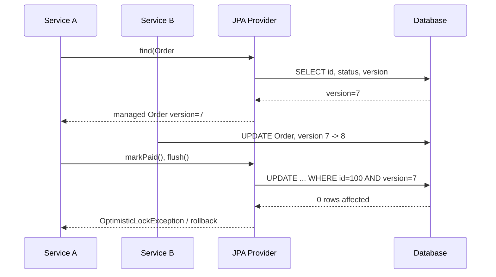
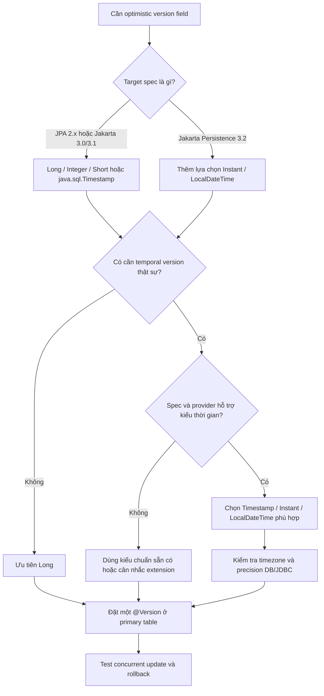

# Kiểu phiên bản được phép theo phiên bản đặc tả trong JPA

Trong JPA, annotation `@Version` đánh dấu một thuộc tính dùng để **kiểm soát khóa lạc quan (*optimistic locking*)**. Khi nhiều giao dịch cùng đọc và cập nhật một entity, persistence provider dùng giá trị version để phát hiện dữ liệu mà giao dịch đang giữ đã cũ, thay vì im lặng ghi đè thay đổi của giao dịch khác.

Một câu hỏi tưởng đơn giản nhưng rất quan trọng khi nâng cấp ứng dụng là:

> **Thuộc tính `@Version` được phép dùng những kiểu Java nào, và danh sách đó thay đổi ra sao giữa JPA 2.x, Jakarta Persistence 3.1 và Jakarta Persistence 3.2?**

Câu trả lời **phụ thuộc phiên bản đặc tả**, không chỉ phụ thuộc phiên bản Java hoặc việc Hibernate có thể ánh xạ một kiểu dữ liệu nào đó.

## 1. Câu trả lời nhanh: bảng đối chiếu chính thức

| Kiểu Java dùng cho `@Version` | JPA 2.2 và các thế hệ JPA cũ | Jakarta Persistence 3.0–3.1 | Jakarta Persistence 3.2 |
|---|:---:|:---:|:---:|
| `int` | Có | Có | Có |
| `java.lang.Integer` | Có | Có | Có |
| `short` | Có | Có | Có |
| `java.lang.Short` | Có | Có | Có |
| `long` | Có | Có | Có |
| `java.lang.Long` | Có | Có | Có |
| `java.sql.Timestamp` | Có | Có | Có, dù API `java.sql` được khuyến nghị thay thế trong code mới |
| **`java.time.Instant`** | **Không được chuẩn bảo đảm** | **Không được chuẩn bảo đảm** | **Có — bổ sung ở 3.2** |
| **`java.time.LocalDateTime`** | **Không được chuẩn bảo đảm** | **Không được chuẩn bảo đảm** | **Có — bổ sung ở 3.2** |
| `byte`/`Byte`, `BigInteger`, `BigDecimal` | Không | Không | Không |
| `java.util.Date`, `Calendar`, `LocalDate` | Không | Không | Không |
| `OffsetDateTime`, `ZonedDateTime` | Không | Không | Không |
| `String`, `UUID`, `enum` | Không | Không | Không |

**“Không” ở đây có nghĩa là _không thuộc danh sách kiểu version portable do đặc tả bảo đảm_**, không khẳng định mọi nhà cung cấp JPA đều từ chối kiểu đó. Một provider có thể hỗ trợ kiểu bổ sung bằng extension; ứng dụng dựa vào extension không còn portable giữa các provider hoặc phiên bản.

Đặc tả Jakarta Persistence 3.2, mục **2.5 Entity Versions**, liệt kê chính xác chín kiểu: sáu kiểu số nguyên nêu trên, `java.sql.Timestamp`, `java.time.LocalDateTime` và `java.time.Instant`. Hai kiểu `java.time` là điểm mới quan trọng của 3.2.

**Nguồn chuẩn chính thức:**

- [Java Persistence 2.2 — Javadoc của `javax.persistence.Version`](https://jakarta.ee/specifications/persistence/2.2/apidocs/javax/persistence/version)
- [Jakarta Persistence 3.1 — Javadoc của `jakarta.persistence.Version`](https://jakarta.ee/specifications/persistence/3.1/apidocs/jakarta.persistence/jakarta/persistence/version)
- [Jakarta Persistence 3.2 — đặc tả, mục Entity Versions](https://jakarta.ee/specifications/persistence/3.2/jakarta-persistence-spec-3.2.html)
- [Jakarta Persistence 3.2 — Javadoc của `jakarta.persistence.Version`](https://jakarta.ee/specifications/persistence/3.2/apidocs/jakarta.persistence/jakarta/persistence/Version.html)
- [Thông tin phát hành Jakarta Persistence 3.2](https://jakarta.ee/specifications/persistence/3.2/)

Tài liệu này lấy **các bản đặc tả đã phát hành** làm mốc. Tài liệu *nightly*, milestone hoặc draft của những phiên bản kế tiếp có thể thay đổi, không nên dùng thay hợp đồng chuẩn được dự án tuyên bố hỗ trợ.

---

## 2. Vì sao JPA cần `@Version`?

Giả sử hai giao dịch đọc cùng một đơn hàng:

```text
Database:
    PurchaseOrder#100
    status = NEW
    version = 7

Transaction A đọc Order#100, version=7
Transaction B đọc Order#100, version=7

A đổi status=PAID, ghi thành công:
    database version = 8

B đổi status=CANCELLED, cố ghi với version=7
    -> phát hiện stale version
    -> optimistic lock conflict
```

Nếu không có biện pháp kiểm soát concurrency, lệnh của B có thể ghi đè thay đổi của A mà không nhận biết; hiện tượng đó thường được gọi là **lost update**.

Entity với phiên bản số:

```java
import jakarta.persistence.*;

@Entity
@Table(name = "purchase_orders")
public class PurchaseOrder {

    @Id
    private Long id;

    @Column(nullable = false)
    private String status;

    @Version
    @Column(nullable = false)
    private Long version;

    protected PurchaseOrder() {}

    public Long getId() { return id; }
    public String getStatus() { return status; }
    public Long getVersion() { return version; }

    public void markPaid() {
        this.status = "PAID";
    }
}
```

Khi managed entity thay đổi, provider kiểm tra phiên bản đã đọc và cập nhật phiên bản theo hợp đồng optimistic locking.

SQL **minh họa**, không phải SQL bắt buộc của mọi provider:

```sql
UPDATE purchase_orders
SET status = 'PAID',
    version = 8
WHERE id = 100
  AND version = 7;
```

Nếu điều kiện `version = 7` không còn đúng, câu UPDATE có thể ảnh hưởng 0 hàng. Provider dùng thông tin đó để báo **`OptimisticLockException`**, thay vì coi đây là một cập nhật thành công.

### Version không phải ID

- `@Id` xác định **entity nào**.
- `@Version` giúp xác định **revision nào** của entity đã được đọc.
- Hai bản ghi khác nhau có thể cùng version=7.
- Version không bắt buộc phải duy nhất toàn bảng.
- Version không phải số thứ tự sự kiện toàn hệ thống.

Một giá trị version phù hợp cho optimistic locking không nhất thiết phù hợp làm ID, ngày tạo hoặc mã nghiệp vụ.

## 3. Bốn lớp cần phân biệt khi nói “kiểu được hỗ trợ”

Khi thấy một ví dụ `@Version Instant` chạy được, cần phân biệt bốn cấp hỗ trợ:

| Lớp | Câu hỏi |
|---|---|
| **Java** | JDK có class đó không? Ví dụ `Instant` có từ Java 8 |
| **Đặc tả JPA/Jakarta Persistence** | Phiên bản spec dự án tuân thủ có **chính thức cho phép** kiểu đó cho `@Version` không? |
| **Persistence provider** | Hibernate/EclipseLink và phiên bản đang chạy có mapping, generation, comparison cho kiểu đó không? |
| **Database/JDBC** | Cột SQL, timestamp precision, driver và dialect có lưu/so sánh đúng version không? |

Đây là bốn điều kiện khác nhau.

Ví dụ:

- Java 17 biết `Instant`.
- Jakarta Persistence 3.1 **chưa** đưa `Instant` vào danh sách kiểu version portable.
- Một bản Hibernate có thể hỗ trợ `Instant` bằng extension.
- Database vẫn cần kiểu cột và precision phù hợp.

Một bài hướng dẫn portable không được suy: **“Java 17 hỗ trợ Instant ⇒ JPA 3.1 cho phép @Version Instant.”**

## 4. Sự tiến hóa của danh sách kiểu version

### 4.1. Thế hệ Java Persistence API cũ

Các thế hệ JPA dùng namespace `javax.persistence`. Trong JPA 2.2, danh sách kiểu được phép trong Javadoc `@Version` là:

```text
int, Integer,
short, Short,
long, Long,
java.sql.Timestamp
```

JPA 2.2 đã hỗ trợ nhiều kiểu `java.time` cho **basic attributes** và truy vấn, nhưng điều đó **không tự mở rộng danh sách kiểu cho `@Version`**.

Ví dụ portable theo JPA 2.2:

```java
import javax.persistence.*;

@Entity
public class Document {

    @Id
    private Long id;

    @Version
    private Long version;
}
```

Hoặc:

```java
@Version
private java.sql.Timestamp version;
```

### 4.2. Jakarta Persistence 3.0 và 3.1

Từ Jakarta Persistence 3.0, namespace API đổi sang `jakarta.persistence`. Đây là thay đổi quan trọng khi chuyển từ Java EE sang Jakarta EE.

Một entity tương đương:

```java
import jakarta.persistence.*;

@Entity
public class Document {

    @Id
    private Long id;

    @Version
    private Long version;
}
```

Trong Jakarta Persistence **3.1**, danh sách kiểu version vẫn là:

```text
int, Integer,
short, Short,
long, Long,
java.sql.Timestamp
```

**Đổi import `javax.persistence.Version` sang `jakarta.persistence.Version` không đồng nghĩa kiểu version được phép tự động thay đổi.**

### 4.3. Jakarta Persistence 3.2

Jakarta Persistence **3.2** chính thức bổ sung:

```text
java.time.Instant
java.time.LocalDateTime
```

Danh sách được phép từ 3.2:

```text
int, Integer, short, Short, long, Long,
java.sql.Timestamp,
java.time.Instant,
java.time.LocalDateTime
```

Đây là điểm phân biệt mà bài học muốn người đọc nhận diện.

**Lưu ý:** Jakarta Persistence 3.2 không bỏ `java.sql.Timestamp` khỏi danh sách `@Version`. Tuy nhiên, nền tảng 3.2 khuyến nghị dùng `java.time` trong code mới và đánh dấu sử dụng một số kiểu thời gian JDBC cũ là không được khuyến khích/deprecated trong phạm vi API tương ứng.

## 5. Bảng tương thích theo bộ thư viện

| Tình huống dự án | Có thể dùng `@Version Long` theo chuẩn? | Có thể dùng `@Version Instant` theo chuẩn? |
|---|:---:|:---:|
| JPA 2.2 / `javax.persistence` | Có | Không |
| Jakarta Persistence 3.0 | Có | Không |
| Jakarta Persistence 3.1 | Có | Không |
| Jakarta Persistence 3.2 | Có | Có |
| Provider cũ với hỗ trợ riêng cho Instant | Có thể | **Có thể chạy**, nhưng không portable nếu spec target cũ |
| Một bản Hibernate mới chỉ được dùng qua API spec cũ | Có thể | Phụ thuộc extension, không nên tự coi chuẩn là 3.2 |

**Cách xác định dự án của mình:** xem dependency Jakarta/Javax Persistence API, phiên bản provider, framework tích hợp và môi trường deploy. Không suy từ phiên bản JDK đơn lẻ.

Ví dụ một ứng dụng Java 21 vẫn có thể đang dùng Jakarta Persistence 3.1. Điều đó không làm danh sách kiểu version của 3.1 tự chuyển thành danh sách 3.2.

---

## 6. Hai nhóm kiểu: bộ đếm số nguyên và dấu thời gian

Có thể chia những kiểu chuẩn thành hai nhóm.

**Nhóm số nguyên:**

```text
short / Short
int / Integer
long / Long
```

Chúng đại diện một **revision number**. Provider thường thay đổi giá trị theo cơ chế tăng số qua các lần cập nhật.

**Nhóm thời gian:**

```text
java.sql.Timestamp              // các bản cũ và 3.2
java.time.LocalDateTime          // mới được chuẩn hóa từ 3.2
java.time.Instant                // mới được chuẩn hóa từ 3.2
```

Chúng đại diện một **revision timestamp**. Version phản ánh thời điểm hoặc giá trị thời gian mà provider sử dụng để phân biệt lần ghi.

Cả hai đều phục vụ optimistic locking; chúng không phải hai cơ chế transaction độc lập.

### So sánh thực dụng

| Tiêu chí | Numeric version | Timestamp version |
|---|---|---|
| Ý nghĩa chính | Số phiên bản | Giá trị thời gian của phiên bản |
| Tính đơn giản của so sánh | Rất trực tiếp | Phụ thuộc precision và mapping |
| Phụ thuộc timezone | Không | Có thể phát sinh với kiểu temporal/mapping |
| Rủi ro precision | Không ở mức thời gian; vẫn có overflow | Cần xem độ phân giải, JDBC, DB |
| Dễ giải thích ETag/API | Thường rất rõ | Cần thống nhất serialization |
| Portability lâu đời | Cao | Timestamp cũ portable; Java Time cần 3.2 |
| Lựa chọn mặc định cho code mới | Thường `Long` | Dùng khi có lý do rõ ràng |

Với một hệ thống không yêu cầu version mang ý nghĩa thời gian, **`Long` là lựa chọn đơn giản, bền và portable**.

## 7. `long` và `Long`: lựa chọn phổ biến

Ví dụ:

```java
@Version
@Column(name = "version", nullable = false)
private Long version;
```

Hoặc:

```java
@Version
private long version;
```

Cả hai đều nằm trong danh sách chuẩn từ các thế hệ JPA cũ tới Jakarta Persistence 3.2.

**Vì sao Long phổ biến?**

- Phạm vi giá trị rộng.
- Không bị mất precision timestamp.
- So sánh bằng số nguyên rõ ràng.
- Dễ map sang SQL `BIGINT` ở nhiều databases.
- Không gắn với timezone hay clock skew.
- Hợp với ứng dụng có nhiều nodes và môi trường deploy khác nhau.

Không cần chọn `Long` vì “tất cả DB đều hỗ trợ BIGINT y hệt” — chi tiết SQL types vẫn phụ thuộc dialect — mà vì nó là một trong các kiểu được JPA chuẩn bảo đảm.

### Primitive và wrapper khác gì?

`long` không thể NULL. `Long` có thể NULL trong Java trước khi provider khởi tạo version hoặc ở trạng thái transient.

Không nên tùy tiện dùng giá trị NULL/0 của version để kết luận entity đang mới hay detached ở mọi provider. Một số providers sử dụng `null` version như tín hiệu unsaved object; chi tiết đó không phải phần thay thế cho lifecycle/JPA entity identity contract.

**Để version do provider quản lý.** Đừng tự set `version = 1L` trên entity đang managed chỉ vì muốn “đánh dấu đã sửa”.

## 8. `int` / `Integer` cũng hợp lệ

```java
@Entity
public class InventoryItem {

    @Id
    private Long id;

    @Version
    @Column(name = "version")
    private Integer version;

    protected InventoryItem() {}
}
```

`int`/`Integer` thường đủ cho nhiều ứng dụng.

Tuy nhiên, nếu một row được cập nhật rất nhiều lần hoặc sống rất lâu, cần nghĩ tới **overflow**. Kiểu `int` của Java là signed 32-bit, giới hạn dương là 2.147.483.647.

Một ứng dụng dùng `int` có thể hoạt động nhiều năm mà không thấy vấn đề; điều đó không thay đổi yêu cầu thiết kế tính hợp lệ về giới hạn kiểu.

Nếu chưa có ràng buộc legacy, `Long` thường giúp tránh thêm một nguy cơ không cần thiết.

## 9. `short` / `Short` là kiểu chuẩn nhưng ít được chọn

```java
@Version
private Short version;
```

Hoàn toàn được phép theo JPA 2.2, Jakarta 3.1 và 3.2.

Nhưng `short` là signed 16-bit:

```text
-32768 ... 32767
```

Nếu version tăng qua nhiều lần ghi, phạm vi nhỏ tạo rủi ro **tràn số** sớm hơn.

Chỉ chọn `Short` nếu có một lý do tương thích schema/legacy rõ ràng và một chính sách xử lý version rollover phù hợp. Không nên chọn chỉ vì muốn tiết kiệm vài byte trong object Java; chi phí database và persistence context thường quan trọng hơn.

## 10. Chọn số nguyên nào cho hệ thống mới?

Một quy tắc đơn giản:

- **Mặc định:** `Long`.
- **Schema cũ đã dùng INTEGER:** `Integer` có thể phù hợp.
- **Schema cũ đã dùng SMALLINT:** `Short` vẫn chuẩn nhưng cần đánh giá giới hạn cập nhật.
- **Yêu cầu version dưới dạng thời gian:** cân nhắc `Instant`/`LocalDateTime` nếu spec target ≥ 3.2 và provider/DB tương thích.

Đừng cố “tối ưu” từ Long xuống Short khi version là dữ liệu phục vụ correctness của concurrency, không phải một cột mà kích thước object luôn là bottleneck.

### Khi dùng `@Column`

```java
@Version
@Column(name = "revision", nullable = false)
private Long version;
```

`@Column` mô tả tên cột/ràng buộc schema; `@Version` mới là annotation yêu cầu optimistic locking. Chỉ khai `@Column(name="revision")` mà không có `@Version` sẽ **không tự kích hoạt** optimistic locking.

---

## 11. `java.sql.Timestamp`: kiểu phiên bản thời gian truyền thống

JPA 2.x và Jakarta 3.1 cho phép:

```java
import jakarta.persistence.*;
import java.sql.Timestamp;

@Entity
public class LegacyDocument {

    @Id
    private Long id;

    @Version
    @Column(name = "version_time")
    private Timestamp versionTime;

    protected LegacyDocument() {}
}
```

Trong JPA 2.2, thay import `jakarta.persistence.*` bằng `javax.persistence.*` tương ứng.

`Timestamp` là kiểu thời gian JDBC cũ, tồn tại trước bộ API `java.time`. Nó vẫn là **kiểu version chuẩn hợp lệ** trong Jakarta Persistence 3.2.

### Cần phân biệt với `java.util.Date`

`java.sql.Timestamp` kế thừa từ `java.util.Date`, nhưng đây là **hai kiểu Java khác nhau**.

- `@Version java.sql.Timestamp`: nằm trong danh sách chuẩn.
- `@Version java.util.Date`: **không** nằm trong danh sách chuẩn, dù Date có thể là basic persistent attribute.

Không suy từ quan hệ kế thừa rằng Java Date cũng là kiểu version portable.

## 12. Vì sao Instant được bổ sung ở Jakarta Persistence 3.2?

`java.time.Instant` biểu diễn một thời điểm trên trục thời gian UTC (*timeline instant*). Nó là kiểu immutable của Java Time API.

Ví dụ hợp lệ theo Jakarta Persistence 3.2:

```java
import jakarta.persistence.*;
import java.time.Instant;

@Entity
@Table(name = "documents")
public class Document {

    @Id
    private Long id;

    private String title;

    @Version
    @Column(name = "revision_instant")
    private Instant revisionInstant;

    protected Document() {}

    public Instant getRevisionInstant() {
        return revisionInstant;
    }
}
```

JPA provider quản lý giá trị version và kiểm tra optimistic locking tương ứng.

**Điều kiện cần:**

1. Dự án nhắm **Jakarta Persistence 3.2** (hoặc phiên bản chuẩn kế tiếp có cùng quy định) nếu muốn portable.
2. Provider triển khai bản spec có hỗ trợ kiểu version này.
3. Database/JDBC mapping cho Instant hoạt động đúng với cách lưu timestamp.
4. Chế độ generation/precision được kiểm tra với database mục tiêu.

**Instant có từ Java 8 không đồng nghĩa đã được chuẩn hóa cho `@Version` từ JPA 2.2.** Mốc của đặc tả là 3.2.

## 13. LocalDateTime: cũng mới được chuẩn hóa ở 3.2

Ví dụ:

```java
import jakarta.persistence.*;
import java.time.LocalDateTime;

@Entity
public class Article {

    @Id
    private Long id;

    private String headline;

    @Version
    @Column(name = "revision_time")
    private LocalDateTime revisionTime;

    protected Article() {}

    public LocalDateTime getRevisionTime() {
        return revisionTime;
    }
}
```

`LocalDateTime` biểu diễn một ngày-giờ **không chứa timezone hoặc offset**. Vì vậy:

- Nó có thể phù hợp với cột TIMESTAMP không lưu timezone.
- Nó không tự cho biết đó là “UTC” hay thời gian địa phương.
- Khi nhiều nodes/database sessions có timezone khác nhau, phải có chính sách thống nhất.
- Khi ánh xạ/version generation, phụ thuộc cách provider xử lý thời gian.

**`Instant` và `LocalDateTime` đều được 3.2 cho phép**, nhưng không vì vậy chúng là cùng một loại giá trị thời gian.

## 14. So sánh Instant và LocalDateTime

| Khía cạnh | `Instant` | `LocalDateTime` |
|---|---|---|
| Mô hình thời gian | Một thời điểm tuyệt đối trên timeline UTC | Một cặp ngày và giờ không mang timezone |
| Có offset/timezone trong object? | Không lưu timezone hiển thị, nhưng có nghĩa thời điểm UTC tuyệt đối | Không |
| Khả năng chuyển qua timezone hiển thị | Tự nhiên qua ZoneId | Cần biết timezone nguồn để diễn giải |
| Tương thích timestamp SQL | Phụ thuộc mapping của provider/DB | Phụ thuộc mapping của provider/DB |
| Được dùng làm @Version theo JPA 3.1? | Không portable | Không portable |
| Được dùng làm @Version theo Jakarta 3.2? | Có | Có |

Với hệ thống phân tán muốn diễn đạt một thời điểm tuyệt đối, `Instant` thường dễ hiểu hơn. Với schema legacy lưu local timestamp đã có quy ước nhất quán, `LocalDateTime` có thể phù hợp.

Tuy nhiên, **kiểu version số nguyên vẫn thường là lựa chọn đơn giản nhất cho optimistic locking**, vì độ chính xác/so sánh temporal còn phụ thuộc storage và generation.

## 15. Timestamp precision ảnh hưởng đến correctness như thế nào?

Giả sử database chỉ lưu timestamp với độ chính xác tới giây:

```text
10:20:30.000
```

Nếu cùng một row được cập nhật hai lần trong cùng giây, một chiến lược generation ngây thơ có thể tạo ra timestamp như nhau. Điều này làm suy yếu khả năng phân biệt revision.

Đặc tả yêu cầu persistence provider thực hiện optimistic version checking đúng semantics, nhưng người triển khai vẫn cần xác minh **provider, JDBC driver, cột SQL và độ chính xác của dữ liệu thời gian** phối hợp đúng trên môi trường thật.

Ví dụ:

```sql
-- PostgreSQL, cú pháp minh họa:
ALTER TABLE documents
ADD COLUMN revision_time TIMESTAMP(6);
```

`TIMESTAMP(6)` biểu diễn fractional seconds với precision dự kiến sáu chữ số ở một số DBMS; **không phải DDL portable cho tất cả databases**.

### Những điều cần kiểm tra

- JDBC gửi/nhận bao nhiêu chữ số fractional seconds?
- Cột database lưu độ chính xác bao nhiêu?
- Provider tạo timestamp ở JVM hay database?
- Timezone session có làm đổi giá trị lúc round-trip?
- SQL parameter comparison có cùng precision sau khi bind?
- Hai lần cập nhật gần nhau có tạo revision distinguishable như yêu cầu optimistic locking?
- DB generated values có được đồng bộ vào entity trong context không?

Không tự xây version timestamp bằng `LocalDateTime.now()` trong business method; để provider quản lý. Nếu hệ thống yêu cầu absolute precision và dễ kiểm chứng, cân nhắc Long version.

## 16. `@Column(secondPrecision)` ở Jakarta Persistence 3.2

Jakarta Persistence 3.2 bổ sung thuộc tính `secondPrecision` trên `@Column` để khai báo số chữ số của phần giây cho các cột thời gian khi schema generation được áp dụng.

Ví dụ dự án dùng 3.2:

```java
@Version
@Column(
    name = "revision_instant",
    secondPrecision = 6
)
private Instant revisionInstant;
```

Lưu ý:

- `secondPrecision` chỉ có từ **Jakarta Persistence 3.2**; copy vào dự án 3.1 có thể không biên dịch.
- Nó không thay đổi danh sách kiểu Java được phép của `@Version`.
- DDL và precision thực tế vẫn phụ thuộc database/JDBC/dialect.
- Không đảm bảo timestamp generation từ mọi nguồn sẽ tự có độ chính xác mong muốn.
- Nếu schema được Flyway/Liquibase quản lý, migration phải phù hợp thay vì chỉ dựa annotation.

Không dùng `@Column(precision=6)` để diễn đạt fractional-second precision: `precision` trong `@Column` vốn có ý nghĩa precision của các kiểu DECIMAL/NUMERIC, còn `secondPrecision` được thêm để biểu diễn precision của thời gian.

## 17. `java.sql.Timestamp` có bị loại bỏ ở 3.2 không?

**Không.**

Đây là một nhầm lẫn quan trọng vì tài liệu Jakarta Persistence 3.2 khuyến nghị API thời gian `java.time` cho code mới và đưa nhiều API thời gian cũ vào diện deprecated/discouraged.

Nhưng danh sách kiểu `@Version` của 3.2 vẫn ghi rõ:

```text
java.sql.Timestamp
java.time.Instant
java.time.LocalDateTime
```

Cần phân biệt:

- **Được phép theo đặc tả**: một kiểu thuộc danh sách version hợp lệ.
- **Được khuyên dùng cho code mới**: một lựa chọn thiết kế và vòng đời API.
- **Bị deprecated ở API nào đó**: cảnh báo về việc dùng API cũ, không luôn có nghĩa kiểu bị cấm.
- **Bị loại bỏ khỏi spec**: một thay đổi tương thích lớn, không xảy ra với `Timestamp` trong danh sách @Version 3.2.

Một ứng dụng legacy đang dùng `@Version Timestamp` có thể tiếp tục phù hợp với spec 3.2; không phải chuyển sang Instant chỉ để “hết lỗi chuẩn”.

---

## 18. Những kiểu thường được nhầm là hợp lệ

Dù nhiều kiểu dưới đây là **basic persistent attributes** trong JPA, chúng **không nằm trong whitelist version type** của Jakarta Persistence 3.2.

| Kiểu | Có thể map thành basic attribute? | Version portable? | Ghi chú |
|---|---|:---:|---|
| `byte` / `Byte` | Có | Không | Số nguyên nhưng không thuộc sáu kiểu được nêu |
| `BigInteger` | Có | Không | Rộng hơn Long nhưng không được liệt kê |
| `BigDecimal` | Có | Không | Không phải version numeric type chuẩn |
| `String` | Có | Không | Không có version semantics được đặc tả bảo đảm |
| `UUID` | Có, theo hỗ trợ kiểu cơ bản tương ứng | Không | Unique ID không đồng nghĩa version |
| `boolean` / `Boolean` | Có | Không | Không thể biểu diễn revision tăng dần hữu ích |
| `double` / `Double` | Có | Không | Floating-point không phù hợp cho so sánh revision |
| `java.util.Date` | Có | Không | Khác `java.sql.Timestamp` |
| `java.util.Calendar` | Có | Không | Không thuộc whitelist |
| `java.sql.Date` / `Time` | Có | Không | Chỉ `Timestamp` trong nhóm `java.sql` được phép |
| `LocalDate` | Có | Không | Thiếu time-of-day; không nằm trong danh sách |
| `LocalTime` | Có | Không | Không nằm trong danh sách |
| `OffsetDateTime` | Có | Không | Một số provider hỗ trợ extension |
| `ZonedDateTime` | Có thể tùy version/provider | Không | Một số provider hỗ trợ extension |
| `enum` | Có | Không | Enum không phải revision counter chuẩn |

**Quy tắc:** “JPA hiểu kiểu đó để lưu vào database” **không kéo theo** “JPA cho phép dùng nó làm `@Version`”.

## 19. Vì sao `BigInteger` không portable cho `@Version`?

`BigInteger` biểu diễn số nguyên có độ lớn tùy ý và là một kiểu Java hữu ích. Nhưng:

```java
@Version
private BigInteger version;
```

không thuộc danh sách version portable dù có thể lưu BigInteger như một basic field.

Đặc tả liệt kê **kiểu cụ thể**, không mô tả “mọi subclass của Number” hoặc “mọi loại số nguyên”. Không tự mở rộng danh sách bằng suy luận kiểu học.

Nếu có một requirement cần version lớn hơn Long, hãy đánh giá:

- Nó có thực sự là version của một row hay là global sequence?
- DB hỗ trợ numeric type đó thế nào?
- Provider có extension cho kiểu này không?
- Nếu dùng extension, có chấp nhận vendor lock-in?
- Có thể dùng Long với thiết kế roll-over/partitioning rõ ràng không?

Chọn kiểu được spec hỗ trợ trước khi tìm giải pháp riêng.

## 20. Tại sao không dùng String hoặc UUID?

Một giá trị UUID mới cho mỗi lần update có thể là một “revision token” theo ý tưởng ứng dụng, nhưng:

```java
@Version
private UUID revisionId;
```

**không phải kiểu `@Version` portable** trong Jakarta Persistence 3.2.

Tương tự:

```java
@Version
private String etag;
```

không nằm trong whitelist.

Nếu muốn dùng ETag cho HTTP API, có thể xây ETag từ `Long version` hoặc một token ứng dụng khác mà vẫn giữ `@Version Long` cho JPA.

Ví dụ:

```text
Database:
  id = 100
  version = 7

HTTP:
  ETag: "order-100-v7"
```

ETag là giao thức API; phiên bản JPA là cơ chế concurrency ở persistence layer. Chúng có thể liên kết nhưng **không nhất thiết dùng cùng kiểu Java**.

## 21. `AttributeConverter` không tự làm mọi type thành version portable

Ví dụ có một value object:

```java
public record RevisionNumber(long value) {}
```

Converter:

```java
@Converter
public class RevisionConverter
        implements AttributeConverter<RevisionNumber, Long> {

    @Override
    public Long convertToDatabaseColumn(RevisionNumber value) {
        return value == null ? null : value.value();
    }

    @Override
    public RevisionNumber convertToEntityAttribute(Long value) {
        return value == null ? null : new RevisionNumber(value);
    }
}
```

Một developer có thể thử:

```java
@Version
@Convert(converter = RevisionConverter.class)
private RevisionNumber version;
```

Nhưng **converter không làm RevisionNumber xuất hiện trong whitelist version types**. Việc version conversion có được provider hỗ trợ và provider quản lý increment/comparison thế nào còn là vấn đề riêng.

Để portable, dùng:

```java
@Version
private Long version;
```

và nếu domain cần value object, cung cấp một phương thức read-only:

```java
public RevisionNumber getRevisionNumber() {
    return new RevisionNumber(version);
}
```

Không sửa trường version của managed entity bằng setter/value object chuyển ngược khi cập nhật nghiệp vụ.

## 22. Hibernate extension không phải hợp đồng JPA chuẩn

Tài liệu Hibernate ORM 7 mô tả các kiểu temporal version mở rộng, có thể bao gồm `OffsetDateTime` hoặc `ZonedDateTime` tùy phiên bản.

Ví dụ:

```java
@Version
private OffsetDateTime versionTime;
```

có thể được Hibernate triển khai với hỗ trợ riêng. Nhưng danh sách **Jakarta Persistence 3.2** không bao gồm `OffsetDateTime`.

Có hai câu hỏi khác nhau:

**“Ứng dụng của tôi chạy được trên Hibernate hiện tại không?”**

Có thể, nếu provider hỗ trợ kiểu và configuration cụ thể.

**“Ứng dụng của tôi portable theo Jakarta Persistence 3.2 không?”**

Không, nếu kiểu không thuộc whitelist của spec.

Khi tài liệu dự án khẳng định “JPA 3.2 hỗ trợ OffsetDateTime làm @Version”, đó là kết luận **sai ở cấp đặc tả**. Cách diễn đạt chính xác là “provider X có thể hỗ trợ OffsetDateTime làm version như một extension”.

Tài liệu provider tham khảo: [Hibernate ORM 7 — Introduction, Version attributes](https://docs.hibernate.org/orm/7.3/introduction/html_single/).

## 23. Provider và spec cần được đồng bộ

Một dự án có dependency:

```xml
<dependency>
    <groupId>jakarta.persistence</groupId>
    <artifactId>jakarta.persistence-api</artifactId>
    <version>3.2.0</version>
</dependency>
```

Điều này **chỉ cho thấy API dependency**. Nó chưa tự chứng minh runtime provider đang dùng có đầy đủ triển khai cho các tính năng 3.2.

Cần kiểm tra:

1. API version.
2. Hibernate/EclipseLink version và compatibility của framework.
3. Khả năng container cung cấp API/provider riêng.
4. Metadata scanning có nhận mapping @Version mới không?
5. JDBC driver/dialect hỗ trợ đúng SQL type không?
6. Integration tests thực hiện được optimistic version check không?

Đừng giải quyết lỗi runtime “unsupported version type” chỉ bằng cách nâng JPA API jar trong khi provider vẫn cũ.

### Tên package khác nhau

| Thế hệ | Import version annotation |
|---|---|
| JPA 2.x | `javax.persistence.Version` |
| Jakarta Persistence 3.x | `jakarta.persistence.Version` |

Sự khác biệt package **không** đồng nghĩa danh sách kiểu đã thay đổi ngay ở Jakarta 3.0. Mốc thêm Instant/LocalDateTime vẫn là 3.2.

---

## 24. Quy tắc: một @Version cho entity hierarchy

Đặc tả đặt ra những giới hạn ngoài Java type:

- Một entity **nên có tối đa một version attribute**.
- Ứng dụng portable **không được khai nhiều hơn một version field/property** cho một entity.
- Trong inheritance hierarchy, version nên được khai ở **root entity** hoặc ở một **mapped superclass** của nó.
- Ứng dụng portable không đặt version chỉ ở một subclass của root entity.
- Version nên được ánh xạ tới **primary table** của entity.

Những quy tắc này áp dụng dù dùng Long, Timestamp, Instant hay LocalDateTime.

Ví dụ tốt:

```java
@MappedSuperclass
public abstract class VersionedEntity {

    @Version
    @Column(name = "version", nullable = false)
    protected Long version;

    public Long getVersion() { return version; }
}
```

```java
@Entity
@Table(name = "purchase_orders")
public class PurchaseOrder extends VersionedEntity {

    @Id
    private Long id;

    private String status;

    protected PurchaseOrder() {}
}
```

Version được kế thừa thông qua mapped superclass, phù hợp với ý tưởng chia sẻ optimistic locking giữa nhiều entities.

## 25. Không khai hai @Version trong cùng entity

Sai về portability:

```java
@Entity
public class Order {

    @Id
    private Long id;

    @Version
    private Long revision;

    @Version
    private Instant updatedAtVersion;
}
```

Không phải vì cả Long và Instant đều được 3.2 cho phép mà entity có thể đồng thời sử dụng hai version attributes.

Nếu nghiệp vụ cần timestamp để hiển thị thời điểm sửa và số version để locking:

```java
@Entity
public class Order {

    @Id
    private Long id;

    @Version
    private Long version;

    private Instant updatedAt;
}
```

Ở đây chỉ `version` là JPA optimistic version. `updatedAt` là một audit field bình thường, có thể được cập nhật theo cơ chế riêng.

## 26. MappedSuperclass so với subclass

Ví dụ hierarchy:

```java
@MappedSuperclass
public abstract class AuditedBase {

    @Version
    private Long version;
}

@Entity
@Inheritance(strategy = InheritanceType.JOINED)
public abstract class Payment extends AuditedBase {

    @Id
    private Long id;
}

@Entity
public class CardPayment extends Payment {

    private String maskedCardNumber;
}
```

Version xuất phát từ mapped superclass và áp vào hierarchy.

Không nên:

```java
@Entity
public class CardPayment extends Payment {

    @Version
    private Long cardOnlyVersion;
}
```

khi root Payment đã xác định hierarchy mà subclass mới tự khai version. Theo quy tắc portable của JPA, version phải được tổ chức ở root hoặc mapped superclass tương ứng.

Nếu chỉ có một subclass cần concurrency riêng, có thể cần xem lại ranh giới entity aggregate/mapping, thay vì dùng hai version attributes trong cùng inheritance hierarchy.

## 27. Version phải thuộc primary table

Giả sử entity có secondary table:

```java
@Entity
@Table(name = "orders")
@SecondaryTable(name = "order_details")
public class Order {

    @Id
    private Long id;

    @Version
    @Column(name = "version")
    private Long version;

    @Column(table = "order_details")
    private String internalNote;
}
```

Version được map tới primary table `orders` (mặc định nếu không khai table khác).

Một cấu hình đưa version tới secondary table:

```java
@Version
@Column(name = "version", table = "order_details")
private Long version;
```

không portable theo quy tắc spec cho version attribute.

Đây là yêu cầu về **vị trí cột ánh xạ**, không phải vấn đề kiểu Java. Một `Long` đúng kiểu vẫn có thể là mapping không portable nếu đặt sai bảng.

## 28. Field access và property access

JPA có thể truy cập entity qua field hoặc getter, tùy access type.

**Field access:**

```java
@Entity
public class Invoice {

    @Id
    private Long id;

    @Version
    private Long version;
}
```

**Property access:**

```java
@Entity
public class Invoice {

    private Long id;
    private Long version;

    @Id
    public Long getId() { return id; }

    @Version
    public Long getVersion() { return version; }

    protected void setId(Long id) { this.id = id; }
    protected void setVersion(Long value) { this.version = value; }
}
```

Với property access, JPA cần setter/metadata đáp ứng yêu cầu của provider/spec, dù setter không nhất thiết được công khai cho business code.

Không phân tán annotations giữa field và getter tùy tiện. Khi dùng `@Access` để điều khiển đặc biệt, phải giữ metadata nhất quán.

**Cả hai cách đều cần kiểu @Version nằm trong whitelist của spec.**

---

## 29. Ai được phép cập nhật giá trị version?

Theo Jakarta Persistence 3.2, sau khi entity đã trở thành persistent, application code **không được tự sửa trực tiếp version field/property**. Hành vi khi sửa trực tiếp thuộc phạm vi không được bảo đảm (*undefined behavior*), trừ ngoại lệ được spec mô tả riêng.

Không nên viết:

```java
public void markPaid() {
    this.status = "PAID";
    this.version++; // Sai hướng thiết kế.
}
```

Thay vào đó:

```java
public void markPaid() {
    this.status = "PAID";
}
```

Provider quyết định generation/comparison/update của version trong lifecycle ORM.

### Tại sao không tự tăng?

- Provider có thể dùng numeric/timestamp generation khác.
- Optimistic lock WHERE phải so sánh **version cũ** đã đọc.
- Tự tăng trước khi flush có thể làm provider hiểu state khác thực tế.
- Các provider có thể dùng version để phân biệt transient/detached instances.
- Với timestamps, business code khó đảm bảo DB precision và timezone đúng.
- Một setter public cho version dễ tạo lỗ hổng dữ liệu và concurrency.

Có thể cung cấp getter read-only cho version; không cần cung cấp method nghiệp vụ để tăng version.

## 30. Vòng đời một versioned entity

Một kịch bản thông dụng:



Đây là sơ đồ về nguyên lý. Provider có thể phát hiện xung đột tại thời điểm flush, commit hoặc lifecycle operation khác. Không nên phụ thuộc vào một thời điểm ném exception cố định mà không kiểm tra.

## 31. OptimisticLockException và transaction rollback

Ví dụ Spring:

```java
@Service
public class OrderService {

    private final EntityManager em;

    public OrderService(EntityManager em) {
        this.em = em;
    }

    @Transactional
    public void markPaid(Long orderId) {
        PurchaseOrder order =
            em.find(PurchaseOrder.class, orderId);

        if (order == null) {
            throw new EntityNotFoundException();
        }

        order.markPaid();

        // Có thể kiểm tra version khi flush
        // hoặc lúc transaction commit.
    }
}
```

Khi version verification thất bại, JPA provider phải báo optimistic locking failure và đánh dấu transaction rollback theo quy tắc đặc tả.

Cách xử lý ở kiến trúc service:

1. Cho phép transaction lỗi rollback.
2. Đọc lại entity trong transaction/persistence context mới.
3. Quyết định trả HTTP 409 Conflict, thông báo người dùng hoặc thực hiện retry theo domain.
4. Không tái sử dụng entity instance với version đã cũ để ghi lại ngay như chưa có chuyện gì.
5. Chỉ retry khi nghiệp vụ idempotent hoặc có chiến lược giải quyết conflict.

**Không bắt OptimisticLockException rồi tiếp tục commit cùng transaction đã bị đánh dấu rollback-only.**

## 32. Merge detached entity và version

Trong web application:

```text
Request 1:
  Load Order version=7
  Send data to client

Request 2:
  Client gửi thay đổi dựa trên version=7
  Database hiện đã version=8
```

Nếu client gửi một detached entity hoặc command có expectedVersion=7, service cần áp dụng optimistic concurrency đúng cách.

Có hai cách tiếp cận phổ biến:

- Dùng entity lifecycle và `merge` với version do provider kiểm tra, nhưng không merge tùy tiện toàn bộ dữ liệu do client gửi.
- Load managed entity theo ID, kiểm tra expectedVersion từ request, áp domain modifications rồi để JPA kiểm tra optimistic locking tại flush/commit.

Ví dụ:

```java
@Transactional
public void changeStatus(
        Long orderId,
        Long expectedVersion,
        String newStatus) {

    PurchaseOrder order =
        em.find(PurchaseOrder.class, orderId);

    if (order == null) {
        throw new EntityNotFoundException();
    }

    if (!Objects.equals(
            order.getVersion(), expectedVersion)) {
        throw new IllegalStateException(
            "Client version is stale"
        );
    }

    order.changeStatus(newStatus);
}
```

`changeStatus` là domain method giả định cần khai trong entity thực tế. `Objects` ở `java.util.Objects`.

**Kiểm tra expectedVersion ở service không thay thế JPA optimistic check ở flush/commit.** Giao dịch khác vẫn có thể cập nhật giữa lúc kiểm tra và lúc flush; vì vậy entity vẫn cần `@Version` và provider phải thực hiện kiểm tra cuối.

## 33. `LockModeType.OPTIMISTIC` có liên hệ gì tới @Version?

JPA có các lock modes như:

```java
em.lock(order, LockModeType.OPTIMISTIC);
```

hoặc:

```java
PurchaseOrder order = em.find(
    PurchaseOrder.class,
    id,
    LockModeType.OPTIMISTIC
);
```

Với entity có `@Version`, provider có đủ metadata để kiểm tra optimistic version.

Cần phân biệt:

- `@Version`: **thuộc tính revision** của entity.
- `LockModeType.OPTIMISTIC`: **yêu cầu kiểm tra khóa lạc quan** của operation.
- `LockModeType.OPTIMISTIC_FORCE_INCREMENT`: yêu cầu tăng version với semantics nhất định của lock mode.
- Các cơ chế optimistic locking không dựa version mà một provider có thể cung cấp: có thể **không portable**.

Không suy rằng `LockModeType.OPTIMISTIC` sẽ cho phép dùng `String` làm version. Danh sách kiểu @Version vẫn là một quy tắc riêng của spec.

## 34. Force increment không thay thế việc chọn đúng type

```java
em.lock(
    order,
    LockModeType.OPTIMISTIC_FORCE_INCREMENT
);
```

được dùng khi muốn buộc việc cập nhật version theo semantics optimistic force increment, ví dụ có nghiệp vụ cần biểu thị một revision mới của aggregate.

Nhưng:

- Field version vẫn cần là kiểu hợp lệ.
- Giao dịch phải được quản lý thích hợp.
- Cách/timing phát SQL có thể phụ thuộc provider.
- Các entity không có @Version có quy tắc hạn chế riêng; không tự suy rằng force increment luôn làm việc.
- Không dùng force increment như một biện pháp thay thế cho domain model khi chỉ cần cập nhật một field bình thường.

---

## 35. Bulk JPQL UPDATE không tự cập nhật version như dirty checking

Một điểm dễ bỏ sót:

```java
int changed = em.createQuery(
    """
    update PurchaseOrder o
    set o.status = :status
    where o.id = :id
    """
)
.setParameter("status", "PAID")
.setParameter("id", orderId)
.executeUpdate();
```

Đây là **bulk update**. Nó được thực thi trực tiếp lên database, không qua từng managed entity.

Theo semantics của JPA bulk DML:

- Không tự chạy optimistic version checking như khi cập nhật từng managed entity.
- Không tự gọi callbacks `@PreUpdate` cho từng row.
- Không tự cập nhật managed objects đã có trong persistence context.
- Không tự tăng `@Version` theo lifecycle entity.
- Affected rows count không có nghĩa đã commit.

Nếu cần giữ version policy thống nhất, có thể phải biểu diễn version change/check **tường minh**.

Ví dụ version numeric:

```jpql
UPDATE PurchaseOrder o
SET o.status = :newStatus,
    o.version = o.version + 1
WHERE o.id = :id
  AND o.version = :expectedVersion
```

Đây là bulk statement do ứng dụng tự thiết kế để kiểm tra expected version. Nó **không phải** provider tự thực hiện optimistic locking trên managed entity; cần kiểm tra `executeUpdate() == 1`, transaction, overflow và cache.

**Không áp công thức cộng 1 này lên `Instant`/`LocalDateTime`/`Timestamp`.** Timestamp version cần cách cập nhật phù hợp temporal semantics và database/provider; một bulk update portable sử dụng timestamp version khó hơn numeric version.

## 36. CriteriaUpdate cũng bypass version management

Ví dụ:

```java
CriteriaBuilder cb = em.getCriteriaBuilder();

CriteriaUpdate<PurchaseOrder> cu =
    cb.createCriteriaUpdate(PurchaseOrder.class);

Root<PurchaseOrder> root =
    cu.from(PurchaseOrder.class);

cu.set(root.get("status"), "PAID");
cu.where(cb.equal(root.get("id"), orderId));

int count = em.createQuery(cu).executeUpdate();
```

Cũng là **bulk DML**. Chọn Criteria API thay cho JPQL string không khiến provider quay lại dirty checking.

Nếu version là Long và use case muốn compare-and-swap theo một ID:

```java
Path<Long> version = root.<Long>get("version");

cu.set(version, cb.sum(version, 1L));

cu.where(
    cb.equal(root.get("id"), orderId),
    cb.equal(version, expectedVersion)
);
```

Khi xây Criteria, phải gộp các predicates bảo vệ trong một `where(...)`; đừng gọi `where()` nhiều lần mà vô tình ghi đè điều kiện trước.

Sau bulk, quản lý `flush/clear/refresh` để tránh managed entities stale.

## 37. Spring Data @Modifying và version

Trong Spring Data JPA:

```java
@Modifying
@Query("""
    update PurchaseOrder o
    set o.status = :status
    where o.id = :id
    """)
int updateStatus(
    @Param("id") Long id,
    @Param("status") String status
);
```

cũng là **JPQL bulk UPDATE**. Annotation `@Modifying` không tự bật optimistic version increments/validation cho các entity được tác động.

Ngược lại:

```java
@Transactional
public void markPaid(Long id) {
    PurchaseOrder order = repository.findById(id)
        .orElseThrow();

    order.markPaid();
}
```

sử dụng managed entity + dirty checking, nên `@Version` được provider quản lý theo lifecycle.

Điểm mấu chốt của bài không phải “Spring Data có hỗ trợ @Version không”, mà là:

> **Đường ghi nào đi qua managed entity lifecycle, và đường nào là bulk/native SQL bỏ qua version management?**

## 38. Native SQL, stored procedure và triggers

Giả sử application có:

```java
@Version
private Long version;
```

nhưng một stored procedure chạy:

```sql
UPDATE purchase_orders
SET status = 'PAID'
WHERE id = 100;
```

Nếu SQL bỏ qua `version`, JPA không tự biết row đã bị thay đổi thông qua procedure. Điều này có thể phá đồng bộ với optimistic locking ở các write paths khác.

Một thiết kế concurrency-aware numeric version có thể dùng SQL logic:

```sql
UPDATE purchase_orders
SET status = 'PAID',
    version = version + 1
WHERE id = :id
  AND version = :expectedVersion;
```

Phải kiểm tra affected rows và transaction. Cú pháp bind marker mang tính minh họa, không phải một procedure implementation portable giữa mọi DBMS.

Với version do database trigger phát sinh, cần cấu hình provider đồng bộ đúng giá trị mới và bảo đảm mọi writer dùng cùng concurrency policy. Các annotation/provider-specific mechanisms dành cho DB-generated version có thể khác nhau.

**@Version không phải một cơ chế tự bảo vệ mọi SQL được database thực thi ngoài JPA.**

## 39. `@UpdateTimestamp` không đồng nghĩa `@Version`

Một số provider như Hibernate có:

```java
@UpdateTimestamp
private Instant updatedAt;
```

Nó mô tả một audit timestamp do provider cập nhật theo cơ chế riêng. Nhưng nếu field không có `@Version`, không nên coi nó tự kích hoạt optimistic lock semantics portable.

Các lựa chọn:

**Audit time + numeric version:**

```java
@Version
private Long version;

private Instant updatedAt;
```

**Temporal version theo Jakarta 3.2:**

```java
@Version
private Instant revisionInstant;
```

Những thông tin này có thể có ý nghĩa thời gian khác nhau:

- `updatedAt`: cần hiển thị thời điểm thay đổi.
- `revisionInstant`: một timestamp được provider dùng làm optimistic version.
- `version`: số revision, không phải thời gian.

Không thay một numeric version đang hoạt động tốt bằng `@UpdateTimestamp` đơn thuần để mong optimistic locking vẫn được bảo đảm.

---

## 40. Chọn kiểu để phục vụ optimistic locking, không phải UX timestamp

Một API hiển thị:

```json
{
  "id": 100,
  "status": "PAID",
  "updatedAt": "2026-04-10T09:00:00Z",
  "version": 7
}
```

đây là một thiết kế hoàn toàn hợp lý:

- `updatedAt` phục vụ hiển thị/audit.
- `version` phục vụ kiểm soát ghi đồng thời.
- Cả hai không cần cùng một giá trị hoặc cùng kiểu.
- Client có thể gửi expectedVersion hoặc HTTP If-Match để từ chối cập nhật dữ liệu cũ.

Không có requirement bắt buộc version phải phản ánh thời gian thực; numeric version thường bền hơn cho concurrency.

## 41. Vì sao tránh dùng timestamp version nếu không có nhu cầu?

Timestamp version hợp lệ theo spec nhưng cần nhiều yếu tố để hoạt động nhất quán:

- Tạo thời gian ở JVM hay DB.
- UTC/timezone.
- Time precision.
- SQL type và converter.
- Driver round-trip.
- Trình tự commit và concurrent updates.
- Dữ liệu tồn tại trong các bản schema cũ.
- Cách provider đồng bộ timestamp do DB tạo.

Numeric version tránh được phần lớn những vấn đề thời gian này.

Không có nghĩa timestamp version “sai”. Nó phù hợp với hệ thống đã có hợp đồng DB timestamp revision hoặc use case chuyên biệt. Nhưng nếu bắt đầu từ đầu và chỉ cần optimistic concurrency, **Long là mặc định dễ bảo trì**.

## 42. Không đồng nhất version với thời điểm commit

Ngay cả khi dùng:

```java
@Version
private Instant revisionInstant;
```

không nên mặc định nó là “thời điểm transaction đã commit thành công”.

Version timestamp có thể được tạo tại flush hoặc theo DB generated strategy. Transaction có thể tiếp tục chạy, retry hoặc rollback. Việc kiểm tra version của optimistic locking khác với việc ghi nhận chính xác commit timestamp của database.

Nếu nghiệp vụ yêu cầu kiểm toán thời điểm commit hoặc thứ tự event trên toàn hệ thống, cần cơ chế audit/CDC/outbox/DB transaction metadata phù hợp, không chỉ đọc `@Version Instant`.

## 43. Chọn kiểu theo mức portability mong muốn

Một guideline:

| Bối cảnh | Lựa chọn thường hợp lý | Lý do |
|---|---|---|
| JPA 2.x và Jakarta 3.1 cần chung code | `Long` | Kiểu chuẩn chung |
| Dự án mới Jakarta Persistence 3.2, không cần version timestamp | `Long` | Đơn giản, dễ test |
| Dự án 3.2 thật sự muốn timestamp revision tuyệt đối | `Instant` | Được chuẩn hỗ trợ, Java Time immutable |
| Dự án 3.2 có schema timestamp không timezone và chính sách time rõ | `LocalDateTime` | Được chuẩn hỗ trợ, nhưng phải hiểu semantics |
| Ứng dụng legacy đang dùng `Timestamp` | `Timestamp` hoặc migration có kế hoạch | Vẫn hợp lệ theo 3.2 |
| Hibernate-only dùng `OffsetDateTime` | Extension có điều kiện | Không portable theo JPA 3.2 |
| Có custom version value object | Thường `Long` bên dưới | Tránh converter/custom generation không portable |
| Có hàng bị update cực kỳ nhiều lần | `Long` | Phạm vi rộng hơn int/short |

Tránh đưa ra lời khuyên “cứ dùng Instant vì nó mới hơn” mà không cân nhắc timestamp precision và provider compatibility.

---

## 44. Migrate từ JPA 2.2 sang Jakarta 3.2 có cần đổi type không?

**Không bắt buộc.**

Ví dụ JPA 2.2:

```java
import javax.persistence.Version;

@Version
private Long version;
```

Sau khi nâng Jakarta Persistence 3.2:

```java
import jakarta.persistence.Version;

@Version
private Long version;
```

Field type `Long` vẫn là kiểu version portable, không cần đổi thành `Instant`.

### Migrate cần những công việc gì?

- Chuyển namespace và các dependency phù hợp.
- Nâng persistence provider/framework tương thích.
- Kiểm tra schema và migrations.
- Kiểm tra entity mapping, converters và JPQL.
- Chạy integration tests optimistic locking.
- Xác minh JPA callback/transaction/version behavior.
- Chỉ thay kiểu version khi có một lý do nghiệp vụ/kỹ thuật rõ.

Đừng gộp quá nhiều thay đổi (namespace, provider, schema, version type) vào một migration nếu không cần thiết; việc xác định lỗi sẽ khó hơn.

## 45. Nếu muốn đổi `Timestamp` sang `Long` thì sao?

Đây **không phải** chỉ là thay dòng Java:

```diff
- @Version private Timestamp version;
+ @Version private Long version;
```

Database đang chứa timestamps, trong khi kiểu mới mong số nguyên. Cần một migration dữ liệu có kế hoạch.

Các bước khái quát:

1. Xác định tất cả bảng và entities đang dùng timestamp version.
2. Xác định mọi writer: JPA, batch, triggers, stored procedures, external services.
3. Chọn chiến lược thêm cột version numeric hoặc thay schema.
4. Điền version ban đầu cho dữ liệu hiện tại theo policy an toàn.
5. Triển khai theo thứ tự tương thích giữa nhiều app nodes.
6. Bảo đảm không có hai clients cùng lúc dùng hai cơ chế conflict checking không đồng bộ.
7. Cập nhật optimistic lock test và API ETag/expectedVersion contract.
8. Chỉ xóa cột/version scheme cũ khi tất cả writers đã chuyển.

Một migration không bảo vệ cả giai đoạn mixed versions có thể tạo lost updates dù từng bản JPA riêng lẻ có `@Version` hợp lệ.

## 46. Khi đổi Instant/LocalDateTime cần xem timezone

Giả sử DB cũ lưu:

```text
revision_time = 2026-04-10 09:00:00
```

Nếu không biết timezone nguồn, không thể chuyển chắc chắn thành một Instant tuyệt đối.

`LocalDateTime` không mang ZoneId. Nếu hệ thống quy ước “mọi timestamp không timezone được lưu UTC”, có thể chuyển theo UTC, nhưng đó là **quy ước dữ liệu**, không tự suy được từ tên field hoặc class.

Khi migrate temporal version:

- Viết rõ timezone nguồn.
- Xử lý daylight-saving transitions nếu dữ liệu nằm trong timezone khu vực.
- Bảo toàn fractional seconds.
- Kiểm tra SQL/JDBC round-trip.
- Tránh để app cũ và mới đọc/ghi cùng cột theo hai chính sách không tương thích.
- Không vô tình biến một version timestamp thành một thứ tự yếu hơn do làm tròn.

Có thể cần giữ version type cũ trong giai đoạn chuyển đổi thay vì thay nóng.

## 47. Kiểm thử mapping types bằng integration test

Với Jakarta Persistence 3.2, một integration test nên kiểm tra:

- Entity `@Version Long` được persist.
- Update một managed entity làm version đổi theo semantics provider.
- Update cạnh tranh trên entity version cũ gây optimistic lock failure.
- `@Version Instant` được provider map và vận hành.
- `@Version LocalDateTime` được provider map và vận hành.
- Temporal precision được giữ đủ sau round-trip.
- Database schema và DDL cột timestamp tương thích.
- Provider không âm thầm dùng kiểu version extension mà ứng dụng tưởng là portable.
- Multiple version fields hoặc mapping sai được phát hiện sớm.

Test không nên chỉ gọi `em.persist()` rồi coi như version mapping đúng. Conflict detection cần ít nhất hai persistence contexts/transactions.

## 48. Minh họa test xung đột với hai EntityManager

Một kịch bản conceptual:

```java
EntityManager em1 = emf.createEntityManager();
EntityManager em2 = emf.createEntityManager();

try {
    // Chuẩn bị Order#100 đã persist từ trước.

    em1.getTransaction().begin();
    em2.getTransaction().begin();

    PurchaseOrder a =
        em1.find(PurchaseOrder.class, 100L);

    PurchaseOrder b =
        em2.find(PurchaseOrder.class, 100L);

    a.markPaid();
    em1.getTransaction().commit();

    b.markCancelled();

    // em2 đang giữ version cũ.
    // Khi flush/commit, kỳ vọng optimistic locking failure.
    em2.getTransaction().commit();

} finally {
    if (em1.getTransaction().isActive()) {
        em1.getTransaction().rollback();
    }
    if (em2.getTransaction().isActive()) {
        em2.getTransaction().rollback();
    }
    em1.close();
    em2.close();
}
```

Đoạn này là **khung minh họa**, cần:

- Domain method `markCancelled()`.
- Seed order.
- EntityManagerFactory và transaction kiểu RESOURCE_LOCAL.
- Thứ tự xử lý/database isolation phù hợp để tránh lock wait/deadlock giữa hai transactions mở cùng lúc.
- Assertions JUnit về exception type/timing theo provider.

Trong test thực tế, thường thuận tiện hơn nếu mỗi transaction đọc entity rồi kết thúc transaction đọc, sau đó cố cập nhật detached snapshots trong các transactions mới để tái hiện conflict, hoặc orchestration rõ bằng latch/threads.

Điểm cần kiểm tra là **xung đột trên version cũ**, không phải số câu SQL chính xác.

## 49. Đơn vị kiểm tra là behavior, không chỉ Java compile

Ví dụ:

```java
@Version
private Instant version;
```

sẽ **biên dịch trên Java 8+** vì Java có Instant. Nhưng điều đó không chứng minh:

- Dự án đang tuân Jakarta Persistence 3.2.
- Provider chấp nhận Instant làm version.
- DB column storage đã đúng.
- Generation source tạo giá trị phù hợp.
- Optimistic collision được phát hiện.

Tương tự, một provider có thể chấp nhận:

```java
@Version
private OffsetDateTime version;
```

nhưng bản này **không portable theo spec 3.2** dù chạy thành công trong test Hibernate.

Hãy viết integration tests theo **runtime stack thực** và dùng spec để phân biệt cam kết portability.

## 50. Inspect version trong runtime

Cách đơn giản:

```java
PurchaseOrder order =
    em.find(PurchaseOrder.class, id);

Long currentVersion = order.getVersion();
```

Nếu dùng Jakarta Persistence 3.2, `PersistenceUnitUtil` bổ sung API `getVersion(Object)` để truy cập version thông qua chuẩn API:

```java
PersistenceUnitUtil util =
    em.getEntityManagerFactory().getPersistenceUnitUtil();

Object version = util.getVersion(order);
```

Đây là tính năng của 3.2; **không copy `getVersion()` này vào project JPA 2.2/Jakarta 3.1** và mặc định nó tồn tại.

Lưu ý:

- Getter/utility dùng để **đọc**, không sửa.
- Dữ liệu entity có thể đã cũ nếu persistence context giữ state trước một bulk update/native SQL.
- Không nhất thiết mọi entity đều có @Version.
- Cần kiểm tra API contract khi entity là transient/detached hoặc provider không có version mapping.

## 51. So sánh hai bản entity dùng version khác nhau

**Bản tương thích rộng:**

```java
@Entity
@Table(name = "documents")
public class Document {

    @Id
    private Long id;

    @Version
    @Column(name = "version")
    private Long version;

    private String title;
}
```

**Bản khai thác Jakarta Persistence 3.2:**

```java
@Entity
@Table(name = "documents")
public class Document {

    @Id
    private Long id;

    @Version
    @Column(name = "revision_time")
    private Instant revisionTime;

    private String title;
}
```

Cả hai là ví dụ **hai thiết kế thay thế nhau**, không phải hai fields đồng thời được khai trên cùng entity.

Mặc dù bản Instant có ý nghĩa revision timestamp, không được kỳ vọng nó tự mang thêm logic audit, timezone display hay HTTP concurrency negotiation.

## 52. Lưu ý về @Version với entities nhiều bảng

Một entity `@SecondaryTable` hoặc inheritance strategy có thể được lưu qua nhiều bảng SQL. Optimistic locking theo JPA quản lý **entity revision**, không phải một version riêng cho mỗi bảng.

Vì vậy:

- Chọn đúng vị trí primary table.
- Không khai thêm version trong secondary table để “bao phủ thêm”.
- Kiểm tra provider khi update field ở secondary table và version checking được thực hiện thế nào.
- Nếu dữ liệu aggregate gồm nhiều entities khác nhau, `@Version` của một root entity không tự version-check mọi child entity độc lập.
- Khi child changes cần khiến root revision thay đổi, thiết kế domain/update/locking policy cụ thể.

Đặc tả danh sách kiểu được phép áp cho mỗi version attribute, nhưng **correctness của aggregate concurrency** còn phụ thuộc ranh giới entity và transaction.

## 53. Bài toán thay đổi child collection mà root không được update

Giả sử:

```text
Order#100 version=7
  ├── Line#1
  └── Line#2
```

Một transaction thêm `Line#3` trong khi transaction khác thay trạng thái Order. Việc thay collection có làm version Order tăng hay không phụ thuộc ownership relationship, mapping và quy tắc provider/JPA.

Không nên suy: “Order có @Version Long, nên mọi thay đổi ở một row OrderLine đều làm Order.version tăng.”

Nếu nghiệp vụ yêu cầu một **aggregate version** đại diện cho cả Order và Lines, phải thiết kế cách thay đổi root/version có chủ đích, hoặc sử dụng concurrency controls phù hợp trên child entities.

Đây là câu hỏi về **lifecycle và aggregate model**, không phải lý do dùng một kiểu @Version đặc biệt.

## 54. Version field có cần được công khai trong DTO?

Không bắt buộc.

**API chỉ đọc:**

```java
public record OrderListItem(
    Long id,
    String status
) {}
```

không cần expose version nếu client không cập nhật dữ liệu dựa trên list item đó.

**API cập nhật có optimistic concurrency:**

```java
public record OrderEditView(
    Long id,
    String status,
    Long version
) {}
```

có thể mang version để client gửi expectedVersion.

Nhưng cần kiểm tra:

- Client có quyền cập nhật entity không?
- Có cần dùng If-Match header thay field body không?
- Version có bị thay đổi bởi bulk/native write paths không?
- Error mapping khi version không khớp trả 409/412 nào theo HTTP contract?
- Có cần so sánh version ở service trước khi sửa managed entity không?

Không dựa vào việc client gửi version đúng để bỏ qua authorization; version không phải security token.

## 55. ETag và version trong REST API

Một thiết kế có thể trả:

```http
HTTP/1.1 200 OK
ETag: "order-100-v7"
Content-Type: application/json

{"id":100,"status":"NEW"}
```

Client gửi:

```http
PATCH /orders/100
If-Match: "order-100-v7"
Content-Type: application/json

{"status":"PAID"}
```

Service xác minh client đang chỉnh sửa đúng revision, sau đó cập nhật managed entity và để JPA thực hiện optimistic lock check khi flush/commit.

Trong trường hợp precondition không khớp, HTTP **412 Precondition Failed** thường phù hợp với If-Match; 409 Conflict cũng có thể được API chọn cho một số xung đột ứng dụng khác.

Kỹ thuật này hoạt động rất tự nhiên với `@Version Long`. Không yêu cầu DB version phải là một Timestamp để tạo ETag.

## 56. Quan sát SQL và lỗi version

Trong một ứng dụng Hibernate 6/Spring Boot, có thể bật logging SQL ở môi trường phát triển:

```yaml
logging:
  level:
    org.hibernate.SQL: DEBUG
    org.hibernate.orm.jdbc.bind: TRACE
```

Quan sát:

1. SQL SELECT có đọc version field không?
2. UPDATE có kiểm tra version cũ ở WHERE không?
3. UPDATE có set version mới theo provider không?
4. Giá trị version bind có đúng Java/DB type không?
5. Timestamp version có đổi sau update không?
6. Đã có flush trước khi kiểm tra version trong test chưa?
7. Có bulk DML bypass version không?
8. Có stored procedure/trigger cập nhật dữ liệu mà bỏ qua version không?
9. Database column có bị làm tròn thời gian không?
10. Transaction có rollback đúng sau `OptimisticLockException` không?

**Cẩn thận:** logging bind values có thể chứa dữ liệu nhạy cảm. Không bật TRACE trên production tùy tiện.

Một SELECT đúng cột version chưa chứng minh optimistic locking hoạt động; phải kiểm tra update conflict.

---

## 57. Bảng lỗi thường gặp

| Triệu chứng hoặc nhận định | Nguyên nhân có thể | Hướng xử lý |
|---|---|---|
| “Java 8 có Instant nên JPA 2.2 cho phép @Version Instant” | Nhầm Java type với JPA version whitelist | JPA 2.2 chưa chuẩn hóa Instant cho version |
| “Jakarta 3.0 đã thêm Instant” | Nhầm thay package với thay danh sách kiểu | Mốc bổ sung là 3.2 |
| “Jakarta 3.2 không còn cho Timestamp” | Nhầm deprecated/discouraged với removed | Timestamp vẫn nằm trong danh sách |
| `@Version LocalDate` bị từ chối | Không thuộc whitelist 3.2 | Chọn Instant/LocalDateTime/Long |
| `@Version OffsetDateTime` chạy trên Hibernate | Provider extension | Không khẳng định portable JPA 3.2 |
| `@Version BigInteger` không hợp lệ | Numeric type không được liệt kê | Chọn Long hoặc extension có kiểm soát |
| `@Version String` không hoạt động | Không phải kiểu version chuẩn | Dùng Long và tạo ETag riêng |
| `@Version java.util.Date` bị từ chối | Nhầm với java.sql.Timestamp | Dùng Timestamp/Java Time theo spec |
| Two @Version fields trong entity | Vi phạm giới hạn version | Chỉ một version attribute |
| Version ở subclass của hierarchy | Mapping không portable | Đưa version lên root hoặc mapped superclass |
| Version ở secondary table | Không portable | Đặt version ở primary table |
| Setter của entity tự tăng version | Ứng dụng can thiệp provider-managed value | Bỏ logic tự tăng |
| Timestamp version không đổi đủ tốt | Precision/generation/mapping | Kiểm tra provider/DB hoặc dùng Long |
| `@Column(secondPrecision=6)` không biên dịch | Dự án không dùng Jakarta 3.2 API | Xác định phiên bản hoặc quản lý DDL qua migration |
| `PersistenceUnitUtil.getVersion()` không biên dịch | API cũ hơn 3.2 | Dùng getter/version metadata phù hợp |
| SQL UPDATE không có version trong WHERE | Bulk/native SQL hoặc mapping thiếu @Version | Xác định write path và concurrency policy |
| Entity Java giữ version cũ sau bulk | Persistence context stale | Flush/refresh/clear đúng lúc |
| `@UpdateTimestamp` không ngăn lost update | Audit timestamp không phải @Version | Dùng @Version hoặc concurrency strategy |
| OptimisticLockException xuất hiện lúc commit | Conflict có thể chỉ phát hiện khi flush/commit | Xử lý ở transaction boundary |
| Retry trong transaction lỗi tiếp tục fail | Transaction rollback-only/aborted | Rollback rồi mở transaction mới |
| Chỉ đổi JPA API jar nhưng Instant vẫn lỗi runtime | Provider chưa tương thích | Nâng/kiểm tra provider/framework |
| Version Long bị overflow sau lượng update lớn | Giới hạn numeric type | Đánh giá loại/tuổi thọ row và monitoring |
| Đổi Timestamp sang Long không đọc được DB | Schema/data migration chưa có | Triển khai migration tương thích |
| ETag khớp nhưng database update bị conflict | Có concurrent write sau precondition check | Chấp nhận JPA optimistic check cuối |
| Test chỉ có một EntityManager không phát hiện race | Không có persistence contexts độc lập | Integration test hai transactions |
| @Version Long nhưng child updates không làm root version tăng | Quan hệ/entity ownership khác | Thiết kế aggregate concurrency rõ |

## 58. Cách đặt câu hỏi đúng khi đọc tài liệu Hibernate

Giả sử một tutorial ghi:

> “Hibernate hỗ trợ `OffsetDateTime` làm version.”

Để dùng thông tin đó an toàn:

1. Nó đang nói về **Hibernate version bao nhiêu**?
2. Kiểu đó được support như một **provider extension** hay là JPA 3.2 standard?
3. App có phải chạy trên EclipseLink hoặc provider khác không?
4. Có cần portability khi đổi Jakarta EE container không?
5. SQL type/generator cần cấu hình gì?
6. Test concurrency đã xác minh conflict detection chưa?

Không đồng nhất tính năng Hibernate với mọi implementation của Jakarta Persistence.

Ngược lại, nếu dùng Hibernate mà feature đã được Jakarta Persistence 3.2 chính thức chuẩn hóa, vẫn cần một **runtime Hibernate version triển khai spec phù hợp** để ứng dụng hoạt động đúng.

## 59. Bài tập 1: phiên bản nào cho Instant?

Cho entity:

```java
@Version
private Instant version;
```

**Câu hỏi:** có portable với Jakarta Persistence 3.1 không?

**Đáp án:** Không. `Instant` chỉ được bổ sung vào danh sách version chuẩn từ **Jakarta Persistence 3.2**. Trên 3.1, một provider có thể hỗ trợ extension nhưng không phải cam kết của spec.

## 60. Bài tập 2: lựa chọn giữa Long và BigInteger

Cho:

```java
@Version
private BigInteger version;
```

Một developer lập luận “BigInteger là số nguyên nên chắc hợp lệ”.

**Đáp án:** Không đúng. Danh sách version là whitelist các kiểu cụ thể; `BigInteger` không nằm trong đó. Dùng `Long` nếu phù hợp, hoặc chấp nhận extension được ghi rõ và test provider.

## 61. Bài tập 3: Timestamp còn hợp lệ không?

Ứng dụng nâng từ JPA 2.2 lên Jakarta Persistence 3.2 nhưng vẫn dùng:

```java
@Version
private java.sql.Timestamp revision;
```

**Đáp án:** Vẫn là kiểu version được 3.2 liệt kê. Có thể cân nhắc Java Time trong code mới nhưng không có yêu cầu chuẩn phải đổi ngay Timestamp.

## 62. Bài tập 4: hai trường @Version

Cho:

```java
@Version private Long number;
@Version private Instant time;
```

**Đáp án:** Không portable. Chọn một version attribute. Nếu cần audit time, giữ time là basic field bình thường (không @Version), hoặc chọn một timestamp version theo chính sách.

## 63. Bài tập 5: bulk update

Entity có:

```java
@Version
private Long version;
```

Repository chạy:

```jpql
UPDATE PurchaseOrder o
SET o.status = 'PAID'
WHERE o.id = :id
```

**Câu hỏi:** version có tự tăng như dirty checking không?

**Đáp án:** Không được bảo đảm; bulk JPQL UPDATE bypass version management. Cần thiết kế version check/increment tường minh hoặc cập nhật managed entity.

## 64. Bài tập 6: precision

Entity Jakarta 3.2 dùng:

```java
@Version
private Instant revisionInstant;
```

Database chỉ lưu giây, provider generate timestamp với fractional seconds.

**Câu hỏi:** có đủ cơ sở tin optimistic locking luôn đúng không?

**Đáp án:** Chưa. Cần integration test round-trip và conflict detection với DB/provider hiện tại, xem fractional-second precision và generation. Nếu có nguy cơ revision collision, cân nhắc Long version hoặc thay storage/generator strategy phù hợp.

## 65. Bài tập 7: composite inheritance

Một mapped superclass đã khai `@Version Long`, subclass khai thêm `@Version Instant`.

**Đáp án:** Không portable, vì một entity hierarchy chỉ nên có một version attribute, nằm ở root/mapped superclass phù hợp.

## 66. Bài tập 8: ETag

Ứng dụng muốn trả:

```http
ETag: "order-100-rev9"
```

Có nhất thiết phải dùng `@Version String` không?

**Đáp án:** Không. Giữ `@Version Long` và tạo ETag từ ID + version. String là định dạng giao thức HTTP, không phải kiểu version chuẩn của JPA.

## 67. Câu hỏi tự kiểm tra

**1. Jakarta Persistence 3.1 hỗ trợ những kiểu @Version nào?**

`short`/`Short`, `int`/`Integer`, `long`/`Long`, `java.sql.Timestamp`.

**2. Jakarta Persistence 3.2 thêm hai kiểu nào?**

`java.time.Instant` và `java.time.LocalDateTime`.

**3. `java.util.Date` có tương đương `java.sql.Timestamp` về portability của @Version không?**

Không.

**4. `OffsetDateTime` có trong whitelist 3.2 không?**

Không, dù một provider có thể hỗ trợ riêng.

**5. Một entity có được khai hai @Version không?**

Không portable.

**6. Version nên nằm ở primary hay secondary table?**

Primary table theo quy tắc portability.

**7. Có thể đặt @Version chỉ trên subclass không?**

Không portable theo nguyên tắc root/mapped superclass.

**8. Business method có nên tự tăng version?**

Không. Để JPA provider quản lý.

**9. Bulk UPDATE có tự áp dụng @Version như managed entity dirty checking không?**

Không.

**10. Khi nâng lên 3.2, có bắt buộc thay @Version Long bằng Instant không?**

Không.

**11. Java 17 có làm Jakarta 3.1 tự hỗ trợ @Version Instant không?**

Không.

**12. Nếu provider hỗ trợ một kiểu ngoài spec, ứng dụng có còn portable không?**

Không thể coi là portable chỉ từ extension đó.

---

## 68. Lược đồ quyết định chọn kiểu @Version



## 69. Checklist khi review entity version mapping

Trước khi chấp nhận một PR đổi kiểu `@Version`, hãy xác nhận:

- Dự án nhắm JPA 2.x, Jakarta 3.1 hay 3.2?
- Field type có trong **whitelist của đúng spec version** không?
- Đây là kiểu JPA standard hay một Hibernate extension?
- API dependency và runtime provider có tương thích không?
- Version thuộc root/mapped superclass đúng chỗ không?
- Mỗi entity hierarchy chỉ có một version field không?
- Version được map vào primary table không?
- Application có setter/method tự thay version sau khi persistent không?
- DB SQL type và nullability đã đúng chưa?
- Temporal version có thống nhất timezone và precision không?
- Có writer khác chạy native SQL/procedure/bulk UPDATE mà bỏ version không?
- Spring Data repository methods có dùng managed lifecycle hay bulk @Modifying?
- Khi conflict, transaction có rollback và API trả lỗi hợp lý không?
- Có integration test hai transactions đọc cùng revision rồi cùng cập nhật không?
- Nếu migrate version type, data migration và mixed-version deployments đã được tính chưa?
- Có phân biệt audit timestamp, HTTP ETag và JPA version không?

**Một kiểu được compiler chấp nhận chưa đủ để kết luận optimistic locking đã hoạt động đúng.**

## 70. Tổng kết

Danh sách kiểu `@Version` **không bất biến giữa các đời đặc tả**:

**JPA 2.2 và Jakarta Persistence 3.1:**

```text
short, Short,
int, Integer,
long, Long,
java.sql.Timestamp
```

**Jakarta Persistence 3.2:**

```text
short, Short,
int, Integer,
long, Long,
java.sql.Timestamp,
java.time.Instant,        // bổ sung từ 3.2
java.time.LocalDateTime   // bổ sung từ 3.2
```

Ví dụ portable rộng:

```java
@Version
private Long version;
```

Ví dụ bổ sung portable từ Jakarta Persistence 3.2:

```java
@Version
private Instant revisionInstant;
```

Hoặc:

```java
@Version
private LocalDateTime revisionTime;
```

Những điểm cần nhớ:

1. **Chọn kiểu theo phiên bản đặc tả thực sự được sử dụng**, không chỉ theo JDK hoặc tutorial của một provider.
2. **Instant và LocalDateTime chỉ chính thức được bổ sung vào whitelist @Version từ Jakarta Persistence 3.2.**
3. **Timestamp vẫn được phép trong 3.2**, dù Java Time được khuyến nghị cho code mới.
4. **Không suy rộng whitelist** sang BigInteger, String, UUID, java.util.Date, OffsetDateTime hoặc mọi basic type khác.
5. **Chỉ một @Version trong entity hierarchy**, đặt ở root/mapped superclass phù hợp và map vào primary table.
6. **Provider quản lý version**; application không nên tự tăng/đổi version của managed entity.
7. **Bulk update, native SQL và stored procedure** không tự đi qua cơ chế optimistic locking của managed entity.
8. **Numeric Long là mặc định thực dụng** khi chỉ cần phát hiện concurrent writes; temporal version có thêm yêu cầu precision/timezone.
9. **Kiểm tra runtime provider và database thật** trước khi dựa vào một kiểu mới hoặc một extension.
10. **Optimistic lock conflict cần rollback/giải quyết đúng tại transaction boundary**, không chỉ bắt exception rồi tiếp tục làm việc trên entity cũ.

Hiểu đúng **kiểu phiên bản được phép theo phiên bản đặc tả** giúp người học viết JPA entities portable, lựa chọn chiến lược versioning bền vững và tránh nhầm giữa **hỗ trợ kiểu dữ liệu Java**, **khả năng mở rộng của provider** và **hợp đồng optimistic locking của JPA**.
