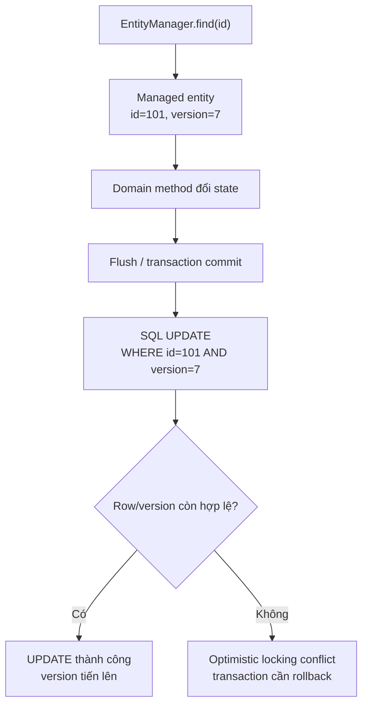
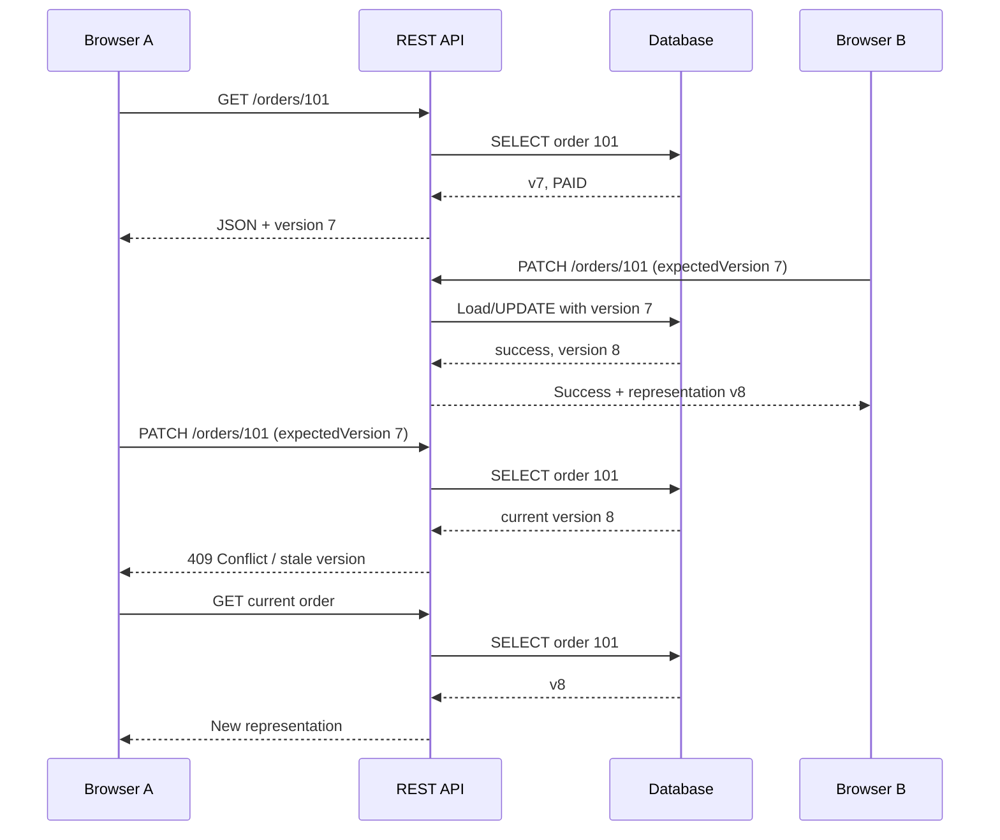

# Kiểm tra phiên bản khi cập nhật và xóa entity

Trong một ứng dụng nhiều người dùng, hai transaction có thể **đọc cùng một bản ghi tại hai thời điểm gần nhau**, sau đó cùng cố cập nhật hoặc xóa bản ghi ấy. Nếu hệ thống chỉ dùng khóa chính để xác định hàng cần ghi, thao tác sau có thể **ghi đè thay đổi của thao tác trước** hoặc xóa một entity mà trạng thái đã thay đổi kể từ khi người dùng xem nó. Đây là nhóm vấn đề *lost update*, *stale write* và *stale delete*.

**Khóa lạc quan** (*optimistic locking*) của JPA sử dụng thuộc tính `@Version` để phát hiện xung đột khi một entity đã được thay đổi bởi giao dịch khác kể từ phiên bản mà transaction hiện tại dựa vào. Cơ chế này đặc biệt phù hợp với ứng dụng có nhiều lượt đọc, thời gian người dùng suy nghĩ/chỉnh sửa dài và tỷ lệ cập nhật đồng thời trên cùng bản ghi không quá cao.

Ví dụ, hai nhân viên cùng mở đơn hàng `#101`:

```text
Thời điểm      Nhân viên A                     Nhân viên B
------------------------------------------------------------------
10:00          Đọc Order#101, version = 7
10:01                                          Đọc version = 7
10:02          Đổi trạng thái, commit
               Database version = 8
10:03                                          Cố sửa theo version 7
                                               -> Conflict / rollback
```

Nếu A cập nhật thành công, B **không được âm thầm ghi đè** dữ liệu dựa trên phiên bản 7. Khi xóa, vấn đề tương tự: nếu A đã chỉnh sửa order từ version 7 lên 8, B không nên xóa bản ghi chỉ vì B vẫn thấy nút “Xóa” trên trang đã mở từ trước.

Bài học này tập trung đúng vào **kiểm tra phiên bản khi cập nhật và xóa entity** trong chương **Khóa lạc quan** của module **Data Persistence Relational Access ORM JPA**. Chúng ta sẽ đi từ `@Version`, SQL có điều kiện version, lifecycle của managed/detached entity, `merge`/`remove`, cách áp dụng `expectedVersion` trong REST API, thời điểm báo lỗi transaction, xung đột với bulk UPDATE/DELETE, soft delete, tác động quan hệ và kiểm thử đồng thời.

## 1. Vì sao khóa chính không đủ để phát hiện stale update?

Giả sử database chứa:

| id | status | shipping_address | version |
|---:|---|---|---:|
| 101 | PAID | 12 Main Street | 7 |

Hai transaction lần lượt:

```sql
-- T1 đọc:
SELECT id, status, shipping_address, version
FROM sales_orders
WHERE id = 101;

-- T2 cũng đọc:
SELECT id, status, shipping_address, version
FROM sales_orders
WHERE id = 101;
```

Không có kiểm tra version, một ứng dụng có thể thực thi:

```sql
-- T1 cập nhật địa chỉ:
UPDATE sales_orders
SET shipping_address = '45 New Street'
WHERE id = 101;

-- T2 dùng màn hình cũ và cập nhật lại một phần dữ liệu:
UPDATE sales_orders
SET shipping_address = '12 Main Street',
    status = 'SHIPPED'
WHERE id = 101;
```

Địa chỉ mới của T1 đã bị ghi đè dù T2 chưa từng biết về nó. `WHERE id=101` chỉ kiểm tra **đúng hàng nào**, không kiểm tra **hàng ấy còn đúng trạng thái mà người sửa đã đọc hay không**.

### 1.1. Điều kiện cập nhật an toàn hơn

Thêm version:

```sql
UPDATE sales_orders
SET shipping_address = '45 New Street',
    version = 8
WHERE id = 101
  AND version = 7;
```

Nếu T1 thành công, version thành 8. Khi T2 thử:

```sql
UPDATE sales_orders
SET status = 'SHIPPED',
    version = 8
WHERE id = 101
  AND version = 7;
```

database không còn row có đồng thời `id=101 AND version=7`, nên điều kiện không khớp. Với cơ chế kiểm tra số hàng bị ảnh hưởng, JPA provider có thể nhận ra **xung đột optimistic locking** và báo lỗi thay vì coi việc ghi đè là thành công.

**Các câu SQL là mô hình khái niệm.** SQL chính xác do provider sinh ra có thể khác theo dialect, mapping, inheritance, batching và chiến lược update; điểm cốt lõi là **điều kiện phiên bản và phát hiện stale write**, không phải provider luôn sinh đúng cú pháp trên.

### 1.2. Bản chất optimistic locking

Khóa lạc quan:

- Không cần giữ row lock xuyên suốt thời gian người dùng đọc và chỉnh sửa form.
- Ghi nhớ version đại diện cho trạng thái đã đọc.
- Khi ghi, kiểm tra version hiện hành có còn đúng không.
- Nếu không khớp, báo xung đột để caller xử lý.
- Chỉ một transaction đang cạnh tranh trên cùng version có thể hoàn thành ghi theo semantics cơ chế version phù hợp.

Nó **không** có nghĩa database không dùng bất kỳ row lock nào. Câu SQL UPDATE/DELETE vẫn sử dụng locking/concurrency control của database để thực hiện an toàn. “Lạc quan” nói về **không giữ khóa độc quyền trong toàn bộ khoảng đọc–sửa** và dùng version để phát hiện cạnh tranh, chứ không loại bỏ mọi database lock.

## 2. Những tình huống cần kiểm tra version

| Tình huống | Rủi ro nếu thiếu kiểm tra |
|---|---|
| Hai nhân viên đổi trạng thái cùng đơn | Ghi đè trạng thái của người trước |
| Người dùng mở form lâu rồi lưu | Ghi dữ liệu dựa trên snapshot cũ |
| Admin xóa entity sau khi người khác sửa | Xóa bản ghi đã đổi mà admin chưa review |
| Worker và HTTP request cùng cập nhật | Background job ghi đè người dùng hoặc ngược lại |
| Hai tác vụ cùng phân bổ inventory | Mất một cập nhật nếu cùng sửa một số lượng |
| REST PATCH có read-modify-write | Request cũ áp thay đổi lên bản mới |
| `merge` một detached entity đã lâu | Copy stale state vào managed entity |
| Soft delete cạnh tranh với update | Entity bị đánh dấu xóa khi trạng thái đã thay đổi |

Khóa lạc quan có ích khi tính đúng đắn yêu cầu: **nếu dữ liệu thay đổi kể từ lúc đọc, hãy báo conflict thay vì lặng lẽ áp thao tác cũ**.

Nhưng nó không thay thế:

- **Authorization**: user có quyền sửa/xóa entity không?
- **Business validation**: trạng thái PAID có được chuyển về DRAFT không?
- **Uniqueness/foreign keys**: dữ liệu có vi phạm ràng buộc database không?
- **Transaction boundary**: nhiều thao tác có atomicity không?
- **Idempotency**: request bị retry có tạo tác dụng lặp không?

Một hệ thống đúng cần phối hợp các cơ chế ấy.

## 3. Khai báo `@Version` trong entity

JPA hỗ trợ **version attribute** được đánh dấu bằng `@Version`. Với trường số, provider quản lý giá trị version theo lifecycle của entity.

### 3.1. Entity mẫu

```java
package example.order.domain;

import jakarta.persistence.*;
import java.time.Instant;

@Entity
@Table(name = "sales_orders")
public class SalesOrder {

    @Id
    @GeneratedValue(strategy = GenerationType.SEQUENCE)
    private Long id;

    @Column(name = "tenant_id", nullable = false,
            updatable = false)
    private String tenantId;

    @Enumerated(EnumType.STRING)
    @Column(name = "status", nullable = false)
    private OrderStatus status;

    @Column(name = "shipping_address")
    private String shippingAddress;

    @Column(name = "updated_at")
    private Instant updatedAt;

    @Version
    @Column(name = "version", nullable = false)
    private Long version;

    protected SalesOrder() {}

    public Long getId() { return id; }
    public String getTenantId() { return tenantId; }
    public OrderStatus getStatus() { return status; }
    public String getShippingAddress() {
        return shippingAddress;
    }
    public Instant getUpdatedAt() { return updatedAt; }
    public Long getVersion() { return version; }

    public void changeShippingAddress(
            String address, Instant now) {
        if (address == null || address.isBlank()) {
            throw new IllegalArgumentException(
                "Shipping address is required");
        }
        shippingAddress = address;
        updatedAt = now;
    }

    public void markShipped(Instant now) {
        if (status != OrderStatus.PAID) {
            throw new IllegalStateException(
                "Only PAID orders may be shipped");
        }
        status = OrderStatus.SHIPPED;
        updatedAt = now;
    }
}
```

Enum:

```java
package example.order.domain;

public enum OrderStatus {
    DRAFT, PAID, SHIPPED, CANCELLED, ARCHIVED
}
```

Ứng dụng không cần tự đặt:

```java
order.version = order.version + 1;
```

cho một managed entity update bình thường. **Provider phải là nơi quản lý version** trong lifecycle theo contract của JPA. Việc ứng dụng tự sửa version ở entity không phải cách portable và dễ phá optimistic-lock semantics.

### 3.2. Cột database

DDL khái niệm:

```sql
CREATE TABLE sales_orders (
    id                BIGINT PRIMARY KEY,
    tenant_id         VARCHAR(64) NOT NULL,
    status            VARCHAR(30) NOT NULL,
    shipping_address  VARCHAR(500),
    updated_at        TIMESTAMP,
    version           BIGINT NOT NULL
);
```

DDL thực tế phải điều chỉnh theo database dialect, ID generation, nullable/default và migration policy. Với dữ liệu legacy, bổ sung `NOT NULL version` thường cần **backfill** trước khi áp constraint; không thêm cột với NULL cho rows cũ rồi mong JPA hiểu chúng là entities versioned hợp lệ.

### 3.3. Quy tắc đối với field `@Version`

- Mỗi entity sử dụng một **version attribute** phù hợp, không khai báo nhiều trường `@Version` tùy tiện.
- JPA chuẩn định nghĩa các kiểu version như `int`/`Integer`, `short`/`Short`, `long`/`Long` và `java.sql.Timestamp`; provider/version có thể hỗ trợ thêm kiểu khác, cần xác minh trước khi dựa vào.
- Version là thuộc tính persistent được provider quản lý; không dùng setter public để client thay đổi trực tiếp.
- Với entity có nhiều bảng secondary/inheritance, phải tuân thủ giới hạn mapping của version attribute theo Jakarta Persistence.
- Kiểu số như `Long` thường dễ giải thích hơn timestamp vì không phụ thuộc độ chính xác thời gian của DB/JDBC.
- Khi entity chưa persist, version có thể chưa được khởi tạo như entity đang tồn tại; không tự tạo quy tắc “version luôn bằng 1” cho mọi provider.

### 3.4. Một thay đổi trên database không nhất thiết tăng version

Nếu SQL khác JPA trực tiếp sửa:

```sql
UPDATE sales_orders
SET status = 'SHIPPED'
WHERE id = 101;
```

mà **không cập nhật version**, một JPA transaction cũ có thể không phát hiện thay đổi qua version check. Vì vậy, mọi write path (JPA managed updates, bulk JPQL, native SQL, scheduled jobs, triggers) phải được review để bảo đảm cơ chế version không bị bỏ qua ở chỗ quan trọng.

## 4. Chu trình cập nhật managed entity

Một thao tác thông thường:

```java
SalesOrder order = em.find(SalesOrder.class, 101L);
order.changeShippingAddress(
    "45 New Street", Instant.now());
// flush hoặc commit sẽ đồng bộ thay đổi.
```

Quy trình khái niệm:



Provider lưu version ban đầu trong trạng thái được quản lý. Khi dirty checking thấy entity thay đổi và thực hiện UPDATE, provider sử dụng version để kiểm tra cạnh tranh.

### 4.1. SQL có điều kiện version là hình thức thường gặp

```sql
UPDATE sales_orders
SET status = 'SHIPPED',
    updated_at = ?,
    version = 8
WHERE id = 101
  AND version = 7;
```

Khi trả **0 hàng phù hợp** do version khác hoặc row đã bị xóa, provider phải nhận diện conflict theo contract tương ứng.

Số hàng thực tế có thể phụ thuộc batch/update count semantics và JDBC driver. Application không nên cố suy ra version mới bằng cách đếm mọi SQL statement của provider; sử dụng managed entity/version API và transaction outcome.

### 4.2. Khi nào version tăng?

Với numeric version, provider thường tăng giá trị khi entity được cập nhật thành công theo semantics khóa lạc quan. Nhưng không phải mọi lời gọi setter đều tương ứng một SQL UPDATE:

- Gán lại đúng giá trị cũ có thể không tạo dirty change.
- Transaction có thể flush nhiều lần.
- Thay đổi trên related child entity không nhất thiết bump version của parent.
- Có thể force increment bằng lock mode phù hợp.

Không thiết kế API dựa trên giả định “mỗi request luôn version +1” nếu operation không thực sự sửa state được versioned của entity.

### 4.3. Version không phải timestamp nghiệp vụ

`updatedAt` trả lời “được cập nhật khi nào” theo clock/business policy; `version` trả lời “đây là thế hệ state thứ mấy theo quản lý ORM”. Hai thuộc tính có vai trò khác nhau. Dùng `updatedAt` làm optimistic token có thể có vấn đề về độ chính xác, đồng hồ và cập nhật ngoài đường chuẩn.

## 5. Timeline: hai transaction cùng UPDATE

Giả sử version ban đầu là 7.

```text
T1                                      T2
------------------------------------------------------------------
BEGIN                                   BEGIN
SELECT order 101 -> v7                  SELECT order 101 -> v7
changeShippingAddress("45...")          markShipped()
FLUSH: UPDATE ... WHERE version=7
affected=1, version tiến lên 8
COMMIT
                                        FLUSH: UPDATE ... WHERE version=7
                                        không khớp vì version hiện tại 8
                                        OptimisticLockException
                                        ROLLBACK
```

Kết quả đúng là T2 **không tự thắng**. Người dùng/worker của T2 cần quyết định đọc lại hay huỷ thao tác.

### 5.1. Nếu T2 flush trước T1 thì sao?

Transaction thắng có thể đảo ngược. Optimistic locking không ưu tiên “người mở màn hình trước” hay “người có role cao hơn”. Nó bảo đảm thao tác dựa trên stale version **không được silently accepted** khi có cạnh tranh được cơ chế version phát hiện.

### 5.2. Nếu T2 chưa đọc entity cho đến sau khi T1 commit?

Khi T2 mới tải version 8 rồi cập nhật, JPA không xem đó là stale write; T2 dựa vào trạng thái mới. Nếu nghiệp vụ vẫn muốn ngăn hành động của một **HTTP client đã đọc version 7 trước đó**, service phải nhận và kiểm tra **expectedVersion từ client** — không thể chỉ trông chờ vào `@Version` của entity vừa tải.

Điểm này đặc biệt quan trọng với REST:

> **JPA kiểm tra version của entity trong transaction hiện tại; HTTP API còn phải kiểm tra version mà người dùng đã nhìn thấy ở request trước đó.**

## 6. Timeline: một transaction UPDATE, transaction kia DELETE

Xét tình huống nhân viên A sửa địa chỉ, nhân viên B muốn xóa:

```text
Time        A                                   B
--------------------------------------------------------------------
10:00       Đọc Order#101 version 7
10:01                                           Đọc version 7
10:02       UPDATE order, version -> 8
10:03                                           DELETE dựa vào v7
                                                -> Conflict
```

Về mặt nghiệp vụ, điều quan trọng là B không xóa order mà B chưa từng thấy phiên bản mới. Khi xóa managed entity được versioned, provider thực hiện kiểm tra optimistic locking theo semantics JPA.

SQL minh họa:

```sql
DELETE FROM sales_orders
WHERE id = 101
  AND version = 7;
```

Nếu version đã là 8, điều kiện không khớp. Provider có thể phát hiện và báo `OptimisticLockException` khi flush/commit.

### 6.1. Nếu A xóa, B cập nhật?

```text
A DELETE Order#101 thành công, commit.
B cố UPDATE Order#101 với version đã đọc trước đó.
```

B không tìm thấy hàng `id=101 AND version=7` để cập nhật, nên phải được coi là stale state/concurrency failure theo transaction semantics phù hợp, không được tự tạo lại order như một “update thành công”.

### 6.2. Nếu hai transaction cùng DELETE?

Transaction thực hiện xóa sau trên một instance đã trở nên stale có thể gặp optimistic locking failure hoặc kết quả không còn entity tùy API/provider/đường thực thi. Cần định nghĩa API:

- Delete với **expected version**: chỉ thành công khi đúng phiên bản đã được người dùng xem.
- Delete idempotent không đòi token: một số API có thể coi “đã không tồn tại” là kết quả chấp nhận, nhưng phải xử lý quyền, thông tin tồn tại và race có chủ đích.

Không tự áp quy tắc “DELETE lần hai luôn thành công” nếu requirement thực sự là **xóa đúng snapshot đã được phê duyệt**.

## 7. Phân biệt ba phiên bản quan trọng

Trong một API update/delete có ít nhất ba khái niệm:

1. **Version người dùng đã nhận** từ lần GET trước: `expectedVersion`.
2. **Version của managed entity khi service tải**: `loadedVersion`.
3. **Version trong database tại lúc SQL ghi thực thi**: `currentDbVersion`.

Ví dụ:

```text
GET /orders/101             -> version = 7
Người khác cập nhật         -> version = 8
PATCH /orders/101            -> request expectedVersion = 7
Service em.find(101)         -> loadedVersion = 8
```

Nếu service chỉ sửa managed entity mà không so sánh `7` với `8`, provider có thể update theo v8 thành công vì nó **vừa đọc version mới**. Vậy ứng dụng không bảo vệ intent của HTTP client đã sử dụng state v7.

### 7.1. Hai tầng kiểm tra cần phối hợp

**Tầng API/application**:

```java
if (!Objects.equals(
        order.getVersion(), request.expectedVersion())) {
    throw new StaleOrderException();
}
```

Chặn request stale ngay khi server đã nhìn thấy DB version mới.

**Tầng JPA/database**:

```text
flush/commit UPDATE hoặc DELETE với version điều kiện.
```

Bảo vệ khoảng race còn lại khi một transaction khác sửa row **sau khi service so sánh expectedVersion nhưng trước khi SQL ghi hoàn thành**.

### 7.2. So sánh Java không thay khóa lạc quan ở DB

Sai khi chỉ:

```java
if (order.getVersion().equals(expectedVersion)) {
    order.changeShippingAddress(address, now);
}
```

mà không có `@Version`/SQL guard. Transaction khác có thể sửa row ngay sau kiểm tra. Khi entity đã có `@Version`, cơ chế provider tiếp tục bảo vệ ở bước flush/commit.

### 7.3. `expectedVersion` không phải quyền truy cập

Biết version 7 không cho phép một user xóa hoặc sửa Order#101 nếu họ không có quyền. Service phải bảo đảm:

```text
authorize actor + tenant + resource + operation
AND expected version still current
AND business transition allowed
```

Token version là điều kiện cạnh tranh, không phải security capability.

## 8. Thiết kế DTO cho thao tác cập nhật

Không nhận nguyên `@Entity` từ request để `merge()`. Dùng một command DTO chỉ chứa các trường client được phép sửa:

```java
package example.order.api;

import jakarta.validation.constraints.NotBlank;
import jakarta.validation.constraints.NotNull;

public record UpdateShippingAddressRequest(
    @NotBlank String shippingAddress,
    @NotNull Long expectedVersion
) {}
```

Body:

```json
{
  "shippingAddress": "45 New Street",
  "expectedVersion": 7
}
```

Service vẫn phải:

- Xác định tenant từ authenticated context.
- Kiểm tra quyền sửa order cụ thể.
- Kiểm tra business rule (ví dụ đơn đã giao có còn được đổi địa chỉ không).
- Đọc managed entity ở đúng scope.
- So sánh expected version với loaded version.
- Gọi domain method cập nhật trường được phép.
- Để `@Version` bảo vệ race khi flush/commit.

### 8.1. Response phải công bố version để client dùng lần sau

Ví dụ GET:

```java
package example.order.api;

import java.time.Instant;
import example.order.domain.OrderStatus;

public record OrderDetailResponse(
    Long id,
    OrderStatus status,
    String shippingAddress,
    Instant updatedAt,
    Long version
) {}
```

JSON:

```json
{
  "id": 101,
  "status": "PAID",
  "shippingAddress": "12 Main Street",
  "updatedAt": "2026-11-01T12:30:00Z",
  "version": 7
}
```

`version` giúp client tạo request có điều kiện. Response có thể dùng một **opaque token/ETag** thay cho số nguyên nếu muốn tách public contract khỏi numeric database version. Nhưng server vẫn phải xác định token đại diện cho đúng resource representation/version nào.

## 9. Service UPDATE có kiểm tra expected version

Ví dụ với Spring-managed transaction:

```java
package example.order.application;

import example.order.api.UpdateShippingAddressRequest;
import example.order.domain.SalesOrder;
import jakarta.persistence.EntityManager;
import jakarta.persistence.PersistenceContext;
import org.springframework.stereotype.Service;
import org.springframework.transaction.annotation.Transactional;
import java.time.Instant;
import java.util.Objects;

@Service
public class OrderCommandService {

    @PersistenceContext
    private EntityManager em;

    @Transactional
    public void updateAddress(
            String authorizedTenantId,
            Long orderId,
            UpdateShippingAddressRequest request) {

        SalesOrder order = em.createQuery(
                "select o from SalesOrder o " +
                "where o.id = :id " +
                "and o.tenantId = :tenantId",
                SalesOrder.class)
            .setParameter("id", orderId)
            .setParameter(
                "tenantId", authorizedTenantId)
            .getResultStream()
            .findFirst()
            .orElseThrow(OrderNotFoundException::new);

        if (!Objects.equals(
                order.getVersion(),
                request.expectedVersion())) {
            throw new StaleOrderException(
                "Order changed since it was read");
        }

        order.changeShippingAddress(
            request.shippingAddress(), Instant.now());

        // Không cần em.merge(order):
        // order đang managed, dirty checking sẽ flush.
        // @Version bảo vệ race đến thời điểm SQL UPDATE.
    }
}
```

`OrderNotFoundException`/`StaleOrderException` là application exceptions được định nghĩa riêng; framework có thể chuyển chúng thành HTTP 404/409/412 theo hợp đồng API.

### 9.1. Vì sao không `em.merge(order)`?

`order` đã được trả về từ query trong persistence context hiện tại, nên đang managed. JPA dirty checking xử lý khi flush/commit. `merge` không cần cho managed entity và không phải một “nút bật optimistic locking”.

### 9.2. Vì sao tenant nằm trong query?

Ngay cả khi URL cung cấp orderId hợp lệ, user không được sửa order của tenant khác. Truy vấn `where o.id=:id AND o.tenantId=:tenantId` giới hạn resource được phép truy cập, nhưng nếu ứng dụng có role/ownership phức tạp, còn cần authorization rule thích hợp.

### 9.3. Trường hợp entity không tồn tại

Không trả nguyên nhân kỹ thuật để lộ rằng một ID tồn tại ở tenant khác. Một số hệ thống chọn cùng response 404 cho “không tồn tại” và “không có quyền xem”. Chính sách phải nhất quán với security model.

### 9.4. Không dùng version do client cung cấp để ghi trực tiếp vào entity

Sai:

```java
order.setVersion(request.expectedVersion());
```

Version là managed optimistic token của provider, không phải thuộc tính nghiệp vụ được chỉnh từ HTTP body.

## 10. Service DELETE có kiểm tra expected version

Xóa entity càng cần kiểm tra stale state, vì hậu quả có thể không dễ hoàn nguyên.

Request DTO:

```java
public record DeleteOrderRequest(
    @NotNull Long expectedVersion
) {}
```

Service:

```java
@Transactional
public void deleteOrder(
        String authorizedTenantId,
        Long orderId,
        Long expectedVersion) {

    SalesOrder order = em.createQuery(
            "select o from SalesOrder o " +
            "where o.id = :id " +
            "and o.tenantId = :tenantId",
            SalesOrder.class)
        .setParameter("id", orderId)
        .setParameter(
            "tenantId", authorizedTenantId)
        .getResultStream()
        .findFirst()
        .orElseThrow(OrderNotFoundException::new);

    if (!Objects.equals(
            order.getVersion(), expectedVersion)) {
        throw new StaleOrderException(
            "Order changed; deletion requires review");
    }

    if (order.getStatus() == OrderStatus.SHIPPED) {
        throw new IllegalStateException(
            "Shipped orders cannot be deleted");
    }

    em.remove(order);
    // DELETE và version check xảy ra theo lifecycle
    // khi provider flush/commit transaction.
}
```

Hai điểm kiểm soát:

1. **Đầu vào request**: chỉ được xóa version mà caller đã review.
2. **Thực thi transaction**: `@Version` bảo vệ race sau khi service tải entity.

### 10.1. Không gọi `remove` với entity detached từ HTTP request

JPA `EntityManager.remove` hoạt động trên managed entity; truyền một detached object có thể bị từ chối. Đừng deserialize JSON thành entity rồi:

```java
em.remove(requestEntity);
```

để tránh truy vấn/authorization. Hãy tải managed entity với đúng tenant/ownership và kiểm tra version như ví dụ.

### 10.2. Xóa entity có quan hệ và FK

Trước khi `remove` cần xét:

- `CascadeType.REMOVE`, `orphanRemoval` và child entity lifecycle.
- FK `ON DELETE CASCADE`/`RESTRICT` của database.
- Dữ liệu hóa đơn, thanh toán, audit và retention.
- Những resource ngoài database có cần cleanup không.

`@Version` của order chỉ bảo vệ **stale state của chính order** theo optimistic locking. Nó không tự bảo đảm mọi child row đều không bị sửa, không tự làm cho xóa hợp lệ về mặt nghiệp vụ, và không thay thế FK constraints.

### 10.3. Nếu row đã bị xóa bởi transaction khác

Khi một managed versioned order đã stale và provider cố DELETE, việc row không còn ở DB có thể là optimistic locking failure. Nhưng nếu service **mới tìm theo ID sau khi row đã bị xóa**, query đơn giản chỉ thấy không tồn tại. Hai tình huống thuộc các thời điểm khác nhau và có thể được API ánh xạ theo chính sách 404/conflict phù hợp.

## 11. REST và HTTP conditional requests

Việc đưa `expectedVersion` vào JSON body là một cách thiết kế. HTTP còn có chuẩn **conditional requests**, đặc biệt `ETag` và `If-Match`.

GET:

```http
GET /api/orders/101 HTTP/1.1
Accept: application/json
```

Response minh họa:

```http
HTTP/1.1 200 OK
ETag: "order-101-v7"
Content-Type: application/json

{"id":101,"status":"PAID","version":7}
```

Client sửa:

```http
PATCH /api/orders/101 HTTP/1.1
If-Match: "order-101-v7"
Content-Type: application/json

{"shippingAddress":"45 New Street"}
```

Server kiểm tra token có còn phù hợp với representation/version hiện hành không. Nếu version đã thay đổi, một response phù hợp với HTTP precondition có thể là:

```http
HTTP/1.1 412 Precondition Failed
```

### 11.1. 409 hay 412?

| Trường hợp | HTTP status thường phù hợp |
|---|---|
| Resource không tồn tại hoặc cố ý che sự tồn tại | `404 Not Found` theo API security policy |
| Client dùng `If-Match` nhưng token không khớp | `412 Precondition Failed` |
| API yêu cầu precondition mà client không cung cấp | `428 Precondition Required` |
| Xung đột trạng thái nghiệp vụ hoặc optimistic lock theo command contract | `409 Conflict`, hoặc `412` nếu gắn với HTTP precondition |
| Validation sai | `400 Bad Request` hoặc `422 Unprocessable Content` tùy contract |
| DB/FK/authorization failure khác | Ánh xạ riêng, không quy hết thành 409 |

Không phải mỗi `OptimisticLockException` mặc nhiên phải thành 412. Response phụ thuộc API có sử dụng HTTP conditional semantics hay command-level expectedVersion.

### 11.2. ETag có thể là opaque token

`ETag` không bắt buộc lộ JPA `@Version` hoặc số revision dạng thô. Nó là **validator** của selected representation theo HTTP semantics. Một hệ thống có thể mã hóa resource ID, version, representation variant và schema version thành token được server kiểm chứng.

### 11.3. Không bỏ qua cú pháp/semantics của `If-Match`

HTTP `If-Match` có thể chứa nhiều entity tags; so sánh dùng **strong comparison** theo HTTP semantics. Không tự viết:

```java
if (header.contains(String.valueOf(version))) { ... }
```

vì dễ chấp nhận tag không khớp (ví dụ version 7 nằm trong version 17), không xử lý chuẩn weak tags/multiple values và có thể bỏ qua representation identity.

### 11.4. Precondition không thay transaction check

Server có thể kiểm tra ETag trước, nhưng một transaction khác vẫn có thể cập nhật order ngay sau đó. SQL ghi phải tiếp tục được bảo vệ bằng version/atomic conditional update.

### 11.5. ETag khi thay đổi chỉ trên child?

Nếu ETag đại diện toàn bộ response có nested items, thay đổi một item có thể làm representation khác dù `SalesOrder.version` không tăng (nếu chỉ version parent). Thiết kế ETag phải quyết định **phạm vi representation được bảo vệ**, và có thể cần aggregate-level version propagation hoặc validator riêng.

## 12. Khi nào optimistic lock exception được phát hiện?

Một hiểu lầm là:

```java
order.changeShippingAddress(...);
// Nếu không ném exception ngay tại đây thì đã cập nhật thành công.
```

Không đúng. Khi entity đang managed, setter/domain method thường chỉ đổi Java state. SQL UPDATE có thể được phát **khi flush hoặc commit**.

```text
load managed entity
    |
    v
change state
    |
    v
flush / commit
    |
    +-- SQL UPDATE ... WHERE version=...
    |       |
    |       +-- match   -> tiếp tục
    |       +-- mismatch -> optimistic locking conflict
    |
    v
transaction completion
```

Trong JPA, `OptimisticLockException` có thể phát sinh tại các thời điểm khác nhau tùy operation/provider:

- Khi `merge` một detached entity stale.
- Khi explicit `lock(..., OPTIMISTIC)` được kiểm tra.
- Khi `flush` update/remove.
- Khi `commit` đồng bộ pending changes.

Không dựa vào giả định “exception luôn xuất hiện tại lệnh `remove()`” hoặc “luôn tại setter”.

### 12.1. Có thể chủ động `flush()` trước khi trả về

```java
@Transactional
public void updateAddress(...) {
    SalesOrder order = loadAndCheck(...);
    order.changeShippingAddress(...);

    em.flush(); // Buộc đồng bộ pending changes trong transaction.
}
```

Lợi ích: trong những trường hợp provider thực hiện versioned UPDATE ở flush, conflict có thể được phát hiện **trước khi method service trả về**.

Nhưng:

- `flush()` **không phải commit**.
- Transaction vẫn có thể thất bại ở commit vì lỗi/concurrency/constraint khác.
- `flush()` có thể đồng bộ **nhiều managed changes khác đang chờ**, không chỉ entity hiện tại.
- Application vẫn cần xử lý exception ở transaction boundary thực tế.

### 12.2. Không bắt exception rồi tiếp tục cùng transaction

Khi `OptimisticLockException` xảy ra, transaction thường bị đánh dấu rollback-only theo JPA semantics. Không nên:

```java
try {
    em.flush();
} catch (OptimisticLockException e) {
    // Sai: sửa object rồi cố commit cùng transaction.
}
```

Hướng đúng: rollback transaction bị conflict, tạo một unit of work mới để đọc lại/retry nếu nghiệp vụ cho phép.

### 12.3. Exception wrapping

Ở tầng JPA có thể gặp `jakarta.persistence.OptimisticLockException`. Spring Data/Spring ORM có thể chuyển thành họ exception như `ObjectOptimisticLockingFailureException` hoặc `OptimisticLockingFailureException` tùy ngữ cảnh. Với EJB/JTA, lỗi có thể xuất hiện khi transaction commit và được bao trong exception khác.

Hãy chuẩn hóa error mapping **ở một lớp xử lý ngoại lệ của ứng dụng** thay vì chỉ catch một class cụ thể trong mỗi repository.

## 13. Transaction rollback và response không công bố thành công quá sớm

Một endpoint cập nhật cần:

```text
HTTP PATCH
  -> validate & authorize
  -> managed update
  -> flush/commit thành công
  -> HTTP success
```

Nếu transaction commit thất bại do optimistic conflict, HTTP không nên trả “200 OK cập nhật thành công” chỉ vì method nội bộ vừa thực thi setter.

Trong mô hình Spring `@Transactional` tại service, transaction interceptor thường commit trước khi controller tiếp tục xây response sau lời gọi service. Nhưng nếu transaction boundary được kéo ra ngoài service hoặc có asynchronous side effects, phải xem chính xác thứ tự.

### 13.1. Không gửi event/email trước khi commit

Sai:

```java
order.markShipped(now);
emailSender.sendShippedEmail(order.getId());
em.flush(); // Có thể conflict sau khi email đã gửi!
```

Nếu flush/commit rollback, email đã gửi không tự biến mất.

Giải pháp có thể là **transactional outbox**:

1. Thay đổi entity trong transaction.
2. Ghi outbox event record cùng transaction.
3. Commit thành công.
4. Worker phát event/email sau commit.

Ngay cả khi dùng after-commit listener, cần xét reliability, crash/retry/idempotency cho delivery; đừng coi callback là transaction của hệ thống email.

### 13.2. Không “cứu” conflict bằng cách xóa version check

Khi conflict xảy ra, không nên xóa `@Version` hoặc đổi lệnh thành:

```sql
UPDATE sales_orders SET ... WHERE id = :id;
```

chỉ để endpoint “luôn thành công”. Làm vậy biến một thông báo xung đột có kiểm soát thành silent lost update.

## 14. Khi nào đọc lại và retry?

Đối với request từ người dùng:

```text
User A chỉnh địa chỉ từ bản v7.
User B đã thay đổi cùng order lên v8.
User A gửi PATCH v7 -> conflict.
```

Không nên tự đọc v8 và áp lại nội dung v7 một cách mù quáng, vì user A có thể **không chấp nhận** thay đổi của B. Một UI phù hợp:

- Thông báo “Đơn hàng đã thay đổi”.
- Tải phiên bản hiện tại.
- Hiển thị sự khác nhau giữa bản user đang chỉnh và bản mới.
- Để user quyết định giữ, sửa lại hoặc hủy thao tác.
- Gửi một request mới với expectedVersion mới nếu được xác nhận.

### 14.1. Retry tự động phù hợp khi nào?

Một operation có thể được retry nếu:

- Nó **idempotent** hoặc có idempotency key/side-effect controls.
- Luôn **đọc lại state trong transaction mới**.
- Tính toán lại nghiệp vụ dựa trên state mới.
- Có giới hạn số lần retry/backoff hợp lý.
- Bảo đảm không ghi đè intent của người dùng.

Ví dụ worker muốn tăng một bộ đếm business theo invariant có thể retry bằng cách đọc lại và tính lại, nhưng chỉ khi domain cho phép. Đừng áp retry vô điều kiện cho việc “đổi địa chỉ thành giá trị user đã nhập dựa trên form cũ”.

### 14.2. Retry khác với đổi version thủ công

Sai:

```java
request.expectedVersion = currentVersion;
repository.save(staleEntity);
```

Điều này có thể biến dữ liệu stale thành write hợp lệ mà không xem xét thay đổi vừa xảy ra. Retry đúng phải **rebase command** trên state mới theo business semantics, không chỉ đổi token.

### 14.3. Conflict storm

Nếu cùng một row bị cập nhật với tần suất cao, optimistic locking có thể tạo nhiều retries/rollbacks. Lúc đó cân nhắc:

- Thiết kế lại contention hotspot.
- Atomic SQL update cho operation có semantics phù hợp.
- Pessimistic locking khi cần serial execution.
- Queue/serialize commands theo aggregate.
- Chia partition/shard counter hoặc mô hình event.

Không phải cứ có `@Version` là tốt nhất cho workload write contention rất cao.

## 15. Detached entity và `merge()`: phiên bản cũ nguy hiểm ở đâu?

Một entity có thể đi qua:

```text
NEW -> MANAGED -> DETACHED
          |
          +-> REMOVED
```

**Managed entity** đang thuộc persistence context nên provider theo dõi thay đổi. **Detached entity** vẫn là Java object chứa ID/fields/version nhưng không còn được một persistence context theo dõi.

Ví dụ:

```java
SalesOrder detached;

// Transaction 1:
detached = em.find(SalesOrder.class, 101L); // v7
em.detach(detached);

// Transaction 2 ở nơi khác:
// Update order #101 -> version 8.

// Transaction 3:
SalesOrder managed = em.merge(detached);
```

Nếu detached object mang version 7 nhưng database là v8, việc `merge` có thể phát hiện stale version và báo optimistic locking conflict. **Thời điểm phát hiện** có thể là ngay khi merge, khi flush hoặc commit, tùy provider và tình huống.

### 15.1. `merge()` không reattach chính object đầu vào

`em.merge(detached)` trả về **managed instance** chứa state được hợp nhất; đối tượng `detached` truyền vào **vẫn detached**. Sau đó sửa tiếp `detached` rồi tưởng provider sẽ tự ghi là sai.

```java
SalesOrder managed = em.merge(detached);
// managed mới là reference cần dùng trong context.
```

Nhưng với HTTP API, việc merge một entity do client gửi **không phải kiến trúc được khuyến nghị**, vì có nguy cơ:

- Copy fields ngoài phạm vi được phép.
- Ghi đè dữ liệu mà client không gửi trong partial update.
- Gán lại collections/relationships không chủ đích.
- Đưa version/ID từ dữ liệu chưa tin cậy vào logic.
- Bỏ qua domain validation và authorization.

Tốt hơn: nhận **request DTO** với expectedVersion, tải managed entity theo tenant/id, kiểm tra và gọi domain method.

### 15.2. Stale version trong detached graph

Giả sử detached `SalesOrder` có danh sách `OrderItem` cũng versioned. Merge một graph lớn có thể dẫn đến nhiều trạng thái lồng nhau, cascade và kiểm tra version ở những entities liên quan. Không nên sử dụng “merge cả graph” như một cơ chế cập nhật REST payload tùy ý; nó làm khó kiểm soát **entity nào thực sự bị sửa và khóa phiên bản nào được kiểm tra**.

### 15.3. Detached object không phải một snapshot đáng tin về quyền

Ngay cả khi version khớp, detached entity có thể mang tenant ID/customer fields giả mạo. Version check chỉ phát hiện cập nhật đồng thời, không xác thực quyền và không bảo đảm payload hợp lệ.

## 16. `remove()`, `deleteById()` và xóa theo điều kiện phiên bản

Ba thao tác sau không đồng nghĩa:

**A. Xóa một managed versioned entity**

```java
SalesOrder order = em.find(SalesOrder.class, id);
em.remove(order);
```

JPA có thể kiểm tra optimistic version của managed entity khi delete.

**B. Xóa theo ID không nhận version từ HTTP client**

```java
repository.deleteById(id);
```

Với Spring Data JPA, hành vi có thể bao gồm tìm entity và xóa qua repository, nhưng **API này không nhận version user đã thấy**. Nếu repository tải state hiện tại mới nhất, nó có thể xóa entity đang v8 dù client đang cầm dữ liệu v7.

**C. Xóa có điều kiện expectedVersion**

```java
SalesOrder order = findAuthorizedOrder(id, tenantId);
assertVersion(order.getVersion(), expectedVersion);
em.remove(order);
```

Cách C vừa bảo vệ **stale HTTP intent** vừa để JPA bảo vệ race tới lúc DELETE.

### 16.1. Không mặc định `deleteById` là “conditional delete”

`deleteById(id)` theo repository contract nói về identity; nó không tự biết version trong browser của người dùng. Nếu API yêu cầu “chỉ xóa khi chưa có ai sửa kể từ lần GET”, phải thiết kế precondition rõ ràng.

### 16.2. Xóa nhiều entities không có cùng semantics

Một vòng lặp:

```java
for (SalesOrder order : selected) {
    em.remove(order);
}
```

có thể đi qua managed entity lifecycle, JPA cascades và version checks của từng entity theo mapping.

Ngược lại:

```java
em.createQuery(
    "delete from SalesOrder o " +
    "where o.status = :status")
  .setParameter("status", OrderStatus.CANCELLED)
  .executeUpdate();
```

là JPQL **bulk DELETE**, không duyệt từng managed entity để áp per-entity optimistic locking/callback/cascade semantics. Phải review riêng ở mục bulk mutation.

## 17. `LockModeType.OPTIMISTIC` khi chỉ đọc entity

Khai báo `@Version` thường đủ cho managed updates/removes. Nhưng có trường hợp transaction **chỉ đọc entity** và muốn bảo đảm entity được bảo vệ bởi optimistic check trong phạm vi transaction.

JPA cung cấp:

```java
LockModeType.OPTIMISTIC
```

Ví dụ:

```java
SalesOrder order = em.find(
    SalesOrder.class,
    101L,
    LockModeType.OPTIMISTIC);

// Thực hiện các phép kiểm tra và đọc các dữ liệu liên quan.
// Provider kiểm tra optimistic version theo semantics
// của lock mode tại các điểm thích hợp.
```

Hoặc trên một managed entity:

```java
em.lock(order, LockModeType.OPTIMISTIC);
```

### 17.1. `OPTIMISTIC` làm gì?

Nó yêu cầu optimistic locking/check phù hợp với versioned entity; về mặt ý tưởng, transaction có thể yêu cầu entity không bị thay đổi ngoài ý muốn trong khoảng công việc.

Nhưng:

- Nó không phải row-level exclusive lock kéo dài như `PESSIMISTIC_WRITE`.
- Nó không tự khóa mọi collection/child entity.
- Nó không tự bảo vệ các bảng/query khác không có cùng version.
- Việc check có thể diễn ra ở flush/commit; không được giả định chính xác một thời điểm cho mọi provider.
- Cần transaction hợp lệ cho `lock`/lock modes theo contract JPA.

### 17.2. Đọc version có nghĩa đã khóa optimistic chưa?

`em.find(SalesOrder.class,id)` tải version cho managed entity, và provider dùng version khi entity được cập nhật/xóa. Nhưng nếu transaction **chỉ đọc** rồi kết thúc mà không update, việc có thực hiện version check ở cuối chỉ vì find hay không không nên được giả định giống nhau cho mọi use case. Nếu nghiệp vụ cần read-only optimistic check, yêu cầu `OPTIMISTIC` tường minh.

### 17.3. Khi nào cần?

Một workflow:

1. Đọc SalesOrder và kiểm tra status.
2. Đọc những dữ liệu khác.
3. Tạo một kết quả hoặc thao tác phụ thuộc vào việc SalesOrder không bị sửa.

Nếu SalesOrder state không được chính transaction cập nhật, dùng `OPTIMISTIC` có thể giúp phát hiện thay đổi concurrent của entity này. Nhưng tính đúng đắn của nhiều entities/aggregate vẫn cần xem riêng, không được suy ra một parent lock bảo vệ toàn database.

## 18. `LockModeType.OPTIMISTIC_FORCE_INCREMENT`

JPA cung cấp:

```java
LockModeType.OPTIMISTIC_FORCE_INCREMENT
```

để yêu cầu optimistic locking và **tăng version** của entity phù hợp ngay cả khi không có thay đổi đơn giản trên mapped scalar fields của entity đó.

Ví dụ:

```java
SalesOrder order = em.find(
    SalesOrder.class, orderId);

em.lock(
    order, LockModeType.OPTIMISTIC_FORCE_INCREMENT);
```

Trường hợp hữu ích: application coi `SalesOrder` là **aggregate root**, muốn thay đổi ở collection child cũng làm version của order thay đổi để request cũ bị phát hiện.

### 18.1. Vì sao cần force increment với child?

Mapping:

```java
@OneToMany(mappedBy = "order", fetch = FetchType.LAZY)
private List<OrderItem> items;
```

Nếu một transaction thêm `OrderItem` qua child FK và parent scalar state không thay đổi, không được mặc định rằng `SalesOrder.version` sẽ tự tăng. Vì collection ở inverse side và provider mapping/ownership ảnh hưởng dirty state; version propagation không phải điều có thể suy ra chỉ từ việc “một child mới đã được tạo”.

Khi API contract coi version của order là validator cho cả tập items, application cần có chiến lược:

- Force increment parent khi cập nhật child có liên quan.
- Thiết kế domain aggregate version riêng.
- Dùng validator dựa trên representation/snapshot ở tầng API.
- Hoặc tách version token của child resources và parent theo semantics phù hợp.

### 18.2. Không tự gọi force increment cho mọi read

Nếu GET/order list vô tình dùng `OPTIMISTIC_FORCE_INCREMENT`, mỗi lượt đọc có thể làm version tăng và tạo thêm writes/conflicts. Chỉ dùng khi thực sự muốn **đánh dấu aggregate đã thay đổi** theo transaction semantics, thường trong command path.

### 18.3. Tăng version xảy ra lúc nào?

Không viết code dựa trên giả định `order.getVersion()` đổi ngay sau `em.lock(...OPTIMISTIC_FORCE_INCREMENT)` ở mọi provider. Version synchronization/check có thể diễn ra khi flush/commit. Nếu response cần version mới, cần biết transaction outcome, provider timing và cách đọc lại token phù hợp.

## 19. So sánh các lock modes thường gặp

| Mode | Mục tiêu | Dùng khi nào |
|---|---|---|
| `NONE` | Không yêu cầu explicit lock mode | Các reads bình thường |
| `OPTIMISTIC` | Yêu cầu optimistic version check | Cần đảm bảo read-only dependency không bị stale trong transaction |
| `OPTIMISTIC_FORCE_INCREMENT` | Optimistic check và bump version | Thay đổi liên quan tới aggregate root cần cập nhật version |
| `PESSIMISTIC_READ` | Yêu cầu read lock theo DB/provider | Tải có contention cao, cần database lock semantics |
| `PESSIMISTIC_WRITE` | Yêu cầu write lock theo DB/provider | Cần serialize updates theo row locking |
| `PESSIMISTIC_FORCE_INCREMENT` | Pessimistic write-style lock và force version increment | Trường hợp đặc thù cần cả lock DB và bump version |

Các aliases lịch sử `READ`/`WRITE` trong JPA tương ứng những optimistic lock modes theo API, nhưng nên dùng tên rõ `OPTIMISTIC`/`OPTIMISTIC_FORCE_INCREMENT` khi làm tài liệu/thiết kế mới.

### 19.1. Khi nào pessimistic có thể phù hợp hơn?

Nếu hàng liên tục bị sửa:

```text
Thread A, B, C, D ... cùng cố đổi cùng một counter/order.
Rất nhiều optimistic conflicts, retries, latency.
```

có thể cân nhắc `PESSIMISTIC_WRITE` hoặc atomic SQL operation để giảm vòng retry. Đổi sang pessimistic không miễn phí: lock wait, deadlock, throughput và transaction duration vẫn cần được quản lý.

### 19.2. Không khóa parent rồi suy ra mọi child đều bất biến

Một `PESSIMISTIC_WRITE` trên order parent chưa chắc ngăn transactions khác sửa bảng `order_items` theo cơ chế DB nếu chúng không tương tác với cùng khóa/ràng buộc. Với business invariant đi qua nhiều bảng, cần thiết kế locking rule cho tất cả paths thay đổi.

## 20. Bulk JPQL UPDATE không tự thực hiện optimistic locking từng entity

Một bẫy cực kỳ quan trọng:

```java
int affected = em.createQuery(
        "update SalesOrder o " +
        "set o.status = :archived " +
        "where o.status = :cancelled")
    .setParameter("archived", OrderStatus.ARCHIVED)
    .setParameter("cancelled", OrderStatus.CANCELLED)
    .executeUpdate();
```

Đây là **bulk JPQL UPDATE**. Theo semantics chuẩn, nó không duyệt từng managed SalesOrder để thực hiện per-entity version check/auto version increment như dirty checking thông thường.

Hệ quả:

- `@Version` của entity **không tự bảo vệ** từng row trong batch như managed update.
- `@PreUpdate` và domain methods không chạy cho từng row.
- Persistence context có thể chứa entity stale.
- Query có thể sửa row vừa được transaction khác cập nhật nếu predicate của nó vẫn matching.
- Có thể làm version **không tăng**, phá cơ chế phát hiện stale state ở các command paths khác.

### 20.1. Version strategy cho bulk phải explicit

Với numeric `Long` version, một JPQL bulk UPDATE có thể chủ động tăng version:

```java
int affected = em.createQuery(
        "update SalesOrder o " +
        "set o.status = :archived, " +
        "o.version = o.version + 1 " +
        "where o.tenantId = :tenantId " +
        "and o.status = :cancelled")
    .setParameter("archived", OrderStatus.ARCHIVED)
    .setParameter("tenantId", tenantId)
    .setParameter("cancelled", OrderStatus.CANCELLED)
    .executeUpdate();
```

**Đây là code thay đổi version một cách tường minh ở bulk mutation**, không phải dirty checking-managed entity. Cần xác minh JPQL provider hỗ trợ phép toán với kiểu version đang dùng và kiểm thử SQL/result. Với timestamp version hoặc mapping đặc biệt, chiến lược `+1` không phù hợp.

### 20.2. Tăng version không đồng nghĩa kiểm tra stale input

Query trên tăng version của mọi matching rows nhưng **không kiểm tra expected version của từng row do caller cung cấp**. Nó có thể có ích để làm các transactions đang giữ version cũ phát hiện stale state sau batch, nhưng không đảm bảo batch không ghi đè business changes không mong muốn nếu WHERE quá rộng.

Muốn atomic conditional update cho một row:

```java
int affected = em.createQuery(
        "update SalesOrder o " +
        "set o.status = :newStatus, " +
        "o.version = o.version + 1 " +
        "where o.id = :id " +
        "and o.tenantId = :tenantId " +
        "and o.version = :expectedVersion " +
        "and o.status = :expectedStatus")
    .setParameter("newStatus", OrderStatus.SHIPPED)
    .setParameter("id", orderId)
    .setParameter("tenantId", tenantId)
    .setParameter("expectedVersion", expectedVersion)
    .setParameter("expectedStatus", OrderStatus.PAID)
    .executeUpdate();

if (affected != 1) {
    throw new StaleOrderException(
        "Order missing, changed or not eligible");
}
```

Trong câu này:

- `id` xác định entity.
- `tenantId` bảo vệ phạm vi.
- `expectedVersion` bảo vệ stale write.
- `expectedStatus` bảo vệ state transition.
- `version = version + 1` giữ token tiến lên khi row thay đổi.
- `affected != 1` cho biết **điều kiện không đáp ứng**, nhưng không tự chỉ rõ nguyên nhân là missing ID, sai tenant, sai status hay stale version.

### 20.3. Bulk update không đồng bộ managed instances

```java
SalesOrder order = em.find(SalesOrder.class, orderId);

int n = conditionalBulkUpdate(...);

// order trong context có thể vẫn giữ version/status cũ.
```

Nếu transaction tiếp tục dùng entity cũ, cần thiết kế `flush`/`clear`/`refresh`/context mới có chủ đích. Việc `clear()` detach toàn persistence context, không tự commit, cũng không xóa mọi second-level cache.

### 20.4. Bulk là một lựa chọn trade-off

Dùng managed entity update nếu:

- Cần entity callbacks/validation.
- Cần JPA cascades.
- Cần per-entity version/lifecycle semantics.
- Số rows nhỏ hoặc một aggregate.

Dùng bulk khi:

- Tập rows lớn.
- Business predicate có thể biểu diễn rõ trong SQL.
- Đã tự thiết kế version increment/guards/audit/cache consistency.
- Chấp nhận bulk bỏ qua lifecycle callbacks.

Không chọn bulk chỉ vì ngắn code mà bỏ qua concurrency rules.

## 21. Bulk JPQL DELETE cũng bỏ qua version check mặc định

Ví dụ:

```java
int removed = em.createQuery(
        "delete from SalesOrder o " +
        "where o.id = :id")
    .setParameter("id", orderId)
    .executeUpdate();
```

Tuy đúng là xóa theo ID, query này là bulk DELETE và **không mặc nhiên lấy managed versioned entity để kiểm tra optimistic version**.

Nếu dùng bulk DELETE một row có điều kiện, viết:

```java
int removed = em.createQuery(
        "delete from SalesOrder o " +
        "where o.id = :id " +
        "and o.tenantId = :tenantId " +
        "and o.version = :expectedVersion " +
        "and o.status = :expectedStatus")
    .setParameter("id", orderId)
    .setParameter("tenantId", tenantId)
    .setParameter("expectedVersion", expectedVersion)
    .setParameter("expectedStatus", OrderStatus.CANCELLED)
    .executeUpdate();

if (removed != 1) {
    throw new StaleOrderException(
        "Order not eligible for deletion");
}
```

**Câu DELETE có điều kiện là atomic ở database statement level theo transaction semantics**, giúp ngăn xóa row khi version đã đổi. Tuy nhiên, nó vẫn không chạy `@PreRemove` và `CascadeType.REMOVE` trên từng managed entity như đường `em.remove`.

### 21.1. Không dùng bulk DELETE bừa bãi khi có child associations

Nếu `OrderItem` tham chiếu `SalesOrder`:

- Không có FK cascade, bulk DELETE có thể bị chặn bởi referential integrity.
- Có `ON DELETE CASCADE`, database có thể xóa child rows mà JPA callbacks/version checks của children không chạy.
- Có nhiều bảng audit/invoice/retention, xóa có thể vi phạm requirement dù version khớp.

Khi xóa một entity nghiệp vụ có lifecycle phức tạp, **load + check + `em.remove`** thường rõ ràng hơn. Bulk conditional delete thích hợp khi đã review đầy đủ database-side effects và không cần per-entity lifecycle.

### 21.2. So sánh hai cách DELETE

| Tiêu chí | Managed `em.remove(order)` | Bulk `DELETE ... WHERE version=:v` |
|---|---|---|
| Kiểm tra version | Provider quản lý theo `@Version` | Developer tự đặt predicate |
| `@PreRemove` | Theo entity lifecycle | Không chạy từng entity |
| JPA cascade REMOVE | Có theo mapping | Không tự chạy |
| FK ON DELETE CASCADE | DB xử lý nếu parent row bị xóa | DB xử lý nếu parent row bị xóa |
| Persistence context | Provider biết entity bị remove | Các managed entities khác có thể stale |
| Kiểm soát row count | Provider xử lý stale state | Developer kiểm tra `executeUpdate()` |
| Thích hợp | Aggregate/entity có lifecycle | SQL-oriented operation đã có guards |

### 21.3. SQL rows affected bằng 0 nói lên điều gì?

Với `DELETE WHERE id=? AND version=?`, `0` có thể do:

- ID không tồn tại.
- Tenant mismatch.
- Version mismatch.
- Business status/precondition mismatch.

Không mặc định phản hồi “version conflict” khi thực chất là sai quyền, và cũng không tiết lộ tenant data bằng cách trả “order tồn tại nhưng bạn không có quyền”. API cần error mapping theo security policy.

## 22. Spring Data JPA `@Modifying` và version guards

Repository có thể khai báo bulk JPQL:

```java
package example.order.persistence;

import example.order.domain.OrderStatus;
import example.order.domain.SalesOrder;
import org.springframework.data.jpa.repository.JpaRepository;
import org.springframework.data.jpa.repository.Modifying;
import org.springframework.data.jpa.repository.Query;
import org.springframework.data.repository.query.Param;

public interface SalesOrderRepository
        extends JpaRepository<SalesOrder, Long> {

    @Modifying
    @Query("""
        update SalesOrder o
        set o.status = :nextStatus,
            o.version = o.version + 1
        where o.id = :id
          and o.tenantId = :tenantId
          and o.version = :expectedVersion
          and o.status = :currentStatus
        """)
    int changeStatusIfVersionMatches(
        @Param("id") Long id,
        @Param("tenantId") String tenantId,
        @Param("expectedVersion") Long expectedVersion,
        @Param("currentStatus") OrderStatus currentStatus,
        @Param("nextStatus") OrderStatus nextStatus
    );
}
```

Service nên gọi trong transaction:

```java
@Transactional
public void markShipped(
        String tenantId, Long orderId,
        Long expectedVersion) {

    int affected = repository.changeStatusIfVersionMatches(
        orderId,
        tenantId,
        expectedVersion,
        OrderStatus.PAID,
        OrderStatus.SHIPPED);

    if (affected != 1) {
        throw new StaleOrderException(
            "State or version has changed");
    }
}
```

Điểm quan trọng:

- `@Modifying` là annotation của **Spring Data JPA**, không phải Jakarta Persistence.
- `@Transactional` phải có transaction thực sự; đặt ở service boundary thường dễ kiểm soát.
- Phép tăng numeric `o.version + 1` là chủ ý của query, không phải tự động do entity lifecycle.
- `@Modifying(clearAutomatically = true)` có thể làm context clear sau query trong Spring Data, nhưng phải hiểu tác động tới managed entities/pending changes; nó không giải quyết mọi cache level.
- Nếu query có DML outside persistence context, cần bảo đảm consistency khi đọc lại.
- Không giả định @Modifying bypass business guards là hợp lệ chỉ vì SQL returns 1 row.

## 23. Soft delete và `@Version`

Không phải mọi lần “xóa” đều là physical SQL DELETE. Nhiều hệ thống dùng **soft delete**:

```java
@Column(name = "deleted_at")
private Instant deletedAt;
```

### 23.1. Soft delete qua managed entity

Nếu domain method `markDeleted(now)` cập nhật `deletedAt` của managed entity:

```java
SalesOrder order = loadAuthorizedOrder(id, tenantId);
assertVersion(order.getVersion(), expectedVersion);
order.markDeleted(now);
```

JPA coi đây là **UPDATE**, nên `@Version` có thể bảo vệ theo đường dirty checking thông thường và version tăng khi UPDATE thành công.

### 23.2. Soft delete bằng bulk query

```java
int affected = em.createQuery(
        "update SalesOrder o " +
        "set o.deletedAt = :now, " +
        "o.version = o.version + 1 " +
        "where o.id = :id " +
        "and o.tenantId = :tenantId " +
        "and o.version = :expectedVersion " +
        "and o.deletedAt is null")
    .setParameter("now", now)
    .setParameter("id", orderId)
    .setParameter("tenantId", tenantId)
    .setParameter("expectedVersion", expectedVersion)
    .executeUpdate();
```

Ví dụ **chỉ hợp lệ khi entity thật sự có mapping `deletedAt`**; cần bổ sung field/method đó vào entity mẫu trước khi chạy. Trong query bulk, ta tự tăng version và kiểm tra affected.

### 23.3. Soft delete không kích hoạt JPA remove lifecycle

Một soft delete là UPDATE:

- Không tự gọi `@PreRemove`/`@PostRemove` như hard delete.
- Không tự kích hoạt FK `ON DELETE CASCADE`, vì parent row không bị DELETE.
- Không mặc định soft-delete children.
- Không tự bảo đảm mọi query sau đó loại bỏ soft-deleted rows.

Khi triển khai soft delete bằng provider-specific annotations (ví dụ Hibernate `@SQLDelete`, `@SoftDelete` tùy version), phải kiểm chứng SQL thực tế có bảo vệ optimistic version đúng không. Không coi tên annotation là bằng chứng rằng stale HTTP deletes được phát hiện.

## 24. Quan hệ cha–con và version của aggregate root

Giả sử:

```java
@Entity
public class SalesOrder {
    @Id
    private Long id;

    @Version
    private Long version;

    @OneToMany(mappedBy = "order")
    private List<OrderItem> items;
}
```

Và:

```java
@Entity
public class OrderItem {
    @Id
    private Long id;

    @Version
    private Long version;

    @ManyToOne(fetch = FetchType.LAZY)
    @JoinColumn(name = "order_id")
    private SalesOrder order;
}
```

Đây là mẫu rút gọn để bàn về version. Khi áp dụng thật cần constructor, constraints và các mapped fields theo schema.

### 24.1. Version của parent không bằng version của child

Nếu T1 update `OrderItem#1` và T2 update `SalesOrder#101`, mỗi entity có version riêng. Không được mặc định xung đột của child sẽ khiến parent version đổi hoặc T2 thất bại.

### 24.2. Đọc tổng tiền từ items cần một policy concurrency

Giả sử service:

1. Đọc SalesOrder và tất cả OrderItems.
2. Tính order total.
3. Ghi Order.total.

Trong khi đó transaction khác sửa một OrderItem. `SalesOrder.version` có thể chưa bị bump vì chỉ child đổi. Nếu nghiệp vụ cần “tổng và items nhất quán”, cần cơ chế bảo vệ **đúng aggregate invariant**:

- Force increment root khi sửa child.
- Version/check tất cả child liên quan khi cần.
- Dùng locks/isolation phù hợp.
- Tính tổng tại database trong một transaction được thiết kế rõ.
- Dùng domain command sở hữu toàn aggregate để serialize/coordinate updates.

### 24.3. `@Version` không thay việc đồng bộ hai chiều

Nếu có `@OneToMany(mappedBy=...)` và `@ManyToOne`, application vẫn phải quản lý owning side/FK và hai chiều collection đúng. Locking không sửa được một object graph có relations sai.

### 24.4. Child DELETE và parent ETag

Nếu một user xem OrderDetail với 5 items, rồi user khác xóa một item, liệu ETag của order detail có phải đổi? Tùy contract: nếu ETag được coi là version cho toàn bộ representation, cần bảo đảm thay đổi child làm validator đổi. `@Version` trên parent không tự hứa điều này cho mọi mapping/operation.

## 25. JPA cascade và database `ON DELETE CASCADE`

Hai cơ chế cần tách biệt:

| Cơ chế | Ai thực hiện? | Liên quan version ra sao? |
|---|---|---|
| `CascadeType.REMOVE` | JPA provider qua entity lifecycle | Có thể áp per-entity remove/version semantics cho entities được xử lý |
| `orphanRemoval=true` | JPA xử lý orphan lifecycle | Có thể xóa child khi bị gỡ khỏi quan hệ; version của parent/child tùy mapping |
| FK `ON DELETE CASCADE` | Database khi xóa parent row | Không tự gọi callbacks/kiểm tra `@Version` của mỗi child theo JPA |
| JPQL bulk DELETE | Database qua bulk statement do provider sinh | Không tự duyệt graph/kiểm tra version từng entity |

### 25.1. Rủi ro khi xóa order có child đang được sửa

Giả sử:

```text
T1 đọc SalesOrder#101 v7
T2 cập nhật OrderItem#900 v3 -> v4
T1 xóa SalesOrder#101 v7
Database FK ON DELETE CASCADE xóa OrderItem#900
```

Nếu T2 chỉ sửa child và parent version vẫn 7, **version check của parent có thể không phát hiện thay đổi ở child**. FK cascade có thể xóa child mà không dùng JPA optimistic locking của child, tùy transaction ordering và database conflict control.

Đây không đơn thuần là bug của `@Version`; nó là câu hỏi thiết kế **aggregate boundary, FK cascade và concurrency policy**. Nếu không được phép xóa order khi bất kỳ item nào đã đổi, cần một cơ chế version/locking/invariant cho toàn aggregate.

### 25.2. Phiên bản của root không tự chặn mọi trigger

Database trigger có thể thay đổi dữ liệu ngoài JPA. Nếu trigger update root mà không tăng version hoặc sửa child không bump root version, token có thể không phản ánh toàn bộ domain change. Với hệ thống đa write paths, cần thống nhất versioning contract giữa ứng dụng và database.

## 26. Persistence context stale sau bulk/native writes

Ví dụ:

```java
SalesOrder order =
    em.find(SalesOrder.class, 101L); // v7, PAID

em.createQuery(
        "update SalesOrder o " +
        "set o.status = :shipped, " +
        "o.version = o.version + 1 " +
        "where o.id = :id")
    .setParameter("shipped", OrderStatus.SHIPPED)
    .setParameter("id", 101L)
    .executeUpdate();

// order có thể vẫn là v7/PAID trong persistence context!
```

JPA bulk mutation thay dữ liệu ở database, **không cập nhật field của managed object hiện có** trong context theo cơ chế dirty checking.

### 26.1. Chiến lược xử lý

Một workflow có thể:

```java
em.flush(); // Đồng bộ pending managed changes nếu cần.
int affected = bulkQuery.executeUpdate();
em.clear(); // Detach toàn bộ managed entities.
```

Nhưng:

- `clear()` không tự commit.
- `clear()` detach **toàn bộ**, không riêng order.
- Nếu còn unflushed changes thì có nguy cơ mất những changes khỏi context.
- `clear()` không xóa mọi second-level/external cache.
- `refresh` của một entity có thể thay state trong RAM theo DB, nhưng **không nên dùng để âm thầm giải quyết conflict và mất thay đổi của user**.

### 26.2. Native SQL bên ngoài JPA

Nếu job JDBC chạy:

```sql
UPDATE sales_orders
SET status = 'ARCHIVED'
WHERE id = 101;
```

và không tăng `version`, một managed entity từ transaction khác có thể không nhận biết thay đổi theo optimistic version. Cần:

- Thống nhất update version khi writer ngoài JPA sửa state được versioned.
- Dùng SQL guards cho shared invariants.
- Quản lý persistence context/cache invalidation.
- Kiểm tra transaction/locking với JDBC writer đó.

### 26.3. Spring `saveAndFlush` có “sửa” dữ liệu stale không?

`saveAndFlush` có thể buộc flush sớm nhưng không tự đổi expectedVersion của client, không thay authorization và không làm stale detached entity trở nên hợp lệ. Nếu version conflict tồn tại, flush có thể làm lỗi xuất hiện sớm hơn — đó là hành vi đúng, không phải lỗi cần bỏ qua.

## 27. Isolation level, row locks và optimistic version

Khóa lạc quan không tồn tại ngoài transaction isolation và database concurrency.

### 27.1. MVCC không tự thay optimistic locking

Các DB sử dụng **MVCC** có thể cho nhiều transaction đọc snapshot riêng mà không chặn nhau. Nhưng nếu application đọc rồi ghi dựa trên stale state, vẫn cần cơ chế kiểm soát lost update hoặc DB isolation mạnh phù hợp. JPA `@Version` là một giải pháp tường minh ở entity layer.

### 27.2. Read Committed vẫn có thể dùng `@Version`

Ở `READ COMMITTED`, hai transactions có thể đọc version 7 và cùng cố ghi; version predicate giúp ngăn silent overwrite. Isolation level không nhất thiết phải là SERIALIZABLE để sử dụng optimistic locking cho một row versioned.

### 27.3. Version không bảo vệ mọi predicate/phantom

Giả sử:

```text
Rule: chỉ tạo thêm coupon nếu tổng coupon active < 5.
T1 COUNT active = 4
T2 COUNT active = 4
T1 INSERT coupon
T2 INSERT coupon
```

Nếu hai transactions **không cùng sửa một versioned row** hoặc không dùng một invariant guard đủ mạnh, `@Version` của từng coupon mới không ngăn tổng active trở thành 6. Đây là một dạng **write skew/cross-row invariant**.

Giải pháp cần nhìn ở mức invariant:

- Lock/force increment một aggregate root chung.
- Database unique/check constraints hoặc atomic conditional update.
- Serializable isolation với retry theo DB.
- Redesign dữ liệu/counter để một row versioned bảo vệ invariant.

### 27.4. Version check không thay row visibility/permissions

Nếu query đọc order không scope tenant, một user có thể thấy version token của tenant khác. Optimistic lock không phải data access control.

### 27.5. Dùng `PESSIMISTIC_WRITE` khi nào?

Với thao tác có contention lớn hoặc cần giữ quyền cập nhật độc quyền trong một transaction ngắn, pessimistic locking có thể hợp lý. Nhưng nó gây lock wait/deadlock và không phù hợp giữ lock trong thời gian user mở form trên browser.

## 28. Chọn chiến lược cập nhật theo yêu cầu

| Nhu cầu | Cách tiếp cận |
|---|---|
| Sửa một entity, cần callback/validation | Managed entity + `@Version` |
| Chặn request HTTP cũ | `expectedVersion`/`If-Match` + managed version check |
| Xóa một aggregate có lifecycle | Load authorized managed entity, compare version, `em.remove` |
| Cập nhật một row atomic theo điều kiện | Bulk JPQL/native UPDATE có `WHERE id/version/expected state`, explicit version increment |
| Xóa một row bằng SQL conditional | Bulk DELETE có `WHERE id/version/tenant` và affected check |
| Thay đổi hàng nghìn rows | Bulk operation có scopes/version/transaction guards; chấp nhận bỏ qua callbacks |
| Child changes phải invalidate parent token | Force increment/version propagation của root |
| Read-only work phải phát hiện root đổi | `LockModeType.OPTIMISTIC` khi phù hợp |
| Contention cực cao | Cân nhắc pessimistic/serialized commands/atomic SQL |
| Invariant qua nhiều rows | Database constraints, aggregate lock hoặc isolation/workflow mạnh hơn |

### 28.1. “Một SQL atomic” không tự là “đúng nghiệp vụ”

Câu:

```sql
UPDATE sales_orders
SET status='SHIPPED'
WHERE id=101 AND version=7;
```

có thể an toàn khỏi stale write nhưng vẫn vi phạm business rule nếu trạng thái hiện tại là CANCELLED và version 7. Hãy thêm `AND status='PAID'` hoặc kiểm tra transition theo domain khi dùng managed entity.

### 28.2. Tính chi phí khi quyết định

Managed entity approach có ưu điểm diễn đạt domain/lifecycle và tận dụng JPA optimistic semantics; SQL conditional approach có thể dùng ít round-trips nhưng cần tự duy trì version/callback/cache/audit. Chọn theo correctness trước, sau đó đo hiệu năng.

## 29. Một quy trình end-to-end cho GET → PATCH

Trong ứng dụng web, thời gian từ lúc người dùng mở form đến khi họ nhấn Save có thể kéo dài vài giây hoặc vài giờ. Database transaction **không nên được giữ mở xuyên suốt khoảng đó**.

Quy trình đúng hơn:



### 29.1. GET trả token ổn định

```json
{
  "id": 101,
  "status": "PAID",
  "shippingAddress": "12 Main Street",
  "version": 7
}
```

### 29.2. PATCH chỉ gửi trường được phép và expected version

```json
{
  "shippingAddress": "45 New Street",
  "expectedVersion": 7
}
```

Không nhận toàn bộ entity graph hoặc tin `tenantId` do client gửi.

### 29.3. Service kiểm tra version từ client

```java
if (!Objects.equals(
        order.getVersion(), request.expectedVersion())) {
    throw new StaleOrderException();
}
```

### 29.4. Provider kiểm tra khi ghi

```text
UPDATE ... WHERE id=:id AND version=:loadedVersion
```

Nếu transaction khác cập nhật sau bước 29.3, optimistic check vẫn có thể phát hiện và rollback.

### 29.5. Response version mới

Sau commit, client cần có token/version tương ứng với dữ liệu mới. Một API có thể:

- Trả HTTP 204, rồi client GET lại để lấy representation hiện hành.
- Trả DTO mới và token sau khi transaction thực sự thành công, với quy trình đọc/flush phù hợp.
- Trả ETag của representation mới theo HTTP contract.

Không phát “version 8” bằng phép `expectedVersion + 1` rồi coi đó là version đã commit trên mọi provider/mapping. Nếu giao dịch thất bại, token giả định đó không tương ứng với state đã lưu.

## 30. Một quy trình end-to-end cho GET → DELETE

Một luồng xóa có xác nhận:

```text
1. Browser GET Order#101, version=7.
2. Người dùng chọn Delete.
3. UI hiển thị trạng thái, số items, cảnh báo retention.
4. Client gửi DELETE với expectedVersion=7 hoặc If-Match.
5. Service xác thực người dùng và tenant.
6. Service đọc entity, kiểm tra expectedVersion.
7. Business rule quyết định order có thể xóa.
8. em.remove(managedOrder).
9. Flush/commit kiểm tra version và FK/cascade.
10. Khi commit thành công, API mới báo xóa thành công.
```

### 30.1. Ví dụ endpoint nhận body delete

Nếu API contract cho phép body:

```java
@DeleteMapping("/{id}")
public ResponseEntity<Void> delete(
        @PathVariable Long id,
        @Valid @RequestBody DeleteOrderRequest request) {

    commandService.deleteOrder(
        authorizedTenant(), id, request.expectedVersion());
    return ResponseEntity.noContent().build();
}
```

Một số client/proxy có hạn chế thực tiễn về DELETE body; giải pháp dùng `If-Match` header thường rõ HTTP conditional semantics hơn. Bất kể chọn cách nào, expected version phải được xác nhận ở server.

### 30.2. Xóa nhầm là lỗi nghiệp vụ, không chỉ concurrency

Ngay cả khi version khớp, có thể phải từ chối xóa vì:

- Order đã có invoice.
- Payment đã capture.
- Đang có refund/dispute.
- Có legal hold hoặc retention.
- Status không cho xóa.
- Child rows phải được giữ.

Kiểm tra version chỉ chứng minh state hiện hành không stale theo phạm vi version. Nó **không thay thế business delete policy**.

### 30.3. Delete confirmation nên phản ánh snapshot nào?

Nếu UI hiển thị “xóa đơn có 5 items” mà trong lúc user xác nhận số items thành 6, việc order version có tăng hay không phụ thuộc aggregate version policy. Nếu xóa order phải được duyệt theo **toàn bộ graph**, cần token/manifest hoặc aggregate version được cập nhật khi children thay đổi.

## 31. Xử lý conflict trong REST API

Một exception handler ở Spring có thể đưa lỗi nghiệp vụ ra response rõ ràng:

```java
public record ApiError(
    String code,
    String message
) {}

@RestControllerAdvice
public class ApiErrorHandler {

    @ExceptionHandler(StaleOrderException.class)
    ResponseEntity<ApiError> staleOrder(
            StaleOrderException exception) {

        return ResponseEntity.status(HttpStatus.CONFLICT)
            .body(new ApiError(
                "ORDER_VERSION_CONFLICT",
                "Order has changed; reload before retrying"));
    }
}
```

Snippet là mẫu minh họa: cần các imports Spring Web và `StaleOrderException` do ứng dụng định nghĩa. Họ exception do ORM/framework ném khi flush/commit cũng cần được ánh xạ thống nhất, có thể ở handler hoặc lớp dịch lỗi.

### 31.1. Không phơi raw SQL/stack trace

Không trả:

```json
{
  "message": "UPDATE sales_orders SET ...",
  "stack": "org.hibernate...."
}
```

cho client cuối. Error response nên:

- Có mã ổn định (`ORDER_VERSION_CONFLICT`).
- Có thông điệp hành động (`reload before retrying`).
- Không tiết lộ SQL, database schema, tenant khác.
- Có correlation/request ID phục vụ logs khi thích hợp.

### 31.2. Phân biệt missing resource và stale version

Nếu service không tìm thấy order đúng tenant, nó có thể trả 404. Nếu tìm thấy order nhưng version không khớp, 409/412 là hợp lý. Nhưng dưới cạnh tranh, một entity có thể bị xóa sau khi service find mà trước khi update; provider exception cũng cần được xử lý, không trả 500 mặc định nếu đó là conflict dự kiến.

### 31.3. Conflict không phải dữ liệu mới nhất

Response conflict có thể chỉ chứa:

```json
{
  "code": "ORDER_VERSION_CONFLICT",
  "message": "Order has changed; reload before retrying"
}
```

Không nhất thiết trả toàn bộ entity hiện hành trong error response, đặc biệt nếu quyền truy cập/field permissions có thể thay đổi. Có thể yêu cầu client GET lại qua endpoint có authorization.

## 32. Phân biệt “stale request” với “concurrent transaction conflict”

Hai cơ chế phát hiện xảy ra ở hai thời điểm khác nhau:

| Tình huống | Cách phát hiện | Ví dụ |
|---|---|---|
| Client xem v7, service tải v8 | Compare expectedVersion trong service | Conflict trước khi sửa |
| Service tải v7, transaction khác commit v8, service flush | JPA optimistic check khi ghi | Conflict khi flush/commit |
| Bulk update có `WHERE version=:v` trả 0 | Affected count trong service | Conditional write thất bại |
| Entity đã bị xóa trước khi GET | Query không tìm thấy | 404/hidden resource theo policy |
| Version đúng nhưng status không cho phép | Business state validation | Domain conflict |
| Tenant không có quyền | Authorization/query scope | 403/404 theo policy |

Một thiết kế tốt không đổ mọi lỗi thành `OptimisticLockException`; không phải mọi unsuccessful write đều do stale version.

### 32.1. Vẫn kiểm tra business precondition lúc ghi

Giả sử request “markShipped” cần order status=PAID. Nếu service tải version mới nhưng status vẫn PAID thì có thể tiếp tục; nếu status chuyển sang CANCELLED, phải từ chối dù token có vẻ đúng do một write path không bump version. Điều kiện trạng thái độc lập với token optimistic locking.

## 33. Bảo vệ transaction khi cập nhật nhiều entities

Một operation có thể sửa Order và Payment:

```java
@Transactional
public void finalizeOrder(Long orderId, Long expectedVersion) {
    SalesOrder order = loadAuthorizedOrder(...);
    assertVersion(order.getVersion(), expectedVersion);

    Payment payment = loadPayment(...);
    // Kiểm tra payment state/version/authorization.

    order.markShipped(now);
    payment.markCaptured(now);
}
```

Nếu một trong hai optimistic checks thất bại trong một transaction và transaction rollback, các cập nhật transactional của cả hai không được commit. Tuy nhiên:

- Không phát external side effects trước commit.
- Nếu payment service ngoài DB đã capture tiền qua network, rollback database **không tự hoàn tác** payment.
- Các entities có version riêng; chỉ check order không bảo vệ payment nếu payment bị sửa đồng thời.
- Thứ tự SQL flush có thể ảnh hưởng lock contention/deadlocks, nên integration test với workload thực.

### 33.1. Sắp xếp thao tác và contention

Khi nhiều transactions sửa nhiều entities, cùng một thứ tự xử lý có thể giảm rủi ro deadlock. JPA provider có thể reorder/batch SQL, vì vậy không nên tự khẳng định thứ tự gọi setters luôn là thứ tự statements tại DB.

### 33.2. Cần xử lý partial business workflow ngoài transaction

Nếu operation trải qua database và external services, dùng saga/outbox/compensation phù hợp. `@Version` chỉ giải quyết xung đột entity trong persistence scope, không tạo distributed transaction.

## 34. Kiểm thử hai transaction thực sự

Một unit test chỉ mock `EntityManager` không kiểm chứng được optimistic version checks ở database. Cần **integration test** với JPA provider, JDBC driver và RDBMS mục tiêu hoặc một cấu hình tương đương đủ gần.

### 34.1. Test concurrent UPDATE trên cùng entity

Skeleton resource-local JPA:

```java
@Test
void staleUpdateMustFail() {
    EntityManager em1 = emf.createEntityManager();
    EntityManager em2 = emf.createEntityManager();

    try {
        em1.getTransaction().begin();
        em2.getTransaction().begin();

        SalesOrder a = em1.find(SalesOrder.class, 101L);
        SalesOrder b = em2.find(SalesOrder.class, 101L);

        assertEquals(a.getVersion(), b.getVersion());

        a.changeShippingAddress(
            "45 New Street", Instant.now());
        em1.getTransaction().commit();

        b.changeShippingAddress(
            "99 Another Street", Instant.now());

        assertThrows(
            RuntimeException.class,
            () -> {
                em2.flush();
                em2.getTransaction().commit();
            });

    } finally {
        if (em1.getTransaction().isActive()) {
            em1.getTransaction().rollback();
        }
        if (em2.getTransaction().isActive()) {
            em2.getTransaction().rollback();
        }
        em1.close();
        em2.close();
    }
}
```

**Đây là skeleton, không phải test chung có thể chạy trên mọi DB mà không sửa**:

- Cần chuẩn bị fixture Order#101 đã persisted và version hợp lệ.
- Hai `EntityManager` dùng hai persistence contexts riêng; transaction setup có thể là resource-local, còn trong Spring/JTA dùng transaction templates/connections khác.
- Một số DB/isolation level giữ snapshot/locks khác nhau; em2 có thể chờ, deadlock hoặc gặp serialization failure thay cho một `OptimisticLockException` trực tiếp.
- `assertThrows(RuntimeException.class, ...)` chỉ cho thấy một lỗi. Test thật nên xác minh **loại lỗi được hệ thống coi là concurrency failure**, unwrap cause nếu framework wrap, và xác minh final DB state không bị ghi đè.
- Nếu em2 không thấy snapshot v7 vì isolation setup, phải điều khiển thứ tự reads/commits bằng synchronization thích hợp.

### 34.2. Test DELETE với stale entity

Kịch bản:

```text
em1 đọc Order#101 version 7
em2 đọc Order#101 version 7
em1 sửa và commit -> version 8
em2.remove(orderVersion7)
em2.flush()/commit()
=> không được xóa Order#101 đã thay đổi
```

Test xác minh:

1. em2 gặp optimistic conflict hoặc transaction concurrency failure theo provider/DB.
2. Order#101 **vẫn tồn tại** sau khi em1 đã sửa.
3. Những child rows/side effects transactional của em2 không được commit.
4. Exception được API dịch ra conflict phù hợp.

### 34.3. Test stale HTTP request dù transaction server mới tải version

Kịch bản riêng, không phụ thuộc hai EntityManagers cùng đọc một phiên bản:

```text
Client GET -> version 7
Backend transaction khác UPDATE -> version 8
Client PATCH expectedVersion 7
Service em.find -> version 8
So sánh expectedVersion 7 != 8 -> conflict
```

Nếu test này không có compare expectedVersion ở application, operation có thể thành công theo @Version vì service đã tải v8. Đây là lỗi ứng dụng rất dễ bỏ sót.

### 34.4. Test nhiều child entities

Nếu API contract dùng order version như aggregate ETag:

- Tạo Order#101 v7 và một Item#1.
- Transaction T1 sửa Item#1.
- Kiểm tra version/ETag của Order có thay đổi theo thiết kế hay không.
- Nếu dùng `OPTIMISTIC_FORCE_INCREMENT` trên root, test conflict với request cũ.
- Test delete Order không xóa child mới bị sửa ngoài ý định.

## 35. Test với Spring Data JPA

Một service được đánh dấu `@Transactional` có thể chạy trong transaction proxy của Spring. Khi viết concurrency integration tests:

- Không tự gọi method `@Transactional` nội bộ cùng bean rồi giả định proxy đã chạy.
- Dùng hai transaction độc lập; tránh cả test chạy trong một test-level transaction bao quanh mọi thao tác.
- Nếu muốn test `OptimisticLockException` tại commit, cần điều khiển transaction boundaries, không chỉ assert setter không lỗi.
- Sau conflict, mở **EntityManager/transaction mới** để đọc final state; persistence context cũ có thể stale hoặc transaction rollback-only.
- Nếu dùng H2/in-memory, đừng coi behavior của nó là bằng chứng đầy đủ cho PostgreSQL/Oracle/MySQL production; lock scheduling/isolation có thể khác.

### 35.1. Dùng `TransactionTemplate` để tách transaction

Ý tưởng:

```java
TransactionTemplate tx = new TransactionTemplate(
    transactionManager);

Long version = tx.execute(status -> {
    SalesOrder o = em.find(SalesOrder.class, 101L);
    return o.getVersion();
});

// Một transaction khác thực hiện update và commit.

assertThrows(StaleOrderException.class, () ->
    tx.execute(status -> {
        commandService.updateAddress(
            tenantId,
            101L,
            new UpdateShippingAddressRequest(
                "45 New Street", version));
        return null;
    }));
```

Đoạn code minh họa test stale request khi command service có compare expectedVersion. Nếu muốn kiểm thử **race sau khi service đã load**, cần hai transaction thực sự chạy chồng lấp bằng thread/connection synchronization; hai `TransactionTemplate.execute` chạy nối tiếp không tạo race kiểu đó.

### 35.2. Test API status và không lộ dữ liệu

Khi request có version cũ:

```http
PATCH /api/orders/101
Content-Type: application/json

{"shippingAddress":"45 New Street","expectedVersion":7}
```

nên trả một conflict response theo contract (ví dụ 409) mà không trả database stack trace.

Khi client không thuộc tenant chứa Order#101, API không được cho phép thao tác ngay cả khi expectedVersion đúng.

### 35.3. Test missing token

Nếu update/delete phải có precondition, xác minh request thiếu `expectedVersion` hoặc `If-Match` bị từ chối. Một controller bỏ qua validation và mặc định version `0` có thể gây hành vi khó đoán; dùng nullable `Long` + `@NotNull` cho input được yêu cầu là một lựa chọn rõ ràng.

## 36. Những anti-pattern cần tránh

### 36.1. Bỏ `@Version` vì lỗi conflict “phiền”

`OptimisticLockException` báo một điều quan trọng: user/worker đã thao tác trên trạng thái không còn mới. Bỏ version thường khiến lost update không còn nhìn thấy chứ không loại bỏ race.

### 36.2. Nhận request entity rồi `save/merge` toàn bộ

```java
@PutMapping("/{id}")
public SalesOrder update(
        @RequestBody SalesOrder incoming) {
    return repository.save(incoming);
}
```

Đây không phải một contract update an toàn. Dùng request DTO/expectedVersion, load entity có quyền, chỉ thay fields được phép.

### 36.3. Chỉ check version hiện tại trong một transaction mới

`em.find(id)` trả version mới nhất mà transaction nhìn thấy. Nếu không có expectedVersion từ client, optimistic check của provider không biết user đã dựa vào snapshot cũ.

### 36.4. Tự gán version từ HTTP body

`order.version = request.version` không phải cách tăng/so sánh version hợp lệ cho managed entity lifecycle.

### 36.5. Bắt conflict rồi commit tiếp

Sau optimistic locking failure, transaction có thể rollback-only. Không cố sửa state trong chính context thất bại rồi commit; tạo transaction mới nếu retry được phép.

### 36.6. Tự động retry mọi stale PATCH

Đọc lại version hiện tại và áp input cũ mà không xem conflict có thể khiến dữ liệu của người khác bị ghi đè theo ý định cũ.

### 36.7. Dùng bulk `UPDATE WHERE id=:id` mà quên version

Bulk query không tự dùng `@Version` giống managed updates. Cần `WHERE version=:expectedVersion` và chiến lược version increment tường minh nếu operation phải dùng bulk.

### 36.8. Dùng bulk `DELETE WHERE id=:id` rồi nghĩ đã khóa optimistic

Cùng nguyên lý: bulk DELETE không tự check per-entity version theo JPA. Phải thêm version predicate hoặc dùng managed `remove`.

### 36.9. Chỉ dựa vào version parent để bảo vệ toàn bộ children

Child có thể thay đổi mà parent version không tăng. Nếu business invariant thuộc aggregate graph, cần version propagation/locking được thiết kế.

### 36.10. Tưởng `flush()` = commit

`flush()` đồng bộ SQL trong transaction, không đảm bảo transaction đã commit. Vẫn có thể rollback sau flush.

### 36.11. Tưởng transaction rollback sẽ thu hồi email đã gửi

External side effects cần outbox/after-commit và retry/idempotency, không phải JPA version check.

### 36.12. Dùng timestamp do client gửi như khóa phiên bản khi không có hợp đồng

Timestamp có thể bị làm tròn, thay đổi timezone, trễ đồng hồ và không phản ánh updates khác. Nếu dùng time-based validator phải có semantics/versioning rõ; numeric `@Version` thường dễ quản lý.

### 36.13. Chỉ kiểm tra `affected==1` mà bỏ tenant/status

Một query bulk có thể sửa đúng một row nhưng là row sai quyền hoặc state transition không hợp lệ. Conditional update cần **identity + authorization scope + version + business preconditions**.

### 36.14. Xóa parent và giả định child version đã được kiểm tra

FK ON DELETE CASCADE ở DB không gọi JPA optimistic checks cho từng child; nếu child edits phải ngăn xóa parent, cần cơ chế aggregate-level phù hợp.

## 37. Bảng chẩn đoán lỗi

| Hiện tượng | Nguyên nhân khả dĩ | Hướng xử lý |
|---|---|---|
| `OptimisticLockException` khi flush | Row đã bị sửa/xóa hoặc version mismatch | Rollback; đọc lại trong transaction mới |
| Lỗi chỉ xuất hiện khi commit | SQL/check được trì hoãn đến flush/commit | Xử lý ở transaction boundary, không chỉ setter |
| User cũ vẫn ghi thành công | Service tải version mới và không so sánh request version | Bổ sung expectedVersion/If-Match |
| Bulk UPDATE không tăng version | Bulk bỏ qua auto version increment | Tăng version tường minh và kiểm tra predicate |
| Bulk DELETE xóa dù version client cũ | Không có version predicate | Conditional delete hoặc managed remove |
| Merge detached object thất bại | Detached version cũ | Không merge state cũ mù quáng; reload/reconcile |
| `remove(detached)` lỗi | Entity không managed | Load managed entity theo quyền rồi remove |
| UI chỉ gặp conflict trên một field khác | Entity-level @Version bảo vệ cả row | Thiết kế conflict resolution/domain workflow; không bỏ khóa |
| Version parent không đổi khi child sửa | Root không được bump theo mapping | Aggregate version propagation/force increment |
| Sau bulk, Java object vẫn status cũ | Persistence context stale | Clear/refresh/context mới có chủ đích |
| Lỗi FK khi DELETE | Child rows bị RESTRICT | Review lifecycle/retention/FK, không bỏ constraints |
| Child row bị xóa ngoài dự kiến | FK `ON DELETE CASCADE` | Review dependency graph; không chỉ parent version |
| Test không tái hiện conflict | Dùng cùng EntityManager/transaction hoặc không sắp xếp reads | Dùng contexts/transactions độc lập và test concurrency |
| Transaction báo rollback-only | Đã xảy ra optimistic/error trước đó | Rollback, mở transaction mới |
| Retry bị phát email hai lần | Side effect không idempotent | Outbox/idempotency workflow |
| Response sai HTTP status | Chưa phân biệt stale token, missing, forbidden, business conflict | Thiết kế error mapping |
| Một row update đúng nhưng nghiệp vụ sai | Version guard có nhưng thiếu expected status | Domain validation/SQL business predicate |
| SQL ngoài ORM phá optimistic lock | Writer khác không bump version | Chuẩn hóa write paths, DB/version contract |
| Timestamp version bất ổn | Precision/type mapping không đồng nhất | Kiểm thử driver; cân nhắc numeric version |
| Version không tăng khi “đọc” | Read không phải update | Không tăng trừ khi force increment theo yêu cầu |

## 38. Quy trình điều tra optimistic locking failure

Khi production ghi nhận conflict, nên thu thập thông tin **đủ để chẩn đoán nhưng không làm lộ dữ liệu**:

1. Operation: update address, mark shipped, delete, soft delete hay bulk job?
2. Resource type/ID đã được phép logging theo policy, tenant và correlation ID.
3. Expected version từ request/ETag.
4. Loaded version tại lúc service đọc.
5. Sự kiện concurrent update từ transaction/job nào (nếu logs/trace cho phép xác định).
6. Lỗi xuất hiện tại compare, merge, flush hay commit?
7. Các write paths khác có update version hay không?
8. Entity có child relations/bulk DML/DB trigger có thể bỏ qua version không?
9. Persistence context có stale sau native/bulk mutation không?
10. Tần suất conflict có quá cao để cần đổi chiến lược locking không?

Không log toàn bộ order/customer/payment payload chỉ để điều tra version. Có thể log operation, masked identifiers, token và trace ID theo data retention/security policy.

### 38.1. Conflict là tín hiệu, không phải mặc định là bug

Nếu hai user thực sự sửa cùng order, conflict là cơ chế ngăn lost update. Nếu nhiều conflicts do một background job bỏ qua version, đó là dấu hiệu cần xem lại write paths. Nếu conflict quá thường xuyên trong một workflow hợp lệ, cần đánh giá contention và UX.

### 38.2. Phân biệt conflict do entity và conflict do database isolation

Database có thể báo deadlock/serialization failure ngay cả khi không có `OptimisticLockException`. Hệ thống nên phân biệt lỗi có thể retry kỹ thuật với stale user intent cần được review.

## 39. Bài tập thực hành

### Bài 1 — Khai báo entity có `@Version`

Tạo `InventoryItem(id, sku, quantity, version)` với `@Entity`, `@Id` và `@Version Long version`.

**Yêu cầu:**

- Giải thích vì sao provider quản lý version.
- Viết SQL UPDATE khái niệm với `WHERE id=:id AND version=:oldVersion`.
- Dự đoán điều gì xảy ra khi hai transactions đọc cùng version rồi cùng update quantity.

### Bài 2 — Lost update không có version

Ban đầu:

```text
Order#101 status=PAID, address=A, version=7
T1 đọc, muốn address=B
T2 đọc, muốn status=SHIPPED
```

**Yêu cầu:** mô phỏng hai SQL UPDATE chỉ `WHERE id` rồi phân tích nguy cơ lost update; sửa thành version guards.

### Bài 3 — Stale HTTP PATCH

Client GET order v7. Một client khác cập nhật lên v8. Client cũ gửi PATCH khi service vừa đọc v8.

**Câu hỏi:** tại sao JPA `@Version` một mình không chặn stale intent nếu service không nhận expectedVersion? Viết DTO và đoạn compare.

### Bài 4 — DELETE có version

Thiết kế endpoint:

```text
DELETE /api/orders/101
If-Match: "order-101-v7"
```

**Yêu cầu:** nêu các bước parse/verify HTTP precondition, authorization tenant, load managed entity, business delete policy, `em.remove` và cách xử lý commit failure. Phân biệt 404, 409 và 412.

### Bài 5 — Xóa stale entity

Hai transactions đọc Order#101 v7; T1 thay address và commit v8; T2 cố remove entity v7.

**Yêu cầu:** vẽ timeline, viết SQL DELETE minh họa có version predicate, nêu vì sao T2 phải rollback.

### Bài 6 — `merge` detached

Một `SalesOrder` detached giữ version 4, database đã lên version 5. Phân tích `merge` có thể thất bại tại những điểm nào và vì sao trả về managed copy không làm object đầu vào trở thành managed.

### Bài 7 — Bulk update có version

Viết JPQL:

```text
UPDATE SalesOrder
SET status=SHIPPED, version=version+1
WHERE id=:id, tenantId=:tenantId,
      version=:expectedVersion, status=PAID
```

**Yêu cầu:** kiểm tra `affected==1` và giải thích vì sao một bulk query không tự dùng `@Version` như managed update.

### Bài 8 — Bulk delete

Viết `DELETE` bulk theo `id`, `tenantId` và `expectedVersion`. Nêu khác biệt với `em.remove` về callbacks, cascades, persistence context và FK ON DELETE CASCADE.

### Bài 9 — Soft delete

Thêm `deletedAt` vào entity. Viết:

1. Managed entity `markDeleted(now)`.
2. Bulk conditional update với `version=version+1`.

Nêu vì sao đây là UPDATE chứ không phải JPA `remove`.

### Bài 10 — Force increment

Một order có version 7 và item list. T1 thêm item mới; T2 mở order detail cũ và muốn xóa order.

**Yêu cầu:** thiết kế policy sao cho item change bump order aggregate version (ví dụ `OPTIMISTIC_FORCE_INCREMENT`), rồi phân tích rủi ro nếu chỉ tăng version của item.

### Bài 11 — Read-only optimistic check

Một service đọc order để quyết định phát hành chứng từ nhưng không sửa order. Khi nào cần `LockModeType.OPTIMISTIC` và nó không bảo vệ những dữ liệu nào?

### Bài 12 — Exception tại commit

`order.changeStatus()` thành công trong RAM nhưng transaction commit ném optimistic lock exception.

**Yêu cầu:** giải thích vì sao không trả success, vì sao không gửi email trước commit, thiết kế outbox phù hợp.

### Bài 13 — Retry đúng và sai

So sánh:

- Retry mù quáng khi nhận conflict bằng cách gán version mới.
- Rollback, đọc state mới, tính lại command, chỉ retry nếu idempotent/business cho phép.

Nêu ví dụ một operation có thể retry và một operation cần user review.

### Bài 14 — Tạo integration test hai EntityManagers

Viết test có em1/em2 đọc same entity version, em1 commit UPDATE rồi em2 UPDATE/DELETE. Verify conflict và final database state. Không dùng cùng persistence context cho cả hai.

### Bài 15 — Multi-tenant

Caller TENANT_A biết Order#202 thuộc TENANT_B và version 3. Vì sao expectedVersion đúng vẫn không cho phép DELETE? Viết query theo id+tenant và nêu HTTP status policy.

### Bài 16 — Cross-row invariant

Hai transactions cùng đọc “còn 1 suất đăng ký” rồi mỗi bên INSERT một row khác nhau. Vì sao `@Version` trên từng registration entity không đủ? Đề xuất aggregate version/atomic capacity update hoặc database locking.

### Bài 17 — DB trigger

Một trigger cập nhật `SalesOrder.status` khi thanh toán thành công nhưng không tăng version.

**Yêu cầu:** phân tích lost update risk và đề xuất quy ước version với DBA/provider, cùng integration test SQL write ngoài ORM.

### Bài 18 — Version và ETag

Thiết kế GET trả `ETag: "order-101-v7"`. PATCH gửi `If-Match` token cũ sau khi order lên v8. Phân biệt `412 Precondition Failed` với `409 Conflict` trong API.

### Bài 19 — Timestamp version

Nêu những rủi ro của timestamp làm version: precision, timezone/driver mapping, database triggers và phát hiện update quá gần nhau. So sánh với numeric `Long` version.

### Bài 20 — Kiểm tra đầy đủ transaction

Vẽ luồng xử lý xóa versioned entity gồm authorization, compare, domain rule, remove, flush/commit, side effect sau commit, HTTP response và rollback. Chỉ rõ nơi nào có thể phát hiện conflict.

## 40. Câu hỏi tự kiểm tra

**1. `@Version` giải quyết vấn đề gì?**

Nó hỗ trợ phát hiện thay đổi cạnh tranh trên entity đã được versioned, ngăn stale update/delete âm thầm ghi đè state theo optimistic-lock semantics.

**2. Vì sao `WHERE id=:id` chưa đủ?**

Nó xác định hàng nhưng không xác nhận hàng vẫn ở version mà caller đã đọc.

**3. SQL UPDATE optimistic thường có điều kiện nào?**

`WHERE id=:id AND version=:oldVersion` và thay version khi cập nhật thành công.

**4. Có phải Java tự tăng `version++` trong entity setter không?**

Không. Provider quản lý version trong lifecycle của managed entity; application không tự đặt version để giả lập khóa lạc quan.

**5. Loại Java thường dùng cho version số là gì?**

`Long`/`long`, `Integer`/`int` hoặc các numeric types được chuẩn/provider hỗ trợ.

**6. Có thể dùng timestamp version không?**

Có trong phạm vi kiểu hỗ trợ của JPA/provider, nhưng cần kiểm soát precision/mapping; numeric version thường dễ hiểu hơn.

**7. `@Version` có bảo đảm không dùng row lock trong database không?**

Không. SQL UPDATE/DELETE vẫn dùng cơ chế khóa/isolation của DB; optimistic không giữ exclusive lock dài xuyên thời gian user chỉnh form.

**8. Optimistic conflict xảy ra ở setter không?**

Thường không; có thể khi merge/lock/flush/commit tùy operation/provider.

**9. `flush()` có commit transaction không?**

Không. Nó đồng bộ pending changes nhưng transaction vẫn có thể rollback.

**10. Sau `OptimisticLockException` có nên tiếp tục commit cùng transaction?**

Không. Rollback transaction và làm lại trong unit of work mới nếu được phép.

**11. Hai transaction cùng đọc version 7, transaction nào thắng?**

Phụ thuộc concurrency scheduling; transaction ghi hợp lệ trước có thể thắng, transaction stale bị báo conflict. Không có ưu tiên người đọc trước.

**12. `@Version` có tự phát hiện HTTP client giữ form v7 nếu service mới tải entity v8?**

Không. Service cần compare expectedVersion/If-Match với loaded/current version để bảo vệ stale client intent.

**13. Có thể tin `expectedVersion` thay authorization không?**

Không. Tenant, ownership và quyền thao tác phải được kiểm tra riêng.

**14. Xóa managed versioned entity bằng API nào?**

`EntityManager.remove(managedEntity)`.

**15. Có nên truyền entity detached do client gửi thẳng vào `remove()`?**

Không. Load managed entity theo ID và scope đã xác minh, rồi check version và remove.

**16. `deleteById(id)` có tự biết client từng xem version mấy không?**

Không. API chỉ nhận ID, nên cần conditional delete contract nếu muốn ngăn stale user intent.

**17. `merge(detached)` có thể phát hiện stale version không?**

Có. Provider có thể kiểm tra tại merge, flush hoặc commit tùy trường hợp.

**18. Object truyền vào `merge` có trở thành managed không?**

Không; `merge` trả về managed instance tương ứng.

**19. `OPTIMISTIC` dùng khi nào?**

Khi transaction yêu cầu optimistic check trên một versioned entity, kể cả khi chủ yếu đọc.

**20. `OPTIMISTIC_FORCE_INCREMENT` làm gì?**

Yêu cầu optimistic locking và tăng version của entity phù hợp, hữu ích khi muốn invalidate aggregate root token.

**21. `OPTIMISTIC_FORCE_INCREMENT` có nên dùng trên mọi GET không?**

Không. Nó có thể tạo writes/version changes không cần thiết.

**22. Bulk JPQL UPDATE có tự kiểm tra/tăng `@Version` cho từng entity không?**

Không theo semantics bulk update mặc định.

**23. Làm sao conditional bulk update một row?**

Thêm ID, tenant, expected version và business status vào WHERE; tăng numeric version tường minh; kiểm tra affected rows.

**24. Bulk JPQL DELETE có tự gọi `@PreRemove`/JPA cascades không?**

Không theo per-entity lifecycle.

**25. Bulk DELETE có thể dùng `WHERE version=:v` không?**

Có, để tạo một conditional delete ở SQL level, rồi kiểm tra `executeUpdate()`.

**26. `executeUpdate() == 0` có chứng minh duy nhất version mismatch không?**

Không. Row có thể missing, sai tenant hoặc sai business predicate.

**27. Vì sao persistence context có thể stale sau bulk?**

Bulk DML thao tác DB trực tiếp, không cập nhật managed instances theo dirty checking.

**28. `em.clear()` có xóa mọi cache không?**

Không. Nó detach first-level persistence context; các cache khác cần xử lý riêng.

**29. Parent version có tự tăng khi một child được INSERT không?**

Không được giả định; phụ thuộc ownership/mapping/provider và chiến lược aggregate version.

**30. FK `ON DELETE CASCADE` có tự kiểm tra version của mỗi child entity theo JPA không?**

Không. DB thực hiện FK action, không chạy JPA child lifecycle.

**31. Soft delete qua managed entity là SQL DELETE hay UPDATE?**

UPDATE trường đánh dấu; `@Version` có thể bảo vệ theo managed update.

**32. Soft delete có tự kích hoạt `@PreRemove` không?**

Không nếu được thực hiện như một UPDATE thông thường.

**33. Có nên tự động retry stale PATCH với version mới không?**

Không, trừ khi business semantics/idempotency cho phép và đã tính lại command trên state mới.

**34. Version check có bảo vệ invariant COUNT nhiều rows không?**

Không mặc định. Cross-row invariants cần locking/constraints/isolation hoặc aggregate version thích hợp.

**35. HTTP `If-Match` mismatch thường trả gì?**

`412 Precondition Failed` theo conditional request semantics.

**36. Khi không dùng `If-Match`, command stale có thể trả gì?**

`409 Conflict` theo API contract.

**37. `428 Precondition Required` dùng khi nào?**

Khi server yêu cầu request phải có precondition mà client không gửi.

**38. ETag có bắt buộc là số `@Version` thô không?**

Không. Nó có thể là opaque representation validator.

**39. Có thể gửi email trước commit rồi rollback DB nếu conflict không?**

Không thể rollback email bằng database transaction; nên dùng outbox/after-commit workflow.

**40. Kiểm thử optimistic lock bằng hai mock objects có đủ không?**

Không. Cần integration tests có hai persistence contexts/transactions và RDBMS/provider phù hợp.

## 41. Checklist triển khai version checks cho UPDATE và DELETE

Khi review một operation versioned, hãy xác nhận:

1. **Entity có `@Version` không?** Kiểu/mapping/cột version có hợp lệ và non-null ở dữ liệu đã persist không?
2. **Version được provider quản lý?** Không có setter/request path tự ý sửa version?
3. **Response công bố token?** Client có nhận được expectedVersion/ETag từ representation đã đọc?
4. **Request có precondition?** Update/delete yêu cầu version hiện có theo contract?
5. **Scope authorization rõ?** Entity được tìm theo ID và authenticated tenant/ownership/role?
6. **Application compare token?** Chặn stale HTTP intent trước khi sửa?
7. **SQL write có optimistic protection?** Managed update/remove hoặc conditional DML WHERE version?
8. **Business status rule được kiểm tra?** Version khớp nhưng transition sai vẫn phải bị từ chối?
9. **Transaction boundary hợp lệ?** Conflict ở flush/commit được bắt và rollback đúng?
10. **Error mapping rõ?** 404/403/409/412/428 phân biệt theo policy?
11. **Không nuốt exception?** Không commit tiếp transaction đã rollback-only?
12. **Không retry mù quáng?** User-conflict cần review, technical retry cần idempotency?
13. **Bulk DML đã được audit?** Version predicate/increment và stale context/cache đã có chiến lược?
14. **Write paths khác JPA có bump version?** Native SQL, jobs, procedures và triggers?
15. **Parent-child version semantics phù hợp?** Thay đổi child có cần invalidate root token?
16. **Xóa có tính tác động phụ?** FK cascades, retention, audit, external resources?
17. **Side effects sau commit?** Không gửi email/broker events trước khi transaction chắc chắn thành công?
18. **Test concurrency thực?** Hai contexts/transactions, update–update, update–delete, delete–update và stale HTTP requests?
19. **Có kiểm thử schema/version migration?** Rows cũ có version hợp lệ, driver/provider tương thích?
20. **Đã quan sát conflict rate?** Nếu contention tăng, có chiến lược locking/workflow khác phù hợp?

## 42. Tổng kết

**Kiểm tra phiên bản khi cập nhật và xóa entity** không đơn thuần là thêm `@Version` vào class. Một hệ thống nhiều người dùng cần phối hợp **versioned managed entity lifecycle**, **expected version từ request**, **business/authorization guards** và **transaction conflict handling**.

Các nguyên tắc quan trọng nhất:

1. **`@Version` giúp phát hiện stale writes** bằng việc kiểm tra version được entity quản lý khi UPDATE/DELETE. SQL khái niệm có `WHERE id=:id AND version=:oldVersion`.
2. **Client-side stale intent cần precondition riêng**: nếu HTTP client mở form ở v7 và service mới tải entity v8, phải so sánh expectedVersion/ETag; JPA chỉ nhìn thấy phiên bản mà transaction hiện tại dựa vào.
3. **Managed update/remove khác bulk DML**: dirty checking và `em.remove` có optimistic lifecycle theo JPA; bulk JPQL UPDATE/DELETE không tự check/bump per-entity version.
4. **Conditional bulk SQL phải có version predicate** và explicit version increment phù hợp cho numeric version khi UPDATE; đồng thời kiểm tra affected count và các business preconditions.
5. **DELETE càng cần kiểm tra stale state** vì hậu quả có thể khó đảo ngược. Version khớp vẫn không thay retention/FK/business delete policy.
6. **`OptimisticLockException` có thể xuất hiện tại merge, lock, flush hoặc commit.** Khi có conflict, rollback transaction, không cố commit cùng persistence context đã thất bại.
7. **`OPTIMISTIC` và `OPTIMISTIC_FORCE_INCREMENT`** phục vụ những mục đích đọc/aggregate version cụ thể; không thay row-level authorization hoặc mọi cross-row invariant.
8. **Version của parent không tự bảo vệ mọi child.** Nếu child changes phải làm stale order detail/delete request, cần aggregate-level version propagation/locking phù hợp.
9. **DTO + ETag/expectedVersion** giúp tách HTTP contract khỏi entity graph và cho caller biết lúc nào phải reload/review. Không sửa trực tiếp version từ JSON.
10. **Kiểm thử đồng thời thực sự** bằng nhiều transactions/persistence contexts, xác minh final DB state và HTTP conflict mapping. Đừng dựa chỉ vào mocks hoặc setters.

Một quy tắc thực hành ngắn gọn:

> **Chỉ chấp nhận UPDATE/DELETE khi đúng đối tượng, đúng quyền, đúng trạng thái nghiệp vụ và đúng phiên bản; nếu phiên bản đã đổi, hãy từ chối hoặc xử lý lại có chủ đích, tuyệt đối không ghi đè/xóa âm thầm.**

Khi thực hiện nhất quán quy tắc này từ giao diện người dùng, service, JPA provider tới database write paths, khóa lạc quan trở thành một cơ chế thực dụng để bảo vệ dữ liệu khỏi các thao tác cạnh tranh mà không phải giữ khóa database trong suốt thời gian người dùng chỉnh sửa.
# Kiểm tra phiên bản khi cập nhật và xóa entity trong JPA

**Khóa lạc quan (optimistic locking)** trong Jakarta Persistence (JPA) giúp phát hiện khi một entity đã được transaction khác sửa đổi kể từ thời điểm transaction hiện tại đọc nó. Thay vì giữ khóa database dài hạn, ứng dụng đọc một **phiên bản (version)** của entity, thực hiện nghiệp vụ, rồi **đối chiếu version tại thời điểm ghi**.

Trong JPA, cách thông dụng và portable là đặt `@Version` trên entity:

```java
@Version
@Column(name = "version", nullable = false)
private Long version;
```

Khi một managed entity được cập nhật, JPA provider có thể phát SQL tương tự:

```sql
UPDATE purchase_orders
SET status = ?, version = ?
WHERE id = ? AND version = ?;
```

Khi entity bị xóa qua `EntityManager.remove`, câu SQL có thể có dạng:

```sql
DELETE FROM purchase_orders
WHERE id = ? AND version = ?;
```

Hai câu trên là **SQL minh họa**. Provider, phiên bản Hibernate/EclipseLink và database dialect có thể render khác nhau. Điều quan trọng là **cả UPDATE và DELETE đều phải tôn trọng phiên bản mà transaction đang sử dụng** theo optimistic-locking semantics của JPA.

Bài học thuộc chương **Khóa lạc quan**, chủ đề **Data Persistence Relational Access ORM JPA**, tập trung vào:

1. Vì sao cần kiểm tra version khi **cập nhật lẫn xóa**.
2. `@Version` hoạt động cùng managed entity, persistence context và dirty checking.
3. Khi nào xung đột xuất hiện: `merge`, `flush`, `commit` hoặc những thời điểm provider thích hợp.
4. Xử lý `OptimisticLockException`, rollback, retry và HTTP preconditions.
5. Phân biệt entity lifecycle operations với bulk JPQL/Criteria, native SQL và stored procedures.
6. Kiểm thử hai transaction có snapshot cũ và xác nhận dữ liệu cuối cùng.

**Nguyên tắc trung tâm:** một thao tác ghi phải bị từ chối nếu entity không còn ở phiên bản mà quyết định ghi dựa trên đó.

---

## 1. Vấn đề lost update

Giả sử database có:

```text
purchase_orders
  id      = 101
  status  = DRAFT
  version = 4
```

Hai transaction A và B cùng đọc:

```text
Thời điểm       Transaction A                 Transaction B
-------------------------------------------------------------------
T0              Đọc DRAFT, version=4          Đọc DRAFT, version=4
T1              Chuyển thành CONFIRMED        Chuyển thành CANCELLED
T2              UPDATE và commit, version=5   Chưa ghi
T3              Hoàn tất                      UPDATE với expected v=4
T4                                             Phát hiện version cũ
T5                                             Rollback
```

Nếu không có optimistic locking, B có thể ghi đè quyết định của A mà không biết A đã thay đổi trạng thái.

Khi kiểm tra version, SQL của A có thể là:

```sql
UPDATE purchase_orders
SET status = 'CONFIRMED',
    version = 5
WHERE id = 101
  AND version = 4;
```

A cập nhật thành công. Sau đó B cố:

```sql
UPDATE purchase_orders
SET status = 'CANCELLED',
    version = 5
WHERE id = 101
  AND version = 4;
```

Database không còn hàng có `id = 101` và `version = 4`. JPA provider phát hiện snapshot mà B dùng đã lỗi thời, từ chối thao tác.

### 1.1. Vì sao gọi là “lạc quan”?

Cơ chế lạc quan giả định phần lớn giao dịch không cùng sửa một entity vào đúng thời điểm, nên tránh dành trước một khóa database trong suốt quãng thời gian người dùng đọc rồi suy nghĩ.

Đến lúc ghi, ứng dụng kiểm tra: **“Phiên bản tôi đã đọc có còn hợp lệ không?”**

- Nếu có: ghi theo semantics transaction.
- Nếu không: báo xung đột để người dùng/service quyết định lại.

Không có nghĩa database không dùng khóa khi thực hiện câu SQL UPDATE/DELETE; database vẫn có cơ chế row locking và transaction isolation. Điểm khác là **không khóa độc quyền từ thời điểm đọc để chờ lần ghi trong tương lai**.

### 1.2. Đối chiếu optimistic và pessimistic

| Tiêu chí | Optimistic locking | Pessimistic locking |
| --- | --- | --- |
| Hướng xử lý | Kiểm tra version khi ghi | Yêu cầu khóa DB |
| API JPA | `@Version`, `OPTIMISTIC` | `PESSIMISTIC_READ`, `PESSIMISTIC_WRITE` |
| Tranh chấp | Thường báo conflict/rollback | Có thể chờ, timeout, deadlock |
| Khóa dài từ khi đọc | Thường không cần | Có thể có |
| Phù hợp | Đọc nhiều, xung đột ghi ít | Tranh chấp cao/cần tuần tự hóa |
| Chi phí | Xử lý conflict/retry | Khóa, chờ, giảm concurrency |

---

## 2. Quy tắc của @Version

Một entity có thuộc tính version:

```java
@Version
@Column(name = "version", nullable = false)
private Long version;
```

Theo mô hình sử dụng portable:

- Mỗi entity có tối đa **một** thuộc tính `@Version`.
- Version có thể được khai báo trong entity hoặc kế thừa từ `@MappedSuperclass`.
- Các kiểu được hỗ trợ phổ biến gồm `int`/`Integer`, `short`/`Short`, `long`/`Long` và `java.sql.Timestamp`. Khả năng dùng kiểu khác cần xem phiên bản JPA/provider.
- Với entity mapping nhiều bảng, cách portable là đặt version trong **bảng chính của entity**.
- Provider quản lý version của managed entity, thông thường bao gồm khởi tạo và thay đổi version khi ghi.
- **Application code không nên tự sửa trường version của managed entity.**

Không đưa setter `setVersion` vào API nghiệp vụ chỉ để client được gán một giá trị tùy ý.

### 2.1. Không giả định version luôn bắt đầu bằng 0

Cách khởi tạo version và thời điểm phiên bản mới có thể quan sát được phụ thuộc vào lifecycle, kiểu dữ liệu và provider. Đừng viết logic nghiệp vụ dựa trên giả định version mới của entity luôn bằng 0 hoặc 1.

Điều quan trọng là: một snapshot cũ **không còn được ghi vô điều kiện** sau khi một transaction khác đã cập nhật entity thành công.

### 2.2. Version không phải updatedAt

Entity có thể có cả:

```java
@Version
private Long version;

@Column(name = "updated_at")
private java.time.Instant updatedAt;
```

`updatedAt` dùng hiển thị/audit; `version` là token phục vụ optimistic concurrency. Thời gian sửa đổi không tự thay thế cơ chế versioning của JPA, đặc biệt khi có vấn đề độ phân giải timestamp hoặc đồng hồ khác nhau.

---

## 3. Ví dụ entity PurchaseOrder

```java
package com.example.shop.domain;

public enum OrderStatus {
    DRAFT,
    CONFIRMED,
    CANCELLED
}
```

```java
package com.example.shop.domain;

import jakarta.persistence.Column;
import jakarta.persistence.Entity;
import jakarta.persistence.EnumType;
import jakarta.persistence.Enumerated;
import jakarta.persistence.GeneratedValue;
import jakarta.persistence.GenerationType;
import jakarta.persistence.Id;
import jakarta.persistence.Table;
import jakarta.persistence.Version;
import java.math.BigDecimal;

@Entity
@Table(name = "purchase_orders")
public class PurchaseOrder {

    @Id
    @GeneratedValue(strategy = GenerationType.IDENTITY)
    private Long id;

    @Column(name = "order_code", nullable = false, unique = true)
    private String orderCode;

    @Enumerated(EnumType.STRING)
    @Column(name = "status", nullable = false, length = 20)
    private OrderStatus status;

    @Column(name = "total_amount",
            nullable = false, precision = 15, scale = 2)
    private BigDecimal totalAmount;

    @Version
    @Column(name = "version", nullable = false)
    private Long version;

    protected PurchaseOrder() {
    }

    public PurchaseOrder(
            String orderCode,
            BigDecimal totalAmount) {
        this.orderCode = orderCode;
        this.totalAmount = totalAmount;
        this.status = OrderStatus.DRAFT;
    }

    public Long getId() {
        return id;
    }

    public String getOrderCode() {
        return orderCode;
    }

    public OrderStatus getStatus() {
        return status;
    }

    public BigDecimal getTotalAmount() {
        return totalAmount;
    }

    public Long getVersion() {
        return version;
    }

    public void confirm() {
        if (status != OrderStatus.DRAFT) {
            throw new IllegalStateException(
                "Only DRAFT orders may be confirmed"
            );
        }
        status = OrderStatus.CONFIRMED;
    }

    public void cancelDraft() {
        if (status != OrderStatus.DRAFT) {
            throw new IllegalStateException(
                "Only DRAFT orders may be cancelled"
            );
        }
        status = OrderStatus.CANCELLED;
    }
}
```

Có hai loại quy tắc:

1. **Business invariants:** chỉ DRAFT có thể xác nhận hoặc hủy theo flow mẫu.
2. **Optimistic concurrency:** chỉ snapshot version còn hợp lệ mới được cập nhật/xóa theo JPA lifecycle.

`@Version` không sửa hộ domain rule; ngược lại `confirm()` kiểm tra DRAFT cũng không giải quyết lost update nếu không có version hoặc cơ chế khóa khác.

### 3.1. Schema SQL

Một schema minh họa với hệ quản trị hỗ trợ identity columns:

```sql
CREATE TABLE purchase_orders (
    id BIGINT GENERATED BY DEFAULT AS IDENTITY PRIMARY KEY,
    order_code VARCHAR(255) NOT NULL UNIQUE,
    status VARCHAR(20) NOT NULL,
    total_amount DECIMAL(15, 2) NOT NULL,
    version BIGINT NOT NULL
);
```

Nếu tạo fixture trực tiếp bằng SQL, cần gán version theo quy tắc đang kiểm thử:

```sql
INSERT INTO purchase_orders (
    order_code, status, total_amount, version
) VALUES (
    'PO-101', 'DRAFT', 100.00, 4
);
```

DDL thực tế phụ thuộc database và migration. Trong ứng dụng JPA thông thường, provider chịu trách nhiệm giá trị version của entity mới.

### 3.2. Vì sao version phải lưu trên DB?

Nếu version chỉ là biến Java nằm trong một JVM, một node khác không thể dựa vào nó để biết hàng đã được cập nhật.

Cột version trong database cung cấp **một điểm kiểm tra chung** giữa các transaction, threads và application instances.

---

## 4. Kiểm tra version khi UPDATE managed entity

Ví dụ resource-local transaction:

```java
EntityManager em = emf.createEntityManager();

try {
    em.getTransaction().begin();

    PurchaseOrder order = em.find(
        PurchaseOrder.class,
        orderId
    );

    if (order == null) {
        throw new jakarta.persistence.EntityNotFoundException(
            "Order not found"
        );
    }

    order.confirm();

    em.getTransaction().commit();
} catch (RuntimeException ex) {
    if (em.getTransaction().isActive()) {
        em.getTransaction().rollback();
    }
    throw ex;
} finally {
    em.close();
}
```

Các bước:

1. `find` đọc entity cùng version và đặt nó trong persistence context.
2. Entity trở thành managed trong context đó.
3. `confirm()` đổi trạng thái Java.
4. Dirty checking xác định entity thay đổi.
5. Provider chuẩn bị SQL UPDATE khi flush.
6. Câu SQL kiểm tra version đã đọc.
7. Nếu ghi thành công, provider cập nhật version theo lifecycle.
8. Nếu không còn version khớp, phát hiện optimistic conflict.

Khi entity đã managed, thường **không cần gọi `persist()` hoặc `merge()`** để lưu thay đổi. `persist` dành cho entity mới, còn `merge` dùng sao chép trạng thái detached vào managed instance theo semantics JPA.

### 4.1. Vì sao cần cả ID và version trong WHERE?

Chỉ có:

```sql
UPDATE purchase_orders
SET status = ?
WHERE id = ?;
```

thì transaction khác có thể ghi đè dữ liệu mới mà không biết nó đã thay đổi.

Có thêm:

```sql
AND version = ?
```

buộc UPDATE phải phù hợp với snapshot được đọc, thay vì chỉ phù hợp identity của hàng.

### 4.2. Cách đọc bind SQL

Với snapshot version 4, log có thể cho thấy:

```text
new status       = CONFIRMED
new version      = 5
order id         = 101
expected version = 4
```

Thứ tự tham số, alias và danh sách cột được cập nhật có thể khác theo provider. Không dựa vào ảnh chụp SQL của một tutorial khác để kết luận provider đang chạy có cùng thứ tự.

### 4.3. Không tăng version bằng tay

Không làm:

```java
order.setVersion(order.getVersion() + 1);
```

Provider quản lý version của entity. Nếu nghiệp vụ muốn bắt buộc tăng version ngay cả khi root không thay đổi field scalar, có `OPTIMISTIC_FORCE_INCREMENT` cho trường hợp phù hợp.

### 4.4. Không phải mọi setter đều tạo UPDATE

Nếu ứng dụng gán lại một giá trị đã có, provider có thể không phát hiện dirty state theo cùng cách với việc giá trị thực sự thay đổi.

Không mặc định `getVersion()` đổi ngay sau setter và trước flush. Việc nhìn thấy giá trị version mới trong Java cũng **không chứng minh transaction đã commit**.

---

## 5. Kiểm tra version khi DELETE entity

Xóa entity theo snapshot cũ có thể làm mất toàn bộ dữ liệu mà transaction khác vừa cập nhật. Vì vậy **DELETE cũng phải bảo vệ bằng optimistic locking** khi xóa một versioned managed entity.

Ví dụ:

```text
T0: A đọc Order#101, version=7
T1: B đọc Order#101, version=7
T2: A đổi totalAmount rồi commit, DB version=8
T3: B cố xóa entity đã đọc với version=7
```

Nếu chỉ xóa theo ID:

```sql
DELETE FROM purchase_orders
WHERE id = 101;
```

thì thay đổi của A có thể bị xóa mà B không hề biết.

Xóa qua managed entity có `@Version` mang optimistic semantics, có thể sinh:

```sql
DELETE FROM purchase_orders
WHERE id = 101
  AND version = 7;
```

Database hiện có version 8; thao tác theo snapshot v7 không thể được coi như xóa thành công.

### 5.1. Ví dụ remove managed entity

```java
EntityManager em = emf.createEntityManager();

try {
    em.getTransaction().begin();

    PurchaseOrder order = em.find(
        PurchaseOrder.class,
        orderId
    );

    if (order == null) {
        throw new jakarta.persistence.EntityNotFoundException();
    }

    if (order.getStatus() != OrderStatus.DRAFT) {
        throw new IllegalStateException(
            "Only DRAFT orders may be deleted"
        );
    }

    em.remove(order);

    em.getTransaction().commit();
} catch (RuntimeException ex) {
    if (em.getTransaction().isActive()) {
        em.getTransaction().rollback();
    }
    throw ex;
} finally {
    em.close();
}
```

`em.remove(order)` đánh dấu entity để xóa. SQL có thể chỉ được gửi khi flush/commit. Nếu version đã cũ thì provider phải xử lý optimistic conflict theo semantics của entity.

### 5.2. UPDATE rồi DELETE stale

```text
A: find Order#101 version=7
B: find Order#101 version=7

A: confirm -> UPDATE, version=8 -> COMMIT
B: remove -> DELETE WHERE version=7
B: không còn hàng khớp -> optimistic conflict
```

Kết quả mong muốn: **Order#101 vẫn tồn tại với thay đổi của A**, không bị B xóa từ màn hình cũ.

### 5.3. DELETE rồi UPDATE stale

```text
A: find version=7
B: find version=7

A: remove -> COMMIT, row biến mất
B: confirm -> UPDATE WHERE version=7
B: không còn hàng -> conflict
```

Version check giúp ngăn transaction B coi UPDATE lên hàng đã biến mất là thành công.

### 5.4. DELETE đồng thời với DELETE

A và B cùng load version 7. A xóa thành công. Khi B xóa entity stale, thao tác không còn hàng đáp ứng snapshot cũ.

Không mặc định đây là trường hợp “xóa đã xong nên luôn thành công”. API có thể có chính sách DELETE idempotent, nhưng **cần phân biệt yêu cầu xóa ID vốn đã không tồn tại với việc xóa từ snapshot stale** theo contract.

### 5.5. Cascade và FK constraints

Trên entity có association, provider có thể phát nhiều SQL để xử lý cascade, orphan removal hoặc bảng join, chứ không nhất thiết chỉ một DELETE. FK constraint có thể chặn việc xóa ngay cả khi version đúng.

**Lỗi foreign key không tự đồng nghĩa optimistic conflict.** Đây là hai vấn đề độc lập: tính nhất quán phiên bản và toàn vẹn tham chiếu.

---

## 6. Thời điểm kiểm tra: flush và commit

Thay đổi managed entity trong Java thường **chưa lập tức** chạy SQL:

```java
PurchaseOrder order =
    em.find(PurchaseOrder.class, orderId);

order.confirm();
```

Tương tự:

```java
em.remove(order);
```

có thể chưa phát DELETE ngay.

Provider kiểm tra version khi đồng bộ thao tác với database. Việc này có thể xảy ra ở:

- `em.flush()`.
- Flush tự động trước truy vấn cần nhìn thấy thay đổi pending.
- Flush trong quá trình `transaction.commit()`.
- Một thời điểm phù hợp khác theo provider/flush mode.

**Không thấy exception tại setter hoặc `remove()` không chứng minh thao tác sẽ commit được.**

### 6.1. Flush tường minh để phát hiện sớm

```java
em.getTransaction().begin();

try {
    PurchaseOrder order = em.find(
        PurchaseOrder.class,
        orderId
    );

    order.confirm();

    em.flush(); // Có thể phát hiện optimistic conflict ở đây.

    em.getTransaction().commit();
} catch (RuntimeException ex) {
    if (em.getTransaction().isActive()) {
        em.getTransaction().rollback();
    }
    throw ex;
}
```

`flush()` đồng bộ những thay đổi đang chờ **trong transaction**, không phải commit.

Một transaction đã flush vẫn có thể rollback vì lỗi sau đó. Đồng thời, `flush()` có thể đẩy SQL của **nhiều managed entities đang dirty**, không chỉ entity vừa sửa.

### 6.2. Xóa cũng vậy

```java
em.remove(order);
em.flush();
```

Có thể phát hiện stale delete sớm hơn, nhưng không có yêu cầu chung rằng business code phải gọi flush cho mọi lần xóa. Flush tự động trước commit vẫn thuộc cơ chế của JPA.

### 6.3. Không dùng version mới để đoán commit thành công

Nếu `getVersion()` đã phản ánh giá trị mới sau flush, database vẫn có thể rollback toàn bộ transaction. Chỉ khi transaction hoàn tất thành công mới có thể coi thay đổi đã được commit.

---

## 7. OptimisticLockException và rollback

JPA có exception:

```java
jakarta.persistence.OptimisticLockException
```

Khi phát hiện xung đột, provider có thể ném exception này và đánh dấu transaction cần rollback.

Tuy nhiên lỗi từ `commit()` cũng có thể được bọc trong `RollbackException` hoặc exception thuộc framework/provider. Không nên phụ thuộc vào giả định **mọi conflict đều có cùng class exception ngoài cùng**.

### 7.1. Mẫu resource-local an toàn

```java
public void confirm(
        EntityManagerFactory emf,
        Long orderId) {

    EntityManager em = emf.createEntityManager();

    try {
        em.getTransaction().begin();

        PurchaseOrder order =
            em.find(PurchaseOrder.class, orderId);

        if (order == null) {
            throw new jakarta.persistence.EntityNotFoundException();
        }

        order.confirm();
        em.getTransaction().commit();

    } catch (RuntimeException ex) {
        if (em.getTransaction().isActive()) {
            em.getTransaction().rollback();
        }
        throw ex;

    } finally {
        em.close();
    }
}
```

Tầng service/API có thể nhận diện exception optimistic trực tiếp hoặc từ cause chain theo runtime cụ thể, để chuyển thành lỗi concurrency có ý nghĩa.

### 7.2. Không tiếp tục transaction/context cũ sau conflict

Sai:

```java
try {
    em.flush();
} catch (OptimisticLockException ex) {
    order.confirm();
    em.flush();
}
```

Sau optimistic failure:

- Transaction có thể đã rollback-only.
- Entity state có thể stale.
- Persistence context có thể không đáng tin cậy để tiếp tục ghi.
- Một lần flush nữa không tự giải quyết được version mismatch.

Cách đúng hướng là **rollback, bỏ unit of work cũ, tạo transaction và context mới, đọc state mới rồi quyết định lại**.

---

## 8. Mô phỏng xung đột bằng hai EntityManager

Muốn tạo hai snapshots thực sự độc lập, cần hai persistence contexts.

```java
EntityManager emA = emf.createEntityManager();
EntityManager emB = emf.createEntityManager();

try {
    emA.getTransaction().begin();
    emB.getTransaction().begin();

    PurchaseOrder a =
        emA.find(PurchaseOrder.class, orderId);

    PurchaseOrder b =
        emB.find(PurchaseOrder.class, orderId);

    Long vA = a.getVersion();
    Long vB = b.getVersion();

    System.out.println(vA);
    System.out.println(vB);

    // Cả hai đọc trạng thái DRAFT ban đầu.
    a.confirm();
    b.cancelDraft();

    emA.getTransaction().commit();

    try {
        emB.getTransaction().commit();
    } catch (RuntimeException ex) {
        if (emB.getTransaction().isActive()) {
            emB.getTransaction().rollback();
        }
        // Kiểm tra nguyên nhân là optimistic conflict.
    }

} finally {
    if (emA.getTransaction().isActive()) {
        emA.getTransaction().rollback();
    }
    if (emB.getTransaction().isActive()) {
        emB.getTransaction().rollback();
    }
    emA.close();
    emB.close();
}
```

Đây là **kịch bản minh họa**, chưa phải test hoàn chỉnh: còn cần assertion cụ thể, fixture và kiểm tra state cuối. Khi A commit thành công, B đang giữ version cũ và có thể bị optimistic conflict tại commit.

### 8.1. Vì sao không dùng cùng một EntityManager?

```java
PurchaseOrder a = em.find(PurchaseOrder.class, orderId);
PurchaseOrder b = em.find(PurchaseOrder.class, orderId);
```

JPA có identity semantics trong persistence context; hai lần `find` cùng entity ID thường trả **cùng managed instance**. Do đó không tạo được hai snapshots cạnh tranh.

### 8.2. Kiểm tra dữ liệu cuối bằng context mới

Sau khi B thất bại, cần dùng EntityManager mới xác nhận:

```text
Order#101
  status = CONFIRMED
  version = version mới sau A commit
```

Không lấy object `b` stale để làm bằng chứng dữ liệu database cuối cùng.

### 8.3. Isolation ảnh hưởng lịch thực thi

Ở những lịch concurrency khác, database có thể báo deadlock, serialization failure hoặc lock timeout. Muốn kiểm chứng đúng `@Version`, nên sắp lịch:

1. A/B đều đọc version V.
2. A commit.
3. B cố ghi từ V.

Hạn chế tình huống hai transaction đang chờ khóa nhau nếu mục đích chỉ là stale version test.

---

## 9. Detached entity và merge

Entity được đọc ở request trước có thể trở thành detached. Nếu sử dụng:

```java
PurchaseOrder detached = ...;

em.getTransaction().begin();
PurchaseOrder managed = em.merge(detached);
em.getTransaction().commit();
```

cần nhớ:

- `detached` vẫn là detached.
- Giá trị trả về `managed` mới là managed instance.
- JPA xử lý version consistency theo merge semantics.
- Xung đột có thể xuất hiện tại merge, flush hoặc commit.
- `merge` **không phải lệnh ghi đè vô điều kiện một entity mới hơn**.

### 9.1. Không tạo entity nửa vời từ DTO rồi merge bừa

Nếu client chỉ gửi ID và status, việc tạo entity với nhiều field còn null rồi gọi merge có thể không phù hợp:

- Thiếu dữ liệu cho domain invariants.
- Có thể copy các field không mong muốn.
- Version gửi từ client có thể không được quản lý đúng.
- Cascade/association có thể bị ảnh hưởng.
- Authorization/tenant ownership có thể bị bỏ qua.

Một command update thường rõ ràng hơn khi **tải managed entity hiện hành, so sánh expected client version, rồi gọi domain method**.

## 10. Xóa detached entity

`EntityManager.remove` được thiết kế cho managed entity. Truyền detached instance có thể gây `IllegalArgumentException`.

Không làm:

```java
PurchaseOrder detached = fromPreviousRequest();
em.remove(detached);
```

Một cách phù hợp:

```java
PurchaseOrder managed =
    em.find(PurchaseOrder.class, orderId);

if (managed != null) {
    em.remove(managed);
}
```

Tuy nhiên việc tải entity mới nhất **chưa bảo vệ quyết định của client trên dữ liệu cũ**. Nếu người dùng đã xem version V cách đây 30 phút, cần so sánh `expectedVersion` gửi từ request trước khi xóa.

### 10.1. Merge rồi remove?

Có thể gặp:

```java
PurchaseOrder managed = em.merge(detached);
em.remove(managed);
```

Nhưng cách này có thể copy detached state không cần thiết, đi qua cascade merge và làm mờ ranh giới quyền/invariant. Với lệnh DELETE theo ID/version, thường đơn giản hơn khi tải managed entity, xác nhận các điều kiện rồi remove.

---

## 11. Bảo vệ cả thời gian người dùng suy nghĩ (client think-time)

JPA bảo vệ khoảng thời gian transaction đang giữ snapshot rồi thực hiện ghi. Nhưng một người dùng có thể:

```text
09:00 GET /orders/101 -> version=7, status=DRAFT
09:15 Một người khác sửa -> version=8
09:30 Client gửi CONFIRM dựa trên màn hình version=7
```

Nếu service lúc 09:30 thực hiện `find`, nó có thể đọc version 8 và tiếp tục update thành công. Optimistic locking ở transaction service **không tự biết client từng đọc version 7**.

Vì vậy API cần **expectedVersion** nếu muốn chặn stale user actions.

GET response:

```json
{
  "id": 101,
  "status": "DRAFT",
  "version": 7
}
```

Command:

```json
{
  "orderId": 101,
  "expectedVersion": 7,
  "action": "CONFIRM"
}
```

### 11.1. Command update

```java
public record ConfirmOrderCommand(
    Long orderId,
    Long expectedVersion
) {
}
```

```java
@Transactional
public void confirm(ConfirmOrderCommand cmd) {
    PurchaseOrder order = em.find(
        PurchaseOrder.class,
        cmd.orderId()
    );

    if (order == null) {
        throw new jakarta.persistence.EntityNotFoundException();
    }

    if (!java.util.Objects.equals(
            order.getVersion(),
            cmd.expectedVersion())) {
        throw new StaleOrderVersionException(
            "Order changed since the client read it"
        );
    }

    order.confirm();

    // @Version còn bảo vệ race từ find tới flush/commit.
}
```

`StaleOrderVersionException` là **exception tự định nghĩa trong ứng dụng**, không phải class JPA chuẩn.

Điểm đặc biệt: check version bằng Java **không thay thế** check version khi SQL ghi. Giữa Java check và flush, một transaction khác vẫn có thể update. `@Version` giúp chặn race đó.

### 11.2. Command xóa theo expectedVersion

```java
public record DeleteOrderCommand(
    Long orderId,
    Long expectedVersion
) {
}
```

```java
@Transactional
public void delete(DeleteOrderCommand cmd) {
    PurchaseOrder order = em.find(
        PurchaseOrder.class,
        cmd.orderId()
    );

    if (order == null) {
        throw new jakarta.persistence.EntityNotFoundException();
    }

    if (!java.util.Objects.equals(
            order.getVersion(),
            cmd.expectedVersion())) {
        throw new StaleOrderVersionException(
            "Cannot delete a stale snapshot"
        );
    }

    if (order.getStatus() != OrderStatus.DRAFT) {
        throw new IllegalStateException(
            "Only DRAFT orders may be deleted"
        );
    }

    em.remove(order);
}
```

Cơ chế gồm hai lớp:

1. **Expected version từ client:** bảo vệ khoảng GET → request.
2. **JPA optimistic version:** bảo vệ khoảng transaction read → SQL UPDATE/DELETE.

### 11.3. HTTP ETag và If-Match

Một API REST có thể biểu diễn version bằng ETag:

```http
GET /orders/101
ETag: "order-101-v7"
```

Client gửi:

```http
DELETE /orders/101
If-Match: "order-101-v7"
```

Server cần xác minh precondition và thực hiện optimistic check ở DB; header không tự làm SQL thêm version.

Có thể dùng:

- **409 Conflict** cho xung đột trạng thái chung.
- **412 Precondition Failed** khi yêu cầu `If-Match` không thỏa.
- **404 Not Found** khi entity không tồn tại, tùy chính sách bảo mật/API.

Đó là hợp đồng HTTP, không phải JPA tự sinh status code.

---

## 12. Bulk JPQL UPDATE không tự dùng version như entity lifecycle

Không phải mọi SQL do JPA tạo đều có cùng optimistic semantics.

Ví dụ:

```java
int changed = em.createQuery(
    """
    UPDATE PurchaseOrder o
    SET o.status = :newStatus
    WHERE o.status = :oldStatus
    """
)
.setParameter("newStatus", OrderStatus.CANCELLED)
.setParameter("oldStatus", OrderStatus.DRAFT)
.executeUpdate();
```

Đây là **bulk JPQL UPDATE**. Nó thực thi DML trực tiếp ở database và không thực hiện dirty checking từng managed entity.

Do đó nó **không tự kiểm tra/tăng version như cập nhật managed entity**.

Bulk DELETE:

```java
int removed = em.createQuery(
    """
    DELETE FROM PurchaseOrder o
    WHERE o.status = :status
    """
)
.setParameter("status", OrderStatus.CANCELLED)
.executeUpdate();
```

không tương đương `em.remove` trên từng entity.

### 12.1. Bảng so sánh đường ghi

| Thao tác | Version check tự động theo entity lifecycle? |
| --- | --- |
| Sửa managed entity + flush | Có |
| `em.remove(managed)` | Có |
| `em.merge(detached)` | Kiểm tra theo merge semantics |
| JPQL bulk UPDATE | Không mặc định |
| JPQL bulk DELETE | Không mặc định |
| CriteriaUpdate/CriteriaDelete | Không mặc định |
| Native SQL UPDATE/DELETE | Không mặc định |
| Stored procedure DML | Không mặc định |
| JDBC job ngoài JPA | Không thuộc JPA |

`@Version` trên class entity **không tự bảo vệ tất cả code paths đang sửa bảng**.

## 13. Conditional bulk UPDATE có version

Nếu muốn bulk update một row theo expected version, dùng điều kiện tường minh:

```java
int affected = em.createQuery(
    """
    UPDATE PurchaseOrder o
    SET o.status = :newStatus,
        o.version = o.version + 1
    WHERE o.id = :id
      AND o.version = :expectedVersion
      AND o.status = :oldStatus
    """
)
.setParameter("newStatus", OrderStatus.CONFIRMED)
.setParameter("id", orderId)
.setParameter("expectedVersion", expectedVersion)
.setParameter("oldStatus", OrderStatus.DRAFT)
.executeUpdate();
```

Với **numeric version**, cần đồng thời:

1. **Check:** `o.version = :expectedVersion`.
2. **Increment:** `o.version = o.version + 1` khi update thành công.

Nếu chỉ check nhưng không increment, transaction khác giữ cùng version vẫn có thể cập nhật sau đó. Nếu chỉ increment nhưng không check, stale writer vẫn có thể ghi.

### 13.1. `affected == 0` không luôn chỉ version mismatch

Query còn điều kiện ID và status. Một kết quả 0 có thể vì:

- ID không tồn tại.
- Version không khớp.
- Status không còn DRAFT.
- Predicate khác bị sai.

Tầng ứng dụng cần phân biệt khi hợp đồng API yêu cầu.

### 13.2. Bulk làm persistence context stale

Giả sử một entity đang managed với version 7. Bulk update làm database version 8, object Java có thể vẫn giữ version 7.

Cần xem xét:

- `em.flush()` trước bulk nếu có pending changes cần xử lý.
- `em.clear()` hoặc `em.refresh(...)` sau bulk theo tình huống.
- Không dùng managed object stale làm dữ liệu hiện hành.
- `clear()` **không tự flush** và có thể làm mất pending changes chưa đồng bộ.

Bulk SQL có manual version check vẫn **không tự gọi JPA lifecycle callbacks/cascade như entity update**.

## 14. CriteriaUpdate cũng là bulk DML

Ví dụ dùng Criteria API:

```java
CriteriaBuilder cb = em.getCriteriaBuilder();

CriteriaUpdate<PurchaseOrder> update =
    cb.createCriteriaUpdate(PurchaseOrder.class);

Root<PurchaseOrder> root =
    update.from(PurchaseOrder.class);

update.set(
    root.get("status"),
    OrderStatus.CONFIRMED
);

update.set(
    root.<Long>get("version"),
    cb.sum(root.<Long>get("version"), 1L)
);

update.where(
    cb.and(
        cb.equal(root.get("id"), orderId),
        cb.equal(
            root.get("version"),
            expectedVersion
        )
    )
);

int affected = em.createQuery(update).executeUpdate();
```

Đây vẫn là bulk DML. Phải quản lý row count, transaction, context và domain invariants. Cách `version + 1` này minh họa cho **numeric version**, không áp dụng máy móc cho timestamp version.

## 15. Conditional bulk DELETE có version

Có thể dùng:

```java
int removed = em.createQuery(
    """
    DELETE FROM PurchaseOrder o
    WHERE o.id = :id
      AND o.version = :expectedVersion
      AND o.status = :expectedStatus
    """
)
.setParameter("id", orderId)
.setParameter("expectedVersion", expectedVersion)
.setParameter("expectedStatus", OrderStatus.DRAFT)
.executeUpdate();
```

Nếu kết quả là 1, DB đã xóa một hàng khớp trong transaction; **chưa có nghĩa transaction đã commit**.

Nếu kết quả là 0, không được tự suy luận mọi trường hợp đều là version conflict.

### 15.1. Chọn bulk hay managed remove?

Dùng `em.remove(managed)` khi cần:

- Domain methods/invariants.
- Entity lifecycle, callback/cascade phù hợp.
- Optimistic version check theo entity.
- Xóa cụ thể một entity đang được quản lý.

Dùng bulk DELETE khi:

- Cần xóa tập lớn theo điều kiện rõ.
- Chấp nhận việc bỏ qua entity lifecycle thông thường.
- Có kế hoạch xử lý FK, context, concurrency và row count.
- Query được kiểm thử trên database đích.

Không chọn bulk chỉ để giảm số SQL nếu điều đó phá version/invariant của nghiệp vụ.

---

## 16. Native SQL và stored procedure phải tự tuân thủ version policy

Native UPDATE không có version:

```sql
UPDATE purchase_orders
SET status = 'CONFIRMED'
WHERE id = ?;
```

không tự trở thành optimistic update chỉ vì entity có `@Version`.

Nếu muốn kiểm soát đồng thời:

```sql
UPDATE purchase_orders
SET status = ?,
    version = version + 1
WHERE id = ?
  AND version = ?;
```

Native DELETE:

```sql
DELETE FROM purchase_orders
WHERE id = ?
  AND version = ?;
```

Tương tự, stored procedure có thể nhận `p_expected_version`, thực hiện SQL có điều kiện, rồi trả affected rows/OUT status.

### 16.1. Ngoại hệ JPA

Nếu một job JDBC hoặc microservice khác sửa status nhưng **không tăng version**, JPA transaction đang giữ version cũ có thể không nhận biết thay đổi đó qua optimistic token.

Mọi đường ghi cùng bảng versioned cần theo **quy ước version chung**, gồm ORM, bulk queries, native SQL, procedures và công cụ batch.

### 16.2. Tránh double version increment

Có thể dùng database trigger để duy trì version, nhưng không bật trigger tăng version tùy ý trong khi provider JPA cũng tăng version. Nếu hai bên không phối hợp, sẽ có nguy cơ version không khớp, invalidation sai hoặc conflict giả.

Phải quyết định ai sở hữu version policy và kiểm thử với DB/provider thực.

## 17. Soft delete cũng cần version check

Nếu entity có:

```java
@Column(name = "deleted", nullable = false)
private boolean deleted;
```

và managed code đổi `deleted`, optimistic versioning áp dụng như update entity thông thường khi state dirty.

Nhưng native soft delete:

```sql
UPDATE purchase_orders
SET deleted = TRUE
WHERE id = ?;
```

không tự bảo vệ snapshot.

Conditional soft delete:

```sql
UPDATE purchase_orders
SET deleted = TRUE,
    version = version + 1
WHERE id = ?
  AND version = ?
  AND deleted = FALSE;
```

Cần xử lý row count và transaction.

Nếu dùng Hibernate-specific custom delete SQL, cần xác minh câu SQL do provider dùng có version condition và báo kết quả đúng. `@Version` không tự sửa một custom SQL thiếu điều kiện.

---

## 18. OPTIMISTIC và OPTIMISTIC_FORCE_INCREMENT

JPA cung cấp lock modes:

```java
em.lock(
    order,
    jakarta.persistence.LockModeType.OPTIMISTIC
);
```

```java
em.lock(
    order,
    jakarta.persistence.LockModeType.OPTIMISTIC_FORCE_INCREMENT
);
```

### 18.1. OPTIMISTIC

Có thể yêu cầu optimistic version check với entity versioned ngay cả khi không có scalar update trực tiếp. Check có thể thực hiện tại thời điểm thích hợp theo semantics/provider.

Không đồng nhất `OPTIMISTIC` với việc xin khóa DB độc quyền dài hạn.

### 18.2. OPTIMISTIC_FORCE_INCREMENT

Yêu cầu tăng version của versioned entity theo lock mode semantics, hữu ích khi root entity cần phản ánh một thay đổi aggregate mà không có scalar dirty trực tiếp.

```java
PurchaseOrder parent =
    em.find(PurchaseOrder.class, orderId);

// Các thay đổi liên quan tới aggregate root.
em.lock(
    parent,
    jakarta.persistence.LockModeType.OPTIMISTIC_FORCE_INCREMENT
);
```

Không dùng force increment cho mọi lần đọc vì nó gây thêm write traffic và làm tăng contention.

### 18.3. Child update có tự tăng parent version?

Không nên mặc định. Tùy mapping/provider, một thay đổi trực tiếp trên `OrderLine` có thể không tăng `PurchaseOrder.version`.

Nếu version parent đại diện cho **toàn bộ aggregate**, cần thiết kế rõ:

- Thay đổi child qua aggregate service.
- Force increment root khi phù hợp.
- Hoặc concurrency contract riêng cho child/invariants.
- Test trên mapping/provider đích.

`@Version` trên parent không tự bảo vệ mọi thay đổi ở tất cả bảng con theo mọi cách truy cập.

---

## 19. Spring Data JPA: save, delete và bulk operations

Một Spring Data repository:

```java
public interface PurchaseOrderRepository
        extends JpaRepository<PurchaseOrder, Long> {
}
```

Service cập nhật:

```java
@Transactional
public void confirm(Long id) {
    PurchaseOrder order = repository.findById(id)
        .orElseThrow();

    order.confirm();
    // Dirty checking khi flush.
}
```

Với managed entity, không cần gọi `save(order)` chỉ để kích hoạt dirty checking.

Xóa:

```java
@Transactional
public void delete(Long id) {
    PurchaseOrder order = repository.findById(id)
        .orElseThrow();

    if (order.getStatus() != OrderStatus.DRAFT) {
        throw new IllegalStateException();
    }

    repository.delete(order);
}
```

Nếu implementation xóa managed entity theo JPA, nó có optimistic-check semantics tương ứng. Nhưng không nên suy luận mọi method chứa từ “delete” đều cùng một cơ chế.

### 19.1. Spring bulk @Modifying

```java
@Modifying
@Query(
    """
    DELETE FROM PurchaseOrder o
    WHERE o.status = :status
    """
)
int deleteByStatusBulk(
    @Param("status") OrderStatus status
);
```

Đây là bulk query, không tự kiểm tra version từng entity như `remove`.

Các option `flushAutomatically` và `clearAutomatically` của `@Modifying` không tự thêm `WHERE version = ?`.

### 19.2. Spring exception translation

Trong Spring, optimistic failure có thể được dịch thành họ:

```java
org.springframework.dao.OptimisticLockingFailureException
```

hoặc subclass tùy provider/đường gọi. JPA thuần có `OptimisticLockException`, nhưng lỗi tại commit có thể được bọc.

Tầng API nên nhận diện **loại concurrency failure** đúng theo framework và cause chain, không dựa trên giả định stack trace duy nhất.

---

## 20. Retry phải dùng transaction mới và kiểm tra nghiệp vụ lại

Một retry hợp lệ về mặt kỹ thuật cần:

```text
Attempt 1:
  begin transaction
  load entity + version
  apply domain operation
  flush / commit -> conflict
  rollback, close/discard context

Attempt 2:
  begin NEW transaction
  load CURRENT entity + version
  re-check domain preconditions
  apply operation if still valid
  commit
```

Không chỉ gọi lại `flush()` trong context stale.

### 20.1. Không retry vô hạn

Đặt giới hạn số attempts, backoff hợp lý và giám sát tỷ lệ conflict. Retry vô hạn trên một hot row có thể làm tăng áp lực lên DB.

### 20.2. Side effects phải idempotent

Ví dụ:

```java
order.confirm();
paymentGateway.charge(customerId, amount);
```

Nếu charge thành công nhưng DB commit bị version conflict, retry cả method có thể **thu tiền hai lần**.

Giải pháp có thể gồm idempotency key, transactional outbox, after-commit event hoặc một workflow đã định nghĩa rõ side effects.

Optimistic locking chỉ bảo vệ transaction dữ liệu liên quan, không rollback HTTP request, email hoặc thanh toán bên ngoài.

### 20.3. Business action có thể đã lỗi thời

A đã CONFIRM đơn DRAFT. B định CANCEL từ DRAFT và gặp conflict. Khi B đọc lại thấy CONFIRMED, nghiệp vụ có thể cấm CANCEL.

Không tự động retry chỉ vì kỹ thuật cho phép. Có thể cần yêu cầu người dùng xác nhận quyết định mới.

---

## 21. Giới hạn của optimistic locking

### 21.1. Không tự giải quyết invariant nhiều hàng

`@Version` bảo vệ những entity versioned được kiểm tra. Hai transaction sửa **hai rows khác nhau** vẫn có thể tạo một kết quả vi phạm invariant đa hàng mà không có conflict trên cùng entity.

Đây có thể là write skew; cần constraints, transaction isolation, locking một tài nguyên chung hoặc chiến lược domain phù hợp.

### 21.2. Không thay foreign key và unique constraints

Một entity có version đúng vẫn có thể bị DB từ chối vì FK, UNIQUE hoặc CHECK constraint.

### 21.3. Không loại bỏ deadlock/timeout

Lệnh UPDATE/DELETE với version condition vẫn tham gia DB locking. Tùy lịch thực thi và isolation, một transaction có thể bị timeout, deadlock hoặc serialization failure.

### 21.4. Không thay authorization

Client biết ID và version mới nhất của order không có nghĩa được phép sửa/xóa. Service cần kiểm tra quyền user/tenant theo security context.

### 21.5. Không phải audit log

Version chỉ là token kiểm soát đồng thời, không lưu ai đổi field nào vào lúc nào. Nếu cần audit lịch sử, thiết kế audit riêng.

---

## 22. Quan sát SQL và tham số khi debug

Với Hibernate 6 ở development/test:

```properties
logging.level.org.hibernate.SQL=DEBUG
logging.level.org.hibernate.orm.jdbc.bind=TRACE
```

Hibernate 5 dùng namespace logger bind khác, thường là:

```properties
logging.level.org.hibernate.type.descriptor.sql.BasicBinder=TRACE
```

Khi update/delete entity versioned, quan sát:

- SQL có `WHERE id = ? AND version = ?` hoặc cơ chế tương đương?
- Bind value của expected version là gì?
- Provider cập nhật version mới khi update thành công?
- Có SQL bulk/native khác không có version predicate?
- SQL phát ở flush hay commit?
- Có SQL cascade/other dirty entities xen vào?
- Exception xuất hiện ở đâu?
- Transaction rollback và state DB cuối cùng đúng không?

Không viết test so khớp nguyên một SQL string gồm aliases, whitespace và thứ tự parameter nội bộ; những chi tiết đó có thể đổi theo provider/dialect.

### 22.1. Rủi ro dữ liệu nhạy cảm trong bind log

Bind logging có thể ghi ID, email, số tiền, token hoặc dữ liệu cá nhân. Chỉ bật TRACE trong môi trường kiểm soát, dùng fixture giả lập và chính sách redaction/retention phù hợp.

---

## 23. Kế hoạch integration tests

Dùng database thật mà ứng dụng hỗ trợ khi cần kiểm chứng semantics của provider/driver. Fixture:

```text
Order#101
  status = DRAFT
  version = V
```

Bảng tình huống:

| Kịch bản | Transaction A | Transaction B | Kỳ vọng |
| --- | --- | --- | --- |
| UPDATE/UPDATE | Update rồi commit | Update từ version V | B conflict |
| UPDATE/DELETE | Update rồi commit | Remove từ version V | B conflict, row vẫn còn |
| DELETE/UPDATE | Remove rồi commit | Update từ version V | B conflict |
| DELETE/DELETE | Remove rồi commit | Remove từ version V | B không được coi stale delete là thành công |
| Không tranh chấp | Không ai thay đổi | Update/remove hợp lệ | Thành công nếu domain/constraints cho phép |

### 23.1. Test stale DELETE

Một skeleton:

```java
@Test
void staleDeleteDoesNotRemoveNewerOrder() {
    EntityManager a = emf.createEntityManager();
    EntityManager b = emf.createEntityManager();

    try {
        a.getTransaction().begin();
        b.getTransaction().begin();

        PurchaseOrder orderA =
            a.find(PurchaseOrder.class, orderId);

        PurchaseOrder orderB =
            b.find(PurchaseOrder.class, orderId);

        assertEquals(
            orderA.getVersion(),
            orderB.getVersion()
        );

        orderA.confirm();
        a.getTransaction().commit();

        b.remove(orderB);

        assertThrows(
            RuntimeException.class,
            () -> b.getTransaction().commit()
        );
    } finally {
        if (a.getTransaction().isActive()) {
            a.getTransaction().rollback();
        }
        if (b.getTransaction().isActive()) {
            b.getTransaction().rollback();
        }
        a.close();
        b.close();
    }

    // Fresh EntityManager: assert order still exists,
    // status is CONFIRMED and B did not delete it.
}
```

Đây là **skeleton minh họa**, chưa phải test production hoàn chỉnh. `RuntimeException.class` quá rộng: test thật cần kiểm tra exception/cause là optimistic-related, chứ không phải kết nối lỗi, sai table hay FK violation. Đồng thời cần có fixture, JUnit imports, `emf`, `orderId` và assertion dữ liệu cuối cùng.

### 23.2. Test dùng context sạch

Nếu fixture vừa được persist trong cùng EntityManager, first-level cache có thể che giấu SQL/state thật. Nên chuẩn bị fixture trong transaction riêng và mở contexts mới cho hai actors.

Sau conflict, verify bằng **EntityManager mới**.

### 23.3. Test client think-time

Ngoài hai transaction race:

1. GET DTO với `version = V`.
2. Thực hiện một update khác và commit để DB thành version mới.
3. Gửi command `expectedVersion = V`.
4. Service từ chối ngay trước khi áp domain change.
5. Xác nhận không ghi đè dữ liệu mới.

Bài test này khác test JPA flush conflict: nó bảo vệ **giao diện người dùng đã cũ**.

---

## 24. Các lỗi phổ biến

| Triệu chứng / nhận định | Giải thích |
| --- | --- |
| “UPDATE mới cần version, DELETE không cần.” | DELETE cũng có thể làm mất cập nhật người khác |
| “@Version giúp mọi SQL được bảo vệ.” | Bulk/native/procedure không tự có version lifecycle |
| “Setter không lỗi nghĩa update thành công.” | SQL có thể chưa flush |
| “remove không lỗi nghĩa delete thành công.” | DELETE có thể chưa chạy |
| “flush thành công nghĩa commit thành công.” | Transaction vẫn có thể rollback |
| “Cứ retry cùng EntityManager sau conflict.” | Context và transaction có thể stale/rollback-only |
| “Retry luôn đúng nghiệp vụ.” | Domain precondition có thể thay đổi |
| “Chỉ check expectedVersion bằng Java là đủ.” | Vẫn có race từ Java check tới flush |
| “Chỉ có @Version là bảo vệ GET→UPDATE sau 30 phút.” | Phải nhận expectedVersion từ client nếu cần |
| “merge luôn ghi đè entity mới.” | Merge chịu optimistic version semantics |
| “remove(detached) portable.” | remove cần managed entity |
| “Bulk DELETE tự kiểm tra version từng entity.” | Không theo per-entity lifecycle |
| “Câu UPDATE có WHERE version thì khỏi tăng version.” | Snapshot cũ vẫn có thể tiếp tục ghi |
| “Cứ tăng version là bảo vệ.” | Phải check expected version nữa |
| “Row count 0 chắc chắn stale version.” | Có thể ID không tồn tại/status không khớp |
| “@Version tự tăng khi bất cứ child nào đổi.” | Cần thiết kế aggregate version policy |
| “Soft delete bằng SQL custom được @Version lo hết.” | Cần check/increment theo custom SQL |
| “FK violation là OptimisticLockException.” | Hai loại lỗi khác |
| “Biết version nghĩa được quyền sửa.” | Authorization độc lập |
| “Test RuntimeException bất kỳ chứng minh conflict.” | Cần xem cause và state cuối |

---

## 25. Bài tập có lời giải

### Bài 1. Hai transaction cập nhật

A/B cùng đọc version 5. A commit update thành version mới, B cố ghi từ v5.

**Đáp án:** B phải bị phát hiện conflict theo optimistic semantics của entity versioned ở flush/commit; không được ghi đè kết quả của A.

### Bài 2. UPDATE và DELETE

A đọc v8, B cũng đọc v8. B update rồi commit thành v9. A remove entity v8.

**Đáp án:** A phải bị chặn stale delete. Nếu vẫn muốn xóa bản ghi v9, cần quyết định lại theo state mới.

### Bài 3. Chưa có exception sau setter

`order.confirm()` không ném lỗi nhưng `em.flush()` ném optimistic exception.

**Đáp án:** Provider có thể trì hoãn SQL UPDATE tới flush. Transaction cần rollback.

### Bài 4. Flush là commit?

**Đáp án:** Không. Flush đồng bộ SQL trong transaction; commit mới hoàn tất giao dịch. Flush xong vẫn có thể rollback.

### Bài 5. Tự tăng version

Developer tăng `order.version++` trong domain method.

**Đáp án:** Không nên sửa field `@Version` của managed entity; provider sở hữu version semantics.

### Bài 6. Native UPDATE bỏ qua version

Batch job chạy `UPDATE purchase_orders SET status='CANCELLED' WHERE id=101`.

**Đáp án:** SQL này không check/increment JPA version, có thể khiến transaction JPA khác không phát hiện thay đổi. Cần version policy chung.

### Bài 7. Check nhưng không increment

`UPDATE ... WHERE id=? AND version=?` không tăng version sau thành công.

**Đáp án:** Một writer khác có cùng expected version vẫn có thể ghi tiếp. Cần tăng version atomic khi update.

### Bài 8. Increment nhưng không check

`UPDATE ... SET version=version+1 WHERE id=?`.

**Đáp án:** Không ngăn caller stale ghi đè; phải thêm expected version predicate.

### Bài 9. Bulk DELETE

`DELETE FROM PurchaseOrder o WHERE o.id=:id`.

**Đáp án:** Bulk DML không tự kiểm tra per-entity version như `em.remove`. Nếu cần, dùng `o.version=:expectedVersion` hoặc managed removal.

### Bài 10. Client GET lâu trước đó

Client đọc v3; DB đã lên v4; service `find` mới v4 rồi update.

**Đáp án:** JPA có thể cho update vì transaction này dùng v4. Muốn chặn decision trên UI v3, API nhận và so expectedVersion v3.

### Bài 11. Detached remove

**Đáp án:** Load managed entity, check quyền/version/invariant rồi remove; đừng truyền detached instance cho `em.remove` một cách portable.

### Bài 12. Retry trong cùng transaction

**Đáp án:** Không. Rollback, tạo transaction/context mới, đọc version hiện hành rồi đánh giá nghiệp vụ lại.

### Bài 13. Soft delete

Native SQL chỉ đặt `deleted=TRUE`.

**Đáp án:** Để optimistic-safe, cần WHERE expected version, tăng version và kiểm tra row count.

### Bài 14. Parent có version, child đổi

**Đáp án:** Không mặc định parent version tăng do mọi child changes. Nếu cần version root đại diện aggregate, thiết kế force-increment/concurrency contract phù hợp.

### Bài 15. Row count 0

Manual DELETE có `WHERE id, version, status` và xóa 0 hàng.

**Đáp án:** Có thể do bất kỳ điều kiện nào không khớp. Không tự gọi luôn là stale version nếu chưa phân biệt.

### Bài 16. FK constraint

Remove entity bị từ chối do vẫn có child records.

**Đáp án:** Đây là vấn đề toàn vẹn tham chiếu, không mặc nhiên optimistic version conflict.

### Bài 17. Hai lần find cùng EntityManager

**Đáp án:** Có thể trả cùng managed instance. Cần hai EntityManagers/transactions độc lập để test conflict.

### Bài 18. Tự động retry thanh toán

DB commit conflict sau khi gateway đã charge.

**Đáp án:** Retry không kiểm soát có thể thu tiền hai lần. Cần idempotency và thiết kế side effects theo transaction outcome.

### Bài 19. 409 vs 412

**Đáp án:** 409 dành cho conflict chung, 412 cho HTTP precondition như `If-Match` không thỏa. Đó là API contract.

### Bài 20. Test chỉ assert RuntimeException

**Đáp án:** Không đủ. Cần xác nhận nguyên nhân optimistic locking và final DB state đúng.

---

## 26. Checklist vận hành

Trước khi coi optimistic locking đã được áp dụng đúng, hãy hỏi:

1. Entity có duy nhất một `@Version` và cột tương ứng không?
2. Version là kiểu phù hợp và được provider quản lý không?
3. Managed UPDATE có check expected version không?
4. Managed DELETE có check expected version không?
5. Có hiểu lỗi có thể xuất hiện tại flush/commit không?
6. Service có rollback và bỏ stale context sau conflict không?
7. API có cần expectedVersion/ETag cho client think-time không?
8. Có vừa check client expectedVersion vừa giữ SQL optimistic guard không?
9. Có merge detached entity không? Có kiểm tra contract không?
10. Có remove detached trực tiếp không?
11. Có JPQL/Criteria bulk DML không?
12. Có native SQL/procedure/external job sửa bảng không?
13. Manual UPDATE có check và increment version không?
14. Manual DELETE có check expected version không?
15. Có kiểm tra affected rows và phân biệt nguyên nhân 0 không?
16. Có soft delete/custom SQL không?
17. Các thay đổi child có cần làm parent version tăng không?
18. Retry có giới hạn và được thực hiện ở transaction mới không?
19. Side effects có idempotency/after-commit strategy không?
20. Có integration test hai contexts với UPDATE/UPDATE, UPDATE/DELETE, DELETE/UPDATE không?
21. Có verify state cuối qua EntityManager mới không?
22. Có phân biệt optimistic conflict, FK, validation, authorization không?
23. HTTP error contract đã rõ chưa?
24. Logging SQL/binds có tránh lộ dữ liệu nhạy cảm không?

## 27. Tổng kết

Khóa lạc quan trong JPA bảo vệ cả hai thao tác cơ bản:

```sql
-- Ý tưởng UPDATE managed entity:
UPDATE purchase_orders
SET status = ?, version = ?
WHERE id = ? AND version = ?;

-- Ý tưởng DELETE managed entity:
DELETE FROM purchase_orders
WHERE id = ? AND version = ?;
```

Luồng:

```text
Đọc entity + version V
          |
          v
Thực hiện domain UPDATE hoặc remove
          |
          v
Flush SQL có điều kiện expected version V
          |
     +----+--------------------------+
     |                               |
     v                               v
DB vẫn có version V          Version khác / row đã mất
     |                               |
     v                               v
Ghi / xóa phù hợp            Optimistic conflict
     |                               |
     v                               v
Commit                        Rollback
                                     |
                                     v
                             Đọc lại / quyết định mới
```

Những nguyên tắc cần nhớ:

- `@Version` giúp ngăn **lost update** và **stale delete** khi dùng các thao tác managed entity theo JPA.
- Xung đột có thể phát hiện muộn ở **flush hoặc commit**.
- Sau conflict, **rollback và dùng transaction mới**, không cố ghi tiếp với context stale.
- Nếu client có thể để màn hình mở lâu, sử dụng **expectedVersion hoặc HTTP ETag/If-Match** để bảo vệ quyết định dựa trên dữ liệu cũ.
- **Bulk JPQL/Criteria, native SQL và stored procedures không tự có per-entity version check như JPA lifecycle**; cần cơ chế check/increment thích hợp nếu muốn optimistic-safe.
- Version không thay thế domain invariants, quyền truy cập, DB constraints, transaction isolation hoặc idempotency.
- Cần integration tests với **hai persistence contexts độc lập** và kiểm tra state cuối cùng.

**Một lần cập nhật hoặc xóa chỉ nên được chấp nhận khi phiên bản mà quyết định dựa trên đó vẫn hợp lệ tại thời điểm database ghi.** Đó là ý nghĩa thực tế của kiểm tra phiên bản khi cập nhật và xóa entity trong JPA.
