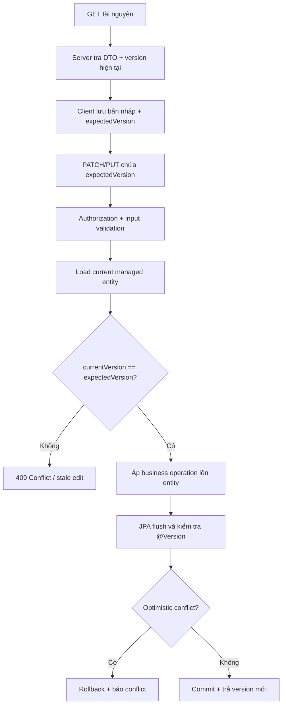
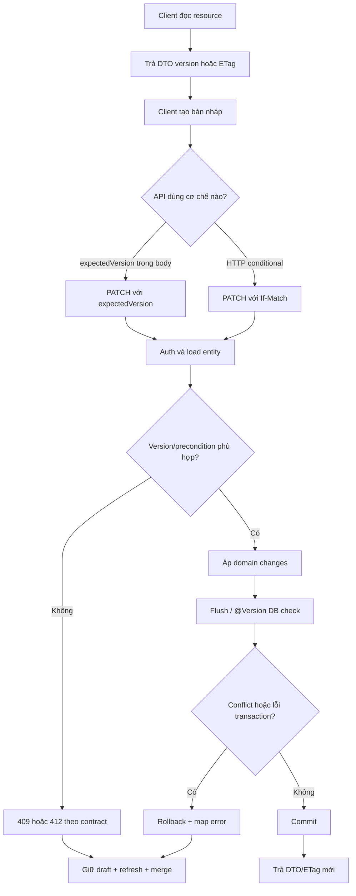

# Truyền phiên bản qua biên ứng dụng để phát hiện dữ liệu cũ

Một ứng dụng JPA thường có nhiều người dùng, nhiều request HTTP và nhiều giao dịch cùng thao tác trên một bản ghi. Người dùng A mở màn hình sửa đơn hàng, để đó vài phút; trong lúc ấy người dùng B cập nhật cùng đơn. Nếu A bấm **Lưu** với dữ liệu đã đọc từ trước, hệ thống cần biết đây là một thao tác dựa trên **phiên bản cũ** (*stale data*) để không âm thầm ghi đè thay đổi của B.

JPA cung cấp **optimistic locking** thông qua `@Version`. Nhưng HTTP request, giao diện web và mobile app không sống trong cùng một persistence context: từ lúc đọc dữ liệu đến lúc gửi bản sửa có thể cách nhau nhiều giây hoặc nhiều giờ. Vì thế, version phải được đưa **qua biên ứng dụng** như một phần của hợp đồng đọc/ghi.

Có hai thiết kế phổ biến:

- Trả trường `version` trong **DTO phản hồi** rồi nhận `expectedVersion` trong request cập nhật.
- Trả HTTP **`ETag`** rồi yêu cầu client gửi **`If-Match`** khi `PUT`/`PATCH`/`DELETE`.

Ở cả hai cách, backend **không được chỉ tin phiên bản do client khai**. Backend phải đọc entity hiện tại, áp dụng kiểm tra version thích hợp và để JPA thực hiện kiểm tra optimistic locking khi flush/commit. Version không thay thế authorization, transaction hay validation.

Ví dụ ngắn:

```json
// GET /api/orders/100
{
  "id": 100,
  "status": "NEW",
  "note": "Giao buổi sáng",
  "version": 7
}
```

Sau khi người dùng sửa ghi chú:

```json
// PATCH /api/orders/100
{
  "note": "Giao sau 15:00",
  "expectedVersion": 7
}
```

Nếu database đang ở version 8, API cần báo **conflict** thay vì ghi đè dựa trên version 7.

> **Tư tưởng chính:** `@Version` bảo vệ **giao dịch ở tầng persistence**; còn `expectedVersion` hoặc `If-Match` bảo vệ **ý định sửa dữ liệu đã quan sát ở một thời điểm trước đó**. Khi kết hợp đúng, ứng dụng có thể báo rõ “dữ liệu đã thay đổi, hãy tải lại hoặc giải quyết xung đột”, thay vì tạo lost update.

Bài học thuộc chương **Khóa lạc quan** của module **Data Persistence Relational Access ORM JPA**. Các ví dụ dùng Jakarta Persistence, Spring transaction/REST khi cần và Java 17+ cho `record`; nguyên lý chung áp dụng cả cho ứng dụng không dùng Spring.

---

## 1. Bài toán chỉnh sửa dữ liệu qua nhiều request

Giả sử PurchaseOrder#100 có:

```text
id      = 100
status  = NEW
note    = "Giao buổi sáng"
version = 7
```

Hai người dùng:

1. A mở màn hình chi tiết và nhận version 7.
2. B cũng mở màn hình và nhận version 7.
3. B sửa ghi chú, lưu thành công; version tăng thành 8.
4. A lưu form cũ, vẫn đang mang version 7.
5. Backend phải từ chối hoặc yêu cầu A xử lý xung đột.

Dòng thời gian:

```mermaid
sequenceDiagram
    participant A as Người dùng A
    participant B as Người dùng B
    participant API as HTTP API
    participant DB as Database
    A->>API: GET /orders/100
    API->>DB: SELECT Order#100
    DB-->>API: note=old, version=7
    API-->>A: DTO version=7
    B->>API: GET /orders/100
    API-->>B: DTO version=7
    B->>API: PATCH expectedVersion=7
    API->>DB: UPDATE ... WHERE version=7
    DB-->>API: Updated; version=8
    API-->>B: 200 / version=8
    A->>API: PATCH expectedVersion=7
    API->>DB: Read current version=8
    API-->>A: 409 Conflict / stale data
```

Nếu server chỉ nhận dữ liệu mới mà không nhận version, A có thể ghi đè note của B dù không hề thấy thay đổi vừa xảy ra.

## 2. Hai loại “dữ liệu cũ” cần phân biệt

**Stale edit / stale form**

Client mở form ở version 7; khi lưu, database đã sang version 8. Ngay cả khi transaction xử lý request A được mở **sau khi B đã commit**, A vẫn đang gửi một quyết định dựa trên dữ liệu cũ.

**Concurrent transaction conflict**

Hai transaction cùng đọc version 7, cùng sửa entity. Một transaction ghi trước và tăng version; giao dịch còn lại phát hiện conflict trong flush/commit.

Chỉ có `@Version` ở entity **không phải lúc nào cũng đủ** để phát hiện stale form:

```text
10:00  A GET version 7
10:01  B UPDATE → version 8
10:05  A PATCH note mới
10:05  Server find() → entity version 8
10:05  Server sửa entity version 8 và commit
```

Nếu A không truyền version 7, server chỉ thấy một entity mới nhất (version 8) và có thể cập nhật thành công. Điều đó đúng ở mức transaction lúc 10:05, nhưng **không bảo vệ ý định sửa dựa trên snapshot lúc 10:00**.

Vì vậy, ứng dụng cần **truyền phiên bản client đã quan sát**, không chỉ gắn annotation ở entity.

## 3. Optimistic locking ở tầng JPA hoạt động ra sao?

Entity:

```java
import jakarta.persistence.*;

@Entity
@Table(name = "purchase_orders")
public class PurchaseOrder {

    @Id
    private Long id;

    @Version
    @Column(name = "version", nullable = false)
    private Long version;

    @Column(name = "note")
    private String note;

    protected PurchaseOrder() {}

    public Long getVersion() { return version; }

    public void changeNote(String newNote) {
        this.note = newNote;
    }
}
```

Một SQL UPDATE mà JPA provider **có thể** tạo:

```sql
UPDATE purchase_orders
SET note = ?,
    version = 8
WHERE id = 100
  AND version = 7;
```

Nếu database không còn row thỏa `id=100 AND version=7`, provider phát hiện bản ghi đang managed đã lỗi thời và có thể ném `OptimisticLockException`. Trong Spring, lỗi có thể được dịch sang một exception thuộc họ `OptimisticLockingFailureException`.

**Đây là SQL minh họa**, không phải câu SQL cố định của mọi JPA provider. Điểm quan trọng là cơ chế kiểm tra revision và tăng version khi cập nhật managed entity.

### Ba thành phần cần đúng

- Entity có `@Version` được map hợp lệ.
- Giao dịch thực hiện sửa dữ liệu qua lifecycle mà provider quản lý.
- Các đường ghi khác không phá chính sách versioning (bulk JPQL/Criteria, native SQL, trigger, stored procedure).

Nếu một writer ngoài JPA thay database nhưng không cập nhật version nhất quán, cơ chế phát hiện xung đột có thể mất hiệu lực.

## 4. Kiểu version nên dùng

Với bài toán truyền version qua API, `Long` thường đơn giản:

```java
@Version
private Long version;
```

Ưu điểm:

- So sánh chính xác, không có vấn đề timezone.
- JSON number/opaque ETag đều dễ biểu diễn.
- Có trong danh sách kiểu version chuẩn từ các thế hệ JPA cũ.
- Dễ xây điều kiện `WHERE version = :expectedVersion` trong trường hợp cần compare-and-set.

Các kiểu phiên bản được phép có thay đổi theo spec:

| Đặc tả | Những kiểu version portable |
|---|---|
| JPA 2.2, Jakarta Persistence 3.0–3.1 | `short/Short`, `int/Integer`, `long/Long`, `java.sql.Timestamp` |
| Jakarta Persistence 3.2 | Các kiểu trên, thêm `java.time.Instant`, `java.time.LocalDateTime` |

Có thể dùng timestamp version nếu runtime/spec và database hỗ trợ, nhưng phải bảo toàn precision/timezone khi chuyển qua JSON hoặc ETag. Không dùng một timestamp bị làm tròn đến giây làm expectedVersion nếu database so sánh tới microsecond.

**Version là concurrency token, không phải nhất thiết là thời gian hiển thị.** Có thể lưu `updatedAt` riêng cho UX.

## 5. Mô hình ví dụ xuyên suốt

Ta định nghĩa một entity đặt hàng:

```java
import jakarta.persistence.*;
import java.time.Instant;

@Entity
@Table(name = "purchase_orders")
public class PurchaseOrder {

    @Id
    @GeneratedValue(strategy = GenerationType.IDENTITY)
    private Long id;

    @Column(name = "tenant_id", nullable = false)
    private String tenantId;

    @Enumerated(EnumType.STRING)
    @Column(name = "status", nullable = false)
    private OrderStatus status;

    @Column(name = "note", length = 500)
    private String note;

    @Column(name = "updated_at", nullable = false)
    private Instant updatedAt;

    @Version
    @Column(name = "version", nullable = false)
    private Long version;

    protected PurchaseOrder() {}

    public Long getId() { return id; }
    public String getTenantId() { return tenantId; }
    public OrderStatus getStatus() { return status; }
    public String getNote() { return note; }
    public Instant getUpdatedAt() { return updatedAt; }
    public Long getVersion() { return version; }

    public void changeNote(String newNote, Instant now) {
        this.note = newNote;
        this.updatedAt = now;
    }

    public void markPaid(Instant now) {
        if (status != OrderStatus.NEW) {
            throw new IllegalStateException(
                "Only NEW orders can be paid"
            );
        }
        this.status = OrderStatus.PAID;
        this.updatedAt = now;
    }
}
```

Enum:

```java
public enum OrderStatus {
    NEW,
    PAID,
    CANCELLED
}
```

DDL minh họa:

```sql
CREATE TABLE purchase_orders (
    id BIGINT PRIMARY KEY,
    tenant_id VARCHAR(60) NOT NULL,
    status VARCHAR(20) NOT NULL,
    note VARCHAR(500),
    updated_at TIMESTAMP NOT NULL,
    version BIGINT NOT NULL
);
```

Các câu DDL và Java generation strategy cần điều chỉnh cho database/dialect đích. Trong bài, mặc định `version` do **JPA provider** quản lý, không do business method tăng trực tiếp.

### Vì sao `tenantId` có mặt?

Cập nhật theo ID mà bỏ tenant/authorization có thể sửa dữ liệu của người dùng khác. Version chỉ kiểm tra **revision**, không kiểm tra **quyền truy cập**. Mọi command thực tế cần scope đọc/ghi phù hợp.

## 6. “Biên ứng dụng” là gì?

Một hệ thống nhiều tầng:

```text
Browser / Mobile client
      |
      | HTTP + JSON + ETag
      v
REST Controller / API Gateway
      |
      | DTO / Command chứa expectedVersion
      v
Application Service
      |
      | Transaction + domain operation
      v
Repository / EntityManager
      |
      | Managed entity @Version
      v
Database
```

Version có thể băng qua:

1. Database → JPA managed entity.
2. Entity → read DTO.
3. Read DTO → HTTP response.
4. Client lưu lại token version của snapshot đã thấy.
5. Client → write DTO/HTTP If-Match.
6. Controller → service command.
7. Service đối chiếu expectedVersion với current version.
8. JPA xác nhận optimistic lock lần cuối ở flush/commit.

**Không đưa managed entity trực tiếp qua HTTP** rồi cho client quyết định toàn bộ fields sẽ được merge. DTO giúp kiểm soát input, output, version và quyền độc lập.

## 7. Thiết kế read DTO mang version

Ví dụ DTO phản hồi:

```java
import java.time.Instant;

public record OrderEditView(
    Long id,
    OrderStatus status,
    String note,
    Instant updatedAt,
    Long version
) {}
```

Khi đọc entity:

```java
private static OrderEditView toEditView(PurchaseOrder order) {
    return new OrderEditView(
        order.getId(),
        order.getStatus(),
        order.getNote(),
        order.getUpdatedAt(),
        order.getVersion()
    );
}
```

JSON có thể là:

```json
{
  "id": 100,
  "status": "NEW",
  "note": "Giao buổi sáng",
  "updatedAt": "2026-04-10T09:00:00Z",
  "version": 7
}
```

**Version được trả vì client sẽ thực hiện thao tác ghi sau đó.** Nếu một endpoint chỉ đọc và không có workflow chỉnh sửa, không nhất thiết phải công khai version.

Không lầm:

- `id` = định danh đơn hàng.
- `updatedAt` = thời gian dùng cho UI/audit.
- `version` = revision để kiểm tra optimistic concurrency.

## 8. DTO yêu cầu cập nhật: dùng tên `expectedVersion`

Một command:

```java
import jakarta.validation.constraints.NotBlank;
import jakarta.validation.constraints.NotNull;

public record ChangeOrderNoteRequest(
    @NotBlank String note,
    @NotNull Long expectedVersion
) {}
```

Đặt tên `expectedVersion` giúp làm rõ:

- Client **không yêu cầu server đặt version bằng 7**.
- Client nói “tôi đã đọc version 7, chỉ sửa nếu điều này vẫn đúng”.
- Version mới được provider sinh sau khi UPDATE thành công.

Không xây API kiểu:

```json
{
  "id": 100,
  "note": "Giao sau 15:00",
  "version": 999
}
```

rồi blindly copy cả `version=999` vào managed entity. Version phải do provider quản lý.

### Why not `newVersion`?

Tên `newVersion` gợi ý client quyết định revision tương lai. Tên `expectedVersion`/`baseVersion`/`ifVersion` thường rõ hơn.

## 9. Quy trình đọc–sửa–lưu

Một workflow đúng:



Điểm dễ bị bỏ qua: **Bước kiểm tra currentVersion trong service và bước kiểm tra @Version ở tầng database là hai lớp khác nhau**, không nên bỏ một lớp nếu API muốn bảo vệ cả stale edit lẫn concurrent update.

## 10. Ví dụ service cập nhật với version từ DTO

Dùng EntityManager trong một Spring service. Mỗi command nhận tenant đáng tin cậy từ tầng authentication, thay vì chấp nhận tenant tùy ý từ body.

```java
import jakarta.persistence.EntityManager;
import jakarta.persistence.EntityNotFoundException;
import jakarta.persistence.PersistenceContext;
import java.time.Clock;
import java.util.Objects;
import org.springframework.stereotype.Service;
import org.springframework.transaction.annotation.Transactional;

@Service
public class OrderApplicationService {

    @PersistenceContext
    private EntityManager em;

    private final Clock clock;

    public OrderApplicationService(Clock clock) {
        this.clock = clock;
    }

    @Transactional(readOnly = true)
    public OrderEditView getForEdit(long id, String tenantId) {
        PurchaseOrder order = findVisibleOrder(id, tenantId);
        return toView(order);
    }

    @Transactional
    public OrderEditView changeNote(
            long id,
            String tenantId,
            ChangeOrderNoteRequest request) {

        PurchaseOrder order = findVisibleOrder(id, tenantId);

        if (!Objects.equals(
                order.getVersion(),
                request.expectedVersion())) {
            throw new StaleOrderException(
                "Order has changed since it was loaded"
            );
        }

        order.changeNote(request.note(), clock.instant());

        // Tùy nhu cầu: ép optimistic check xảy ra trước
        // khi tạo DTO phản hồi ngay trong method.
        em.flush();

        return toView(order);
    }

    private PurchaseOrder findVisibleOrder(
            long id, String tenantId) {

        return em.createQuery(
            """
            select o
            from PurchaseOrder o
            where o.id = :id
              and o.tenantId = :tenantId
            """,
            PurchaseOrder.class
        )
        .setParameter("id", id)
        .setParameter("tenantId", tenantId)
        .getResultStream()
        .findFirst()
        .orElseThrow(EntityNotFoundException::new);
    }

    private OrderEditView toView(PurchaseOrder o) {
        return new OrderEditView(
            o.getId(),
            o.getStatus(),
            o.getNote(),
            o.getUpdatedAt(),
            o.getVersion()
        );
    }
}
```

Exception nghiệp vụ:

```java
public class StaleOrderException extends RuntimeException {

    public StaleOrderException(String message) {
        super(message);
    }
}
```

### Cần hiểu đúng đoạn code

- `findVisibleOrder(...)` ràng buộc **ID và tenant** ngay trong query.
- `Objects.equals` so sánh nullable wrappers an toàn; bản request phải được validate để expectedVersion khác null.
- `changeNote(...)` sửa business fields nhưng **không sửa version**.
- `em.flush()` khiến provider gửi SQL và thực hiện optimistic check; **không commit transaction**.
- Transaction vẫn có thể thất bại ở commit do nguyên nhân khác.
- Spring transaction interceptor chỉ commit sau khi transactional method hoàn tất qua proxy.
- Exception được để lan ra ngoài transaction boundary để rollback phù hợp.

Nếu có chính sách phân quyền chi tiết hơn tenant, phải kiểm tra quyền người dùng trong service/domain tương ứng. Không dùng một query filter tenant làm cơ chế authorization đầy đủ trong mọi ứng dụng.

## 11. Vì sao không chỉ so sánh expectedVersion rồi `save()`?

Một anti-pattern:

```java
PurchaseOrder current = repository.findById(id)
    .orElseThrow();

if (Objects.equals(
        current.getVersion(), expectedVersion)) {
    // "Phiên bản khớp, vậy chắc chắn không ai đổi nữa."
}

current.changeNote(newNote, Instant.now());
repository.save(current);
```

So sánh ở thời điểm đọc chỉ phản ánh một **thời điểm**. Một transaction khác có thể commit **sau so sánh, trước flush**.

Nếu entity có `@Version` và ghi qua managed lifecycle, provider sẽ thực hiện check cuối tại database. Vì thế không nên tự viết SQL UPDATE chỉ theo ID rồi tin vào đoạn `if` trước đó.

### Timeline race

```text
T1: SELECT version=7
T1: if (expectedVersion==7) → true

T2: UPDATE ... WHERE version=7 → version=8, commit

T1: cố UPDATE ... WHERE version=7
    → 0 rows / OptimisticLockException
```

Trong trường hợp này, kiểm tra Java cho T1 **đã qua**, nhưng JPA optimistic locking vẫn phát hiện T2 cập nhật trước.

Đây là lý do quan trọng để giữ cả **compare-before-edit** và **@Version-at-flush**.

## 12. Vì sao `em.flush()` không phải `commit()`?

`flush()` đồng bộ các thay đổi của persistence context xuống database trong transaction đang mở. Nó giúp buộc phát hiện nhiều lỗi sớm hơn, bao gồm optimistic version conflicts, nhưng:

- Không làm transaction trở thành committed.
- Không bảo đảm dữ liệu đã bền vững.
- Không tự đảm bảo hệ thống khác có thể nhìn thấy thay đổi.
- Có thể flush **nhiều entity đang managed**, không chỉ Order đang sửa.
- Một số lỗi có thể phát sinh thêm ở commit.
- Exception ở transaction hoặc commit cần được xử lý ở boundary thích hợp.

Với service trả DTO có version mới, `em.flush()` có thể giúp entity được cập nhật revision trước khi map kết quả. Với những chiến lược **database-generated version**, cần kiểm tra cách provider refresh/generated value.

Không nên gửi HTTP success chỉ vì một lệnh flush đã chạy, trước khi transaction thực sự commit thành công.

## 13. Response sau cập nhật nên chứa gì?

Một response thành công:

```http
HTTP/1.1 200 OK
Content-Type: application/json

{
  "id": 100,
  "status": "NEW",
  "note": "Giao sau 15:00",
  "updatedAt": "2026-04-10T09:10:00Z",
  "version": 8
}
```

Client phải thay version đang lưu bằng version mới.

Nếu operation không trả body, có thể trả `204 No Content`; nhưng khi client còn tiếp tục chỉnh sửa, server nên cung cấp cách lấy version mới, ví dụ ETag response header hoặc GET lại tài nguyên.

**Không giữ expectedVersion=7** cho lần cập nhật kế tiếp sau khi đã lưu thành công và nhận version 8. Khi client vẫn gửi version 7, nó sẽ tự tạo conflict với chính bản sửa của mình.

## 14. Xử lý stale version bằng HTTP 409 Conflict

Với API dùng trường `expectedVersion` trong JSON, một phản hồi thường gặp:

```http
HTTP/1.1 409 Conflict
Content-Type: application/json

{
  "code": "STALE_ORDER",
  "message": "Đơn hàng đã được thay đổi. Hãy tải lại dữ liệu.",
  "resourceId": 100
}
```

`409 Conflict` thường phù hợp khi business operation xung đột với trạng thái hiện tại của resource và không dùng một HTTP conditional header.

Không nên trả `500 Internal Server Error` cho một conflict concurrency được dự kiến trong nghiệp vụ; đó là tình huống hợp lệ cần client xử lý.

### Không tiết lộ version/current data ngoài quyền xem

Nếu một user không có quyền truy cập Order#100, error response không nên tiết lộ:

- Có hay không order này trong tenant khác.
- Version hiện tại.
- Nội dung ghi chú mới.
- Tên người vừa sửa.

Authorization/visibility phải được đánh giá trước khi quyết định trả thông tin stale chi tiết.

## 15. Giao diện người dùng nên xử lý 409 như thế nào?

Một UX thực tế:

1. Giữ bản nháp user đang nhập, **không xóa form**.
2. Hiển thị thông báo “Dữ liệu đã thay đổi từ lúc bạn mở màn hình”.
3. Cho người dùng tải bản mới từ server.
4. So sánh các trường bị thay đổi nếu hệ thống hỗ trợ.
5. Cho chọn giữ bản hiện tại, áp một số thay đổi của mình hoặc sửa lại.
6. Gửi request mới với version của bản **đã được người dùng xem/xác nhận**.

Không tự động:

```text
Nhận 409 → GET version mới → đổi expectedVersion →
PATCH lại bản nháp cũ → không hỏi người dùng
```

vì cách đó có thể ghi đè thay đổi của người khác, vô hiệu hóa mục tiêu ngăn stale edit.

**Một retry mù quáng bằng version mới không phải giải quyết optimistic conflict.**

## 16. Ba chiến lược xử lý conflict

| Chiến lược | Mô tả | Khi nào phù hợp |
|---|---|---|
| **Reject and refresh** | Báo stale, yêu cầu tải lại | Form đơn giản, dữ liệu quan trọng |
| **Manual merge** | So sánh current và draft, cho user quyết định | Chỉnh sửa văn bản, nhiều trường |
| **Automatic merge có kiểm soát** | Chỉ hợp nhất thay đổi độc lập với quy tắc domain rõ | Tính năng collaborative hoặc command commutative |

Nếu hai người chỉnh hai trường độc lập, automatic merge đôi khi hợp lý; nhưng phải chứng minh merge policy không vi phạm invariants.

Ví dụ:

- A đổi shippingAddress.
- B đổi internalNote.
- Server có thể merge nếu version mới được đọc, cả hai trường độc lập và user/API contract cho phép.

Nhưng:

- A đổi tổng tiền.
- B đổi trạng thái thanh toán.

Không thể mặc định hai thay đổi này độc lập.

## 17. Dữ liệu server nên trả thêm khi conflict?

Một số API trả:

```json
{
  "code": "STALE_ORDER",
  "message": "Dữ liệu đã được cập nhật",
  "clientVersion": 7,
  "currentVersion": 8
}
```

Có thể thêm `currentVersion` nếu client **được phép xem** resource. Nhưng response chỉ chứa version không đủ cho người dùng quyết định merge; client có thể gọi GET mới.

Không nhất thiết gửi toàn bộ current entity trong error vì:

- Có thể lộ dữ liệu nhạy cảm.
- Response lỗi trở nên phức tạp.
- Bản mới có thể lại thay đổi sau đó.
- Có thể phá hợp đồng caching/ETag.

Một API có thể chỉ trả code ổn định và link/resource ID để GET lại theo quyền hiện tại.

---

## 18. HTTP ETag: một cách truyền phiên bản chuẩn ở biên REST

HTTP có cơ chế **entity tags** để điều kiện hóa request. Server có thể trả:

```http
GET /api/orders/100

HTTP/1.1 200 OK
Content-Type: application/json
ETag: "order-100-v7"

{
  "id": 100,
  "status": "NEW",
  "note": "Giao buổi sáng"
}
```

Khi client sửa:

```http
PATCH /api/orders/100
If-Match: "order-100-v7"
Content-Type: application/json

{
  "note": "Giao sau 15:00"
}
```

Server thực thi request chỉ khi precondition `If-Match` phù hợp với **current representation validator** của resource.

Nếu resource đã đổi:

```http
HTTP/1.1 412 Precondition Failed
Content-Type: application/json

{
  "code": "PRECONDITION_FAILED",
  "message": "Tài nguyên đã thay đổi từ lần đọc trước"
}
```

**`ETag` không phải JPA annotation.** Nó là HTTP representation validator. Một API có thể xây ETag dựa trên `@Version` khi chính sách cập nhật version bao phủ toàn bộ thay đổi của representation.

## 19. `If-Match` và `If-None-Match` không giống nhau

Hai HTTP headers thường bị nhầm:

| Header | Ý nghĩa thường gặp | Use case |
|---|---|---|
| `If-Match` | Chỉ thực hiện nếu current validator phù hợp | Chống ghi đè dữ liệu cũ khi PUT/PATCH/DELETE |
| `If-None-Match` | Chỉ thực hiện nếu current validator **không phù hợp** | Cache revalidation GET, conditional create |

Đối với cập nhật dựa trên version đã đọc, header chính là:

```http
If-Match: "order-100-v7"
```

Một GET có `If-None-Match` có thể nhận `304 Not Modified` nếu representation chưa đổi; đây là **cache validation**, không phải bằng chứng “client được quyền ghi”.

Đừng dùng kết quả GET 304 làm thay thế cho điều kiện If-Match trên request ghi sau đó.

## 20. Mã HTTP thường dùng

| Tình huống | Mã phổ biến |
|---|---:|
| GET thành công | `200 OK` |
| PATCH/PUT thành công có body | `200 OK` |
| UPDATE thành công không có body | `204 No Content` |
| JSON expectedVersion bị stale, không dùng HTTP precondition | `409 Conflict` |
| `If-Match` không khớp theo HTTP precondition | `412 Precondition Failed` |
| API bắt buộc conditional request nhưng client không gửi điều kiện | `428 Precondition Required` |
| Body/header không hợp lệ về cú pháp | `400 Bad Request` |
| Resource không tồn tại/không thể nhìn thấy theo chính sách | `404 Not Found` hoặc cơ chế access control tương ứng |
| Không có quyền | `403 Forbidden` khi chính sách cho phép tiết lộ |
| Input vi phạm ràng buộc nghiệp vụ | `400/422/409` tùy contract |

Không đưa mọi optimistic lock failure vào `500`. Nhưng cũng không kết luận mọi `PersistenceException` đều là stale data: constraint violation, connection error và transaction failure có cách xử lý khác.

## 21. 409 và 412 khác nhau ở đâu?

**409 Conflict** thường mô tả conflict với trạng thái resource ở mức ứng dụng, đặc biệt khi client gửi `expectedVersion` trong JSON body.

**412 Precondition Failed** có semantics chính thức của HTTP: request chứa điều kiện như `If-Match` nhưng điều kiện không thỏa.

Ví dụ:

```http
PATCH /api/orders/100
If-Match: "order-100-v7"
```

Current ETag = `"order-100-v8"` ⇒ `412`.

Nếu API **không** dùng HTTP precondition mà chỉ nhận JSON expectedVersion và conflict ⇒ `409` là lựa chọn thông dụng.

Không có quy tắc “mọi optimistic locking exception luôn phải trả 409” bất kể request đã dùng If-Match hay chưa. Hãy chọn theo contract REST và semantics của precondition.

## 22. 428 Precondition Required khi cần bắt buộc gửi version

Nếu API có chính sách “mọi thao tác cập nhật phải là conditional write”:

```http
PATCH /api/orders/100
Content-Type: application/json

{"note":"Giao sau 15:00"}
```

không chứa `If-Match`, server có thể trả:

```http
HTTP/1.1 428 Precondition Required
Content-Type: application/json

{
  "code": "PRECONDITION_REQUIRED",
  "message": "Hãy tải resource và gửi If-Match hợp lệ"
}
```

Một API chỉ dùng `expectedVersion` trong JSON có thể trả 400 khi thiếu field bắt buộc. `428` đặc biệt phù hợp với thiết kế HTTP conditional request.

Không nên tự động mặc định expectedVersion bằng version hiện tại khi request thiếu precondition. Làm vậy sẽ chuyển thao tác stale thành blind overwrite.

## 23. Strong ETag và weak ETag

HTTP ETag có hai dạng:

**Strong:**

```http
ETag: "order-100-v7"
```

**Weak:**

```http
ETag: W/"order-100-v7"
```

Đối với **`If-Match`**, HTTP sử dụng **strong comparison**. Một weak ETag không thỏa strong comparison chỉ vì phần opaque tag text giống nhau.

Vì vậy, khi chọn ETag làm cơ chế cập nhật có điều kiện:

- Sử dụng **strong ETag** phù hợp representation semantics.
- Không dùng `W/"..."` cho If-Match rồi coi tương đương tag strong.
- Không cắt bỏ chữ `W/` tùy tiện trong parser.
- Không thay HTTP ETag bằng chuỗi “version=7” không theo cú pháp entity-tag.

Nếu muốn hỗ trợ caching GET và conditional writes bằng cùng một ETag, phải thiết kế validator phù hợp cả hai use cases.

## 24. Có thể dùng `@Version` để tạo strong ETag không?

**Có điều kiện.**

Một entity version có thể làm ETag nếu mọi thay đổi liên quan đến **representation** của resource đều làm ETag thay đổi phù hợp, và chính sách biểu diễn không khiến hai response khác nhau đáng kể chia sẻ cùng một strong validator.

Ví dụ JSON của order chứa:

```json
{
  "id": 100,
  "status": "NEW",
  "note": "Giao buổi sáng",
  "version": 7
}
```

Nếu `status`, `note` và mọi field có trong representation chỉ thay đổi qua một cơ chế đảm bảo tăng root Order.version, tag như `"order-100-v7"` có thể là một lựa chọn.

**Nhưng nếu response cũng chứa:**

```json
{
  "id": 100,
  "version": 7,
  "customerName": "An",
  "latestShipment": "Đang giao"
}
```

mà Customer/Shipment được cập nhật **không làm Order.version tăng**, JSON representation có thể đổi trong khi ETag vẫn `"order-100-v7"`. Khi đó tag không còn biểu diễn đầy đủ sự thay đổi của representation theo strong validator semantics.

Các giải pháp:

- Thiết kế resource representation chỉ bao gồm state được root version bao phủ.
- Tạo ETag từ hash của representation thực tế đã chuẩn hóa.
- Tổng hợp những version liên quan và đảm bảo thay đổi representation được phản ánh.
- Dùng validator riêng cho read representation và cơ chế expectedVersion cho write aggregate.
- Không gắn nhãn “strong” chỉ vì token không có tiền tố `W/`; semantics mới quyết định hợp lệ.

**Một JPA entity version không tự động là strong ETag cho mọi JSON view.**

## 25. ETag không phải authorization token

Client có thể thấy:

```http
ETag: "order-100-v7"
```

Nhưng điều đó không chứng minh client:

- Được quyền cập nhật Order#100.
- Thuộc tenant sở hữu order.
- Được quyền đổi status từ NEW sang PAID.
- Có quyền truy cập các dữ liệu nhạy cảm khác.
- Được dùng một cursor/version của người khác.

**Version và ETag chỉ xác định trạng thái**, không cấp quyền.

Ở mọi request ghi, server vẫn phải xác thực user/tenant và kiểm tra domain authorization. Không nhận `tenantId` từ body rồi tin đó là tenant của caller.

## 26. Cấu trúc ETag và quyền tiết lộ thông tin

Một ETag đơn giản:

```http
ETag: "order-100-v7"
```

có thể tiết lộ ID và số version. Nhiều API chấp nhận điều này, nhưng nếu chính sách yêu cầu token khó suy đoán, có thể dùng opaque token được ký/hash tùy thiết kế.

Không nên nghĩ:

- “Base64 là bảo mật.”
- “ETag không đoán được thì khỏi kiểm tra quyền.”
- “ETag chữ ký hợp lệ nghĩa client còn quyền”.

ETag dù opaque vẫn **không thay thế** authorization. Nếu sign token, phải xác định vòng đời key, expiry/versioning nếu phù hợp, và xử lý replay/concurrency.

## 27. HTTP If-Match có thể là danh sách tag

HTTP cho phép If-Match có nhiều entity tags hoặc wildcard:

```http
If-Match: "order-100-v7", "order-100-v8"
```

Hoặc:

```http
If-Match: *
```

Ngữ nghĩa:

- Danh sách: precondition có thể thỏa nếu **ít nhất một strong ETag** phù hợp current validator.
- `*`: yêu cầu tài nguyên đích có current representation phù hợp về tồn tại, **không phải** yêu cầu exact version.

Nếu API của bạn bắt buộc *exact revision token* để tránh stale edits, phải quyết định contract có chấp nhận nhiều tags/`*` hay không, và tránh parser tự ý “bắt số version đầu tiên”.

Một ví dụ học tập có thể giới hạn **chỉ một strong tag** trong endpoint, nhưng khi đó phải ghi rõ đó là **hợp đồng con của API** và xử lý các trường hợp HTTP precondition khác đúng chính sách; không trình bày parser đơn giản như HTTP parser tổng quát.

## 28. Điều gì xảy ra nếu resource chưa tồn tại?

Khi client gửi:

```http
PATCH /api/orders/100
If-Match: "order-100-v7"
```

nhưng resource đã bị xóa, có thể không có current representation để tag khớp. Với HTTP conditional semantics, `If-Match` không thỏa; response có thể là 412 theo cách xử lý precondition thích hợp. API cũng phải xác định behavior cho resource không nhìn thấy vì authorization.

**Đừng tiết lộ sự tồn tại của resource thuộc tenant khác** qua sự khác biệt lỗi một cách vô tình. Chính sách access control và semantics HTTP cần được thiết kế cùng nhau.

---

## 29. REST Controller cho JSON expectedVersion

Một controller Spring đơn giản:

```java
import jakarta.validation.Valid;
import org.springframework.http.ResponseEntity;
import org.springframework.web.bind.annotation.*;

@RestController
@RequestMapping("/api/orders")
public class OrderController {

    private final OrderApplicationService orders;
    private final TenantContext tenantContext;

    public OrderController(
            OrderApplicationService orders,
            TenantContext tenantContext) {
        this.orders = orders;
        this.tenantContext = tenantContext;
    }

    @GetMapping("/{id}")
    public OrderEditView get(@PathVariable long id) {
        return orders.getForEdit(
            id, tenantContext.currentTenantId()
        );
    }

    @PatchMapping("/{id}/note")
    public OrderEditView changeNote(
            @PathVariable long id,
            @Valid @RequestBody ChangeOrderNoteRequest request) {

        return orders.changeNote(
            id,
            tenantContext.currentTenantId(),
            request
        );
    }
}
```

`TenantContext` là adapter **giả định** do ứng dụng triển khai, lấy tenant từ identity/security context đã xác thực. Nó không phải interface chuẩn JPA/Spring có sẵn trong mọi dự án.

Controller không tự nhận `tenantId` từ request body như một nguồn sự thật.

### Transaction nên nằm ở đâu?

- Controller xử lý HTTP, mapping và security context.
- Application service sở hữu transaction, domain changes và precondition.
- Repository/EntityManager thực hiện persistence.
- Error handler biến conflict thành HTTP response **sau khi transaction rollback**.

Không đặt logic persist/commit trực tiếp khắp các controller chỉ để giảm số class.

## 30. Xử lý exception bên ngoài transaction

Khi request stale trước khi sửa entity, ta ném:

```java
throw new StaleOrderException(
    "Order has changed since it was loaded"
);
```

Và khi xung đột do race tại flush/commit, provider có thể ném:

```java
jakarta.persistence.OptimisticLockException
```

hoặc Spring dịch sang:

```java
org.springframework.dao.OptimisticLockingFailureException
```

Một `@RestControllerAdvice`:

```java
import jakarta.persistence.OptimisticLockException;
import org.springframework.dao.OptimisticLockingFailureException;
import org.springframework.http.HttpStatus;
import org.springframework.http.ResponseEntity;
import org.springframework.web.bind.annotation.*;

@RestControllerAdvice
public class ConflictHandler {

    public record ErrorBody(
        String code,
        String message
    ) {}

    @ExceptionHandler(StaleOrderException.class)
    public ResponseEntity<ErrorBody> stale(
            StaleOrderException ex) {
        return ResponseEntity.status(HttpStatus.CONFLICT)
            .body(new ErrorBody(
                "STALE_ORDER",
                "Dữ liệu đã thay đổi. Hãy tải lại."
            ));
    }

    @ExceptionHandler({
        OptimisticLockException.class,
        OptimisticLockingFailureException.class
    })
    public ResponseEntity<ErrorBody> optimisticFailure(
            RuntimeException ex) {
        return ResponseEntity.status(HttpStatus.CONFLICT)
            .body(new ErrorBody(
                "OPTIMISTIC_LOCK_CONFLICT",
                "Có cập nhật đồng thời. Vui lòng thử lại sau khi tải lại."
            ));
    }
}
```

Cấu trúc xử lý exception cụ thể phụ thuộc phiên bản Spring/provider và exception wrapping. Trong ứng dụng thực tế, cần kiểm tra translation chain, transactional proxy và mapping handler.

**Tại sao error handler nằm ngoài transactional method?**

Khi `OptimisticLockException` xảy ra, transaction có thể đã rollback-only/aborted. Catch nó ở service rồi tiếp tục sửa/commit trong cùng transaction là nguy hiểm. Để transaction boundary xử lý rollback trước khi biến lỗi thành response thường rõ ràng hơn.

## 31. Khi nào trả 412 thay vì 409 trong controller?

Nếu endpoint dùng HTTP `If-Match`, có thể định nghĩa exception nghiệp vụ riêng:

```java
public class PreconditionFailedException
        extends RuntimeException {
    public PreconditionFailedException() {
        super("If-Match did not match current representation");
    }
}
```

Error handler:

```java
@ExceptionHandler(PreconditionFailedException.class)
@ResponseStatus(HttpStatus.PRECONDITION_FAILED)
public ErrorBody preconditionFailed() {
    return new ErrorBody(
        "PRECONDITION_FAILED",
        "Tài nguyên đã thay đổi. Hãy tải lại."
    );
}
```

Đoạn trên đặt trong controller advice giả định có `ErrorBody` và imports tương ứng.

Nếu request có If-Match mà database phát hiện optimistic conflict **sau** khi server đã kiểm tra precondition, cần map lỗi theo semantics của HTTP conditional request và kiến trúc hiện tại. Phần lớn API chọn 412 cho thao tác dựa trên If-Match bị stale; 409 vẫn phù hợp với conflict domain độc lập với precondition.

**Không dùng một HTTP status duy nhất cho mọi loại lỗi bất kể cơ chế API.**

## 32. Ví dụ tạo ETag khi GET

Một Spring REST controller có thể tạo tag từ view nếu đã bảo đảm mọi thay đổi representation đều đổi version:

```java
@GetMapping("/{id}/edit-view")
public ResponseEntity<OrderEditView> getEditView(
        @PathVariable long id) {

    OrderEditView view = orders.getForEdit(
        id, tenantContext.currentTenantId()
    );

    String etag = "\"order-" + view.id()
        + "-v" + view.version() + "\"";

    return ResponseEntity.ok()
        .eTag(etag)
        .body(view);
}
```

Spring ResponseEntity hỗ trợ đặt ETag; ví dụ dùng giá trị đã có dấu ngoặc kép theo cú pháp HTTP.

**Đây là mẫu mã hóa tag cho một representation chỉ phụ thuộc version của Order.** Nếu view còn chứa thông tin Customer, Shipping hay dữ liệu aggregate từ nơi khác, phải xem lại strong ETag như phần 24.

### GET 200 với version và ETag

Có thể trả **cả hai**:

- `version` trong DTO tiện làm expectedVersion ở JSON command.
- `ETag` tiện dùng với HTTP If-Match.

Nhưng nếu API hỗ trợ cả hai cơ chế ghi, phải xác định cơ chế nào là nguồn precondition và làm gì khi chúng mâu thuẫn. Đừng nhận một expectedVersion=7 trong body và If-Match v8 rồi âm thầm chọn một giá trị.

## 33. Controller xử lý If-Match: tách parse khỏi business service

Ví dụ hợp đồng endpoint:

```http
PATCH /api/orders/100/note
If-Match: "order-100-v7"
Content-Type: application/json

{"note":"Giao sau 15:00"}
```

Trong controller:

```java
@PatchMapping("/{id}/note")
public ResponseEntity<OrderEditView> updateWithIfMatch(
        @PathVariable long id,
        @RequestHeader("If-Match") String ifMatch,
        @RequestBody ChangeNoteOnlyBody body) {

    long expectedVersion =
        etagService.requireSingleStrongOrderTag(
            id, ifMatch
        );

    ChangeOrderNoteRequest cmd =
        new ChangeOrderNoteRequest(
            body.note(), expectedVersion
        );

    OrderEditView updated = orders.changeNote(
        id, tenantContext.currentTenantId(), cmd
    );

    return ResponseEntity.ok()
        .eTag(etagService.formatOrderTag(
            updated.id(), updated.version()
        ))
        .body(updated);
}
```

Ở đây:

- `ChangeNoteOnlyBody` là DTO có field `note`.
- `etagService` là **thành phần ứng dụng giả định** cần triển khai để parse/validate/format đúng contract.
- `requireSingleStrongOrderTag` chỉ chấp nhận một tag strong theo hợp đồng endpoint, không phải parser toàn bộ trường hợp If-Match của HTTP.
- Nếu client gửi `If-Match` không khớp, service báo precondition failure hoặc stale conflict theo chính sách.
- Cần validate `body.note()` và quyền cập nhật.

Đây là mẫu **phân tách trách nhiệm**, không phải một đoạn copy-paste độc lập có thể chạy nếu chưa có các lớp liên quan.

### Vì sao không parse bằng `split("-")`?

Một ETag có thể chứa các ký tự được HTTP cho phép, phiên bản format thay đổi, hoặc có nhiều tags. Parser “cắt dấu gạch nối” rất dễ tạo lỗi. Hãy có định dạng versioned rõ ràng và parser dành riêng có kiểm tra cú pháp, prefix resource, kiểu số, overflow và tag loại weak.

Đừng lấy ETag của Order#100 rồi dùng cho Order#200 chỉ vì cùng version=7. Token cần gắn đúng resource/representation.

## 34. If-Match với body version: tránh hợp đồng mơ hồ

Giả sử client gửi:

```http
If-Match: "order-100-v8"
Content-Type: application/json

{
  "note": "Giao sau 15:00",
  "expectedVersion": 7
}
```

Có ba hướng thiết kế:

1. **Chỉ chấp nhận If-Match**: không có expectedVersion trong body.
2. **Chỉ chấp nhận expectedVersion**: không sử dụng If-Match làm write precondition.
3. **Cho phép cả hai nhưng bắt buộc khớp**: nếu không, từ chối request.

Hướng nào cũng có thể có lý do, nhưng phải tài liệu hóa rõ. Không âm thầm ưu tiên If-Match trong endpoint A và body version trong endpoint B.

Càng ít nguồn phiên bản cần giữ đồng bộ, càng ít bug.

## 35. Client state: lưu version cùng snapshot

Trong frontend:

```text
orderDraft = {
  id: 100,
  note: "Giao buổi sáng",
  baseVersion: 7
}
```

Khi user sửa field note:

```text
orderDraft = {
  id: 100,
  note: "Giao sau 15:00",
  baseVersion: 7
}
```

**Không tăng baseVersion khi người dùng gõ**. Version phải phản ánh snapshot server mà form đang dựa vào.

Sau PATCH thành công:

```text
serverResponse.version = 8

orderDraft.baseVersion = 8
orderDraft.note = serverResponse.note
```

Nếu bị 409/412:

- Giữ bản nháp.
- Không thay version bằng v8 rồi gửi lại ngay.
- GET bản mới và đưa ra conflict resolution UX.
- Chỉ tạo command mới với v8 khi người dùng hoặc merge policy đã chấp nhận cập nhật dựa trên dữ liệu mới.

## 36. Multiple tabs và offline clients

Version đặc biệt quan trọng khi:

- Người dùng mở hai tab cùng một bản ghi.
- Mobile app làm việc khi mạng chập chờn.
- Người dùng mở form lâu rồi quay lại.
- Một background job thay đổi dữ liệu.
- Các microservices cùng ghi vào một database.
- Người dùng A sửa từ laptop, B sửa từ điện thoại.

Ví dụ tab 1 lưu thành công v8; tab 2 vẫn giữ v7. Khi tab 2 gửi PATCH, server từ chối. Không cần chia sẻ Java transaction hay persistence context giữa hai tabs.

**Không dựa vào “form chỉ tồn tại vài giây” để bỏ expectedVersion.** Cả hai request có thể rất gần nhau mà vẫn có xung đột.

## 37. Tại sao không mở database transaction suốt phiên chỉnh sửa?

Một thiết kế sai:

```text
GET edit form
  BEGIN transaction
  giữ EntityManager và DB locks mở 10 phút
PATCH form
  COMMIT
```

Giữ transaction dài qua nhiều HTTP requests gây:

- Giữ connection/locks lâu.
- Tăng contention.
- Dễ hết timeout.
- Khó scale nhiều người dùng.
- Lỗi phân tán/session recovery phức tạp.

Thiết kế đúng thường là:

```text
Request GET:
  transaction ngắn → trả DTO + version → đóng

Thời gian user chỉnh:
  không có DB transaction dài

Request PATCH:
  transaction mới → kiểm expectedVersion
  → cập nhật managed entity → commit hoặc rollback
```

Đây là cách optimistic concurrency phù hợp cho **long-running business conversation** với nhiều request, nhưng không giữ long-running physical transaction.

## 38. @Version và @UpdateTimestamp khác nhau

Một entity:

```java
@Version
private Long version;

private Instant updatedAt;
```

có hai nhiệm vụ rõ ràng:

- `version` dùng cho optimistic locking.
- `updatedAt` dùng cho audit/hiển thị.

Một provider như Hibernate có annotation `@UpdateTimestamp` cho audit field, nhưng nó **không thay thế `@Version`** trừ khi field được mapping với semantics version phù hợp.

Không so sánh client `updatedAt` đã format đến phút:

```text
"2026-04-10 09:10"
```

như một version nếu DB lưu microseconds và nhiều updates có thể xảy ra trong cùng phút.

**Số phiên bản chính xác dễ bảo toàn qua API hơn chuỗi thời gian hiển thị.**

## 39. Dữ liệu bị stale do persistence context, không chỉ do client

Ngoài stale edit ở HTTP boundary, có stale data trong JPA persistence context.

Giả sử:

```java
PurchaseOrder order =
    em.find(PurchaseOrder.class, 100L);

// Trong cùng transaction có bulk JPQL hoặc native SQL
// cập nhật row 100 ở database.
```

Sau bulk update, `order.getVersion()` có thể vẫn là version cũ trong Java, vì bulk DML không tự cập nhật mọi managed entity instance.

Nếu server dùng version từ một object stale như currentVersion để kiểm tra request, có thể kết luận sai.

Giải pháp tùy workflow:

- Tránh trộn bulk DML và managed entity state trên cùng row.
- Flush pending changes trước bulk.
- Refresh/reload/clear với nhận thức về pending changes.
- Đảm bảo mọi write path cùng chính sách version.
- Dùng query/load phù hợp vào thời điểm transaction cần dữ liệu.

Không tưởng `find()` lần thứ hai trong cùng EntityManager luôn query DB lại; first-level cache có thể trả cùng instance.

## 40. Mỗi transaction vẫn có thể bị optimistic conflict

Ngay cả khi request gửi expectedVersion đúng và service tải managed entity phiên bản mới nhất, giao dịch khác vẫn có thể ghi trước khi service commit.

Với hai requests:

```text
Request A: expectedVersion=7
Request B: expectedVersion=7

A read current v7
B read current v7

A changes note
B changes note

A UPDATE ... WHERE version=7 → v8
B UPDATE ... WHERE version=7 → 0 rows → conflict
```

Nếu chỉ có Java `if (version == expectedVersion)` rồi SQL UPDATE theo ID, cả hai request có thể vượt qua kiểm tra và lần cuối ghi đè lần trước.

**Giữ kiểm tra version trong WHERE ở database** thông qua managed JPA `@Version` hoặc compare-and-set SQL được thiết kế tường minh.

---

## 41. Cập nhật trực tiếp bằng JPQL bulk UPDATE: trường hợp đặc biệt

Một số service cần tránh tải entity vì update rất đơn giản. Có thể dùng compare-and-set với numeric version:

```java
@Modifying
@Query("""
    update PurchaseOrder o
       set o.note = :note,
           o.updatedAt = :now,
           o.version = o.version + 1
     where o.id = :id
       and o.tenantId = :tenant
       and o.version = :expectedVersion
    """)
int changeNoteIfVersion(
    @Param("id") Long id,
    @Param("tenant") String tenant,
    @Param("expectedVersion") Long expectedVersion,
    @Param("note") String note,
    @Param("now") Instant now
);
```

Ý tưởng SQL:

```sql
UPDATE purchase_orders
   SET note = ?,
       updated_at = ?,
       version = version + 1
 WHERE id = ?
   AND tenant_id = ?
   AND version = ?;
```

Kết quả:

- `affectedRows == 1`: một row thỏa precondition đã được cập nhật.
- `affectedRows == 0`: không tìm thấy row, không có quyền theo tenant hoặc version sai.
- `affectedRows > 1`: bất thường nếu ID là primary key; cần điều tra.

**Quan trọng:** Đây là **JPQL bulk DML**, không phải automatic optimistic locking của managed entity. Code phải tự bảo đảm điều kiện version, version increment, audit, validation và cache synchronization. Cách này chỉ minh họa numeric version; không áp `version + 1` cho temporal version.

## 42. Bulk UPDATE không phát sinh entity lifecycle callbacks

Khi dùng:

```java
em.createQuery("update PurchaseOrder o set ...")
    .executeUpdate();
```

hoặc `CriteriaUpdate`:

- JPA không tải/sửa từng managed entity.
- `@PreUpdate`/`@PostUpdate` không chạy cho từng row theo lifecycle.
- `@Version` không tự được tăng/check như dirty checking.
- Managed entities đang nạp có thể stale.
- Spring Data `@Modifying` có thể hỗ trợ flush/clear flags nhưng không tự biến bulk update thành entity lifecycle.

Nếu domain method `markPaid()` kiểm tra order đang NEW, một JPQL bulk update chỉ đổi status mà không có predicate tương ứng có thể cho phép trạng thái sai.

**CAS bulk update** hữu ích cho command đơn giản, nhưng phải đưa mọi precondition nghiệp vụ vào WHERE và có chính sách audit/concurrency phù hợp.

## 43. Không tự động coi affectedRows=0 là version mismatch

Trong câu:

```sql
UPDATE purchase_orders
SET note = ?, version = version + 1
WHERE id = ?
  AND tenant_id = ?
  AND version = ?;
```

`0 rows` có thể do:

- ID không tồn tại.
- ID có tồn tại nhưng thuộc tenant khác.
- Resource bị soft-deleted và query có filter.
- Version không khớp.
- Một predicate trạng thái khác không thỏa.

**Không dùng count=0 để tiết lộ tài nguyên tenant khác.**

Ứng dụng có thể chọn một thông điệp chung kiểu “không thể cập nhật theo precondition”, hoặc truy vấn lại có ràng buộc security để phân biệt not-found với stale khi được phép.

## 44. Khi viết CAS bằng CriteriaUpdate

Ví dụ:

```java
CriteriaBuilder cb = em.getCriteriaBuilder();

CriteriaUpdate<PurchaseOrder> update =
    cb.createCriteriaUpdate(PurchaseOrder.class);

Root<PurchaseOrder> o =
    update.from(PurchaseOrder.class);

Path<Long> version =
    o.<Long>get("version");

update.set(o.get("note"), newNote);
update.set(o.get("updatedAt"), now);
update.set(version, cb.sum(version, 1L));

update.where(
    cb.equal(o.get("id"), orderId),
    cb.equal(o.get("tenantId"), tenantId),
    cb.equal(version, expectedVersion)
);

int count = em.createQuery(update).executeUpdate();
```

Ví dụ này chỉ áp dụng khi `version` là numeric type tương thích. Truy vấn phải chạy trong write transaction và kiểm tra `count`.

So với managed entity:

| Tiêu chí | Managed @Version | Bulk compare-and-set |
|---|---|---|
| Tải entity trước khi sửa | Thường có | Không nhất thiết |
| Domain methods/callbacks | Có thể dùng | Bị bỏ qua |
| Version check | Provider quản lý | Query tự viết |
| Version increment | Provider quản lý | Query tự viết |
| Persistence context | Đồng bộ cho managed entity theo lifecycle | Có thể stale |
| Điều kiện nghiệp vụ phức tạp | Dễ diễn đạt trong domain | Phải đưa đủ vào query |
| Phù hợp | CRUD/domain aggregate | Conditional set-based command đơn giản |

Không chọn bulk CAS chỉ vì ít dòng Java hơn nếu correctness dựa vào domain logic của entity.

## 45. Khi update có nhiều trường và invariants

Một request gửi:

```json
{
  "status": "PAID",
  "note": "Đã thanh toán",
  "expectedVersion": 7
}
```

Domain có thể yêu cầu:

- Chỉ NEW → PAID.
- Không thể trả PAID khi chưa xác nhận payment.
- User phải có quyền.
- Ghi audit hoặc phát domain event.
- Cập nhật những entity khác trong cùng transaction.

Trong trường hợp này, đọc managed entity, kiểm expectedVersion, áp domain method và để JPA `@Version` xử lý thường an toàn hơn một bulk UPDATE viết rời rạc.

**Version là một điều kiện cần cho chống ghi đè, không thay thế các business invariants.**

## 46. Truyền version khi xóa entity

Nếu client đã xem một order version 7 rồi bấm Delete, tài nguyên có thể đã thay đổi thành version 8. Xóa không có precondition có thể xóa những dữ liệu user chưa từng thấy.

Với HTTP:

```http
DELETE /api/orders/100
If-Match: "order-100-v7"
```

Hoặc JSON command nội bộ:

```java
public record DeleteOrderCommand(
    Long expectedVersion
) {}
```

Một service dùng managed lifecycle:

```java
@Transactional
public void deleteOrder(
        long id,
        String tenantId,
        long expectedVersion) {

    PurchaseOrder order = findVisibleOrder(id, tenantId);

    if (!Objects.equals(
            order.getVersion(),
            expectedVersion)) {
        throw new StaleOrderException("Order changed");
    }

    validateDeletionAllowed(order);

    em.remove(order);

    // @Version/lifecycle/FK constraints vẫn phải
    // được giải quyết khi flush/commit.
}
```

`findVisibleOrder` và `validateDeletionAllowed` là helpers của service cần triển khai thật.

Nếu dùng JPQL bulk DELETE:

```jpql
DELETE FROM PurchaseOrder o
WHERE o.id = :id
  AND o.tenantId = :tenant
  AND o.version = :expectedVersion
```

cần nhớ bulk DELETE bỏ qua JPA cascade/remove callbacks và không tự quản lý child entities như `em.remove()`. FK constraint có thể chặn.

## 47. Soft delete với expectedVersion

Thay vì xóa vật lý, nhiều hệ thống dùng:

```java
private Instant deletedAt;
```

Khi user gửi command xóa:

1. Đọc managed entity theo ID và tenant.
2. Kiểm expectedVersion.
3. Áp method domain như `order.softDelete(now)`.
4. Flush để JPA cập nhật version.
5. Trả 204 hoặc DTO/version mới theo contract.

Nếu dùng CAS:

```sql
UPDATE purchase_orders
SET deleted_at = :now,
    version = version + 1
WHERE id = :id
  AND tenant_id = :tenant
  AND version = :expectedVersion
  AND deleted_at IS NULL;
```

Phải kiểm tra số rows và không lầm 0 row thành “stale” trong mọi trường hợp: resource có thể đã được soft-delete.

Soft delete cũng cần query/read filters và chính sách quyền truy cập nhất quán.

## 48. Cập nhật bản ghi con có làm root version tăng không?

Giả sử:

```text
Order#100 version=7
  ├── Line#1 quantity=2
  └── Line#2 quantity=1
```

Một request sửa OrderLine#1:

```java
line.changeQuantity(3);
```

Nếu OrderLine là entity riêng, **không mặc định** điều đó khiến `PurchaseOrder.version` tăng. Có thể root Order vẫn version 7.

Nếu GET detail có ETag từ Order.version nhưng chứa Lines, representation có thể đổi mà ETag không đổi.

Giải pháp tùy domain:

- Nếu Order và Lines là một aggregate cần một revision thống nhất, sửa thông qua root và bảo đảm root version tăng khi có child changes, chẳng hạn strategy dùng `OPTIMISTIC_FORCE_INCREMENT` khi thật sự cần.
- Dùng version riêng cho từng Line nếu thao tác independent theo Line.
- Xây ETag từ nhiều phiên bản của những dữ liệu được đại diện.
- Hoặc dùng hash của representation cho HTTP cache validation.
- Không gắn strong ETag một root version lên mọi view chứa child data nếu child thay độc lập.

**Chọn ranh giới version theo ranh giới nghiệp vụ**, không chỉ theo số lượng entity classes.

## 49. `OPTIMISTIC_FORCE_INCREMENT` có thể giúp khi sửa aggregate

JPA hỗ trợ:

```java
em.lock(
    order,
    LockModeType.OPTIMISTIC_FORCE_INCREMENT
);
```

Khi phù hợp, lock mode này yêu cầu tăng version của managed entity theo semantics optimistic locking, kể cả khi business operation chủ yếu sửa entities liên quan.

Tuy nhiên:

- Transaction phải phù hợp.
- Timing/tác động cụ thể phụ thuộc provider và mapping.
- Không phải mọi thay đổi child tự động gọi force increment.
- Nếu ứng dụng cần cập nhật root version khi sửa child, phải có thiết kế **chủ động**.
- Không gọi force increment bừa cho mọi GET vì nó là hành vi ghi revision.

Khi dùng ETag cho aggregate, nên tích hợp việc tăng root version vào một domain operation được sở hữu bởi service/aggregate, và kiểm tra qua integration tests.

## 50. Multiple resources: một version không bảo vệ mọi thứ

Một thao tác:

```text
"Thanh toán đơn hàng"
  1. Đổi PurchaseOrder.status
  2. Trừ Inventory.stock
  3. Ghi Payment
```

Nhận `expectedVersion` của PurchaseOrder chỉ chứng minh client đã đọc đúng revision của Order. Nó không chứng minh stock còn đủ hoặc Payment chưa tồn tại.

Những invariants khác cần:

- Conditional UPDATE stock with `stock >= quantity`.
- Unique constraint/idempotency key cho Payment.
- Transaction boundary và ràng buộc DB.
- Version/locking thích hợp cho Inventory nếu dùng managed entity.
- Xử lý distributed side effects/saga nếu vượt một database transaction.

**Optimistic version ở một entity không phải một global transaction token.**

---

## 51. DTO mapping: không cho client ghi vào @Version

Sai:

```java
public void copyRequestToEntity(
        UpdateOrderRequest request,
        PurchaseOrder order) {

    order.setStatus(request.status());
    order.setNote(request.note());
    order.setVersion(request.version()); // Không nên.
}
```

Việc copy cả version từ body vào managed entity có thể phá provider-managed version state và concurrency semantics.

Đúng:

```java
if (!Objects.equals(
        order.getVersion(),
        request.expectedVersion())) {
    throw new StaleOrderException("Stale write");
}

order.changeNote(request.note(), clock.instant());
```

**Version chỉ dùng để so sánh**, không được map thành một business field mới cần persist.

Với MapStruct/ModelMapper hoặc framework mapping tự động, cần loại trừ `id`/`tenantId`/`version` và những field không được phép sửa.

## 52. Vì sao tránh merge một entity được dựng từ JSON?

Anti-pattern:

```java
@PatchMapping("/{id}")
public PurchaseOrder update(
        @RequestBody PurchaseOrder body) {

    return em.merge(body);
}
```

Vấn đề:

- Client gửi entity representation không đáng tin cậy.
- Có thể ghi đè field client không được sửa.
- Có thể vô tình thay tenant, association, nullable fields.
- Detached/missing version semantics khó kiểm soát.
- Merge có behavior với những fields vắng mặt khác PATCH semantics.
- Managed entity có thể đã tồn tại trong persistence context với state khác.
- Mass assignment/security vulnerabilities có thể xuất hiện.

Dù JPA `merge()` có cơ chế kiểm tra version cho versioned detached entities, **không nên coi merge một object deserialized từ HTTP là thiết kế API đúng**.

Thay bằng:

1. DTO/command whitelist.
2. Load managed entity theo ID và quyền.
3. So sánh expectedVersion.
4. Áp domain operation lên các fields được phép.
5. Để provider kiểm soát version lúc flush/commit.

## 53. DTO “đọc để sửa” khác DTO “viết”

Read DTO:

```java
public record OrderEditView(
    Long id,
    OrderStatus status,
    String note,
    Instant updatedAt,
    Long version
) {}
```

Write DTO:

```java
public record ChangeOrderNoteRequest(
    String note,
    Long expectedVersion
) {}
```

Không bắt write DTO phải chứa mọi field của read DTO. Ví dụ PATCH note chỉ cần note và expectedVersion.

Ưu điểm:

- Không vô tình đặt `status` thành NULL khi client không gửi.
- Không mở quyền sửa `updatedAt`.
- Không cho client quyết định ID/tenant/version.
- Khi thêm field chỉ đọc trong response, không làm nó tự trở thành field có thể sửa.

Phân tách DTO là một phần của chiến lược bảo vệ stale updates và domain invariants.

## 54. PATCH và PUT: tác động đến xung đột

**PATCH** thường diễn tả thay đổi một phần:

```json
{
  "note": "Giao sau 15:00",
  "expectedVersion": 7
}
```

**PUT** thường diễn tả thay thế representation theo hợp đồng endpoint. Khi PUT chứa một snapshot cũ, nguy cơ ghi đè nhiều fields càng rõ.

Dù dùng PATCH hay PUT:

- Nếu resource có thể bị đồng thời sửa, cần concurrency precondition.
- Không tự tăng version ở client.
- Không bỏ check vì “chỉ thay một field”.
- Nếu PATCH được thiết kế với thao tác cộng dồn/increment có tính giao hoán, policy retry có thể khác, nhưng vẫn cần idempotency và invariants.

Không quyết định xử lý conflict chỉ dựa trên HTTP verb; nó phụ thuộc ý nghĩa command.

## 55. Increment operation và idempotency khác stale form

Giả sử API nhận:

```json
{
  "incrementBy": 10
}
```

Đây là **command tăng** điểm, không phải đặt điểm thành một giá trị đã tính ở client.

Nếu yêu cầu “cộng 10 đúng một lần”, cần idempotency key để tránh request retry hai lần và một chiến lược atomic update phù hợp.

Version check có thể giúp phát hiện ghi đồng thời, nhưng **không tự ngăn duplicate command** khi client không nhận response và gửi lại.

Tương tự:

- `SET stock = 5` dựa trên version đã xem → cần stale protection.
- `DECREMENT stock by 1 if stock > 0` → cần atomic conditional update và idempotency tùy use case.

Không dùng version để thay thế **idempotency key** hoặc unique business operation ID.

## 56. Timestamp version qua JSON: nguy cơ làm mất precision

Nếu ứng dụng dùng:

```java
@Version
private Instant revisionInstant;
```

và JSON trả:

```json
{
  "revisionInstant": "2026-04-10T09:00:00Z"
}
```

nhưng DB lưu:

```text
2026-04-10 09:00:00.123456
```

thì client có thể mất phần microseconds. Khi gửi lại, so sánh exact timestamp sai mặc dù không có update mới.

Cách làm:

- Bảo toàn precision và chuẩn serialization nếu dùng temporal version.
- Không dùng `updatedAt` đã format theo UI làm version.
- Có thể chọn ETag opaque do server tạo từ giá trị version canonical.
- Đảm bảo JPA provider/database round-trip temporal values nhất quán.
- Cân nhắc Long version cho API có nhiều ngôn ngữ/nền tảng client.

Một timestamp ở múi giờ khác nhưng cùng Instant phải được chuẩn hóa đúng nếu dùng as concurrency token.

## 57. JSON number và version Long qua JavaScript

Một lưu ý liên nền tảng:

Java `long` có thể chứa giá trị lớn hơn phạm vi integer chính xác của JavaScript `Number`. JavaScript chỉ biểu diễn chính xác mọi số nguyên trong khoảng an toàn tới `Number.MAX_SAFE_INTEGER`.

Ví dụ Long version cực lớn:

```text
9007199254740993
```

có thể bị làm tròn nếu parse thành JavaScript Number.

Với version counters thông thường, khó đạt số lớn như thế cho một row. Nhưng nếu API muốn đúng về mặt protocol với toàn bộ Long range:

- Có thể encode version thành **string** trong DTO.
- Hoặc dùng HTTP ETag opaque.
- Hoặc có giới hạn/schema/contract rõ ràng cho numeric values.

Không dựa vào numeric JSON parse mặc định nếu correctness của token có thể bị ảnh hưởng bởi rounding.

## 58. Nếu dùng UUID revision do ứng dụng tạo?

Một token mới mỗi lần cập nhật có thể được lưu trong một trường khác:

```java
private UUID businessRevisionToken;

@Version
private Long version;
```

Nhưng:

- `businessRevisionToken` **không phải một kiểu @Version portable**.
- Nếu muốn nó bảo vệ stale writes, phải có atomic CAS/DB constraints tương ứng.
- Nếu dùng cả token và Long, phải quyết định chúng thay đổi đồng bộ thế nào.
- Đừng tạo hai nguồn concurrency truth độc lập nếu không có lý do.

Đơn giản nhất là dùng chính `@Version Long` trong contract của resource hoặc một ETag có thể suy ra nhất quán từ version.

## 59. Conditional request chỉ bảo vệ khi các writer tuân thủ

Một API dùng If-Match đúng có thể vẫn gặp lost update nếu có writer khác:

```sql
UPDATE purchase_orders
SET note = 'Changed by batch'
WHERE id = 100;
```

không tăng version.

Trường hợp:

1. Client GET version 7.
2. Batch thay note nhưng vẫn giữ version 7.
3. Client PATCH If-Match v7.
4. Server thấy version vẫn 7 và cho phép ghi.

Như vậy concurrency token không phản ánh thay đổi ở database.

Phải điều tra các write paths:

- Hibernate dirty checking.
- Spring Data `@Modifying` query.
- `CriteriaUpdate`.
- Native SQL.
- Stored procedure.
- Database trigger.
- Data migration/batch import.
- Service khác dùng JDBC.

**Mọi writer tác động lên resource được version bảo vệ phải tuân một chính sách versioning nhất quán.**

## 60. Caching và ETag không thay optimistic locking

Một reverse proxy có thể cache GET response với ETag. Browser dùng `If-None-Match` để kiểm tra cache.

Nhưng khi PATCH/PUT:

- Version hiện tại vẫn phải được đánh giá ở authoritative store.
- Cache có thể chưa được invalidated.
- Nếu dùng stale ETag từ cache, server cần từ chối bằng 412.
- 304 response của GET chỉ là kết quả cache validation theo thời điểm xử lý, không khóa tài nguyên cho request ghi sau đó.

Không để HTTP cache quyết định optimistic concurrency độc lập với database state.

## 61. Race giữa GET và PATCH là bình thường

Không thể bảo đảm:

```text
GET version=7 → PATCH version=7
```

luôn thành công, vì có thể có writer khác giữa hai request.

Đó **không phải lỗi của optimistic locking**. Đây chính là trạng thái công cụ được thiết kế để phát hiện.

Một API tốt cần:

- Trả conflict có thể hiểu.
- Không biến conflict thành lỗi server không rõ nghĩa.
- Không silently overwrite.
- Cho client đường phục hồi rõ ràng.
- Đo tỷ lệ conflict để xem UX/workflow có cần cải tiến.

Nếu tần suất xung đột quá cao, có thể cần thiết kế lại aggregate boundaries, workflow hoặc locking strategy, không chỉ tăng số retry.

---

## 62. Test stale form: giao dịch B commit trước request A

Đây là test quan trọng vì nó chứng minh vì sao `@Version` **một mình** không đủ ở biên HTTP.

Chuẩn bị:

```text
Order#100 version=7
```

Bước test:

1. GET Order#100 → read DTO version 7.
2. Mở một transaction khác, đổi note qua JPA, commit → version 8.
3. Gửi PATCH từ DTO cũ với expectedVersion=7.
4. Kỳ vọng response 409 (hoặc 412 nếu dùng If-Match).
5. GET lại → note của B được giữ, version 8.
6. Không có UPDATE từ stale request A.

Nếu service chỉ đọc version 8 và thay note mà **không so sánh expectedVersion**, test này có thể thất bại dù entity được annotate `@Version`.

## 63. Test concurrency thực sự: hai transaction cùng đọc một version

Một test khác:

```text
T1 read v7
T2 read v7
T1 change note and commit → v8
T2 change note and flush/commit → conflict
```

Cần hai EntityManager/persistence contexts độc lập.

Ví dụ khung logic:

```java
EntityManager em1 = emf.createEntityManager();
EntityManager em2 = emf.createEntityManager();

try {
    // Dùng resource-local transactions cho ví dụ.
    em1.getTransaction().begin();
    em2.getTransaction().begin();

    PurchaseOrder first =
        em1.find(PurchaseOrder.class, 100L);

    PurchaseOrder second =
        em2.find(PurchaseOrder.class, 100L);

    first.changeNote("From A", Instant.now());
    em1.getTransaction().commit();

    second.changeNote("From B", Instant.now());

    // Kỳ vọng optimistic conflict khi flush/commit,
    // nếu hai transactions đều đã đọc cùng version.
    em2.getTransaction().commit();

} finally {
    if (em1.getTransaction().isActive()) {
        em1.getTransaction().rollback();
    }
    if (em2.getTransaction().isActive()) {
        em2.getTransaction().rollback();
    }
    em1.close();
    em2.close();
}
```

Đây là **pseudocode Java có chủ đích minh họa**, không phải một JUnit test hoàn chỉnh. Cần tạo entity test, orchestrate concurrency, assertions và tránh tình huống DB lock chặn cả hai transactions trong môi trường cụ thể.

Cũng nên test conflict tại commit vì provider có thể trì hoãn SQL tới flush/commit.

## 64. Test không đủ nếu chỉ so sánh version trong Java

Một unit test:

```java
assertEquals(7L, order.getVersion());
```

không chứng minh database optimistic locking.

Cần integration test kiểm tra:

- Version thực sự tăng sau update.
- SQL UPDATE có điều kiện version cũ hoặc semantics tương đương.
- Transaction thứ hai bị từ chối khi stale.
- Rollback không làm ghi dữ liệu trái dự kiến.
- Các write paths khác cũng cập nhật version.
- Nếu dùng temporal version, precision không làm mất conflict.
- Nếu dùng ETag, HTTP precondition mapping chính xác.

Unit test của helper compareVersion có ích, nhưng **không thay thế integration test với database thật**.

## 65. Test HTTP ETag/If-Match

Ví dụ checklist:

**A. GET**

- Trả `ETag` đúng cấu trúc và representation.
- Nếu resource thay đổi, ETag đổi.
- Nếu có nhiều representations (ngôn ngữ, media type, embeds), validator phù hợp từng biến thể.

**B. PATCH đúng If-Match**

- Request có tag hiện tại.
- Update thành công.
- Trả ETag mới nếu contract quy định.

**C. PATCH If-Match stale**

- Request có tag cũ.
- Trả 412.
- Không ghi đè dữ liệu.

**D. Thiếu header**

- Trả 428 khi API yêu cầu conditional requests.

**E. Weak tag**

- `W/"..."` không được coi là match theo strong comparison của If-Match.

**F. Nhiều tags và wildcard**

- Được xử lý theo HTTP semantics hoặc theo hợp đồng API đã tài liệu hóa rõ ràng, không bị parser bỏ qua âm thầm.

**G. Sai resource**

- ETag Order#100 không được áp cho Order#200 chỉ vì hai record cùng version.

**H. Tenant**

- Không thể dùng ETag của tenant khác để đọc/ghi resource không có quyền.

## 66. Test xung đột trên các fields độc lập

Giả sử entity có hai fields:

```text
note
shippingAddress
```

T1 sửa note, T2 sửa shippingAddress dựa trên cùng version.

Với **row-level @Version**, thông thường một writer thành công, writer còn lại conflict vì cả hai sửa cùng entity revision.

Điều này có thể tạo **false conflict ở góc nhìn người dùng**, vì hai fields độc lập. Nhưng đó là lựa chọn thiết kế bảo vệ toàn entity.

Các hướng xử lý:

- Chấp nhận conflict và cho merge thủ công.
- Thiết kế automatic field-level merge với quy tắc rõ.
- Tách các fields thành entities/aggregates độc lập nếu domain phù hợp.
- Có optimistic locking riêng theo subresource.
- Không bỏ @Version chỉ để tránh conflict nếu điều đó có thể gây lost update.

Version granularity phải khớp concurrency granularity mà nghiệp vụ muốn.

## 67. Audit log khi phát hiện stale update

Một event audit có thể ghi:

```json
{
  "event": "ORDER_STALE_EDIT_REJECTED",
  "resourceId": 100,
  "expectedVersion": 7,
  "currentVersion": 8,
  "requestId": "req-..."
}
```

Nhưng:

- Không ghi toàn bộ payload chứa thông tin nhạy cảm.
- Không dùng version làm dữ liệu bảo mật.
- Không log ETag chứa token bí mật nếu đã thiết kế như vậy.
- Không log tenant/user trái chính sách privacy.
- Tránh lưu request body đầy đủ khi chứa dữ liệu cá nhân.
- Không nhầm event “stale edit rejected” với một business transaction đã commit.

Observability giúp phát hiện endpoints có nhiều conflict và UX thường xuyên mở form quá lâu.

## 68. Không gửi thông báo thành công trước commit

Một bẫy trong service kết hợp message broker:

```java
@Transactional
public void updateOrder(...) {
    order.changeNote(...);
    eventPublisher.publish("ORDER_UPDATED");
    // Sau đó transaction bị OptimisticLockException ở commit.
}
```

Nếu event được publish ra hệ thống ngoài trước commit, client/service khác có thể nhận “ORDER_UPDATED” dù database đã rollback.

Các giải pháp:

- Transactional outbox trong cùng DB transaction.
- After-commit callbacks khi phù hợp, hiểu giới hạn delivery.
- Messaging/saga design thích hợp.
- Không gửi event mang trạng thái mới chưa được commit.

Optimistic locking bảo vệ database update; nó không tự rollback một email, HTTP call hoặc message đã gửi ra hệ thống ngoài.

## 69. Retry: khi nào có thể tự động?

Một retry có thể phù hợp cho operation:

```text
"Đánh dấu đã xem" nếu có policy idempotent
```

và service có thể đọc lại current state rồi áp command không làm mất ý định người khác.

Nhưng retry **không phù hợp mặc định** cho form edit:

```text
"Đặt note thành nội dung người dùng đã nhập
dựa trên bản v7"
```

vì tự động đổi expectedVersion sang v8 rồi gửi lại có thể ghi đè B.

Quy tắc:

1. Phân biệt transient infrastructure errors với **business stale conflict**.
2. Chỉ retry business conflict khi domain policy xác nhận có thể merge/tái áp command.
3. Bắt đầu transaction mới.
4. Giới hạn số retries/backoff.
5. Duy trì idempotency đối với side effects.
6. Không giữ managed entity của transaction đã rollback để retry.

**Không giải quyết stale edit bằng vòng while retry vô hạn.**

## 70. Một ví dụ UX manual merge

Giả sử:

```text
Base v7:
  note = "Giao buổi sáng"
  address = "A"

User A draft:
  note = "Giao sau 15:00"
  address = "A"

Current server v8:
  note = "Giao buổi sáng"
  address = "B"
```

Có thể hiển thị:

```text
Phiên bản hiện tại đã thay đổi.

                 Bạn đang sửa        Dữ liệu mới nhất
Ghi chú           Giao sau 15:00     Giao buổi sáng
Địa chỉ           A                  B

[Giữ bản hiện tại] [Áp ghi chú của tôi] [Hủy]
```

Nếu user chọn áp ghi chú của mình trên current v8, server dùng command mới với expectedVersion=8, vẫn có thể gặp conflict khác nếu version tiếp tục đổi.

**Manual merge là một quyết định mới dựa trên state mới**, khác với retry tự động của stale payload.

## 71. Nếu hai người sửa cùng text field

Base v7:

```text
note = "Giao buổi sáng"
```

A draft:

```text
note = "Giao sau 15:00"
```

B current v8:

```text
note = "Giao tại cửa sau"
```

Ở đây hai người sửa cùng field. Hệ thống không thể tự biết đâu là giá trị đúng.

Một API chỉ có expectedVersion nên từ chối ghi của A; UI có thể cung cấp bản diff để người dùng lựa chọn. Với tài liệu collaborative real-time, có thể dùng OT/CRDT hoặc mô hình cộng tác khác, nhưng đó là bài toán vượt ra khỏi optimistic locking đơn giản.

**Version phát hiện conflict, không tự giải quyết ý nghĩa conflict.**

---

## 72. Kiến trúc microservices và biên ứng dụng

Ví dụ:

```text
Order Service → REST client → Inventory Service
```

Một Order.version không tự kiểm tra Inventory.version. Nếu hai services đều có tài nguyên cần bảo vệ, mỗi service phải quản lý precondition của tài nguyên mình sở hữu.

Khi dùng event:

```json
{
  "orderId": 100,
  "orderVersion": 8,
  "eventType": "ORDER_PAID"
}
```

Version trong event có thể giúp consumer nhận biết thứ tự/version của Order, nhưng không tự bảo đảm delivery đúng thứ tự, exactly-once processing hoặc distributed transaction.

Có thể cần:

- Event IDs và idempotent consumers.
- Sequence/order per aggregate.
- Transactional outbox.
- Conflict resolution cho eventual consistency.
- Không để một service tự sửa version database của service khác.

## 73. Version trong thông điệp sự kiện khác expectedVersion HTTP

Phân biệt:

- `expectedVersion` ở request: **điều kiện tiên quyết** cho một ghi mới.
- `newVersion` ở response/event: revision **sau** thao tác thành công.
- `eventSequence`: số thứ tự sự kiện, có thể hoặc không trùng entity version.
- `ETag`: representation validator theo HTTP.
- `updatedAt`: thời điểm phục vụ audit/UX.

Một event consumer không nên dùng `orderVersion=8` trong event để trực tiếp set `@Version` của managed entity Order ở service khác.

## 74. Ảnh hưởng của database isolation

Optimistic locking không đòi hỏi giữ row lock trong toàn thời gian user sửa form.

Tuy nhiên, transaction isolation ảnh hưởng:

- Những rows được đọc ở thời điểm nào.
- Có thể nhìn thấy các commits khác trong transaction hay không.
- Có phát sinh lock wait/deadlock/serialization failure hay không.
- Cách UPDATE được thực thi dưới MVCC.

Không suy rằng mọi transaction isolation level đều cho cùng kết quả timing khi hai transactions đồng thời UPDATE cùng một row.

Quan trọng là **version checking tại authoritative DB** và cách service xử lý failure. Nếu nghiệp vụ cần snapshot tuyệt đối giữa nhiều entities, @Version của một root không tự đảm bảo multi-row invariant.

## 75. Trường hợp update không làm đổi dữ liệu thực tế

Nếu user gửi note đúng bằng giá trị hiện tại, provider có thể không coi entity là dirty, nên version **không tăng**.

Ví dụ:

```java
order.changeNote(order.getNote(), now);
```

Trong model của bài, `changeNote` còn cập nhật `updatedAt`, nên có thể vẫn phát sinh UPDATE. Nếu chỉ set cùng giá trị ở một field mà không thay field nào khác, provider có thể không gửi UPDATE.

Hãy định nghĩa contract:

- Một PATCH idempotent no-op có cần tăng revision không?
- Có cần audit event cho mọi request kể cả không đổi?
- Có cần If-Match vẫn thỏa ngay cả khi operation không có side effects?
- Có muốn return 200/204 với version không đổi không?

**@Version tăng theo persistence update semantics**, không nhất thiết là bộ đếm số HTTP requests.

## 76. Database-generated version và ETag

Một số hệ thống dùng trigger hoặc cơ chế database-generated version.

Ví dụ khái quát:

```sql
-- Database-side version update strategy,
-- không nhất thiết trùng cách JPA tự generate.
```

Khi version do DB sinh:

- Provider phải biết cách lấy giá trị mới.
- Read DTO/ETag phải sử dụng **giá trị version đã được đồng bộ**.
- Không tạo ETag dựa trên một Java field cũ chưa refresh.
- Một số annotation cho database generation là provider-specific.
- Chạy integration tests xem version mới xuất hiện trước khi tạo response.

Với managed numeric @Version chuẩn, provider thường quản lý increment và state. Đừng chuyển sang DB trigger tạo version nếu không hiểu tương tác với provider.

## 77. Các lỗi API thường gặp

| Hiện tượng | Nguyên nhân | Hướng xử lý |
|---|---|---|
| A ghi đè B dù entity có @Version | A không gửi phiên bản đã đọc; server load state mới rồi cập nhật | Đưa expectedVersion hoặc If-Match qua biên |
| Server kiểm version trước, vẫn lost update | Cập nhật SQL chỉ theo ID, không check ở DB | Giữ JPA @Version hoặc atomic CAS |
| Client gửi version mới do tự cộng 1 | Client hiểu sai quyền sở hữu revision | Chỉ gửi expectedVersion cũ |
| PUT body bind toàn entity | Mass assignment và merge dữ liệu cũ | Dùng command DTO whitelist |
| Version lúc PATCH luôn null | Read DTO không trả hoặc client không giữ | Đồng bộ read/write contract |
| Response thành công trả version cũ | DTO map trước flush/generated value chưa đồng bộ | Flush/refresh theo provider, transaction boundary đúng |
| PATCH 409 rồi UI xóa draft | UX không giữ thay đổi | Giữ draft và hỗ trợ refresh/merge |
| UI tự GET rồi retry v8 | Vượt optimistic precondition của user | Yêu cầu user/merge policy xác nhận |
| OptimisticLockException thành 500 | Thiếu exception mapping | Map domain conflict phù hợp, rollback |
| Catch exception rồi commit lại | Transaction rollback-only/aborted | Rollback, transaction mới khi cần |
| ETag v7 dùng cho representation thay từ Customer | Root version không bao phủ toàn view | Thiết kế validator đủ toàn representation |
| Weak ETag được dùng trong If-Match | Nhầm strong vs weak comparison | Dùng strong ETag phù hợp |
| Thiếu If-Match nhưng server tự dùng current version | Blind overwrite | Trả 428/400 theo API contract |
| If-Match không khớp nhưng trả 409 trong mọi trường hợp | Không áp HTTP precondition semantics | Thường dùng 412 cho failed If-Match |
| Header chứa nhiều tags bị parse sai | Parser tự cắt chuỗi đơn giản | Dùng parser đúng contract hoặc giới hạn hợp lệ rõ |
| Cross-tenant update có version đúng | Version không là authorization | Kiểm tra tenant/role trong query/service |
| Client dùng version làm security token | Hiểu sai chức năng | Auth độc lập |
| Bulk @Modifying không tăng version | Bypass JPA lifecycle | CAS tường minh hoặc managed entity |
| Native procedure thay row nhưng version không đổi | Writer không tuân version policy | Đồng bộ mọi write paths |
| Timestamp version làm tròn khi JSON | Precision/zone mismatch | Preserve exact value hoặc dùng Long |
| Long JSON bị làm tròn trong JS | Số vượt safe integer | Dùng string/opaque ETag khi cần |
| Cùng version nhưng data con thay | Root không versioned theo child changes | Thiết kế aggregate version/ETag |
| ETag tag resource A dùng được cho B | Validator không gắn resource identity | Scope token theo resource |
| Count affected=0 lộ dữ liệu tenant khác | Error quá chi tiết | Security-aware error handling |
| PATCH no-op không tăng version | Entity không dirty | Định nghĩa no-op contract |
| Cache GET trả stale ETag | Cache invalidation/trust boundary | Authoritative DB check khi ghi |
| Retry vô hạn sau conflict | Không có merge policy và backoff | Thử lại chỉ khi domain cho phép |
| HTTP success nhưng transaction rollback sau đó | Thực hiện side effect trước commit | Hoãn publish, dùng outbox |

## 78. Bài tập 1: @Version nhưng không truyền expectedVersion

API:

```java
@Transactional
public void update(Long id, String note) {
    PurchaseOrder order = em.find(PurchaseOrder.class, id);
    order.changeNote(note, Instant.now());
}
```

**Câu hỏi:** Tại sao A có thể ghi đè B dù @Version tồn tại?

**Trả lời:** Nếu B commit trước khi request A bắt đầu, A tải version mới nhất và JPA không biết A đang sửa dựa trên bản v7 cũ. Cần nhận expectedVersion và so sánh với version đã tải trước khi sửa.

## 79. Bài tập 2: Race sau khi so sánh

Service kiểm:

```java
if (order.getVersion().equals(expectedVersion)) {
    order.changeNote(note, now);
}
```

Trong thời gian giữa if và commit, B cập nhật.

**Trả lời:** Không thể bảo đảm chỉ bằng if. JPA @Version phải kiểm tra revision tại database khi flush/commit; nếu không dùng lifecycle, cần CAS SQL có WHERE version.

## 80. Bài tập 3: Chọn HTTP status

Client PATCH có:

```http
If-Match: "order-100-v7"
```

Current ETag = v8.

**Đáp án:** `412 Precondition Failed` phù hợp với HTTP conditional request.

Nếu thay vào đó API dùng JSON expectedVersion và không có If-Match, `409 Conflict` thường phù hợp.

## 81. Bài tập 4: Vì sao cần 428?

API bắt buộc mọi PATCH có If-Match nhưng request không gửi header.

**Đáp án:** `428 Precondition Required` giúp thể hiện server yêu cầu điều kiện cập nhật. Không tự giả định version hiện tại để cập nhật mù.

## 82. Bài tập 5: Client tự tăng version

Client nhận version 7 và gửi:

```json
{"note":"Changed","expectedVersion":8}
```

dù server chưa xác nhận update nào.

**Đáp án:** Sai. expectedVersion phải là **version đã quan sát** (7). Server/provider mới quyết định version tiếp theo khi ghi thành công.

## 83. Bài tập 6: ETag chứa dữ liệu con

Order.version=7, nhưng Customer.name đổi và Order detail JSON đổi theo.

**Đáp án:** ETag chỉ dựa trên Order.version không còn là strong validator đáng tin cậy cho representation chứa Customer.name nếu thay đổi Customer không làm version Order đổi. Cần thiết kế validator bao phủ representation hoặc tách view.

## 84. Bài tập 7: Catch optimistic exception

```java
@Transactional
public boolean save(...) {
    try {
        em.flush();
        return true;
    } catch (OptimisticLockException ex) {
        return false;
    }
}
```

**Vấn đề:** transaction có thể rollback-only/aborted. Trả false trong transactional method rồi để proxy commit có thể dẫn đến lỗi khác. Hãy để exception đi qua transaction boundary hoặc quản lý rollback tường minh, rồi map response ngoài transaction.

## 85. Bài tập 8: Khác nhau giữa DELETE và bulk DELETE

Một delete endpoint cần @PreRemove callbacks và cascade children.

**Đáp án:** Load managed entity, check expectedVersion, gọi `em.remove(entity)`. Không thay bằng JPQL bulk DELETE chỉ theo ID/version vì bulk DELETE không chạy JPA cascade/callback từng entity.

## 86. Bài tập 9: Nhiều tab

Tab 1 lưu version 8, tab 2 vẫn gửi 7.

**Đáp án:** Từ chối stale edit; giữ bản nháp tab 2; GET bản mới và yêu cầu merge/confirm nếu cần.

## 87. Bài tập 10: Version ở root và child

Một line item đổi, Order.version không đổi.

**Đáp án:** Không giả định root version bao phủ mọi child update. Xác định aggregate concurrency: sửa qua root với increment policy, dùng child version hoặc composite validator thích hợp.

## 88. Checklist triển khai API chống stale edit

**Ở entity:**

- Có đúng một `@Version` được map hợp lệ.
- Business code không tự set hoặc tăng version.
- Mọi write paths quan trọng đều tuân version policy.
- Không nhầm `updatedAt` với version.

**Ở DTO:**

- Read response có version/ETag khi client sẽ cập nhật.
- Write request có expectedVersion hoặc If-Match.
- DTO không cho bind ID/tenant/version thành các fields sửa tùy ý.
- Không làm mất timestamp precision/Long integer accuracy khi dùng token.

**Ở service:**

- Xác minh tenant/authorization.
- Load managed entity thích hợp.
- So sánh expectedVersion.
- Áp domain operation.
- Giữ @Version check tại flush/commit.
- Không catch optimistic failure rồi tiếp tục transaction lỗi.
- Không auto retry stale form nếu không có merge policy.

**Ở HTTP:**

- 409 cho business stale conflict theo contract JSON version.
- 412 cho If-Match precondition failed.
- 428 khi API bắt buộc conditional request nhưng thiếu.
- Strong ETag phải phù hợp representation, không phải chỉ tên gọi.
- Client không dùng ETag như quyền truy cập.

**Ở UI:**

- Lưu base version cùng draft.
- Sau save thành công cập nhật version mới.
- Sau conflict giữ bản nháp, hỗ trợ tải lại/merge.
- Không retry mù với version mới.

**Ở test:**

- Stale form sau khi người khác đã commit.
- Race giữa hai transactions đọc cùng version.
- Xung đột trong flush/commit được rollback.
- Body/If-Match mismatch.
- Cross-tenant authorization.
- Child/bulk/native write path version consistency.
- Response/ETag version đúng sau commit.
- Timestamp/serialization nếu không dùng Long.

## 89. Sơ đồ quyết định sử dụng version ở biên



## 90. Tổng kết

Truyền version qua biên ứng dụng giải quyết một bài toán mà chỉ riêng `@Version` bên trong một transaction không giải quyết hết: **người dùng chỉnh sửa từ một snapshot cũ trong khi dữ liệu đã thay đổi giữa các HTTP requests**.

Mẫu DTO:

```json
// Response GET
{"id":100,"note":"Giao buổi sáng","version":7}

// Request PATCH
{"note":"Giao sau 15:00","expectedVersion":7}
```

Mẫu HTTP:

```http
GET /api/orders/100
ETag: "order-100-v7"

PATCH /api/orders/100
If-Match: "order-100-v7"
```

Mẫu service:

```java
PurchaseOrder order = findAuthorizedOrder(id, tenantId);

if (!Objects.equals(
        order.getVersion(),
        expectedVersion)) {
    throw new StaleOrderException("Stale edit");
}

order.changeNote(newNote, clock.instant());

em.flush(); // JPA @Version kiểm tra conflict ở DB.
```

Và các nguyên tắc quan trọng:

1. **@Version bảo vệ vòng đời persistence; expectedVersion/If-Match bảo vệ ý định sửa dựa trên bản đã đọc.**
2. **Version là điều kiện tiên quyết, không phải giá trị do client được quyền đặt** cho entity.
3. **So sánh ở Java chưa đủ để tránh race**; optimistic version check phải diễn ra khi ghi DB.
4. **409 và 412 khác nhau về ngữ nghĩa**: stale JSON command thường 409, failed HTTP If-Match thường 412; thiếu required precondition có thể 428.
5. **Strong ETag phải phản ánh representation**, không mặc định dùng Order.version cho view có dữ liệu từ nhiều entities thay đổi độc lập.
6. **Version không cấp quyền truy cập**; mỗi request phải kiểm tra tenant, role và business authorization.
7. **Bulk/native/stored procedure writes cần version policy riêng**, không tự thừa hưởng lifecycle callbacks và optimistic locking.
8. **UI cần giữ bản nháp và giải quyết conflict có chủ đích**, không tự tăng expectedVersion hoặc retry mù.
9. **Temporal/JSON serialization phải bảo toàn exact token** nếu không dùng Long.
10. **Kiểm thử cả stale form lẫn giao dịch cạnh tranh thật**, cộng với HTTP precondition semantics và consistency của các write paths.

Thiết kế đúng luồng truyền phiên bản giúp ứng dụng **phát hiện dữ liệu cũ một cách có thể dự đoán**, xử lý xung đột minh bạch và tránh ghi đè những thay đổi mà người dùng chưa từng thấy, trong khi vẫn giữ transaction ngắn và không cần khóa database suốt thời gian chỉnh sửa form.
