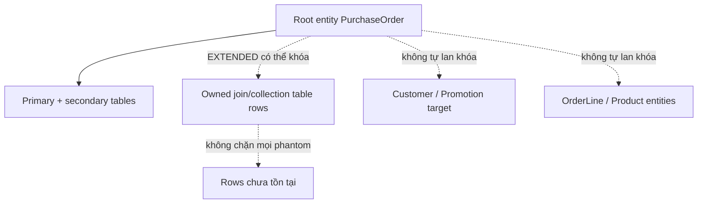
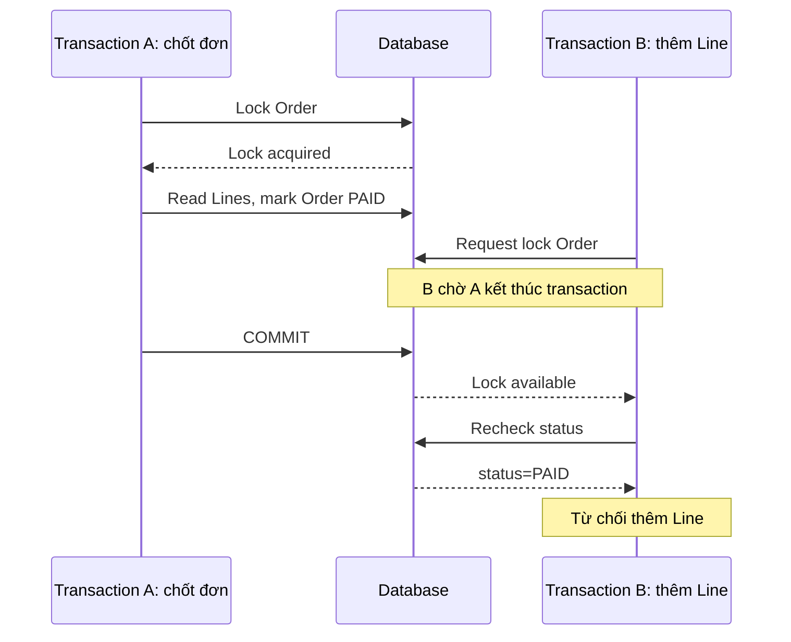
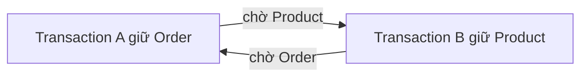
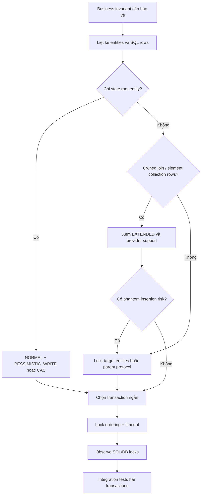

# Đánh giá phạm vi khóa của entity và các quan hệ liên quan

Khi ứng dụng JPA xử lý nhiều giao dịch đồng thời, một cách phổ biến để tránh những thao tác xung đột là yêu cầu **khóa bi quan (*pessimistic locking*)**. Nhưng gọi `EntityManager.find()` với `PESSIMISTIC_WRITE` không tự nói lên **mọi hàng database nào đã được khóa**.

Ví dụ:

```java
PurchaseOrder order = entityManager.find(
    PurchaseOrder.class,
    orderId,
    LockModeType.PESSIMISTIC_WRITE
);
```

Câu hỏi phải đặt ra là: liệu thao tác này có khóa chỉ `purchase_orders`, hay cả `order_lines`, `customers`, `products`, những hàng ở bảng liên kết `order_promotions`, và các phần tử `@ElementCollection`?

Câu trả lời phụ thuộc **mapping của entity, phạm vi khóa JPA, lock mode, truy vấn SQL provider thực thi và cơ chế khóa thực tế của database**. Quan hệ trong Java **không đồng nghĩa** quan hệ khóa.

Bài **“Đánh giá phạm vi khóa của entity và các quan hệ liên quan”** thuộc chương **Khóa bi quan** của module **Data Persistence Relational Access ORM JPA**. Chúng ta sẽ phân biệt `PessimisticLockScope.NORMAL` và `EXTENDED`, đánh giá từng loại association, viết truy vấn khóa có chủ đích, tránh deadlock/phantom, thiết kế protocol cho nhiều writer và kiểm thử bằng hai transaction.

> **Nguyên tắc:** Khóa đúng entity chưa chắc đã bảo vệ được bất biến nằm trên entity khác. Khóa rộng hơn chưa chắc an toàn hơn; đôi khi chỉ làm tăng thời gian chờ, deadlock và lượng dữ liệu bị chặn.

---

## 1. Vấn đề cần giải quyết trước khi viết lệnh khóa

Giả sử nghiệp vụ chốt đơn:

1. Đọc Order#100, xác minh trạng thái NEW.
2. Kiểm tra các OrderLine còn hợp lệ.
3. Trừ tồn kho Product.
4. Chuyển trạng thái Order thành PAID.
5. Ghi Payment và hoàn tất giao dịch.

Nếu transaction A chỉ khóa Order#100, transaction B vẫn có thể có đường ghi vào Product hoặc OrderLine riêng. Có thể B bị một số khóa database khác chặn, nhưng **JPA lock trên Order không phải cam kết khóa toàn bộ object graph**.

Ta cần xác định:

- **Bất biến** cần giữ là gì?
- **Hàng SQL** nào quyết định bất biến đó?
- **Transaction khác** có thể cập nhật những hàng nào?
- **Mọi writer** có sử dụng cùng quy tắc khóa không?
- **Database constraints/isolation** đã bảo vệ những điều kiện nào?

Đây là đánh giá phạm vi khóa đúng nghĩa, không chỉ đọc annotation `@OneToMany`.

## 2. Mô hình quan hệ xuyên suốt

Giả sử:

```text
customers
    ^
    | customer_id
purchase_orders -------- purchase_order_details
    |
    +------< order_lines >------ products
    |
    +------< order_labels
    |
    +------< order_promotions >------ promotions
```

Phân loại:

| Bảng | Vai trò |
|---|---|
| `purchase_orders` | Primary table của PurchaseOrder |
| `purchase_order_details` | Secondary table của **cùng entity** |
| `order_lines` | Bảng của **OrderLine entity riêng** |
| `customers` | Bảng của Customer entity |
| `products` | Bảng của Product entity |
| `order_labels` | Collection table của ElementCollection |
| `order_promotions` | Join table do PurchaseOrder sở hữu |
| `promotions` | Bảng của Promotion entity |

Khóa trên một entity có thể liên quan nhiều bảng **biểu diễn chính entity đó**, nhưng không tự khóa tất cả các entity mà nó tham chiếu.

## 3. Entity PurchaseOrder minh họa

```java
import jakarta.persistence.*;
import java.util.*;

@Entity
@Table(name = "purchase_orders")
@SecondaryTable(
    name = "purchase_order_details",
    pkJoinColumns = @PrimaryKeyJoinColumn(name = "order_id")
)
public class PurchaseOrder {

    @Id
    private Long id;

    @Version
    @Column(name = "version", nullable = false)
    private Long version;

    @Column(name = "tenant_id", nullable = false)
    private String tenantId;

    @Enumerated(EnumType.STRING)
    @Column(nullable = false)
    private OrderStatus status;

    @Column(
        table = "purchase_order_details",
        name = "shipping_note"
    )
    private String shippingNote;

    @ManyToOne(fetch = FetchType.LAZY, optional = false)
    @JoinColumn(name = "customer_id")
    private Customer customer;

    @OneToMany(mappedBy = "order")
    private List<OrderLine> lines = new ArrayList<>();

    @ElementCollection
    @CollectionTable(
        name = "order_labels",
        joinColumns = @JoinColumn(name = "order_id")
    )
    @Column(name = "label")
    private Set<String> labels = new HashSet<>();

    @ManyToMany
    @JoinTable(
        name = "order_promotions",
        joinColumns = @JoinColumn(name = "order_id"),
        inverseJoinColumns = @JoinColumn(name = "promotion_id")
    )
    private Set<Promotion> promotions = new HashSet<>();

    protected PurchaseOrder() {}

    public Long getId() { return id; }
    public Long getVersion() { return version; }
    public OrderStatus getStatus() { return status; }
    public String getTenantId() { return tenantId; }
    public List<OrderLine> getLines() { return lines; }

    public void markPaid() {
        if (status != OrderStatus.NEW) {
            throw new IllegalStateException(
                "Only NEW orders can be paid"
            );
        }
        status = OrderStatus.PAID;
    }
}
```

Enum:

```java
public enum OrderStatus {
    NEW, PAID, CANCELLED
}
```

## 4. Các entity liên quan

```java
@Entity
@Table(name = "customers")
public class Customer {

    @Id
    private Long id;

    private String displayName;

    protected Customer() {}
}
```

```java
@Entity
@Table(name = "products")
public class Product {

    @Id
    private Long id;

    private String sku;
    private Integer stock;

    @Version
    private Long version;

    protected Product() {}
}
```

```java
@Entity
@Table(name = "order_lines")
public class OrderLine {

    @Id
    private Long id;

    @ManyToOne(fetch = FetchType.LAZY, optional = false)
    @JoinColumn(name = "order_id", nullable = false)
    private PurchaseOrder order;

    @ManyToOne(fetch = FetchType.LAZY, optional = false)
    @JoinColumn(name = "product_id", nullable = false)
    private Product product;

    private Integer quantity;

    protected OrderLine() {}
}
```

```java
@Entity
@Table(name = "promotions")
public class Promotion {

    @Id
    private Long id;
    private String code;

    protected Promotion() {}
}
```

Ở model này:

- `OrderLine` là **entity độc lập**; mỗi line sở hữu foreign key `order_id`.
- `Customer` và `Product` là **target entities**, không phải bảng phụ của Order.
- `Promotion` là entity độc lập; `order_promotions` chỉ chứa các cặp khóa liên kết.
- `labels` là các basic values trong collection table, không có entity `OrderLabel` với `@Id` riêng.

## 5. Các lớp nghĩa của “khóa”

Cần phân biệt ít nhất bốn lớp:

| Lớp | Câu hỏi |
|---|---|
| **Business invariant** | Điều kiện nào phải không bị phá? |
| **JPA LockModeType** | Cần lock/optimistic check theo mục đích gì? |
| **JPA PessimisticLockScope** | Phạm vi entity/association table nào thuộc yêu cầu khóa? |
| **Database row/range/index locks** | Hệ quản trị thật sự đã khóa tài nguyên nào? |

Một ứng dụng có thể khai `PESSIMISTIC_WRITE` nhưng provider sinh nhiều câu SQL. Database có thể dùng row lock, index range lock hoặc key lock, tùy dialect và transaction isolation. Không được suy trực tiếp từ enum Java ra số SQL statements hay toàn bộ physical lock resources.

---

## 6. LockModeType: kiểu yêu cầu khóa

Các giá trị liên quan:

```java
LockModeType.PESSIMISTIC_READ
LockModeType.PESSIMISTIC_WRITE
LockModeType.PESSIMISTIC_FORCE_INCREMENT
```

So sánh:

| Mode | Ý nghĩa |
|---|---|
| `PESSIMISTIC_READ` | Bảo vệ việc đọc bằng cơ chế khóa bi quan phù hợp |
| `PESSIMISTIC_WRITE` | Bảo vệ thao tác đọc–sửa–ghi bằng cơ chế khóa ghi |
| `PESSIMISTIC_FORCE_INCREMENT` | Khóa bi quan và yêu cầu tăng version của entity versioned |

Ngoài ra có `OPTIMISTIC` và `OPTIMISTIC_FORCE_INCREMENT` là **khóa lạc quan**, không đồng nghĩa row lock bi quan.

Mode trả lời **kiểu phối hợp**, không tự trả lời “có khóa Customer và Lines không?”.

## 7. PESSIMISTIC_READ không phải một SQL cố định

Một provider có thể dùng cơ chế shared/read lock nếu database hỗ trợ, nhưng không nên kết luận:

```text
PESSIMISTIC_READ == SELECT ... FOR SHARE
```

trên mọi DBMS.

Một số database hoặc provider có thể dùng dạng khóa mạnh hơn trong các điều kiện nhất định. Khả năng hai PESSIMISTIC_READ transactions đồng thời cùng tiến triển phải được kiểm chứng trên stack thực tế.

Dù dùng read lock, đừng suy rằng association được fetch cùng root cũng tự được khóa.

## 8. PESSIMISTIC_WRITE và SQL FOR UPDATE

Trong PostgreSQL, một ví dụ SQL thường gặp:

```sql
SELECT o.*
FROM purchase_orders o
WHERE o.id = ?
FOR UPDATE;
```

Nhưng JPA không bắt buộc provider luôn sinh chính câu này. Có thể có:

- Dialect-specific locking syntax.
- Secondary locking queries.
- Follow-on locking sau truy vấn SELECT.
- Locking clauses riêng cho alias.
- Các hạn chế khi query có DISTINCT, pagination hoặc outer JOIN.

Một câu JPQL tương đương ở mức ý định không đồng nghĩa có cùng physical locks giữa PostgreSQL, MySQL, Oracle và SQL Server.

## 9. PESSIMISTIC_FORCE_INCREMENT và version

Ví dụ:

```java
PurchaseOrder order = em.find(
    PurchaseOrder.class,
    orderId,
    LockModeType.PESSIMISTIC_FORCE_INCREMENT
);
```

Mục đích là lấy khóa bi quan đồng thời buộc tăng revision của entity versioned, ngay cả khi entity không có scalar field thông thường bị thay đổi.

Nhưng:

- Không có nghĩa mọi child entity được khóa.
- Không tự thêm `PessimisticLockScope.EXTENDED`.
- Không thay thế cơ chế bảo vệ Product.stock.
- Thời điểm version increment có thể phụ thuộc flush/commit.
- Trên unversioned entity, cần tuân các hạn chế/behavior của spec và provider.

Khóa một Order và tăng Order.version không tự tạo version increment trên Customer hay OrderLine.

## 10. PessimisticLockScope có hai giá trị

```java
import jakarta.persistence.PessimisticLockScope;

PessimisticLockScope.NORMAL
PessimisticLockScope.EXTENDED
```

Hint chuẩn trong Jakarta Persistence:

```java
"jakarta.persistence.lock.scope"
```

Đối với các dự án JPA 2.x dùng namespace cũ, hint tương ứng là:

```java
"javax.persistence.lock.scope"
```

Giá trị của hint trong API là enum `PessimisticLockScope`, không phải một `LockModeType` khác.

**Nếu không khai scope, mặc định là NORMAL**. Cần kiểm tra hỗ trợ EXTENDED của persistence provider và dialect, không giả định mọi implementation đều có behavior giống nhau.

## 11. NORMAL: tập trung vào chính entity

Ví dụ:

```java
PurchaseOrder order = em.find(
    PurchaseOrder.class,
    100L,
    LockModeType.PESSIMISTIC_WRITE
);
```

về mặt phạm vi tương ứng với `NORMAL`.

Một entity chỉ map một bảng có thể chủ yếu tương ứng một row. Nhưng entity map nhiều bảng do `@SecondaryTable` hoặc `InheritanceType.JOINED` là trường hợp khác.

**NORMAL liên quan các hàng database biểu diễn entity được khóa**, chứ không phải “chỉ primary table trong mọi mapping”.

## 12. NORMAL và @SecondaryTable

PurchaseOrder có:

```text
purchase_orders[id=100]
purchase_order_details[order_id=100]
```

Hai hàng này là state của **cùng PurchaseOrder entity**.

Khi pessimistic lock entity với NORMAL, đặc tả xem xét các hàng ánh xạ state entity trong primary/secondary tables, không được hiểu là khóa root rồi mặc nhiên bỏ qua mọi secondary table.

Cách provider tạo locking SQL cho từng bảng còn tùy triển khai; quan sát SQL và database locks nếu nghiệp vụ phụ thuộc vào việc chặn direct SQL writers trên secondary table.

## 13. NORMAL và JOINED inheritance

Ví dụ:

```java
@Entity
@Inheritance(strategy = InheritanceType.JOINED)
public abstract class Payment {

    @Id
    private Long id;

    @Version
    private Long version;
}
```

```java
@Entity
public class CardPayment extends Payment {

    private String cardToken;
}
```

Một CardPayment có thể có rows:

```text
payments[id=10]
card_payments[id=10]
```

Đây là hai bảng thuộc **một CardPayment entity** theo JOINED inheritance. Phạm vi NORMAL phải được đánh giá trên các hàng biểu diễn entity đó.

Tuy nhiên, nếu CardPayment còn trỏ tới Order hoặc Customer, chúng là **entities khác**, không tự nằm trong phạm vi khóa chỉ vì association.

## 14. NORMAL và @ManyToOne

Trong:

```java
@ManyToOne(fetch = FetchType.LAZY)
@JoinColumn(name = "customer_id")
private Customer customer;
```

Order row chứa foreign key `customer_id`, nhưng Customer row là entity riêng.

```text
purchase_orders[id=100, customer_id=10]  ← Order
customers[id=10]                         ← Customer
```

NORMAL lock trên Order **không tạo cam kết khóa Customer entity**.

Nếu một transaction khác UPDATE `Customer.displayName`, hành vi chặn thực tế có thể phụ thuộc SQL/database, nhưng JPA lock scope NORMAL không cho phép chúng ta kết luận Customer đã bị khóa như một phần của aggregate.

## 15. NORMAL và @OneToMany(mappedBy)

Quan hệ:

```java
@OneToMany(mappedBy = "order")
private List<OrderLine> lines;
```

Các rows:

```text
order_lines[id=1,order_id=100]
order_lines[id=2,order_id=100]
```

thuộc **OrderLine entities**, không phải các hàng phụ của PurchaseOrder entity.

PESSIMISTIC_WRITE trên PurchaseOrder với NORMAL **không tự khóa từng OrderLine**. Điều này vẫn đúng khi application đã gọi `order.getLines()` và các OrderLine objects tồn tại trong persistence context.

Loaded không đồng nghĩa locked.

## 16. NORMAL và @ElementCollection

```java
@ElementCollection
@CollectionTable(name = "order_labels")
private Set<String> labels;
```

Bảng `order_labels` chứa các element values. NORMAL không có tác dụng mở rộng tới các collection table rows theo nghĩa của EXTENDED chỉ vì collection thuộc một Java entity.

Một use case cần ngăn sửa các hàng labels đã tồn tại có thể cân nhắc EXTENDED nếu provider hỗ trợ, nhưng cần xem cả vấn đề phantom insert.

## 17. NORMAL và @ManyToMany

Ví dụ:

```text
purchase_orders[id=100]
order_promotions[order_id=100,promotion_id=20]
promotions[id=20]
```

Phải phân biệt:

1. Order row.
2. Join row mô tả membership.
3. Promotion row.

NORMAL không đồng nghĩa khóa toàn bộ ba lớp dữ liệu.

Việc business muốn giữ membership không đổi khác với việc muốn giữ `Promotion.remainingUses` không đổi.

---

## 18. EXTENDED mở rộng đến đâu?

Sử dụng:

```java
Map<String, Object> props = Map.of(
    "jakarta.persistence.lock.scope",
    PessimisticLockScope.EXTENDED
);

PurchaseOrder order = em.find(
    PurchaseOrder.class,
    orderId,
    LockModeType.PESSIMISTIC_WRITE,
    props
);
```

Khi provider hỗ trợ, EXTENDED mở rộng phạm vi khóa sang các **rows biểu diễn association/collection do entity sở hữu**, nhất là:

- Rows trong join tables cho entity relationships mà root sở hữu.
- Rows trong collection tables của element collections mà root sở hữu.

Không phải:

- Tất cả target entities được association tham chiếu.
- Mọi child entity của inverse `@OneToMany(mappedBy=...)`.
- Mọi hàng có foreign key tới root.
- Mọi hàng có thể được INSERT trong tương lai.
- Toàn bộ object graph trong RAM.

## 19. Bảng đối chiếu phạm vi

| Dữ liệu | NORMAL | EXTENDED |
|---|---|---|
| Root `purchase_orders` | Thuộc phạm vi | Thuộc phạm vi |
| `purchase_order_details` của cùng entity | Thuộc phạm vi entity | Thuộc phạm vi entity |
| Bảng joined inheritance của cùng entity | Thuộc phạm vi entity | Thuộc phạm vi entity |
| Customer qua ManyToOne | Không tự cam kết | Không tự cam kết |
| OrderLine qua mappedBy OneToMany | Không tự cam kết | Không tự cam kết |
| Product của OrderLine | Không tự cam kết | Không tự cam kết |
| Join table `order_promotions` do Order sở hữu | Không mở rộng kiểu EXTENDED | Có thể được yêu cầu khóa các rows hiện hữu |
| Collection table `order_labels` | Không mở rộng kiểu EXTENDED | Có thể được yêu cầu khóa các rows hiện hữu |
| Promotion entity ở đầu bên kia join table | Không tự cam kết | Không tự cam kết |
| Các rows chưa tồn tại | Không chống phantom portable | Không chống phantom portable |

Các ô “có thể được yêu cầu khóa” diễn đạt semantics của EXTENDED với provider hỗ trợ; physical SQL locks và chi tiết provider/dialect vẫn phải kiểm chứng. Đừng chuyển bảng thành nhận định “database luôn khóa đúng và chỉ những rows ấy”.

## 20. EXTENDED và Promotion

Với `@ManyToMany` sở hữu:

```java
@ManyToMany
@JoinTable(
    name = "order_promotions",
    joinColumns = @JoinColumn(name = "order_id"),
    inverseJoinColumns = @JoinColumn(name = "promotion_id")
)
private Set<Promotion> promotions;
```

EXTENDED có thể áp vào hàng:

```text
order_promotions(100,20)
```

Nhưng không tự yêu cầu lock:

```text
promotions(id=20, remaining_uses=5)
```

Nếu Promotion có quota chung, hàng entity Promotion hoặc một counter tương ứng vẫn cần cơ chế concurrency riêng.

**Khóa membership không phải khóa nội dung của target entity.**

## 21. EXTENDED và inverse OneToMany

Trong model:

```java
@OneToMany(mappedBy = "order")
private List<OrderLine> lines;
```

OrderLine sở hữu FK `order_id`. EXTENDED trên Order không biến OrderLine thành “owned join-table rows”.

Nếu bất biến cần bảo vệ số lượng/chất lượng Lines, có thể:

- Khóa từng OrderLine entity hiện có.
- Thiết lập parent-lock protocol cho mọi writer sửa Line.
- Dùng một counter/constraint hoặc isolation phù hợp.
- Thiết kế concurrency của toàn aggregate ở tầng ứng dụng.

Không dùng EXTENDED như tên khác của `CascadeType.ALL`.

## 22. OneToMany dùng @JoinTable

Một OneToMany có thể sở hữu join table:

```java
@OneToMany
@JoinTable(
    name = "order_attachments",
    joinColumns = @JoinColumn(name = "order_id"),
    inverseJoinColumns = @JoinColumn(name = "attachment_id")
)
private List<Attachment> attachments;
```

`Attachment` là entity giả định cần có mapping thật.

Ở đây root sở hữu `order_attachments`. Với EXTENDED, các join rows hiện có có thể được đưa vào phạm vi khóa, nhưng **Attachment entity rows vẫn không tự được khóa**.

Vì thế phải đọc ownership/mapping, không chỉ tên `@OneToMany`.

## 23. EXTENDED và ElementCollection

```text
order_labels(order_id=100,label="urgent")
order_labels(order_id=100,label="gift")
```

EXTENDED có thể khóa các element-collection rows này khi implementation hỗ trợ. Nhưng transaction khác vẫn có thể muốn INSERT:

```sql
INSERT INTO order_labels(order_id,label)
VALUES (100,'review');
```

Row mới không phải một trong các rows đã tồn tại lúc A lock. **Đừng coi EXTENDED là cam kết ngăn INSERT phantom**.

Tùy DB/isolation, range/index/FK locks có thể phát sinh side effects; đấy là behavior riêng cần test.

## 24. Phantom rows trong một collection

Giả sử A:

```text
BEGIN
lock Order#100 with EXTENDED
read labels = {"urgent","gift"}
```

B:

```text
BEGIN
insert label "review" for Order#100
```

Liệu B bị chặn? Không thể kết luận portable từ JPA EXTENDED alone.

Nếu business rule là “sau khi Order PAID không được thay labels”, cần bảo vệ cả:

- Những rows hiện hữu.
- Những inserts trong tương lai.
- Những writers không đi qua JPA.
- Trạng thái Order được đọc nhất quán.

Một cách là quy định **mọi writer thay labels phải khóa Order trước** và kiểm tra status. Thêm DB constraints khi có thể.

## 25. Phân biệt khóa rows với khóa tập hợp

Khóa rows hiện hữu:

```text
lock Line#1
lock Line#2
```

không hoàn toàn tương đương bảo vệ một predicate:

```text
"tất cả Lines thuộc Order#100"
```

vì có thể thêm Line#3.

Đối với invariants như “Order không quá 10 Lines”, “không thêm thành viên khi chốt”, hoặc “chỉ một active booking”, cần **predicate/range consistency, protocol chủ sở hữu hoặc database constraint**, chứ không chỉ khóa những rows hiện có.

---

## 26. Mô hình ba vòng



**Vòng 1:** rows biểu diễn chính entity — NORMAL.

**Vòng 2:** owned join/collection rows — EXTENDED khi được hỗ trợ.

**Vòng 3:** entities khác — cần lock request/protocol riêng nếu invariant phụ thuộc chúng.

Đây là sơ đồ về **semantics ở tầng JPA**, không phải hình dump chính xác của physical DB locks.

## 27. PessimisticLockScope khác FetchType

```java
@ManyToOne(fetch = FetchType.EAGER)
private Customer customer;
```

EAGER nói Customer cần được fetch, không chứng minh Customer row sẽ bị khóa khi Order bị khóa.

```java
@OneToMany(fetch = FetchType.LAZY)
private List<OrderLine> lines;
```

LAZY không ngăn một truy vấn độc lập lấy `PESSIMISTIC_WRITE` trên OrderLine.

**Fetch là quyết định tải dữ liệu; lock là quyết định phối hợp giao dịch.**

## 28. EntityGraph không tự lan khóa

Một graph:

```java
EntityGraph<PurchaseOrder> graph =
    em.createEntityGraph(PurchaseOrder.class);

graph.addAttributeNodes("customer");

Subgraph<OrderLine> lineGraph =
    graph.addSubgraph("lines");

lineGraph.addAttributeNodes("product");
```

và:

```java
Map<String, Object> hints = Map.of(
    "jakarta.persistence.fetchgraph", graph,
    "jakarta.persistence.lock.scope",
    PessimisticLockScope.NORMAL
);

PurchaseOrder order = em.find(
    PurchaseOrder.class,
    orderId,
    LockModeType.PESSIMISTIC_WRITE,
    hints
);
```

Graph yêu cầu tải Customer/Lines/Product; nhưng không đồng nghĩa provider **bắt buộc khóa mọi Customer/Line/Product rows**.

Graph rộng còn có thể làm locking SQL phức tạp hoặc không hợp lệ với một số JOINs/dialects.

## 29. JOIN FETCH không phải lock propagation

JPQL:

```jpql
SELECT o
FROM PurchaseOrder o
JOIN FETCH o.customer
WHERE o.id = :id
```

với:

```java
query.setLockMode(LockModeType.PESSIMISTIC_WRITE);
```

không tạo một hợp đồng portable “mọi bảng được FETCH JOIN đều bị khóa”.

Provider có thể sinh SQL có `FOR UPDATE OF o`, một locking clause không giới hạn alias, hoặc secondary locking query tùy DBMS.

Nếu business cần khóa Customer, hãy **khóa Customer như một target entity** một cách tường minh.

## 30. CascadeType không tự cascade lock

```java
@OneToMany(
    mappedBy = "order",
    cascade = CascadeType.ALL
)
private List<OrderLine> lines;
```

`CascadeType.ALL` liên quan lifecycle operations như persist, merge và remove. Nó **không** có nghĩa `PESSIMISTIC_WRITE` sẽ lan từ Order tới Lines.

Bảng:

| Khái niệm | Công dụng |
|---|---|
| `CascadeType` | Lan truyền entity lifecycle operations |
| `FetchType` | Khi nào association được fetch theo mapping |
| `EntityGraph` | Fetch plan của use case |
| `LockModeType` | Kiểu yêu cầu khóa/optimistic check |
| `PessimisticLockScope` | Phạm vi entity, join/collection rows của pessimistic lock |
| `@Version` | Revision dùng trong optimistic locking |

Đừng dùng một annotation để thay chức năng annotation khác.

---

## 31. EntityManager.find() để khóa theo ID

```java
@Transactional
public void markPaid(long orderId) {
    PurchaseOrder order = em.find(
        PurchaseOrder.class,
        orderId,
        LockModeType.PESSIMISTIC_WRITE
    );

    if (order == null) {
        throw new EntityNotFoundException(
            "Order not found"
        );
    }

    order.markPaid();
}
```

Đây là ví dụ cú pháp; phương thức production còn cần authorization/tenant, lỗi nghiệp vụ, rules liên quan và quản lý transaction.

**`find()` chỉ theo ID không tự lọc tenant.** Đừng dùng lock như cơ chế phân quyền.

## 32. EntityManager.find() với EXTENDED

```java
Map<String, Object> properties = new HashMap<>();

properties.put(
    "jakarta.persistence.lock.scope",
    PessimisticLockScope.EXTENDED
);

PurchaseOrder order = em.find(
    PurchaseOrder.class,
    orderId,
    LockModeType.PESSIMISTIC_WRITE,
    properties
);
```

Phạm vi này có thể cần khi application sửa owned join/collection rows hiện hữu, nhưng không phải lựa chọn mặc định cho mọi command.

Khóa nhiều hơn có thể tăng contention mà vẫn không bảo vệ target entities cần thiết.

## 33. EntityManager.lock() cho managed entity

```java
PurchaseOrder order = em.find(
    PurchaseOrder.class,
    orderId
);

em.lock(
    order,
    LockModeType.PESSIMISTIC_WRITE,
    Map.of(
        "jakarta.persistence.lock.scope",
        PessimisticLockScope.NORMAL
    )
);
```

Khi gọi `lock()`:

- Entity cần ở trạng thái phù hợp, thường là managed.
- Có active transaction nếu dùng pessimistic lock.
- Provider có thể sinh SQL khóa riêng.
- Khóa không tự làm mọi field stale trong Java được refresh.
- Không tự lock target relationships.

## 34. EntityManager.refresh() có lock mode

```java
em.refresh(
    order,
    LockModeType.PESSIMISTIC_WRITE,
    Map.of(
        "jakarta.persistence.lock.scope",
        PessimisticLockScope.NORMAL
    )
);
```

`refresh()` yêu cầu nạp lại state theo JPA semantics; `lock()` không nên được coi tương đương refresh.

Cẩn thận:

- Refresh có thể ghi đè pending changes chưa flush.
- Entity phải managed.
- Không tự refresh/lock mọi association sâu.
- DB snapshot/visibility vẫn phụ thuộc transaction isolation.

Không dùng refresh chỉ để tránh thiết kế query phù hợp từ đầu.

## 35. JPQL với setLockMode()

Để lọc theo tenant:

```java
TypedQuery<PurchaseOrder> query = em.createQuery(
    """
    select o
    from PurchaseOrder o
    where o.id = :id
      and o.tenantId = :tenant
    """,
    PurchaseOrder.class
);

query.setParameter("id", orderId);
query.setParameter("tenant", authenticatedTenantId);
query.setLockMode(LockModeType.PESSIMISTIC_WRITE);

PurchaseOrder order = query.getResultStream()
    .findFirst()
    .orElseThrow(EntityNotFoundException::new);
```

Ưu điểm so với `find()` đơn thuần:

- Predicate tenant nằm ngay trong query.
- Có thể lọc theo trạng thái hoặc ownership.
- Truy vấn trả managed entity để cập nhật.
- Lock request được áp dụng trong quá trình thực thi query.

Không quên security/permissions ngoài tenant nếu domain cần.

## 36. Gắn scope hint cho JPQL query

```java
query.setLockMode(
    LockModeType.PESSIMISTIC_WRITE
);

query.setHint(
    "jakarta.persistence.lock.scope",
    PessimisticLockScope.EXTENDED
);

PurchaseOrder order = query.getSingleResult();
```

Lưu ý:

- `setLockMode` yêu cầu lock.
- `setHint` xác định scope.
- Chỉ đặt scope hint mà không yêu cầu pessimistic lock **không phải một lệnh lock**.
- Hỗ trợ EXTENDED và SQL actual phải được kiểm tra với provider.

## 37. Criteria API với pessimistic lock

```java
CriteriaBuilder cb = em.getCriteriaBuilder();

CriteriaQuery<PurchaseOrder> cq =
    cb.createQuery(PurchaseOrder.class);

Root<PurchaseOrder> o = cq.from(PurchaseOrder.class);

cq.select(o).where(
    cb.equal(o.get("id"), orderId),
    cb.equal(o.get("tenantId"), tenantId)
);

TypedQuery<PurchaseOrder> query = em.createQuery(cq);

query.setLockMode(
    LockModeType.PESSIMISTIC_WRITE
);
query.setHint(
    "jakarta.persistence.lock.scope",
    PessimisticLockScope.NORMAL
);

PurchaseOrder order = query.getSingleResult();
```

Criteria xác định tập entities và predicates; lock mode/scope là cấu hình trên query được thực thi.

Không dùng `CriteriaUpdate` chỉ để “lấy lock rồi sửa entity”: CriteriaUpdate là bulk DML với semantics khác managed entity.

## 38. Query trả DTO và khóa

Một constructor projection:

```jpql
SELECT NEW com.example.dto.OrderSummary(
    o.id, o.status
)
FROM PurchaseOrder o
WHERE o.id = :id
```

không trả một managed PurchaseOrder theo hình thức thông thường. Không nên giả định `setLockMode()` trên mọi DTO/scalar query đều portable hoặc khóa các entity giống entity-select query.

Nếu nghiệp vụ cần lock root trước khi tính toán response, có thể query **entity result** với lock, sau đó map sang DTO trong transaction. Nếu thực sự cần locking SQL đặc biệt cho scalar query, có thể dùng native SQL với contract DB rõ ràng.

---

## 39. Khóa Customer riêng

Ví dụ có hai entities cần bảo vệ:

```java
@Transactional
public void process(
        long orderId,
        long customerId) {

    PurchaseOrder order = em.find(
        PurchaseOrder.class,
        orderId,
        LockModeType.PESSIMISTIC_WRITE
    );

    Customer customer = em.find(
        Customer.class,
        customerId,
        LockModeType.PESSIMISTIC_WRITE
    );

    validateRelationship(order, customer);

    // Sau khi có khóa và validate, áp logic nghiệp vụ.
}
```

`validateRelationship(...)` là domain helper giả định. Production cần kiểm tra customer thật sự thuộc Order và user có quyền.

Quan trọng: thống nhất **lock ordering**. Nếu transaction A khóa Order rồi Customer nhưng B khóa Customer rồi Order, có thể tạo deadlock.

## 40. Khóa OrderLine riêng

```java
List<OrderLine> lines = em.createQuery(
    """
    select l
    from OrderLine l
    where l.order.id = :orderId
    order by l.id
    """,
    OrderLine.class
)
.setParameter("orderId", orderId)
.setLockMode(
    LockModeType.PESSIMISTIC_WRITE
)
.getResultList();
```

Truy vấn này trả OrderLine entities, vì thế trực tiếp yêu cầu pessimistic lock trên những entities phù hợp.

Nhưng **khóa những Lines hiện có không bảo đảm chặn INSERT một Line mới**. Cũng không nên suy rằng `ORDER BY id` đảm bảo chính xác thứ tự vật lý DB acquire locks ở mọi query plan.

## 41. Protocol khóa parent trước khi sửa child

Một giải pháp phổ biến cho aggregate:

> Mọi thao tác thêm/xóa/sửa OrderLine phải trước tiên khóa PurchaseOrder cha, kiểm tra Order.status vẫn NEW, rồi mới thay Line trong cùng transaction.

Luồng:



Ưu điểm: một row parent đóng vai **coordination point** cho tập child rows, kể cả khi child mới chưa tồn tại.

Điều kiện bắt buộc: **mọi writer phải tuân protocol**, kể cả batch jobs và native SQL paths có quyền ghi.

## 42. Parent-lock protocol không bảo vệ Product.stock

Dù mọi Line writer khóa Order, hai Orders khác nhau vẫn có thể bán cùng Product.

Nếu invariant là `Product.stock >= 0`, cần làm việc với **Product row**:

```java
Product product = em.find(
    Product.class,
    productId,
    LockModeType.PESSIMISTIC_WRITE
);
```

hoặc atomic conditional SQL:

```sql
UPDATE products
SET stock = stock - :quantity
WHERE id = :productId
  AND stock >= :quantity;
```

Với atomic bulk update, kiểm tra số hàng bị tác động và quản lý `@Version` nhất quán nếu còn writer qua managed entity lifecycle.

**Khóa Order không thay Product lock hoặc atomic stock update.**

## 43. Tránh deadlock: thống nhất thứ tự khóa

Transaction A:

```text
lock Order#100
lock Product#20
```

Transaction B:

```text
lock Product#20
lock Order#100
```

Có thể tạo deadlock.



Biện pháp:

- Thống nhất thứ tự khóa cho mọi workflow, ví dụ Order rồi Product.
- Khi khóa nhiều IDs cùng loại, sắp theo ID ổn định khi có thể.
- Giữ transaction ngắn.
- Không gọi mạng bên ngoài trong lúc giữ lock nếu không cần.
- Giới hạn số rows.
- Dùng timeout/retry trong **transaction mới** với idempotency.
- Giữ indexes phù hợp để tránh query quét rộng.

SQL `ORDER BY id` có thể giúp mô tả tập cần khóa theo thứ tự nhưng không phải một cam kết portable về thứ tự DB acquire mọi physical row lock.

## 44. Multi-row locking

```java
List<Long> ids = List.of(20L, 21L, 22L);

List<Product> products = em.createQuery(
    """
    select p
    from Product p
    where p.id in :ids
    order by p.id
    """,
    Product.class
)
.setParameter("ids", ids)
.setLockMode(LockModeType.PESSIMISTIC_WRITE)
.getResultList();
```

Hãy kiểm tra:

- Mọi ID có tồn tại không?
- Caller có quyền trên những products đó không?
- SQL có dùng index và lock scope mong muốn không?
- Có query khác khóa theo thứ tự ngược không?
- Transaction có thể xử lý cùng lúc tất cả rows mà không giữ lock quá lâu không?

Dùng query entity results với lock mode chỉ khi business cần khóa entities đó, không để DTO/list API mặc định khóa hàng loạt.

## 45. Phantom INSERT của child

A:

```sql
SELECT *
FROM order_lines
WHERE order_id = 100
FOR UPDATE;
```

B:

```sql
INSERT INTO order_lines(id, order_id)
VALUES (4, 100);
```

Liệu B bị chặn? Không có câu trả lời portable từ việc lock các rows hiện có. DBMS/isolation có thể sinh range/gap/FK locks, nhưng JPA không hứa “mọi INSERT theo predicate bị cấm”.

Nếu invariant yêu cầu không tạo child mới, dùng parent-lock protocol, constraint, isolation hoặc thiết kế owner/counter thích hợp.

## 46. Foreign key không thay business rule

FK:

```sql
FOREIGN KEY (order_id)
REFERENCES purchase_orders(id)
```

chỉ kiểm tra parent tồn tại, không tự xác minh:

```text
Order.status == NEW
```

Một database có thể lấy lock khi kiểm tra FK, nhưng không nên dùng side effect này để thực hiện quy tắc “không thêm Line sau PAID”.

Business invariant cần được thiết kế rõ, lý tưởng là có lớp DB enforcement hoặc một protocol được mọi writer tuân thủ.

---

## 47. SQL với FOR UPDATE OF trên PostgreSQL

Một truy vấn minh họa:

```sql
SELECT o.id, o.status, c.display_name
FROM purchase_orders o
JOIN customers c ON c.id = o.customer_id
WHERE o.id = 100
FOR UPDATE OF o;
```

Ý nghĩa trên PostgreSQL: locking clause chỉ định alias o. Nếu cần khóa Customer:

```sql
SELECT o.id, c.id
FROM purchase_orders o
JOIN customers c ON c.id = o.customer_id
WHERE o.id = 100
FOR UPDATE OF o, c;
```

Đây là **SQL PostgreSQL-specific**, không phải JPQL chuẩn. Provider có thể dùng dạng khác hoặc follow-on locking.

Ví dụ cho thấy **JOIN không tự bằng khóa cả hai bảng**.

## 48. Hạn chế với OUTER JOIN và DISTINCT

Một số DBMS không cho kết hợp locking clause với những dạng:

- OUTER JOIN ở nullable side.
- DISTINCT.
- GROUP BY hoặc aggregate.
- Window functions.
- Một số dạng pagination.

Nếu ORM phát SQL không hợp lệ hoặc dùng follow-on locking, không mặc định đó là lỗi trong code business. Cần xem query plan, loại result, dialect và chiến lược fetch/lock.

Đối với các use cases phức tạp, có thể query entity IDs trước, lấy lock entity rows bằng một truy vấn đơn giản hơn, rồi kiểm tra lại preconditions.

## 49. MySQL InnoDB: row/gap/next-key locks

Trong InnoDB, truy vấn có locking read hoặc UPDATE có thể lấy record locks, gap locks hoặc next-key locks, tùy:

- Transaction isolation.
- Index sử dụng.
- Predicate bằng key hay range.
- Query execution plan.
- Phiên bản DBMS.

Một PESSIMISTIC_WRITE trên entity qua PK có thể có physical lock behavior khác query range scan.

**Không suy lock footprint chỉ từ SQL WHERE mà bỏ qua index plan.** Cần test/measure đúng database.

## 50. PostgreSQL MVCC: lock không chặn mọi SELECT

Với PostgreSQL MVCC, một plain SELECT có thể tiếp tục đọc snapshot committed dù row đang bị transaction khác giữ FOR UPDATE.

Do đó không đúng nếu nói:

> “PESSIMISTIC_WRITE nghĩa là mọi transaction khác không thể đọc Order này.”

Khóa chủ yếu phối hợp operations gây xung đột theo DB semantics. Khả năng đọc bản committed cũ và khả năng UPDATE có thể khác nhau.

---

## 51. Transaction bắt buộc

Pessimistic locks yêu cầu transaction phù hợp.

```java
@Transactional
public void updateUnderLock(long id) {
    PurchaseOrder order = em.find(
        PurchaseOrder.class,
        id,
        LockModeType.PESSIMISTIC_WRITE
    );

    order.markPaid();
}
```

Không có active transaction, provider có thể ném `TransactionRequiredException`.

Khi transaction commit/rollback, DB row locks thông thường được giải phóng. **Entity object không mang khóa qua request HTTP**.

## 52. Lock không sống cùng persistence context vô hạn

Một số nhầm lẫn:

- `em.flush()` không phải commit.
- `em.clear()` detach entities, **không phải release all row locks**.
- `em.detach(order)` không tự rollback transaction.
- Giữ object reference trong JVM không có nghĩa còn giữ DB lock.
- Trả managed object ra controller sau transaction không cho phép khóa kéo dài đến khi user nhấn nút.

Thời gian giữ khóa gắn với transaction và database semantics, không gắn với thời gian sống của Java object.

## 53. Tránh @Transactional(readOnly=true) cho write lock

Một service chỉ đọc có thể khai `@Transactional(readOnly=true)`, nhưng nếu thực hiện PESSIMISTIC_WRITE và mutation thì cần một **write transaction** đúng ý định.

Tùy Spring/provider/DB, readOnly có thể điều chỉnh flush hoặc đánh dấu transaction read only; có hệ thống sẽ từ chối locking/update SQL.

Không coi việc chạy được trên môi trường local là portability guarantee.

## 54. Lock timeout

Jakarta Persistence có hint:

```java
"jakarta.persistence.lock.timeout"
```

Ví dụ:

```java
Map<String, Object> properties = Map.of(
    "jakarta.persistence.lock.timeout", 2000
);

PurchaseOrder order = em.find(
    PurchaseOrder.class,
    id,
    LockModeType.PESSIMISTIC_WRITE,
    properties
);
```

Giá trị thường được diễn đạt theo milliseconds. Nhưng việc provider/DB có hỗ trợ và có chờ đúng từng millisecond không phải lúc nào cũng được bảo đảm.

Bổ sung:

- Statement/transaction timeout.
- DB server timeout.
- Metrics thời gian chờ.
- Cleanup/rollback khi thất bại.
- Retry policy phù hợp.

## 55. NOWAIT khác SKIP LOCKED

Một hint:

```java
query.setHint(
    "jakarta.persistence.lock.timeout",
    0
);
```

thường biểu diễn mong muốn no-wait khi implementation hỗ trợ, có thể được dịch thành NOWAIT trên một số DBMS.

Nhưng:

- Không bảo đảm NOWAIT trên mọi provider.
- NOWAIT không phải SKIP LOCKED.
- SKIP LOCKED bỏ qua các rows đang bị khóa, hữu ích cho một số queue workers, nhưng thường là tính năng vendor/provider-specific.
- Một job dùng SKIP LOCKED cần idempotency, xử lý starvation, retry và invariant riêng.

Không dùng lock scope EXTENDED như công tắc bật SKIP LOCKED.

## 56. Exception khi lấy lock

Những loại liên quan:

| Exception | Ý nghĩa khái quát |
|---|---|
| `TransactionRequiredException` | Không có transaction cần thiết |
| `LockTimeoutException` | Lock acquisition timeout theo semantics rollback statement |
| `PessimisticLockException` | Lỗi khóa bi quan nghiêm trọng theo semantics rollback transaction |
| `OptimisticLockException` | Version conflict có thể được phát hiện trong một số concurrency paths |
| Vendor/Spring translated exceptions | Các wrapper/translation của JDBC/ORM/framework |

Cần kiểm tra exception chain và transaction state thay vì chỉ đọc class name. Với deadlock hoặc DB aborted transaction, policy an toàn là **rollback rồi thử lại ở transaction mới** nếu operation cho phép.

## 57. Retry không nên ở cùng transaction lỗi

Sai:

```java
try {
    query.getSingleResult();
} catch (RuntimeException ex) {
    // Thử lại ngay trong transaction cũ như chưa có lỗi.
}
```

Một lock/deadlock failure có thể khiến transaction đã rollback-only/aborted.

Cách đúng:

1. Kết thúc/rollback transaction lỗi.
2. Phân loại lỗi transient.
3. Nếu business idempotent, mở transaction mới.
4. Giới hạn retries/backoff.
5. Không double-decrement stock hoặc double-publish event.

---

## 58. Spring Data JPA @Lock

```java
import org.springframework.data.jpa.repository.*;
import org.springframework.data.repository.query.Param;
import java.util.Optional;

public interface PurchaseOrderRepository
        extends JpaRepository<PurchaseOrder, Long> {

    @Lock(LockModeType.PESSIMISTIC_WRITE)
    @Query("""
        select o from PurchaseOrder o
        where o.id = :id
          and o.tenantId = :tenant
        """)
    Optional<PurchaseOrder> findLocked(
        @Param("id") Long id,
        @Param("tenant") String tenant
    );
}
```

Service:

```java
@Transactional
public void markPaid(Long id, String tenantId) {
    PurchaseOrder order = repository
        .findLocked(id, tenantId)
        .orElseThrow(EntityNotFoundException::new);

    order.markPaid();
}
```

`@Lock` xác định lock mode của repository query, **không mặc nhiên cấu hình EXTENDED** hoặc khóa toàn bộ associations.

## 59. Spring Data và hint scope

Spring Data có `@QueryHints`, nhưng annotation `@QueryHint` lưu giá trị dưới dạng string trong khi JPA lock.scope chuẩn được biểu diễn bằng `PessimisticLockScope` enum qua runtime API.

Khi cần EXTENDED với tính portable mong muốn, một custom repository dùng EntityManager trực tiếp thường dễ kiểm soát hơn:

```java
TypedQuery<PurchaseOrder> query = em.createQuery(
    """
    select o from PurchaseOrder o
    where o.id = :id
    """,
    PurchaseOrder.class
);

query.setParameter("id", id);
query.setLockMode(LockModeType.PESSIMISTIC_WRITE);
query.setHint(
    "jakarta.persistence.lock.scope",
    PessimisticLockScope.EXTENDED
);

PurchaseOrder locked = query.getSingleResult();
```

Đừng đặt `value="EXTENDED"` trong annotation rồi tự kết luận mọi provider sẽ chuyển string sang enum chính xác.

## 60. Spring transaction self-invocation

Với Spring proxy mode, gọi `this.methodWithTransactional()` bên trong cùng bean có thể không được transaction interceptor xử lý như một lời gọi qua proxy.

Một lock request bên trong method đó có thể chạy không có transaction như mong muốn.

Giải pháp thường là thiết kế transaction boundary ở application service được gọi qua Spring bean proxy hoặc dùng transaction management phù hợp. **Không dựa vào annotation có mặt trên source code để xác nhận runtime transaction active.**

---

## 61. Phân trang với collection fetch và lock

Ví dụ rủi ro:

```jpql
SELECT o
FROM PurchaseOrder o
LEFT JOIN FETCH o.lines
ORDER BY o.id
```

và:

```java
query.setMaxResults(20);
query.setLockMode(LockModeType.PESSIMISTIC_WRITE);
```

Một Order có nhiều Lines tạo nhiều SQL rows. Provider có thể:

- Phân trang trong memory.
- Sinh SQL phức tạp.
- Cảnh báo hoặc lỗi khi dùng collection fetch pagination.
- Dùng follow-on locking.
- Bị DB từ chối locking clause với OUTER JOIN.

**Thêm PESSIMISTIC_WRITE không sửa lỗi collection pagination**, và JOIN FETCH không tự bảo đảm khóa các OrderLine entities.

## 62. Trang IDs rồi lock: phải kiểm tra lại

Một pattern:

1. SELECT IDs của 20 Orders phù hợp theo thứ tự ổn định.
2. Query Order entities theo IDs với PESSIMISTIC_WRITE.
3. Kiểm tra lại status và các preconditions.
4. Xử lý rồi commit.

Giữa bước 1 và bước 2, Order có thể đã đổi trạng thái. **Lock ở bước 2 không khiến snapshot bước 1 tự còn nguyên**.

Nếu có nhiều workers cùng claim tasks, cân nhắc strategy riêng với trạng thái claim, lease, idempotency và những khả năng DB như SKIP LOCKED nếu chấp nhận vendor-specific behavior.

## 63. Lock nhiều Orders bằng một query có thể tốn kém

```java
List<PurchaseOrder> orders = em.createQuery(
    """
    select o from PurchaseOrder o
    where o.status = :status
    """,
    PurchaseOrder.class
)
.setParameter("status", OrderStatus.NEW)
.setLockMode(LockModeType.PESSIMISTIC_WRITE)
.getResultList();
```

Nếu có 100.000 Orders NEW, query có thể tạo contention nghiêm trọng. Đừng khóa cả danh sách chỉ vì muốn xử lý 20 hàng.

Chọn batch/claim strategy, index và transaction boundaries rõ.

## 64. Index cũng ảnh hưởng lock footprint

Với điều kiện:

```sql
WHERE tenant_id = ?
  AND status = 'NEW'
  AND id >= ?
```

index hỗ trợ filter giúp query không phải quét quá nhiều rows. Trên một số DBMS/isolation, phạm vi index scan ảnh hưởng số lock được lấy.

Một index ứng viên:

```sql
CREATE INDEX idx_order_tenant_status_id
ON purchase_orders(tenant_id, status, id);
```

Đây chỉ là ứng viên; cần xem EXPLAIN/DB plan thực tế. Index giúp performance và đôi khi giảm contention, **không thay thế transaction logic**.

---

## 65. Khóa parent không thay unique constraint

Nếu rule “một active Reservation cho mỗi Seat” cần được bảo đảm, database unique constraint hoặc partial unique index (nếu DB hỗ trợ) là lớp bảo vệ mạnh.

Khóa Order/Reservation theo một protocol có thể giảm race, nhưng một code path bypass vẫn có thể tạo duplicate nếu không có DB constraint phù hợp.

Tương tự, không dùng EXTENDED để thay `UNIQUE(order_id,label)` khi không muốn nhãn trùng.

## 66. Khóa và transaction isolation

| Thành phần | Quyết định gì? |
|---|---|
| PESSIMISTIC_READ/WRITE | Khóa theo mục đích đọc/ghi |
| NORMAL/EXTENDED | Phạm vi dữ liệu owned associations được lock |
| READ COMMITTED/REPEATABLE READ/SERIALIZABLE | Snapshot và các hiện tượng đồng thời |
| @Version | Kiểm tra revision thay đổi |
| UNIQUE/FK/CHECK | Các constraints toàn vẹn DB |

Không nên nói “EXTENDED làm transaction thành SERIALIZABLE”. Nó không có semantics đó.

Nếu invariant dựa trên tổng hợp nhiều rows/predicate, có thể cần isolation/constraints/protocol bổ sung.

## 67. Lock trong giao dịch đọc không ngăn mọi plain SELECT

Ở DBMS dùng MVCC như PostgreSQL, SELECT bình thường có thể đọc committed snapshot dù một transaction khác giữ FOR UPDATE trên row.

Vì vậy:

- Khóa có thể chặn các write operations.
- Không phải mọi reader đều bị chặn.
- Các transactions có thể nhìn thấy phiên bản committed khác nhau tùy isolation.
- Cách xử lý lock conflict phụ thuộc loại statement.

Đừng giải thích PESSIMISTIC_WRITE như một mutex JVM khiến cả thế giới không được đọc.

## 68. Khóa không kéo dài qua HTTP form edit

Sai:

```text
GET /orders/100
  BEGIN
  lock Order
  giữ transaction trong 10 phút
PATCH /orders/100
  COMMIT
```

Cách này giữ connection/lock quá lâu, khó scale, dễ timeout.

Đối với long-running edit, dùng `@Version` và expectedVersion/If-Match. Dùng pessimistic locks trong **giao dịch cập nhật ngắn** khi thực sự cần.

## 69. Tránh gọi external services khi giữ lock

Ví dụ xấu:

```text
BEGIN
lock Order, Product
HTTP POST payment gateway (chờ 8 giây)
send email
UPDATE Order
COMMIT
```

Vấn đề:

- Khóa giữ trong lúc chờ mạng.
- Deadlock/timeout tăng.
- Payment/email có thể thành công dù transaction DB rollback.
- Retry có thể gây double charge.

Một thiết kế tốt hơn chia workflow thành các bước idempotent và transaction ngắn, dùng outbox/saga khi phù hợp.

---

## 70. Kiểm thử NORMAL bằng hai transaction

Một integration test:

1. Transaction A khóa Order#100 bằng PESSIMISTIC_WRITE/NORMAL.
2. Giữ A mở.
3. Transaction B cố update **chính Order#100**.
4. Quan sát B chờ hoặc timeout theo DB/provider.
5. A commit/rollback.
6. B tiếp tục hoặc xử lý failure theo contract.

Hai transactions phải thuộc **hai EntityManager/database sessions độc lập**. Không dùng chung một EntityManager vì EntityManager không thread-safe và một persistence context không tái hiện concurrency đúng.

## 71. Test Customer target riêng

1. A khóa Order#100 với NORMAL.
2. B cố UPDATE Customer#10.
3. Quan sát actual SQL/lock behavior.
4. Lặp khi A query JOIN FETCH Customer.
5. Lặp khi A lock Customer riêng.

Một tình huống có chặn Customer do SQL locking side effect không có nghĩa JPA NORMAL **cam kết khóa Customer trên mọi provider**.

Test dùng để xác minh DB stack, không để suy ngược ra quy tắc portable sai.

## 72. Test EXTENDED

Chuẩn bị Order#100 có:

```text
labels = {"urgent"}
promotions = {Promotion#20}
```

Trong hai transactions:

1. A yêu cầu EXTENDED trên Order.
2. B cố DELETE/UPDATE hàng `order_labels` đã hiện hữu.
3. B thử sửa hàng `order_promotions` đã hiện hữu.
4. B thử UPDATE `promotions.id=20`.
5. B thử INSERT label mới.
6. So sánh thời gian chờ/locks/outcomes.

Mục tiêu là thấy rõ **join/collection row khác target entity** và **existing row khác phantom insertion**.

## 73. Test phantom với hai giao thức

**Không có protocol:** A khóa Order và đọc Lines, B INSERT Line trực tiếp. Đánh giá kết quả theo DB/FK/isolation nhưng không khẳng định portable.

**Có protocol:** B phải lock Order trước khi thêm Line; sau khi A chốt Order và commit, B nhận lock rồi thấy Order không còn NEW nên từ chối.

Test thứ hai đánh giá **business concurrency protocol**, không chỉ một hint của ORM.

## 74. Test deadlock

A:

```text
lock Order → Product
```

B:

```text
lock Product → Order
```

Sắp xếp hai transactions độc lập, đặt timeout, kiểm tra DB báo deadlock và rollback đúng.

Sau khi sửa code để mọi workflow lock theo cùng thứ tự, test lại để giảm nguy cơ chu trình chờ.

Một test concurrency nên dùng `CountDownLatch`/barrier để điều phối, tránh chỉ dựa vào `Thread.sleep()` có thời gian cố định.

## 75. Quan sát SQL và locks

Trong Hibernate + Spring Boot ở môi trường dev:

```yaml
logging:
  level:
    org.hibernate.SQL: DEBUG
    org.hibernate.orm.jdbc.bind: TRACE
```

Quan sát:

- Có `FOR UPDATE`/`FOR SHARE`/database hints không?
- Có secondary lock queries không?
- SQL có khóa alias root hay cả joined tables?
- Có lock secondary table/JOINED inheritance rows không?
- EXTENDED có truy vấn tới join/collection tables không?
- SQL dùng indexes nào?
- Query có pagination/fetch collection gây row multiplication không?
- Lock wait thực tế dài bao nhiêu?
- Có exceptions/rollback đúng không?

Bind TRACE logs có thể chứa thông tin nhạy cảm; tránh bật bừa trong production.

## 76. Database diagnostics

Ví dụ công cụ theo DBMS:

- PostgreSQL: `pg_locks`, `pg_stat_activity`, deadlock diagnostics.
- MySQL/InnoDB: Performance Schema và InnoDB status.
- SQL Server: DMVs, blocking sessions và deadlock graphs.
- Oracle: session/lock diagnostics.

Kết quả physical locks cần được liên kết với transaction, SQL statement, isolation và provider version cụ thể. Không lấy quan sát từ một DBMS làm cam kết cho mọi DBMS.

---

## 77. Case study: chốt đơn và Lines

Bất biến: sau khi Order PAID không được thêm/xóa/sửa Lines.

Thiết kế:

1. Mọi Line-changing operation lock parent Order.
2. Kiểm tra status NEW trước khi ghi.
3. Transaction chốt Order cũng lock parent.
4. Chốt Order chuyển status PAID và commit.
5. Bất kỳ Line writer nào chờ lock sẽ kiểm tra status sau khi được cấp quyền và từ chối nếu PAID.
6. Audit đường ghi bulk/native để không bypass protocol.

Khóa EXTENDED trên Order không đủ nếu `lines` dùng `mappedBy` và có phantom inserts.

## 78. Case study: Promotion quota

Order có ManyToMany Promotions qua join table. Bất biến là một Promotion không được dùng quá quota.

EXTENDED trên Order chỉ có thể liên quan các **join rows của Order đó**, không khóa counter chung của Promotion.

Cần:

- Promotion/counter row lock hoặc atomic conditional update.
- Unique constraint cho usage nếu phù hợp.
- Idempotency để không áp cùng request hai lần.
- Transaction consistency giữa Order và Promotion usage.

**Membership lock không phải quota lock.**

## 79. Case study: inventory reservation

Hai Orders tranh cùng Product.stock.

Khóa Order#100 và Order#101 không xung đột nếu là hai rows khác nhau; cả hai vẫn có thể cố trừ Product#20.

Các giải pháp:

- Lock Product#20 PESSIMISTIC_WRITE rồi kiểm tra stock.
- Atomic SQL UPDATE có `WHERE stock >= requestedQuantity`.
- Version CAS nếu dùng optimistic inventory update.
- Transaction + idempotency + unique reservation rules.

Không giải quyết stock bằng EXTENDED của Orders.

## 80. Case study: nhãn không được trùng

Order.labels là ElementCollection. Quy tắc: cùng Order không có nhãn trùng.

Một DB constraint:

```sql
ALTER TABLE order_labels
ADD CONSTRAINT uq_order_label
UNIQUE (order_id, label);
```

có thể đảm bảo uniqueness. EXTENDED có thể giúp phối hợp các rows hiện có nhưng không thay constraint, nhất là khi INSERT nhãn mới chưa có row để khóa.

Nếu còn điều kiện “chỉ sửa labels khi Order.NEW”, thêm parent-lock protocol.

## 81. Case study: Customer profile

Hàng nghìn Orders tham chiếu cùng Customer.

Việc lock mỗi Order không nên mặc định khóa Customer, vì như vậy sẽ làm profile Customer chịu contention lớn chỉ vì Orders đang xử lý.

Nếu business không cần bảo vệ Customer field, **đừng khóa Customer**. Khóa đúng những entity gắn với invariant giữ throughput tốt hơn.

---

## 82. Những lỗi thường gặp

| Triệu chứng | Nguyên nhân | Cách xử lý |
|---|---|---|
| Lock Order nhưng Customer vẫn sửa được | Customer là target entity khác | Lock Customer nếu invariant cần |
| EXTENDED nhưng Product vẫn update | Không lock target Product | Product lock/CAS riêng |
| Lock Order nhưng Line quantity đổi | Child entity không tự khóa | Lock Line hoặc parent protocol |
| EXTENDED vẫn INSERT label mới | Không bảo đảm chống phantom | Protocol/constraint/isolation |
| JOIN FETCH Customer tưởng đã lock Customer | Fetch khác lock | Yêu cầu Customer lock tường minh |
| CascadeType.ALL không lan khóa | Lifecycle cascade khác pessimistic lock | Xác định lock plan riêng |
| NORMAL được hiểu là chỉ primary table | Quên secondary/JOINED mappings | Xem đầy đủ entity mapping |
| Exception TransactionRequiredException | Không có active transaction | Tạo transaction đúng boundary |
| Timeout khi chờ lock | Lock contention hoặc hint timeout | Giảm lock time, handle retry/rollback |
| Deadlock khi xử lý Order và Product | Paths lock theo thứ tự ngược | Thống nhất order |
| SELECT bình thường vẫn đọc được row locked | DB MVCC snapshot | Hiểu lock conflicts thay vì giả định chặn mọi reader |
| Hint EXTENDED bị bỏ qua | Provider/dialect không hỗ trợ như mong muốn | Kiểm chứng API/SQL/DB test |
| NOWAIT không đúng kỳ vọng | Timeout hint không portable tuyệt đối | Test provider/DB cụ thể |
| PESSIMISTIC_READ chặn nhiều readers | Provider dùng lock mạnh hơn | Xem SQL và isolation |
| DTO query không lock như dự kiến | Không phải entity result phù hợp | Query entity rồi map DTO |
| Transaction giữ lock 10 giây | Network call trong transaction | Chia workflow/transaction ngắn |
| em.clear() không thả row lock | Clear detach, không commit | Kết thúc transaction |
| Lock và update ở hai transactions | Lock đã được thả trước khi ghi | Đặt trong cùng transaction |
| Count Lines rồi thêm vượt quota | Phantom/race | Parent protocol/counter/constraint |
| Lock cả Page nhưng DB chậm | Join/fetch pagination và nhiều rows | Batch selection/claim strategy |
| Bypass từ native SQL | Writer không tuân lock policy | Audit mọi write path |
| Lock nhưng cross-tenant update vẫn xảy ra | Lock không thay authorization | Tenant/security predicates |
| Test một EntityManager không thấy race | Không có concurrent sessions | Hai EM/transactions độc lập |
| Test bị treo | Không có latch/timeout/rollback | Điều phối threads và cleanup |
| DB lock khác local | Dialect/isolation/index khác | Integration test trên DB đích |

## 83. Bài tập 1: ManyToOne

Order có `Customer customer`. A lock Order/NORMAL, B update Customer.

**Hỏi:** JPA có cam kết B bị chặn không?

**Đáp án:** Không. Customer là target entity riêng. Nếu cần khóa Customer, yêu cầu explicit lock trên Customer. DB side effects không phải portability guarantee.

## 84. Bài tập 2: ManyToMany

Order sở hữu join table `order_promotions`, liên kết Promotion#20.

**Hỏi:** EXTENDED có khóa Promotion#20 không?

**Đáp án:** Không tự bảo đảm. EXTENDED nhằm mở rộng tới join rows owned, không mặc nhiên khóa Promotion entity.

## 85. Bài tập 3: OneToMany(mappedBy)

Order có `List<OrderLine> lines` với mappedBy.

**Hỏi:** Đổi NORMAL sang EXTENDED có đủ khóa tất cả Lines?

**Đáp án:** Không. OrderLine là child entity có FK ở bảng riêng; dùng explicit Line lock hoặc root protocol.

## 86. Bài tập 4: @SecondaryTable

Order.shippingNote nằm ở bảng phụ.

**Hỏi:** NORMAL có xem xét hàng ở secondary table không?

**Đáp án:** Có trong phạm vi state của cùng entity theo mapping; cách SQL locking thực tế cần xác minh với provider/DB.

## 87. Bài tập 5: Phantom

A khóa những Lines hiện có. B muốn INSERT Line mới.

**Hỏi:** JPA có bảo đảm B bị chặn không?

**Đáp án:** Không portable; cần xét DB/isolation/FK và một protocol/constraint bảo vệ invariant.

## 88. Bài tập 6: Tồn kho

A lock Order, B lock một Order khác, cả hai muốn trừ cùng Product stock.

**Hỏi:** Lock Orders có ngăn oversell không?

**Đáp án:** Không. Cần Product row lock/atomic conditional UPDATE và transaction policy tương ứng.

## 89. Bài tập 7: Lock timeout

```java
query.setHint(
    "jakarta.persistence.lock.timeout",
    0
);
```

**Hỏi:** Có cam kết NOWAIT trên mọi DB không?

**Đáp án:** Không. Kiểm chứng hỗ trợ/provider/dialect và xử lý lock exception.

## 90. Bài tập 8: JOIN FETCH

```jpql
SELECT o FROM PurchaseOrder o JOIN FETCH o.customer
```

gắn PESSIMISTIC_WRITE.

**Hỏi:** Customer chắc chắn bị khóa?

**Đáp án:** Không có guarantee đơn giản như vậy. Nếu cần Customer lock, query/lock Customer riêng.

## 91. Bài tập 9: Deadlock

A khóa Order→Product, B khóa Product→Order.

**Hỏi:** Hướng xử lý?

**Đáp án:** Một lock ordering chung, transaction ngắn, timeout và retry transaction mới khi nghiệp vụ cho phép.

## 92. Bài tập 10: EXTENDED và collection

Order.labels dùng ElementCollection.

**Hỏi:** EXTENDED có thay UNIQUE(order_id,label) không?

**Đáp án:** Không. Constraint kiểm soát trùng dữ liệu, EXTENDED chủ yếu điều chỉnh các rows association/collection được khóa khi hỗ trợ.

---

## 93. Checklist review lock plan

**Mapping:**

- Root có primary/secondary tables hay JOINED inheritance?
- Quan hệ dùng mappedBy, owning FK, JoinTable hay ElementCollection?
- Những entities nào có state độc lập?

**Correctness:**

- Invariant phụ thuộc rows nào?
- Có phantom inserts không?
- Mọi writer đều tuân lock protocol?
- Có database constraints phù hợp?
- Có Product/Customer/Promotion targets cần lock riêng?

**Concurrency:**

- Transaction nào lấy lock?
- Lock giữ đến commit/rollback?
- Có thứ tự lock chung?
- Có timeout/deadlock/rollback policy?
- Có external calls trong transaction?

**Provider/DB:**

- EXTENDED có được hỗ trợ?
- SQL FOR UPDATE áp alias nào?
- Query có follow-on locking?
- Có hạn chế JOIN/FETCH/pagination?
- Index/isolation ảnh hưởng lock footprint thế nào?

**Tests:**

- Hai EntityManagers/transactions độc lập?
- Test target entities vs join rows?
- Test phantom insert?
- Test deadlock/timeout?
- Test native/batch writer bypass?

## 94. Sơ đồ quyết định



## 95. Tổng kết

Hai khái niệm phải luôn tách biệt:

**Kiểu khóa:**

```java
LockModeType.PESSIMISTIC_READ
LockModeType.PESSIMISTIC_WRITE
LockModeType.PESSIMISTIC_FORCE_INCREMENT
```

**Phạm vi khóa:**

```java
PessimisticLockScope.NORMAL
PessimisticLockScope.EXTENDED
```

Ví dụ NORMAL:

```java
PurchaseOrder order = em.find(
    PurchaseOrder.class,
    orderId,
    LockModeType.PESSIMISTIC_WRITE
);
```

Ví dụ EXTENDED:

```java
PurchaseOrder order = em.find(
    PurchaseOrder.class,
    orderId,
    LockModeType.PESSIMISTIC_WRITE,
    Map.of(
        "jakarta.persistence.lock.scope",
        PessimisticLockScope.EXTENDED
    )
);
```

Những nguyên tắc cốt lõi:

1. **NORMAL bảo vệ entity root** với những hàng biểu diễn entity, bao gồm các bảng secondary/JOINED phù hợp.
2. **EXTENDED có thể mở rộng tới các join/collection table rows do root sở hữu**; nó không khóa mọi entity ở đầu bên kia association.
3. **ManyToOne target và OneToMany(mappedBy) child là entities khác**, không tự nhận root lock.
4. **FetchType, EntityGraph, JOIN FETCH và CascadeType không thay thế lock plan.**
5. **EXTENDED không tự ngăn phantom insert** vào tập con.
6. **Khóa đúng entity chứa state quyết định invariant**, ví dụ Product.stock hoặc Promotion quota.
7. **Parent-lock protocol phải được mọi writer tuân thủ** nếu dùng để phối hợp thay đổi children.
8. **Transaction, lock ordering, timeout và rollback** là phần không thể thiếu của thiết kế.
9. **SQL và physical locks tùy provider/dialect/isolation**, nên quan sát trên database đích.
10. **Kiểm thử cạnh tranh bằng hai transactions thực tế** để xác minh assumptions, không chỉ nhìn Java annotations.

Đánh giá đúng **phạm vi khóa của entity và các quan hệ liên quan** giúp tránh cả hai thái cực: **khóa quá hẹp khiến invariant vẫn bị phá** và **khóa quá rộng khiến throughput giảm, contention tăng và deadlock dễ xảy ra**. Thiết kế tốt bắt đầu từ dữ liệu nào cần được bảo vệ, thể hiện lock mode/scope có chủ đích, bảo đảm mọi writer tuân thủ và kiểm chứng trên DB thật.
