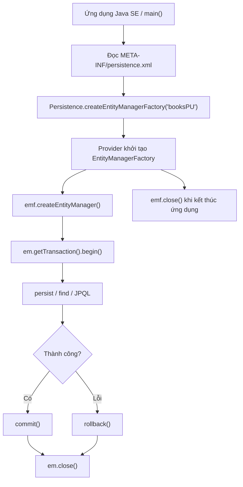

# Khởi tạo EntityManagerFactory trong Java SE

Khi xây dựng ứng dụng Java chạy độc lập bằng phương thức `main()`, ta có thể sử dụng **Jakarta Persistence (JPA)** mà không cần application server hay Spring. Điểm khởi đầu quan trọng nhất là khai báo **persistence unit** và dùng `Persistence.createEntityManagerFactory(...)` để tạo **`EntityManagerFactory`**. Từ factory này, ứng dụng tạo các `EntityManager` để đọc, ghi và quản lý entity trong từng đơn vị công việc.

Bài học tập trung vào **cách khởi tạo `EntityManagerFactory` trong môi trường Java SE**: chuẩn bị thư viện, mô tả persistence unit, bootstrap, chạy một giao dịch thực tế, quản lý vòng đời tài nguyên và xử lý các lỗi cấu hình thường gặp.

## 1. Các khái niệm phải phân biệt

| Thành phần | Vai trò |
|---|---|
| **Persistence unit (PU)** | Một cấu hình JPA có tên, xác định provider, các entity được quản lý, nguồn dữ liệu, loại transaction và thuộc tính hoạt động. |
| **`persistence.xml`** | Tệp cấu hình chuẩn để khai báo một hoặc nhiều persistence unit. |
| **Persistence provider** | Phần mềm triển khai đặc tả JPA, ví dụ Hibernate ORM hoặc EclipseLink. |
| **`Persistence`** | Lớp bootstrap chuẩn trong `jakarta.persistence`, cung cấp `createEntityManagerFactory(...)`. |
| **`EntityManagerFactory` (EMF)** | Đối tượng cấp ứng dụng, giữ cấu hình và cung cấp các `EntityManager`; khởi tạo tương đối tốn chi phí, được thiết kế để dùng chung giữa các luồng. |
| **`EntityManager` (EM)** | Đối tượng thao tác với persistence context: `persist`, `find`, `merge`, `remove`, truy vấn…; **không an toàn khi chia sẻ giữa các luồng**. |
| **`EntityTransaction`** | Giao diện điều khiển transaction trực tiếp khi dùng persistence unit kiểu `RESOURCE_LOCAL`. |

Trong Java SE, không có container tự động tiêm `@PersistenceContext` hay quản lý thời điểm đóng `EntityManager`. Ứng dụng cần chủ động tạo, dùng và đóng các đối tượng tương ứng.

Một luồng điển hình:



**Phân biệt quan trọng:** `EntityManagerFactory` và `EntityManager` không phải cùng một đối tượng. Thông thường, tạo **một EMF cho mỗi persistence unit** khi ứng dụng khởi động, nhưng tạo và đóng **nhiều EM** theo từng công việc hoặc transaction.

## 2. Chuẩn bị một ví dụ Java SE hoàn chỉnh

Ta xây dựng ứng dụng quản lý sách nhỏ dùng:

- Java 17 trở lên;
- Jakarta Persistence API 3.1;
- Hibernate ORM 6.x làm JPA provider;
- H2 để minh họa một cơ sở dữ liệu quan hệ chạy trong bộ nhớ;
- Maven để quản lý dependency và chạy chương trình.

Các phiên bản Maven bên dưới là **ví dụ nhất quán của cùng thế hệ API**, không có ý khẳng định chúng là những bản mới nhất. Khi dùng trong dự án thực tế, chọn phiên bản provider tương thích với Jakarta Persistence API và Java đang sử dụng.

Cấu trúc dự án:

```text
jpa-java-se-demo/
├── pom.xml
└── src/
    └── main/
        ├── java/
        │   └── demo/
        │       ├── Book.java
        │       └── Main.java
        └── resources/
            └── META-INF/
                └── persistence.xml
```

### 2.1. Khai báo dependency trong `pom.xml`

```xml
<project xmlns="http://maven.apache.org/POM/4.0.0"
         xmlns:xsi="http://www.w3.org/2001/XMLSchema-instance"
         xsi:schemaLocation="http://maven.apache.org/POM/4.0.0
                             https://maven.apache.org/xsd/maven-4.0.0.xsd">
    <modelVersion>4.0.0</modelVersion>

    <groupId>demo</groupId>
    <artifactId>jpa-java-se-demo</artifactId>
    <version>1.0-SNAPSHOT</version>

    <properties>
        <maven.compiler.release>17</maven.compiler.release>
        <project.build.sourceEncoding>UTF-8</project.build.sourceEncoding>
    </properties>

    <dependencies>
        <dependency>
            <groupId>jakarta.persistence</groupId>
            <artifactId>jakarta.persistence-api</artifactId>
            <version>3.1.0</version>
        </dependency>

        <dependency>
            <groupId>org.hibernate.orm</groupId>
            <artifactId>hibernate-core</artifactId>
            <version>6.6.4.Final</version>
        </dependency>

        <dependency>
            <groupId>com.h2database</groupId>
            <artifactId>h2</artifactId>
            <version>2.3.232</version>
        </dependency>
    </dependencies>

    <build>
        <plugins>
            <plugin>
                <groupId>org.apache.maven.plugins</groupId>
                <artifactId>maven-compiler-plugin</artifactId>
                <version>3.13.0</version>
            </plugin>

            <plugin>
                <groupId>org.codehaus.mojo</groupId>
                <artifactId>exec-maven-plugin</artifactId>
                <version>3.4.1</version>
                <configuration>
                    <mainClass>demo.Main</mainClass>
                </configuration>
            </plugin>
        </plugins>
    </build>
</project>
```

**Vì sao cần cả API và provider?** `jakarta.persistence-api` chứa interface, annotation và lớp bootstrap theo đặc tả; bản thân API không cung cấp engine ORM hoàn chỉnh. Hibernate là một **implementation** của API đó. H2 đóng vai trò driver JDBC và cơ sở dữ liệu cho ví dụ.

Tùy cách đóng gói và dependency transitively của provider, có thể không cần khai báo API riêng; ở đây ta khai báo tường minh để nhìn rõ ba vai trò.

### 2.2. Khai báo persistence unit bằng `persistence.xml`

Tạo tệp **`src/main/resources/META-INF/persistence.xml`**:

```xml
<?xml version="1.0" encoding="UTF-8"?>
<persistence xmlns="https://jakarta.ee/xml/ns/persistence"
             xmlns:xsi="http://www.w3.org/2001/XMLSchema-instance"
             xsi:schemaLocation="
                 https://jakarta.ee/xml/ns/persistence
                 https://jakarta.ee/xml/ns/persistence/persistence_3_1.xsd"
             version="3.1">

    <persistence-unit name="booksPU" transaction-type="RESOURCE_LOCAL">
        <provider>org.hibernate.jpa.HibernatePersistenceProvider</provider>

        <class>demo.Book</class>
        <exclude-unlisted-classes>true</exclude-unlisted-classes>

        <properties>
            <property name="jakarta.persistence.jdbc.driver"
                      value="org.h2.Driver"/>
            <property name="jakarta.persistence.jdbc.url"
                      value="jdbc:h2:mem:booksdb;DB_CLOSE_DELAY=-1"/>
            <property name="jakarta.persistence.jdbc.user"
                      value="sa"/>
            <property name="jakarta.persistence.jdbc.password"
                      value=""/>

            <property name="jakarta.persistence.schema-generation.database.action"
                      value="drop-and-create"/>
        </properties>
    </persistence-unit>
</persistence>
```

Phân tích những thành phần chính:

| Cấu hình | Ý nghĩa |
|---|---|
| `META-INF/persistence.xml` | Vị trí chuẩn để JPA tìm tệp khi nó có trên **runtime classpath**. |
| `name="booksPU"` | Định danh persistence unit; phải khớp chính xác với chuỗi truyền vào `createEntityManagerFactory("booksPU")`. |
| `transaction-type="RESOURCE_LOCAL"` | Ứng dụng tự điều khiển transaction thông qua `EntityTransaction`, phù hợp với ví dụ Java SE chạy độc lập. |
| `<provider>` | Chọn Hibernate làm provider; khi chỉ có một provider được cấu hình đúng, có thể để cơ chế khám phá provider thực hiện lựa chọn. |
| `<class>demo.Book</class>` | Chỉ định lớp entity được quản lý. |
| `<exclude-unlisted-classes>true</exclude-unlisted-classes>` | Không dựa vào cơ chế tự khám phá các entity chưa liệt kê, giúp ví dụ Java SE có hành vi rõ ràng. |
| `jakarta.persistence.jdbc.*` | Thuộc tính JDBC chuẩn dùng cho kết nối DB. |
| `schema-generation.database.action` | Yêu cầu sinh schema; giá trị `drop-and-create` chỉ thích hợp với môi trường minh họa/test vì **có thể xóa dữ liệu hiện có**. |

Maven thông thường tự đưa `src/main/resources` vào runtime classpath. Sau khi build, tài nguyên tương ứng thường nằm ở `target/classes/META-INF/persistence.xml`. Nếu đặt XML bên cạnh `Main.java` hoặc nhầm tên `META-INF`, JPA có thể không tìm thấy persistence unit.

Địa chỉ `jdbc:h2:mem:booksdb;DB_CLOSE_DELAY=-1` tạo database H2 trong bộ nhớ của tiến trình. `DB_CLOSE_DELAY=-1` giữ database tồn tại sau khi kết nối cuối đóng, cho đến khi JVM kết thúc. Với cơ sở dữ liệu thật, thay phần JDBC bằng thông tin kết nối phù hợp và **không dùng** `drop-and-create` cho dữ liệu sản xuất.

### 2.3. Định nghĩa entity `Book`

Tạo `src/main/java/demo/Book.java`:

```java
package demo;

import jakarta.persistence.Column;
import jakarta.persistence.Entity;
import jakarta.persistence.GeneratedValue;
import jakarta.persistence.GenerationType;
import jakarta.persistence.Id;
import jakarta.persistence.Table;
import java.util.Objects;

@Entity
@Table(name = "books")
public class Book {

    @Id
    @GeneratedValue(strategy = GenerationType.IDENTITY)
    private Long id;

    @Column(nullable = false, length = 200)
    private String title;

    protected Book() {
        // Constructor không tham số theo yêu cầu JPA.
    }

    public Book(String title) {
        this.title = Objects.requireNonNull(title, "title");
    }

    public Long getId() {
        return id;
    }

    public String getTitle() {
        return title;
    }
}
```

`@Entity` đánh dấu `Book` là đối tượng do JPA quản lý; `@Id` xác định khóa chính; `@GeneratedValue` yêu cầu provider tạo giá trị định danh theo chiến lược đã chọn; `@Column` bổ sung ràng buộc ánh xạ. Tên đầy đủ của lớp là `demo.Book` nên phải trùng với phần tử `<class>` trong XML.

Không thể thay `@Entity` bằng một Java class bất kỳ rồi kỳ vọng JPA tự map. Các entity phải tuân thủ yêu cầu của đặc tả/provider về kiểu lớp, constructor và định danh.

## 3. Khởi tạo EntityManagerFactory trong phương thức `main()`

Tạo `src/main/java/demo/Main.java`:

```java
package demo;

import jakarta.persistence.EntityManager;
import jakarta.persistence.EntityManagerFactory;
import jakarta.persistence.EntityTransaction;
import jakarta.persistence.Persistence;
import java.util.List;

public class Main {

    public static void main(String[] args) {
        EntityManagerFactory emf =
                Persistence.createEntityManagerFactory("booksPU");

        try {
            saveBook(emf, "Effective Java");
            printBooks(emf);
        } finally {
            emf.close();
        }
    }

    private static void saveBook(EntityManagerFactory emf, String title) {
        EntityManager em = emf.createEntityManager();

        try {
            EntityTransaction tx = em.getTransaction();

            try {
                tx.begin();

                Book book = new Book(title);
                em.persist(book);

                tx.commit();
                System.out.println("Đã lưu sách ID = " + book.getId());
            } catch (RuntimeException ex) {
                if (tx.isActive()) {
                    tx.rollback();
                }
                throw ex;
            }
        } finally {
            em.close();
        }
    }

    private static void printBooks(EntityManagerFactory emf) {
        EntityManager em = emf.createEntityManager();

        try {
            List<Book> books = em.createQuery(
                    "SELECT b FROM Book b ORDER BY b.id",
                    Book.class
            ).getResultList();

            for (Book book : books) {
                System.out.println(book.getId() + " - " + book.getTitle());
            }
        } finally {
            em.close();
        }
    }
}
```

Chạy tại thư mục dự án:

```bash
mvn compile exec:java
```

Khi có đủ dependency và cấu hình đúng, Hibernate khởi tạo persistence unit, H2 có bảng `books`, một bản ghi được lưu và truy vấn trả về sách vừa tạo. Chương trình in thông tin tương tự:

```text
Đã lưu sách ID = 1
1 - Effective Java
```

Các dòng log bổ sung và giá trị ID cụ thể phụ thuộc provider, cơ sở dữ liệu và dữ liệu trước đó. Đây là kết quả **minh họa**; việc khởi tạo EMF có thể phát SQL sinh schema trước khi chạy lệnh `persist`.

### Điều gì xảy ra ở lệnh bootstrap?

```java
EntityManagerFactory emf =
        Persistence.createEntityManagerFactory("booksPU");
```

Về mặt ý tưởng, bước này:

1. Tìm thông tin persistence unit trên classpath, đặc biệt `META-INF/persistence.xml`.
2. Xác định persistence unit tên `booksPU`.
3. Tìm provider có thể xử lý unit đó (trong ví dụ là Hibernate).
4. Khởi tạo metadata ánh xạ, cấu hình truy cập JDBC và những dịch vụ provider cần dùng.
5. Trả về một `EntityManagerFactory` đã sẵn sàng tạo các `EntityManager`.

Cách thức quét classpath, xây dựng metadata, mở connection hoặc tạo schema chi tiết phụ thuộc provider và cấu hình; không nên cho rằng `createEntityManagerFactory` chỉ khởi tạo một object Java rẻ tiền.

**Bootstrap EMF thường là công việc cấp ứng dụng**, không nên lặp lại mỗi lần thực thi query, mỗi lần tạo request hoặc mỗi lần xử lý một bản ghi.

## 4. Transaction RESOURCE_LOCAL hoạt động như thế nào?

Với `transaction-type="RESOURCE_LOCAL"`, ứng dụng chủ động gọi:

```java
EntityTransaction tx = em.getTransaction();

try {
    tx.begin();
    em.persist(new Book("Domain-Driven Design"));
    tx.commit();
} catch (RuntimeException ex) {
    if (tx.isActive()) {
        tx.rollback();
    }
    throw ex;
}
```

Các mốc cần hiểu:

- **`begin()`:** bắt đầu transaction phục vụ thay đổi dữ liệu.
- **`persist()`:** đưa entity mới vào persistence context. SQL `INSERT` có thể phát ngay hoặc được trì hoãn, tùy chiến lược sinh ID, provider và thời điểm flush.
- **`flush()`:** đồng bộ những thay đổi JPA đang chờ thành câu lệnh SQL; **chưa phải commit**.
- **`commit()`:** kết thúc transaction thành công; provider thường flush các thay đổi còn chờ trước commit.
- **`rollback()`:** hủy thay đổi của transaction khi xảy ra lỗi. Không tiếp tục dùng trạng thái entity cũ như thể transaction đã thành công.

`RESOURCE_LOCAL` phù hợp với Java SE khi không có môi trường JTA. Ngược lại, persistence unit `JTA` được điều khiển bởi một transaction manager; không thể chỉ thay `RESOURCE_LOCAL` thành `JTA` trong ví dụ rồi tiếp tục dùng `em.getTransaction()` như cũ. Cần chọn chiến lược transaction theo môi trường thực tế.

### Tại sao nên đóng EntityManager trong `finally`?

`EntityManager` nắm giữ persistence context và có thể sử dụng tài nguyên của provider/cơ sở dữ liệu. Đóng nó khi công việc kết thúc sẽ giải phóng tài nguyên thích hợp và kết thúc vòng đời của context. Nếu code ném ngoại lệ, khối `finally` vẫn thực hiện `close()`.

`EntityManager` **không thread-safe**: không dùng cùng một `em` từ nhiều thread. Thay vào đó, tạo một `EntityManager` riêng cho mỗi đơn vị công việc cần độc lập.

### Tại sao cần đóng cả EntityManagerFactory?

EMF giữ cấu hình và nhiều tài nguyên cấp ứng dụng; `emf.close()` trả những tài nguyên đó về provider. Sau khi đóng EMF, không gọi `createEntityManager()` trên nó nữa. Với ứng dụng chạy lâu, có thể quản lý EMF bằng một lớp ứng dụng hoặc gắn việc đóng vào vòng đời khi shutdown.

Trong ví dụ `main()`, `try/finally` bảo đảm factory được đóng ngay cả khi ghi hoặc đọc thất bại. Trong chương trình server Java SE tự phát triển, đừng tạo một EMF rồi đóng sau mỗi request: hãy dùng một factory xuyên suốt vòng đời server và đóng khi server dừng.

## 5. Khởi tạo có cấu hình ghi đè bằng Java

Ngoài XML, JPA cung cấp overload nhận một `Map` các thuộc tính:

```java
Map<String, Object> overrides = new HashMap<>();

String jdbcUrl = System.getenv("APP_JDBC_URL");
String jdbcUser = System.getenv("APP_JDBC_USER");
String jdbcPassword = System.getenv("APP_JDBC_PASSWORD");

if (jdbcUrl != null && !jdbcUrl.isBlank()) {
    overrides.put("jakarta.persistence.jdbc.url", jdbcUrl);
}
if (jdbcUser != null) {
    overrides.put("jakarta.persistence.jdbc.user", jdbcUser);
}
if (jdbcPassword != null) {
    overrides.put("jakarta.persistence.jdbc.password", jdbcPassword);
}

EntityManagerFactory emf =
        Persistence.createEntityManagerFactory("booksPU", overrides);

try {
    // Tạo EntityManager và thực hiện công việc.
} finally {
    emf.close();
}
```

Imports tương ứng:

```java
import jakarta.persistence.EntityManagerFactory;
import jakarta.persistence.Persistence;
import java.util.HashMap;
import java.util.Map;
```

Các thuộc tính được truyền vào cho phép điều chỉnh cấu hình bootstrap theo môi trường triển khai mà không cần sao chép XML cho mỗi môi trường. Tuy nhiên, **vẫn cần provider và định nghĩa persistence unit có thể được tìm thấy** để dùng cơ chế bootstrap tiêu chuẩn này; `Map` không có nghĩa là tự tạo được một persistence unit hoàn toàn chưa được khai báo trong mọi provider.

Đối với production, lưu thông tin nhạy cảm trong secret manager hoặc cơ chế cấu hình bảo mật phù hợp. Tránh hard-code password trong mã nguồn, XML đưa lên git hoặc log khi startup. Cơ chế truyền giá trị từ environment ở trên chỉ minh họa một cách đọc cấu hình.

### Chọn giữa XML và thuộc tính Java

| Cách cấu hình | Phù hợp khi | Cần chú ý |
|---|---|---|
| `persistence.xml` | Cấu hình tên PU, provider, entity, transaction thống nhất cho module | Đúng vị trí classpath, namespace và version |
| `createEntityManagerFactory(name, properties)` | URL/user/password hoặc một số tùy chọn thay đổi theo môi trường | Chỉ cung cấp property override cho PU mà provider nhận diện |
| API bootstrap đặc thù Hibernate/EclipseLink | Cần xây dựng metadata hoặc provider configuration hoàn toàn bằng Java | Kém portable giữa provider, API không còn thuần chuẩn JPA |

Khi bài toán là **khởi tạo `EntityManagerFactory` theo chuẩn JPA trong Java SE**, cách căn bản vẫn là `persistence.xml` và `Persistence.createEntityManagerFactory("tênPU")`.

## 6. Quản lý nhiều persistence unit

Một ứng dụng có thể khai báo nhiều persistence unit, ví dụ khi hai phần của ứng dụng có nguồn dữ liệu hoặc mô hình entity tách biệt:

```xml
<persistence xmlns="https://jakarta.ee/xml/ns/persistence"
             version="3.1">
    <persistence-unit name="mainPU" transaction-type="RESOURCE_LOCAL">
        <!-- Provider, các class và cấu hình DB chính -->
    </persistence-unit>

    <persistence-unit name="auditPU" transaction-type="RESOURCE_LOCAL">
        <!-- Provider, các class và cấu hình DB audit -->
    </persistence-unit>
</persistence>
```

Đoạn XML trên minh họa cấu trúc chứ chưa có đủ cấu hình để kết nối và vận hành.

Trong Java:

```java
EntityManagerFactory mainEmf =
        Persistence.createEntityManagerFactory("mainPU");
EntityManagerFactory auditEmf =
        Persistence.createEntityManagerFactory("auditPU");

try {
    // Mỗi factory tạo EntityManager thuộc persistence unit riêng.
} finally {
    auditEmf.close();
    mainEmf.close();
}
```

Một `EntityManager` không tự quản lý entity tùy ý của persistence unit khác. Nếu hai unit dùng hai database/transaction manager khác nhau, hai transaction `RESOURCE_LOCAL` thông thường **không tạo thành một giao dịch nguyên tử chung**; cần thiết kế phối hợp riêng nếu nghiệp vụ yêu cầu nhất quán xuyên nguồn dữ liệu.

Không tạo thêm persistence unit chỉ vì có nhiều bảng. Thông thường, một PU có thể quản lý nhiều entity/bảng chung nguồn dữ liệu.

## 7. Những lỗi thường gặp khi tạo EntityManagerFactory

### 7.1. `No Persistence provider for EntityManager named ...`

Ví dụ:

```text
jakarta.persistence.PersistenceException:
No Persistence provider for EntityManager named booksPU
```

Những nguyên nhân cần kiểm tra:

1. Tệp không nằm đúng `META-INF/persistence.xml` trên **runtime classpath**.
2. Tên `booksPU` trong XML không khớp chuỗi truyền vào phương thức bootstrap.
3. Dependency provider chưa có khi chạy, hoặc service provider metadata không được đóng gói đúng.
4. XML sai namespace, version hoặc cấu trúc đối với phiên bản JPA/provider.
5. Ứng dụng dùng `jakarta.persistence.*` nhưng kéo provider hoặc tệp cấu hình thuộc hệ `javax.persistence.*` cũ.

Đầu tiên, xác nhận build thực sự chứa `META-INF/persistence.xml` và runtime classpath chứa Hibernate. Ví dụ, với Maven, kiểm tra đường dẫn `target/classes/META-INF/persistence.xml` sau `mvn compile`.

### 7.2. Không tìm thấy JDBC driver hoặc không kết nối được DB

Triệu chứng thường là lỗi liên quan `ClassNotFoundException`, `Unable to load class`, `SQLException`, URL sai, sai username/password hoặc DB chưa mở.

Kiểm tra:

- Dependency driver có trên runtime classpath (H2 trong ví dụ).
- `jakarta.persistence.jdbc.driver` khớp driver và URL.
- Database đang hoạt động và endpoint có thể truy cập.
- Credentials và quyền của tài khoản DB hợp lệ.
- Provider đang sử dụng đúng những cấu hình JDBC đã khai báo.

Nếu dùng `DataSource` thay vì driver properties, cách cấu hình kết nối và vòng đời pool sẽ khác. Trong môi trường triển khai thật, một connection pool chuyên dụng như HikariCP thường phù hợp hơn cơ chế kết nối tối giản mặc định cho ví dụ.

### 7.3. `Not a managed type` hoặc `Unknown entity`

Nếu query hoặc `persist` báo không nhận ra `Book`:

- Kiểm tra `@Entity` và import `jakarta.persistence.Entity`.
- Kiểm tra `<class>demo.Book</class>` đúng tên package/lớp.
- Kiểm tra entity nằm trong classpath và thuộc đúng persistence unit.
- Nếu dùng `exclude-unlisted-classes=true`, các entity cần được liệt kê tường minh.
- Trong JPQL, `FROM Book` là **tên entity**, không phải tên bảng SQL `books` (trừ khi entity được đặt tên khác bằng `@Entity(name = "...")`).

### 7.4. Lỗi bảng không tồn tại hoặc schema khác mong đợi

Không phải cứ tạo EMF thành công là tất cả bảng đã được tự tạo. Điều đó phụ thuộc vào cấu hình schema generation, quyền của tài khoản database và tình trạng schema có sẵn.

Trong ví dụ, `drop-and-create` được bật để minh họa. Trong production, nên quản lý migration bằng công cụ như Flyway/Liquibase hoặc cơ chế triển khai schema đã chọn; tránh khởi tạo EMF với cấu hình xóa bảng.

### 7.5. Ứng dụng “treo” hoặc tiêu thụ nhiều tài nguyên

Tạo EMF liên tục, không đóng EM/EMF, để transaction mở lâu hoặc giữ query/result lớn có thể dẫn tới cạn connection, bộ nhớ và khóa database. Kiểm tra vòng đời của từng tài nguyên, thời gian transaction, connection pool và lượng dữ liệu được tải.

### 7.6. Trộn `javax.persistence` và `jakarta.persistence`

Các tài liệu cũ thường dùng:

```java
import javax.persistence.Persistence;
```

Trong ví dụ này, API Jakarta Persistence 3.1 và Hibernate 6 dùng:

```java
import jakarta.persistence.Persistence;
```

Khi nâng cấp, cần bảo đảm dependency, import, namespace XML và provider thuộc cùng thế hệ Jakarta Persistence. Không thay import một phần rồi giữ runtime provider không tương thích.

## 8. Các nguyên tắc thiết kế khi đưa vào ứng dụng thực tế

### Khởi tạo một lần, tái sử dụng nhiều lần

Một cách tổ chức quản lý EMF ở mức ứng dụng:

```java
public final class JpaContext implements AutoCloseable {
    private final EntityManagerFactory factory;

    public JpaContext(String persistenceUnitName) {
        this.factory =
                Persistence.createEntityManagerFactory(persistenceUnitName);
    }

    public EntityManager createEntityManager() {
        return factory.createEntityManager();
    }

    @Override
    public void close() {
        factory.close();
    }
}
```

Imports:

```java
import jakarta.persistence.EntityManager;
import jakarta.persistence.EntityManagerFactory;
import jakarta.persistence.Persistence;
```

Sử dụng:

```java
try (JpaContext context = new JpaContext("booksPU")) {
    EntityManager em = context.createEntityManager();
    try {
        // Đọc hoặc ghi dữ liệu; tự điều khiển transaction khi ghi.
    } finally {
        em.close();
    }
}
```

`JpaContext` ở đây chỉ minh họa việc gom trách nhiệm vòng đời; không bắt buộc tạo wrapper nếu `main()` và service lifecycle đã đủ rõ ràng. Trong ứng dụng có dependency injection framework, nên để một thành phần quản lý lifecycle của EMF.

### Giữ transaction ngắn và nhất quán

Mỗi lần ghi nên có ranh giới transaction rõ ràng, rollback khi xảy ra lỗi và không giữ transaction mở qua thời gian chờ người dùng hoặc gọi mạng lâu. Các service nghiệp vụ lớn có thể đóng gói thao tác `EntityManager` để tránh lặp mã, miễn là bảo toàn ranh giới và xử lý lỗi.

### Tách cấu hình test và production

H2 in-memory cùng `drop-and-create` rất tiện để học hoặc chạy thử. Tuy nhiên, H2 không mô phỏng đầy đủ cú pháp SQL, isolation, index và đặc trưng của mọi database production. Nên có integration test với đúng DB engine khi ứng dụng phụ thuộc vào tính năng riêng hoặc transaction concurrency.

### Không biến EntityManager thành biến toàn cục

Sai hướng:

```java
// Không chia sẻ EntityManager kiểu singleton này qua nhiều thread.
static EntityManager em;
```

Hướng nên dùng: lưu tham chiếu tới `EntityManagerFactory` trong thành phần quản lý cấp ứng dụng, và tạo `EntityManager` riêng cho mỗi đơn vị công việc.

### Quan sát quá trình khởi tạo

Khi lỗi xảy ra, xem exception gốc của provider, kiểm tra classpath và XML, cấu hình JDBC và quyền DB. Có thể bật SQL logging trong môi trường phát triển để quan sát quá trình tạo schema và lệnh SQL, nhưng tránh in mật khẩu hoặc dữ liệu nhạy cảm vào log.

## 9. Bài tập thực hành

**Bài 1 — Kiểm tra cơ chế tìm persistence unit**

Đổi `name="booksPU"` trong XML thành `libraryPU` nhưng giữ lời gọi bootstrap cũ. Chạy và quan sát lỗi. Sau đó đổi thành:

```java
Persistence.createEntityManagerFactory("libraryPU");
```

Mục tiêu: hiểu rằng **tên PU là hợp đồng** giữa cấu hình và lệnh bootstrap.

**Bài 2 — Thêm entity**

Tạo `Author` có `id`, `name`, thêm `@Entity` và khai báo `<class>demo.Author</class>` trong `persistence.xml`. Tạo một giao dịch persist tác giả, rồi đọc lại bằng `em.find(Author.class, id)`. Mục tiêu: hiểu entity phải được quản lý bởi persistence unit trước khi sử dụng.

**Bài 3 — Tạo hai EntityManager khác nhau**

Trong cùng một `EntityManagerFactory`, dùng một `EntityManager` để ghi sách và commit, sau đó đóng nó. Tạo `EntityManager` mới để đọc sách. Mục tiêu: phân biệt vòng đời factory và persistence context của từng manager.

**Bài 4 — Thử rollback**

Bắt đầu transaction, gọi `persist(new Book("Uncommitted"))`, sau đó gọi `rollback()`. Dùng một `EntityManager` mới để kiểm tra rằng bản ghi không được commit. Mục tiêu: phân biệt `persist`, `flush` và `commit`.

**Bài 5 — Ghi đè cấu hình khi bootstrap**

Truyền URL H2 khác qua `createEntityManagerFactory("booksPU", properties)` và quan sát dữ liệu được lưu ở database mới. Mục tiêu: hiểu sự kết hợp giữa cấu hình XML và property override.

## 10. Tự kiểm tra kiến thức

1. **Vì sao không tạo `EntityManagerFactory` trước mọi câu query?** Vì bootstrap provider, metadata và các dịch vụ liên quan tương đối tốn chi phí; factory được dùng lại lâu dài.
2. **`EntityManagerFactory` có thay thế `EntityManager` để `persist` được không?** Không. Factory tạo manager; manager thực hiện CRUD và quản lý persistence context.
3. **JPA biết chọn `booksPU` bằng cách nào?** Thông qua metadata persistence unit có tên tương ứng trên classpath, thường khai báo trong `META-INF/persistence.xml`.
4. **Trong Java SE dùng `RESOURCE_LOCAL`, ai bắt đầu và kết thúc transaction?** Ứng dụng gọi `em.getTransaction().begin()/commit()/rollback()`.
5. **Gọi `flush()` có nghĩa dữ liệu đã commit?** Không. Flush đồng bộ SQL đang chờ; transaction vẫn có thể rollback.
6. **Có thể dùng chung một `EntityManager` cho nhiều thread?** Không. Tạo manager riêng cho đơn vị công việc/thread theo thiết kế.
7. **Đóng `EntityManagerFactory` ở đâu?** Khi kết thúc vòng đời ứng dụng hoặc thành phần sở hữu persistence unit, sau khi công việc liên quan hoàn tất.

**Ghi nhớ:** Với Java SE và một persistence unit `RESOURCE_LOCAL`, quy trình chuẩn là **đặt `META-INF/persistence.xml` trên classpath → gọi `Persistence.createEntityManagerFactory("tênPU")` một lần → tạo `EntityManager` cho công việc → quản lý transaction → đóng `EntityManager` → đóng `EntityManagerFactory` lúc kết thúc ứng dụng**. Đúng vòng đời giúp chương trình dùng JPA ổn định và tránh rò rỉ tài nguyên.
