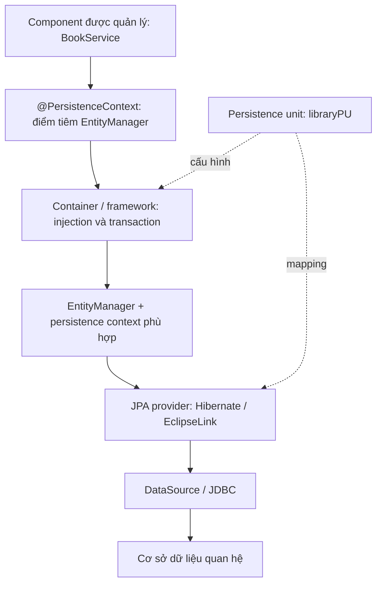
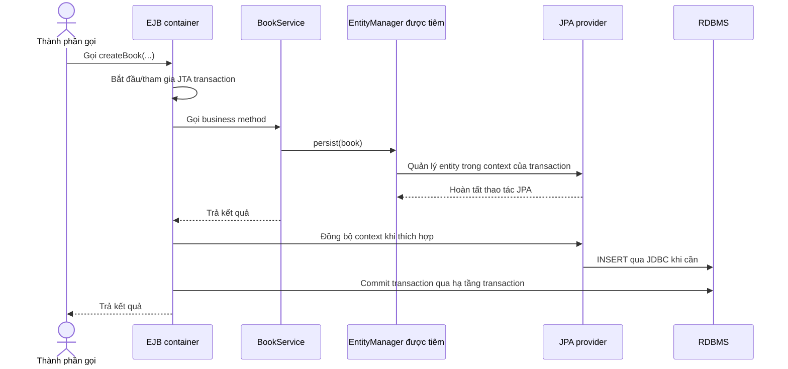

# Tiêm `EntityManager` bằng `@PersistenceContext` trong môi trường quản lý

Trong một ứng dụng Jakarta Persistence (JPA), ta có thể tự tạo `EntityManager` từ `EntityManagerFactory`. Tuy nhiên, khi chạy trong **môi trường được quản lý** như Jakarta EE hoặc một ứng dụng Spring có tích hợp JPA, cách làm phổ biến hơn là yêu cầu container cung cấp `EntityManager` thông qua annotation **`@PersistenceContext`**.

Việc tiêm này không chỉ giúp giảm mã khởi tạo. Container còn phối hợp `EntityManager` với **persistence unit**, **persistence context**, **transaction** và vòng đời của component. Vì vậy, muốn sử dụng đúng `@PersistenceContext`, cần hiểu đối tượng được tiêm đại diện cho điều gì, context được tạo vào lúc nào, nó hoạt động ra sao trong mỗi transaction và ai chịu trách nhiệm đóng tài nguyên.

## 1. Ba khái niệm cần phân biệt trước khi tiêm

Trong JPA, ba khái niệm sau có liên hệ chặt chẽ nhưng không đồng nhất:

| Khái niệm | Ý nghĩa | Vòng đời điển hình |
|---|---|---|
| **Persistence unit** | Đơn vị cấu hình persistence: tên unit, tập entity, provider, datasource và thuộc tính runtime | Được xác lập khi ứng dụng khởi tạo/deploy |
| **`EntityManager`** | Giao diện thao tác với entity: `persist`, `find`, `merge`, `remove`, tạo truy vấn, `flush`... | Phụ thuộc cách tạo: do ứng dụng hoặc container quản lý |
| **Persistence context** | Tập các entity đang được quản lý cùng cơ chế bảo đảm đồng nhất định danh và theo dõi thay đổi | Thường gắn với một transaction; có thể kéo dài hơn trong extended context |

**Persistence unit** xác định *cấu hình nào* được dùng. **`EntityManager`** là API để *làm việc* với dữ liệu. **Persistence context** là môi trường theo dõi *những entity nào đang được quản lý*.

Ví dụ, với cùng một entity `Book` và cùng persistence unit `libraryPU`, hai transaction khác nhau vẫn có thể làm việc với hai persistence context khác nhau. Một biến `EntityManager` được tiêm vào service không có nghĩa tất cả lời gọi service trong suốt thời gian ứng dụng chạy đều chia sẻ một persistence context.

### JPA API và container có vai trò gì?

- **JPA specification** định nghĩa `@PersistenceContext`, `EntityManager`, persistence context và các quy tắc tích hợp.
- **JPA provider** như Hibernate ORM hoặc EclipseLink hiện thực việc ánh xạ entity, theo dõi thay đổi, tạo SQL và giao tiếp với JDBC.
- **Container/framework** xác định component được quản lý, xử lý việc tiêm, tổ chức transaction và phối hợp provider với tài nguyên của ứng dụng.
- **JDBC driver và RDBMS** thực hiện phần giao tiếp và lưu trữ ở tầng cơ sở dữ liệu.

Trong Jakarta EE, `@PersistenceContext` là cơ chế tiêm **container-managed entity manager**. Trong Spring, annotation này cũng được hỗ trợ bởi hạ tầng tích hợp JPA, thường thông qua một đối tượng đại diện liên kết `EntityManager` với transaction hiện tại.

## 2. `@PersistenceContext` có tác dụng gì?

Annotation nằm trong gói `jakarta.persistence`:

```java
import jakarta.persistence.EntityManager;
import jakarta.persistence.PersistenceContext;

@PersistenceContext(unitName = "libraryPU")
private EntityManager entityManager;
```

Đoạn khai báo gửi một yêu cầu tới môi trường quản lý:

> Hãy cung cấp cho component này một `EntityManager` thuộc persistence unit `libraryPU`, sử dụng cách quản lý persistence context tương ứng với cấu hình được yêu cầu.

Container/framework xử lý yêu cầu khi tạo hoặc cấu hình component. Nó có thể tiêm một đối tượng trung gian (proxy/delegate) thay vì một `EntityManager` vật lý cố định. Khi ứng dụng gọi `entityManager.find(...)`, hạ tầng sẽ chuyển tiếp tới `EntityManager` và persistence context thích hợp với transaction hiện tại.

Điều này mang lại những thuận lợi chính:

1. Component không phải tự gọi `Persistence.createEntityManagerFactory(...)` hoặc `createEntityManager()` cho mỗi lần thực hiện nghiệp vụ.
2. `EntityManager` tham gia transaction được container/framework quản lý đúng theo mô hình tích hợp.
3. Persistence context có thể được chia sẻ và lan truyền giữa các lời gọi thuộc **cùng một transaction**, theo quy tắc của JPA và môi trường chạy.
4. Vòng đời các tài nguyên do container quản lý không phải được đóng thủ công trong mỗi service method.
5. Code nghiệp vụ làm việc với API `EntityManager` chuẩn mà không cần trực tiếp gọi API của provider.

Sơ đồ logic:



**Cần lưu ý:** field được tiêm không phải bằng chứng rằng một transaction đã bắt đầu. Việc tiêm và việc mở transaction là hai trách nhiệm khác nhau. Chẳng hạn, một transaction có thể được bắt đầu tự động khi lời gọi đi qua phương thức EJB hoặc Spring service đã được khai báo transaction.

## 3. Chuẩn bị persistence unit trong Jakarta EE

Để minh họa, giả sử ứng dụng quản lý sách và triển khai trong một Jakarta EE runtime có hỗ trợ Jakarta Persistence, transaction JTA và một `DataSource` tên `java:app/jdbc/LibraryDS`.

Một cấu trúc tối thiểu có thể gồm:

```text
src/main/
├── java/
│   └── example/
│       ├── domain/
│       │   └── Book.java
│       └── service/
│           └── BookService.java
└── resources/
    └── META-INF/
        └── persistence.xml
```

### 3.1. Khai báo persistence unit

Ví dụ cấu hình `META-INF/persistence.xml` theo namespace Jakarta Persistence:

```xml
<?xml version="1.0" encoding="UTF-8"?>
<persistence xmlns="https://jakarta.ee/xml/ns/persistence"
             version="3.1">
    <persistence-unit name="libraryPU" transaction-type="JTA">
        <jta-data-source>java:app/jdbc/LibraryDS</jta-data-source>
        <class>example.domain.Book</class>
        <properties>
            <property name="jakarta.persistence.schema-generation.database.action"
                      value="none"/>
        </properties>
    </persistence-unit>
</persistence>
```

Giải thích:

- `name="libraryPU"` định danh persistence unit. Đây là giá trị mà `@PersistenceContext(unitName = "libraryPU")` tham chiếu.
- `transaction-type="JTA"` cho biết persistence unit sử dụng transaction được điều phối theo JTA.
- `<jta-data-source>` tham chiếu `DataSource` do môi trường chạy cung cấp. Datasource đó phải thật sự được cấu hình và truy cập được.
- `<class>example.domain.Book</class>` liệt kê entity mà provider quản lý trong ví dụ.
- `schema-generation.database.action=none` tránh để JPA tự tạo/xóa bảng. Cần chuẩn bị schema tương ứng qua migration hoặc DBA.

Trong ứng dụng thực tế, Jakarta EE container có thể hỗ trợ thêm cách phát hiện entity, chọn provider và quản lý cấu hình khác nhau. Ví dụ không bắt buộc một nhà cung cấp JPA cụ thể; runtime phải có provider tương thích với phiên bản Jakarta Persistence được sử dụng.

### 3.2. Định nghĩa entity

```java
package example.domain;

import jakarta.persistence.Column;
import jakarta.persistence.Entity;
import jakarta.persistence.GeneratedValue;
import jakarta.persistence.GenerationType;
import jakarta.persistence.Id;
import jakarta.persistence.Table;
import jakarta.persistence.Version;

@Entity
@Table(name = "books")
public class Book {
    @Id
    @GeneratedValue(strategy = GenerationType.IDENTITY)
    private Long id;

    @Column(nullable = false, length = 200)
    private String title;

    @Version
    private long version;

    protected Book() {
        // Constructor không đối số dành cho JPA.
    }

    public Book(String title) {
        this.title = title;
    }

    public Long getId() {
        return id;
    }

    public String getTitle() {
        return title;
    }

    public void rename(String title) {
        this.title = title;
    }
}
```

Entity chỉ chứa annotation và Java code theo chuẩn JPA. Provider đọc mapping, ánh xạ lớp `Book` vào bảng `books` và chịu trách nhiệm đồng bộ giá trị cột với các đối tượng managed. Vì đang đặt `schema-generation` thành `none`, ví dụ giả định bảng `books` có cột khóa chính `id`, `title` và `version` phù hợp với cách sinh khóa của cơ sở dữ liệu.

## 4. Tiêm `EntityManager` trong một EJB do Jakarta EE quản lý

Một cách minh họa rõ ràng nhất là dùng **stateless session bean**. EJB container quản lý đối tượng này và mặc định áp dụng container-managed transaction cho các business method với thuộc tính transaction `REQUIRED`.

```java
package example.service;

import example.domain.Book;
import jakarta.ejb.Stateless;
import jakarta.persistence.EntityManager;
import jakarta.persistence.PersistenceContext;

@Stateless
public class BookService {
    @PersistenceContext(unitName = "libraryPU")
    private EntityManager em;

    public Long createBook(String title) {
        Book book = new Book(title);
        em.persist(book);
        return book.getId();
    }

    public Book findBook(Long id) {
        return em.find(Book.class, id);
    }

    public void renameBook(Long id, String newTitle) {
        Book book = em.find(Book.class, id);
        if (book == null) {
            throw new IllegalArgumentException("Book not found: " + id);
        }

        book.rename(newTitle);
        // Provider tự phát hiện thay đổi của entity managed.
    }

    public void deleteBook(Long id) {
        Book book = em.find(Book.class, id);
        if (book != null) {
            em.remove(book);
        }
    }
}
```

Ở đây, `@Stateless` và `@PersistenceContext` làm hai việc khác nhau:

- `@Stateless` khai báo một EJB được container quản lý; với cấu hình mặc định, EJB transaction `REQUIRED` tạo hoặc tham gia transaction JTA cho business method.
- `@PersistenceContext` yêu cầu container tiêm `EntityManager` thuộc persistence unit `libraryPU`.

Khi `createBook` được gọi thông qua EJB container, transaction được thiết lập theo metadata EJB; provider theo dõi `book` sau `persist` và đồng bộ với CSDL theo quy tắc flush/commit. Trong `renameBook`, `book` được trả về bởi `find` là managed nếu tìm thấy; sửa thuộc tính trên đối tượng đó đủ để provider phát hiện thay đổi khi đồng bộ. Trong `deleteBook`, `remove` đánh dấu entity để xóa.

Đoạn code **không gọi** `em.getTransaction().begin()`, `commit()` hoặc `em.close()`, bởi `EntityManager` được container quản lý và transaction do EJB container điều phối. Việc gọi các phương thức quản lý transaction resource-local đối với container-managed JTA entity manager không phù hợp với mô hình này.

### Tiêm tại field và tại setter

`@PersistenceContext` có thể được đặt trên field hoặc setter của một component được hỗ trợ:

```java
import jakarta.persistence.EntityManager;
import jakarta.persistence.PersistenceContext;

public class ReportService {
    private EntityManager em;

    @PersistenceContext(unitName = "libraryPU")
    public void setEntityManager(EntityManager em) {
        this.em = em;
    }
}
```

`ReportService` phải được môi trường có cơ chế injection thích hợp tạo và quản lý; khai báo setter một mình không khiến một đối tượng khởi tạo bằng `new ReportService()` được tiêm tự động. Mọi ví dụ nghiệp vụ cần đặt class trong loại component được container/framework hỗ trợ.

### Thuộc tính `unitName` và `name`

Ví dụ `@PersistenceContext(unitName = "libraryPU")` định danh **persistence unit** mà entity manager cần sử dụng. Annotation còn có thuộc tính `name`, liên quan đến tên tham chiếu trong môi trường đặt tên của component; nó không thay thế trực tiếp cho `unitName`.

Khi ứng dụng chỉ có một persistence unit và môi trường có thể chọn được unit duy nhất, có thể gặp cú pháp `@PersistenceContext` không có `unitName`. Nhưng ở hệ thống có nhiều unit, chỉ rõ `unitName` giúp tránh nhầm giữa các cơ sở dữ liệu hoặc nhóm entity.

Ví dụ:

```java
@PersistenceContext(unitName = "catalogPU")
private EntityManager catalogEm;

@PersistenceContext(unitName = "billingPU")
private EntityManager billingEm;
```

Hai field đại diện cho các persistence unit khác nhau. Entity của unit này không mặc nhiên thuộc mô hình ánh xạ của unit kia, dù cả hai đều được khai báo trong cùng ứng dụng.

## 5. Điều gì thực sự xảy ra khi gọi service?

Với **transaction-scoped persistence context** (giá trị mặc định của `@PersistenceContext`), một chuỗi gọi điển hình là:



Sơ đồ chỉ mô tả **trách nhiệm và luồng logic**. Thời điểm phát SQL phụ thuộc provider và chiến lược sinh khóa; với `GenerationType.IDENTITY`, `INSERT` có thể cần thực thi sớm để lấy id. Container/provider phối hợp commit thông qua hạ tầng transaction thực tế, không nhất thiết thực hiện đúng từng bước theo thứ tự giản lược của sơ đồ.

Nếu một EJB method dùng transaction `REQUIRED` gọi một EJB method khác cũng dùng `REQUIRED`, lời gọi thứ hai thường tham gia **cùng transaction JTA**. Trong trường hợp các entity manager tương thích với cùng persistence unit và cùng cơ chế context propagation, hai phương thức có thể dùng chung persistence context gắn với transaction đó.

Điều này giải thích vì sao một entity có thể được nhìn thấy dưới dạng managed ở nhiều lời gọi nghiệp vụ trong cùng transaction, ngay cả khi các component có những field `EntityManager` được tiêm riêng. **Identity của field được tiêm không quyết định identity của persistence context.**

## 6. Persistence context mặc định: `TRANSACTION`

Mặc định, `@PersistenceContext` dùng `PersistenceContextType.TRANSACTION`:

```java
import jakarta.persistence.EntityManager;
import jakarta.persistence.PersistenceContext;
import jakarta.persistence.PersistenceContextType;

@PersistenceContext(
    unitName = "libraryPU",
    type = PersistenceContextType.TRANSACTION
)
private EntityManager em;
```

Không cần khai báo `type` nếu muốn dùng mặc định.

**Transaction-scoped persistence context** liên kết vòng đời managed entity với transaction hiện hành:

1. Khi transaction bắt đầu và entity manager tham gia, provider thiết lập/sử dụng persistence context cho transaction.
2. Những entity truy vấn hoặc được `persist` trong transaction trở thành managed trong context tương ứng.
3. Thay đổi trên entity managed được đồng bộ theo chế độ flush và transaction.
4. Khi transaction hoàn tất, context theo transaction kết thúc; các đối tượng Java vẫn có thể còn trong bộ nhớ nhưng không còn được context cũ quản lý.

Ví dụ:

```text
Transaction A:
    em.find(Book.class, 1L) -> Book A (managed trong context A)
    sửa Book A
    commit -> context A kết thúc

Transaction B:
    em.find(Book.class, 1L) -> Book B (managed trong context B)
    commit -> context B kết thúc
```

Hai đối tượng `Book A` và `Book B` có thể đại diện cho **cùng hàng dữ liệu** nhưng thuộc hai persistence context khác nhau. Không nên dựa vào phép so sánh tham chiếu `==` giữa entity nhận từ các transaction khác nhau để kết luận chúng có cùng bản ghi hay không.

### Vì sao context theo transaction quan trọng?

Một transaction tạo ra ranh giới rõ ràng cho việc theo dõi thay đổi, rollback, locking và đồng bộ dữ liệu. Đối với các request hoặc business operation độc lập, mỗi transaction thường có context riêng, tránh giữ quá nhiều đối tượng managed trong bộ nhớ.

Nếu một entity đã **detached** sau khi context kết thúc và ứng dụng muốn cập nhật bằng transaction mới, một hướng làm thông dụng là tải lại entity trong transaction mới rồi thay đổi nó. Trong những trường hợp cần xử lý trạng thái detached, `em.merge(detachedEntity)` sao chép trạng thái vào **một đối tượng managed được trả về**; đối tượng detached ban đầu không tự biến thành managed.

### Truy vấn ngoài transaction có gì khác?

Một số thao tác đọc có thể được phép thực hiện ngoài transaction, nhưng transaction-scoped container-managed context không tồn tại xuyên suốt nhiều business method không có transaction. Entity trả về có thể tách khỏi context sau thao tác và các thay đổi không tự được lưu.

Các thao tác cần transaction, chẳng hạn cập nhật/xóa và đồng bộ dữ liệu, có thể gây `TransactionRequiredException` nếu được gọi trong hoàn cảnh không có transaction phù hợp. Khi nghiệp vụ cần đọc và sửa entity, hãy xác định transaction boundary rõ ràng.

## 7. Extended persistence context: dùng khi cần giữ entity managed lâu hơn

Ngoài `TRANSACTION`, JPA còn định nghĩa `PersistenceContextType.EXTENDED`. Extended context có vòng đời dài hơn một transaction, thường phục vụ một **conversation** gồm nhiều bước tương tác.

Trong Jakarta EE, extended container-managed persistence context được gắn với **stateful session bean**; không áp dụng nó tùy ý cho stateless bean.

Ví dụ minh họa:

```java
package example.service;

import example.domain.Book;
import jakarta.ejb.Remove;
import jakarta.ejb.Stateful;
import jakarta.persistence.EntityManager;
import jakarta.persistence.PersistenceContext;
import jakarta.persistence.PersistenceContextType;

@Stateful
public class BookEditingSession {
    @PersistenceContext(
        unitName = "libraryPU",
        type = PersistenceContextType.EXTENDED
    )
    private EntityManager em;

    private Book editingBook;

    public void start(Long bookId) {
        editingBook = em.find(Book.class, bookId);
        if (editingBook == null) {
            throw new IllegalArgumentException("Book not found: " + bookId);
        }
    }

    public void changeTitle(String newTitle) {
        editingBook.rename(newTitle);
    }

    @Remove
    public void finish() {
        em.flush();
    }
}
```

Mã này minh họa mục đích của extended context: entity có thể vẫn được theo dõi giữa các lời gọi vào cùng một stateful bean. **Không được hiểu rằng thay đổi sẽ luôn chỉ ghi xuống CSDL ở `finish()`.** Với transaction JTA được container cấp cho từng lời gọi, extended context có thể tham gia transaction và được đồng bộ ở ranh giới transaction của những lời gọi trước đó. Nếu muốn một quy trình nhiều bước chỉ ghi dữ liệu sau khi người dùng xác nhận, phải thiết kế transaction boundary và luồng lưu nháp/chốt dữ liệu phù hợp; extended context tự nó không tạo cơ chế “commit tất cả ở cuối”.

So sánh nhanh:

| Tiêu chí | `TRANSACTION` | `EXTENDED` |
|---|---|---|
| Phạm vi context | Gắn với transaction | Gắn với vòng đời stateful conversation |
| Entity sau khi transaction kết thúc | Không còn managed bởi context cũ | Có thể vẫn managed trong extended context |
| Đối tượng sử dụng điển hình | Stateless EJB, nghiệp vụ request/transaction | Stateful session bean nhiều bước |
| Nguy cơ vận hành | Lazy access ngoài scope; entity detached giữa transaction | Giữ nhiều entity lâu, dữ liệu cũ, xung đột đồng thời, tài nguyên lớn |
| Khi nên chọn | Phần lớn nghiệp vụ CRUD thông thường | Chỉ khi thực sự cần persistence context dài hạn |

Trong hệ thống API stateless phổ biến, transaction-scoped context thường là lựa chọn đơn giản hơn. Extended context đòi hỏi cân nhắc cách quản lý vòng đời stateful bean, bộ nhớ, tính nhất quán dữ liệu và tính đồng thời.

## 8. Đồng bộ persistence context với JTA transaction

Annotation `@PersistenceContext` còn có thuộc tính `synchronization`, sử dụng `SynchronizationType`:

```java
import jakarta.persistence.EntityManager;
import jakarta.persistence.PersistenceContext;
import jakarta.persistence.SynchronizationType;

@PersistenceContext(
    unitName = "libraryPU",
    synchronization = SynchronizationType.SYNCHRONIZED
)
private EntityManager em;
```

`SYNCHRONIZED` là chế độ thông thường: persistence context đồng bộ với transaction mà nó đã tham gia. Khi cần một context chưa tham gia đồng bộ ngay, JPA hỗ trợ `UNSYNCHRONIZED` trong mô hình JTA:

```java
@PersistenceContext(
    unitName = "libraryPU",
    synchronization = SynchronizationType.UNSYNCHRONIZED
)
private EntityManager em;

public void submitChanges() {
    // Phương thức phải thực thi trong một JTA transaction phù hợp.
    em.joinTransaction();
    em.flush();
}
```

Ý nghĩa:

- `UNSYNCHRONIZED` cho phép persistence context tồn tại/chứa thay đổi mà chưa tự động đồng bộ với transaction JTA đang diễn ra.
- `joinTransaction()` yêu cầu context tham gia transaction hiện tại, sau đó có thể đồng bộ thay đổi theo quy tắc JPA.
- Không thể dùng chế độ này như một cơ chế thay thế transaction để ghi dữ liệu an toàn. Thao tác `flush` cần context tham gia transaction tương ứng.

Đây là khả năng nâng cao, chủ yếu hữu ích khi cần kiểm soát chính xác thời điểm một context được đồng bộ với transaction. Với CRUD thông thường, nên bắt đầu từ `SYNCHRONIZED` mặc định.

## 9. Quản lý transaction: container chịu trách nhiệm đến đâu?

Điểm cốt lõi của injection trong môi trường quản lý là sự phối hợp giữa **entity manager** và **transaction manager**.

### 9.1. Transaction trong Jakarta EE EJB

EJB có thể khai báo thuộc tính transaction:

```java
import jakarta.ejb.Stateless;
import jakarta.ejb.TransactionAttribute;
import jakarta.ejb.TransactionAttributeType;
import jakarta.persistence.EntityManager;
import jakarta.persistence.PersistenceContext;

@Stateless
public class LendingService {
    @PersistenceContext(unitName = "libraryPU")
    private EntityManager em;

    @TransactionAttribute(TransactionAttributeType.REQUIRED)
    public void registerLoan(Long bookId) {
        Book book = em.find(Book.class, bookId);
        if (book == null) {
            throw new IllegalArgumentException("Book not found");
        }
        // Thao tác cập nhật entity hoặc tạo Loan ở đây.
    }
}
```

`REQUIRED` nghĩa là tham gia transaction hiện tại nếu có; nếu không có thì container bắt đầu một transaction mới cho lời gọi qua EJB container. Các thuộc tính `REQUIRES_NEW`, `MANDATORY`, `SUPPORTS`, `NOT_SUPPORTED`, `NEVER` cũng có ngữ nghĩa riêng. Việc thay thuộc tính transaction có thể làm thay đổi persistence context và thời điểm dữ liệu được đồng bộ.

Nếu dùng CDI-managed bean trong Jakarta EE, có thể gặp `jakarta.transaction.Transactional` để khai báo transaction boundary trên phương thức được interceptor quản lý:

```java
import jakarta.enterprise.context.ApplicationScoped;
import jakarta.persistence.EntityManager;
import jakarta.persistence.PersistenceContext;
import jakarta.transaction.Transactional;

@ApplicationScoped
public class InventoryService {
    @PersistenceContext(unitName = "libraryPU")
    private EntityManager em;

    @Transactional
    public void updateBook(Long id, String title) {
        Book book = em.find(Book.class, id);
        if (book == null) {
            throw new IllegalArgumentException("Book not found");
        }
        book.rename(title);
    }
}
```

Ví dụ này giả định Jakarta EE runtime hỗ trợ injection và transactional interceptor cho component nêu trên. Khác với EJB `@Stateless`, khai báo CDI scope như `@ApplicationScoped` **không tự đồng nghĩa** với việc mọi phương thức đều có transaction: phương thức cần được gọi thông qua cơ chế quản lý/interceptor tương ứng.

### 9.2. Rollback không giống `clear()` hay `close()`

Khi một transaction thất bại, container/transaction manager chịu trách nhiệm rollback dựa trên các quy tắc áp dụng. EntityManager và provider điều chỉnh trạng thái persistence context theo ngữ nghĩa JPA. Trong môi trường EJB container-managed transaction, quy tắc rollback khi xảy ra system exception và application exception có thể khác nhau; nếu muốn rollback chủ động, hãy dùng cơ chế transaction phù hợp của container.

Không nên gọi `em.clear()` hoặc `em.close()` để “rollback”. `clear()` chỉ tách các entity khỏi persistence context; `close()` quản lý vòng đời entity manager trong mô hình application-managed, không phải thao tác kết thúc transaction.

### 9.3. `flush()` khác `commit()`

`em.flush()` yêu cầu provider đồng bộ trạng thái entity đang quản lý với cơ sở dữ liệu trong phạm vi transaction. `commit` là bước chấp nhận transaction do hạ tầng transaction thực hiện. SQL có thể đã được gửi xuống cơ sở dữ liệu trước commit nhưng vẫn bị rollback nếu transaction kết thúc không thành công.

Ví dụ:

```java
@Stateless
public class BookCommandService {
    @PersistenceContext(unitName = "libraryPU")
    private EntityManager em;

    public void renameAndCheck(Long id, String title) {
        Book book = em.find(Book.class, id);
        if (book == null) {
            throw new IllegalArgumentException("Book not found");
        }
        book.rename(title);
        em.flush(); // Đồng bộ SQL trong transaction, chưa phải commit.
    }
}
```

`flush()` hữu ích khi cần phát hiện một số lỗi ràng buộc CSDL sớm trong transaction, nhưng không nên gọi ở mọi bước nếu không có mục đích rõ ràng.

## 10. Spring hỗ trợ `@PersistenceContext` như thế nào?

Trong ứng dụng Spring tích hợp JPA, `@PersistenceContext` cũng được hỗ trợ cho bean do Spring quản lý. Thông thường, Spring tiêm một **shared EntityManager proxy**; khi phương thức được gọi trong transaction, proxy chuyển thao tác tới `EntityManager` gắn với transaction đó.

Ví dụ:

```java
package example.service;

import example.domain.Book;
import jakarta.persistence.EntityManager;
import jakarta.persistence.PersistenceContext;
import org.springframework.stereotype.Service;
import org.springframework.transaction.annotation.Transactional;

@Service
public class SpringBookService {
    @PersistenceContext
    private EntityManager em;

    @Transactional
    public Long create(String title) {
        Book book = new Book(title);
        em.persist(book);
        return book.getId();
    }

    @Transactional(readOnly = true)
    public Book get(Long id) {
        return em.find(Book.class, id);
    }

    @Transactional
    public void rename(Long id, String title) {
        Book book = em.find(Book.class, id);
        if (book == null) {
            throw new IllegalArgumentException("Book not found");
        }
        book.rename(title);
    }
}
```

Điểm khác cần nhận biết:

- `@PersistenceContext` vẫn thuộc `jakarta.persistence`, nhưng cơ chế tiêm do Spring hỗ trợ.
- `@Transactional` trong ví dụ thuộc `org.springframework.transaction.annotation.Transactional`, không phải annotation EJB.
- Spring Boot có thể tự cấu hình `EntityManagerFactory`, `DataSource` và JPA provider từ dependency cùng application configuration; nhiều dự án không cần viết `persistence.xml`.
- Trong các cấu hình dùng nhiều `EntityManagerFactory`, việc lựa chọn đúng persistence unit/`EntityManagerFactory` và transaction manager phải được cấu hình rõ ràng.

Với Spring sử dụng proxy-based transaction, gọi một phương thức `@Transactional` từ một phương thức khác **bên trong chính cùng instance** có thể không đi qua transaction proxy. Nếu transaction không được thiết lập như mong đợi, lỗi xuất hiện ở thao tác JPA là hệ quả của cách gọi, không nhất thiết do `@PersistenceContext` thất bại.

Spring Data JPA cung cấp tầng repository thuận tiện hơn nhưng vẫn sử dụng provider JPA ở bên dưới. Tiêm `EntityManager` trực tiếp phù hợp khi cần thao tác JPQL, Criteria, truy vấn động hoặc xử lý persistence context một cách có chủ đích.

## 11. Phân biệt `@PersistenceContext` và `@PersistenceUnit`

Hai annotation dễ bị nhầm vì tên tương tự nhau:

| Annotation | Đối tượng thường được tiêm | Vai trò |
|---|---|---|
| `@PersistenceContext` | `EntityManager` | Thao tác với persistence context do môi trường quản lý |
| `@PersistenceUnit` | `EntityManagerFactory` | Truy cập factory của persistence unit, có thể tạo `EntityManager` trong mô hình phù hợp |

Ví dụ:

```java
import jakarta.persistence.EntityManager;
import jakarta.persistence.EntityManagerFactory;
import jakarta.persistence.PersistenceContext;
import jakarta.persistence.PersistenceUnit;

public class ExampleComponent {
    @PersistenceContext(unitName = "libraryPU")
    private EntityManager em;

    @PersistenceUnit(unitName = "libraryPU")
    private EntityManagerFactory emf;
}
```

Khi dùng `@PersistenceContext`, container sở hữu vòng đời của container-managed `EntityManager`. Khi **ứng dụng tự tạo** `EntityManager` thông qua `emf.createEntityManager()`, instance đó là **application-managed entity manager**; ứng dụng cần đóng nó và quản lý transaction theo mô hình đang dùng.

Đây là khác biệt về quyền sở hữu tài nguyên và vòng đời, không chỉ là khác biệt về cú pháp.

### Không tự đóng `EntityManager` được tiêm

Không viết:

```java
@PersistenceContext(unitName = "libraryPU")
private EntityManager em;

public void doWork() {
    // ...
    em.close(); // Sai cách đối với container-managed EntityManager.
}
```

Container quản lý tài nguyên được tiêm và sẽ xử lý vòng đời thích hợp. Trong môi trường quản lý, tự tạo/đóng entity manager cũng có thể phá vỡ khả năng tham gia và chia sẻ context theo transaction nếu làm không đúng.

### Không tự dùng `EntityTransaction` cho JTA entity manager

Đoạn sau phù hợp với một số chương trình Java SE sử dụng resource-local `EntityManager`, **không phải** mẫu giao dịch mặc định trong Jakarta EE JTA:

```java
EntityManager em = emf.createEntityManager();
try {
    em.getTransaction().begin();
    // ...
    em.getTransaction().commit();
} finally {
    em.close();
}
```

Nếu persistence unit được cấu hình JTA và entity manager được container quản lý, hãy để EJB transaction, JTA hoặc hạ tầng transaction của framework điều phối.

## 12. Vòng đời và tính an toàn khi sử dụng đồng thời

Một số class managed có thể tồn tại lâu, thậm chí có phạm vi application, nhưng điều đó **không đồng nghĩa** một persistence context được duy trì suốt vòng đời class.

Trong mô hình transaction-scoped, container/framework có thể tiêm một proxy ổn định. Mỗi thread hoặc transaction được định tuyến tới entity manager/persistence context thích hợp. **`EntityManager` thực tế và entity managed không được xem là đối tượng thread-safe để chia sẻ tùy ý giữa các thread.**

Ví dụ một `@ApplicationScoped` bean hoặc Spring singleton service có thể giữ field `EntityManager` được tiêm do hạ tầng cung cấp, nhưng không nên:

- Lưu một instance `EntityManager` tự tạo vào biến `static` rồi gọi đồng thời từ nhiều thread.
- Giữ entity managed để dùng như trạng thái toàn cục giữa các HTTP request độc lập.
- Truyền một entity manager đang tham gia transaction sang thread tự tạo rồi tiếp tục sử dụng.
- Coi một đối tượng entity đã được đọc trong transaction trước là tự động managed ở transaction sau.

Để tránh nhầm lẫn, hãy hiểu field `EntityManager` được tiêm là một **điểm truy cập** tới dịch vụ persistence do môi trường quản lý, còn ngữ cảnh dữ liệu thực tế phụ thuộc transaction và phạm vi context.

## 13. Những lỗi thường gặp và cách nhận diện

| Biểu hiện | Nguyên nhân khả dĩ | Hướng xử lý |
|---|---|---|
| Field `em` bằng `null` | Component được tạo bằng `new`, chưa tham gia cơ chế injection; loại component không được runtime hỗ trợ | Để container/framework tạo component và kiểm tra cấu hình injection |
| Không tìm thấy persistence unit | `unitName` sai hoặc cấu hình unit không được nạp vào runtime | Đối chiếu tên `libraryPU` với khai báo persistence unit, kiểm tra package/deployment |
| Không tìm thấy `DataSource` | JNDI name không khớp, datasource chưa được cấu hình | Kiểm tra tài nguyên JDBC trong runtime và tên `<jta-data-source>` |
| Không có transaction khi ghi | Method được gọi ngoài transaction boundary; interceptor/proxy không được kích hoạt | Thiết lập EJB/JTA/Spring transaction đúng cách |
| `TransactionRequiredException` | Thao tác yêu cầu transaction nhưng hiện không có transaction thích hợp | Đặt thao tác trong transaction được quản lý |
| Lỗi khi gọi `em.close()` | Đang cố đóng container-managed entity manager | Bỏ thao tác đóng thủ công; để container quản lý |
| Thay đổi entity không được lưu | Entity đã detached, transaction bị rollback, hoặc context không đồng bộ | Xem trạng thái entity, transaction, `merge`/tải lại và chế độ synchronization |
| Truy cập quan hệ lazy gây lỗi | Entity đã ngoài persistence context cần thiết | Lấy đủ dữ liệu trong transaction bằng fetch join/entity graph/DTO |
| Cùng khóa nhưng đối tượng Java không giống nhau | Các lần tải xảy ra ở các persistence context khác nhau | So sánh định danh nghiệp vụ/khóa chính theo thiết kế, không phụ thuộc `==` |
| Cấu hình nhiều unit nhưng lấy nhầm dữ liệu | Injection chọn sai persistence unit hoặc transaction manager | Chỉ rõ `unitName` và kiểm tra hạ tầng gắn đúng datasource |

### Ví dụ lỗi: tự tạo service bằng `new`

```java
BookService service = new BookService();
service.createBook("JPA");
```

Nếu `BookService` là EJB ví dụ ở trên, lời gọi này tạo ra một đối tượng Java thông thường, bỏ qua container. Field `em` không được tiêm và transaction của EJB cũng không được thiết lập. Client phải lấy tham chiếu EJB bằng cơ chế được container hỗ trợ, chẳng hạn injection vào một component quản lý khác.

### Ví dụ lỗi: coi detached entity là managed

Giả sử `findBook` được gọi trong transaction A, trả về `Book`, rồi caller lưu đối tượng đó và sửa ở transaction B mà không đưa nó vào persistence context của B. Việc sửa Java object đơn thuần không buộc provider cập nhật CSDL.

Một cách xử lý trong transaction B là đọc lại:

```java
@Stateless
public class BookUpdater {
    @PersistenceContext(unitName = "libraryPU")
    private EntityManager em;

    public void updateTitle(Long id, String newTitle) {
        Book managed = em.find(Book.class, id);
        if (managed == null) {
            throw new IllegalArgumentException("Book not found");
        }
        managed.rename(newTitle);
    }
}
```

Mẫu này cũng cho phép quyết định rõ cần đọc, khóa và kiểm tra phiên bản nào trong transaction cập nhật.

## 14. Ví dụ luồng hoàn chỉnh: hai lời gọi, hai transaction

Giả sử ứng dụng nhận hai yêu cầu HTTP riêng biệt để tạo sách rồi đổi tên sách. Ở tầng persistence, hai lời gọi được xử lý như sau:

```text
Yêu cầu HTTP 1
  -> Container gọi BookService.createBook("JPA")
  -> JTA Transaction T1
  -> @PersistenceContext truy cập context C1 của libraryPU
  -> persist(Book)
  -> provider INSERT và transaction commit
  -> context C1 kết thúc

Yêu cầu HTTP 2
  -> Container gọi BookService.renameBook(id, "Jakarta Persistence")
  -> JTA Transaction T2
  -> @PersistenceContext truy cập context C2 của libraryPU
  -> find(Book, id), rồi rename(...)
  -> provider UPDATE và transaction commit
  -> context C2 kết thúc
```

Ở cả hai yêu cầu, business code có thể dùng cùng một field tên `em` của `BookService`. Song **C1** và **C2** là các persistence context khác nhau. Việc context tồn tại trong T1 không gây ra một “bộ nhớ entity toàn cục” giữ nguyên qua T2.

Trong từng transaction, provider theo dõi các entity managed, kiểm tra `@Version` khi cần và đồng bộ SQL. Nếu một transaction thất bại, container/transaction manager xử lý rollback theo quy tắc áp dụng. Với cách tổ chức này, service tập trung vào logic nghiệp vụ; container quản lý vòng đời và transaction; provider thực thi ORM.

## 15. Khi nào nên tiêm `EntityManager` trực tiếp?

Tiêm trực tiếp thường hợp lý khi service cần kiểm soát truy vấn hoặc persistence context rõ hơn mức mà một lớp repository sẵn có cung cấp. Ví dụ:

- Viết JPQL hoặc Criteria API động theo nhiều bộ lọc.
- Gọi `flush()` tại thời điểm có chủ đích trong transaction.
- Dùng `lock()` với lock mode chuẩn để giải quyết yêu cầu đồng thời.
- Truy vấn bằng entity graph, projection, pagination và thao tác bulk query.
- Dùng các thao tác `detach()`, `clear()`, `refresh()`, `merge()` khi quản lý trạng thái entity một cách rõ ràng.

Tuy nhiên, tiêm `EntityManager` không làm cho transaction boundary, lazy loading hay hiệu năng truy vấn tự động đúng. Các quyết định đó vẫn thuộc trách nhiệm thiết kế của ứng dụng. Đối với ứng dụng Spring Data JPA, có thể bắt đầu với repository và chỉ dùng `EntityManager` trong những phần cần thiết.

## 16. Câu hỏi tự kiểm tra

1. **`@PersistenceContext(unitName = "libraryPU")` chọn điều gì?** Nó tham chiếu persistence unit có tên `libraryPU` và yêu cầu môi trường quản lý cung cấp `EntityManager` liên quan đến unit đó.
2. **Có phải một field `EntityManager` được tiêm tương ứng một context tồn tại mãi không?** Không. Với transaction-scoped context mặc định, context thường gắn với transaction hiện tại.
3. **Ai gọi `begin()`, `commit()` và `close()` trong mẫu `@Stateless` + `@PersistenceContext`?** Container/transaction manager điều phối giao dịch và vòng đời của entity manager được quản lý; business method không đóng hay tự dùng `EntityTransaction`.
4. **Vì sao `em.find(...)` rồi sửa thuộc tính có thể tạo `UPDATE`?** Vì entity đang managed, provider có thể phát hiện thay đổi và đồng bộ khi flush/commit.
5. **Khác nhau chính giữa `TRANSACTION` và `EXTENDED`?** Transaction-scoped context gắn với transaction; extended context được duy trì theo stateful conversation và có thể vượt qua nhiều transaction.
6. **Vì sao `new BookService()` làm injection thất bại?** Vì bỏ qua khâu tạo và xử lý injection của container.
7. **`@PersistenceUnit` tiêm gì so với `@PersistenceContext`?** Annotation đầu tiên tiêm `EntityManagerFactory`; annotation thứ hai tiêm `EntityManager` được môi trường quản lý.
8. **`flush()` có phải là `commit()` không?** Không. Flush đồng bộ thay đổi trong transaction; commit xác nhận kết quả transaction.

## Kết luận

`@PersistenceContext` là cơ chế nối mã nghiệp vụ với một **container-managed `EntityManager`** trong kiến trúc JPA. Nó giúp component làm việc với entity thông qua API chuẩn, trong khi container/framework quản lý injection và phối hợp transaction, còn provider quản lý persistence context, mapping và SQL.

Nắm chắc sự khác biệt giữa **persistence unit**, **`EntityManager`**, **persistence context** và **transaction** là chìa khóa để sử dụng annotation này chính xác. Trong phần lớn nghiệp vụ CRUD, hãy dùng transaction-scoped context mặc định, xác định rõ transaction boundary và để môi trường quản lý sở hữu vòng đời của entity manager được tiêm. Chỉ chuyển sang extended hoặc unsynchronized context khi bài toán thực sự cần đến ngữ nghĩa nâng cao của chúng.
