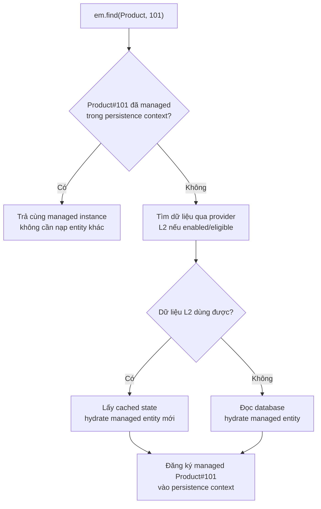

# Phân biệt bộ nhớ đệm cấp một và bộ nhớ đệm chia sẻ

Khi làm việc với **JPA (Jakarta Persistence)**, lập trình viên thường gặp hai hiện tượng tưởng như giống nhau:

1. Gọi `EntityManager.find(Order.class, 101L)` hai lần trong cùng một transaction nhưng chỉ thấy một lần `SELECT`.
2. Đóng `EntityManager` hiện tại, mở `EntityManager` khác, gọi `find` cùng ID và đôi khi **vẫn không thấy SQL SELECT**.

Hiện tượng thứ nhất thường đến từ **bộ nhớ đệm cấp một** (*first-level cache*, hay chính xác hơn là **persistence context / identity map**). Hiện tượng thứ hai có thể đến từ **bộ nhớ đệm chia sẻ** (*shared cache*, thường gọi là *second-level cache* hoặc *L2 cache*), nếu JPA provider và ứng dụng đã bật cấu hình phù hợp.

Hai cơ chế đều có thể giảm truy vấn database, nhưng **không cùng phạm vi, vòng đời, hình thức dữ liệu, tính nhất quán và mức độ hỗ trợ của chuẩn JPA**. Nếu nhầm lẫn, ứng dụng có thể đưa ra quyết định sai về hiệu năng, dữ liệu stale, giao dịch hoặc tính đúng đắn trong hệ thống nhiều người dùng.

Ví dụ:

```java
Order first = em.find(Order.class, 101L);
Order second = em.find(Order.class, 101L);

System.out.println(first == second); // true nếu cùng managed entity
```

Trong cùng persistence context, JPA bảo đảm **identity** của managed entity theo kiểu entity và khóa chính. Không phải do một cache toàn cục tự động chia sẻ Java object giữa mọi transaction.

Ngược lại:

```java
EntityManager em1 = emf.createEntityManager();
Order first = em1.find(Order.class, 101L);
em1.close();

EntityManager em2 = emf.createEntityManager();
Order second = em2.find(Order.class, 101L);
em2.close();

System.out.println(first == second); // Không nên mong đợi true.
```

Nếu shared cache được sử dụng, JPA provider có thể tái tạo một managed instance trong `em2` từ dữ liệu lưu ở L2 mà không cần truy vấn entity row từ database. Nhưng **Java object instance thuộc em1 không trở thành object managed dùng chung cho em2**.

Bài học này tập trung đúng vào **phân biệt bộ nhớ đệm cấp một và bộ nhớ đệm chia sẻ** trong chương **Bộ nhớ đệm** của module **Data Persistence Relational Access ORM JPA**. Chúng ta sẽ tìm hiểu persistence context, JPA identity semantics, cache lifecycle, cách cấu hình `@Cacheable` và `SharedCacheMode`, `EntityManagerFactory.getCache()`, cache retrieval/store hints, ví dụ với Hibernate, stale data, bulk updates, transactions, multi-tenant systems, đo lường và kiểm thử.

## 1. Bản đồ các lớp cache quanh JPA

Một ứng dụng JPA thường có nhiều loại bộ nhớ đệm nằm trên đường đọc dữ liệu:

```text
              HTTP / Application Service
                         |
                         v
                  EntityManager
                         |
                Persistence Context
                L1 / Identity Map
                         |
                   (L1 miss)
                         |
                         v
                 JPA Provider
                         |
               Shared Cache / L2?
                         |
                   (L2 miss)
                         |
                         v
                 JDBC / Database
                         |
                      Tables
```

Đây là sơ đồ **khái niệm cho việc tìm entity theo khóa chính**, không phải mô tả chính xác mọi SQL statement. Query JPQL, native SQL, lazy collection loading và Hibernate query cache có những đường đi khác nhau.

### 1.1. Những thuật ngữ cần phân biệt

| Thuật ngữ | Ý nghĩa |
|---|---|
| **Persistence context** | Tập managed entities cùng identity, state tracking và lifecycle do `EntityManager` quản lý |
| **L1 cache** | Tên thực hành thường dùng cho cơ chế lưu managed entities trong persistence context |
| **Identity map** | Trong một persistence context, một persistent identity tương ứng một managed object instance |
| **Shared cache** | Cache có thể dùng chung giữa nhiều persistence contexts, theo cấu hình và khả năng provider |
| **L2 cache** | Tên phổ biến của shared entity-state cache, nhất là trong Hibernate |
| **Query cache** | Cache kết quả truy vấn hoặc danh sách result identifiers; khác entity cache và không phải cơ chế mặc định của JPA |
| **Application cache** | Cache do application tự xây, ví dụ Spring Cache, Redis ở tầng service/API |
| **Database buffer cache** | Cache nội bộ RDBMS dành cho pages/indexes; không đồng nghĩa JPA L1/L2 |

**Điểm mấu chốt:** gọi một cơ chế là “cache” không có nghĩa nó cùng loại với các cơ chế khác. L1 còn là nơi ORM theo dõi thay đổi để flush, trong khi L2 chủ yếu tái sử dụng state giữa các context.

### 1.2. Hai khái niệm không nên nhập làm một

**L1** trả lời:

> Trong unit of work này, entity ID X đã được quản lý chưa? Nếu có, dùng đúng object đang managed.

**L2** trả lời:

> Giữa nhiều unit of work, provider có state của entity ID X đủ dùng để tránh đọc lại từ database không?

Không có bảo đảm rằng L2 luôn có dữ liệu, luôn được sử dụng, luôn bỏ qua SQL hoặc luôn mới nhất khi có writer bên ngoài ORM.

## 2. Bảng so sánh nhanh L1 và shared cache

| Tiêu chí | L1 / Persistence context | Shared cache / L2 |
|---|---|---|
| Phạm vi chính | Một persistence context gắn với `EntityManager` | Chia sẻ giữa nhiều persistence contexts, thường trong phạm vi `EntityManagerFactory`/provider |
| Hỗ trợ JPA | **Cốt lõi, bắt buộc** với managed entities | **Tùy chọn**; provider/config quyết định |
| Loại nội dung | Managed entity instances và state theo dõi | State/cache entries của entity/association theo provider, không phải cùng managed Java object |
| Object identity | Cùng persistent identity → cùng managed instance trong context | Không bảo đảm cùng instance giữa các EntityManagers |
| Theo dõi dirty checking | Có | Không thay L1 để dirty check |
| Thời gian sống | Theo persistence context; có thể vượt transaction trong extended context | Theo cache region/EMF/provider, eviction/expiration và cấu hình |
| Có thể tắt hoàn toàn bằng `@Cacheable(false)`? | **Không** | Có thể điều khiển eligibility theo shared-cache mode |
| Lệnh xóa/clear | `em.clear()`, `em.detach(...)`, close context | `emf.getCache().evict(...)`/`evictAll()` |
| Chia sẻ giữa ứng dụng/JVM | Không | **Không mặc định**; cần provider/cache backend có distributed support |
| Cache eviction ảnh hưởng managed entities? | `clear` detach entities hiện tại | Evict L2 **không tự detach** entities đã managed |
| Đồng bộ thay đổi | Flush/dirty checking | Provider + cache strategy/invalidation, có giới hạn với writes ngoài ORM |
| Dùng cho `find` theo ID | Có, ưu tiên object đã managed | Có thể được provider tra khi L1 miss |
| Dùng để tránh mọi JPQL SELECT | Không | Không; entity L2 khác query result cache |
| Nguy cơ dữ liệu cũ | Managed state có thể cũ so với DB | Cached state có thể stale nếu invalidation/consistency không đúng |
| Cơ chế cấu hình | Vòng đời `EntityManager` và các operation chuẩn JPA | `shared-cache-mode`, `@Cacheable`, provider-specific config |

### 2.1. Quy tắc nhớ

**L1 = “object đang được quản lý trong phiên làm việc này”.**

**L2 = “dữ liệu có thể được tái sử dụng giữa các phiên làm việc”.**

Hai cơ chế bổ sung nhau; một entity được lấy từ shared cache vẫn phải trở thành một **managed instance của persistence context hiện tại** khi được sử dụng như entity.

## 3. Persistence context là gì?

Theo JPA, **persistence context** là môi trường quản lý các entity instances với persistent identity và lifecycle. Thông thường một `EntityManager` quản lý một persistence context.

Ví dụ:

```java
EntityManager em = emf.createEntityManager();

try {
    Order order = em.find(Order.class, 101L);
    order.changeStatus(OrderStatus.PAID);

    // Nếu có transaction phù hợp, thay đổi có thể
    // được flush bằng dirty checking.
} finally {
    em.close();
}
```

L1 không chỉ là một `Map<ID, Entity>` đơn giản:

- Nó theo dõi managed instances.
- Bảo đảm identity trong phạm vi context.
- Duy trì state cần cho dirty checking.
- Phục vụ lifecycle operations: persist, merge, remove, flush, refresh, detach.
- Quản lý association proxies/collection wrappers tùy provider.
- Giúp giải quyết nhiều reference cùng trỏ tới một entity identity.

### 3.1. Identity map

Giả sử:

```java
Order a = em.find(Order.class, 101L);
Order b = em.find(Order.class, 101L);

assert a == b;
```

Trong cùng persistence context, hai lần truy cập một entity cùng persistent identity phải quy về cùng managed entity instance. Điều này ngăn trường hợp code có **hai Java objects managed khác nhau biểu diễn cùng một row nhưng mang hai state trái ngược**.

### 3.2. Không đồng nghĩa entity luôn “mới nhất”

Giả sử:

```text
T1: EntityManager A đọc Order#101 status=PAID
T2: EntityManager B cập nhật status=SHIPPED và commit
T1: EntityManager A gọi find(Order, 101) lần nữa
```

Nếu Order#101 vẫn managed trong A, `find` thường trả chính object đang managed; **không bắt buộc truy vấn DB để lấy SHIPPED**. Đó là đặc tính identity/stability của context, không phải lỗi SQL.

Muốn nhìn lại state hiện tại theo transaction/isolation semantics, application có thể dùng `refresh`, `clear`/context mới hoặc quản lý transaction boundary phù hợp. Không nên tự động refresh mọi entity vì có thể mất thay đổi chưa flush.

## 4. Một entity mẫu để quan sát cache

Chúng ta dùng entity `Product` với khóa chính, tên và giá.

```java
package example.catalog;

import jakarta.persistence.*;
import java.math.BigDecimal;

@Entity
@Table(name = "products")
public class Product {

    @Id
    @GeneratedValue(strategy = GenerationType.SEQUENCE)
    private Long id;

    @Column(name = "sku", nullable = false, unique = true)
    private String sku;

    @Column(name = "name", nullable = false)
    private String name;

    @Column(name = "price", nullable = false,
            precision = 15, scale = 2)
    private BigDecimal price;

    @Version
    private Long version;

    protected Product() {}

    public Long getId() { return id; }
    public String getSku() { return sku; }
    public String getName() { return name; }
    public BigDecimal getPrice() { return price; }
    public Long getVersion() { return version; }

    public void rename(String newName) {
        if (newName == null || newName.isBlank()) {
            throw new IllegalArgumentException(
                "Product name must not be blank");
        }
        name = newName;
    }

    public void changePrice(BigDecimal newPrice) {
        if (newPrice == null || newPrice.signum() < 0) {
            throw new IllegalArgumentException(
                "Invalid product price");
        }
        price = newPrice;
    }
}
```

Một schema tương ứng:

```sql
CREATE TABLE products (
    id       BIGINT PRIMARY KEY,
    sku      VARCHAR(100) NOT NULL UNIQUE,
    name     VARCHAR(255) NOT NULL,
    price    DECIMAL(15, 2) NOT NULL,
    version  BIGINT NOT NULL
);
```

DDL là minh họa; việc sinh ID và sequence được cấu hình phù hợp database thật. Trong phần tiếp theo, giả định product ID 101 đã tồn tại.

## 5. L1 hoạt động thế nào khi gọi `find`?

Ví dụ với resource-local JPA:

```java
EntityManager em = emf.createEntityManager();
try {
    Product a = em.find(Product.class, 101L);
    Product b = em.find(Product.class, 101L);
    Product c = em.find(Product.class, 101L);

    System.out.println(a == b); // true
    System.out.println(b == c); // true
} finally {
    em.close();
}
```

Quy trình khái niệm:



Đây là mô hình phổ biến cho **lookup bằng primary key**. JPA không quy định provider bắt buộc dùng L2 theo đúng từng bước này; các cơ chế proxy, lock modes, hints, inheritance và cache configuration có thể làm đường thực thi khác.

### 5.1. Vì sao gọi `find` lần thứ hai thường không SELECT?

Vì object `Product#101` đang managed trong L1. Provider trả cùng instance. Việc cache hit ở đây không đòi L2 được bật.

### 5.2. Vì sao gọi ở `EntityManager` thứ hai có thể SELECT?

`em2` có persistence context khác và không sở hữu managed instance của `em1`. Nếu L2 không được bật, entity không eligible hoặc cache entry đã bị evict, provider cần truy vấn database.

### 5.3. `find` trả null có được cache mãi không?

Không nên tự giả định JPA chuẩn phải negative-cache mọi ID không tồn tại. Provider có thể có cơ chế cache misses theo chính sách riêng, nhưng hành vi lưu “không có entity” không phải lý do để thiết kế logic nghiệp vụ mà không xét database.

### 5.4. L1 không phải cache truy vấn tổng quát

`em.find(Product.class, 101L)` tận dụng identity map. Nhưng:

```java
em.createQuery(
    "select p from Product p where p.price > :min",
    Product.class)
  .setParameter("min", new BigDecimal("100"))
  .getResultList();
```

có thể vẫn phát SQL SELECT mỗi lần query dù các `Product` trả về đã managed. L1 giúp **trả về cùng Java instances** cho các IDs hiện có, nhưng **không mặc định giữ mọi result list để khỏi chạy JPQL lại**.

## 6. L1 gắn với transaction hay gắn với EntityManager?

Điều quan trọng: **persistence context không luôn trùng chính xác với một transaction**.

Trong ứng dụng phổ biến:

- `EntityManager` dùng transaction-scoped persistence context.
- Mỗi service transaction thường có context tương ứng.
- Khi transaction kết thúc, context thường không còn được giữ như managed context cho request kế tiếp.

Tuy nhiên JPA còn hỗ trợ các phạm vi khác, chẳng hạn **extended persistence context** trong một số mô hình component lifecycle.

### 6.1. Resource-local `EntityManager`

```java
EntityManager em = emf.createEntityManager();

em.getTransaction().begin();
Product p = em.find(Product.class, 101L);
em.getTransaction().commit();

// em vẫn đang mở.
Product again = em.find(Product.class, 101L);
```

Ở một `EntityManager` resource-local còn mở, persistence context có thể tiếp tục quản lý entity sau khi một transaction kết thúc, đến lúc `clear`/`close`/detach. Vì vậy không thể nói “L1 luôn bị xóa ngay khi COMMIT” như một quy luật cho mọi loại EntityManager.

### 6.2. Container-managed transaction-scoped EntityManager

Với Jakarta EE/JTA hoặc Spring transaction-bound EntityManager, framework có thể quản lý lifetime theo transaction/request. L1 thường không được dùng chung tùy tiện giữa HTTP requests.

### 6.3. Extended persistence context

Một extended context có thể giữ managed entities qua nhiều transactions thuộc cùng conversational workflow. Nó giúp identity/state kéo dài, nhưng tăng rủi ro stale state và memory footprint. Không nên tạo extended context chỉ để “có cache lâu hơn” thay cho L2 hoặc application-level DTO caching.

### 6.4. `EntityManager` không thread-safe

Không chia sẻ một `EntityManager` / persistence context mutable giữa nhiều threads, người dùng hoặc HTTP requests để tận dụng L1. JPA EntityManager không được thiết kế cho concurrent access kiểu ấy. Nếu cần cache dùng chung, sử dụng shared cache/provider được cấu hình cho mục đích đó, không biến một persistence context thành singleton.

## 7. L1 và dirty checking

Persistence context cần biết state của managed entities để phát hiện thay đổi:

```java
EntityTransaction tx = em.getTransaction();
tx.begin();

Product product = em.find(Product.class, 101L);
product.changePrice(new BigDecimal("199.00"));

tx.commit(); // flush managed changes theo semantics JPA
```

Không cần:

```java
em.merge(product);
```

khi `product` đang managed. Provider dùng dirty checking và các lifecycle rules để đồng bộ SQL khi flush/commit.

### 7.1. L1 vừa giữ identity vừa giữ uncommitted state

Giả sử product có price 150 trong DB. Transaction đọc product rồi đổi thành 199 nhưng chưa flush:

```java
Product p = em.find(Product.class, 101L);
p.changePrice(new BigDecimal("199.00"));

Product q = em.find(Product.class, 101L);
System.out.println(q.getPrice()); // 199.00 ở managed object
```

Việc gọi `find` lại trả cùng object đã sửa. Nó không đọc lại giá 150 chỉ để “làm mới cache”, bởi L1 là **trạng thái đang làm việc của transaction**, không phải bản sao cache đọc đơn giản.

### 7.2. Shared cache không thay L1 để dirty check

L2 không giữ một Java `Product` managed singleton cho cả hệ thống để nhiều transactions cùng sửa object đó. Nếu làm vậy, uncommitted changes của transaction A có nguy cơ bị transaction B nhìn thấy; JPA giữ identity và dirty tracking theo persistence context để phân tách.

### 7.3. Flushing và visibility

`em.flush()` đồng bộ pending changes đến database trong transaction hiện tại, **không commit**. Những transaction khác nhìn thấy thay đổi hay không phụ thuộc isolation và commit. Không dùng cache hit/miss để suy luận dữ liệu chưa commit đã được công bố cho mọi context.

## 8. Vòng đời L1: `detach`, `clear`, `close`, `refresh`

Bốn operation quan trọng:

```java
em.detach(product);
em.clear();
em.close();
em.refresh(product);
```

Không phải chúng đều “xóa cache” theo cùng một nghĩa.

### 8.1. `detach(entity)` — bỏ quản lý một entity

```java
Product p = em.find(Product.class, 101L);
em.detach(p);
```

`p` không còn được persistence context theo dõi. Những sửa đổi sau detach không tự flush như managed changes. Entity có thể được nạp lại thành managed instance trong context sau đó.

Lưu ý cascading DETACH có thể ảnh hưởng associations được cấu hình cascade; không coi detach một object luôn cô lập khỏi mọi graph trong mọi mapping.

### 8.2. `clear()` — detach toàn bộ managed entities

```java
em.clear();
```

Tất cả managed entities trong context bị detach. Lần `find` tiếp theo không thể chỉ trả chính managed entry cũ từ L1; provider có thể đọc từ L2 hoặc database.

**Nguy cơ:** các thay đổi chưa flush có thể không được lưu khi detach/clear. Khi cần giữ pending changes:

```java
em.flush();  // Trong transaction phù hợp.
em.clear();  // Sau đó detach.
```

Nhưng flush có thể đẩy nhiều pending updates; phải hiểu unit of work, không áp máy móc.

### 8.3. `close()` — kết thúc EntityManager

```java
em.close();
```

Với application-managed EntityManager, `close` kết thúc việc quản lý context tương ứng. Objects trước đó không còn được sử dụng như managed instances của EM đã đóng.

Trong môi trường container-managed, lifecycle và quyền gọi `close()` do container/framework quản lý; không tự close injected EntityManager nếu hợp đồng container không cho phép.

### 8.4. `refresh(entity)` — nạp lại state theo database semantics

```java
Product p = em.find(Product.class, 101L);
em.refresh(p);
```

`refresh` thay state của managed entity theo database data được provider đọc (và có thể có lock/hints phù hợp), thay vì chỉ trả nguyên state trong L1. Nó có thể **ghi đè các thay đổi chưa flush** của object đó.

Không dùng `refresh` để giải quyết conflict bằng cách im lặng bỏ thay đổi của người dùng. Việc sử dụng phải nằm trong một transaction/consistency policy rõ ràng.

### 8.5. Tác động đến shared cache

`em.clear()` hay `em.detach(p)` thay **membership của persistence context**, không phải một mệnh lệnh portable “xóa mọi shared cache entry”. Ngược lại `emf.getCache().evict(Product.class, 101L)` nhắm tới shared cache và không khiến một `Product#101` đã managed trong EM hiện tại tự biến mất.

## 9. `contains` ở EntityManager khác `contains` ở Cache

Hai API dễ bị lẫn:

```java
em.contains(product);
```

và:

```java
emf.getCache().contains(Product.class, 101L);
```

Ý nghĩa:

| API | Câu hỏi trả lời |
|---|---|
| `em.contains(product)` | Object Java này có đang managed trong persistence context của em không? |
| `emf.getCache().contains(Product.class, 101L)` | Shared cache có entry cho entity identity này theo cache API không? |

### 9.1. Một entity có thể managed dù không nằm trong L2

```java
Product p = em.find(Product.class, 101L);
boolean managed = em.contains(p); // true nếu p đang managed
```

Ngay cả khi `shared-cache-mode=NONE`, câu hỏi managed vẫn có nghĩa và có thể trả true.

### 9.2. Một entity có thể nằm trong L2 nhưng không managed ở EM hiện tại

Giả sử EM1 đã đóng sau khi đọc Product#101 và provider đặt state vào L2. EM2 mới mở chưa tải entity:

```java
boolean inShared =
    emf.getCache().contains(Product.class, 101L);

// EM2 chưa có managed Product#101 chỉ vì inShared == true.
```

Lần `em2.find` có thể tạo managed instance trong EM2 từ cached state.

### 9.3. `Cache.contains` không phải một consistency proof

Ngay cả khi `contains` trả true, dữ liệu có thể bị evict/changed giữa bước kiểm tra và sử dụng. Không dùng `contains` như điều kiện correctness/concurrency. Nó là API quan sát cache state, không phải database lock hoặc authorization.

## 10. Shared cache / L2 cache là gì?

**Shared cache** cho phép provider tái sử dụng cached entity state giữa nhiều persistence contexts. Nó thường sống ở phạm vi `EntityManagerFactory`/SessionFactory và có thể sử dụng cache backend theo cấu hình.

Ví dụ flow:

```text
EntityManager A
   L1 A: chưa có Product#101
   -> DB SELECT -> hydrate Product#101
   -> Provider có thể store entity state ở L2
   -> L1 A quản lý Product instance A
   close A

EntityManager B
   L1 B: chưa có Product#101
   -> L2 hit cho Product#101
   -> hydrate Product instance B
   -> L1 B quản lý Product instance B
   -> không nhất thiết SELECT entity row ở DB
```

Điều cần nhớ:

- **L2 không phải một persistence context chung**.
- Entity instances giữa A và B **không dùng chung identity Java**.
- Chỉ cache state/entry đủ để provider materialize object khi phù hợp.
- Có thể có cache miss, eviction, expiration, lock hints, bypass hoặc SQL từ associations.
- L2 là tính năng tùy chọn theo cấu hình/provider.

### 10.1. Dữ liệu nào có thể nằm trong L2?

Tùy provider:

- State persistent của eligible entities.
- Một số association/collection state nếu được hỗ trợ và cấu hình riêng.
- Cache entries liên quan version/identifiers.

Không mặc định L2 chứa:

- Mọi entity của persistence unit.
- Mọi JPQL query result.
- Toàn bộ entity object graph.
- JDBC ResultSet.
- Managed object identity của các persistence contexts.
- Những giá trị tính toán từ API response chưa được cache riêng.

### 10.2. Shared cache không tự là distributed cache

Một L2 cache triển khai in-process trong một JVM không tự đồng bộ với cache trong JVM khác. Nếu triển khai nhiều application instances:

```text
App node A -> L2 cache A
App node B -> L2 cache B
App node C -> L2 cache C
```

Muốn consistency/invalidation cross-node, cần backend/cluster topology có hỗ trợ hoặc chính sách eviction phù hợp. “Shared” ở đây chủ yếu chỉ **shared giữa persistence contexts**, không đồng nghĩa “shared giữa mọi server trên toàn hệ thống”.

## 11. Tại sao L2 có thể tăng hiệu năng?

Giả sử bảng `Product` chứa catalog ít thay đổi nhưng được đọc thường xuyên:

```text
10.000 requests/giờ
Mỗi request tạo một EntityManager/transaction riêng
Nhiều requests đọc lặp lại 200 products phổ biến
```

L1 chỉ có ích **bên trong từng request/context**. Khi request kết thúc, cache quản lý local ấy không giúp request kế tiếp. L2 có thể làm state của 200 products phổ biến được tái sử dụng giữa requests, giảm:

- Số lần database phải đọc entity rows theo ID.
- Lượng dữ liệu truyền qua JDBC/network.
- CPU deserialize row và SQL execution trong một số workloads.
- Latency của các repeated primary-key lookups.

Nhưng lợi ích phụ thuộc hit rate, kích thước entries, eviction rate và chi phí quản lý consistency. Với dữ liệu thường xuyên thay đổi hoặc gần như không được đọc lặp, L2 có thể tốn RAM và overhead mà cải thiện ít.

### 11.1. Workload phù hợp

Thường đáng cân nhắc:

- Bảng mã quốc gia, currency metadata, danh mục tương đối tĩnh.
- Product/reference data được đọc lặp.
- Entities có read-to-write ratio rất cao.
- Khối dữ liệu đủ nhỏ và có access locality để đạt hit rate tốt.

### 11.2. Workload cần thận trọng

- Inventory quantity hoặc seat count liên tục thay đổi.
- Payment state cần freshness/transactional consistency mạnh.
- Dữ liệu tenant nhạy cảm có invalidation phức tạp.
- Entities có kích thước rất lớn hoặc lifecycle ngắn.
- Bulk SQL/JDBC writers thường xuyên sửa DB ngoài provider.

Không có danh sách “cứ Product thì bật cache, cứ Order thì tắt” đúng cho mọi hệ thống. Đánh giá dựa trên **frequency, consistency, invalidation và đo lường**.

## 12. Chuẩn JPA quy định gì về shared cache?

Jakarta Persistence có những thành phần chuẩn:

- `@Cacheable` trên entity.
- `SharedCacheMode` cho persistence unit.
- `EntityManagerFactory.getCache()` trả `jakarta.persistence.Cache`.
- `CacheRetrieveMode` và `CacheStoreMode` điều khiển cách dùng shared cache trong các operation hỗ trợ.
- Properties/hints chuẩn theo namespace `jakarta.persistence.cache.*` trong Jakarta Persistence hiện đại.

Tuy nhiên **JPA không bắt buộc mọi provider phải triển khai cùng cache topology hoặc cùng số SQL statements**. Việc có shared cache thực tế, cache eviction policies, backend (heap/off-heap/distributed), query cache và statistics thường là provider-specific.

### 12.1. Mức tối thiểu luôn có

`EntityManager` phải quản lý persistence context/identity của managed entities theo semantics JPA; đó là cơ chế mà lập trình viên gọi là L1.

### 12.2. Shared cache là tùy chọn

Nếu provider không bật hoặc không hỗ trợ L2 theo configuration, ứng dụng vẫn dùng JPA bình thường. `@Cacheable(true)` không phải mệnh lệnh đảm bảo không có SQL, và `emf.getCache()` không đồng nghĩa cache entries chắc chắn được lưu.

## 13. `SharedCacheMode`: kiểm soát entity nào eligible

Enum chuẩn:

```java
import jakarta.persistence.SharedCacheMode;
```

Các giá trị chính:

| Giá trị | Ý định |
|---|---|
| `ALL` | Cho phép cache mọi entities/eligible state trong persistence unit theo semantics shared cache |
| `NONE` | Tắt shared caching cho persistence unit |
| `ENABLE_SELECTIVE` | Chỉ cache những entities được đánh dấu `@Cacheable(true)` |
| `DISABLE_SELECTIVE` | Cache mặc định, trừ entities được đánh dấu `@Cacheable(false)` |
| `UNSPECIFIED` | Không yêu cầu chính sách cụ thể; hành vi phụ thuộc provider |

### 13.1. Khuyến nghị về tính chủ động

Với hệ thống cần kiểm soát rõ ràng, `ENABLE_SELECTIVE` thường dễ review:

```text
Mặc định entity không được đưa vào shared cache.
Developer chỉ đánh dấu @Cacheable(true)
cho những types đã được đánh giá về hiệu năng và tính nhất quán.
```

Ngược lại, `ALL`/`DISABLE_SELECTIVE` có thể làm nhiều entity types được cache hơn dự kiến khi hệ thống lớn lên.

### 13.2. `UNSPECIFIED` không nên là giả định production

`UNSPECIFIED` có thể dẫn tới behavior do provider quyết định. Nếu ứng dụng phụ thuộc vào sự tồn tại hoặc vắng mặt của L2, phải chọn mode/config thích hợp và xác nhận trên provider đang dùng.

### 13.3. `ALL` không phải “mọi SELECT đều hit”

Shared caching eligibility không đồng nghĩa mọi entity ID đã có entry, mọi query result được cache hoặc dữ liệu đã được preload. Cache vẫn có miss/eviction/lock constraints; `ALL` không tự làm JPQL query cache trở thành mặc định.

## 14. Cấu hình `shared-cache-mode` trong `persistence.xml`

Ví dụ persistence unit dùng Jakarta Persistence:

```xml
<?xml version="1.0" encoding="UTF-8"?>
<persistence xmlns="https://jakarta.ee/xml/ns/persistence"
             version="3.1">
    <persistence-unit name="catalogPU"
                      transaction-type="RESOURCE_LOCAL">
        <provider>
            org.hibernate.jpa.HibernatePersistenceProvider
        </provider>
        <class>example.catalog.Product</class>

        <shared-cache-mode>ENABLE_SELECTIVE</shared-cache-mode>

        <properties>
            <property name="jakarta.persistence.jdbc.driver"
                      value="org.postgresql.Driver"/>
            <property name="jakarta.persistence.jdbc.url"
                      value="jdbc:postgresql://localhost:5432/catalog"/>
            <property name="jakarta.persistence.jdbc.user"
                      value="catalog_user"/>
            <!-- Mật khẩu/credentials thực phải được quản lý an toàn. -->
        </properties>
    </persistence-unit>
</persistence>
```

Đây là **minh họa cấu trúc**, chưa phải một cấu hình application chạy độc lập: cần JDBC password/secret management, dependency JPA provider/driver, transaction setup và cấu hình cache backend thực tế. Nếu dùng Spring Boot, các thuộc tính có thể được truyền qua cấu hình `spring.jpa.properties.*` theo cách framework/provider tương ứng; không nhất thiết đặt `persistence.xml`.

### 14.1. Cách khác: properties khi tạo EntityManagerFactory

Jakarta Persistence có API:

```java
Map<String, Object> props = new HashMap<>();
// Provider/container-specific bootstrap properties.
EntityManagerFactory emf =
    Persistence.createEntityManagerFactory("catalogPU", props);
```

Chính sách shared cache của persistence unit thường được khai báo qua metadata/container/provider config. Không tự nghĩ ra một property key để override `SharedCacheMode` nếu provider chưa tài liệu hóa.

### 14.2. Chế độ shared cache chỉ định eligibility

Ngay cả khi đã chọn `ENABLE_SELECTIVE`, **backend/region factory và chiến lược provider** có thể còn phải được cấu hình. Không coi chỉ một dòng XML là bằng chứng L2 thật sự hoạt động.

## 15. `@Cacheable`: chọn entity được shared cache

Khi mode là `ENABLE_SELECTIVE`:

```java
package example.catalog;

import jakarta.persistence.Cacheable;
import jakarta.persistence.Entity;

@Cacheable(true)
@Entity
public class Product {
    // ... persistent fields, @Id, @Version ...
}
```

`@Cacheable(true)` thể hiện rằng Product **được chọn** để shared caching theo chính sách metadata phù hợp.

Với mode `DISABLE_SELECTIVE`, một entity nhạy cảm hoặc thay đổi liên tục có thể đánh dấu:

```java
@Cacheable(false)
@Entity
public class LiveInventory {
    // ... fields ...
}
```

### 15.1. Không nhầm `@Cacheable(false)` với tắt L1

`@Cacheable(false)` **không cấm EntityManager quản lý entity trong persistence context**. Bạn vẫn có thể:

```java
LiveInventory a = em.find(LiveInventory.class, 7L);
LiveInventory b = em.find(LiveInventory.class, 7L);

System.out.println(a == b); // true khi cùng managed entity
```

Ngay cả khi entity không tham gia shared cache.

### 15.2. Không giả định mọi mode xử lý annotation giống nhau

`SharedCacheMode` quyết định cách diễn giải selective eligibility. Với `ALL` hoặc `NONE`, đừng suy diễn chỉ từ annotation mà bỏ qua policy cấp persistence unit. Cần hiểu toàn bộ metadata và provider setup.

### 15.3. Không nhất thiết mọi association được cache cùng entity

Entity `Product` được shared-cache-eligible không có nghĩa:

```java
product.getReviews();
product.getCategories();
```

đều được trả từ L2. Các lazy collection/association có strategy và cacheability riêng tùy provider. `@Cacheable` của root không hứa cache mọi object graph.

## 16. JPA Cache API: kiểm tra và loại bỏ shared entries

Chuẩn Jakarta Persistence cung cấp:

```java
import jakarta.persistence.Cache;
import jakarta.persistence.EntityManagerFactory;

Cache cache = emf.getCache();
```

Các phương thức hữu ích:

```java
boolean cached = cache.contains(Product.class, 101L);
cache.evict(Product.class, 101L);
cache.evict(Product.class);
cache.evictAll();
```

Ý nghĩa:

| API | Mục đích |
|---|---|
| `contains(Entity.class, id)` | Kiểm tra shared cache có entry cho identity đã cho |
| `evict(Entity.class, id)` | Loại entry của một entity identity khỏi shared cache |
| `evict(Entity.class)` | Loại entries của một entity class khỏi shared cache |
| `evictAll()` | Yêu cầu loại mọi entity entries được quản lý qua shared cache |

### 16.1. Ví dụ eviction sau một thay đổi ngoài ORM

Giả sử một integration job JDBC cập nhật giá của Product#101 **ngoài JPA provider**, và application biết chắc công việc ấy đã commit.

```java
EntityManagerFactory emf = ...;

// Chỉ sau khi xác nhận external writer đã commit:
emf.getCache().evict(Product.class, 101L);
```

Đây là cách yêu cầu **L2 không tiếp tục dùng cached entry** đó trong những lần load sau.

**Nhưng không có nghĩa mọi EntityManager hiện đang mở đã tự reload Product#101.** Nếu một context đã quản lý Product#101 trong L1, nó vẫn có instance riêng. Vì vậy:

```java
emf.getCache().evict(Product.class, 101L);

// Nếu em đang managed Product#101:
Product p = em.find(Product.class, 101L);
// p vẫn có thể là chính instance cũ trong L1!
```

Muốn kiểm soát state trong context hiện có, cần `refresh` hoặc một context mới theo transaction policy phù hợp.

### 16.2. Eviction không phải rollback

`cache.evict(...)` chỉ tác động lên cache state, **không hoàn tác database transaction** và không xóa entity row trong DB. Ngược lại, `em.remove(product)` là thao tác persistence lifecycle dẫn đến DELETE khi flush/commit, không phải “xóa entry khỏi L2” đơn thuần.

### 16.3. Evict không sửa được mọi data source

Nếu application còn Spring Cache, Redis API response cache hoặc CDN cache, `EntityManagerFactory.getCache().evict(...)` không tự xóa tất cả các tầng đó. Cần định nghĩa rõ ownership/invalidation cho từng lớp.

### 16.4. Không dùng `evictAll()` như một giải pháp thường xuyên

Xóa toàn cache có thể gây **cache stampede**: rất nhiều requests đồng loạt phải đọc DB lại. Ưu tiên eviction theo entity identity/region khi dữ liệu thay đổi có thể xác định; chỉ dùng toàn bộ cache eviction có kế hoạch.

## 17. Shared cache hints: đọc từ cache và ghi vào cache

Jakarta Persistence định nghĩa:

```java
import jakarta.persistence.CacheRetrieveMode;
import jakarta.persistence.CacheStoreMode;
```

Hai nhóm điều khiển:

**CacheRetrieveMode**

- `USE`: provider được phép dùng shared cache khi đọc theo semantics hỗ trợ.
- `BYPASS`: bỏ qua shared cache khi lấy dữ liệu theo operation/hint.

**CacheStoreMode**

- `USE`: dùng cách lưu cache bình thường.
- `BYPASS`: không lưu kết quả vào shared cache theo operation/hint.
- `REFRESH`: yêu cầu refresh/update shared cache theo semantics của chế độ store/operation phù hợp.

### 17.1. Ví dụ `find` bỏ qua shared cache

```java
Map<String, Object> properties = new HashMap<>();
properties.put(
    "jakarta.persistence.cache.retrieveMode",
    CacheRetrieveMode.BYPASS);
properties.put(
    "jakarta.persistence.cache.storeMode",
    CacheStoreMode.USE);

Product product =
    em.find(Product.class, 101L, properties);
```

Mục tiêu: tránh lấy cached entity state từ shared cache khi provider cần load Product#101.

**Điểm cực quan trọng:** nếu Product#101 **đã managed trong L1**, cache retrieve hint **không biến `find` thành truy vấn DB bắt buộc**. Persistence context identity vẫn được ưu tiên cho managed entity. Muốn làm mới managed state, hãy xem `refresh` hoặc context mới.

### 17.2. Ví dụ query hint

```java
List<Product> products = em.createQuery(
        "select p from Product p " +
        "where p.price >= :minPrice",
        Product.class)
    .setParameter(
        "minPrice", new BigDecimal("100.00"))
    .setHint(
        "jakarta.persistence.cache.retrieveMode",
        CacheRetrieveMode.BYPASS)
    .getResultList();
```

Đây là hint đối với **shared entity caching** trong query operation theo khả năng provider; nó không phải API chuẩn để bật/tắt một **JPQL query result cache**. Query vẫn có thể phát SQL để xác định result rows.

### 17.3. Làm mới shared state

Ví dụ:

```java
Map<String, Object> properties = new HashMap<>();
properties.put(
    "jakarta.persistence.cache.retrieveMode",
    CacheRetrieveMode.BYPASS);
properties.put(
    "jakarta.persistence.cache.storeMode",
    CacheStoreMode.REFRESH);

Product latest =
    freshEntityManager.find(
        Product.class, 101L, properties);
```

Ý định: đọc không dựa vào cached value của L2 và yêu cầu shared cache được cập nhật khi phù hợp. Tên `freshEntityManager` cố ý nhấn mạnh **không có Product#101 đã managed trong L1** ở context này.

### 17.4. Bảng lựa chọn

| Retrieve | Store | Ý định thông thường |
|---|---|---|
| `USE` | `USE` | Dùng chính sách shared cache mặc định |
| `BYPASS` | `USE` | Không lấy từ L2 nhưng cho phép lưu kết quả |
| `BYPASS` | `BYPASS` | Bỏ qua cả đọc và lưu ở shared cache khi operation hỗ trợ |
| `BYPASS` | `REFRESH` | Lấy lại từ nguồn phù hợp và làm mới shared cached data |

Các mode không tự thay transaction isolation hoặc “bảo đảm database đang là state mới nhất trên toàn hệ thống” khi có nhiều writers, replicas hay async replication.

### 17.5. Namespace ở code cũ

Ứng dụng JPA trước khi chuyển sang Jakarta có thể thấy:

```text
javax.persistence.cache.retrieveMode
javax.persistence.cache.storeMode
```

Với Jakarta Persistence hiện đại dùng package `jakarta.persistence` và properties namespace tương ứng. Không trộn không kiểm soát hai thế hệ trong cùng dự án.

## 18. Ba thao tác dễ nhầm: `clear`, `refresh`, `evict`

Đặt trong một bảng:

| Thao tác | Đích chính | Tác động tới Java object đang managed | Tác động tới DB |
|---|---|---|---|
| `em.clear()` | L1 của EntityManager hiện tại | Detach toàn bộ managed entities | Không trực tiếp sửa DB |
| `em.detach(entity)` | L1 của EntityManager hiện tại | Detach entity cụ thể | Không trực tiếp sửa DB |
| `em.refresh(entity)` | Managed entity trong L1 | Ghi đè/reload state theo DB operation | SELECT/refresh phù hợp; không tự commit |
| `emf.getCache().evict(Entity.class, id)` | Shared cache | Không tự detach instance ở L1 | Không sửa DB row |
| `emf.getCache().evictAll()` | Shared cache | Không tự detach mọi managed entities | Không sửa DB row |
| `em.remove(entity)` | Persistence lifecycle | Entity chuyển sang removed state | Có thể DELETE khi flush/commit |

### 18.1. Câu chuyện stale state

```text
EM-A đã managed Product#101 price=100 (L1-A)
L2 cũng có Product#101 price=100
JDBC job commit price=120

Ứng dụng gọi L2 evict(Product#101)

EM-B mở mới và find Product#101 -> có thể đọc price=120
EM-A gọi find Product#101 -> vẫn có thể thấy price=100
```

Eviction đã giúp các **future cache lookups** tránh stale L2 entry, nhưng **không làm mới L1-A**.

### 18.2. Khi nào dùng context mới?

Với request độc lập, để mỗi transaction/request có persistence context phù hợp là cách thông thường. Không cần gắn code `clear()` sau mọi repository call; thiết kế scope và transaction boundaries tốt thường dễ hiểu hơn thao tác cache thủ công khắp nơi.

## 19. Query cache không phải L1 hay entity L2

Đây là nguồn nhầm lẫn lớn:

```java
em.createQuery(
    "select p from Product p " +
    "where p.price >= :minPrice",
    Product.class)
  .setParameter(
      "minPrice", new BigDecimal("100.00"))
  .getResultList();
```

Chạy hai lần có thể vẫn sinh **hai SELECT statements** dù:

- Cùng persistence context có các Product entities managed (L1).
- Shared cache có states của nhiều Products (L2).

Tại sao? Query cần xác định **những IDs nào thỏa điều kiện** theo database state. Cache entities theo ID không tự tạo một index tổng quát cho mọi predicate như `price >= :minPrice`.

### 19.1. Query result cache làm gì?

Một số providers như Hibernate có **query cache** tùy chọn, có thể cache kết quả query có cấu hình (thường liên quan identifiers hoặc scalar results) và metadata invalidation. Đây là tầng **khác** entity state L2:

```text
Query cache:
    "select p ... where price>=100" + params
        -> IDs [101, 105, 108]

Entity L2:
    Product#101 -> cached state
    Product#105 -> cached state
    Product#108 -> cached state

Persistence context:
    Managed Product objects của một EntityManager
```

Nếu query cache hit nhưng entity states không nằm trong L2, provider có thể cần thêm database reads để hydrate entities. Query cache và L2 thường bổ sung nhau khi sử dụng; **không đồng nghĩa bật một cái thì cái kia tự hoạt động tốt**.

### 19.2. Query cache không thuộc hợp đồng JPA portable

Không có annotation/hint chuẩn Jakarta Persistence bảo đảm “cache kết quả của bất kỳ JPQL query này trong 10 phút”. Tính năng cụ thể nằm ở Hibernate/provider hoặc application cache.

Ví dụ Hibernate-specific:

```java
List<Product> products = em.createQuery(
        "select p from Product p " +
        "where p.sku like :prefix",
        Product.class)
    .setParameter("prefix", "BOOK-%")
    .setHint("org.hibernate.cacheable", true)
    .getResultList();
```

Hint chỉ có tác dụng khi Hibernate query caching được cấu hình/bật phù hợp, phiên bản/provider hỗ trợ và dữ liệu eligible. Nó không phải chuẩn JPA, và không tự giải quyết cache invalidation với mọi external writer.

### 19.3. Không cache query result tùy tiện

Query result phụ thuộc:

- Parameter values.
- Sort, pagination, tenant filter.
- Dữ liệu mới được insert/delete, không chỉ update entity đã có trong cache.
- Thay đổi ở bảng liên quan/JOINs.
- Transaction consistency.

Vì vậy kết quả `select Product where price>=100` có thể **lỗi thời về membership** nếu giá hoặc danh sách sản phẩm thay đổi. Cần xem invalidation, query space, TTL và nhu cầu freshness của từng use case.

## 20. Hibernate: cấu hình L2 cụ thể hơn chuẩn JPA

Trong thực tế, Hibernate thường dùng một cache backend/region factory và concurrency strategy được cấu hình riêng.

### 20.1. Những thành phần cần có

Một cấu hình Hibernate L2 điển hình cần:

1. Hibernate version phù hợp.
2. Module tích hợp cache (ví dụ JCache integration, theo phiên bản).
3. Cache provider/backend tương thích.
4. Provider-specific properties kích hoạt L2 và chọn region factory.
5. Metadata chọn entity/collection regions và chiến lược truy cập.
6. Đo hit/miss và xác minh invalidation với DB thật.

Đừng coi `@Cacheable(true)` là đủ khi chưa cung cấp backend hay kiểm chứng region setup.

### 20.2. Ví dụ khái niệm với JCache backend

Trong cấu hình Hibernate phù hợp:

```properties
# Tên property thuộc Hibernate, không phải JPA standard.
hibernate.cache.use_second_level_cache=true

# Khi dùng Hibernate JCache integration (cần module/backend):
hibernate.cache.region.factory_class=jcache

# Query cache là tùy chọn riêng, không bật chỉ vì có L2.
hibernate.cache.use_query_cache=false
```

Tên alias `jcache` và các property/backend options cần được đối chiếu với đúng **Hibernate version**. Khi dùng Spring Boot:

```properties
spring.jpa.properties.hibernate.cache.use_second_level_cache=true
spring.jpa.properties.hibernate.cache.region.factory_class=jcache
```

Các dòng trên chỉ minh họa cách truyền properties, **không phải cấu hình production hoàn chỉnh**. Cần thêm đúng dependencies, JCache provider, cache region configs, sizing/expiry và support của môi trường hiện tại.

### 20.3. Hibernate `@Cache`

Ngoài JPA `@Cacheable`, Hibernate có annotation chọn concurrency strategy:

```java
import jakarta.persistence.Cacheable;
import jakarta.persistence.Entity;
import org.hibernate.annotations.Cache;
import org.hibernate.annotations.CacheConcurrencyStrategy;

@Entity
@Cacheable
@Cache(usage = CacheConcurrencyStrategy.READ_WRITE)
public class Product {
    // ... @Id, @Version, fields ...
}
```

`@Cache` ở đây là **org.hibernate.annotations.Cache**, không phải `jakarta.persistence.Cache`. `CacheConcurrencyStrategy` và những strategy được hỗ trợ phụ thuộc provider/backend; phải lựa chọn theo write behavior và consistency requirements.

### 20.4. Một số concurrency strategies thường được nhắc đến

| Strategy | Ý nghĩa khái niệm | Cảnh báo |
|---|---|---|
| `READ_ONLY` | Phù hợp với cached entities gần như bất biến | Không nên dùng cho entity có legitimate updates |
| `READ_WRITE` | Hỗ trợ ứng dụng có cả đọc/ghi với cơ chế invalidation/locking phù hợp | Cần backend/provider support và test concurrency |
| `NONSTRICT_READ_WRITE` | Chấp nhận cửa sổ không nhất quán ngắn hơn để đổi lấy chi phí thấp ở một số workloads | Không phù hợp khi stale reads không chấp nhận được |
| `TRANSACTIONAL` | Hướng tới tích hợp cache với transactional consistency theo backend | Không phải cache backend nào cũng hỗ trợ; cấu hình phức tạp |

Không phải mọi strategy đều khả dụng/khuyến nghị với tất cả versions hoặc providers; bảng giúp hiểu **trade-off**, không thay tài liệu API của chính version đang triển khai.

### 20.5. Cache collection là cấu hình riêng

Ví dụ Hibernate:

```java
@OneToMany(mappedBy = "product", fetch = FetchType.LAZY)
@org.hibernate.annotations.Cache(
    usage = CacheConcurrencyStrategy.READ_WRITE)
private Set<ProductReview> reviews = new HashSet<>();
```

Đây là ví dụ về một **collection cache region**, không phải JPA standard. Muốn dùng cần entity `ProductReview`, mapping/schema thích hợp và backend strategy tương ứng. Caching collection membership không nhất thiết tự cache toàn bộ state của từng child entity. Khi association thay đổi từ một writer khác, invalidation còn phức tạp hơn cache entity theo ID.

### 20.6. Không bật cache chỉ để che N+1

Nếu endpoint tải 100 products rồi chạm một lazy collection cho từng product, có thể phát 100 SQL queries. L2 có thể giảm vài truy vấn khi hit, nhưng thiết kế đúng nên đánh giá:

- DTO projection cho list.
- `JOIN FETCH` một association khi có giới hạn hợp lý.
- Batch fetching/subselect fetching.
- Query tập IDs, aggregation đúng nhu cầu.

Cache không chữa được một fetch plan cơ bản sai, nhất là khi entries lạnh hoặc bị evict.

## 21. L2 và transaction: ai được nhìn thấy thay đổi khi nào?

Một phiên bản database thay đổi theo transaction:

```text
T1: đọc Product#101 price=100, version=3
T2: đọc Product#101 price=100, version=3
T1: UPDATE price=120 -> version=4, commit
T2: vẫn giữ Product#101 price=100 trong L1-T2
```

Sau T1 commit, provider có thể update/evict L2 entry theo strategy. Nhưng T2 đang giữ managed object riêng và có thể vẫn thấy snapshot/state cũ trong L1. Sự tồn tại của L2 không tự ép T2 làm mới entity.

### 21.1. L1 cần bảo toàn identity và unit-of-work state

Việc tự thay state của managed Product giữa chừng chỉ vì L2 vừa thay có thể phá dirty checking, business calculations và repeatable-read expectation ở mức object. Do đó không coi L1 là một live view tự đồng bộ với mọi writer.

### 21.2. L2 consistency phụ thuộc provider và cache strategy

Ở một deployment:

- Một transaction commit.
- Provider update hoặc evict cache entry.
- Những transaction mới có thể nhận cached state hợp lệ.

Nhưng có những edge cases:

- Transaction rollback.
- DB connection bị lỗi sau cache operation.
- Các application nodes dùng cache regions độc lập.
- Native SQL/JDBC không thông báo cho ORM.
- Dữ liệu thay đổi từ external batch/trigger.
- Cache TTL và replica lag.

Cần thiết kế correctness ở **database/transaction/version level**, không chỉ giả định L2 luôn cung cấp fresh state.

### 21.3. `@Version` bảo vệ updates, không có nghĩa read luôn fresh

Một entity có `@Version` và được L2 cache vẫn có thể được trả với snapshot phiên bản cũ khi reader đã tải trước đó trong L1. Khi transaction đó cố cập nhật, optimistic check có thể phát hiện phiên bản đã thay đổi; nhưng **người dùng có thể đã nhìn thấy thông tin cũ** trước khi ghi.

Nếu yêu cầu là luôn thấy trạng thái mới nhất, cần chiến lược đọc thích hợp (transaction/isolation, cache bypass, refresh, routing master/replica, event update). `@Version` không phải cơ chế “freshness guaranteed” cho mọi GET.

## 22. Writer ngoài JPA: nguồn stale cache quan trọng

Giả sử:

```text
Application A (Hibernate/JPA) đọc Product#101 -> L2 lưu price=100.
Data import job (JDBC/native SQL) sửa price=120 và COMMIT.
Application A mở EntityManager mới -> L2 có thể vẫn trả price=100.
```

JPA provider **không tự biết mọi thay đổi ở DB** nếu writer khác không đi qua các integration/invalidation paths được provider theo dõi.

### 22.1. Native SQL update

```sql
UPDATE products
SET price = 120
WHERE id = 101;
```

Không có một hợp đồng JPA portable buộc mọi L2 provider phải nhận ra câu SQL được chạy ngoài EntityManager và cập nhật cache tức thì.

### 22.2. Bulk JPQL update

```java
em.createQuery(
        "update Product p " +
        "set p.price = p.price * 1.05 " +
        "where p.sku like :prefix")
    .setParameter("prefix", "BOOK-%")
    .executeUpdate();
```

Bulk mutation bỏ qua per-entity lifecycle/managed state synchronization. Một số providers như Hibernate có thể thực hiện cache invalidation theo query spaces/regions cho các bulk statements mà chúng biết, nhưng **không được giả định đây là hành vi portable và hoàn hảo với mọi native SQL, stored procedure hoặc trigger**.

### 22.3. Ba chiến lược đối phó

1. **Không cache entities có nhiều external writers** nếu consistency requirement mạnh.
2. **Phối hợp invalidation**: job/event thông báo cache evict sau commit, theo entity ID hoặc region phù hợp.
3. **Đọc từ nguồn có kiểm soát** cho operations yêu cầu freshness: cache bypass, fresh context, appropriate DB/transaction strategy.

Nếu chọn invalidation qua event, phải giải quyết event delivery failures, duplicate events, ordering và multi-node propagation. Một “evict event” không được gửi vì network lỗi có thể khiến cache stale kéo dài.

### 22.4. TTL không phải chứng minh độ mới

TTL 5 phút chỉ giới hạn thời gian tồn tại của entry theo cache backend (và chi tiết refresh/expiry), **không bảo đảm dữ liệu luôn mới hơn 5 phút theo nghĩa nghiệp vụ** khi có replication lag, reload stale source hoặc event delay. Với dữ liệu tài chính/thanh toán, cần freshness contract rõ hơn một TTL ngẫu nhiên.

## 23. Entity cache khác application cache

Một ứng dụng có thể dùng:

```java
@Cacheable("productSummaries")
public ProductSummary getSummary(Long id) {
    ...
}
```

Lưu ý: `@Cacheable("productSummaries")` ở ví dụ này là **Spring Cache annotation** (package `org.springframework.cache.annotation.Cacheable`), **không phải JPA `jakarta.persistence.Cacheable`**.

Sự trùng tên rất dễ gây nhầm:

| Annotation/API | Package | Cache điều gì? |
|---|---|---|
| `@Cacheable` của JPA | `jakarta.persistence.Cacheable` | Metadata entity eligibility cho shared persistence cache |
| `@Cacheable` của Spring | `org.springframework.cache.annotation.Cacheable` | Kết quả method theo application-defined key/cache backend |
| Hibernate `@Cache` | `org.hibernate.annotations.Cache` | Provider-specific entity/collection region strategy |

### 23.1. Spring Cache có thể cache DTO

Ví dụ `ProductSummary` gồm ID, name, price và public fields. Cache kết quả service có thể tiết kiệm cả JPA query và DTO mapping, nhưng:

- Key phải phân biệt tenant/role nếu response khác nhau.
- Phải chọn TTL/invalidation khi Product thay đổi.
- Không cache dữ liệu nhạy cảm vào scope rộng.
- Không dựa vào Spring Cache để tự quản lý Hibernate L1/L2.

### 23.2. Hai cache có thể tồn tại đồng thời

```text
HTTP GET /products/101
 -> Spring Cache lookup ProductSummary
     miss
 -> Service / JPA EntityManager
     L1 lookup Product
       miss
     L2 lookup Product state
       hit or miss
 -> map ProductSummary
 -> Spring Cache store summary
```

Đây là **ba loại state cached khác nhau** với vòng đời, key và invalidation khác nhau. Càng nhiều cache layers, càng phải rõ ai chịu trách nhiệm tính nhất quán và cache metrics.

## 24. Độ nhất quán theo các tình huống cập nhật

| Tình huống | L1 có thể thấy state cũ? | L2 có thể chứa state cũ? | Hành động cần cân nhắc |
|---|---|---|---|
| Transaction khác sửa same entity | Có, vì instance đang managed | Tùy provider/strategy | Refresh/context mới nếu cần; @Version khi update |
| UPDATE qua managed JPA và commit | Context khác có thể stale | Provider có thể invalidate/update | Test cache strategy/transactions |
| Bulk JPQL UPDATE | Có | Tùy provider invalidation | Clear/refresh; review L2 rules |
| JDBC/native SQL outside provider | Có | Có nguy cơ rõ | Invalidation hoặc cache bypass |
| DB trigger sửa related table | Có | Có thể | Không cache quan hệ nhạy cảm hoặc sync invalidation |
| Row bị xóa ngoài ORM | Context cũ có thể giữ entity | Stale entry có thể tồn tại | Evict, xác minh DB, constraints |
| Entity chuyển tenant/role scope | Có thể gây security issue nếu cache/key sai | Có thể | Tenant isolation/keys và access checks |
| L2 entry hết TTL | L1 không bị ảnh hưởng trực tiếp | Entry bị loại/expire | Lần load sau dùng L2 miss path |
| `em.clear()` | Objects bị detach | Không bị clear chỉ bởi operation này | Cache L2 còn hoạt động |
| `emf.getCache().evictAll()` | Managed objects giữ state | Entries L2 bị evict | Context mới/read cần thiết |

### 24.1. Đừng dùng cache để bảo vệ quyền truy cập

Nếu cùng một Product ID có thể được nhìn thấy bởi user A nhưng không bởi user B, việc L2 có Product entry không trao quyền cho B. Mọi query/API vẫn phải thực thi authorization/tenant filtering ở tầng phù hợp.

### 24.2. Đừng tự sửa DB rồi chỉ clear một EntityManager

Nếu external job update Product#101 và application gọi `em.clear()` trên một EM, một EM khác vẫn có thể dùng stale L2 entry. Phải xác định chính xác **cache layer nào** chứa stale state.

## 25. Multi-tenant caching: ranh giới bảo mật

Một hệ thống nhiều tenant cần chú ý:

```text
Tenant A: Order #101
Tenant B: Order #101
```

Nếu DB schema có khóa ghép `(tenant_id, order_id)`, JPA identity mapping phải phản ánh đúng khóa; nếu provider dùng multi-tenancy integration, cache key phải phân biệt đúng tenant theo cơ chế được hỗ trợ.

### 25.1. Entity identity và cache key

JPA identity thường dựa trên **entity type + primary key** trong một persistence context, cùng những discriminator/tenant semantics do provider thiết lập. Nếu hai tenant có cùng numeric ID nhưng ứng dụng mapping chỉ định ID một cách sai, vấn đề không chỉ ở cache: identity/entity mapping và authorization cũng sai.

Với multi-tenancy provider-specific, phải xác nhận L2 cache keys/regions bao gồm tenant context đúng theo documentation, không tự suy luận.

### 25.2. Shared cache không tự biết người dùng nào có quyền

Ngay cả khi Product#101 nằm trong L2, một REST call vẫn phải được kiểm tra:

```text
authenticated principal
 + tenant/organization boundary
 + resource-level ownership
 + field-level permissions
```

Không được trả raw entity chỉ vì cache hit. L2 chỉ là nguồn dữ liệu, không là access-control decision.

### 25.3. Rủi ro khi cache query hoặc DTO theo key thiếu tenant

Ví dụ sai trong application cache:

```text
cacheKey = "orders:page:0:size:20"
```

nếu response phụ thuộc tenant. Một key phù hợp phải phân biệt tenant + filter + sort + page/cursor + permission view khi cần. Query cache provider-specific cũng phải được kiểm chứng với tenant filters và security parameters.

### 25.4. Khi nào không bật shared cache?

Nếu dữ liệu thuộc nhiều tenant, quyền thường xuyên thay đổi hoặc invalidation phức tạp, có thể chủ động tắt shared entity caching cho types ấy thay vì đặt security/correctness lên một cache chưa chứng minh được isolation.

## 26. L1/L2 và optimistic locking

Với entity:

```java
@Entity
public class Product {
    @Id
    private Long id;
    @Version
    private Long version;
    // ...
}
```

Hai contexts:

```text
EM1: Product#101 version 7, price=100
EM2: Product#101 version 7, price=100

EM1 update -> DB version 8, price=120
EM2 cố update state v7
   -> Optimistic locking check phải phát hiện stale write
      khi provider thực thi versioned DML phù hợp.
```

### 26.1. L1 giúp quản lý state, @Version giúp phát hiện xung đột

L1 không tự ngăn hai EntityManagers cập nhật cùng row; mỗi context có managed state riêng. `@Version` kiểm tra state ở lúc database write/flush/commit, giảm nguy cơ lost update.

### 26.2. L2 không thay @Version

Nếu Product#101 được hydrate từ L2 vào EM2, EM2 vẫn cần optimistic locking khi sửa entity. Cached state không có quyền “ghi chắc chắn thành công” chỉ vì L2 hit.

### 26.3. @Version không tự bảo đảm cache freshness khi đọc

Một API GET có thể đọc state cũ từ L1 hoặc từ L2 cấu hình không nhất quán trước khi user gửi update. Version check ở bước ghi có thể bảo vệ lost update nhưng không xóa sự thật user đã thấy thông tin cũ. Với dữ liệu cần fresh reads, hãy thiết kế bypass/invalidation/transaction appropriately.

### 26.4. Bulk DML có thể bỏ qua per-entity version handling

```java
em.createQuery(
    "update Product p set p.price = :price " +
    "where p.id = :id")
  .setParameter("price", new BigDecimal("120"))
  .setParameter("id", 101L)
  .executeUpdate();
```

Theo JPA bulk update semantics, câu này không tự áp per-entity optimistic locking và version increment như managed entity dirty checking. Nếu operation cần version guard, thêm predicate và update version phù hợp, kiểm tra affected row; đồng thời xử lý L1/L2 stale state theo provider/cache config.

## 27. Cache và lazy associations

Một entity:

```java
@Entity
public class Category {
    @Id
    private Long id;

    @OneToMany(mappedBy = "category",
               fetch = FetchType.LAZY)
    private List<Product> products;
}
```

Nếu Category#10 được L2 cache, gọi:

```java
Category category = em.find(Category.class, 10L);
category.getProducts().size();
```

vẫn có thể phát SQL để tải products. Vì:

1. Lazy collection có thể chưa initialized.
2. Cache entity state của Category không nhất thiết bao gồm collection membership.
3. Collection cache có thể không bật hoặc entry miss.
4. Muốn hydrate Product entities còn cần L1/L2/database reads phù hợp.

### 27.1. Entity L2 ≠ collection L2 ≠ query cache

```text
Category#10 entity cache:
    name, version, scalar fields

Category#10.products collection cache:
    danh sách Product IDs / collection metadata (provider-specific)

Product entity cache:
    Product#101, Product#102 states

Query cache:
    kết quả một JPQL/SQL query được chọn
```

Chỉ bật một tầng không buộc tất cả những tầng khác sẵn sàng.

### 27.2. N+1 vẫn có thể tồn tại

Trả 100 categories rồi serialize `category.getProducts()` có thể phát nhiều lazy SELECTs nếu không batch/fetch. L2 hit rate không phải phương án thiết kế chính cho N+1.

### 27.3. Không fetch mọi collection bằng JOIN chỉ để giảm cache misses

Một query JOIN FETCH nhiều to-many collections có thể gây Cartesian row explosion. Cần chọn fetch plan theo use case, có thể sử dụng DTO projection, batch fetching, split queries và bounds.

## 28. Cache và JPQL/native query result

Trong cùng EntityManager:

```java
Product p1 = em.find(Product.class, 101L);

List<Product> products = em.createQuery(
        "select p from Product p " +
        "where p.sku = :sku",
        Product.class)
    .setParameter("sku", "BOOK-101")
    .getResultList();
```

Nếu query trả Product#101, JPA identity semantics khiến managed result gắn với chính instance `p1` trong cùng persistence context. Nhưng **SQL SELECT của JPQL vẫn có thể chạy** để xác định row phù hợp, vì L1 chỉ nắm entity theo identity, không giữ index theo SKU/predicate.

### 28.1. `find` theo ID và query theo business key khác nhau

`em.find(Product.class,id)` có đường tra entity identity, thường có thể tận dụng L1/L2 hiệu quả.

`select p from Product p where p.sku=:sku` cần database/index hoặc query cache riêng để xác định ID, trừ khi provider có những optimization đặc thù. Vì vậy không benchmark L2 bằng cách chỉ nhìn một query `WHERE sku` rồi kết luận L2 “không hoạt động”.

### 28.2. Native query có thể vẫn SELECT dù L2 nóng

`em.createNativeQuery("select ...")` không tự có semantics của `find` để dùng cached entity state theo mọi trường hợp. SQL vẫn có thể thực thi; mapping kết quả vào managed entities và cache interaction phụ thuộc provider/mapping.

### 28.3. DTO projection và L2

```java
select new example.catalog.ProductSummary(
    p.id, p.name, p.price)
from Product p
```

Query trả DTO scalar values. Đừng tự mặc định entity L2 sẽ cung cấp toàn bộ DTO projection mà không chạy database SQL. Nếu cần cache DTO responses, dùng application cache/query cache với explicit invalidation policy.

## 29. Cache size, eviction policies và memory

Một L2 cache hữu ích cần **phù hợp dung lượng working set**:

```text
1.000.000 products trong database
20.000 products được đọc lặp lại trong 90% requests
Cache chứa đủ 20.000 hot entries -> có thể hit rate tốt
Cache chỉ chứa 1.000 entries -> churn/evictions liên tục
```

Nhưng việc lưu mọi entity vào heap có thể:

- Tăng memory footprint.
- Tạo áp lực garbage collector.
- Tăng overhead invalidation/serialization.
- Giữ references/state lâu hơn mong muốn.
- Khi dùng remote cache, tăng network latency thay vì giảm ở một số workloads.

### 29.1. Các chính sách thường gặp

- **Capacity bound:** giới hạn số entries/bytes.
- **LRU/LFU hoặc gần đúng:** eviction khi cache đầy.
- **TTL/TTI:** expire theo thời gian tồn tại hoặc thời gian không truy cập, tùy backend.
- **Region sizing:** cấu hình theo entity/collection type.
- **Memory/off-heap/remote:** lựa chọn theo topology và latency.

Những chi tiết này thuộc cache provider/backend, không phải `EntityManagerFactory.getCache()` chuẩn.

### 29.2. Không phải dữ liệu càng cũ càng đáng cache

Cache hiệu quả khi dữ liệu được **đọc lại đủ thường xuyên**. Một entity chỉ được đọc một lần, dù bất biến suốt 10 năm, có thể không mang lợi ích nếu đưa vào L2.

### 29.3. Cache stampede

Khi một hot entry hết TTL hoặc bị evict, hàng trăm concurrent requests có thể cùng query DB để nạp lại. Backend/provider có thể hỗ trợ locking/single-flight hoặc backoff, nhưng không nên coi đó là behavior JPA portable.

### 29.4. L1 lớn cũng là vấn đề

Trong một batch job:

```java
for (Long id : millionsOfIds) {
    Product p = em.find(Product.class, id);
    process(p);
}
```

nếu cùng một EntityManager sống quá lâu, persistence context có thể giữ rất nhiều managed entities và dirty-checking state, gây tăng RAM ngay cả khi L2 tắt. Với batch processing, dùng page/chunk transaction và `flush`/`clear` khi cần; hoặc DTO/stream processing phù hợp, không giữ một L1 khổng lồ.

## 30. Cache hit và performance: đo cái gì?

Đánh giá L2 bằng **số SQL SELECTs** là hữu ích nhưng chưa đủ. Nên đo:

| Chỉ số | Tại sao quan trọng |
|---|---|
| L2 hit/miss/put | Cache có phục vụ các requests thực sự không? |
| L1 managed instance count | Context có giữ quá nhiều objects không? |
| SQL statement count | Giảm được bao nhiêu database round-trips? |
| SQL rows/bytes | Dữ liệu truyền có lớn dù số statements thấp? |
| Query latency p50/p95/p99 | Cache có cải thiện tail latency không? |
| DB CPU/IO/connection usage | Có giảm áp lực lên database không? |
| Heap/off-heap occupancy | Chi phí RAM/GC của cache |
| Eviction/churn rate | Entries có bị đẩy ra quá thường xuyên không? |
| Stale-read incidents | Có sai lệch dữ liệu thực tế không? |
| Cache invalidation latency | Writer commit tới khi readers thấy state mới mất bao lâu? |
| Error/rollback rate | Cache consistency có ảnh hưởng transaction? |

### 30.1. Hibernate statistics

Hibernate cung cấp thống kê provider-specific:

```java
import org.hibernate.SessionFactory;
import org.hibernate.stat.Statistics;

SessionFactory sf =
    emf.unwrap(SessionFactory.class);

Statistics stats = sf.getStatistics();

long hits = stats.getSecondLevelCacheHitCount();
long misses = stats.getSecondLevelCacheMissCount();
long puts = stats.getSecondLevelCachePutCount();
long sqlPrepared = stats.getPrepareStatementCount();
```

Để có statistics cần bật cấu hình phù hợp:

```properties
hibernate.generate_statistics=true
```

Các counters có thể tính trên toàn `SessionFactory` và bị ảnh hưởng bởi workloads khác. Muốn benchmark một use case, cần môi trường/test cô lập hoặc trừ delta trước/sau và kiểm soát transaction/cache state.

### 30.2. Không coi hit rate cao là đủ

Hit rate 95% có vẻ tốt, nhưng nếu 5% misses tập trung ở các queries đắt hoặc invalidation thường xuyên dẫn đến latency spikes, tổng trải nghiệm vẫn có thể kém. Cần đo end-to-end cùng độ mới dữ liệu.

### 30.3. Không bật SQL bind logging nhạy cảm tràn lan

Quan sát SQL để hiểu cache behavior có thể khiến giá, email, token hoặc tenant IDs lộ trong logs. Trên production, dùng instrumentation phù hợp và data redaction.

## 31. Thí nghiệm: L1 identity trong một EntityManager

Giả định Product#101 đã tồn tại, hãy chạy:

```java
EntityManager em = emf.createEntityManager();
try {
    Product a = em.find(Product.class, 101L);
    Product b = em.find(Product.class, 101L);

    if (a == null) {
        throw new IllegalStateException("Fixture missing");
    }

    System.out.println(a == b);        // true
    System.out.println(em.contains(a)); // true
} finally {
    em.close();
}
```

Hai lần `find` trả cùng managed entity trong cùng persistence context. Đây là minh chứng cho **L1/identity map**, không phải bằng chứng L2 đã bật.

Tiếp theo:

```java
Product first = em.find(Product.class, 101L);
em.detach(first);
System.out.println(em.contains(first)); // false

Product second = em.find(Product.class, 101L);
```

Sau `detach`, first không còn managed. Second được lấy làm managed instance; không nên phụ thuộc vào việc first và second có cùng Java reference. Nếu dùng `em.clear()` thay `detach(first)` thì **mọi** managed entities trong context bị detach.

## 32. Thí nghiệm: L2 giữa hai EntityManagers

Chỉ có thể phân biệt L2 với L1 rõ ràng nếu dùng **hai persistence contexts khác nhau**. Ví dụ resource-local:

```java
EntityManager em1 = emf.createEntityManager();
Product first;
try {
    em1.getTransaction().begin();
    first = em1.find(Product.class, 101L);
    em1.getTransaction().commit();
} finally {
    if (em1.getTransaction().isActive()) {
        em1.getTransaction().rollback();
    }
    em1.close();
}

boolean inL2 =
    emf.getCache().contains(Product.class, 101L);

EntityManager em2 = emf.createEntityManager();
Product second;
try {
    em2.getTransaction().begin();
    second = em2.find(Product.class, 101L);
    em2.getTransaction().commit();
} finally {
    if (em2.getTransaction().isActive()) {
        em2.getTransaction().rollback();
    }
    em2.close();
}

System.out.println("L2 entry: " + inL2);
System.out.println("same instance: " + (first == second));
```

Nếu L2 được cấu hình và Product đủ điều kiện, provider có thể dùng cached state khi EM2 load. Tuy nhiên hai EntityManagers **không chia sẻ cùng managed object**. Nếu cache.contains trả false, hãy xem `SharedCacheMode`, entity eligibility, backend/region, expiration và hints; không suy ra rằng JPA persistence context bị tắt.

Để chứng minh L2 hit, nên kết hợp **provider statistics** hoặc SQL instrumentation. Chỉ nhìn việc hai Java objects có values giống nhau không chứng minh có cache hit.

## 33. Thí nghiệm: clear L1 khác evict L2

**Trường hợp A:**

```java
Product a = em.find(Product.class, 101L);
em.clear();
Product b = em.find(Product.class, 101L);
```

L1 entry cũ đã bị detach, nhưng `b` có thể được load từ L2, không nhất thiết SELECT.

**Trường hợp B:**

```java
Product a = em.find(Product.class, 101L);
emf.getCache().evict(Product.class, 101L);
Product b = em.find(Product.class, 101L);
System.out.println(a == b); // true nếu a vẫn managed
```

L2 entry bị evict nhưng L1 vẫn có managed a, nên find có thể trả nguyên object đó. **Evict không phải refresh**.

Nếu database được một JDBC job cập nhật sau khi `a` đã load, thì:

- `em.find` có thể vẫn trả state cũ từ L1.
- Evict L2 không tự cập nhật a.
- Một EntityManager mới có thể đọc DB theo transaction/replica visibility sau eviction.
- `em.refresh(a)` yêu cầu reload managed state, nhưng có thể ghi đè thay đổi chưa flush.

Từ đó có ba nguồn stale quan trọng: **L1 managed state, L2 cached state, database transaction snapshot hoặc read replica**.

## 34. Kiểm thử tích hợp

Một bộ kiểm thử nên bao gồm:

| Tình huống | Điều cần xác minh |
|---|---|
| Gọi `find` hai lần trong EM | Cùng managed reference |
| `detach` và `contains` | Object không còn managed |
| `clear` rồi find | L1 cũ không còn; L2 có thể phục vụ lần load sau |
| Evict L2 khi entity vẫn managed | Object L1 không tự detach/refresh |
| Load trong EM1 rồi EM2 | Mỗi context có managed instance riêng |
| L2 enabled và warm | Có thể quan sát hit/miss đúng cấu hình |
| L2 disabled | L1 identity vẫn hoạt động |
| `@Cacheable(false)` | Chỉ loại shared cache eligibility |
| Chạy lại JPQL SELECT | Có thể vẫn chạy SQL dù entity managed |
| Bulk UPDATE | Managed instances có thể stale |
| External JDBC update | Invalidation/bypass plan hoạt động |
| @Version trên hai transactions | Conflict khi cập nhật stale entity |
| Multi-tenant IDs | Không leak dữ liệu giữa tenants |
| Lazy collection | Root entity cache không bảo đảm cache child collection |
| App có nhiều nodes | Invalidation đi tới các nodes theo thiết kế |

### 34.1. Test L1 độc lập với L2

```java
EntityManager em = emf.createEntityManager();
try {
    Product a = em.find(Product.class, 101L);
    Product b = em.find(Product.class, 101L);

    assertNotNull(a);
    assertSame(a, b);
    assertTrue(em.contains(a));
} finally {
    em.close();
}
```

Đây là skeleton JUnit, cần fixtures và JPA bootstrap phù hợp.

### 34.2. Test L2

Để đo shared cache, hãy: cấu hình cache backend thật; chọn Product eligible; dọn entries trước test; warm bằng EM1; đóng EM1; mở EM2; dùng L2 statistics/SQL counter; xác minh EM2 có object managed riêng; cập nhật Product rồi đo invalidation. Khi test concurrency, dùng **hai transactions/EntityManagers độc lập**, không một context duy nhất.

### 34.3. Test thay đổi ngoài JPA

Warm entry, dùng JDBC transaction khác update Product rồi commit; thực hiện eviction sau commit; dùng **fresh EntityManager** đọc lại. Nếu có read replica, kiểm tra visibility/lag riêng. Không dùng mock để chứng minh cache backend và database consistency thực tế.

## 35. Lỗi thường gặp và cách xử lý

| Hiện tượng | Lý do khả dĩ | Hướng xử lý |
|---|---|---|
| Tắt L2 mà find hai lần vẫn không SELECT | L1 identity map | Bình thường |
| Hai EM tạo hai Product instances khác nhau | Persistence contexts độc lập | Bình thường |
| Có `@Cacheable` nhưng vẫn SELECT | L2 chưa bật/miss/evicted | Kiểm tra mode, backend, stats |
| `em.clear()` rồi không SQL | L2 hit | Clear chỉ L1 |
| Evict nhưng vẫn đọc giá cũ | Product đang managed trong L1 | Refresh/context mới |
| JPQL query vẫn SELECT dù L2 nóng | Query results khác entity cache | Đánh giá query cache/projection |
| Product cached nhưng lazy reviews SELECT | Collection cache riêng | Fetch/batch/caching strategy |
| JDBC job commit rồi API vẫn cũ | Stale L1/L2/replica | Xác định tầng, invalidate |
| Bulk DML xong entity RAM vẫn cũ | Bulk bỏ qua managed state sync | Clear/refresh/context mới |
| Cache hit cao nhưng response chậm | N+1, hydration, JSON, network | Đo end-to-end |
| Memory tăng khi batch hàng triệu entities | L1 context quá lớn | Chunk/flush/clear |
| Cache READ_ONLY không hợp với cập nhật | Chọn strategy sai | Đổi strategy hoặc không cache |
| Tenant A thấy entry tenant B | Tenant key/authorization sai | Sửa mapping/guard |
| Caches của các nodes khác nhau | In-process caches riêng | Cluster-aware invalidation |
| CacheRetrieveMode.BYPASS vẫn trả object cũ | L1 hit | Bypass L2 không bypass L1 |
| `refresh` làm mất sửa đổi chưa flush | Refresh overwrite state | Chỉ dùng có chủ đích |
| `evictAll` gây database overload | Cache stampede | Eviction mục tiêu |
| Test một EM rồi kết luận L2 có hit | Đo nhầm L1 | Dùng hai EM và stats |

## 36. Bài tập thực hành

### Bài 1 — Cache identity

Một EM gọi `find(Product,101)` ba lần. Giải thích vì sao cùng reference dù L2 tắt. Sau `clear()` thì sao?

### Bài 2 — Shared cache

EM1 và EM2 đọc Product#101. Mô tả trường hợp L2 hit/miss, vì sao hai managed instances không nhất thiết bằng reference, và cách quan sát số SQL.

### Bài 3 — Hai loại `contains`

So sánh `em.contains(product)` và `emf.getCache().contains(Product.class,id)`. Cho tình huống chúng trả hai giá trị khác nhau mà không có lỗi.

### Bài 4 — Selective caching

Viết `persistence.xml` với `ENABLE_SELECTIVE` và entity Product có `@Cacheable(true)`. Giải thích backend còn cần cấu hình gì.

### Bài 5 — Query cache

Giải thích vì sao hai lần chạy `select p from Product p where p.price >= 100` có thể vẫn SELECT mặc dù các Product đều đang managed.

### Bài 6 — Bypass L2

Viết `em.find` với `CacheRetrieveMode.BYPASS`. Vì sao một entity đã managed trong L1 vẫn có thể được trả mà không đọc database?

### Bài 7 — Writer ngoài ORM

JDBC job đổi giá từ 100 thành 120. Phân tích L1 stale, L2 stale, eviction, refresh và read replica lag.

### Bài 8 — N+1

Một trang list đọc 100 Categories và duyệt lazy Products của từng Category. Đề xuất một fetch/query strategy thay vì chỉ hy vọng L2 hit.

### Bài 9 — Cache và version

Hai EM cùng đọc Product version 7; một EM commit version 8. Giải thích vai trò khác nhau của L1/L2 và `@Version`.

### Bài 10 — Multi-tenant

Hai tenants dùng cùng orderId. Nêu yêu cầu mapping/tenant-aware cache key và tại sao API authorization vẫn cần thiết.

### Bài 11 — Cache metrics

Catalog có 1 triệu rows nhưng chỉ 20 nghìn hot Product IDs. Đề xuất cache size, eviction policy và metrics đo lợi ích.

### Bài 12 — Integration test

Viết test với hai EMs, warm L2 trong EM1, kiểm tra cache hit bằng provider stats khi EM2 đọc, sau đó evict và load lại.

## 37. Câu hỏi tự kiểm tra

**1. L1 thuộc phạm vi nào?** Persistence context do EntityManager quản lý.

**2. L2 thuộc phạm vi nào?** Cache chia sẻ giữa nhiều persistence contexts theo provider/config.

**3. L1 có bắt buộc không?** Có, vì identity/lifecycle là core JPA semantics.

**4. L2 có bắt buộc không?** Không; shared cache optional.

**5. Hai find cùng ID trong một context có cùng managed instance không?** Có.

**6. Hai EM có dùng chung managed Java instance nhờ L2 không?** Không.

**7. `em.clear()` làm gì?** Detach tất cả managed entities trong context.

**8. `Cache.evict` làm gì?** Loại shared cache entry, không xóa DB.

**9. `@Cacheable(false)` có tắt L1 không?** Không.

**10. `em.contains(p)` trả lời điều gì?** Object p có managed trong EM hiện tại không.

**11. `Cache.contains` trả lời điều gì?** Shared cache có entry của entity identity hay không.

**12. `ENABLE_SELECTIVE` dùng khi nào?** Muốn chỉ cache entities đã được chọn rõ ràng.

**13. Query cache có phải entity L2 không?** Không.

**14. Entity L2 có tự cache mọi JPQL result list không?** Không.

**15. CacheRetrieveMode.BYPASS có bypass L1 không?** Không.

**16. CacheStoreMode.REFRESH làm gì?** Yêu cầu refresh shared cache theo operation phù hợp.

**17. `refresh` có thể ghi đè unflushed changes không?** Có.

**18. External JDBC update có tự invalidation JPA L2 không?** Không được bảo đảm portable.

**19. `@Version` có bảo đảm reads luôn fresh không?** Không, chủ yếu bảo vệ optimistic writes.

**20. Root entity cache có đồng nghĩa cache toàn bộ lazy collections không?** Không.

**21. Shared cache in-process có tự đồng bộ với JVM khác không?** Không.

**22. Tại sao EntityManager không làm singleton đa thread?** Không thread-safe và giữ mutable managed state.

**23. Cache hit có thay authorization không?** Không.

**24. Vì sao TTL không phải strong consistency?** Không giải quyết transaction snapshots, external writers, replica lag.

**25. Test L2 phải dùng gì để tránh nhầm L1?** Hai persistence contexts độc lập và SQL/cache stats.

**26. `evictAll()` có làm dữ liệu DB biến mất không?** Không.

**27. L2 cache có thể cải thiện gì?** Giảm repeated entity loads giữa contexts khi hit.

**28. Vì sao không chỉ đo hit rate?** Cần xét latency, SQL rows, memory và stale-read incidents.

**29. JPA `@Cacheable` khác Spring `@Cacheable` ở đâu?** Entity eligibility so với method-result caching.

**30. Câu ngắn nhất phân biệt L1/L2?** L1 giữ managed instances trong một context; L2 chia sẻ cached entity state giữa contexts.

## 38. Tổng kết

**Bộ nhớ đệm cấp một và bộ nhớ đệm chia sẻ đều có thể giảm truy vấn lặp, nhưng phục vụ hai mục đích rất khác nhau.**

1. **L1 là persistence context**, giữ managed entities, identity map, dirty checking và unit-of-work state. Nó là thành phần cốt lõi của JPA.
2. **L2 là shared cache tùy chọn**, giữ cached state để nhiều persistence contexts có thể tái sử dụng, không chia sẻ cùng managed Java objects.
3. **`find` cùng ID hai lần trong một context** thường không cần query lần thứ hai do L1; kết quả này không chứng minh L2 hoạt động.
4. **`clear`/`detach` tác động L1, `getCache().evict` tác động L2.** Evict L2 không refresh một entity đang managed.
5. **L2 entity cache khác query cache và collection cache.** Một JPQL SELECT hoặc lazy association vẫn có thể phát SQL khi L2 entity đã nóng.
6. **`SharedCacheMode`/`@Cacheable` quyết định eligibility**, còn backend, cache region, concurrency strategy và hit/miss behavior phụ thuộc provider.
7. **Cache không thay transactions, optimistic locking hay authorization.** External writers, bulk DML, stale L1, replicas và multi-node topology cần chính sách nhất quán.
8. **Chỉ tối ưu sau khi đo.** Hit rate, SQL counts, response latency, memory và stale-read incidents cùng quyết định lợi ích thực tế.

Cách ghi nhớ:

```text
L1 = managed identity + trạng thái trong một EntityManager.
L2 = cached state có thể dùng giữa nhiều EntityManagers.
Query cache = cache kết quả truy vấn (tầng khác).
Application cache = cache DTO/method responses (tầng khác).
```

Khi hiểu rõ phạm vi từng tầng, bạn sẽ biết **vì sao `find` không phát SQL, vì sao `clear` không nhất thiết tạo SELECT, vì sao `evict` chưa làm managed entity đổi giá**, và **nên giải quyết stale data ở đúng tầng nào** thay vì bật/tắt cache một cách cảm tính.
