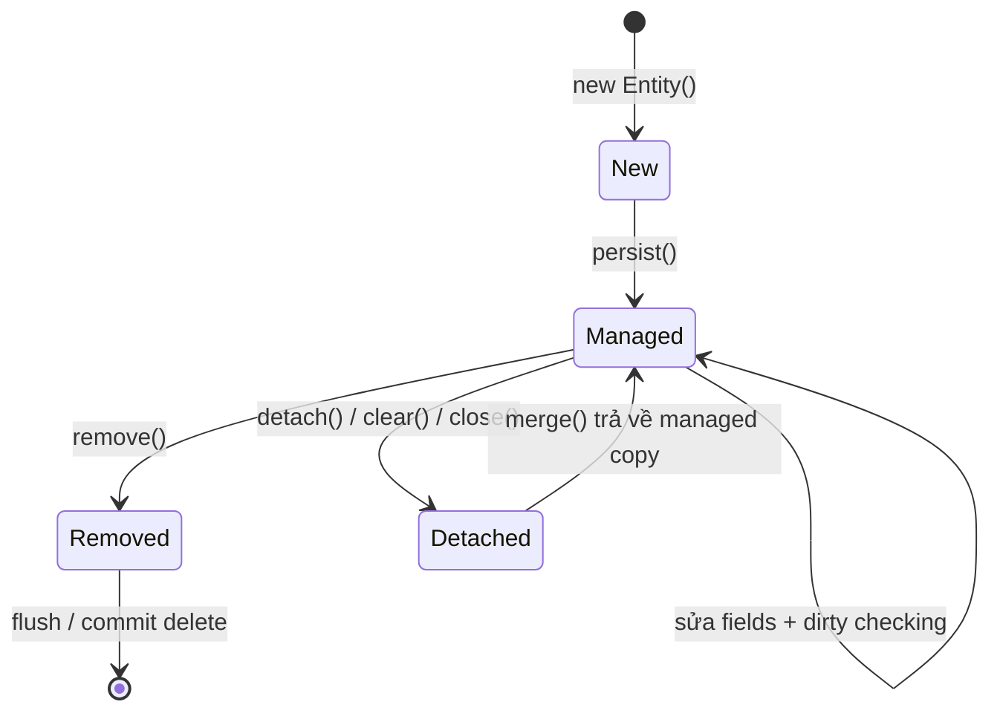
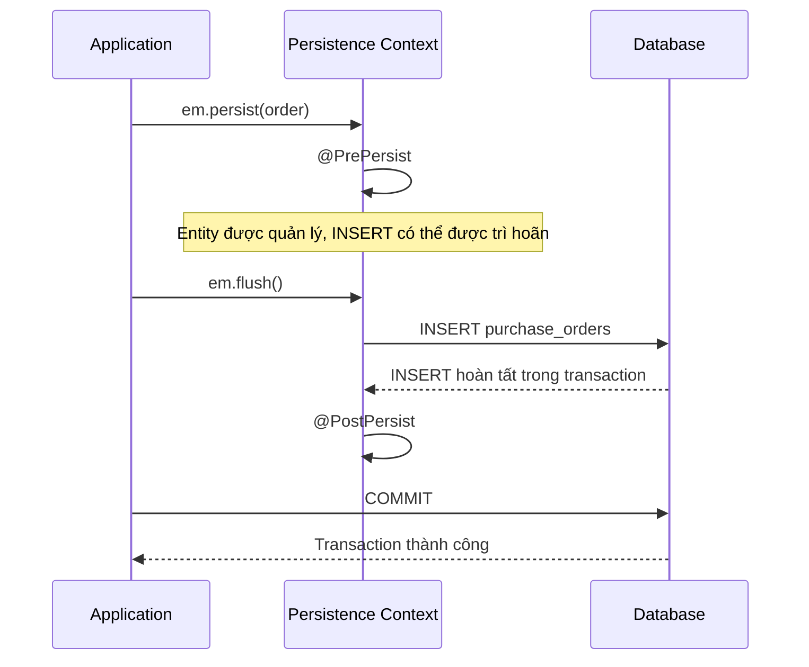
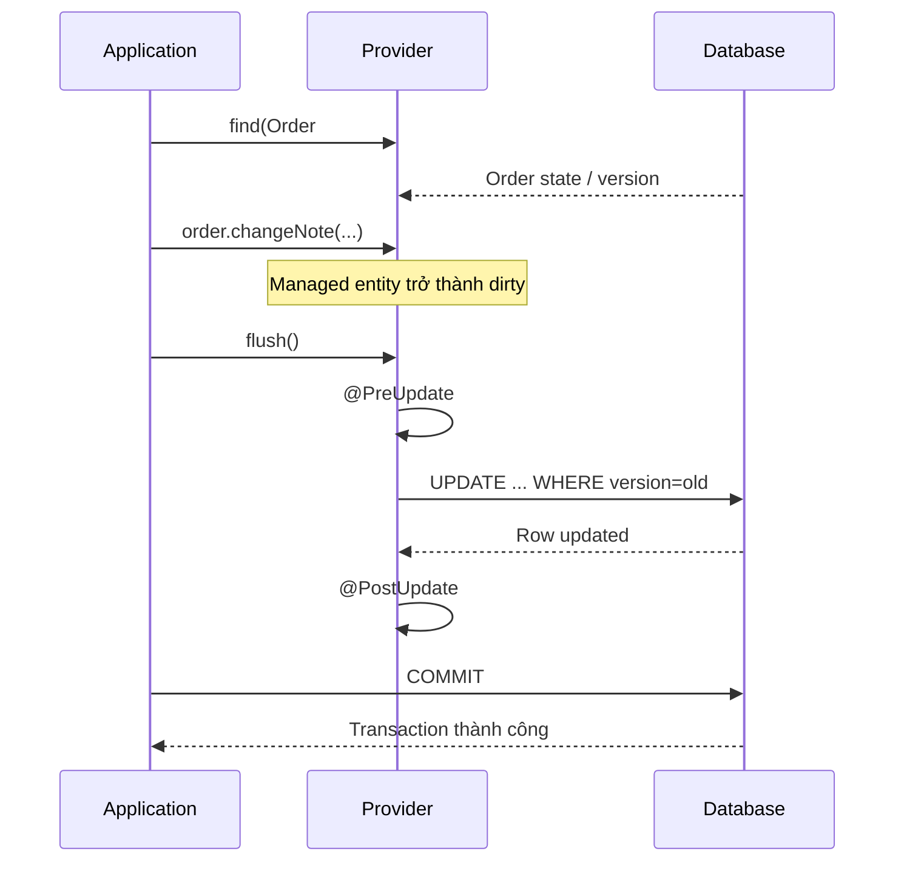
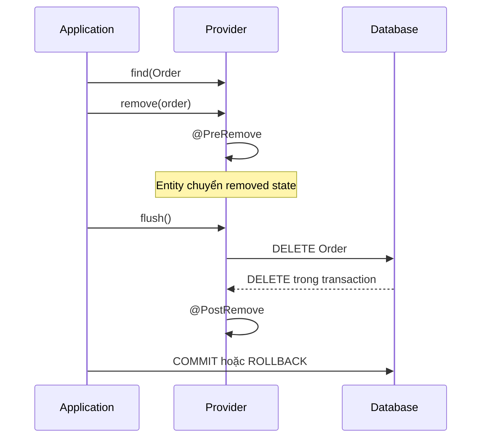
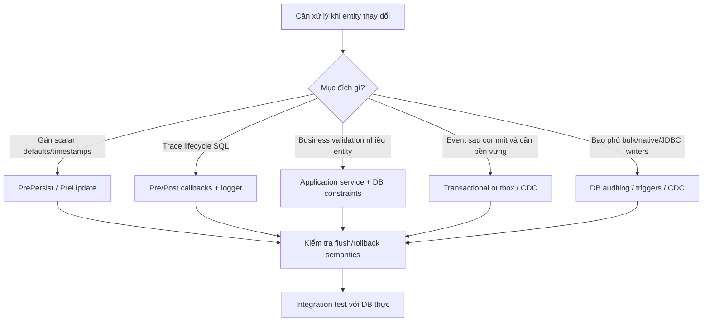

# Theo dõi các thời điểm trước và sau persist, update và remove trong JPA

Trong JPA, một entity không chỉ là đối tượng Java được lưu xuống database. Nó tham gia một **vòng đời (*entity lifecycle*)** dưới sự quản lý của persistence context: được tạo mới, trở thành persistent/managed, có thể được chỉnh sửa, bị xóa và cuối cùng có thể rời khỏi persistence context.

Jakarta Persistence cung cấp các **lifecycle callbacks** cho phép ứng dụng chạy logic tại những thời điểm trước hoặc sau các thao tác quan trọng:

- `@PrePersist` và `@PostPersist`: trước/sau việc đưa entity mới vào database.
- `@PreUpdate` và `@PostUpdate`: trước/sau thao tác cập nhật database đối với entity hiện có.
- `@PreRemove` và `@PostRemove`: trước/sau thao tác xóa entity.
- `@PostLoad`: một callback liên quan, được gọi sau khi dữ liệu entity được nạp hoặc refresh.

Các callbacks này rất hữu ích cho việc **gán timestamp, kiểm tra dữ liệu cục bộ, theo dõi lifecycle, ghi trace chẩn đoán**, nhưng không phải là sự kiện “transaction đã commit”. Chúng cũng không thay thế được audit log bền vững, domain events hoặc transactional outbox.

> **Ý quan trọng nhất:** “`@PostPersist` đã chạy” chỉ cho biết entity đã đi qua mốc lifecycle tương ứng; **không đồng nghĩa INSERT đã được commit thành công**. Điều tương tự áp dụng với `@PostUpdate` và `@PostRemove`.

Bài học **“Theo dõi các thời điểm trước và sau persist, update và remove”** thuộc chương **Sự kiện vòng đời**, module **Data Persistence Relational Access ORM JPA**. Bài sẽ liên kết annotation với mã Java, SQL, `EntityManager`, `flush()`, `@Transactional`, Hibernate/Spring Data, rollback, cascades và các kịch bản kiểm thử.

---

## 1. Vì sao cần biết thời điểm callback?

Giả sử một ứng dụng thương mại điện tử có `PurchaseOrder`. Ta muốn:

1. Gán `createdAt` khi tạo đơn.
2. Cập nhật `updatedAt` khi thay đổi đơn.
3. Theo dõi lúc JPA chuẩn bị INSERT, UPDATE hoặc DELETE.
4. Biết lúc nào ID được database sinh và có thể đọc.
5. Không gửi email “đơn đã tạo” khi transaction cuối cùng thất bại.
6. Không tưởng rằng một `bulk UPDATE` đã kích hoạt các entity callbacks.
7. Không nhầm “đã gọi `persist()`” với “SQL đã gửi” hoặc “đã commit”.

Nếu không phân biệt những thời điểm này, developer dễ viết:

```java
@PostPersist
void sendCreatedEmail() {
    emailService.sendOrderCreatedEmail(...);
}
```

Email có thể đã gửi ra hệ thống ngoài, sau đó transaction rollback và Order **không tồn tại như một commit thành công**. Email trở thành thông tin sai.

Một thiết kế đúng phải xác định **callback là mốc lifecycle ở trong tiến trình persistence**, không phải nơi mặc định thực hiện side effect không thể rollback.

## 2. Bản đồ các trạng thái entity

JPA thường mô tả các trạng thái:

| Trạng thái | Mô tả |
|---|---|
| **New / transient** | Object vừa tạo bằng `new`, chưa được persistence context quản lý |
| **Managed / persistent** | Entity được persistence context quản lý, thay đổi có thể được đồng bộ xuống DB |
| **Removed** | Entity đã được đánh dấu xóa trong persistence context |
| **Detached** | Entity không còn được quản lý bởi persistence context hiện tại |

Một sơ đồ khái quát:



Sơ đồ chỉ biểu diễn các chuyển trạng thái chính. `merge()` có những quy tắc về state và managed copy riêng; không phải lúc nào chính object detached cũng trở thành managed.

**Callback không ánh xạ một-một với từng trạng thái trong sơ đồ.** Ví dụ một entity có thể managed rất lâu mà không phát sinh `@PreUpdate` nếu không có database UPDATE.

## 3. Bảng sáu sự kiện cần ghi nhớ

| Callback | Trước/sau sự kiện gì? | Mốc SQL liên quan | Chú ý |
|---|---|---|---|
| `@PrePersist` | Trước thao tác persist/INSERT theo lifecycle | Trước INSERT của entity | Thường gán default scalar fields |
| `@PostPersist` | Sau INSERT của entity | Sau INSERT đã thực thi | ID sinh tự động có thể đã sẵn sàng; **chưa chắc commit** |
| `@PreUpdate` | Trước database UPDATE | Trước UPDATE | Phụ thuộc dirty checking và flush |
| `@PostUpdate` | Sau database UPDATE | Sau UPDATE | **Chưa chắc commit** |
| `@PreRemove` | Trước remove/delete | Trước DELETE theo lifecycle | Không dùng như thay thế validation của service |
| `@PostRemove` | Sau database DELETE | Sau DELETE | **Chưa chắc commit** |

**Đây là bảng ngữ nghĩa**, không phải lời hứa về một lệnh SQL được gửi ngay tại dòng gọi API. JPA có quyền trì hoãn các database writes cho đến `flush()` hoặc một thời điểm thích hợp.

## 4. Cần phân biệt bốn mốc thời gian

Bốn mốc thường xuất hiện:

1. **Gọi API JPA** — ví dụ `em.persist(order)`, `em.remove(order)`.
2. **Callback lifecycle** — ví dụ `@PrePersist` hoặc `@PostUpdate`.
3. **Flush / thực hiện SQL** — provider đồng bộ thay đổi của persistence context tới database.
4. **Commit transaction** — transaction được xác nhận thành công hoặc bị rollback.

Chúng liên quan nhưng không giống nhau.



Sơ đồ dùng **trường hợp INSERT trì hoãn tới flush**. Trên một provider/generation strategy khác, INSERT có thể diễn ra ngay trong `persist()`; vì vậy vị trí chính xác của `@PostPersist` so với *lời gọi* `flush()` phụ thuộc cách thực thi. Tuy nhiên, **`@PostPersist` không phải callback after-commit**.

## 5. Entity mẫu xuyên suốt

Ta dùng một entity có ID sinh tự động, timestamp và version.

```java
package com.example.orders;

import jakarta.persistence.*;
import java.time.Instant;

@Entity
@Table(name = "purchase_orders")
public class PurchaseOrder {

    @Id
    @GeneratedValue(strategy = GenerationType.IDENTITY)
    private Long id;

    @Version
    @Column(name = "version", nullable = false)
    private Long version;

    @Enumerated(EnumType.STRING)
    @Column(name = "status", nullable = false)
    private OrderStatus status = OrderStatus.NEW;

    @Column(name = "note", length = 500)
    private String note;

    @Column(name = "created_at", nullable = false)
    private Instant createdAt;

    @Column(name = "updated_at", nullable = false)
    private Instant updatedAt;

    protected PurchaseOrder() {}

    public static PurchaseOrder create(String note) {
        PurchaseOrder order = new PurchaseOrder();
        order.note = note;
        return order;
    }

    public Long getId() { return id; }
    public Long getVersion() { return version; }
    public OrderStatus getStatus() { return status; }
    public String getNote() { return note; }
    public Instant getCreatedAt() { return createdAt; }
    public Instant getUpdatedAt() { return updatedAt; }

    public void changeNote(String newNote) {
        this.note = newNote;
    }
}
```

Enum:

```java
package com.example.orders;

public enum OrderStatus {
    NEW, PAID, CANCELLED
}
```

Ví dụ schema:

```sql
CREATE TABLE purchase_orders (
    id BIGINT GENERATED BY DEFAULT AS IDENTITY PRIMARY KEY,
    version BIGINT NOT NULL,
    status VARCHAR(30) NOT NULL,
    note VARCHAR(500),
    created_at TIMESTAMP NOT NULL,
    updated_at TIMESTAMP NOT NULL
);
```

DDL là minh họa theo một nhóm dialect có identity columns; schema thật phải phù hợp database. Trong bài này, `@Version` do provider quản lý; callback không tự tăng version.

## 6. Cách khai một callback ngay trong entity

JPA cho phép khai lifecycle callback method trong entity:

```java
@PrePersist
private void beforePersist() {
    Instant now = Instant.now();
    createdAt = now;
    updatedAt = now;
}
```

Với method khai **trực tiếp trên entity**, callback:

- Có `void` return type.
- Không nhận tham số.
- Được gắn một hoặc nhiều lifecycle annotations phù hợp.
- Không phải một method business code cần chủ động gọi.
- Do JPA provider gọi vào mốc lifecycle tương ứng.

Đoạn trên có thể được đặt vào entity `PurchaseOrder`; provider sẽ gọi nó khi entity được persist theo semantics JPA.

## 7. @PrePersist: tạo giá trị mặc định trước INSERT

Ví dụ:

```java
@PrePersist
private void beforeInsert() {
    Instant now = Instant.now();

    if (createdAt == null) {
        createdAt = now;
    }
    if (updatedAt == null) {
        updatedAt = now;
    }
    if (status == null) {
        status = OrderStatus.NEW;
    }
}
```

Phù hợp để:

- Gán `createdAt` hoặc các basic fields chưa có.
- Thiết lập giá trị mặc định thuộc state entity.
- Chuẩn hóa dữ liệu **cục bộ** mà không truy cập entity khác.
- Kiểm tra những invariant đơn giản chỉ dùng các scalar attributes.

Không phù hợp mặc định để:

- Query một bảng khác bằng `EntityManager`.
- Gọi mạng.
- Gửi email.
- Đọc/ghi một entity khác.
- Tự gán ID đã được provider quản lý nếu không có thiết kế ID riêng.
- Tự commit transaction.

**Callback nằm trong lifecycle của persistence provider**, không phải một application service độc lập.

## 8. @PrePersist được gọi khi nào?

Trong vòng đời entity mới, `@PrePersist` được gọi trước database INSERT tương ứng. Nó thường xảy ra khi gọi `persist()` và cũng có thể được gọi trong các đường persist theo cascade.

Ví dụ:

```java
PurchaseOrder order =
    PurchaseOrder.create("Giao giờ hành chính");

em.persist(order);

// beforeInsert() đã được gọi theo lifecycle.
```

Đừng dựa vào `@PrePersist` để kết luận SQL INSERT đã gửi hoặc đã commit. Với nhiều chiến lược khóa, insert có thể được trì hoãn.

Nếu một parent persist cascade xuống children, JPA có thể gọi `@PrePersist` trên các entities con được cascade, nhưng **thứ tự giữa các entities không được dùng làm contract nghiệp vụ**.

## 9. @PrePersist và generated ID

Với:

```java
@Id
@GeneratedValue(strategy = GenerationType.IDENTITY)
private Long id;
```

ID có thể chỉ sẵn sàng sau khi INSERT diễn ra.

Vì vậy:

```java
@PrePersist
private void beforeInsert() {
    // Không mặc định id != null.
}
```

Không nên viết:

```java
@PrePersist
private void beforeInsert() {
    auditCode = "ORDER-" + id;
}
```

rồi tin `id` chắc chắn có giá trị trong mọi generation strategy.

ID bằng sequence/preallocated strategy có thể được xác định sớm hơn; IDENTITY thường gắn với kết quả INSERT. **Thời điểm có ID ở PrePersist không nên là một giả định portable cho mọi generator.**

## 10. @PostPersist: sau database INSERT

Callback:

```java
@PostPersist
private void afterInsert() {
    // Entity đã đi qua mốc post-persist.
}
```

Khác PrePersist, PostPersist được gọi **sau database INSERT** của entity. Các generated primary key values sẽ có sẵn theo semantics liên quan của JPA.

Ví dụ:

```java
@PostPersist
private void afterInsert() {
    Logger.getLogger(PurchaseOrder.class.getName())
          .fine("Inserted order id=" + id);
}
```

Đây là trace nội bộ minh họa; không gửi notification, không đẩy message ra queue trực tiếp và không gọi REST API bên ngoài trong callback.

**“Sau INSERT” không có nghĩa “sau COMMIT”.** Database INSERT có thể đã chạy nhưng transaction vẫn có thể rollback.

## 11. Hai thời điểm khác nhau của PostPersist

Trường hợp provider trì hoãn SQL:

```text
em.persist(entity)
  @PrePersist

em.flush()
  INSERT
  @PostPersist

commit()
```

Trường hợp provider cần INSERT sớm (ví dụ một số IDENTITY strategies):

```text
em.persist(entity)
  @PrePersist
  INSERT
  @PostPersist

em.flush()          // Có thể không cần INSERT cho entity đó
commit()
```

Đây là **hai kịch bản hợp lệ về ý tưởng**, không phải mọi provider đều làm giống nhau.

Không viết test yêu cầu `@PostPersist` chỉ được gọi **sau khi chính method `em.flush()` được gọi thủ công**. Nếu INSERT diễn ra sớm hơn, callback có thể đã chạy.

## 12. @PostPersist không phải dấu hiệu giao dịch thành công

Ví dụ:

```java
@Transactional
public void createOrder() {
    PurchaseOrder order =
        PurchaseOrder.create("Giao buổi chiều");

    em.persist(order);
    em.flush();

    // @PostPersist có thể đã chạy.
    throw new IllegalStateException("Business rule failed");
}
```

Khi transaction rollback, Order INSERT đã thực hiện **không tồn tại như một thay đổi đã commit**.

Vì thế các thao tác như:

- Gửi email.
- Đẩy Kafka event.
- Xóa cache phân tán.
- Gọi thanh toán.
- Gửi webhook.
- Ghi dữ liệu vào database khác.

không nên được coi là “an toàn” chỉ vì diễn ra trong `@PostPersist`.

Nếu cần event bền vững, dùng transaction-bound design như **transactional outbox**.

---

## 13. @PreUpdate: trước database UPDATE

Khi managed entity được sửa:

```java
PurchaseOrder order =
    em.find(PurchaseOrder.class, 100L);

order.changeNote("Giao sau 15:00");
```

JPA phát hiện state thay đổi qua **dirty checking** và có thể tạo SQL UPDATE tại flush.

Callback:

```java
@PreUpdate
private void beforeUpdate() {
    updatedAt = Instant.now();
}
```

được gọi trước database UPDATE của entity. Đây là mẫu thường dùng để gán basic field `updatedAt`.

### Điều cần nhớ

- `@PreUpdate` **không phải** callback được gọi mỗi khi setter Java chạy.
- Nó gắn với database UPDATE theo lifecycle của entity.
- Khi không có thay đổi khiến UPDATE xảy ra, có thể không có PreUpdate.
- Nếu update chỉ là thay đổi relationship/collection, timing/việc callback có được gọi trên root entity không thể suy ra một cách portable cho mọi mapping/provider.
- Không tự giả định việc gọi `save()` luôn tạo UPDATE.

## 14. Dirty checking và callback update

Ví dụ:

```java
@Transactional
public void changeNote(long id) {
    PurchaseOrder order =
        em.find(PurchaseOrder.class, id);

    order.changeNote("Giao sau 15:00");

    // Không nhất thiết có SQL ở dòng này.
    // Tại flush/commit provider kiểm tra dirty state.
}
```

Nếu note trước đó đã là “Giao sau 15:00”, provider có thể xác định **không có thay đổi** và bỏ qua SQL UPDATE.

Khi không UPDATE, không nên kỳ vọng `@PreUpdate` và `@PostUpdate` chạy chỉ vì một setter được gọi.

Có những provider/mapping dùng enhanced dirty tracking hoặc chiến lược update khác nhau; **đừng dùng số lần gọi setter làm căn cứ tính số callbacks**.

## 15. @PreUpdate và updatedAt

Một mẫu:

```java
@PrePersist
private void initializeTimestamps() {
    Instant now = Instant.now();
    createdAt = now;
    updatedAt = now;
}

@PreUpdate
private void touchTimestamp() {
    updatedAt = Instant.now();
}
```

Ý tưởng:

- INSERT lần đầu: có createdAt và updatedAt.
- UPDATE các basic fields sau đó: cập nhật updatedAt.
- Không cần chỉnh updatedAt trong mọi business method.

Nhưng đây là lựa chọn **entity auditing bằng callback**, không có nghĩa updatedAt phản ánh thời điểm transaction commit. Nếu cần sự chính xác tới mức commit timestamp, phải dùng một cơ chế khác.

Một trade-off: `Instant.now()` trong callback phụ thuộc system clock, khó điều khiển trong unit tests; application service dùng injected `Clock` có thể testable hơn.

## 16. @PreUpdate có thể dùng để chuẩn hóa dữ liệu không?

Có thể sửa **non-relationship state của chính entity**, ví dụ:

```java
@PreUpdate
private void normalizeNote() {
    if (note != null) {
        note = note.trim();
    }
}
```

Tuy nhiên, nên cân nhắc:

- Cùng quy tắc phải được áp khi persist, nếu muốn dữ liệu nhất quán.
- Logic nào là domain invariant nên đặt vào domain method/service thay vì giấu trong callback?
- Có cần thông báo validation error rõ cho user trước flush?
- Provider có persist field được sửa trong callback đúng như mong muốn trên DB mục tiêu không?
- Callback được gọi tại flush/commit, đôi khi xa hơn dòng business mutation.

Những invariant quan trọng ảnh hưởng nhiều entities/bảng không nên bị dồn vào `@PreUpdate`.

## 17. @PostUpdate: sau database UPDATE

Callback:

```java
@PostUpdate
private void afterUpdate() {
    Logger.getLogger(PurchaseOrder.class.getName())
          .fine("Updated order id=" + id);
}
```

được gọi sau database UPDATE theo lifecycle entity. Nó có thể là điểm ghi log chẩn đoán trong transaction.

Nhưng:

- Chưa chắc transaction đã commit.
- Một exception sau callback có thể rollback toàn bộ cập nhật.
- Có thể chưa an toàn để publish message ra hệ thống khác.
- Nếu UPDATE đến từ JPQL bulk DML, callback sẽ không chạy như managed entity lifecycle.
- Không phải mọi thay đổi liên quan collection đều tạo root entity UPDATE.

**PostUpdate mô tả mốc thao tác database, không phải một domain event “OrderUpdatedCommitted”.**

## 18. PostUpdate không có nghĩa dữ liệu đã nhìn thấy ở transaction khác

Ở DBMS hỗ trợ transaction isolation:

```text
Transaction A:
    UPDATE Order
    @PostUpdate
    chưa COMMIT

Transaction B:
    SELECT Order
    có thể vẫn thấy committed state cũ
```

Dữ liệu A vừa cập nhật có thể chưa visible cho B cho tới commit, tùy isolation và DBMS.

Nếu PostUpdate gọi một REST service khác rồi yêu cầu nó GET Order ngay, service đó có thể thấy state cũ, bị chặn hoặc có hành vi khác tùy topology/transaction.

Tránh thiết kế distributed workflow dựa vào giả định “PostUpdate chạy rồi thì mọi nơi đều đọc được giá trị mới”.

## 19. @Version và Update callbacks

Entity có:

```java
@Version
private Long version;
```

Khi update managed entity, provider quản lý version checking/increment.

Không tự sửa version trong callback:

```java
@PreUpdate
private void beforeUpdate() {
    version = version + 1; // Không nên.
}
```

Vấn đề:

- Provider sở hữu version lifecycle.
- Có thể gây sai expected version trong WHERE clause.
- Thời điểm giá trị mới hiện diện trong callback khác nhau theo implementation.
- Có thể tạo optimistic lock failure hoặc state không nhất quán.

Dùng getter của version để quan sát với nhận thức về timing; **đừng dựa vào giá trị version bên trong Pre/PostUpdate để xây một protocol ngoài hệ thống mà chưa kiểm chứng provider**.

---

## 20. @PreRemove: trước thao tác xóa

Với managed entity:

```java
PurchaseOrder order =
    em.find(PurchaseOrder.class, 100L);

em.remove(order);
```

Callback:

```java
@PreRemove
private void beforeRemove() {
    Logger.getLogger(PurchaseOrder.class.getName())
          .fine("Removing order id=" + id);
}
```

JPA có thể gọi PreRemove khi remove operation được thực hiện. SQL DELETE thực tế có thể được trì hoãn tới flush.

Đừng suy rằng `@PreRemove` chỉ chạy ở một thời điểm cố định “ngay trước câu SQL DELETE”, giống một SQL trigger.

### Điều nên làm trước remove

- Xác thực quyền xóa ở application service.
- Kiểm tra trạng thái nghiệp vụ (ví dụ Order đã paid có được xóa không).
- Xử lý hoặc từ chối nếu còn child references.
- Kiểm soát cascade/orphan removal.
- Đảm bảo transaction và DB constraints.

**PreRemove không nên thay toàn bộ domain validation và authorization**, vì lúc callback chạy có thể đã nằm sâu trong flush/cascade và lỗi khó giải thích cho caller.

## 21. @PostRemove: sau database DELETE

Callback:

```java
@PostRemove
private void afterRemove() {
    Logger.getLogger(PurchaseOrder.class.getName())
          .fine("Delete issued for order id=" + id);
}
```

Nó gắn với mốc sau database DELETE tương ứng. Nhưng:

- Delete vẫn có thể bị rollback.
- Entity Java còn có thể tồn tại dưới dạng object reference, dù row đã bị xóa trong transaction.
- Không nên tiếp tục dùng managed state như thể entity vẫn còn trong database.
- JPA cascading remove có thể kích hoạt callbacks trên các entity con được xóa.
- Thứ tự callbacks giữa các entities trong cascade không phải sequence nghiệp vụ được bảo đảm.
- Bulk JPQL DELETE không kích hoạt các callbacks của từng entity.

### Một tình huống dễ nhầm

Nếu SQL DELETE đã thực hiện và PostRemove chạy, sau đó transaction lỗi:

```text
DELETE Order#100 trong transaction A
@PostRemove chạy
Lỗi phát sinh
ROLLBACK transaction A
Order#100 vẫn tồn tại trong database
```

Đây là lý do **không gửi webhook “OrderDeleted” trực tiếp từ PostRemove**.

## 22. Soft delete không phải @Remove lifecycle

Nhiều hệ thống chỉ đánh dấu:

```java
private Instant deletedAt;
```

và:

```java
public void softDelete(Instant now) {
    this.deletedAt = now;
}
```

Sau đó JPA thực hiện **UPDATE**, không phải DELETE.

Vì vậy:

- Có thể chạy `@PreUpdate`/`@PostUpdate`.
- Không kỳ vọng `@PreRemove`/`@PostRemove` của entity chạy.
- Entity vẫn có row trong database.
- Read filters và uniqueness constraints cần xem xét soft-delete status.

Đừng đặt business logic soft-delete trong `@PreRemove` nếu service thực tế không bao giờ gọi `em.remove()`.

## 23. remove() với entity NEW, MANAGED hoặc DETACHED

Quy tắc lifecycle khác nhau:

| Trạng thái lúc gọi remove | Hành vi khái quát |
|---|---|
| Managed | Entity được chuyển sang removed; callbacks delete theo quy tắc |
| New | Thường được bỏ qua về việc xóa row cho chính entity mới; cascade rules có thể liên quan |
| Detached | Không được trực tiếp xóa như managed; có thể phát sinh `IllegalArgumentException` |
| Removed | Gọi lặp có semantics riêng; không coi là một DELETE mới tự động |

Ví dụ:

```java
PurchaseOrder detached = ...;

em.remove(detached); // Không phải pattern đúng.
```

Một pattern thường dùng:

```java
PurchaseOrder managed =
    em.find(PurchaseOrder.class, detached.getId());

if (managed != null) {
    em.remove(managed);
}
```

Hoặc gọi `em.merge()` trong trường hợp có lý do phù hợp, rồi remove **managed copy**, nhưng phải hiểu merge/stale version implications.

## 24. Cascade REMOVE và callback trên child entities

Ví dụ:

```java
@OneToMany(
    mappedBy = "order",
    cascade = CascadeType.REMOVE
)
private List<OrderLine> lines;
```

Khi remove PurchaseOrder, provider có thể cascade remove tới OrderLine entities. Những entity con có callback `@PreRemove`/`@PostRemove` riêng cũng có thể được gọi.

Tuy nhiên:

- Không đặt kỳ vọng “mọi child PreRemove luôn chạy trước parent PreRemove” nếu spec không cam kết thứ tự đó cho use case.
- Không dùng callback child để gọi network đến một hệ thống phụ.
- Database FK cascade `ON DELETE CASCADE` không tương đương với JPA cascade; hàng bị DB xóa trực tiếp không nhất thiết có JPA entity callbacks.
- Bulk DELETE không chạy per-entity remove callbacks/cascades theo lifecycle JPA.
- Với lazy collections, số SQL để cascade có thể đáng kể.

Nếu nghiệp vụ cần audit mọi child deletion, hãy thiết kế hệ thống audit dựa trên event/outbox hoặc database-level solution phù hợp với cả các đường ghi.

---

## 25. @PostLoad: callback bổ trợ

Ngoài ba cặp chính, JPA có:

```java
@PostLoad
private void afterLoad() {
    // Sau khi entity state được nạp / refresh.
}
```

Nó có thể hữu ích để:

- Tính một giá trị `@Transient` dựa trên các scalar fields vừa nạp.
- Ghi trace chẩn đoán.
- Khởi tạo một cache **thuộc riêng object** nếu không can thiệp persistence semantics.

Không dùng PostLoad để:

- Thay đổi các associations một cách tùy tiện.
- Gửi notification mỗi lần query SELECT.
- Gọi EntityManager query khác gây recursion.
- Giả định entity chắc chắn được load từ SQL ở mỗi lần `find()` (first-level cache có thể trả cùng managed instance mà không thực hiện load mới).

**PostLoad khác Pre/PostPersist, Update và Remove**; đưa vào đây để giải thích bức tranh lifecycle trọn vẹn hơn.

## 26. Thời điểm liên quan flush

Các operations:

```java
em.persist(order);
order.changeNote("New note");
em.remove(order);
```

không nhất thiết có SQL tại từng dòng. Persistence context có thể gom thay đổi và flush khi:

- Ứng dụng chủ động gọi `em.flush()`.
- Provider thực hiện auto-flush trước một query theo flush mode/semantics.
- Transaction tiến tới commit.
- Một operation cần SQL sớm, ví dụ để lấy generated ID.
- Một số lifecycle/locking operations khác yêu cầu đồng bộ.

Do đó cần phân biệt **entity operations** với **database INSERT/UPDATE/DELETE**. Post callbacks theo dõi mốc database operation, nhưng lúc nào database operation xảy ra là vấn đề của flush/generation strategy.

## 27. FlushModeType.AUTO và COMMIT

JPA có các flush modes quan trọng:

```java
FlushModeType.AUTO
FlushModeType.COMMIT
```

Khái quát:

- `AUTO` cho phép/đòi provider bảo đảm query consistency theo semantics của flush mode, thường có thể flush trước một query.
- `COMMIT` cho phép trì hoãn đồng bộ tới commit theo semantics; ảnh hưởng của pending changes lên query result trước commit có thể không được xác định như người viết mong.
- Gọi `em.flush()` thủ công khiến provider cố đồng bộ ngay tại đó.
- Query/native SQL/provider extensions có những chi tiết khác nhau cần xem stack thật.

Không viết test dạng:

```text
persist()
query()
assert @PostPersist always happened
```

mà không xác định flush mode và database operation đã thực sự xảy ra chưa.

## 28. Flush không phải commit

```java
em.persist(order);
em.flush(); // SQL được đồng bộ vào DB transaction.
```

Có thể đã chạy `@PostPersist`, nhưng:

```java
em.getTransaction().rollback();
```

vẫn có thể đảo ngược INSERT.

Vì vậy hai câu này khác nhau:

- **Database operation đã được thực thi trong transaction**.
- **Transaction đã commit thành công và dữ liệu trở nên bền vững**.

Mọi quyết định external side effect cần phân biệt hai mốc.

## 29. Một timeline update điển hình



Nếu optimistic locking check thất bại, `@PostUpdate` không được xem là một sự kiện “update đã commit”. Exception và rollback semantics cần xử lý ở transaction boundary.

## 30. Một timeline remove điển hình



Nếu cascade REMOVE, sơ đồ thực tế có thể có nhiều callbacks/DELETEs cho related entities. Thứ tự và số SQL phụ thuộc mapping/provider.

---

## 31. Đặt callbacks trong Entity hay Entity Listener?

Có hai hình thức chính:

**Trong entity class:**

```java
@Entity
public class PurchaseOrder {

    // Fields và mappings...

    @PrePersist
    private void beforeInsert() {
        // ...
    }
}
```

**Trong một listener class riêng:**

```java
public class OrderLifecycleListener {

    @PrePersist
    public void beforeInsert(PurchaseOrder entity) {
        // ...
    }
}
```

và gắn listener:

```java
@Entity
@EntityListeners(OrderLifecycleListener.class)
public class PurchaseOrder {

    // Fields, mappings...
}
```

Mẫu listener giúp tránh nhét mọi concern chẩn đoán/auditing vào entity. Tuy nhiên callback vẫn chạy theo lifecycle JPA với hạn chế tương tự; đưa logic nguy hiểm sang listener **không làm nó an toàn hơn**.

## 32. Signature của callback trên entity

Ví dụ:

```java
@PrePersist
private void assignDefaults() {
    // Không có tham số, return void.
}

@PreUpdate
private void touchUpdatedAt() {
    // Không có tham số, return void.
}
```

Đối với callback khai trong entity hoặc mapped superclass, chữ ký cần phù hợp quy tắc của JPA: một method `void` không nhận tham số. Không dùng:

```java
@PrePersist
public boolean beforePersist(PurchaseOrder order) {
    return true;
}
```

làm entity callback — sai chữ ký (return và argument).

Nếu cần gọi behavior có tham số, callback có thể gọi một helper method thông thường với dữ liệu sẵn có, nhưng không biến helper thành lifecycle entrypoint sai chuẩn.

## 33. Signature của callback trong listener

Trong listener class, callback nhận một đối số là entity được xử lý (hoặc `Object` phù hợp contract):

```java
public class OrderLifecycleListener {

    @PostPersist
    public void afterInsert(PurchaseOrder order) {
        // ...
    }

    @PostUpdate
    public void afterUpdate(PurchaseOrder order) {
        // ...
    }

    @PostRemove
    public void afterDelete(PurchaseOrder order) {
        // ...
    }
}
```

Ở đây method không khai cùng chữ ký với entity callback. Đặt `@PostPersist` trên method trong listener nhưng không có tham số sẽ không tuân callback signature dành cho listener.

Một listener class có thể dùng cho nhiều entities nếu thiết kế argument phù hợp, nhưng nên tránh ép cast không an toàn.

## 34. Listener hoàn chỉnh cho sáu mốc

Ví dụ dùng Java Util Logging để minh họa trace **không có external side effects**:

```java
package com.example.orders;

import jakarta.persistence.*;
import java.util.logging.Logger;

public class OrderLifecycleListener {

    private static final Logger LOG =
        Logger.getLogger(OrderLifecycleListener.class.getName());

    @PrePersist
    public void prePersist(PurchaseOrder order) {
        LOG.fine(() -> "PrePersist id=" + order.getId());
    }

    @PostPersist
    public void postPersist(PurchaseOrder order) {
        LOG.fine(() -> "PostPersist id=" + order.getId());
    }

    @PreUpdate
    public void preUpdate(PurchaseOrder order) {
        LOG.fine(() -> "PreUpdate id=" + order.getId());
    }

    @PostUpdate
    public void postUpdate(PurchaseOrder order) {
        LOG.fine(() -> "PostUpdate id=" + order.getId());
    }

    @PreRemove
    public void preRemove(PurchaseOrder order) {
        LOG.fine(() -> "PreRemove id=" + order.getId());
    }

    @PostRemove
    public void postRemove(PurchaseOrder order) {
        LOG.fine(() -> "PostRemove id=" + order.getId());
    }
}
```

Gắn vào entity:

```java
@Entity
@EntityListeners(OrderLifecycleListener.class)
public class PurchaseOrder {
    // Mapping như phần đầu.
}
```

Trong file thực tế, không khai thêm hai class `PurchaseOrder` trùng tên; đoạn trên chỉ diễn tả phần annotation cần ghép vào entity ở phần 5.

**Cảnh báo:** listener này ghi trace khi callbacks diễn ra, không cho biết transaction đã commit. Logger có thể bật hoặc tắt theo cấu hình; không dùng log như một audit ledger bảo đảm exactly-once.

## 35. Listener và entity callback có thể cùng tồn tại

Một entity có:

```java
@Entity
@EntityListeners(OrderLifecycleListener.class)
public class PurchaseOrder {

    // ...

    @PrePersist
    private void initializeTimestamps() {
        // ...
    }
}
```

và `OrderLifecycleListener` có `@PrePersist` riêng. Cả hai đều thuộc lifecycle của entity.

Lưu ý:

- Có các quy tắc callback invocation order giữa default listeners, superclass listeners, entity listeners và callback trên entity.
- Không nên xây business invariant dựa vào side effect khó đoán giữa nhiều callbacks.
- Trong cùng một class, không khai trùng nhiều methods cho **cùng callback event** theo cách vi phạm quy tắc đặc tả.
- Nên giữ số listeners vừa đủ và responsibilities tách bạch.

## 36. Mapped superclass và callback kế thừa

Ví dụ:

```java
@MappedSuperclass
public abstract class AuditedEntity {

    @Column(name = "created_at")
    protected Instant createdAt;

    @Column(name = "updated_at")
    protected Instant updatedAt;

    @PrePersist
    protected void onCreate() {
        Instant now = Instant.now();
        createdAt = now;
        updatedAt = now;
    }

    @PreUpdate
    protected void onModify() {
        updatedAt = Instant.now();
    }
}
```

Entity kế thừa:

```java
@Entity
public class PurchaseOrder extends AuditedEntity {

    @Id
    private Long id;

    private String note;

    protected PurchaseOrder() {}
}
```

Callbacks ở mapped superclass có thể được áp dụng cho entity con theo inheritance rules. Đây là một cách phổ biến để tái sử dụng logic timestamp.

Nếu entity subclass khai callback cùng event, cần hiểu các quy tắc callback inheritance/overriding theo spec để tránh duplicate hoặc suppress behavior ngoài mong muốn. Trong thiết kế thực tế, giữ tầng callback rõ và test integration.

## 37. Default entity listeners

JPA cũng cho phép cấu hình **default entity listeners** qua mapping metadata XML để áp dụng tới nhiều entities trong một persistence unit.

Điều này có thể phục vụ concerns dùng chung, nhưng cũng tạo “logic ẩn” khi đọc Java class:

- Một entity không thấy `@EntityListeners` vẫn có thể nhận default listener.
- Default listener có thể chạy trước entity-specific listener theo callback order rules.
- Metadata XML có thể bổ sung hoặc override cấu hình annotation tùy mapping settings.
- Khi debug, cần xem config của persistence unit nếu có listeners không được khai trực tiếp trên entity.

Trong bài này chỉ minh họa ý tưởng; không cần đọc config của một dự án cụ thể để hiểu semantics.

## 38. @ExcludeDefaultListeners và @ExcludeSuperclassListeners

JPA hỗ trợ:

```java
@ExcludeDefaultListeners
```

và:

```java
@ExcludeSuperclassListeners
```

cho phép loại trừ một số listeners mặc định hoặc listeners từ superclass theo quy tắc của spec.

Ví dụ:

```java
@Entity
@ExcludeDefaultListeners
public class InternalAuditLog {
    // Entity này không muốn nhận default listeners.
}
```

Còn:

```java
@Entity
@ExcludeSuperclassListeners
public class SpecialDocument extends BaseDocument {
    // Loại trừ superclass-level entity listeners theo semantics.
}
```

Không nhầm các annotations này với “tắt mọi callback”:

- Callback method khai trong entity có quy tắc riêng.
- Inherited callback methods và entity listener inheritance cần phân biệt.
- Không dùng excludes tùy tiện mà không hiểu audit behavior có thể bị mất.

## 39. Thứ tự listeners: tránh phụ thuộc quá mức

Về mô hình chung, JPA có các nhóm:

1. Default listeners nếu được cấu hình.
2. Listeners thuộc superclass/hierarchy.
3. Entity-specific listeners.
4. Callback methods được khai ở entity/mapped superclass theo quy tắc inheritance.

Đặc tả định nghĩa invocation order cho các nhóm; nhưng **đừng tự thiết kế một workflow nhiều bước dựa vào việc listener A chỉnh state rồi listener B đọc state đó khi có thể thay bằng một method minh bạch**.

Một workflow quan trọng nên được điều phối ở application service, có transaction rõ và test cụ thể.

---

## 40. Điều gì được làm bên trong callback?

Với ứng dụng cần tính portable, lifecycle callback có thể sửa **non-relationship state của chính entity**.

Ví dụ phù hợp:

```java
@PrePersist
private void setInitialTimestamp() {
    createdAt = Instant.now();
}
```

Hoặc:

```java
@PreUpdate
private void normalizeCode() {
    if (note != null) {
        note = note.trim();
    }
}
```

Những thao tác **không nên thực hiện** bên trong JPA callback portable:

- Tạo/đóng EntityManager.
- Gọi Query/EntityManager operations.
- Thay relationship tới entity khác.
- Duyệt lazy graph sâu gây truy vấn.
- Chỉnh các entity khác trong persistence context.
- Gọi dịch vụ bên ngoài với side effect.
- Commit/rollback transaction.
- Phụ thuộc vào thứ tự flush của nhiều entities.

Đây là những giới hạn giúp callback có thể được provider gọi trong thời điểm nhạy cảm của persistence lifecycle.

## 41. Vì sao không nên query DB trong @PreUpdate?

Ví dụ xấu:

```java
@PreUpdate
private void beforeUpdate() {
    long count = entityManager.createQuery(
        "select count(o) from PurchaseOrder o",
        Long.class
    ).getSingleResult();
}
```

Vấn đề:

- Entity không nên tự nắm EntityManager.
- Callback có thể đang chạy trong flush; query khác có thể tạo reentrancy/auto-flush.
- Một số provider từ chối hoặc hành vi không portable.
- Query có thể nhìn snapshot/state khó dự đoán.
- Performance có thể bị nhân lên N lần khi flush nhiều entities.

Đưa logic kiểm tra nhiều bảng vào service hoặc database constraint và giữ callback đơn giản.

## 42. Vì sao không sửa association trong callback?

Ví dụ rủi ro:

```java
@PrePersist
private void beforePersist() {
    this.customer = entityManager.find(
        Customer.class, customerId
    );
}
```

Callback đang ở ranh giới flush/persist; việc thay relationship, truy vấn entity khác hoặc kích hoạt cascades tại đây có thể phụ thuộc provider.

Cách tốt hơn:

```java
@Transactional
public PurchaseOrder createOrder(
        Long customerId, String note) {

    Customer customer = em.getReference(
        Customer.class, customerId
    );

    PurchaseOrder order =
        PurchaseOrder.create(note);

    order.assignCustomer(customer);
    em.persist(order);

    return order;
}
```

`assignCustomer()` là domain method giả định cần triển khai. Validation/authorization cho customer phải diễn ra ở service. Callback vẫn có thể gán `createdAt`/`updatedAt` scalar fields.

## 43. Không tự gọi callback method để thay thế JPA

Một callback:

```java
@PrePersist
void setDefaults() {
    // ...
}
```

do provider gọi theo lifecycle.

Nếu application tự gọi:

```java
order.setDefaults();
```

đó chỉ là một lời gọi Java thông thường, không khiến entity được persist. Tên annotation không tự tạo transaction, SQL hoặc entity state transition.

Nếu domain cần gán defaults cả trước khi persist, có thể trích logic ra method tường minh rồi gọi từ callback hoặc factory:

```java
private void initializeDefaults() {
    // ...
}

@PrePersist
void beforeInsert() {
    initializeDefaults();
}
```

Nhưng nên tránh các logic lặp gây thay đổi khác nhau giữa factory/service/callback.

## 44. Gọi setters trong callback có an toàn không?

Trong PrePersist/PreUpdate, sửa basic fields thường là use case hợp lý.

Tuy nhiên:

- Không gọi một domain method có side effects ngoài entity.
- Không tự update version.
- Không thay các association collections tùy tiện.
- Không tạo vòng gọi callback qua EntityManager operations.
- Nếu setter có validation, chắc chắn validation dựa dữ liệu entity sẵn có.
- Xác minh field changes trong callback được provider ghi nhận trên DB mục tiêu.

Một callback tự tăng counter ở PreUpdate:

```java
@PreUpdate
void incrementCounter() {
    updateCount++;
}
```

có thể biến callback thành một phần của dirty state. Nếu business coi updateCount là revision, nên dùng `@Version` thay vì tự xây “version” phụ trùng chức năng.

## 45. Callback method ném exception thì sao?

Ví dụ:

```java
@PrePersist
private void validateLocalState() {
    if (note != null && note.length() > 500) {
        throw new IllegalStateException(
            "Note is too long"
        );
    }
}
```

Một unchecked exception trong callback khi transaction đang hoạt động có thể khiến persistence operation thất bại và transaction bị đánh dấu rollback/rollback-only theo semantics JPA.

Hãy phân biệt:

- **Domain validation:** nên xử lý tại service/DTO validation để có lỗi sớm và dễ hiểu.
- **Database constraint:** lớp bảo vệ cuối cùng cho dữ liệu.
- **Callback failure:** có thể phát sinh muộn ở flush/commit và phức tạp hơn để map thành thông báo cho user.

Không bắt exception trong callback rồi cố tiếp tục ghi state không hợp lệ.

## 46. Callback có thể chạy trong lúc commit

Nếu ứng dụng không gọi `flush()` thủ công, database writes có thể diễn ra khi transaction commit và các Pre/PostUpdate/Remove callbacks được kích hoạt lúc này.

Điều đó giải thích vì sao:

- Business method đã return rồi vẫn có exception từ transaction interceptor.
- Log callback có timestamp gần thời điểm commit.
- Thứ tự log giữa service và callbacks có thể khác dự đoán.
- Test chỉ gọi setter mà chưa flush/commit không thấy callback update.
- Không nên trigger external side effect trước khi transaction hoàn tất.

**Callback timing gắn với JPA persistence synchronization, không gắn với dòng source code tạo ra state change.**

## 47. Callback và rollback

Giả sử:

```java
@PostUpdate
void afterUpdate() {
    LOG.info("Updated Order");
}
```

Nếu sau callback có một constraint violation ở entity khác và transaction rollback, log trên vẫn tồn tại vì log không tham gia DB transaction.

Có thể vẫn hữu ích nếu message ghi rõ “UPDATE SQL issued”; nhưng **sai** nếu log được dùng làm bằng chứng doanh nghiệp rằng Order đã cập nhật thành công.

Để ghi audit bền vững chỉ cho committed operations, cân nhắc audit entity/outbox trong **cùng transaction** hoặc cơ chế CDC/DB auditing.

---

## 48. Callback không phải domain event

Một domain event như `OrderPaid` mô tả **ý nghĩa nghiệp vụ**. Callback `@PostUpdate` chỉ nói **một entity đã qua database UPDATE**.

Hai sự kiện khác nhau:

| Câu hỏi | JPA callback | Domain event |
|---|---|---|
| Một entity vừa được INSERT? | `@PostPersist` | Có thể không có domain event tương ứng |
| Order đổi từ NEW → PAID? | Chỉ biết UPDATE, không tự hiểu transition | `OrderPaid` diễn đạt rõ |
| Giao dịch đã commit? | Không chứng minh | Cần outbox/after-commit mechanism |
| Update là no-op? | Có thể không callback | Business command có thể vẫn có event riêng |
| Bulk SQL ảnh hưởng 1000 rows? | Không callback từng entity | Có thể publish batch event theo nghiệp vụ |
| Domain invariants qua nhiều entities? | Không phù hợp | Service/domain layer điều phối |

Không dùng `@PostUpdate` để gửi “OrderPaid” cho mọi UPDATE vì field note, address, status đều có thể thay đổi.

## 49. Transactional outbox cho event đáng tin cậy

Một pattern:

```text
Transaction:
    cập nhật Order
    INSERT OutboxMessage(OrderPaid)
    COMMIT cả hai

Background publisher:
    đọc OutboxMessage đã commit
    publish event tới broker
    đánh dấu delivered / retry
```

Mấu chốt là **Order change và OutboxMessage được lưu trong cùng DB transaction**. Nếu rollback, cả hai biến mất.

Một ví dụ service khái quát:

```java
@Transactional
public void payOrder(long orderId) {
    PurchaseOrder order =
        em.find(PurchaseOrder.class, orderId);

    order.markPaid();

    OutboxMessage event = OutboxMessage.of(
        "OrderPaid",
        order.getId().toString()
    );

    em.persist(event);
}
```

`OutboxMessage` là entity/domain helper giả định cần triển khai. Trong hệ thống thật cần payload, unique event ID, idempotency, retry và các transaction boundaries thích hợp.

**Không nhất thiết cần callback để tạo outbox event.** Application service biết chính xác command nghiệp vụ đã xảy ra, nên thường là nơi rõ ràng hơn.

## 50. Spring @TransactionalEventListener khác JPA lifecycle callback

Spring có:

```java
@TransactionalEventListener(
    phase = TransactionPhase.AFTER_COMMIT
)
public void onOrderPaid(OrderPaidEvent event) {
    // ...
}
```

Nó là cơ chế của **Spring**, không phải annotation Jakarta Persistence lifecycle.

Ưu điểm: có thể xử lý một application event sau khi transaction commit thành công theo phase đã chọn.

Nhưng vẫn có giới hạn:

- Nếu process crash ngay sau commit trước khi xử lý/publish, event có thể mất.
- Một callback AFTER_COMMIT không tự bảo đảm delivery bền vững tới broker.
- Nếu cần delivery đáng tin cậy qua restart, **transactional outbox** thường phù hợp hơn.
- Những operations cần DB transaction mới sau commit phải quản lý transaction boundary riêng.

Không gọi `@PostPersist` là tương đương `@TransactionalEventListener(AFTER_COMMIT)`.

## 51. Hibernate events và JPA callbacks

Hibernate cung cấp những cơ chế như event listeners, interceptors và annotations riêng trong ORM. Chúng có thể cho nhiều metadata hơn hoặc cho phép theo dõi SQL/dirty state sâu hơn.

Nhưng:

- `@PrePersist`/`@PostPersist` v.v. là API Jakarta Persistence chuẩn.
- Hibernate event APIs là **provider-specific**.
- Spring Data auditing annotations cũng không phải chính những lifecycle annotation của JPA.
- Database triggers lại chạy ở tầng database, không phải JPA provider.

Khi tài liệu nói “listener”, cần chỉ rõ đang nói về **JPA entity listener, Hibernate event listener, Spring transaction event listener hay database trigger**.

## 52. Spring Data auditing và callback JPA

Spring Data JPA hỗ trợ:

```java
@CreatedDate
private Instant createdAt;

@LastModifiedDate
private Instant lastModifiedDate;
```

thường kết hợp với `AuditingEntityListener` và cấu hình `@EnableJpaAuditing` trong Spring Data JPA.

Đó là **một giải pháp auditing của Spring Data**, không phải chức năng tự động có sẵn chỉ nhờ `@Column` hoặc `@Version`.

Nếu dự án đang dùng Spring Data auditing, không nên thêm một callback tùy biến khác cùng gán `createdAt`/`updatedAt` mà không quyết định ai là owner của các fields đó.

Một mạch audit duy nhất dễ kiểm thử và bảo trì hơn hai listeners cùng ghi timestamp.

---

## 53. Bulk JPQL UPDATE bỏ qua callbacks của từng entity

Ví dụ:

```java
int changed = em.createQuery(
    """
    update PurchaseOrder o
       set o.note = :note
     where o.status = :status
    """
)
.setParameter("note", "Batch changed")
.setParameter("status", OrderStatus.NEW)
.executeUpdate();
```

Đây là **bulk JPQL UPDATE**.

Nó không đi qua từng managed entity để gọi `@PreUpdate`/`@PostUpdate` như dirty checking.

Hệ quả:

- `updatedAt` trong callback có thể không đổi.
- `@Version` không tự tăng theo managed entity lifecycle.
- Những managed instances đã được load trước đó có thể stale.
- Entity listeners của từng row không được dùng làm audit nguồn sự thật cho bulk operations.
- Domain methods/validation trên từng entity không được gọi.

Nếu cần timestamp/version cho bulk update, phải đưa logic vào SQL/JPQL statement hoặc chọn một chiến lược khác.

## 54. Bulk JPQL DELETE cũng bỏ qua callbacks

Ví dụ:

```java
int deleted = em.createQuery(
    """
    delete from PurchaseOrder o
    where o.status = :status
    """
)
.setParameter("status", OrderStatus.CANCELLED)
.executeUpdate();
```

Đây là direct bulk DELETE.

Không giả định:

- Mọi Order đều được load vào EntityManager.
- `@PreRemove`/`@PostRemove` chạy từng row.
- JPA cascade REMOVE chạy cho mọi child.
- `@PreRemove` có thể ngăn xóa dựa trên domain state.
- Persistence context được tự đồng bộ với kết quả bulk delete.

Database foreign keys hoặc triggers vẫn áp dụng theo DB semantics, nhưng đó là một con đường khác JPA callbacks.

## 55. CriteriaUpdate và CriteriaDelete cũng là bulk DML

Ví dụ:

```java
CriteriaBuilder cb = em.getCriteriaBuilder();

CriteriaUpdate<PurchaseOrder> update =
    cb.createCriteriaUpdate(PurchaseOrder.class);

Root<PurchaseOrder> o = update.from(PurchaseOrder.class);

update.set(o.get("note"), "Batch");
update.where(
    cb.equal(o.get("status"), OrderStatus.NEW)
);

em.createQuery(update).executeUpdate();
```

Điều này **không trở thành per-entity lifecycle update** chỉ vì sử dụng Criteria API thay JPQL string.

Tương tự, `CriteriaDelete` không tự kích hoạt per-entity remove callbacks.

Khi mục tiêu là cập nhật nhiều rows trực tiếp, cần có một cơ chế audit riêng cho bulk operations hoặc sử dụng database triggers/CDC nếu yêu cầu bao phủ mọi đường ghi.

## 56. Native SQL và JDBC ngoài JPA

Nếu một batch chạy:

```sql
UPDATE purchase_orders
SET note = 'changed'
WHERE status = 'NEW';
```

trực tiếp qua JDBC hoặc stored procedure:

- JPA provider không nhìn thấy per-entity lifecycle transitions.
- Không có `@PreUpdate`/`@PostUpdate` cho từng row.
- Managed entities đã load trước đó có thể stale.
- `@Version` có thể không được cập nhật theo policy nếu SQL bỏ qua cột version.

Nếu cần audit **mọi thay đổi từ mọi writer**, một cách chỉ dựa vào JPA listeners là chưa đủ.

## 57. Database trigger khác JPA callback

Một trigger:

```sql
CREATE TRIGGER ...
AFTER UPDATE ON purchase_orders
...
```

chạy khi database thực thi update theo DB semantics, kể cả update không do JPA tạo.

Ưu điểm:

- Có thể bao phủ JDBC/native SQL/bulk DML.
- Tồn tại gần dữ liệu.
- Có thể ghi audit rows trong transaction DB.

Giới hạn:

- SQL/trigger syntax phụ thuộc DBMS.
- Không tự nắm user/business context ở application nếu không truyền đúng.
- Khó diễn đạt domain event có nhiều entities nếu không thiết kế cẩn thận.
- Trigger error/locking có thể ảnh hưởng transaction.
- Không tương đương event publisher after-commit.

JPA callbacks và triggers phục vụ những phạm vi trách nhiệm khác nhau.

## 58. Mapped entity update có thể không dùng SQL UPDATE

Một số entity operations:

```java
em.persist(entity);
em.remove(entity);
```

trong cùng transaction, trước flush, có thể khiến provider tối ưu bỏ qua việc tạo row cuối cùng hoặc áp một chuỗi operations khác tùy lifecycle semantics.

Không dùng một phép đếm cứng “mỗi `persist()` luôn có đúng 1 INSERT, mỗi `remove()` luôn có đúng 1 DELETE” để suy số callback/SQL trên mọi trường hợp.

Thử nghiệm lifecycle đặc biệt cần xác định trạng thái entity, flush mode, cascade và generation strategy.

---

## 59. Callback có thể làm sai cách đếm audit

Một dashboard cộng vào biến:

```java
@PostPersist
void increaseCounter() {
    counter.incrementAndGet();
}
```

rồi coi đó là “số Orders được tạo thành công” sẽ sai khi transaction rollback.

Ngay cả khi không rollback, counter trong một JVM:

- Không bao quát nodes khác.
- Không khôi phục qua restart.
- Có thể đếm events khác đường ghi bulk.
- Không mang chính xác business semantics của commit.

Nếu cần chỉ số metrics, callback có thể quan sát events mang nghĩa **lifecycle attempt/SQL operation**, nhưng đặt tên metric chính xác và không dùng nó làm ledger tài chính.

## 60. Callback và exception handling

Ví dụ:

```java
@Transactional
public void changeOrder(long id) {
    PurchaseOrder order =
        em.find(PurchaseOrder.class, id);

    order.changeNote("New");
    // SQL có thể chạy khi commit ngoài body method.
}
```

Nếu `@PreUpdate` ném exception ở flush/commit, một transaction interceptor có thể phát lỗi **sau khi thân method trả về**, ở lúc commit.

Vì thế exception handling cần đặt ở transaction boundary/caller phù hợp, không chỉ quấn quanh dòng `order.changeNote(...)`.

Sau một persistence/flush failure, không nên tiếp tục dùng cùng transaction như chưa có lỗi. Rollback và tạo unit of work mới khi có retry an toàn.

## 61. Callback và thread safety

Một entity listener có thể được provider tạo/giữ theo cơ chế quản lý riêng và được gọi bởi nhiều concurrent transactions.

Đừng lưu mutable per-request state vào instance field của listener:

```java
public class BadListener {
    private Long lastOrderId; // Dễ thành shared mutable state.

    @PostPersist
    public void afterPersist(PurchaseOrder o) {
        lastOrderId = o.getId();
    }
}
```

Không nên dùng `lastOrderId` như state của request hiện tại; transaction khác có thể gọi listener trên instance được tái sử dụng.

Cách an toàn hơn:

- Chỉ dùng local variables trong callback.
- Đọc scalar fields của entity được truyền vào.
- Dùng thread-safe logging/tracing infrastructure.
- Nếu cần request identity, truyền qua application context có thiết kế rõ; tránh ngầm dựa vào thread-local trong môi trường async mà không có propagation.

---

## 62. Một ví dụ toàn bộ entity callbacks

Ví dụ dưới đây minh họa **timestamp + trace**, không thực hiện external side effects.

```java
package com.example.orders;

import jakarta.persistence.*;
import java.time.Instant;
import java.util.logging.Logger;

@Entity
@Table(name = "purchase_orders")
public class PurchaseOrder {

    private static final Logger LOG =
        Logger.getLogger(PurchaseOrder.class.getName());

    @Id
    @GeneratedValue(strategy = GenerationType.IDENTITY)
    private Long id;

    @Version
    private Long version;

    @Column(nullable = false)
    private String status = "NEW";

    private String note;

    @Column(name = "created_at", nullable = false)
    private Instant createdAt;

    @Column(name = "updated_at", nullable = false)
    private Instant updatedAt;

    protected PurchaseOrder() {}

    public static PurchaseOrder create(String note) {
        PurchaseOrder o = new PurchaseOrder();
        o.note = note;
        return o;
    }

    public Long getId() { return id; }
    public Instant getCreatedAt() { return createdAt; }
    public Instant getUpdatedAt() { return updatedAt; }

    public void changeNote(String newNote) {
        note = newNote;
    }

    @PrePersist
    private void prePersist() {
        Instant now = Instant.now();
        createdAt = now;
        updatedAt = now;
        LOG.fine("PrePersist: id may be absent");
    }

    @PostPersist
    private void postPersist() {
        LOG.fine("PostPersist: id=" + id);
    }

    @PreUpdate
    private void preUpdate() {
        updatedAt = Instant.now();
        LOG.fine("PreUpdate: id=" + id);
    }

    @PostUpdate
    private void postUpdate() {
        LOG.fine("PostUpdate: id=" + id);
    }

    @PreRemove
    private void preRemove() {
        LOG.fine("PreRemove: id=" + id);
    }

    @PostRemove
    private void postRemove() {
        LOG.fine("PostRemove: id=" + id);
    }

    @PostLoad
    private void postLoad() {
        LOG.fine("PostLoad: id=" + id);
    }
}
```

Trong ứng dụng thật:

- Chỉ nên gắn callbacks thực sự cần thiết.
- Audit timestamps có thể được quản lý ở service/Spring auditing.
- Mọi external side effects dùng transaction-safe pattern.
- Tránh đặt quá nhiều logging ở hot paths.
- Không dùng `System.out.println` lẫn vào financial audit.
- Không dùng callback để kiểm tra authorization.

## 63. Luồng sử dụng ví dụ

Trong một service:

```java
@Transactional
public Long create(String note) {
    PurchaseOrder order =
        PurchaseOrder.create(note);

    em.persist(order);
    em.flush();

    return order.getId();
}
```

Khi tạo, PrePersist/PostPersist có thể xuất hiện theo mốc INSERT.

Cập nhật:

```java
@Transactional
public void update(long id, String note) {
    PurchaseOrder order =
        em.find(PurchaseOrder.class, id);

    order.changeNote(note);
    em.flush();
}
```

Nếu entity dirty và UPDATE xảy ra, PreUpdate/PostUpdate có thể được gọi.

Xóa:

```java
@Transactional
public void delete(long id) {
    PurchaseOrder order =
        em.find(PurchaseOrder.class, id);

    if (order != null) {
        em.remove(order);
        em.flush();
    }
}
```

PreRemove/PostRemove gắn với remove/delete path.

**Không ghép ba operations này vào một transaction rồi suy mỗi callback luôn xuất hiện đúng một lần theo đúng thứ tự trên**; ví dụ đơn giản giả định mỗi service call là một transaction riêng, entity đã tồn tại cho update/delete và không có logic khác.

---

## 64. Kiểm thử @PrePersist và @PostPersist

Một integration test nên xác minh:

1. Tạo transient PurchaseOrder.
2. Gọi `em.persist()`.
3. `createdAt` được thiết lập theo callback.
4. Gọi `em.flush()` để buộc SQL INSERT khi cần.
5. `id` đã được gán sau mốc insert, đặc biệt với IDENTITY.
6. Callback `@PostPersist` có thể đã chạy.
7. Rollback hoặc commit tùy mục tiêu test.

Một điểm quan trọng: nếu test rollback **sau PostPersist**, không được kỳ vọng Order còn tồn tại trong database.

Test loại này kiểm tra storage/lifecycle, không phải business audit delivery.

## 65. Kiểm thử @PreUpdate và @PostUpdate

Kịch bản:

1. Seed Order và commit.
2. Mở một persistence context/transaction mới.
3. `em.find()` Order.
4. Sửa một basic field thực sự khác giá trị cũ.
5. `em.flush()`.
6. Quan sát updatedAt mới và callbacks update tương ứng.
7. Commit và reload ở persistence context mới để so sánh state cuối.

Thử thêm **no-op update**:

```java
order.changeNote(order.getNote());
em.flush();
```

Không nên đặt assertion kiểu “PostUpdate luôn tăng một lần vì setter đã được gọi”. Hãy xác minh **SQL UPDATE có được phát hay không** trên provider thực tế.

## 66. Kiểm thử @PreRemove và @PostRemove

Kịch bản:

1. Seed một Order đã commit.
2. Transaction mới load managed entity.
3. Gọi `em.remove()`.
4. Flush để đồng bộ DELETE.
5. Quan sát callbacks trước/sau delete.
6. Rollback một lần để chứng minh PostRemove không đồng nghĩa committed deletion.
7. Trong test khác commit rồi mở persistence context mới và kiểm tra row đã bị xóa.

Với cascade remove, tạo các child entities rồi kiểm tra họ có callbacks riêng theo lifecycle không, nhưng tránh assert thứ tự giữa nhiều entity callbacks nếu không có contract cần thiết.

## 67. Một cách quan sát callbacks trong integration test

Để thử mà không tạo side effects mạng, có thể có một *test-only trace collector* dùng local state được inject qua test infrastructure hoặc lưu dấu vết `@Transient` trên entity.

Ví dụ đoạn minh họa trong một test entity:

```java
@Transient
private List<String> callbackTrace = new ArrayList<>();

@PrePersist
private void onPrePersist() {
    callbackTrace.add("prePersist");
}

@PostPersist
private void onPostPersist() {
    callbackTrace.add("postPersist");
}
```

Sau `persist/flush`, có thể xem:

```java
assertTrue(
    entity.getCallbackTrace().contains("prePersist")
);
assertTrue(
    entity.getCallbackTrace().contains("postPersist")
);
```

Đây là test scaffolding:

- Cần getter, imports và một entity test hoàn chỉnh.
- Trace list `@Transient` không được lưu xuống database.
- Sau detach/reload, list có thể được khởi tạo lại và không phản ánh lịch sử transaction cũ.
- Không dùng list này làm hệ thống audit production.
- Không tạo nhiều callback methods cùng event trong **một class** gây xung đột với những callbacks ví dụ khác.

## 68. Test callback timing với flush

Một test có thể ghi trace:

```text
call persist
check current trace
call flush
check current trace
commit
```

Nhưng **không phải mọi DB/provider sinh SQL cùng thời điểm**. Với IDENTITY, PostPersist có thể đã chạy ở persist. Với sequence/preallocation, INSERT có thể trì hoãn tới flush.

Test nên assert **điều được chuẩn bảo đảm**:

- PrePersist trước INSERT.
- PostPersist sau INSERT.
- ID được cấp theo semantics khi insert hoàn thành.
- PostPersist không chứng minh commit.
- Pre/PostUpdate gắn với database UPDATE.
- Pre/PostRemove gắn với delete lifecycle/database DELETE.

Không hardcode “PostPersist phải xuất hiện chính xác sau lệnh flush trong mọi environment”.

## 69. Test transaction rollback

Một test quan trọng:

```java
EntityTransaction tx = em.getTransaction();

tx.begin();

PurchaseOrder order =
    PurchaseOrder.create("Rollback example");

em.persist(order);
em.flush(); // Có thể đã chạy PostPersist.

Long id = order.getId();

tx.rollback();

em.clear();

PurchaseOrder afterRollback =
    em.find(PurchaseOrder.class, id);

// Kỳ vọng không có committed Order tương ứng.
```

Đoạn code giả định RESOURCE_LOCAL EntityManager và không có committed row trùng ID. Trong integration test thật, phải kiểm soát fixture và EntityManager state đúng.

Thông điệp: callbacks có thể đã chạy dù transaction rollback; đó không phải lỗi JPA.

## 70. Test bulk UPDATE không gọi callback

1. Seed Order và commit.
2. Thực hiện JPQL bulk UPDATE trên Order trong transaction khác.
3. Kiểm tra SQL/row updated.
4. Không trông chờ `@PreUpdate`/`@PostUpdate` per-entity được gọi.
5. Dọn persistence context trước khi reload vì bulk DML có thể để managed state stale.

Nếu hệ thống phụ thuộc updatedAt từ callback, test này sẽ cho thấy bulk path cần xử lý timestamp riêng.

---

## 71. Các lỗi thường gặp

| Triệu chứng | Nguyên nhân có thể | Hướng xử lý |
|---|---|---|
| `@PostPersist` chạy nhưng row không tồn tại | Transaction rollback sau INSERT | Không coi PostPersist là after-commit |
| Email gửi khi Order chưa commit | Side effect trong callback | Outbox/after-commit strategy |
| `@PrePersist` thấy id null | IDENTITY hoặc generator chưa cấp ID | Không cần ID ở PrePersist; dùng sau insert |
| `@PreUpdate` không chạy sau setter | Không có dirty SQL UPDATE | Kiểm tra state và flush |
| `@PostUpdate` không chạy khi bulk JPQL | Bulk bỏ qua per-entity callbacks | Dùng managed lifecycle hoặc audit bulk riêng |
| `@PreRemove` không chạy khi soft delete | Soft delete là UPDATE | Dùng domain command/update semantics |
| `@PostRemove` không chạy sau native DELETE | Xóa ngoài JPA lifecycle | Trigger/CDC/audit đường ghi tương ứng |
| Callback có nhưng log không xuất hiện | Logging level/filter tắt | Kiểm tra logger config |
| Callback được gọi lúc commit, không ở setter | Dirty checking/flush timing | Không gắn callback timing vào setter |
| Callback ném lỗi sau service method return | Exception trong flush/commit | Xử lý tại transaction boundary |
| Listener truy vấn DB tạo recursion | Query/EntityManager bên trong callback | Đưa logic sang service |
| Callback sửa collection gây behavior lạ | Relationship mutation không portable | Chỉ sửa scalar local state |
| Hai listeners gán timestamp khác nhau | Ownership chồng chéo | Chỉ một cơ chế audit |
| @Version bị sai sau callback | App tự tăng version | Để provider quản lý @Version |
| IDENTITY gây PostPersist sớm hơn mong đợi | INSERT được thực hiện sớm | Kiểm thử mốc SQL, không chỉ flush call |
| Test không thấy update callbacks | Chưa flush/commit | Gọi flush trong transaction để kiểm tra |
| Listener giữ state của request trước | Shared mutable listener field | Không dùng instance mutable state |
| Callback trên child không theo thứ tự kỳ vọng | Cascade/flush ordering | Không dựa vào cross-entity order |
| DB FK cascade không gọi child callback | DB xóa, JPA không quản lý từng child | Phân biệt DB cascade và JPA cascade |
| Entity detached gọi remove lỗi | remove cần managed entity | Load/merge đúng lifecycle |
| PostLoad không chạy lần 2 khi find | First-level cache trả managed instance | Hiểu load/refresh semantics |
| Rollback nhưng metric tăng | Counter không transactional | Đặt metric đúng nghĩa hoặc dùng audit bền vững |
| @TransactionalEventListener được nhầm với JPA | Khác tầng framework | Phân biệt callback/after-commit |
| Outbox event phát trước commit | Publisher không theo committed outbox | Publisher đọc committed records |
| Native SQL bỏ version | Bypass @Version management | Policy nhất quán mọi write paths |
| Bulk DELETE không cascade JPA | Bulk DML không gọi entity lifecycle | Dùng em.remove hoặc DB constraints phù hợp |
| Callback mất khi đổi provider | Dựa vào extension/timing ngoài spec | Giữ semantics portable và test |

## 72. Bài tập 1: PrePersist và IDENTITY

Entity có:

```java
@Id
@GeneratedValue(strategy = GenerationType.IDENTITY)
private Long id;

@PrePersist
void callback() {
    System.out.println(id);
}
```

**Câu hỏi:** Có thể cam kết in ra ID khác null không?

**Đáp án:** Không. Với IDENTITY, ID thường chỉ được cấp sau INSERT. Không xây logic phụ thuộc generated ID ở PrePersist.

## 73. Bài tập 2: PostPersist và rollback

Transaction:

```java
em.persist(order);
em.flush(); // PostPersist đã chạy.
throw new RuntimeException();
```

**Câu hỏi:** Callback có chứng minh Order đã tồn tại bền vững không?

**Đáp án:** Không. Transaction sẽ rollback; PostPersist không tương đương after-commit.

## 74. Bài tập 3: PreUpdate không được gọi

Một managed Order:

```java
order.changeNote(order.getNote());
em.flush();
```

**Câu hỏi:** Có thể mong PreUpdate chắc chắn chạy không?

**Đáp án:** Không. Nếu provider xác định entity không dirty và không phát database UPDATE, không có lý do để gọi các update callbacks.

## 75. Bài tập 4: Soft delete

Service:

```java
order.softDelete(Instant.now());
```

và JPA thực hiện UPDATE cột `deleted_at`.

**Câu hỏi:** Dùng callback nào?

**Đáp án:** Theo persistence operation là UPDATE, có thể liên quan PreUpdate/PostUpdate. Không phải PreRemove/PostRemove trừ khi thực sự dùng remove lifecycle.

## 76. Bài tập 5: Bulk update

```jpql
UPDATE PurchaseOrder o
SET o.status = 'CANCELLED'
WHERE o.status = 'NEW'
```

**Câu hỏi:** Có tự chạy PostUpdate cho 10.000 rows không?

**Đáp án:** Không. JPQL bulk DML bỏ qua per-entity callbacks.

## 77. Bài tập 6: Listener và entity method

Một entity có `@EntityListeners(TraceListener.class)` và `@PrePersist` method ngay trên entity.

**Câu hỏi:** Hai lớp callback có thể cùng được áp không?

**Đáp án:** Có theo các quy tắc JPA listener/callback ordering. Tránh nhiều methods cùng event trong cùng class và tránh business dependencies vào side effects giữa listeners.

## 78. Bài tập 7: Audit event

Yêu cầu: sau OrderPaid committed phải gửi Kafka message, không mất event khi process crash.

**Câu hỏi:** Có nên gửi trong `@PostUpdate` không?

**Đáp án:** Không. Callback chưa bảo đảm commit; cần transactional outbox hoặc cơ chế delivery bền vững tương đương. After-commit hook riêng không bảo đảm bền vững qua crash.

## 79. Bài tập 8: Relation mutations

Trong `@PrePersist` một developer gọi `em.find(Customer.class, id)` rồi gán association.

**Câu hỏi:** Có phải portable design tốt không?

**Đáp án:** Không. Portable lifecycle callback nên tránh EntityManager/Query operations và sửa relationship; hãy gắn association ở application service trước persist.

## 80. Bài tập 9: Callback update version

Entity có `@Version Long` và `@PreUpdate` tự cộng version.

**Câu hỏi:** Có đúng không?

**Đáp án:** Không. Version phải do provider quản lý; application không tự chỉnh version của persistent entity.

## 81. Bài tập 10: JPA cascade vs DB cascade

Database `ON DELETE CASCADE` xóa OrderLines khi DELETE Order, nhưng OrderLine có `@PostRemove`.

**Câu hỏi:** Listener của mỗi OrderLine có chắc chắn chạy không?

**Đáp án:** Không nếu child rows chỉ bị xóa trực tiếp bởi database cascade và JPA không thực hiện remove lifecycle trên từng OrderLine. Cần phân biệt DB cascade với JPA cascading.

---

## 82. Checklist cho code review

**Entity callbacks**

- Đã dùng đúng `@PrePersist`/`PostPersist`/`PreUpdate`/`PostUpdate`/`PreRemove`/`PostRemove` chưa?
- Chữ ký method có đúng đối với entity hoặc listener không?
- Có duplicate callback cùng event trong một class không?
- PrePersist có vô tình phụ thuộc generated IDENTITY ID không?
- Callback chỉ sửa scalar state của chính entity khi cần?
- Có callback khác/default listener đang ghi cùng field không?

**Thời điểm**

- Logic có phân biệt `persist`, `flush`, database DML và `commit` không?
- Post callbacks có bị gọi nhầm “after commit” không?
- Update chỉ phát sinh khi entity dirty và UPDATE xảy ra?
- Có xét flush mode, cascade và provider/generator timing không?
- Test có chủ động flush/commit ở các mốc cần quan sát không?

**An toàn giao dịch**

- Có email/Kafka/webhook/HTTP call trong callback không?
- Có ý thức callbacks có thể chạy rồi rollback không?
- Exception trong callback có được xử lý ở transaction boundary?
- Có @Version tự tăng sai trong callback không?
- Có bulk/native SQL bypass callbacks không?
- Event quan trọng có outbox/CDC strategy không?

**Vận hành**

- Callback có query EntityManager, sửa associations hoặc kéo lazy graph lớn không?
- Listener có shared mutable state không?
- Logging có bị nhầm làm audit ledger không?
- Có test với database/provider thực không?
- Đã phân biệt Spring auditing, Hibernate events và JPA callback chưa?

## 83. Sơ đồ chọn giải pháp



## 84. Tổng kết

Ba cặp callbacks của JPA là:

```java
@PrePersist  / @PostPersist
@PreUpdate   / @PostUpdate
@PreRemove   / @PostRemove
```

Cách dùng đơn giản:

```java
@PrePersist
private void beforeInsert() {
    Instant now = Instant.now();
    createdAt = now;
    updatedAt = now;
}

@PreUpdate
private void beforeUpdate() {
    updatedAt = Instant.now();
}
```

Có thể chuyển callbacks sang một entity listener:

```java
@EntityListeners(OrderLifecycleListener.class)
@Entity
public class PurchaseOrder {
    // ...
}
```

Những điều cần nhớ nhất:

1. **Pre/Post là các mốc JPA lifecycle**, không phải lời hứa rằng transaction đã commit thành công.
2. **PrePersist trước INSERT, PostPersist sau INSERT**; với generated ID, không dựa vào `id` ở PrePersist.
3. **Pre/PostUpdate gắn với database UPDATE**, không phải mọi setter Java; dirty checking và flush quyết định.
4. **PreRemove trước remove/delete, PostRemove sau DELETE** nhưng vẫn có thể rollback.
5. **Flush không phải commit**; Post callbacks có thể chạy rồi toàn transaction rollback.
6. **Callbacks trên entity và entity listener có chữ ký khác nhau**; listener có thứ tự/kế thừa theo quy tắc JPA.
7. **Portable callbacks nên giới hạn ở non-relationship state của chính entity**; tránh EntityManager queries, thay associations và external side effects.
8. **Bulk JPQL/Criteria/native DML không đi qua per-entity lifecycle callbacks**, vì vậy không thể dùng callbacks làm audit duy nhất cho mọi write path.
9. **Soft delete thường là UPDATE**, còn JPA remove và database ON DELETE CASCADE có semantics riêng.
10. **Domain events, Kafka/email và audit bền vững cần transaction-safe architecture**, thường là transactional outbox khi cần bảo đảm delivery.
11. **Spring Data auditing, Spring transaction event listeners và Hibernate event APIs không đồng nghĩa JPA lifecycle callbacks.**
12. **Kiểm thử với EntityManager/database thực**, quan sát mốc flush, rollback, generated ID, dirty checking và cascades thay vì suy từ dòng source code.

Hiểu rõ **thời điểm trước và sau persist, update, remove** giúp bạn dùng lifecycle callbacks đúng vai trò: gọn cho metadata và trace nội bộ, nhưng không biến một mốc persistence thành tuyên bố thành công của transaction hoặc sự kiện nghiệp vụ. Chính sự phân biệt này giúp hệ thống JPA dễ bảo trì, giảm lỗi concurrency và tránh side effects sai khi có rollback.
