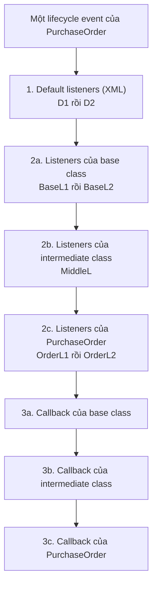

# Quy tắc kế thừa, loại trừ và thứ tự callback

Khi một entity trong JPA phát sinh sự kiện vòng đời, ví dụ được `persist`, `update`, `remove` hoặc `load`, callback không nhất thiết chỉ là một phương thức trong chính entity đó. Ứng dụng có thể khai báo callback ở **entity**, **mapped superclass**, **entity listener class**, hoặc khai báo **default listeners** cho toàn persistence unit. Nếu có kế thừa, một thao tác lưu đơn giản có thể kích hoạt cả chuỗi phương thức.

Ví dụ, một `PurchaseOrder` kế thừa `AuditedEntity`, cả hai có `@PrePersist`; đồng thời superclass và subclass mỗi lớp đăng ký listener riêng:

```java
@MappedSuperclass
@EntityListeners(AuditListener.class)
abstract class AuditedEntity {
    @PrePersist
    protected void initializeAuditFields() { /* ... */ }
}

@Entity
@EntityListeners(OrderListener.class)
class PurchaseOrder extends AuditedEntity {
    @PrePersist
    protected void validateOrder() { /* ... */ }
}
```

Khi gọi `entityManager.persist(order)`, các callback không được gọi ngẫu nhiên. Theo quy tắc Jakarta Persistence, **listeners bên ngoài được gọi trước callback khai báo trực tiếp trong entity/mapped superclass**, và các phần tử thừa kế thường được xử lý **từ lớp cha tổng quát nhất đến lớp con cụ thể nhất**. Nếu có default listener, nó được gọi trước các entity listeners.

Mặt khác, `@ExcludeDefaultListeners` và `@ExcludeSuperclassListeners` cho phép loại trừ **những nhóm listener khác nhau**, nhưng không phải cơ chế tắt mọi callback ở lớp cha. Việc override phương thức callback trong Java lại tạo ra một kiểu thay đổi thứ tự/kết quả khác nữa.

Bài này giải thích **quy tắc kế thừa, loại trừ và thứ tự callback** trong chương **Sự kiện vòng đời** của module **Data Persistence Relational Access ORM JPA**. Nội dung được xây dựng theo ngữ nghĩa của Jakarta Persistence 3.2, đồng thời nêu rõ những chỗ thứ tự không được bảo đảm portable và những khác biệt cần chú ý khi dùng Hibernate hoặc XML metadata.

## 1. Callback vòng đời là gì?

**Lifecycle callback** là phương thức được JPA provider gọi khi một entity đi qua sự kiện nhất định trong vòng đời persistence.

Các annotation callback chuẩn thường gặp:

| Annotation | Ý nghĩa khái quát | Điểm cần nhớ |
|---|---|---|
| `@PrePersist` | Trước thao tác đưa entity mới vào quản lý/persist theo lifecycle | Có thể khởi tạo field không phải quan hệ |
| `@PostPersist` | Sau thao tác INSERT/persist được đồng bộ vào DB theo semantics provider | Không đồng nghĩa toàn transaction đã commit |
| `@PreUpdate` | Trước database UPDATE của entity managed bị thay đổi | Không bắt buộc chạy chỉ vì gọi một setter |
| `@PostUpdate` | Sau database UPDATE theo lifecycle | Có thể xảy ra trong flush, trước commit |
| `@PreRemove` | Trước entity bị remove | Không đồng nghĩa đã DELETE/commit xong |
| `@PostRemove` | Sau DELETE/removal theo lifecycle | Không bảo đảm side effect ngoài DB được commit |
| `@PostLoad` | Sau khi entity được nạp vào context hoặc refresh | Có thể kích hoạt khi load từ cache/provider, không chỉ câu SQL trực tiếp |

Các annotation trên nằm trong package `jakarta.persistence`. Đừng nhầm chúng với callback của Spring, Hibernate event system hoặc domain events tự định nghĩa.

### 1.1. Một event có thể có nhiều callbacks

Giả sử một `@PreUpdate` event:

```text
DefaultChangeListener.onPreUpdate(...)
         |
         v
SuperclassChangeListener.onPreUpdate(...)
         |
         v
OrderChangeListener.onPreUpdate(...)
         |
         v
AuditedEntity.beforeUpdate()
         |
         v
PurchaseOrder.beforeUpdate()
```

Đây là ví dụ về một chuỗi có đầy đủ các cấp; thực tế nhóm nào xuất hiện phụ thuộc annotation, XML metadata và exclusion.

### 1.2. Callback không phải business command

`order.ship()` là hành động nghiệp vụ do code gọi. `@PreUpdate` là sự kiện do provider gọi khi entity được cập nhật. Không nên dùng callback để thay mọi quy tắc domain, vì thao tác bulk JPQL/native SQL, transaction timing và quan hệ có thể khiến callback không chạy theo cách bạn tưởng.

## 2. Ba nơi khai báo callback

Về mặt kiến trúc, JPA cho phép callback xuất hiện ở ba vị trí:

1. **Trong entity class**.
2. **Trong mapped superclass** hoặc superclass entity.
3. **Trong entity listener class** được liên kết bằng `@EntityListeners` hoặc metadata XML.

Ngoài ra, **default entity listeners** có thể được cấu hình cho persistence unit qua XML descriptor.

### 2.1. Callback trực tiếp trong entity

```java
import jakarta.persistence.Entity;
import jakarta.persistence.Id;
import jakarta.persistence.PrePersist;

@Entity
public class CatalogItem {

    @Id
    private Long id;

    private String displayName;

    @PrePersist
    protected void normalizeName() {
        if (displayName != null) {
            displayName = displayName.trim();
        }
    }
}
```

Với dạng này, callback không nhận đối số vì nó đang chạy **trên chính entity instance**.

### 2.2. Callback trong mapped superclass

```java
import jakarta.persistence.MappedSuperclass;
import jakarta.persistence.PrePersist;
import java.time.Instant;

@MappedSuperclass
public abstract class AuditedEntity {

    private Instant createdAt;

    @PrePersist
    protected void assignCreatedAt() {
        if (createdAt == null) {
            createdAt = Instant.now();
        }
    }
}
```

Mọi entity subclass thích hợp thừa kế persistent fields/methods từ `AuditedEntity`. Callback `assignCreatedAt` có thể được áp dụng cho lifecycle của các entity con theo quy tắc inheritance.

`@MappedSuperclass` **không phải `@Entity` độc lập**, nên không thể mặc định gọi `em.find(AuditedEntity.class, id)` như khi tìm một entity class bình thường. Vai trò ở đây là chia sẻ mapping/callback logic trong cây kế thừa.

### 2.3. Callback trong entity listener class

```java
import jakarta.persistence.PrePersist;

public class AuditListener {

    public AuditListener() {}

    @PrePersist
    public void beforeInsert(Object entity) {
        System.out.println(
            "About to persist: "
            + entity.getClass().getSimpleName());
    }
}
```

Đăng ký:

```java
import jakarta.persistence.Entity;
import jakarta.persistence.EntityListeners;

@Entity
@EntityListeners(AuditListener.class)
public class CatalogItem {
    // ...
}
```

Listener là class riêng, method nhận entity instance làm đối số. Một listener class có thể được dùng lại cho nhiều entity types khi chữ ký/phạm vi phù hợp.

### 2.4. Sự khác biệt về chữ ký method

| Vị trí | Dạng callback |
|---|---|
| Entity hoặc mapped superclass | `void method()` |
| Entity listener class | `void method(S entity)`, trong đó `S` là kiểu phù hợp với entity được nghe |

Ví dụ:

```java
@PreUpdate
protected void onEntityUpdate() {
    // Trong entity: không tham số
}
```

```java
@PreUpdate
public void onListenerUpdate(PurchaseOrder order) {
    // Trong listener: nhận entity
}
```

Nếu listener được áp dụng cho nhiều entity classes không có cùng base type, một tham số `Object` có thể thích hợp hơn. Nếu nó chỉ nghe `PurchaseOrder`, kiểu `PurchaseOrder` giúp code rõ ràng.

## 3. Quy tắc tổng quát: thứ tự các nhóm callback

Với **cùng một lifecycle event**, thứ tự theo Jakarta Persistence 3.2 có thể ghi nhớ như sau:

<escape>1.</escape> **Default entity listeners** trong persistence unit, theo thứ tự khai báo XML.

<escape>2.</escape> **Entity listener classes** từ hierarchy, bắt đầu superclass tổng quát nhất rồi đi xuống subclass; các listeners cùng một cấp chạy theo thứ tự trong `@EntityListeners({...})`.

<escape>3.</escape> **Callback methods trực tiếp trên entity và các superclass**, từ superclass tổng quát nhất xuống lớp entity cụ thể nhất.

Sơ đồ:



Điều cốt lõi là **tất cả nhóm listener được xử lý trước nhóm callback khai báo trực tiếp** trong entity hierarchy, không phải mỗi superclass thực hiện cả listener và entity callback rồi mới chuyển xuống subclass.

### 3.1. Thứ tự không phụ thuộc file/class name

Tên method `beforePersistA` không khiến nó chạy trước `beforePersistB`. Theo annotation metadata, thứ tự listeners trong mảng `@EntityListeners` mới có ý nghĩa.

### 3.2. Không so thứ tự giữa các event khác loại bằng một danh sách duy nhất

Các quy tắc ở đây nói về **các callback cùng event**: ví dụ tất cả `@PrePersist`. Không có một quy tắc đơn giản “mọi `@PostLoad` luôn chạy trước mọi `@PreUpdate` của mọi entity” trong mọi transaction; thời điểm events gắn với operation, flush và association access.

### 3.3. Default listeners có thể không tồn tại

Nếu persistence unit chưa cấu hình default listener, bước 1 bỏ qua. Nếu superclass/entity không đăng ký listeners, bước 2 có thể bỏ trống. Nếu entity không có callback riêng, bước 3 cũng có thể không có method nào.

## 4. Ví dụ cây kế thừa đầy đủ

Xây dựng ba tầng:

```text
AuditedRoot              @MappedSuperclass
    |
    v
BusinessDocument          @MappedSuperclass
    |
    v
PurchaseOrder             @Entity
```

Tại mỗi tầng có thể đăng ký listeners và callback riêng.

### 4.1. Superclass tổng quát nhất

```java
import jakarta.persistence.*;
import java.time.Instant;

@MappedSuperclass
@EntityListeners({
    BaseSecurityListener.class,
    BaseMetricsListener.class
})
public abstract class AuditedRoot {

    private Instant createdAt;

    @PrePersist
    protected void rootBeforePersist() {
        createdAt = Instant.now();
        CallbackTrace.add("entity:AuditedRoot");
    }
}
```

### 4.2. Superclass trung gian

```java
import jakarta.persistence.*;

@MappedSuperclass
@EntityListeners(DocumentListener.class)
public abstract class BusinessDocument
        extends AuditedRoot {

    @PrePersist
    protected void documentBeforePersist() {
        CallbackTrace.add("entity:BusinessDocument");
    }
}
```

### 4.3. Entity cụ thể

```java
import jakarta.persistence.*;

@Entity
@EntityListeners({
    OrderValidationListener.class,
    OrderMetricsListener.class
})
public class PurchaseOrder extends BusinessDocument {

    @Id
    @GeneratedValue
    private Long id;

    private String orderCode;

    protected PurchaseOrder() {}

    @PrePersist
    protected void orderBeforePersist() {
        CallbackTrace.add("entity:PurchaseOrder");
    }
}
```

Ở ví dụ này, mỗi class có **một phương thức `@PrePersist`**. Chúng có tên khác nhau và không override nhau.

### 4.4. Các listener classes

```java
import jakarta.persistence.PrePersist;

public class BaseSecurityListener {
    public BaseSecurityListener() {}

    @PrePersist
    public void verify(Object entity) {
        CallbackTrace.add("listener:BaseSecurity");
    }
}

public class BaseMetricsListener {
    public BaseMetricsListener() {}

    @PrePersist
    public void track(Object entity) {
        CallbackTrace.add("listener:BaseMetrics");
    }
}

public class DocumentListener {
    public DocumentListener() {}

    @PrePersist
    public void validate(Object entity) {
        CallbackTrace.add("listener:Document");
    }
}

public class OrderValidationListener {
    public OrderValidationListener() {}

    @PrePersist
    public void validate(PurchaseOrder entity) {
        CallbackTrace.add("listener:OrderValidation");
    }
}

public class OrderMetricsListener {
    public OrderMetricsListener() {}

    @PrePersist
    public void record(PurchaseOrder entity) {
        CallbackTrace.add("listener:OrderMetrics");
    }
}
```

Các top-level classes trên chỉ được đặt chung trong một khối để dễ quan sát. Khi viết project Java thật, các `public` classes thường nằm ở source files riêng theo tên class. `CallbackTrace` là helper minh họa trong test; không phải API JPA.

### 4.5. Nếu chưa cấu hình default listeners

Với event `@PrePersist`, kỳ vọng thứ tự:

| Vị trí | Phương thức |
|---:|---|
| 1 | `BaseSecurityListener.verify` |
| 2 | `BaseMetricsListener.track` |
| 3 | `DocumentListener.validate` |
| 4 | `OrderValidationListener.validate` |
| 5 | `OrderMetricsListener.record` |
| 6 | `AuditedRoot.rootBeforePersist` |
| 7 | `BusinessDocument.documentBeforePersist` |
| 8 | `PurchaseOrder.orderBeforePersist` |

**Chú ý:** listener ở `AuditedRoot` được gọi trước listener ở `BusinessDocument` và `PurchaseOrder`; nhưng callback trực tiếp `AuditedRoot.rootBeforePersist` **không được chen vào** ngay sau `BaseMetricsListener`. Nó chờ sau toàn bộ nhóm listeners.

### 4.6. Khi có default listeners

Nếu persistence unit khai báo hai default listeners `DefaultAuditListener` và `DefaultRoutingListener`, chúng chạy **trước** vị trí 1 và 2 ở bảng trên, theo thứ tự khai báo trong XML.

## 5. Default entity listeners được khai báo ở đâu?

Theo Jakarta Persistence 3.2, default entity listeners được khai báo qua **XML descriptor** ở phần persistence-unit defaults. Đây là những listener classes áp dụng cho entities trong persistence unit trừ khi được loại trừ.

Ví dụ `META-INF/orm.xml` minh họa:

```xml
<?xml version="1.0" encoding="UTF-8"?>
<entity-mappings
    xmlns="https://jakarta.ee/xml/ns/persistence/orm"
    version="3.1">

  <persistence-unit-metadata>
    <persistence-unit-defaults>
      <entity-listeners>
        <entity-listener
            class="example.audit.DefaultAuditListener">
          <pre-persist method-name="onCreate"/>
        </entity-listener>
        <entity-listener
            class="example.audit.DefaultMetricsListener">
          <pre-persist method-name="countCreate"/>
        </entity-listener>
      </entity-listeners>
    </persistence-unit-defaults>
  </persistence-unit-metadata>
</entity-mappings>
```

Ví dụ chỉ thể hiện thành phần XML liên quan; ứng dụng cần thiết lập schema/version, bootstrap và đường dẫn mapping file theo môi trường sử dụng.

### 5.1. Thứ tự default listeners

Theo thứ tự XML:

```text
DefaultAuditListener.onCreate
DefaultMetricsListener.countCreate
```

sẽ chạy trước entity listeners khai báo trên `AuditedRoot`/`BusinessDocument`/`PurchaseOrder`.

### 5.2. Default listeners và entity listeners không cùng phạm vi

`DefaultAuditListener` được chọn ở cấp persistence unit; `OrderMetricsListener` được chọn cho entity hierarchy cụ thể. Vì vậy loại trừ default listeners bằng một annotation khác với loại trừ superclass listeners.

### 5.3. XML có thể thay đổi thứ tự annotation

`orm.xml` không chỉ dùng cho default listeners. XML mapping có thể chỉ định entity listener bindings, callback methods hoặc **override order** mà annotation metadata thường tạo ra. Nếu thứ tự thực tế khác dự kiến, cần kiểm tra cả XML descriptor chứ không chỉ nhìn `@EntityListeners` trong source code.

## 6. Một annotation có nhiều listeners: thứ tự có ý nghĩa

Khai báo:

```java
@EntityListeners({
    NormalizationListener.class,
    ValidationListener.class,
    AuditListener.class
})
```

Đối với cùng event, khi không bị XML override hoặc exclusion khác, thứ tự là:

```text
NormalizationListener
    -> ValidationListener
    -> AuditListener
```

### 6.1. Đổi thứ tự phần tử có thể đổi hành vi

Nếu validation cần kiểm tra giá trị đã được normalize, thứ tự `NormalizationListener` trước `ValidationListener` có thể quan trọng. Tuy vậy, **đặt business dependency mạnh giữa những callbacks riêng lẻ thường làm thiết kế khó kiểm thử**. Với các thao tác nghiệp vụ quan trọng, service/domain method rõ ràng có thể phù hợp hơn.

### 6.2. Không nên dùng nhiều callback cùng event trong một class

Theo quy tắc Jakarta Persistence 3.2, **một class không khai báo hơn một lifecycle callback method cho cùng một event**. Muốn thực hiện nhiều hành động ở cùng event, gộp chúng trong một callback method hoặc tách thành nhiều listener classes được sắp thứ tự có chủ đích.

Ví dụ nên tránh:

```java
@PrePersist
void initializeCode() {}

@PrePersist
void initializeTime() {}
```

trong **cùng một entity class hoặc listener class**.

Giải pháp:

```java
@PrePersist
void prepareForInsert() {
    initializeCode();
    initializeTime();
}
```

hoặc dùng hai listener classes riêng trong `@EntityListeners({CodeListener.class, TimeListener.class})` nếu sự tách biệt thật sự cần thiết.

### 6.3. Một method có thể tham gia nhiều events

```java
@PrePersist
@PreUpdate
void normalizeForWrite() {
    // ...
}
```

Một method được chỉ định cho nhiều callback events là hợp lệ. Tuy nhiên nó sẽ chạy theo **mỗi event mà provider thực sự phát sinh**, chứ không phải “chắc chắn một lần cho mỗi transaction”.

## 7. Kế thừa callback từ entity hoặc mapped superclass

Giả sử:

```java
@MappedSuperclass
public abstract class TimestampedEntity {

    protected Instant createdAt;

    @PrePersist
    protected void fillTimestamp() {
        if (createdAt == null) {
            createdAt = Instant.now();
        }
    }
}

@Entity
public class Invoice extends TimestampedEntity {
    @Id
    private Long id;

    private String invoiceNumber;
}
```

Khi persist một `Invoice`, phương thức callback `TimestampedEntity.fillTimestamp` là một callback được khai báo trong hierarchy.

### 7.1. Superclass có thể là entity class

Không chỉ `@MappedSuperclass`:

```java
@Entity
@Inheritance(strategy = InheritanceType.JOINED)
public abstract class Document {
    @Id
    private Long id;

    @PrePersist
    protected void documentCreated() { /* ... */ }
}

@Entity
public class Invoice extends Document {
    @PrePersist
    protected void invoiceCreated() { /* ... */ }
}
```

Trong trường hợp này, callback của entity superclass `Document` được xử lý trước callback riêng ở `Invoice` khi cùng event, miễn không bị override.

### 7.2. Superclass tổng quát nhất trước

Với:

```text
AuditedRoot -> Document -> Invoice
```

các callback method tương ứng một event ở ba lớp chạy theo:

```text
AuditedRoot callback
    -> Document callback
    -> Invoice callback
```

**Sau** các entity listener callbacks liên quan.

### 7.3. Đừng nhầm `@MappedSuperclass` với Java inheritance thuần túy

JPA diễn giải metadata từ mapped superclass/entity hierarchy. Một helper class Java bất kỳ không trở thành mapped superclass chỉ vì entity `extends` nó; việc metadata callback được provider nhận diện phải tuân thủ các quy tắc mapped classes và annotation/XML trong persistence model.

## 8. `@ExcludeDefaultListeners`: loại trừ listener mặc định

Annotation:

```java
import jakarta.persistence.ExcludeDefaultListeners;
```

Dùng trên entity hoặc mapped superclass:

```java
@Entity
@ExcludeDefaultListeners
@EntityListeners(OrderListener.class)
public class PurchaseOrder extends AuditedRoot {
    // ...
}
```

Tác dụng: **không gọi default listeners của persistence unit** cho entity ấy và các subclass thuộc phạm vi kế thừa của nó.

Nó **không** có nghĩa:

- Không gọi `OrderListener`.
- Không gọi listeners đã đăng ký ở superclass.
- Không gọi callback methods trực tiếp trong entity/superclasses.
- Không gọi callback của mọi event khác.

### 8.1. Minh họa thứ tự

Trước khi loại trừ:

```text
DefaultAuditListener
BaseSecurityListener
OrderListener
AuditedRoot.@PrePersist
PurchaseOrder.@PrePersist
```

Sau khi gắn `@ExcludeDefaultListeners` trên `PurchaseOrder`:

```text
BaseSecurityListener
OrderListener
AuditedRoot.@PrePersist
PurchaseOrder.@PrePersist
```

Chỉ nhóm default listener biến mất.

### 8.2. Tác dụng tới descendants

Nếu `SpecialOrder extends PurchaseOrder`, quy tắc exclude default listeners của `PurchaseOrder` cũng áp dụng cho các subclass của nó. Vì vậy annotation trên một mapped superclass hoặc base entity có thể ảnh hưởng **rộng hơn một entity cụ thể**.

### 8.3. Trường hợp dùng

Một hệ thống có `DefaultAuditListener` để ghi metadata cho hầu hết entities, nhưng một entity đặc thù có chính sách audit khác và muốn loại nó khỏi default chain. Khi dùng annotation, cần ghi rõ vì sao để không vô tình bỏ qua một quy tắc compliance dùng chung.

## 9. `@ExcludeSuperclassListeners`: loại listeners từ lớp cha

Annotation:

```java
import jakarta.persistence.ExcludeSuperclassListeners;
```

Ví dụ:

```java
@MappedSuperclass
@EntityListeners({
    BaseSecurityListener.class,
    BaseMetricsListener.class
})
public abstract class AuditedRoot {
    @PrePersist
    protected void rootBeforePersist() { /* ... */ }
}

@Entity
@ExcludeSuperclassListeners
@EntityListeners(OrderListener.class)
public class PurchaseOrder extends AuditedRoot {
    @Id
    private Long id;

    @PrePersist
    protected void orderBeforePersist() { /* ... */ }
}
```

Với `@ExcludeSuperclassListeners` trên `PurchaseOrder`:

- Các **entity listener classes gắn với superclass `AuditedRoot`** bị loại khỏi callback chain dành cho PurchaseOrder.
- `OrderListener` gắn trực tiếp vào PurchaseOrder **vẫn chạy**.
- Default listeners, nếu không bị exclude riêng, **vẫn chạy**.
- Callback method `AuditedRoot.rootBeforePersist` khai báo trực tiếp trong mapped superclass **vẫn chạy**.
- Callback method `PurchaseOrder.orderBeforePersist` **vẫn chạy**.

Đây là khác biệt dễ nhầm nhất trong chủ đề.

### 9.1. Trước và sau khi loại trừ

**Không gắn annotation:**

```text
DefaultListener
BaseSecurityListener
BaseMetricsListener
OrderListener
AuditedRoot.rootBeforePersist
PurchaseOrder.orderBeforePersist
```

**Có `@ExcludeSuperclassListeners`:**

```text
DefaultListener
OrderListener
AuditedRoot.rootBeforePersist
PurchaseOrder.orderBeforePersist
```

### 9.2. Tại sao superclass callback không bị loại?

Vì `@ExcludeSuperclassListeners` nói về **entity listener classes đăng ký trên superclasses**, không nói về **lifecycle callback methods khai báo trực tiếp trong entity/mapped superclass**.

Nếu bạn muốn một subclass không thực hiện callback method từ superclass, đó là bài toán **override method** hoặc thiết kế lại callback hierarchy, không phải tác dụng của `@ExcludeSuperclassListeners`.

### 9.3. Phạm vi ở các subclass bên dưới

Nếu:

```text
AuditedRoot
  -> PurchaseOrder (@ExcludeSuperclassListeners)
      -> SpecialOrder (@EntityListeners(SpecialListener))
```

`SpecialOrder` cũng không sử dụng các listeners đã bị loại từ `AuditedRoot` theo metadata kế thừa; `OrderListener` và `SpecialListener` có thể vẫn được áp dụng theo quy tắc gắn trên các lớp trong subtree. Những listeners bị exclude không được “tự động quay lại” chỉ vì thêm một subclass.

### 9.4. Listener trực tiếp ở superclass có thể được thêm lại tường minh bằng XML

Đặc tả cho phép metadata XML gắn listener classes tường minh; trong một số trường hợp, một listener vốn bị exclude ở nhóm default/superclass nếu được **liệt kê tường minh** lại cho entity/mapped superclass sẽ được áp dụng. Do vậy cần xem cả effective metadata khi XML có mặt; không chỉ đoán từ annotation trên source.

## 10. Kết hợp cả hai annotation loại trừ

Một entity có thể cần **không dùng default listeners** và **không dùng listeners khai báo trên superclasses**:

```java
@Entity
@ExcludeDefaultListeners
@ExcludeSuperclassListeners
@EntityListeners(SpecialOrderListener.class)
public class SpecialOrder extends AuditedRoot {

    @Id
    private Long id;

    @PrePersist
    protected void beforeCreate() {
        // Callback trực tiếp của entity
    }
}
```

Với một `@PrePersist` event, nếu superclass có `rootBeforePersist()`, thứ tự các callback còn lại thường là:

```text
SpecialOrderListener.@PrePersist
AuditedRoot.rootBeforePersist
SpecialOrder.beforeCreate
```

**Hai nhóm bị loại** là:

1. Default listeners từ persistence unit.
2. Entity listener classes khai báo trên superclasses.

**Không bị loại**:

1. Entity listener class của chính `SpecialOrder`.
2. Callback method khai báo trên `AuditedRoot` nếu không bị override.
3. Callback method khai báo trên `SpecialOrder`.

### 10.1. Bảng đối chiếu ngắn

Giả định chuỗi gốc:

```text
D = Default listener
S = Superclass listener
E = Entity's own listener
B = Base direct callback
C = Child direct callback

Không loại trừ:             D -> S -> E -> B -> C
@ExcludeDefaultListeners:   S -> E -> B -> C
@ExcludeSuperclassListeners:D -> E -> B -> C
Cả hai annotation:               E -> B -> C
```

Bảng trên dành cho ví dụ **một superclass, một entity**; cây kế thừa sâu có thể có thêm nhiều listeners ở các cấp và XML metadata, nhưng logic nhóm vẫn như vậy.

### 10.2. Vì sao không có `@ExcludeSuperclassCallbacks`?

Các annotation chuẩn nêu trên chỉ cung cấp cơ chế exclude nhóm listeners. Đối với callback methods được khai báo trực tiếp trong entity/mapped superclass, dùng **quy tắc inheritance/override** của Java/JPA hoặc thay đổi thiết kế; không tự tạo tên annotation không tồn tại trong chuẩn.

### 10.3. Cẩn trọng với base entity dùng chung

Đặt `@ExcludeDefaultListeners` trên một mapped superclass có hàng chục entity con có thể khiến **mọi descendant trong nhánh đó** bỏ qua default auditing. Khi review thay đổi, cần kiểm tra tác động toàn hierarchy, không chỉ entity vừa sửa.

## 11. Override callback method ở lớp con

JPA cho phép lớp con **override inherited callback method cùng loại event**. Khi callback đó bị override, **phương thức ở superclass bị override không được tự động gọi thêm** theo quy tắc callback inheritance.

Ví dụ:

```java
@MappedSuperclass
public abstract class AuditedRoot {

    @PrePersist
    protected void prepareCreate() {
        System.out.println("base prepare");
    }
}

@Entity
public class SpecialOrder extends AuditedRoot {
    @Id
    private Long id;

    @Override
    @PrePersist
    protected void prepareCreate() {
        System.out.println("special prepare");
    }
}
```

Với một `@PrePersist` event của `SpecialOrder`, **không có hai independent callback methods** `AuditedRoot.prepareCreate` và `SpecialOrder.prepareCreate` được gọi nối tiếp bởi JPA. Subclass đã override phương thức kế thừa.

### 11.1. Nếu muốn giữ phần việc của superclass?

Trong phương thức override, có thể gọi `super` có chủ đích:

```java
@Override
@PrePersist
protected void prepareCreate() {
    super.prepareCreate(); // Gọi bằng Java, không phải JPA callback riêng
    System.out.println("special prepare");
}
```

Khi đó code base chạy do **lời gọi Java tường minh**, không do provider phát thêm một callback độc lập cho method đã bị override.

### 11.2. Khi muốn cả base và child là hai callbacks riêng

Thay vì override:

```java
@MappedSuperclass
public abstract class AuditedRoot {
    @PrePersist
    protected void initializeCommonFields() { /* ... */ }
}

@Entity
public class SpecialOrder extends AuditedRoot {
    @Id
    private Long id;

    @PrePersist
    protected void validateSpecialFields() { /* ... */ }
}
```

Hai phương thức có tên khác nhau, không override; thứ tự là **base callback rồi child callback**, sau khi tất cả applicable listener classes đã chạy.

### 11.3. Vì sao nên dùng `@Override` và annotation callback tường minh?

Method-level annotations trong Java không tự hoạt động giống `@Inherited` của type annotations. Khi subclass chủ ý thay callback, ghi rõ `@Override` và `@PrePersist` giúp người đọc hiểu behavior; đừng dựa vào một phương thức trùng tên không annotation rồi đoán JPA provider sẽ xử lý thế nào.

### 11.4. Overloading không phải overriding

```java
protected void prepareCreate() {}
protected void prepareCreate(String source) {}
```

Hai chữ ký khác nhau là overload, không override. Một callback trực tiếp trên entity cần **không có tham số**, nên `prepareCreate(String source)` không phải một entity callback hợp lệ nếu được đánh dấu `@PrePersist`.

### 11.5. Phương thức private của superclass

Trong Java, phương thức `private` không được override theo nghĩa Java thông thường. Nếu superclass và subclass có private methods trùng tên, không được giả định chúng tạo thành quan hệ override chỉ dựa trên chuỗi tên. Để xây callback hierarchy rõ, ưu tiên `protected` với các tên khác nhau hoặc override tường minh theo contract; tránh thiết kế phải đoán reflection behavior.

## 12. Override entity listener method là vấn đề khác

Ngoài callbacks nằm trong entities, một **entity listener class** có thể có chính cây kế thừa Java:

```java
public class BaseListener {
    @PreUpdate
    public void beforeUpdate(Object entity) {
        System.out.println("base listener");
    }
}

public class SpecializedListener extends BaseListener {
    @Override
    @PreUpdate
    public void beforeUpdate(Object entity) {
        System.out.println("specialized listener");
    }
}
```

Khi `SpecializedListener` được đăng ký, phải xét quy tắc callback method inheritance/override đối với listener class **riêng**, không nhầm với hai listener classes `@EntityListeners({BaseListener.class, SpecializedListener.class})`.

### 12.1. Hai trường hợp cần phân biệt

**Trường hợp A — Một registered listener kế thừa callback method:**

```java
@EntityListeners(SpecializedListener.class)
```

Provider nhận listener class đó và các callback methods phù hợp theo inheritance/override semantics.

**Trường hợp B — Hai registered listeners tách biệt:**

```java
@EntityListeners({
    BaseListener.class,
    SpecializedListener.class
})
```

Đây là danh sách **hai listener classes được đăng ký**, mỗi listener có thể được xử lý theo metadata riêng. Không coi chúng là “một listener inheritance chain” rồi tự động suy ra chỉ một callback; nếu muốn một listener duy nhất, chỉ đăng ký loại phù hợp.

### 12.2. Tránh trùng hành vi do đăng ký lặp

Nếu `BaseListener` và `SpecializedListener` cùng thực hiện một audit side effect, việc đăng ký cả hai có thể dẫn đến hiệu ứng trùng lặp. Nên thiết kế trách nhiệm mỗi listener độc lập và test invocation sequence trên provider mục tiêu.

## 13. Listener kế thừa qua nhiều cấp và exclusion ở lớp trung gian

Xét cây:

```text
AuditedRoot
  @EntityListeners(RootListener)
     |
     v
BusinessDocument
  @EntityListeners(DocumentListener)
     |
     v
PurchaseOrder
  @ExcludeSuperclassListeners
  @EntityListeners(OrderListener)
     |
     v
SpecialOrder
  @EntityListeners(SpecialListener)
```

Đối với `PurchaseOrder`:

```text
RootListener       -- excluded
DocumentListener   -- excluded
OrderListener      -- included
```

Đối với `SpecialOrder`:

```text
RootListener       -- excluded by inherited rule
DocumentListener   -- excluded by inherited rule
OrderListener      -- included
SpecialListener    -- included
```

Default listeners vẫn được áp dụng nếu không bị exclude riêng. Các callback methods trực tiếp trên `AuditedRoot` và `BusinessDocument` vẫn có thể chạy.

### 13.1. Đừng đọc `@ExcludeSuperclassListeners` như “xóa mọi thứ ở trên”

Nó ngăn **inherited entity listener classes** trong phần hierarchy phía trên điểm khai báo, không xóa inheritance Java hay JPA mapping fields/methods/callbacks.

### 13.2. Khi XML explicitly rebind một listener

Đặc tả cho phép liên kết listeners theo XML. Nếu một listener từng bị exclude nhưng lại được liệt kê tường minh cho entity/mapped superclass, effective configuration có thể đưa listener đó trở lại theo quy tắc XML. Vì vậy bài toán cuối cùng là **effective listener metadata** chứ không phải chỉ tập annotations ở một file.

### 13.3. Mở rộng cây kế thừa cần regression tests

Thêm một mapped superclass giữa hai lớp hoặc chuyển `@EntityListeners` từ class này sang class khác có thể đổi thứ tự và nhóm bị exclude. Đây là thay đổi behavior có thể quan trọng với auditing/validation, dù public entity API vẫn giống nhau.

## 14. Kế thừa class không đồng nghĩa thứ tự cascade giữa entities

Đây là giới hạn rất quan trọng:

- **Thứ tự callback theo inheritance hierarchy** của *một entity instance* được đặc tả.
- **Thứ tự callbacks giữa parent entity và related child entities do cascade** không được đặc tả chặt chẽ giống vậy.

Ví dụ:

```java
@Entity
public class PurchaseOrder {

    @Id
    private Long id;

    @OneToMany(
        mappedBy = "order",
        cascade = CascadeType.PERSIST
    )
    private List<OrderItem> items;

    @PrePersist
    protected void prePersistOrder() {
        System.out.println("order pre");
    }
}

@Entity
public class OrderItem {

    @Id
    private Long id;

    @ManyToOne
    private PurchaseOrder order;

    @PrePersist
    protected void prePersistItem() {
        System.out.println("item pre");
    }
}
```

Khi persist order và cascade persist items, **không dựa vào một thứ tự portable tuyệt đối** như:

```text
Order @PrePersist
Item 1 @PrePersist
Item 2 @PrePersist
```

hoặc chiều ngược lại. Jakarta Persistence cho phép provider quyết định thứ tự callback so với cascade lifecycle events đến các entity liên quan.

### 14.1. Vì sao chuyện này quan trọng?

Nếu `OrderItem.@PrePersist` yêu cầu một biến tạm được `PurchaseOrder.@PrePersist` thiết lập trước đó, logic có thể phụ thuộc vào thứ tự không được đảm bảo.

Cách tốt hơn:

```java
Order order = factory.create(...);
order.assignItems(...);
repository.persist(order);
```

Hãy khởi tạo invariants trong domain/factory/service **trước khi gọi persist**, thay vì tạo dependency nhạy cảm giữa lifecycle callbacks của nhiều entity instances.

### 14.2. Thứ tự elements trong List không phải thứ tự callbacks portable

`items` là `List` trong Java không tự bảo đảm JPA cascade gọi `@PrePersist` của các items theo index 0, 1, 2 trên mọi provider và mapping. Đây là hai tầng quy tắc khác nhau.

## 15. Đặc tả quy định thứ tự trong một event, không phải thứ tự toàn transaction

Một transaction có thể:

```text
persist A
persist B
find C
update D
remove E
flush
commit
```

Các callback khác nhau có thể xảy ra:

- Ngay khi gọi `persist`/`remove` theo event semantics.
- Khi provider flush SQL INSERT/UPDATE/DELETE.
- Sau khi entity được load/refresh.
- Ở các thời điểm phụ thuộc ID generation, flush mode và provider.

Do đó, từ quy tắc “default listener trước superclass listener” không thể suy ra một thứ tự toàn cục cho mọi entity/events trong transaction.

### 15.1. Thứ tự `@PrePersist` và `@PostPersist`

`@PrePersist` được gọi ở giai đoạn persist lifecycle; `@PostPersist` được gọi sau database insert tương ứng. Nhưng không nên giả định `@PostPersist` là “transaction đã commit thành công”. Nếu callback gửi email/kết nối ngoài database ngay thời điểm đó, transaction vẫn có thể rollback sau đó.

### 15.2. `@PreUpdate`/`@PostUpdate` phụ thuộc SQL UPDATE thực tế

```java
Product product = em.find(Product.class, 101L);
product.setName(product.getName());
```

Nếu provider không phát hiện persistent state thay đổi và không tạo UPDATE, không nên mặc định `@PreUpdate`/`@PostUpdate` vẫn được gọi. Thậm chí thay đổi ở to-many relation hoặc collection membership có thể làm provider thực hiện những DML khác mà không có database UPDATE trên parent row.

### 15.3. `@PostLoad` không có nghĩa mọi `find` đều gọi lại

Lần load đầu vào persistence context có thể phát sinh `@PostLoad`. Nhưng:

```java
Product a = em.find(Product.class, 101L);
Product b = em.find(Product.class, 101L);
```

lần `find` thứ hai có thể trả chính managed instance trong L1, không có load event mới. Không thiết kế một counter kiểu “mỗi lời gọi find tăng một” trong `@PostLoad`.

### 15.4. Provider có thể flush trước query

Với `FlushModeType.AUTO`, một JPQL query có thể dẫn đến flush pending changes để đảm bảo query thấy state cần thiết, tùy provider/query. Điều đó có thể làm `@PreUpdate` xảy ra **trước khi method chứa query trả về**, khác dự đoán “chỉ khi commit”.

## 16. Override không phải loại trừ toàn bộ callback nhóm cha

Có ba thao tác cần phân biệt:

| Bạn muốn gì? | Cơ chế | Hệ quả |
|---|---|---|
| Không chạy default listeners của persistence unit | `@ExcludeDefaultListeners` | Loại nhóm default; nhóm superclass/entity vẫn theo quy tắc |
| Không chạy listeners đăng ký ở superclasses | `@ExcludeSuperclassListeners` | Không loại callback methods trực tiếp trên superclasses |
| Không chạy implementation callback đã kế thừa cùng method/signature | Override callback method | Super implementation bị override không tự được provider gọi |
| Muốn chạy cả base và child callback độc lập | Khai báo hai phương thức callback khác tên | Base trước child sau listener classes |
| Muốn thêm một listener riêng của subclass | `@EntityListeners(SubListener.class)` | Thêm vào chuỗi listeners theo hierarchy |
| Muốn điều chỉnh default/callback order qua metadata | XML descriptor | Effective metadata có thể thay annotation order |

### 16.1. Một anti-pattern

```java
@MappedSuperclass
public class AuditedRoot {
    @PrePersist
    protected void fillAudit() {
        // CreatedAt
    }
}

@Entity
@ExcludeSuperclassListeners
public class Payment extends AuditedRoot {
    // Developer tưởng fillAudit không chạy.
}
```

Sai vì `fillAudit` là **direct callback method trên mapped superclass**, không phải entity listener class được gắn ở superclass.

### 16.2. Một cách sửa phù hợp

Nếu chỉ một vài entity cần bỏ audit initialization, thay vì override trống một cách khó bảo trì, có thể:

- Tách auditing listener để cho phép exclude đúng nhóm.
- Tách base classes theo domain semantics.
- Tạo strategy/service factory khởi tạo audit theo use case.
- Dùng override tường minh khi thật sự cần thay đổi callback behavior, kèm integration test.

Chọn thiết kế làm rõ **mục đích nghiệp vụ** thay vì chỉ tìm cách “tắt callback cho chạy được”.

## 17. Callback method signatures hợp lệ

Jakarta Persistence 3.2 quy định:

### 17.1. Trong entity/mapped superclass

```java
@PrePersist
protected void beforeInsert() {
    // no args
}
```

Trả về `void`, không có tham số.

### 17.2. Trong listener class

```java
@PrePersist
public void beforeInsert(PurchaseOrder order) {
    // one entity parameter
}
```

Trả về `void`, một tham số có kiểu thích hợp với entity được callback.

### 17.3. Visibility và modifiers

Callback methods có thể là `public`, `protected`, package-private hoặc `private`, nhưng **không được `static` hoặc `final`** theo chuẩn.

Ví dụ không hợp lệ:

```java
@PrePersist
public static void beforeInsert() {}
```

```java
@PrePersist
public final void beforeInsert() {}
```

```java
@PrePersist
public boolean beforeInsert() {
    return true;
}
```

Trong ví dụ cuối, return type không phải `void`.

### 17.4. Entity listener constructor

Jakarta Persistence 3.2 quy định entity listener class cần **public no-argument constructor**. Ở môi trường Jakarta EE có CDI được bật, listener classes cũng có thể sử dụng CDI dependency injection theo điều kiện/khả năng môi trường đó, nhưng không nên giả định listener tùy ý được tạo bằng Spring container chỉ vì class có `@Component`.

### 17.5. Chữ ký gắn với class hierarchy

Listener method nhận `PurchaseOrder` không thể tự động dùng cho mọi entity không có quan hệ kiểu phù hợp. Một generic listener có thể dùng tham số `Object`; khi cần thao tác với field chung, dùng interface hoặc mapped superclass làm parameter type theo chuẩn.

## 18. Callback không phải nơi gọi EntityManager tùy ý

Một số tác vụ hấp dẫn để đặt vào callback:

```java
@PrePersist
void beforeCreate() {
    entityManager.persist(other);
    repository.findBySomething(...);
}
```

Trong portable JPA applications, **không nên** gọi `EntityManager` hoặc query operations, truy cập các entity instances khác hoặc chỉnh quan hệ bên trong callback. Điều đó có thể gây:

- Reentrancy và flush recursion.
- Inconsistent persistence context state.
- Provider-specific behavior.
- N+1 hoặc SQL phát sinh bất ngờ.
- Lifecycle callbacks bị gọi thêm ngoài dự đoán.
- Vòng lặp cascade và xử lý thứ tự khó kiểm soát.

Đặc tả cho phép callback thay đổi **non-relationship state của chính entity**. Nên dùng callback cho các việc nhỏ, xác định và độc lập.

### 18.1. Các tác vụ tương đối phù hợp

Ví dụ:

- Gắn `createdAt` khi null trong `@PrePersist`.
- Gắn `updatedAt` trong `@PreUpdate`.
- Chuẩn hóa chuỗi đơn giản.
- Kiểm tra invariant cục bộ đơn giản và ném unchecked exception khi sai.
- Khởi tạo transient derived field sau `@PostLoad`.

### 18.2. Các tác vụ cần cân nhắc tránh

- Gửi email, thông báo webhook, JMS message với yêu cầu “chỉ gửi sau commit”.
- Gọi external HTTP API và giả định rollback có thể hoàn tác side effect.
- Truy vấn nhiều repository để quyết định xử lý cross-entity invariant.
- Thêm/xóa entities khác trong cùng persistence context.
- Sửa quan hệ hai chiều và cascade graph phức tạp.
- Phụ thuộc vào thứ tự các callback của những child entities khác.

### 18.3. Nếu thật sự cần audit/outbox?

Với audit có nghiệp vụ mạnh, hãy dùng service/transaction boundary, database constraints, outbox hoặc một persistence event integration được thiết kế và kiểm thử rõ. Không mặc định `@PostPersist` được gọi sau khi transaction commit.

## 19. Callback ném exception: chuỗi sẽ dừng

Jakarta Persistence cho phép lifecycle callbacks ném unchecked/runtime exception.

Ví dụ:

```java
public class ValidationListener {

    @PrePersist
    public void validate(PurchaseOrder order) {
        if (order.getOrderCode() == null) {
            throw new IllegalArgumentException(
                "Order code is required");
        }
    }
}
```

Khi callback ném runtime exception:

- Các callback tiếp theo trong cùng chuỗi **không tiếp tục được gọi**.
- Nếu callback chạy trong transaction và persistence context đã joined transaction, transaction bị đánh dấu rollback theo semantics chuẩn.
- Application phải xử lý error ở transaction boundary; không coi việc callback đầu đã chạy là “đã lưu thành công”.

### 19.1. Ví dụ thứ tự bị cắt

```text
DefaultListener                  OK
BaseSecurityListener            throws RuntimeException
OrderListener                   NOT CALLED
AuditedRoot.@PrePersist         NOT CALLED
PurchaseOrder.@PrePersist       NOT CALLED
```

### 19.2. Không dùng exception cho logic “skip callback nhưng vẫn commit”

Ném exception không tương đương “bỏ qua listener này, chạy phần khác”. Nó có semantics lỗi/rollback mạnh hơn. Nếu cần selectively skip một nhiệm vụ bên trong callback, dùng điều kiện rõ ràng hoặc cấu hình exclude phù hợp.

### 19.3. Rollback không đảo ngược side effects ngoài database

Nếu DefaultListener đã gửi email rồi BaseSecurityListener ném lỗi, database transaction có thể rollback nhưng email không tự thu hồi. Đây là một lý do tránh side effects ngoài DB trong lifecycle callbacks.

## 20. XML mapping và annotation metadata: thứ tự thực tế lấy ở đâu?

Ngoài `@EntityListeners`, JPA cho phép dùng `orm.xml` để:

- Khai báo default listeners.
- Liên kết entity listener classes với entity hoặc mapped superclass.
- Chọn callback methods bằng các XML elements `pre-persist`, `post-load`...
- Bổ sung hoặc override ordering/binding theo quy tắc metadata.
- Loại default/superclass listeners qua XML elements tương ứng.

Ví dụ biểu diễn listener cho một entity:

```xml
<entity class="example.order.PurchaseOrder">
  <entity-listeners>
    <entity-listener class="example.audit.XmlValidationListener">
      <pre-persist method-name="onCreate"/>
    </entity-listener>
    <entity-listener class="example.audit.XmlMetricsListener">
      <pre-persist method-name="recordCreate"/>
    </entity-listener>
  </entity-listeners>
</entity>
```

Ví dụ là một đoạn nằm trong `entity-mappings` đầy đủ, không phải file XML tự chạy.

### 20.1. XML exclusion

```xml
<entity class="example.order.SpecialOrder">
  <exclude-default-listeners/>
  <exclude-superclass-listeners/>
</entity>
```

Các phần tử này biểu diễn mục đích tương ứng với `@ExcludeDefaultListeners` và `@ExcludeSuperclassListeners` theo metadata rules.

### 20.2. Vì sao debug phải xem XML?

Một class:

```java
@EntityListeners({A.class, B.class})
class PurchaseOrder { ... }
```

trông như sẽ gọi A trước B. Nhưng nếu effective XML metadata override/bind listeners theo cách khác, runtime ordering có thể khác. Với hệ thống legacy dùng `orm.xml` hoặc nhiều modules, code review chỉ nhìn annotations dễ bỏ sót.

### 20.3. Đừng lấy package name làm thứ tự

Class ở `example.audit` không mặc nhiên chạy trước class ở `example.sales`. Thứ tự lấy từ các cấp metadata và vị trí đăng ký listeners, không phải thứ tự classpath hay package.

### 20.4. Jakarta Persistence version cần xác định

Bài này dùng quy tắc Jakarta Persistence **3.2**. Các phiên bản phát triển/đề xuất trong tương lai có thể mở rộng cách đăng ký default listeners hoặc callback types. Khi dự án nâng spec/provider version, nên xem effective version và migration notes; không tự áp behavior từ bản dự thảo cho ứng dụng đang chạy 3.2.

## 21. Ví dụ audit thực tế có kế thừa callback

Một use case thường gặp là tự đặt `createdAt` và `updatedAt` cho nhiều entities.

### 21.1. Mapped superclass dùng chung

```java
package example.audit;

import jakarta.persistence.*;
import java.time.Instant;

@MappedSuperclass
@EntityListeners(ChangeAuditListener.class)
public abstract class TimestampedEntity {

    @Column(name = "created_at", nullable = false,
            updatable = false)
    private Instant createdAt;

    @Column(name = "updated_at", nullable = false)
    private Instant updatedAt;

    @PrePersist
    protected void beforeInsert() {
        Instant now = Instant.now();
        if (createdAt == null) {
            createdAt = now;
        }
        updatedAt = now;
    }

    @PreUpdate
    protected void beforeUpdate() {
        updatedAt = Instant.now();
    }

    public Instant getCreatedAt() { return createdAt; }
    public Instant getUpdatedAt() { return updatedAt; }
}
```

Đây là hai callbacks **khác loại event** trong cùng class, hợp lệ. Phương thức chỉ sửa non-relationship fields của entity.

### 21.2. Listener riêng cho audit information

```java
package example.audit;

import jakarta.persistence.*;

public class ChangeAuditListener {

    public ChangeAuditListener() {}

    @PrePersist
    public void beforeCreate(Object entity) {
        // Ví dụ: ghi diagnostics nhẹ vào một sink phù hợp.
        // Tránh gọi EntityManager/query operations ở đây.
    }

    @PreUpdate
    public void beforeChange(Object entity) {
        // Ví dụ: thống kê trong bộ nhớ của unit of work.
    }
}
```

### 21.3. Entity kế thừa và thêm kiểm tra riêng

```java
package example.order;

import example.audit.TimestampedEntity;
import jakarta.persistence.*;
import java.math.BigDecimal;

@Entity
@EntityListeners(OrderValidationListener.class)
public class PurchaseOrder extends TimestampedEntity {

    @Id
    @GeneratedValue
    private Long id;

    private String orderCode;

    @Column(nullable = false, precision = 15, scale = 2)
    private BigDecimal totalAmount;

    protected PurchaseOrder() {}

    @PrePersist
    protected void prepareOrder() {
        if (orderCode == null || orderCode.isBlank()) {
            throw new IllegalStateException(
                "Order code is required");
        }
    }

    public String getOrderCode() { return orderCode; }
    public BigDecimal getTotalAmount() { return totalAmount; }
}
```

`OrderValidationListener` có thể chứa:

```java
package example.order;

import jakarta.persistence.PrePersist;

public class OrderValidationListener {
    public OrderValidationListener() {}

    @PrePersist
    public void validate(PurchaseOrder order) {
        if (order.getTotalAmount() == null
                || order.getTotalAmount().signum() < 0) {
            throw new IllegalArgumentException(
                "Total amount must not be negative");
        }
    }
}
```

### 21.4. Thứ tự `@PrePersist`

Khi không có default listener:

```text
1. ChangeAuditListener.beforeCreate
2. OrderValidationListener.validate
3. TimestampedEntity.beforeInsert
4. PurchaseOrder.prepareOrder
```

Nếu cấu hình một `DefaultListener`, nó đứng **trước bước 1**.

### 21.5. Thứ tự `@PreUpdate`

Vì `OrderValidationListener` chỉ có `@PrePersist`, với `@PreUpdate`:

```text
1. ChangeAuditListener.beforeChange
2. TimestampedEntity.beforeUpdate
```

`PurchaseOrder.prepareOrder` **không chạy** cho update vì nó chỉ được đánh dấu `@PrePersist`. Nếu muốn validate cả update, thêm `@PreUpdate` cho callback phù hợp hoặc đặt validation ở domain/service và Bean Validation.

### 21.6. Giới hạn của ví dụ

- `Instant.now()` trong callback làm timestamp phụ thuộc application clock. Nếu cần một clock chung nhất quán, thiết kế clock abstraction hoặc database timestamp policy phù hợp.
- `@PreUpdate` chỉ gắn với database UPDATE thực sự của entity; chỉ đổi children mà parent row không update có thể không bump `updatedAt`.
- Đừng dựa vào callback để sửa trạng thái entity nếu update được thực hiện bằng bulk JPQL hoặc native SQL.
- Callback audit không nên phát email/event ra hệ thống ngoài trước commit.
- Code mẫu tập trung giải thích callback chain, không phải giải pháp auditing đầy đủ cho compliance.

## 22. Khi subclass muốn audit khác mà không mất timestamp base

Giả sử `ExternalOrder` không dùng `ChangeAuditListener` của `TimestampedEntity`, nhưng vẫn cần `createdAt`/`updatedAt` do base callback thiết lập.

Thiết kế:

```java
@Entity
@ExcludeSuperclassListeners
@EntityListeners(ExternalOrderListener.class)
public class ExternalOrder extends TimestampedEntity {

    @Id
    private Long id;

    private String partnerReference;

    @PrePersist
    protected void validatePartnerReference() {
        if (partnerReference == null
                || partnerReference.isBlank()) {
            throw new IllegalArgumentException(
                "Missing partner reference");
        }
    }
}
```

Với `@PrePersist`:

```text
ExternalOrderListener.callback
TimestampedEntity.beforeInsert
ExternalOrder.validatePartnerReference
```

`ChangeAuditListener` bị loại do là listener khai báo ở superclass. Nhưng `TimestampedEntity.beforeInsert` vẫn chạy vì nó là **direct callback**.

### 22.1. Nếu muốn giữ base audit listener nhưng loại default?

Dùng:

```java
@ExcludeDefaultListeners
@EntityListeners(ExternalOrderListener.class)
```

Khi đó `ChangeAuditListener` từ `TimestampedEntity` vẫn được áp dụng.

### 22.2. Nếu muốn không chạy base timestamp callback?

`@ExcludeSuperclassListeners` không đủ. Cần thay đổi hierarchy hoặc override callback có chủ đích:

```java
@Override
@PrePersist
protected void beforeInsert() {
    // Cố ý không gọi super.beforeInsert().
    // Phải bảo đảm createdAt/updatedAt được quản lý
    // theo một cơ chế khác phù hợp schema.
}
```

Điều này có thể làm vi phạm NOT NULL columns nếu subclass không khởi tạo timestamps bằng cách khác. Vì thế **override trống** chỉ để chặn behavior thường khó bảo trì; thiết kế base classes rõ trách nhiệm sẽ tốt hơn.

## 23. Khi nào một callback chạy nhiều lần?

Một số người viết:

```java
@PostLoad
protected void afterLoad() {
    loadCounter++;
}
```

rồi kỳ vọng callback chạy đúng một lần trong suốt vòng đời của entity trong toàn application. Điều này không đúng:

- Một entity có thể được load ở nhiều persistence contexts khác nhau.
- `EntityManager.refresh` có thể kích hoạt `@PostLoad` một lần nữa.
- L2 hit vẫn có thể dẫn đến materialization/load event vào context mới.
- Một managed entity đã có trong L1 được trả lại bởi `find` thường không tạo load event mới.

Do đó `@PostLoad` phải được thiết kế **idempotent hoặc ít nhất không phụ thuộc vào một lần gọi duy nhất trên toàn hệ thống**.

### 23.1. Không nên nhân giá trị mỗi lần PostLoad

Sai:

```java
@PostLoad
void init() {
    derivedAmount = derivedAmount.add(baseAmount);
}
```

Nếu được gọi nhiều lần, giá trị dẫn xuất bị cộng dồn sai. Tốt hơn:

```java
@PostLoad
void init() {
    derivedAmount = calculateFromCurrentState();
}
```

với `calculateFromCurrentState()` là một phép gán/xác định lại từ state hiện hành, không cộng dồn dựa vào trạng thái tạm từ lần callback trước.

### 23.2. Listener dùng counter cần phân biệt transaction state

Ghi metrics vào một counter in-memory có thể tiếp tục tồn tại ngay cả khi DB transaction rollback. Điều đó có thể phù hợp cho **số lần thử xử lý**, nhưng không nhất thiết phù hợp cho **số bản ghi đã commit thành công**. Muốn đếm commits, thiết kế instrumentation theo transaction outcome.

## 24. Các trường hợp callback không tự chạy

Kế thừa callback metadata chỉ có ý nghĩa **khi một lifecycle event phù hợp thật sự phát sinh**.

### 24.1. Bulk JPQL UPDATE

```java
int affected = em.createQuery(
        "update PurchaseOrder o " +
        "set o.status = :newStatus " +
        "where o.status = :oldStatus")
    .setParameter("newStatus", OrderStatus.ARCHIVED)
    .setParameter("oldStatus", OrderStatus.CANCELLED)
    .executeUpdate();
```

Bulk JPQL UPDATE không duyệt từng managed entity theo lifecycle thông thường. Vì vậy đừng mong:

```text
DefaultUpdateListener
SuperclassUpdateListener
PurchaseOrder.@PreUpdate
PurchaseOrder.@PostUpdate
```

được gọi cho từng row bị bulk update. Cần tự đảm bảo audit, version increment và cache/persistence-context consistency cho bulk operation nếu nghiệp vụ yêu cầu.

### 24.2. Bulk JPQL DELETE

```java
em.createQuery(
        "delete from PurchaseOrder o " +
        "where o.status = :status")
    .setParameter("status", OrderStatus.CANCELLED)
    .executeUpdate();
```

Không mong đợi mọi `@PreRemove`/`@PostRemove`/`CascadeType.REMOVE` trên từng managed entity được gọi như khi `em.remove(order)`.

### 24.3. Native SQL/JDBC UPDATE

```sql
UPDATE purchase_orders
SET status = 'ARCHIVED'
WHERE status = 'CANCELLED';
```

Truy vấn database bên ngoài entity lifecycle không tự kích hoạt Java entity callbacks.

### 24.4. Thay đổi quan hệ nhưng không đổi parent row

Khi thêm một `OrderItem`, database có thể chỉ INSERT child row. Không nên giả định `PurchaseOrder.@PreUpdate` sẽ được gọi nếu parent row không UPDATE. Nếu cần tính lại total hoặc audit parent do child change, hãy dùng domain service/aggregate command hoặc một cơ chế phù hợp hơn.

### 24.5. Setter chưa chắc có UPDATE

```java
order.setStatus(order.getStatus());
```

Nếu provider nhận thấy persistent state không thay đổi, có thể không phát SQL UPDATE và không có `@PreUpdate`. Không dùng lifecycle callback như một phương tiện đếm số lời gọi setter.

### 24.6. Constraint/validation bên ngoài lifecycle callback

Database CHECK, UNIQUE, FK, JPA Bean Validation và application service validations là các cơ chế khác. Một row được lưu qua bulk/native write có thể bỏ callback Java nhưng vẫn chịu database constraints. Ngược lại callback chạy thành công không có nghĩa database commit chắc chắn thành công.

## 25. Bean Validation và lifecycle callbacks

Jakarta Persistence có tích hợp Bean Validation cho các sự kiện thích hợp như persist/update/remove khi provider được cấu hình. Ví dụ:

```java
@Entity
public class Product {
    @Id
    private Long id;

    @NotBlank
    private String name;

    @PrePersist
    void normalize() {
        if (name != null) {
            name = name.trim();
        }
    }
}
```

Các annotations như `@NotBlank` thuộc Jakarta Validation. Tuy nhiên không nên đồng nhất:

- `@PrePersist` là lifecycle callback.
- Bean Validation là validation framework tích hợp tại persistence lifecycle.
- Database NOT NULL/CHECK là constraints của RDBMS.

Nếu ứng dụng phụ thuộc vào thứ tự chính xác giữa validation framework, custom callbacks và flush behavior, cần kiểm chứng hợp đồng của Jakarta Persistence version và provider/integration thực tế. Bài học callback ordering trước hết là **thứ tự giữa lifecycle callbacks**, không phải lời hứa thứ tự cho mọi validation và database trigger.

### 25.1. Callback có thể chuẩn hóa state trước khi persistence

Việc chuẩn hóa các non-relationship fields trong `@PrePersist` có thể hợp lệ, nhưng nếu logic là một business invariant quan trọng, đặt kiểm tra ở domain/service và Bean Validation thường giúp bắt lỗi sớm hơn trước khi gọi persistence.

### 25.2. Không gọi repository từ một validator/listener để tránh vòng reentrancy

Một callback gọi query để kiểm tra uniqueness có thể không portable và gây flush/query recursive behavior. Với uniqueness, dựa vào database UNIQUE constraint cho enforcement; có thể kết hợp application pre-check để cải thiện UX nhưng phải xử lý race khi commit.

## 26. Listener với CDI hoặc dependency injection

Entity listeners thường cần dependency như clock, tenant context hoặc audit metadata provider.

### 26.1. Jakarta EE và CDI

Trong môi trường Jakarta EE có CDI enabled, JPA listener classes có thể được CDI quản lý/inject theo rules của môi trường. Nhưng điều này là khả năng tích hợp container; **không suy ra mọi Java SE JPA bootstrap đều tự thực hiện CDI injection**.

### 26.2. Spring/Hibernate

Trong Spring Boot + Hibernate, một số tích hợp có thể hỗ trợ injection vào listeners thông qua cấu hình bean containers/provider-specific cơ chế. Nhưng một class bất kỳ ghi:

```java
@Component
public class AuditListener {
    @Autowired
    private AuditService service;
}
```

không nên được mặc nhiên giả định là Spring-managed trong mọi JPA provider/version. Hãy xác minh integration thực tế và tránh service/query side effects ở callback.

### 26.3. Default listeners từ XML có thể gây phụ thuộc rộng

Một default listener được áp vào tất cả entities có thể không phù hợp với những entity types thiếu fields mà listener dự kiến. Dùng interface/metadata rõ hoặc thiết kế listener generic an toàn. Khi exception xảy ra trong default listener, nhiều entity operations có thể bị ảnh hưởng.

### 26.4. Thread safety

Listener instances có thể được provider tái sử dụng giữa các operations theo implementation. Không đặt per-entity mutable state trong instance fields mà không có synchronization/context management; tránh giả định một listener instance mới được tạo cho mỗi entity event.

## 27. Dùng test trace để quan sát thứ tự một cách rõ ràng

Một cách học đơn giản là ghi event names vào danh sách **chỉ trong integration test**. Tránh dùng `System.out` như cơ chế audit production.

### 27.1. Helper trace cho test

```java
package example.test;

import java.util.ArrayList;
import java.util.List;

public final class CallbackTrace {

    private static final ThreadLocal<List<String>> EVENTS =
        ThreadLocal.withInitial(ArrayList::new);

    private CallbackTrace() {}

    public static void add(String event) {
        EVENTS.get().add(event);
    }

    public static List<String> snapshot() {
        return List.copyOf(EVENTS.get());
    }

    public static void reset() {
        EVENTS.get().clear();
    }

    public static void remove() {
        EVENTS.remove();
    }
}
```

`ThreadLocal` giúp tránh trộn trace giữa các threads trong những tests đồng bộ đơn giản. Nó **không phải** một audit infrastructure an toàn cho production hoặc cho callbacks chạy trên threads khác. Luôn cleanup trong `finally`, nhất là khi test runner dùng thread pool.

### 27.2. Listener mẫu

```java
public class BaseListener {
    public BaseListener() {}

    @PrePersist
    public void beforePersist(Object e) {
        CallbackTrace.add("BaseListener");
    }
}

public class ChildListener {
    public ChildListener() {}

    @PrePersist
    public void beforePersist(Object e) {
        CallbackTrace.add("ChildListener");
    }
}
```

### 27.3. Mapped superclass và entity test

```java
@MappedSuperclass
@EntityListeners(BaseListener.class)
public abstract class BaseRecord {

    @PrePersist
    protected void baseCallback() {
        CallbackTrace.add("BaseRecord");
    }
}

@Entity
@EntityListeners(ChildListener.class)
public class TestRecord extends BaseRecord {

    @Id
    @GeneratedValue
    private Long id;

    @PrePersist
    protected void childCallback() {
        CallbackTrace.add("TestRecord");
    }
}
```

### 27.4. JUnit test skeleton

```java
@Test
void invokesListenersBeforeEntityCallbacks() {
    CallbackTrace.reset();

    EntityManager em = emf.createEntityManager();
    try {
        em.getTransaction().begin();
        em.persist(new TestRecord());
        em.flush();

        assertEquals(
            List.of(
                "BaseListener",
                "ChildListener",
                "BaseRecord",
                "TestRecord"
            ),
            CallbackTrace.snapshot()
        );

        em.getTransaction().rollback();
    } finally {
        if (em.getTransaction().isActive()) {
            em.getTransaction().rollback();
        }
        em.close();
        CallbackTrace.remove();
    }
}
```

Mã trên giả định **không có default listener** cho `TestRecord`, XML không override order và một persistence unit có thể persist entity mẫu. Nếu có default listeners, phải đưa events của chúng vào expected trace hoặc loại chúng trong fixture theo policy. Đây là **test skeleton**; cần imports, EMF bootstrap, schema và JUnit setup.

### 27.5. Test loại trừ superclass listeners

Tạo entity:

```java
@Entity
@ExcludeSuperclassListeners
@EntityListeners(ChildListener.class)
public class ExcludedRecord extends BaseRecord {

    @Id
    private Long id;

    @PrePersist
    protected void childCallback() {
        CallbackTrace.add("ExcludedRecord");
    }
}
```

Kỳ vọng của `@PrePersist` (nếu không có default listeners):

```text
ChildListener
BaseRecord
ExcludedRecord
```

Đây là một cách kiểm chứng thực tế rằng **`BaseListener` bị exclude nhưng `BaseRecord.baseCallback` vẫn chạy**.

### 27.6. Test loại trừ default listeners

Trong persistence unit có default XML listener:

```java
@Entity
@ExcludeDefaultListeners
@EntityListeners(ChildListener.class)
public class NoDefaultRecord extends BaseRecord {
    // @Id + callback theo fixture.
}
```

Test mong đợi default listener không xuất hiện, nhưng `BaseListener` và `ChildListener` vẫn được gọi nếu không exclude super. Có thể test trên cùng EMF với các fixture classes rõ ràng.

### 27.7. Test override

Một entity subclass override `@PrePersist` method của mapped superclass. Test trace nên cho thấy **chỉ callback override** ở slot đó, không tự có thêm invocation độc lập của method bị override. Nếu override gọi `super.method()`, trace của base xuất hiện do Java call explicit; điều đó khác JPA invocation ordering.

## 28. Quan sát các event khác với `@PrePersist`

Ví dụ trước tập trung vào `@PrePersist` vì dễ trigger rõ ràng. Nhưng **quy tắc thứ tự giữa listeners và direct callbacks áp dụng cho cùng lifecycle event nói chung**. Điều cần điều chỉnh là lúc event được provider phát sinh.

### 28.1. `@PostLoad`

```java
@MappedSuperclass
@EntityListeners(BaseLoadListener.class)
public abstract class ReadModelBase {

    @PostLoad
    protected void baseLoaded() {
        CallbackTrace.add("BaseCallback:@PostLoad");
    }
}

@Entity
@EntityListeners(ProductLoadListener.class)
public class Product extends ReadModelBase {

    @Id
    private Long id;

    @PostLoad
    protected void productLoaded() {
        CallbackTrace.add("ProductCallback:@PostLoad");
    }
}
```

Nếu listeners có `@PostLoad` phù hợp, khi entity **được load vào persistence context mới** thứ tự là:

```text
BaseLoadListener
ProductLoadListener
ReadModelBase.baseLoaded
Product.productLoaded
```

Nếu có default `@PostLoad` listener, nó đứng đầu. Một `em.refresh(product)` có thể kích hoạt PostLoad lại; một `em.find` trả object đã managed không nhất thiết kích hoạt lại.

### 28.2. `@PreUpdate` và `@PostUpdate`

```java
@PreUpdate
protected void beforeUpdate() {
    updatedAt = Instant.now();
}

@PostUpdate
protected void afterUpdate() {
    // Không mặc định commit đã hoàn tất.
}
```

Để test:

1. Mở transaction.
2. Load entity managed.
3. Sửa một mapped scalar thực sự.
4. Gọi `em.flush()`.
5. Quan sát callback order cho PreUpdate và PostUpdate.

Không chỉ gọi setter rồi lập tức kiểm tra `PostUpdate`, vì event có thể chờ flush/SQL UPDATE.

### 28.3. `@PreRemove` và `@PostRemove`

```java
em.getTransaction().begin();
Product product = em.find(Product.class, id);
em.remove(product);
em.flush();
em.getTransaction().rollback();
```

Observe trace trong test; đừng suy ra vì `@PostRemove` đã gọi thì DELETE transaction chắc chắn sẽ commit. Nếu rollback, database row vẫn có thể tồn tại, dù callbacks/side effects đã được thực thi.

### 28.4. `@PostPersist` và generated IDs

Với `GenerationType.IDENTITY`, ID thường chỉ có sau INSERT, nên `@PrePersist` không phải nơi portable để phụ thuộc generated ID. `@PostPersist` xảy ra sau entity INSERT theo lifecycle và có thể quan sát ID được sinh, nhưng không đồng nghĩa commit thành công. Với SEQUENCE/TABLE/UUID generation, thời điểm ID có sẵn sớm hơn theo loại generation; không dùng thứ tự callback để giả định mọi provider cấp ID giống nhau.

### 28.5. Bulk operations vẫn khác

Không test callback order bằng:

```java
em.createQuery("update Product p set p.name = 'X'")
  .executeUpdate();
```

vì đây là bulk operation không đi qua per-entity managed lifecycle như việc sửa Product rồi flush.

## 29. Tình huống thực tế: audit listener bị gọi hai lần

Giả sử đội dự án ghi log:

```text
Audit event: Order created
Audit event: Order created
```

Những nguyên nhân cần cân nhắc:

- Listener được gắn như default listener và một entity listener cụ thể.
- Hai listener classes khác nhau cùng gọi một audit service.
- Subclass kế thừa listener của superclass nhưng developer thêm listener mới có hành động trùng.
- Một callback direct gọi tường minh `super` và logic audit lặp ở method khác.
- Có nhiều event hoặc nhiều lifecycle operations thực sự, không chỉ một.
- Provider có effective XML metadata khác với source annotations.
- Một retry sau rollback thực hiện lại persist, nên side effect ngoài DB lặp lại.

### 29.1. Không sửa bằng cách đổi thứ tự tùy tiện

Nếu hai listener classes cùng thực hiện một tác vụ, đổi mảng `@EntityListeners({A,B})` thành `{B,A}` không loại trùng. Cần xác định **ai sở hữu trách nhiệm audit**.

### 29.2. Một chiến lược giải quyết

1. Kiểm tra default listeners trong `orm.xml`.
2. Kiểm tra toàn bộ superclass/mapped-superclass listener declarations.
3. Kiểm tra entity listener declarations tại subclass.
4. Xem direct callbacks có gọi cùng service không.
5. Xem callback methods có override/gọi super không.
6. Dùng trace integration test theo một event.
7. Tách audit “attempt” khỏi audit “committed change”.

Một audit event cần exactly-once processing thường không nên phụ thuộc vào các callbacks có thể chạy trước rollback; cần transaction/outbox/idempotency strategy.

## 30. Tình huống thực tế: superclass callback vẫn chạy dù đã exclude

Code:

```java
@MappedSuperclass
class BaseEntity {
    @PrePersist
    void setCreatedAt() { /* ... */ }
}

@Entity
@ExcludeSuperclassListeners
class ChildEntity extends BaseEntity {
    @Id
    private Long id;
}
```

Developer báo “`@ExcludeSuperclassListeners` không hoạt động vì `setCreatedAt` vẫn chạy”.

**Giải thích:** annotation hoạt động đúng. `BaseEntity.setCreatedAt` là callback method **trong mapped superclass**, không phải entity listener class được đăng ký ở superclass.

### 30.1. Khi nào nó mới bị loại?

Nếu base khai báo:

```java
@MappedSuperclass
@EntityListeners(BaseAuditListener.class)
class BaseEntity { ... }
```

thì `@ExcludeSuperclassListeners` trên Child loại các callback của `BaseAuditListener` khi chúng được kế thừa qua base.

### 30.2. Cách tránh nhầm

Trong review, đừng gọi mọi `@PrePersist` ở superclass là “superclass listener”. Dùng đúng thuật ngữ:

- **Superclass entity listener class**: một class được liên kết qua `@EntityListeners` ở superclass.
- **Superclass callback method**: một phương thức được đánh dấu `@PrePersist`/… trực tiếp trên superclass.

Chúng chịu các quy tắc loại trừ khác nhau.

## 31. Tình huống thực tế: thêm `@ExcludeDefaultListeners` làm mất auditing toàn hệ thống

Một persistence unit có default listener `ComplianceListener` để tạo audit metadata. Một developer thêm:

```java
@MappedSuperclass
@ExcludeDefaultListeners
abstract class PartnerEntity { ... }
```

Sau đó tất cả entity subclasses:

```text
PartnerCompany
PartnerInvoice
PartnerPayment
```

có thể bị loại khỏi default listener chain. Vấn đề không chỉ ở một entity mà ảnh hưởng cả subtree.

### 31.1. Bài học

- Annotate exclusion ở cấp **hẹp nhất** phù hợp mục tiêu.
- Ghi tài liệu lý do loại trừ.
- Kiểm tra những subclass hiện hữu và subclass sẽ thêm sau.
- Với compliance-critical auditing, dùng test bảo vệ những entity types phải có audit.
- Không xem default listener là phương tiện duy nhất để đảm bảo ràng buộc pháp lý/transactional audit.

### 31.2. Không dùng lớp cha chung chỉ để gắn exclusion

Nếu hierarchy không thể hiện đúng domain semantics, tách type hierarchy hoặc listener bindings có thể tốt hơn áp một annotation loại trừ rộng và rồi tạo nhiều ngoại lệ ở descendants.

## 32. Định hướng thiết kế khi có nhiều listener classes

Khi dùng nhiều callbacks, nên phân chia rõ:

| Nhu cầu | Vị trí khả thi | Lưu ý |
|---|---|---|
| Gán timestamps cho mọi entity trong một hierarchy | Callback mapped superclass | Đơn giản, không phụ thuộc vào listener exclusion |
| Cross-cutting audit metadata cho persistence unit | Default listener XML | Scope rộng, cần kiểm soát exclusion |
| Audit đặc thù nhóm document | Listener ở mapped superclass document | Kế thừa xuống subtree, có thể exclude |
| Validation cụ thể cho Order | Callback hoặc listener ở Order | Chọn một nơi sở hữu, tránh trùng |
| Normalize scalar field | Callback trực tiếp | Không gọi query/relation mutation |
| Enforce multi-row business invariant | Domain/service + DB constraint | Callback đơn lẻ không phải transaction coordinator |
| Publish event sau commit | Transactional outbox/after-commit workflow | Không phụ thuộc `@PostPersist` |
| Đếm successful writes | Transaction outcome instrumentation | Callback có thể chạy rồi rollback |
| Tính lại derived field lúc load | `@PostLoad` | Idempotent, không phụ thuộc số lần gọi |

### 32.1. Nguyên tắc trách nhiệm duy nhất

Nếu `DefaultAuditListener` và `BaseAuditListener` đều gán cùng `createdAt`, thứ tự có thể làm kết quả cuối cùng phụ thuộc listener nào ghi sau. Tốt hơn **một component chịu trách nhiệm** gán field, components khác chỉ observe hoặc validate.

### 32.2. Không tạo ordering dependency không cần thiết

Giả sử:

```text
Listener A phải tạo token
Listener B phải đọc token
Listener C phải gọi service
Entity callback phải sửa token lần nữa
```

Đây là một choreography quá phức tạp cho một JPA lifecycle event. Hãy xem việc gom logic trong domain factory hoặc service trước persistence. Callback order là một công cụ xác định, không phải lý do buộc toàn workflow sống trong callback chain.

## 33. Bảng chẩn đoán nhanh

| Hiện tượng | Nguyên nhân có thể | Cách xử lý |
|---|---|---|
| Callback của base chạy trước child | Inheritance ordering đúng | Giữ hai methods khác tên nếu muốn cả hai |
| Listener của child chạy trước base direct callback | Listeners luôn trước direct callbacks | Không giả định xử lý từng class thành một khối |
| Default listener vẫn chạy dù exclude superclass | `@ExcludeSuperclassListeners` không loại default | Dùng `@ExcludeDefaultListeners` khi đúng mục đích |
| Superclass listener vẫn chạy dù exclude default | `@ExcludeDefaultListeners` không loại superclass | Dùng `@ExcludeSuperclassListeners` |
| Superclass direct callback vẫn chạy sau exclude superclass | Annotation chỉ loại registered listener classes | Override/restructure callback |
| Cả hai loại listeners bị loại | Gắn cả hai exclusions | Own listener/direct callbacks vẫn có |
| Callback base không chạy | Subclass override cùng callback type | Dùng tên khác để có hai callbacks, hoặc gọi super |
| Callback chạy trùng | Nhiều registrations hoặc duplicate responsibilities | Xem hierarchy, default/XML, trace |
| Thứ tự khác annotation list | XML metadata có thể override | Xem effective metadata |
| `@PreUpdate` không chạy sau setter | Có thể không có SQL UPDATE | Tạo persistent change thực và flush trong test |
| `@PostLoad` không chạy lần find thứ hai | Entity đã managed trong L1 | Dùng context mới/refresh khi test load |
| `@PostPersist` chạy nhưng transaction rollback | Callback không phải after-commit | Dùng outbox/transaction success logic |
| Callback child xảy ra trước parent | Cascade inter-entity ordering không portable | Không phụ thuộc cross-entity callback order |
| Callback không chạy ở bulk JPQL update/delete | Bulk bypass lifecycle per entity | Tách bulk strategy/audit |
| Listener thiếu dependency injection | Bootstrap/container integration khác | Xác minh provider/CDI/Spring config |
| Callback gọi query gây lỗi/SQL bất ngờ | Reentrancy không portable | Chuyển logic sang service |
| Listener ném exception, những callback sau không chạy | Runtime exception làm dừng chuỗi | Xử lý rollback/conflict |
| Entity không có `@PrePersist` riêng vẫn bị gọi listener | Inherited/default listener bindings | Xem toàn hierarchy |
| Class có hai `@PrePersist` methods bị lỗi | Trùng callback event trong class | Gộp method hoặc tách listeners |
| API REST không thấy callback của DB trigger | DB trigger không phải JPA listener | Phân biệt application vs DB lifecycle |

## 34. Bài tập thực hành

### Bài 1 — Tính thứ tự callback trong hierarchy

Giả sử:

```text
Default listeners: D1, D2

MappedSuperclass A:
    @EntityListeners({A1, A2})
    @PrePersist void a()

MappedSuperclass B extends A:
    @EntityListeners(B1)
    @PrePersist void b()

Entity C extends B:
    @EntityListeners({C1, C2})
    @PrePersist void c()
```

**Yêu cầu:** viết đúng thứ tự tất cả callbacks cho `@PrePersist` của C. Giải thích vì sao `a()` không chen ngay sau `A2`.

### Bài 2 — Loại default listeners

Từ bài 1, thêm `@ExcludeDefaultListeners` trên C. Liệt kê những callbacks còn lại. Tại sao A1 và A2 vẫn chạy?

### Bài 3 — Loại superclass listeners

Từ bài 1, thay bằng `@ExcludeSuperclassListeners` trên C. Liệt kê những callbacks còn lại. Tại sao `a()` và `b()` vẫn chạy?

### Bài 4 — Kết hợp hai loại trừ

Gắn cả `@ExcludeDefaultListeners` và `@ExcludeSuperclassListeners` trên C. Viết chuỗi mới. Nếu D extends C, chính sách loại trừ nào tiếp tục tác động lên D?

### Bài 5 — Override callback

Mapped superclass:

```java
@PrePersist
protected void beforeInsert() {
    System.out.println("base");
}
```

Subclass override với `@Override @PrePersist` và in “child”. Hãy dự đoán output nếu không gọi `super.beforeInsert()` và nếu gọi super tường minh. Vì sao đây không phải hai callbacks độc lập?

### Bài 6 — Không override

Đổi tên callback subclass thành `beforeInsertChild()`. So sánh output với bài 5; nêu thứ tự base/child khi cùng event.

### Bài 7 — Một class hai callbacks cùng event

Một listener class có hai methods đều `@PrePersist`. Hãy viết lại thành một method điều phối hai tác vụ hoặc hai listener classes khác nhau trong `@EntityListeners({...})`.

### Bài 8 — Default listener qua XML

Viết đoạn `orm.xml` khai báo default listeners `AuditListener` và `MetricsListener` theo thứ tự. Gắn `@ExcludeDefaultListeners` vào một entity và giải thích sự khác biệt so với `@ExcludeSuperclassListeners`.

### Bài 9 — Cascade parent/child

Order có 3 Items và `cascade = PERSIST`. Developer muốn `@PrePersist` của Order luôn chạy trước cả ba callbacks Item.

**Yêu cầu:** giải thích vì sao không nên phụ thuộc vào inter-entity callback ordering và chuyển invariant initialization sang domain factory/service.

### Bài 10 — `@PreUpdate` không chạy

Code chỉ gọi `order.setStatus(order.getStatus())` rồi commit. Vì sao callback có thể không chạy? Thiết kế một integration test sửa persistent state thật rồi `flush`.

### Bài 11 — `@PostLoad` và L1 cache

Load Product bằng `find` hai lần trong cùng EM. Vì sao PostLoad không nhất thiết được gọi hai lần? So sánh với `refresh` và fresh EntityManager.

### Bài 12 — Runtime exception dừng chuỗi

Chuỗi D1 → BaseListener → ChildListener → BaseCallback → ChildCallback. BaseListener ném IllegalStateException.

**Yêu cầu:** xác định callbacks nào đã chạy/chưa chạy và transaction outcome dự kiến. Tại sao không tiếp tục commit?

### Bài 13 — Bulk update không gọi callback

Một ứng dụng dùng `@PreUpdate` để gán `updatedAt`. Sau đó thêm bulk JPQL UPDATE trạng thái cho 10.000 orders.

**Yêu cầu:** giải thích vì sao timestamps/callback audit có thể không được cập nhật và đề xuất một chiến lược riêng cho bulk DML.

### Bài 14 — Audit listener trùng

`GlobalAuditListener` đăng ký default, `OrderAuditListener` đăng ký trên mapped superclass, `PurchaseOrder` có direct `@PrePersist` gọi audit service.

**Yêu cầu:** lập callback sequence, nhận diện duplicate responsibility và thiết kế lại cho một nguồn audit duy nhất.

### Bài 15 — Kế thừa exclusion qua class trung gian

`A -> B -> C -> D`, B gắn `@ExcludeSuperclassListeners`, C và D đăng ký listener riêng. Liệt kê những inherited listeners nào bị exclude, những listeners nào vẫn xuất hiện và vì sao default listeners không bị loại bởi annotation đó.

### Bài 16 — Listener injection

Một listener được đánh dấu Spring `@Component` nhưng dependency luôn null khi provider tạo instance. Hãy giải thích khác biệt listener construction do JPA provider với bean lifecycle của Spring và đề xuất phương án tích hợp được xác minh.

### Bài 17 — After-commit event

`@PostPersist` gửi webhook, sau đó transaction rollback. Giải thích vì sao webhook không thể bị rollback, và chuyển sang outbox hoặc workflow sau commit có retry/idempotency.

### Bài 18 — Integration test callback ordering

Tạo `CallbackTrace`, hai listener classes ở base/child, hai direct callbacks, một default listener trong XML. Viết JUnit assertion cho order. Lần lượt gắn từng exclude annotation rồi cập nhật expected trace.

### Bài 19 — XML override

Entity khai báo `@EntityListeners({A.class,B.class})` nhưng XML mapping chọn thứ tự khác. Hãy giải thích vì sao thứ tự runtime phải dựa trên effective metadata; xây một integration test kiểm chứng provider đang dùng.

### Bài 20 — Callback inheritance và domain design

Một hệ thống có 6 cấp mapped superclass chỉ để chia sẻ audit/validation callbacks, dẫn đến chuỗi 15 listeners.

**Yêu cầu:** đề xuất refactor ranh giới domain/service, chỗ dùng direct callbacks, chỗ dùng listener classes và cách giảm coupling vào callback ordering.

## 35. Câu hỏi tự kiểm tra

**1. Callback JPA có thể nằm ở đâu?**

Trong entity, mapped superclass, entity listener class; default listeners có thể được khai báo cấp persistence unit.

**2. Entity callback method nhận mấy tham số?**

Không có tham số, return `void`.

**3. Entity listener callback nhận gì?**

Một tham số entity với kiểu phù hợp, return `void`.

**4. Nhóm nào chạy trước trong một event?**

Default listeners, nếu có và không bị exclude.

**5. Sau default listeners là nhóm nào?**

Entity listener classes gắn với hierarchy, từ superclass tổng quát nhất xuống subclass.

**6. Direct callbacks trong entity hierarchy chạy khi nào?**

Sau các applicable listener classes, từ superclass tổng quát nhất đến entity subclass.

**7. Trong `@EntityListeners({A.class,B.class})`, ai chạy trước?**

A trước B cho cùng event, trừ khi effective XML metadata override.

**8. `@ExcludeDefaultListeners` loại nhóm nào?**

Default listeners của persistence unit, không loại superclass listener classes hoặc direct callbacks.

**9. `@ExcludeSuperclassListeners` loại nhóm nào?**

Entity listener classes được gắn ở các superclasses phía trên, không loại default listeners.

**10. Nó có loại direct `@PrePersist` của mapped superclass không?**

Không.

**11. Gắn cả hai exclusions có tắt callback của entity hiện tại không?**

Không; own entity listeners và direct callbacks vẫn theo rules.

**12. Exclusion ở một superclass có áp cho subclass dưới nó không?**

Có, theo inheritance scope của annotation.

**13. Có thể dùng `@ExcludeSuperclassCallbacks` không?**

Không; đây không phải annotation callback exclusion chuẩn.

**14. Khi subclass override inherited callback method cùng event, super method có tự chạy thêm không?**

Không; overridden superclass method không được invoked như một callback riêng.

**15. Muốn chạy logic base khi override thì làm gì?**

Gọi `super.method()` tường minh nếu phù hợp, hoặc khai báo hai callbacks không override.

**16. Overload method có thay override không?**

Không. Entity callback method phải có chữ ký no-argument.

**17. Callback method có thể `static` hoặc `final` không?**

Không theo Jakarta Persistence callback rules.

**18. Một class có thể có hai `@PrePersist` methods không?**

Không; mỗi class không được có hơn một callback method cho cùng event.

**19. Một method có thể vừa `@PrePersist` vừa `@PreUpdate` không?**

Có, vì là các event khác nhau.

**20. Default listener được khai báo ở đâu trong Jakarta Persistence 3.2?**

Qua persistence-unit defaults trong XML descriptor.

**21. XML có thể tác động callback ordering không?**

Có, nó có thể thiết lập hoặc override ordering/binding theo metadata rules.

**22. Thứ tự callback của parent và child khi cascade có chắc chắn không?**

Không; inter-entity cascade callback ordering không portable.

**23. `@PreUpdate` có bắt buộc chạy sau mọi setter không?**

Không; nó gắn với update lifecycle/SQL UPDATE thực tế.

**24. `@PostLoad` có chạy mỗi khi `find` được gọi không?**

Không; find có thể trả managed instance đã có trong persistence context.

**25. `@PostPersist` có đồng nghĩa commit xong không?**

Không.

**26. Bulk JPQL UPDATE/DELETE có gọi callbacks trên từng entity không?**

Không theo per-entity lifecycle.

**27. Callback được phép làm gì với state entity?**

Có thể thay non-relationship state; portable applications nên tránh query/EntityManager operations và quan hệ/other entities.

**28. Runtime exception trong callback ảnh hưởng chuỗi ra sao?**

Dừng các callbacks tiếp theo và có thể đánh dấu transaction rollback theo điều kiện chuẩn.

**29. Listener có nhất thiết là Spring bean không?**

Không; listener construction/injection phụ thuộc JPA provider và container integration.

**30. Vì sao không đặt mọi business logic trong callback?**

Thời điểm/ordering liên quan flush, cascade, bulk và transaction có giới hạn; domain/service rõ ràng dễ kiểm thử hơn.

**31. `@PostLoad` có nên cộng dồn transient field mỗi lần không?**

Không nên; callback có thể chạy lại khi refresh/new context.

**32. `@ExcludeSuperclassListeners` trên một mapped superclass có ảnh hưởng descendants không?**

Có; phải xét toàn subtree.

**33. Listener class đăng ký ở subclass có bị loại khi subclass gắn `@ExcludeSuperclassListeners` không?**

Không; annotation loại inherited listeners từ các superclasses phía trên.

**34. Nếu listener bị exclude nhưng liệt kê tường minh lại trong XML thì sao?**

Effective metadata có thể áp lại listener theo quy tắc explicit listing; phải xem XML configuration.

**35. Cách tốt nhất để kiểm chứng thứ tự trên project thực là gì?**

Integration test với JPA provider/metadata thật và trace danh sách callbacks cho một event.

## 36. Checklist thiết kế và đọc thứ tự callback

Trước khi thêm hoặc sửa lifecycle callback:

1. **Event đúng chưa?** `@PrePersist`, `@PreUpdate`, `@PostLoad`… không có thời điểm giống nhau.
2. **Callback được khai báo ở đâu?** Default listener, entity listener hay direct callback?
3. **Hierarchy có mấy cấp?** Có entity superclasses và mapped superclasses nào?
4. **Default listener XML có tồn tại không?** Thứ tự khai báo ra sao?
5. **Mỗi `@EntityListeners` có mảng listeners thứ tự thế nào?**
6. **Superclass listeners đã được kế thừa chưa?** Có exclusion ở cấp trung gian không?
7. **`@ExcludeDefaultListeners` có đang loại một audit rule quan trọng không?**
8. **`@ExcludeSuperclassListeners` có bị hiểu nhầm là tắt direct superclass callbacks không?**
9. **Có callback bị override không?** `@Override` và callback annotation đã rõ?
10. **Có hai methods cùng event trong một class không?** Nên gộp/tách theo rule.
11. **XML có override annotations hoặc rebind listener không?**
12. **Callback có phụ thuộc thứ tự cascade giữa hai entities không?** Tránh vì không portable.
13. **Callback có gọi EntityManager/query hoặc sửa relations không?** Cân nhắc chuyển sang service.
14. **Có side effect ngoài transaction không?** Không gửi event/email theo giả định `@PostPersist` là after-commit.
15. **Runtime exception có làm rollback phù hợp không?** Các callbacks sau nó sẽ không chạy.
16. **Bulk DML/native SQL có bypass callback không?** Phải có cơ chế xử lý riêng.
17. **Callback có thể chạy nhiều lần không?** Đặc biệt `@PostLoad`/refresh và transaction retry.
18. **Integration test đã dùng provider + effective metadata thực?** Không chỉ mock entity methods.
19. **Refactor hierarchy có đổi listener chain không?** Test đủ descendants quan trọng.
20. **Chức năng có thể nằm ở domain/service thay vì callback không?** Ưu tiên điều khiển rõ khi complexity cao.

## 37. Nguồn tham khảo

Các quy tắc chính trong bài dựa trên đặc tả công khai và API của Jakarta Persistence:

- [Jakarta Persistence 3.2 Specification – Entity Listeners and Callback Methods](https://jakarta.ee/specifications/persistence/3.2/jakarta-persistence-spec-3.2.html) — xem mục **3.6**, đặc biệt **3.6.2** (chữ ký callback methods), **3.6.4** (thứ tự và exclusion), **3.6.5** (exception), **3.6.6** (XML metadata).
- [Jakarta Persistence 3.2 Specification – XML descriptor](https://jakarta.ee/specifications/persistence/3.2/jakarta-persistence-spec-3.2.html) — xem cách khai báo default listeners, entity listener bindings và các phần tử loại trừ.
- [Hibernate ORM User Guide](https://docs.hibernate.org/orm/6.2/userguide/html_single/) — tài liệu provider-specific về lifecycle callbacks; hành vi/cấu hình chi tiết cần đối chiếu phiên bản Hibernate mà dự án sử dụng.

Tài liệu provider-specific có thể minh họa SQL và timing của provider, nhưng khi cần **thứ tự portable**, nên ưu tiên contract của Jakarta Persistence version được ứng dụng sử dụng.

## 38. Tổng kết

**Quy tắc kế thừa, loại trừ và thứ tự callback** giúp nhiều entity listeners và callback methods cùng phối hợp mà không phải dựa vào một thứ tự ngẫu nhiên. Với cùng một lifecycle event trong Jakarta Persistence 3.2, thứ tự tổng quát là:

```text
Default listeners (XML order)
    |
    v
Entity listeners của các superclasses
    (lớp cha tổng quát nhất -> lớp con)
    |
    v
Entity listeners của entity hiện tại
    (theo @EntityListeners declaration order)
    |
    v
Direct callback methods của các superclasses
    (lớp cha tổng quát nhất -> lớp con)
    |
    v
Direct callback method của entity hiện tại
```

Những điểm cốt lõi:

1. **Default listeners chạy đầu tiên**, trừ khi bị loại bằng `@ExcludeDefaultListeners` hoặc XML metadata tương ứng.
2. **Entity listeners khai báo ở superclasses được kế thừa**, được gọi trước listeners ở subclasses; thứ tự cùng cấp theo `@EntityListeners({...})`.
3. **Direct callback methods của entity/mapped-superclass chạy sau listener classes**, từ superclass tổng quát nhất đến entity hiện tại.
4. **`@ExcludeDefaultListeners` chỉ loại default listeners**; nó không mặc nhiên loại listeners của superclass.
5. **`@ExcludeSuperclassListeners` chỉ loại entity listener classes gắn với superclasses**; nó không tự loại default listeners hoặc direct callback methods ở superclasses.
6. **Override một inherited callback method cùng event khiến superclass method bị override không được provider gọi như callback riêng**. Nếu cần cả hai callback, dùng method names khác hoặc gọi super tường minh khi phù hợp.
7. **Exclusions được áp dụng cả trong subtree kế thừa**. Một annotation trên mapped superclass có thể ảnh hưởng nhiều entities.
8. **XML descriptor có thể định nghĩa hoặc thay đổi effective listener bindings/order**, vì vậy phải xem cả metadata ngoài Java annotations.
9. **Thứ tự cascade callbacks giữa những entity instances khác nhau không portable**. Không dùng lifecycle callback chain để điều phối cross-entity business invariants.
10. **Callbacks không phải after-commit hooks** và không tự chạy cho bulk JPQL/native DML. Tránh external side effects hoặc query operations trong callbacks.
11. **Runtime exception dừng callback chain**, và trong transaction thích hợp có thể làm transaction rollback.
12. **Integration tests trên provider thật** là cách đáng tin để xác nhận metadata hierarchy và nhận diện lỗi exclusion, override hoặc callback bị gọi trùng.

Quy tắc dễ nhớ nhất:

> **Listener bên ngoài trước, callback trong entity sau; trong mỗi nhóm có kế thừa, xử lý từ lớp cha xuống lớp con. Hai annotation loại trừ nhắm đến hai nhóm listener khác nhau, không tắt mọi callback ở superclass.**

Khi nắm rõ quy tắc này, bạn có thể đọc một entity hierarchy phức tạp, dự đoán chuỗi callbacks cho từng lifecycle event, chọn đúng annotation loại trừ và tránh những lỗi khó phát hiện khi refactor persistence model.
