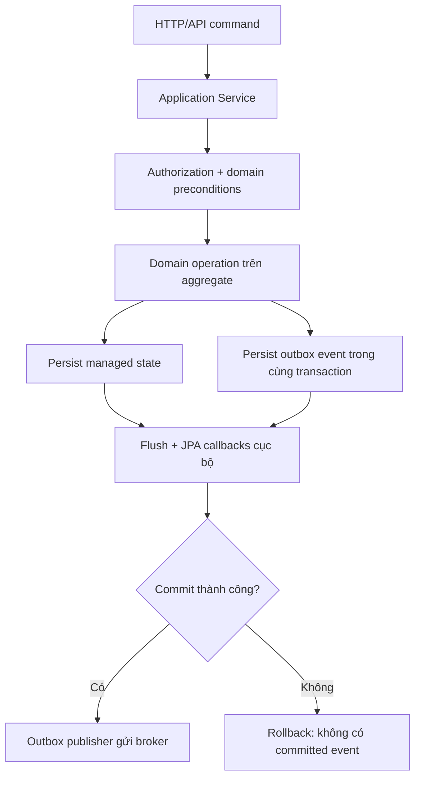
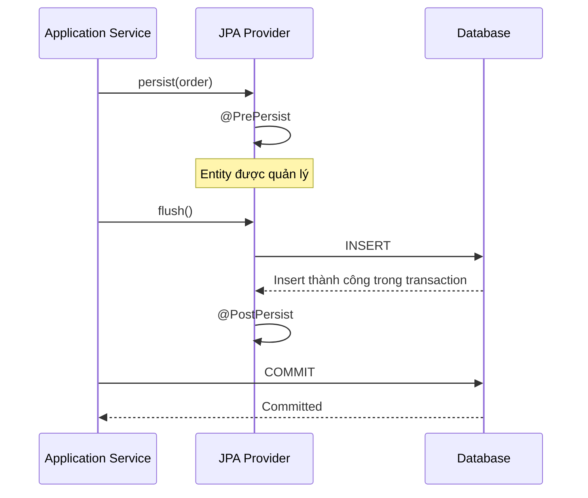
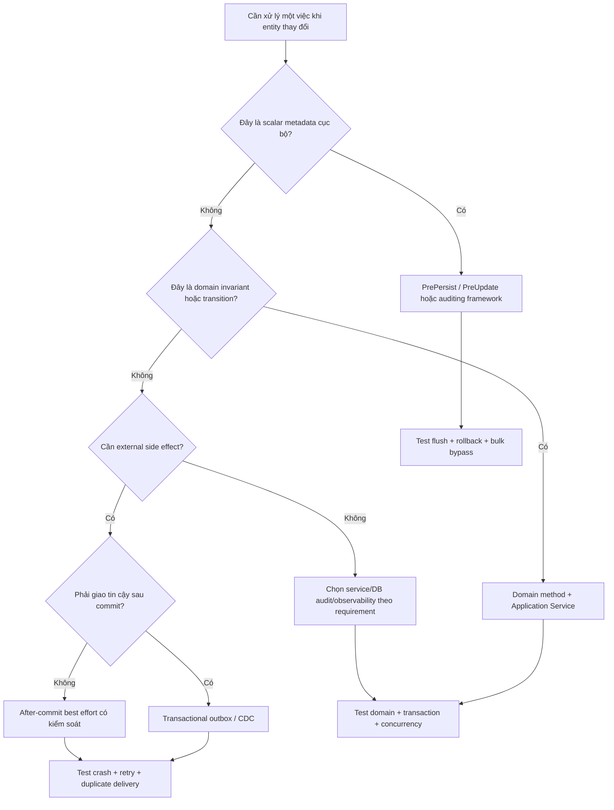

# Tránh phụ thuộc nghiệp vụ khó quan sát vào callback trong JPA

JPA cung cấp **entity lifecycle callbacks** để xử lý các mốc `persist`, `update`, `remove` và `load`. Chúng có vẻ tiện lợi: chỉ cần đặt `@PrePersist`, `@PostUpdate` hoặc `@EntityListeners` lên entity, một hành động sẽ được thực thi tự động khi persistence provider xử lý dữ liệu.

Sự tiện lợi này cũng là nguồn gốc của một loại lỗi kiến trúc khó tìm: **business logic quan trọng bị giấu trong callback**, khiến người đọc application service không nhìn thấy hệ quả của lệnh lưu entity. Việc gửi email, trừ kho, kiểm tra hạn mức, phát domain event, thao tác entity khác hoặc ghi audit ngoài transaction có thể chạy ở những thời điểm không ai chủ động gọi, thậm chí chạy trước khi giao dịch cuối cùng rollback.

Ví dụ:

```java
@Transactional
public void createOrder(CreateOrderCommand command) {
    PurchaseOrder order = PurchaseOrder.from(command);
    entityManager.persist(order);
}
```

Nhìn service, người đọc chỉ thấy tạo đơn. Nhưng nếu entity có:

```java
@PostPersist
private void notifyAndReserveStock() {
    // Gửi email, trừ tồn kho, gọi API vận chuyển...
}
```

thì cùng một dòng `persist(order)` lại kéo theo nhiều quy tắc nghiệp vụ không xuất hiện ở chỗ điều phối. Những hệ quả đó khó kiểm soát về thứ tự, transaction, quyền truy cập, concurrency và khả năng retry.

**Luận điểm chính của bài:**

> Callback thích hợp với **công việc nhỏ, cục bộ, gần cơ chế persistence**. Quy tắc nghiệp vụ quan trọng và side effects nên được gọi **tường minh từ domain/application service**, dưới một transaction boundary và chính sách delivery rõ ràng.

Bài **“Tránh phụ thuộc nghiệp vụ khó quan sát vào callback”** thuộc chương **Sự kiện vòng đời** của module **Data Persistence Relational Access ORM JPA**. Các ví dụ sử dụng Jakarta Persistence, Java, một số đoạn Spring transaction/Spring Data JPA và SQL minh họa. Bài tập trung vào **khả năng quan sát, tính đúng đắn và khả năng bảo trì** chứ không phải chỉ thuộc tên annotations.

---

## 1. “Phụ thuộc khó quan sát” nghĩa là gì?

Một quy tắc trở nên khó quan sát khi:

- Hành vi quan trọng xảy ra **gián tiếp** từ một lời gọi JPA không mang tên nghiệp vụ.
- Người đọc method `save()` hoặc `persist()` không đoán được side effects.
- Lỗi chỉ phát sinh trong `flush()` hoặc `commit()`, cách xa dòng sửa dữ liệu.
- Callback dùng dữ liệu từ request, security context hoặc entity khác mà không thể hiện dependency.
- Một đường ghi khác như bulk JPQL, SQL batch hoặc migration **không chạy callback**.
- Event/email được gửi trước khi transaction hoàn tất.
- Thứ tự giữa callbacks, cascade và nhiều entities ảnh hưởng tới kết quả nghiệp vụ.
- Test unit chỉ mock repository không kích hoạt callback nên bỏ sót logic.

**“Ẩn” không đồng nghĩa “luôn sai”.** Callback được JPA thiết kế như một phần của lifecycle. Vấn đề là giao cho nó trách nhiệm mà người dùng code cần nhìn thấy, điều phối hoặc kiểm soát như một business operation.

### Ví dụ đối chiếu

Dễ quan sát:

```java
@Transactional
public void confirmOrder(Long id) {
    PurchaseOrder order = loadForUpdate(id);
    order.confirm();
    reserveInventoryFor(order);
    outbox.record(OrderConfirmed.from(order));
}
```

Khó quan sát:

```java
@Transactional
public void confirmOrder(Long id) {
    PurchaseOrder order = repository.findById(id)
        .orElseThrow();
    order.setStatus(CONFIRMED);
    // Không thấy inventory, email hay event.
}
```

trong khi một `@PostUpdate` ở superclass lại gọi inventory service và Kafka.

Ở thiết kế đầu, reviewer nhìn thấy **các trách nhiệm nghiệp vụ** tại một chỗ. Ở thiết kế thứ hai, reviewer phải lần theo annotations, superclass, entity listeners, persistence provider và transaction events mới biết điều gì sẽ xảy ra.

## 2. Hãy bắt đầu từ ranh giới trách nhiệm

Có thể chia làm bốn tầng:

| Tầng | Trách nhiệm chính | Ví dụ |
|---|---|---|
| **Domain entity / aggregate** | Quy tắc trạng thái của nghiệp vụ | `order.confirm()`, không được confirm đơn đã hủy |
| **Application service** | Điều phối use case, authorization, transaction, side effects qua adapter | `confirmOrder(id, actor)` |
| **Persistence mapping và callbacks** | Ánh xạ/lifecycle, defaults/audit metadata đơn giản | `@PrePersist` gán `createdAt` |
| **Integration / delivery** | Broker, email, webhook, payment, outbox, retries | Gửi `OrderConfirmed` sau commit qua outbox |

Một callback không nên trở thành “application service thứ hai” chạy ngầm từ phía ORM.

Sơ đồ luồng khuyến nghị:



## 3. Những callback JPA cần nhận diện

| Annotation | Mốc lifecycle | Có thể dùng hợp lý cho | Không nên mặc định dùng cho |
|---|---|---|---|
| `@PrePersist` | Trước database INSERT | Gán default scalar values, timestamps | Trừ kho, kiểm tra quyền, gọi DB |
| `@PostPersist` | Sau INSERT | Trace ID đã tạo, nội bộ transaction | Email/event “đã commit” |
| `@PreUpdate` | Trước database UPDATE | `updatedAt`, chuẩn hóa scalar field | Validation liên entity, network I/O |
| `@PostUpdate` | Sau UPDATE | Trace kỹ thuật | Domain event cho mọi lần đổi trạng thái |
| `@PreRemove` | Trước remove/delete lifecycle | Trace đơn giản, local checks | Authorization/xử lý cascade nghiệp vụ phức tạp |
| `@PostRemove` | Sau DELETE | Trace kỹ thuật | Webhook xóa chắc chắn đã commit |
| `@PostLoad` | Sau load/refresh entity | Tính transient derived value | Ghi DB, phát event “đã xem”, HTTP call |

Các mốc **Post** không phải những callback “after-commit”. Điều này là nguyên nhân phổ biến nhất của side effect không nhất quán.

## 4. Vì sao cùng một callback có thể chạy ngoài dự đoán?

JPA quản lý entity qua persistence context. Trong một transaction, nhiều lời gọi Java có thể được gom lại và **flush** về sau.

```java
@Transactional
public void update(Long id) {
    PurchaseOrder order = em.find(PurchaseOrder.class, id);
    order.changeNote("Deliver after 15:00");

    // Không nhất thiết UPDATE ngay tại đây.
    runOtherBusinessLogic();

    // SQL UPDATE và Pre/PostUpdate có thể chỉ diễn ra ở flush/commit.
}
```

Các yếu tố ảnh hưởng thời điểm:

- `FlushModeType.AUTO` hoặc `COMMIT`.
- `em.flush()` được gọi tường minh hay không.
- Provider có auto-flush trước query không.
- ID generation strategy, nhất là IDENTITY.
- Cascades và traversal of managed associations.
- Dirty checking, versioning và enhanced dirty tracking.
- Transaction commit được thực hiện bởi Spring interceptor bên ngoài method body.

Vì vậy, **callback thường không chạy ở dòng setter được viết**. Business rule phụ thuộc “ngay sau khi gọi setStatus” sẽ khó hiểu nếu đặt trong `@PostUpdate`.

## 5. Persist, flush, callback và commit khác nhau

Một timeline minh họa INSERT trì hoãn:



Với một số IDENTITY implementations, INSERT và PostPersist có thể xảy ra **ngay lúc `persist()`**, không nhất thiết đợi lệnh `flush()` thủ công.

Điểm chung là:

- PrePersist trước INSERT.
- PostPersist sau INSERT.
- SQL có thể đã chạy **trước khi transaction hoàn tất**.
- Transaction có thể rollback sau PostPersist.

**Không suy “@PostPersist ⇒ dữ liệu đã bền vững/visible cho mọi transaction”.**

## 6. Nguy cơ thứ nhất: side effect trước commit

Thiết kế không nên dùng:

```java
@Entity
public class PurchaseOrder {

    // Các fields và mappings khác...

    @PostPersist
    void afterPersist() {
        EmailGateway.sendOrderCreated(...);
    }
}
```

Vấn đề không chỉ là method static mà là **đặt external side effect vào callback**.

Giả sử:

```text
Transaction A:
    INSERT Order#100
    @PostPersist gửi email "Đơn đã tạo"
    INSERT Payment thất bại do constraint
    ROLLBACK

Kết quả:
    Email đã gửi
    Order không được commit
```

Email hoặc webhook không thể tự rollback cùng transaction database. Kể cả nếu callback chỉ đặt message vào broker, một publish thành công trước commit vẫn có thể tạo **ghost event**.

**Đưa việc phát sự kiện ra một cơ chế transaction-aware**, chẳng hạn outbox, thay vì gọi trong callback.

## 7. Nguy cơ thứ hai: domain event mơ hồ

`@PostUpdate` nghĩa là entity có database UPDATE. Nó **không có nghĩa** một sự kiện nghiệp vụ cụ thể đã xảy ra.

Ví dụ Order được UPDATE vì:

- Sửa ghi chú.
- Thay shippingAddress.
- Chuyển NEW → PAID.
- Đổi user assignment.
- Đánh dấu một audit field.
- Provider force version increment.

Nếu callback luôn phát `OrderPaidEvent`, chỉ một lần sửa ghi chú cũng có thể tạo event thanh toán sai.

Sai:

```java
@PostUpdate
private void onUpdated() {
    kafka.publish(new OrderPaidEvent(id));
}
```

Đúng về ý định:

```java
public void markPaid() {
    if (status != OrderStatus.NEW) {
        throw new InvalidOrderStateException();
    }
    status = OrderStatus.PAID;
}
```

Và service:

```java
@Transactional
public void payOrder(Long id) {
    PurchaseOrder order = findAuthorizedOrder(id);
    order.markPaid();
    outbox.record("OrderPaid", order.getId());
}
```

`outbox.record` là một application component giả định sẽ **persist outbox row trong cùng transaction**, không gửi broker ngay lập tức. Domain method có tên `markPaid` làm ý nghĩa thay đổi rõ ràng.

## 8. Nguy cơ thứ ba: đọc hoặc sửa entity khác từ callback

Một listener muốn kiểm tra kho:

```java
@PrePersist
public void validateStock(PurchaseOrder order) {
    Product product = entityManager.find(
        Product.class,
        order.getProductId()
    );
    if (product.getStock() < order.getQuantity()) {
        throw new IllegalStateException("Out of stock");
    }
}
```

Đây không phải thiết kế lifecycle callback portable:

- Đọc entity khác bằng `EntityManager` trong callback bị hạn chế theo đặc tả.
- Callback có thể đang chạy giữa quá trình flush.
- Query có thể dẫn đến reentrant flush hoặc state khó đoán.
- Việc đọc stock và ghi Order không đảm bảo tránh oversell.
- Tính đúng đắn phải dựa vào lock/atomic update/constraint tại DB, không phải một phép đọc trong listener.
- Khó test vì method nghiệp vụ không thể hiện dependency tới Product.

Đưa kiểm tra và reserve stock vào **application service** với transaction và concurrency policy phù hợp.

## 9. Nguy cơ thứ tư: callback chạy khác giữa các đường ghi

So sánh:

**Managed entity update:**

```java
@Transactional
public void rename(Long id, String note) {
    PurchaseOrder order = em.find(PurchaseOrder.class, id);
    order.changeNote(note);
}
```

**Bulk JPQL update:**

```java
@Transactional
public int renameAll(String note) {
    return em.createQuery(
        """
        update PurchaseOrder o
        set o.note = :note
        where o.status = :status
        """
    )
    .setParameter("note", note)
    .setParameter("status", OrderStatus.NEW)
    .executeUpdate();
}
```

Bulk JPQL UPDATE không đi qua lifecycle của **từng managed entity**, nên không kích hoạt `@PreUpdate`/`@PostUpdate` cho từng row như dirty checking.

Nếu “mỗi lần thay note phải tính phí” được giấu trong `@PostUpdate`, hai đường ghi tạo kết quả nghiệp vụ khác nhau dù đều thay cùng bảng.

**Business invariants không nên tồn tại duy nhất trong callback có thể bị bulk/native SQL bỏ qua.**

## 10. Nguy cơ thứ năm: một setter không đồng nghĩa UPDATE

Một entity managed có:

```java
order.changeNote(order.getNote());
```

Nếu giá trị không đổi, provider có thể không tạo SQL UPDATE; khi ấy các update callbacks có thể không được gọi.

Một callback như:

```java
@PreUpdate
void auditCommand() {
    requestAudit.incrementCommandCount();
}
```

không đếm **commands** mà đếm một nhóm những UPDATE events đã được provider nhận diện.

Nếu mục tiêu là “đếm mọi command update được chấp nhận”, hãy đo ở **application service**, không ở `@PreUpdate`.

## 11. Nguy cơ thứ sáu: thao tác entity có thể bị cascade

```java
@OneToMany(
    mappedBy = "order",
    cascade = CascadeType.PERSIST
)
private List<OrderLine> lines;
```

Gọi:

```java
em.persist(order);
```

có thể kích hoạt `@PrePersist`/`@PostPersist` trên nhiều OrderLine được cascade.

Nếu mỗi OrderLine listener lại gửi event hoặc trừ kho, một lời gọi service có thể tạo N side effects mà service không biểu hiện.

Ngoài ra, không nên xây quy tắc nghiệp vụ dựa trên một thứ tự cụ thể giữa callbacks của nhiều entities trong cascade nếu đặc tả không cam kết thứ tự đó.

## 12. Nguy cơ thứ bảy: không phân biệt JPA cascade với database cascade

Giả sử:

```sql
FOREIGN KEY (order_id)
REFERENCES purchase_orders(id)
ON DELETE CASCADE
```

Khi database tự xóa các OrderLine rows vì Order bị DELETE, **không có nghĩa JPA đã gọi `@PostRemove` trên từng OrderLine entity**.

Ngược lại, nếu application gọi `em.remove(order)` và JPA cascade REMOVE xuống child managed entities theo mapping, callbacks trên children có thể được áp dụng.

Nếu callback child là nguồn duy nhất ghi audit xóa từng dòng, việc có hay không có JPA cascade/DB cascade sẽ thay đổi lịch sử audit.

Đó là một dấu hiệu rằng business audit cần được thiết kế ở ranh giới rộng hơn callbacks.

## 13. Nguy cơ thứ tám: soft delete không đi qua Remove callback

Trong hệ thống soft-delete:

```java
public void archive(Instant now) {
    archivedAt = now;
}
```

JPA thực hiện UPDATE cột `archived_at` thay vì DELETE.

Do đó:

- `@PreUpdate`/`@PostUpdate` có thể chạy nếu có UPDATE.
- `@PreRemove`/`@PostRemove` không phải các mốc phù hợp.
- Nếu dùng provider-specific SQL delete customization, callback behavior còn tùy implementation.
- Nếu soft delete được thực hiện bằng bulk SQL, per-entity callbacks không chạy.

Nếu nghiệp vụ cần phát `OrderArchived`, hãy gọi tường minh từ use case archive, **không suy sự kiện từ @PostRemove**.

## 14. Nguy cơ thứ chín: callback đọc security context ngầm

Ví dụ:

```java
@PrePersist
void setCreatedBy() {
    createdBy = SecurityContextHolder
        .getContext()
        .getAuthentication()
        .getName();
}
```

Cách làm này có thể dùng trong một số tích hợp auditing được kiểm soát, nhưng nếu coi nó là business authorization sẽ rất nguy hiểm:

- Batch job không có HTTP user.
- Async thread có context khác hoặc không được propagate.
- Migration/CLI/test không có Spring Security.
- Một message consumer có service account.
- Thread-local có thể không mang đúng actor.
- Tenant access có thể cần kiểm tra nhiều điều kiện ngoài username.

Với business operation, **actor/tenant phải là dependency tường minh** của command và được xác thực ở service. Auditing framework có thể cung cấp `AuditorAware` phù hợp, nhưng không dùng audit field gán trong callback để thay authorization.

## 15. Nguy cơ thứ mười: callback không phải điểm commit

Một `@PostRemove` có thể chạy rồi transaction rollback.

```text
DELETE Order#100
@PostRemove log "đã xóa"
UPDATE bảng khác thất bại
ROLLBACK
Order#100 vẫn tồn tại
```

Nếu callback gọi hệ thống ngoài để “xóa Order khỏi search index”, search index có thể bị mất dữ liệu trong khi database còn Order.

Một thiết kế integration an toàn phải quan tâm **commit boundary** và khả năng retry/khôi phục sau crash.

---

## 16. Phạm vi trách nhiệm hợp lý của callback

Callbacks có thể phù hợp khi logic:

1. **Chỉ làm việc với trạng thái của chính entity**, đặc biệt basic/non-relationship attributes.
2. **Không phụ thuộc entity khác** hoặc dữ liệu request ngoài context.
3. **Không phát external side effects** không thể rollback.
4. **Không cần biết transaction đã commit**.
5. **Không thay đổi business meaning quan trọng** khi bị bulk SQL bypass.
6. **Có thể chạy tại flush**, không cần thứ tự thực thi chính xác so với các service operations.
7. **Có thể kiểm thử dễ dàng** như một quy tắc persistence nhỏ.
8. **Không vi phạm** giới hạn của JPA callback.

Ví dụ hợp lý:

```java
@PrePersist
private void initializeTimestamps() {
    Instant now = Instant.now();
    createdAt = now;
    updatedAt = now;
}

@PreUpdate
private void updateTimestamp() {
    updatedAt = Instant.now();
}
```

Ngay cả trường hợp này cũng cần xác định **đường ghi bulk** có tự cập nhật timestamp không; nếu không, audit timestamp có thể không nhất quán giữa các writers.

## 17. Callback không phải lớp business validation chính

Có thể dùng `@PrePersist` để kiểm tra một điều kiện scalar:

```java
@PrePersist
void validateCode() {
    if (code == null || code.isBlank()) {
        throw new IllegalStateException(
            "Code must not be blank"
        );
    }
}
```

Tuy nhiên:

- Lỗi có thể phát sinh muộn ở flush/commit.
- Người gọi API khó biết field nào sai nếu exception bị wrap.
- Quy tắc không được bảo vệ khi bulk/native SQL bypass.
- Có thể không chạy khi object chỉ được đọc hoặc không dirty.
- Một duplicate business rule trong DTO, callback và DB dễ drift.

Với validation có ý nghĩa nghiệp vụ rõ ràng:

- Validate input ở API boundary.
- Dùng domain methods/constructors để bảo vệ invariants của object.
- Dùng DB constraints cho điều kiện luôn phải đúng tại storage.
- Chỉ dùng callback như một lớp bổ trợ nhỏ nếu có lý do.

## 18. Đừng để callback tự mở transaction

Ví dụ không phù hợp:

```java
@PostPersist
void afterPersist() {
    transactionManager.begin();
    // update something else
    transactionManager.commit();
}
```

Một JPA callback có thể chạy khi provider đang flush transaction hiện tại. Tự điều khiển transaction bên trong sẽ tạo nested transaction assumptions và reentrant database access khó portable.

Trong JPA portable callbacks, không nên gọi `EntityManager`/`Query` operations hoặc thay relationships/entities khác. Service/application layer mới là nơi mở transaction, điều phối repositories và quyết định rollback.

## 19. Listener class không biến hành động ẩn thành rõ ràng

Tách logic sang listener:

```java
@Entity
@EntityListeners(OrderLifecycleListener.class)
public class PurchaseOrder {
    // ...
}
```

có thể giúp entity gọn hơn, nhưng **không tự sửa vấn đề coupling**.

Nếu:

```java
public class OrderLifecycleListener {

    @PostUpdate
    public void updated(PurchaseOrder order) {
        paymentGateway.charge(order.getId());
    }
}
```

thì logic vẫn được gọi gián tiếp, lại còn khó phát hiện hơn vì nằm ở class khác.

**Entity listener là nơi tổ chức callback code, không phải nơi gửi toàn bộ business service vào ORM.**

## 20. Default listeners càng làm dependency khó tìm

JPA có thể cấu hình default entity listeners qua XML mapping metadata.

Hậu quả:

- Một entity không có `@EntityListeners` vẫn có callback.
- Có callbacks từ mapped superclass.
- Một listener ở library có thể áp dụng cho nhiều entities.
- Có thể có `@ExcludeDefaultListeners` hoặc `@ExcludeSuperclassListeners` ảnh hưởng invocation.
- Mapping XML có thể thay đổi/hỗ trợ cấu hình annotation.

Vì vậy, khi logic nghiệp vụ nằm trong callback, reviewer phải theo dõi **nhiều tầng cấu hình** để biết use case làm gì.

Business operation nên nằm ở service/domain code mà người đọc có thể lần theo từ entrypoint.

## 21. Thứ tự callbacks không phải workflow engine

Có thể tồn tại:

- Default listeners.
- Superclass listeners.
- Entity listeners.
- Callback methods trên mapped superclass.
- Callback methods trên concrete entity.
- Cascaded lifecycle của các entity liên quan.

JPA có quy tắc callback invocation order cho từng nhóm, nhưng không nên biến chuỗi đó thành quy trình:

```text
Listener A: kiểm credit
Listener B: trừ kho
Listener C: ghi payment
Listener D: gửi email
```

Một thay đổi mapping/inheritance/provider có thể ảnh hưởng thứ tự và timing, còn exception giữa các bước gây state khó kiểm soát.

Một application service với các method có tên miền nghiệp vụ là nơi phù hợp để thể hiện pipeline và error handling.

## 22. Phụ thuộc vào @PostLoad còn khó quan sát hơn

Ví dụ:

```java
@PostLoad
void onLoaded() {
    viewCount++;
}
```

Nếu `viewCount` là mapped field, việc **chỉ đọc dữ liệu** có thể khiến entity dirty rồi tạo UPDATE. Một SELECT báo cáo vô tình trở thành write.

Các vấn đề:

- First-level cache có thể khiến `find()` lần hai không load lại.
- Query DTO/scalar không bắt buộc instantiate managed entity.
- Cache, projections, refresh và lazy fetching ảnh hưởng callback.
- “Một HTTP view” không tương ứng chính xác một PostLoad callback.
- Việc cập nhật counter có thể gây optimistic lock conflicts.

Nếu cần đếm lượt xem, hãy dùng **một explicit command/event pipeline** phù hợp, không mutate persistent state trong `@PostLoad`.

## 23. @PostLoad hợp lý với transient derived value

Ví dụ:

```java
@Transient
private String displayLabel;

@PostLoad
private void buildDisplayLabel() {
    displayLabel = code + " — " + name;
}
```

Đây là một operation cục bộ, không truy cập DB và không phát side effects, nhưng cần xét:

- Có thể tính bằng getter thay vì callback.
- Nếu code/name đổi sau load, displayLabel có trở nên stale không?
- Một DTO projection có thể phù hợp hơn.
- Không nên lưu output transient như một business source of truth.

Callback phù hợp nhất khi logic thật sự thuộc **representation state cục bộ** và không cần ai khác biết để đảm bảo correctness.

---

## 24. Ví dụ xấu hoàn chỉnh: nghiệp vụ ẩn trong @PostPersist

Một entity mẫu:

```java
@Entity
@EntityListeners(DangerousOrderListener.class)
public class PurchaseOrder {

    @Id
    @GeneratedValue(strategy = GenerationType.IDENTITY)
    private Long id;

    @Enumerated(EnumType.STRING)
    private OrderStatus status = OrderStatus.NEW;

    private Long productId;
    private int quantity;

    // Getters, mapping, constructors...
}
```

Listener giả định:

```java
public class DangerousOrderListener {

    @PostPersist
    public void afterInsert(PurchaseOrder order) {
        inventoryService.reserve(
            order.getProductId(),
            order.getQuantity()
        );
        kafkaTemplate.send(
            "orders",
            new OrderCreatedEvent(order.getId())
        );
    }
}
```

**Đoạn này minh họa anti-pattern, không phải JPA portable code để copy chạy**: listener đang tích hợp domain services, I/O và sửa dữ liệu ở mốc persistence nhạy cảm.

Lỗ hổng:

1. `persist()` trở thành giao dịch nghiệp vụ ngầm.
2. Inventory và broker có thể không cùng transaction.
3. Callback có thể chạy trước commit.
4. Nếu Inventory thất bại, Order có thể rollback nhưng reservation trước đó đã thành công ở service khác.
5. Nếu broker thành công rồi DB rollback, event sai.
6. Bulk import có thể không gọi listener.
7. Test mock repository không bao giờ thấy callback.
8. Retry có nguy cơ reserve/kafka lần hai.
9. Authorization và tenant context không xuất hiện tại use case.
10. Người đọc `createOrder()` không biết các phụ thuộc.

## 25. Refactor: domain entity chỉ bảo vệ trạng thái của mình

Định nghĩa Order:

```java
import jakarta.persistence.*;
import java.time.Instant;

@Entity
@Table(name = "purchase_orders")
public class PurchaseOrder {

    @Id
    @GeneratedValue(strategy = GenerationType.IDENTITY)
    private Long id;

    @Version
    private Long version;

    @Enumerated(EnumType.STRING)
    @Column(nullable = false)
    private OrderStatus status;

    @Column(nullable = false)
    private Long productId;

    @Column(nullable = false)
    private int quantity;

    @Column(name = "created_at", nullable = false)
    private Instant createdAt;

    protected PurchaseOrder() {}

    public static PurchaseOrder newOrder(
            Long productId, int quantity) {

        if (productId == null || quantity <= 0) {
            throw new IllegalArgumentException(
                "Invalid product or quantity"
            );
        }

        PurchaseOrder o = new PurchaseOrder();
        o.productId = productId;
        o.quantity = quantity;
        o.status = OrderStatus.NEW;
        return o;
    }

    public void confirm() {
        if (status != OrderStatus.NEW) {
            throw new IllegalStateException(
                "Only NEW orders can be confirmed"
            );
        }
        status = OrderStatus.CONFIRMED;
    }

    @PrePersist
    private void setCreatedAt() {
        if (createdAt == null) {
            createdAt = Instant.now();
        }
    }

    public Long getId() { return id; }
    public Long getProductId() { return productId; }
    public int getQuantity() { return quantity; }
    public OrderStatus getStatus() { return status; }
}
```

Enum:

```java
public enum OrderStatus {
    NEW, CONFIRMED, CANCELLED
}
```

Phân công:

- `newOrder()` kiểm tra dữ liệu ngay tại domain boundary.
- `confirm()` thực hiện state transition rõ ràng.
- `@PrePersist` chỉ gán một trường scalar nội bộ.
- Không có network/Inventory/Payment call trong entity.
- `@Version` do provider quản lý.

## 26. Refactor: service điều phối rõ use case

Giả sử `InventoryService` cung cấp một operation **atomic reserve** trong cùng database transaction, và `OutboxRepository` lưu event row cùng transaction:

```java
@Service
public class OrderApplicationService {

    private final EntityManager em;
    private final InventoryService inventory;
    private final OutboxRepository outbox;

    public OrderApplicationService(
            EntityManager em,
            InventoryService inventory,
            OutboxRepository outbox) {
        this.em = em;
        this.inventory = inventory;
        this.outbox = outbox;
    }

    @Transactional
    public Long createAndConfirm(
            Long productId,
            int quantity,
            AuthenticatedActor actor) {

        authorize(actor, productId);

        PurchaseOrder order =
            PurchaseOrder.newOrder(productId, quantity);

        inventory.reserve(productId, quantity);

        order.confirm();
        em.persist(order);
        em.flush(); // Nếu cần generated IDENTITY id.

        outbox.insert(
            OutboxMessage.orderConfirmed(order.getId())
        );

        return order.getId();
    }
}
```

Các thành phần `AuthenticatedActor`, `authorize`, `InventoryService`, `OutboxRepository` và `OutboxMessage` là **abstractions giả định** của ứng dụng; cần triển khai và nối đúng transaction manager.

Ở đây service thể hiện tường minh:

1. Authorization.
2. Tạo aggregate.
3. Reserve inventory.
4. Confirm state.
5. Persist Order.
6. Ghi outbox event.

Không có “ma thuật” của `@PostPersist` che khuất dependency.

### Điều kiện về transaction

Đoạn ví dụ giả định Inventory và Outbox dùng **cùng transactional database resource**. Nếu Inventory là một microservice bên ngoài, gọi API reserve không tự tham gia DB transaction của Order: cần saga/reservation workflow/idempotency tương ứng.

Đừng copy ví dụ rồi tin `@Transactional` tự biến HTTP call tới inventory service thành một distributed atomic transaction.

## 27. Mô hình tốt hơn cho external inventory service

Nếu inventory là remote service, thay vì gọi trong JPA callback:

```text
Transaction 1:
    Order NEW -> PENDING_RESERVATION
    ghi Outbox ReservationRequested
    COMMIT

Outbox worker:
    publish ReservationRequested
    Inventory service reserve với idempotency key

Transaction 2:
    nhận ReservationSucceeded/Failed
    Order -> CONFIRMED/REJECTED
    COMMIT
```

Đây là một **saga-style workflow** có trạng thái tường minh. Nó dễ quan sát hơn vì:

- Mỗi bước có tên và state.
- Có correlation/event ID.
- Có chính sách timeout/retry.
- Có thể xử lý duplicate messages.
- Không cần giữ DB transaction mở chờ mạng.
- Có thể giám sát các Orders đang PENDING_RESERVATION.

Callback không thay thế một distributed consistency protocol.

## 28. Vì sao cần transactional outbox?

Một pattern:

```text
Transaction database:
    UPDATE purchase_orders
    INSERT outbox_messages
    COMMIT

Worker khác:
    SELECT committed outbox_messages
    publish message
    đánh dấu delivered
```

Nếu transaction rollback, cả UPDATE và outbox INSERT rollback. Không có committed event sai.

Nếu process crash sau commit, outbox record vẫn còn để worker retry. Nhưng publisher có thể gửi trùng do crash giữa publish và đánh dấu đã gửi; consumers cần **idempotency/deduplication**.

Outbox giải quyết khoảng trống commit-versus-publish tốt hơn callback `@PostUpdate`, song **không tự bảo đảm exactly-once delivery trên broker**.

## 29. Outbox record là một entity bình thường

Ví dụ cấu trúc:

```java
@Entity
@Table(name = "outbox_messages")
public class OutboxMessage {

    @Id
    private UUID id;

    @Column(nullable = false)
    private String eventType;

    @Column(nullable = false)
    private String aggregateId;

    @Column(nullable = false)
    private Instant createdAt;

    protected OutboxMessage() {}

    public static OutboxMessage orderConfirmed(Long orderId) {
        OutboxMessage m = new OutboxMessage();
        m.id = UUID.randomUUID();
        m.eventType = "OrderConfirmed";
        m.aggregateId = orderId.toString();
        m.createdAt = Instant.now();
        return m;
    }
}
```

Application service ghi outbox row bằng:

```java
em.persist(
    OutboxMessage.orderConfirmed(order.getId())
);
```

Trong production, còn cần payload, schema version, delivery state, retry count, indexes, ordering strategy và bảo vệ thông tin nhạy cảm. Đoạn code chỉ mô tả **việc lưu sự kiện giao dịch cùng transaction**, không phải toàn bộ message delivery platform.

## 30. Spring @TransactionalEventListener có thay outbox không?

Spring cung cấp:

```java
@TransactionalEventListener(
    phase = TransactionPhase.AFTER_COMMIT
)
public void handle(OrderConfirmedEvent event) {
    // ...
}
```

Khác với `@PostPersist`:

- Nó gắn với phase **sau commit** của Spring transaction.
- Không phải annotation của JPA chuẩn.
- Có thể phù hợp với cache eviction hoặc local best-effort notification.
- Không tự bảo đảm durable delivery qua process crash.
- Nếu handler cần ghi DB sau commit, phải quản lý transaction mới phù hợp; tránh giả định transaction cũ còn commit thêm dữ liệu được.

Khi yêu cầu không mất event và có retry bền vững, outbox hoặc cơ chế tương đương vẫn là lựa chọn cần cân nhắc.

## 31. Đặt tên event theo nghiệp vụ

Không nên gửi:

```text
EntityUpdated
EntityPersisted
PostUpdateTriggered
```

nếu consumer cần biết “đơn đã thanh toán” hay “giấy phép đã duyệt”.

Tốt hơn:

```text
OrderConfirmed
PaymentCaptured
InventoryReserved
ShipmentDispatched
```

Tên event cho biết:

- Điều gì đã xảy ra.
- Aggregate nào sở hữu transition.
- Consumer quan tâm đến ý nghĩa nào.
- Có cần idempotency/key/order/correlation không.

**Lifecycle events phục vụ hạ tầng; domain events phục vụ nghiệp vụ.** Đừng nối hai khái niệm bằng cách mapping mọi PostUpdate thành một business event không điều kiện.

---

## 32. @PrePersist cho timestamp: nên chấp nhận khi nào?

Một mẫu nhỏ:

```java
@PrePersist
private void beforeInsert() {
    Instant now = Instant.now();
    if (createdAt == null) createdAt = now;
    if (updatedAt == null) updatedAt = now;
}
```

Thường phù hợp nếu:

- Chỉ JPA-managed writes tạo entity, hoặc các writers khác có cùng timestamp policy.
- Chấp nhận application clock là nguồn thời gian.
- Field không cần “commit timestamp” chính xác.
- Không dùng timestamp để thay phiên bản concurrency.
- Test được bằng persist/flush trên provider mục tiêu.
- Không có listener khác cũng ghi field.

Nếu dự án dùng Spring Data Auditing, nên cân nhắc `@CreatedDate`/`@LastModifiedDate` với cấu hình auditing phù hợp thay vì thêm một hệ callback trùng lặp.

## 33. Timestamp không phải sự kiện nghiệp vụ

Các field:

```java
private Instant createdAt;
private Instant updatedAt;
```

là metadata. Chúng không tự cho biết:

- Ai đã phê duyệt?
- Vì sao chuyển trạng thái?
- Transaction đã commit?
- Order có gửi notification?
- Đã bị bulk SQL cập nhật mà callback không chạy?
- Đã được rollback bao nhiêu lần?

Nếu cần audit mang ý nghĩa domain, hãy lưu thông tin **actor, action, outcome, correlation ID và committed transition** theo chính sách nhất quán. Tránh suy tất cả từ `updatedAt`.

## 34. Dùng @Version thay vì callback tự tăng version

Sai:

```java
@PreUpdate
void incrementRevision() {
    revision++;
}
```

khi `revision` đang được dùng làm optimistic concurrency token.

JPA có:

```java
@Version
private Long version;
```

Provider quản lý version và kiểm tra concurrent updates theo chuẩn.

Nếu một callback tự sửa version:

- Có thể phá optimistic comparison.
- Tạo behavior phụ thuộc provider.
- Không bao phủ bulk/native writers.
- Có thể tạo version khác nhau khi callback không chạy.

Business code không nên sửa `@Version` của managed entity; hãy để provider quản lý và đồng bộ mọi đường ghi.

## 35. Callback và optimistic locking conflicts

Một giao dịch:

```text
T1 đọc Order version 7
T2 cập nhật Order -> version 8, commit
T1 sửa Note
@PreUpdate được gọi khi flush
UPDATE ... WHERE version=7 thất bại
transaction rollback
```

Nếu PreUpdate đã gọi mạng hoặc phát event, hành vi đó không thể tự rollback.

Thêm một lý do để giữ callback cục bộ: **chính persistence operation sau callback còn có thể bị từ chối do optimistic lock conflict**.

## 36. Domain validation ở service không thay concurrency check

Một service:

```java
if (product.getStock() >= quantity) {
    product.setStock(product.getStock() - quantity);
}
```

vẫn có race nếu hai transactions đọc cùng stock.

Giải pháp có thể là:

- Lock Product bằng `PESSIMISTIC_WRITE`.
- Optimistic `@Version` với xử lý retry/conflict.
- Atomic conditional UPDATE `WHERE stock >= :quantity` và kiểm tra affected rows.
- Database constraints hỗ trợ.

Tách validation khỏi callback giúp thấy rõ concurrency policy, nhưng **chỉ thay vị trí code không tự giải quyết race**.

## 37. Bulk DML và business rule

Một repository method:

```java
@Modifying
@Query("""
    update PurchaseOrder o
       set o.status = :newStatus
     where o.status = :oldStatus
    """)
int changeStatuses(
    @Param("oldStatus") OrderStatus oldStatus,
    @Param("newStatus") OrderStatus newStatus
);
```

được Spring Data thực thi dưới dạng bulk JPQL UPDATE.

Các điều **không tự xảy ra**:

- Không gọi domain method `order.confirm()` cho từng Order.
- Không gọi `@PreUpdate`/`@PostUpdate` cho từng Order.
- Không tự chạy mọi business validator trong listeners.
- Không tự tăng `@Version` theo entity lifecycle.
- Không tự đồng bộ managed instances đang cached trong persistence context.

Nếu đây là một business transition quan trọng, phải thiết kế một **bulk-safe workflow**: điều kiện WHERE đầy đủ, version policy, audit/outbox theo batch và xử lý partial outcomes.

Không dựa vào “trước đây chuyển trạng thái bằng repository.save() nên listener đã lo hết”.

## 38. SQL trực tiếp và stored procedures

Các writers khác có thể gồm:

```sql
UPDATE purchase_orders
SET status = 'CONFIRMED'
WHERE id = 100;
```

hoặc:

- JDBC.
- Migration script.
- Database trigger.
- Stored procedure.
- ETL/batch import.
- Một service khác dùng chung database.
- Administrative console.

JPA callbacks không chạy cho các rows được sửa ngoài JPA lifecycle.

**Nếu một invariant phải đúng bất kể writer là ai**, cần ranh giới kiểm soát thích hợp:

- Database constraints.
- Stored procedure contract.
- Tập trung writes qua một service.
- Authorization ở DB/application.
- CDC/auditing bao phủ external writers.
- Truy cập database chỉ từ các paths tuân protocol.

Không để một listener trên Java class là nơi duy nhất bảo vệ một invariant của toàn database.

## 39. Không dùng @PreRemove để thay chính sách xóa

Sai về kiến trúc:

```java
@PreRemove
void beforeRemove() {
    if (hasUnsettledPayment()) {
        throw new IllegalStateException(
            "Cannot delete paid order"
        );
    }
}
```

Nếu `hasUnsettledPayment()` phải query DB hay gọi payment service, callback đang chứa dependency không phù hợp.

Tốt hơn:

```java
@Transactional
public void deleteOrder(Long id, Actor actor) {
    PurchaseOrder order = findAuthorizedOrder(id, actor);

    paymentPolicy.requireDeletionAllowed(order);

    order.ensureCanBeDeleted();
    em.remove(order);
}
```

`paymentPolicy` là abstraction của application/domain service cần được thiết kế transaction/concurrency phù hợp. Nếu nó gọi remote service, không được giả định kiểm tra và delete là atomic giữa hai hệ thống.

Những constraints phải luôn đúng nên có lớp DB enforcement khi có thể.

## 40. Orphan removal và callback khó nhận diện

Ví dụ:

```java
@OneToMany(
    mappedBy = "order",
    orphanRemoval = true
)
private List<OrderLine> lines;
```

Code:

```java
order.getLines().remove(line);
```

có thể dẫn tới remove lifecycle cho orphaned entity trong quá trình flush, với callbacks theo semantics JPA.

Nếu một `@PostRemove` của OrderLine gọi payment adjustment, thì **chỉ sửa Java collection đã âm thầm kích hoạt tác động tiền bạc**.

Nếu xóa Line có nghiệp vụ hoàn tiền hoặc điều chỉnh stock, hãy tạo domain operation tường minh:

```java
public RemovedLine removeLine(Long lineId) {
    // Check status và tìm line.
    // Thay collection.
    // Trả thông tin nghiệp vụ để service xử lý.
}
```

Application service quyết định inventory/payment effect sau domain transition. Không dùng orphan-removal callback làm “event bus” về tài chính.

## 41. Merge và callbacks có thể gây bất ngờ

Với detached entity:

```java
PurchaseOrder managed = em.merge(detached);
```

JPA sẽ tạo/tra cứu managed instance và copy state theo merge semantics; không nhất thiết object `detached` ban đầu trở thành managed.

Callback nào xảy ra phụ thuộc:

- Entity có tồn tại hay không.
- Managed state có thay đổi đủ để UPDATE không.
- Có cascade MERGE không.
- Có insert mới không.
- Thời điểm flush.
- Persistence provider.

Nếu một listener quyết định business flow dựa trên “merge luôn có PostUpdate” hoặc “entity detached luôn trở thành managed”, rất dễ sai.

Với HTTP update, thường an toàn hơn khi **load managed entity, check expectedVersion, áp domain method** thay vì deserialize JSON thành entity rồi merge toàn bộ.

## 42. Đừng truyền JPA entity trực tiếp qua HTTP

Anti-pattern:

```java
@PutMapping("/{id}")
public PurchaseOrder update(
        @PathVariable Long id,
        @RequestBody PurchaseOrder payload) {
    return em.merge(payload);
}
```

Những vấn đề:

- Mass assignment fields như ID, tenant, version.
- Missing/null fields khó khớp PATCH semantics.
- Hidden cascades và callbacks.
- Authorization khó đặt đúng.
- Stale user form có thể ghi đè recent changes.
- Business transitions không đi qua domain methods.

Tốt hơn dùng command DTO:

```java
public record ChangeOrderNoteRequest(
    String note,
    Long expectedVersion
) {}
```

Service đọc managed entity, authorize, so sánh version, gọi `order.changeNote()` và để provider xử lý dirty checking.

## 43. No-op command và callback event khác nhau

Một command:

```java
order.rename(order.getName());
```

có thể không tạo SQL UPDATE. Một callback `@PostUpdate` do đó không phải nơi đếm “mỗi lần user bấm Lưu”.

Ngược lại, một business operation có thể thành công về nghĩa nghiệp vụ nhưng không đòi SQL thay đổi (idempotent command), ví dụ “confirm” một trạng thái đã được confirm với contract cho phép no-op.

Do đó:

- **Command accepted**.
- **Domain transition occurred**.
- **Entity SQL UPDATE occurred**.
- **Transaction committed**.

là bốn sự kiện khác nhau. Hãy đặt analytics/audit đúng sự kiện cần đo.

---

## 44. Thiết kế audit: ba mức độ

| Mục tiêu | Giải pháp phù hợp | Giới hạn cần biết |
|---|---|---|
| Có `createdAt`/`updatedAt` trên entity | Callback hoặc Spring Data auditing | Bulk/native bypass, timestamp không phải commit |
| Theo dõi domain transition, actor và lý do | Application/domain service + audit entity/outbox | Cần transaction/authorization/consistency |
| Audit mọi SQL writers trên database | DB trigger, CDC, database audit logs | Phụ thuộc DB, cần business context nếu yêu cầu |

Không có một annotation callback có thể thay cả ba mức.

### Ví dụ audit nghiệp vụ

```java
@Transactional
public void cancelOrder(
        Long orderId, Actor actor, String reason) {

    PurchaseOrder order = findAuthorized(orderId, actor);

    order.cancel(reason);

    auditRepository.record(
        OrderAudit.cancelled(
            orderId, actor.id(), reason
        )
    );
}
```

Nếu auditRepository và Order dùng cùng DB transaction, audit row cùng rollback nếu command thất bại. Đây là thuộc tính quan trọng khi audit phải phản ánh **committed domain transitions**.

## 45. Domain event chỉ nên tạo khi transition thực xảy ra

Ví dụ entity:

```java
public boolean confirm() {
    if (status == OrderStatus.CONFIRMED) {
        return false;
    }
    if (status != OrderStatus.NEW) {
        throw new IllegalStateException(
            "Order cannot be confirmed"
        );
    }
    status = OrderStatus.CONFIRMED;
    return true;
}
```

Service:

```java
@Transactional
public void confirm(Long id) {
    PurchaseOrder order = findAuthorizedOrder(id);

    if (order.confirm()) {
        outbox.insert(
            OutboxMessage.orderConfirmed(order.getId())
        );
    }
}
```

Ở đây application service quyết định event dựa trên **thành công của transition**, không dựa vào việc SQL UPDATE có được provider phát hay không.

Một lưu ý khác: nếu API coi confirm lặp là lỗi thay vì no-op, domain method cần ném exception; contract phải thống nhất.

## 46. Khi domain logic cần nhiều entities

Ví dụ Order confirmed phải bảo đảm:

- Order đang NEW.
- Inventory đủ.
- Coupon chưa hết quota.
- Payment chưa capture trùng.
- Tenant có quyền.
- Số tiền đúng theo chính sách giá.

Đây không phải bài toán của một callback trên Order:

```java
@PostUpdate
private void validateEverything() { ... }
```

Cần application service điều phối repositories, concurrency, DB constraints và potential distributed workflow.

Một callback xảy ra giữa flush không phải một vị trí thuận lợi để quyết định thứ tự lock hoặc xử lý transaction retry.

## 47. Kiểm soát thứ tự khóa ở service

Nếu reserve stock và confirm Order cần khóa hai entities:

```text
Transaction A: lock Order -> lock Product
Transaction B: lock Product -> lock Order
```

có thể deadlock. Với service tường minh, có thể đặt quy tắc lock ordering như:

```text
Mọi workflow: lock Order trước, lock Product theo ID tăng dần
```

hoặc một protocol khác được áp dụng nhất quán.

Nếu các locks phát sinh ngầm từ nhiều callbacks, developer khó kiểm soát thứ tự; nguyên nhân deadlock trở nên khó truy.

## 48. Không che giấu external call trong PreUpdate

Giả sử một `@PreUpdate` kiểm tra điểm tín dụng từ API bên ngoài. Callback có thể được gọi trong lúc flush, khi transaction đã giữ database locks.

Kết quả:

- Transaction chờ mạng.
- Database connections và locks giữ lâu.
- Tăng lock wait/timeout.
- Provider có thể đang đồng bộ nhiều entities.
- Failure mạng khiến transaction lỗi ở vị trí khó kiểm soát.
- Retry có thể phát sinh side effects lặp.

Một workflow tốt thường phân tách pre-check/claim/commit theo transaction policy rõ. Nếu external data phải nhất quán với DB state, cần thiết kế distributed consistency chứ không chỉ gọi network trước UPDATE.

## 49. @EntityListeners và dependency injection

Nhiều ứng dụng muốn inject Spring beans vào JPA listeners. Việc hỗ trợ integration phụ thuộc container/provider/framework, không nên mặc định mọi listener chuẩn JPA đều được Spring xây dựng với dependency injection theo cách một `@Service` được quản lý.

Ngay cả khi inject thành công:

```java
public class AuditListener {
    // Inject service ...
}
```

**Có thể inject** không đồng nghĩa **nên đặt business flow trong callback**.

Dependency injection không thay đổi những giới hạn:

- Timing trước commit.
- Callback chạy trong flush.
- Bulk/native bypass.
- Transaction/rollback ambiguity.
- Hidden behavior.
- Test khó quan sát.

Nếu callback cần nhiều services, đó là tín hiệu nên cân nhắc chuyển logic lên application service.

## 50. Listener không nên giữ per-request mutable state

Anti-pattern:

```java
public class OrderListener {

    private String currentActor;
    private Long lastOrderId;

    @PostPersist
    public void onPersist(PurchaseOrder order) {
        lastOrderId = order.getId();
    }
}
```

Provider/container có thể tái sử dụng listener instances trong nhiều operations/transactions. Shared mutable fields dễ gây nhiễu dữ liệu giữa concurrent requests.

Nếu cần dữ liệu actor/correlation:

- Truyền rõ ở application command.
- Sử dụng request-scoped/application context với lifecycle nhất quán khi có lý do.
- Không giả định thread-local sẽ đi qua async boundaries.
- Không lưu request state trong listener instance fields.
- Với audit actor, cân nhắc Spring Data `AuditorAware` hoặc cơ chế rõ ràng khác.

## 51. Callback tracing nên nói đúng sự kiện

Nếu buộc cần trace để debug:

```java
public class OrderTraceListener {

    private static final Logger LOG =
        Logger.getLogger(OrderTraceListener.class.getName());

    @PrePersist
    public void prePersist(PurchaseOrder order) {
        LOG.fine("JpaPrePersist");
    }

    @PostPersist
    public void postPersist(PurchaseOrder order) {
        LOG.fine("JpaPostPersist");
    }

    @PreUpdate
    public void preUpdate(PurchaseOrder order) {
        LOG.fine("JpaPreUpdate");
    }

    @PostUpdate
    public void postUpdate(PurchaseOrder order) {
        LOG.fine("JpaPostUpdate");
    }
}
```

Tên log nên phân biệt:

- `JpaPostUpdate`: persistence lifecycle event.
- `OrderConfirmed`: business transition.
- `OrderConfirmedCommitted`: event/outbox state được đảm bảo qua transaction.

Không ghi “Thanh toán thành công” từ PostUpdate nếu chưa xác định payment capture và commit đã hoàn tất.

**Tránh log dữ liệu nhạy cảm**, nhất là toàn bộ payload entity hoặc credentials.

## 52. Observation nên bắt đầu ở use-case boundary

Một request có correlation ID:

```text
requestId=abc123
command=ConfirmOrder
orderId=100
actorId=...
transactionOutcome=COMMITTED
outboxEventId=...
```

Application service hoặc request middleware có thể ghi structured logs/traces cho:

- Command đã nhận.
- Authorization outcome.
- Domain transition.
- Kết quả transaction.
- Outbox event ID.
- Failure category (validation, optimistic conflict, database, remote service).

Callbacks có thể là nguồn trace phụ trợ, nhưng **không phải trung tâm observability** của business operation.

## 53. Metrics và callback: gắn đúng ý nghĩa

Một metric tăng ở `@PostPersist` đo mốc PostPersist, **không nhất thiết** đo số Orders committed. Transaction có thể rollback.

Nếu muốn metric “orders_confirmed_total”:

- Cần định nghĩa khi nào confirmation được coi là committed.
- Tránh đếm lặp khi retry.
- Sử dụng business event đã commit hoặc outbox consumer có deduplication.
- Không đọc `@PostUpdate` rồi tự suy mọi UPDATE là order confirmation.

Ngược lại, metric kỹ thuật như “jpa_entity_update_callbacks_total” có thể hữu ích để quan sát ORM behavior, miễn là đặt tên chính xác.

## 54. Có thể đặt audit vào database không?

Nếu yêu cầu bao phủ **mọi nguồn ghi**, có thể dùng:

- Database triggers ghi audit rows.
- Change Data Capture (CDC).
- DB native auditing.
- Một service ghi duy nhất với domain audit ledger.

Nhưng trigger/CDC cũng có trade-offs:

- Không tự biết đầy đủ actor/business reason.
- SQL phụ thuộc DBMS.
- Need schema evolution và permission policy.
- CDC có lag, duplicates hoặc replay.
- Cần correlation với domain events.

Điểm chính là **chọn nơi thực thi theo requirement**, không mặc định JPA callback luôn là nơi duy nhất có thể biết dữ liệu thay đổi.

## 55. Outbox payload và dữ liệu được commit

Một outbox event:

```json
{
  "id": "3bf7...",
  "type": "OrderConfirmed",
  "aggregateId": "100",
  "payload": {
    "status": "CONFIRMED",
    "quantity": 3
  }
}
```

nên phản ánh domain transition mà service đã quyết định. Khi transaction rollback, outbox record rollback.

Cần chú ý:

- Event ID duy nhất.
- Idempotency consumer.
- Không ghi bí mật vào payload.
- Payload schema version.
- Ordering per aggregate nếu cần.
- Tránh publish event từ entity callback khi cả business transition chưa hoàn tất.

Một event mang tên “OrderConfirmed” chỉ được ghi nếu domain rule đã xác nhận order thật sự có transition được phép.

---

## 56. Chiến lược kiểm thử: kiểm logic nghiệp vụ mà không cần provider

Khi logic nằm trong domain method:

```java
@Test
void cannotConfirmCancelledOrder() {
    PurchaseOrder order = cancelledOrder();

    assertThrows(
        IllegalStateException.class,
        order::confirm
    );
}
```

Ta có thể test nhanh invariant mà không cần EntityManager hay database.

Nếu toàn bộ rule nằm trong `@PreUpdate`, gọi method trên entity trong một unit test bình thường có thể không kích hoạt lifecycle callback. Muốn test rule phải tạo môi trường persistence hoặc gọi method callback thủ công, mà cách sau **không kiểm tra JPA invocation thực tế**.

**Tách domain rules khỏi callback cải thiện cả tốc độ lẫn độ tin cậy của tests.**

## 57. Test application service với các dependencies tường minh

Ví dụ service:

```java
public void confirm(Long id, Actor actor) {
    PurchaseOrder order = repository.getAuthorized(id, actor);
    order.confirm();
    outbox.insert(
        OutboxMessage.orderConfirmed(order.getId())
    );
}
```

Test có thể kiểm:

- Repository được gọi với actor.
- Domain transition hợp lệ.
- Outbox được ghi khi thành công.
- Không ghi outbox nếu domain validation thất bại.
- Trường hợp idempotent có behavior xác định.
- Remote inventory adapter không bị gọi ngoài ý muốn.

Vì dependencies được inject công khai, test không cần khám phá listener ẩn trong persistence config.

## 58. Integration test callbacks vẫn cần, nhưng mục tiêu hẹp

Nếu dùng `@PrePersist` cho timestamp, nên test:

1. Persist entity.
2. Flush/commit trên database thật.
3. Reload ở persistence context mới.
4. Kiểm tra `createdAt` có giá trị.
5. Kiểm tra type/precision khớp database.
6. Xác minh bulk path có strategy riêng nếu cần.
7. Nếu dùng listener, kiểm chứng annotations/mapping được áp.

Không biến test callback thành test cho toàn bộ workflow thanh toán, gửi email hay inventory.

## 59. Test rollback để thấy sự khác biệt

Một integration test:

```java
EntityManager em = emf.createEntityManager();

try {
    em.getTransaction().begin();

    PurchaseOrder order =
        PurchaseOrder.newOrder(20L, 2);

    em.persist(order);
    em.flush(); // PostPersist có thể đã chạy.

    Long generatedId = order.getId();

    em.getTransaction().rollback();
    em.clear();

    // Dữ liệu chưa commit sẽ không tồn tại như insert thành công.
} finally {
    if (em.getTransaction().isActive()) {
        em.getTransaction().rollback();
    }
    em.close();
}
```

Với RESOURCE_LOCAL EntityManager, đây là một khung minh họa cần fixtures/assertions khi triển khai. Test nên dùng database/transaction setup thích hợp, không phụ thuộc việc callback chỉ xảy ra khi `flush()` (IDENTITY có thể insert sớm).

Mục tiêu: hiểu rằng **callback đã chạy vẫn có thể rollback**.

## 60. Test bulk path để tránh “lỗ hổng callback”

Test nên so sánh:

**Path A:** load managed entity, sửa field, flush.

**Path B:** JPQL bulk UPDATE hoặc JDBC UPDATE.

Kiểm tra:

- Mốc JPA callbacks chỉ áp theo managed lifecycle.
- DB rows cuối cùng giống như requirement không.
- Version/updatedAt/audit được quản lý đúng cho cả hai paths.
- Persistence context được refresh/clear khi cần.
- Business invariants có bị bypass không.

Nếu một tính năng quan trọng chỉ hoạt động với Path A, hãy quyết định **cấm Path B** hoặc bổ sung bảo vệ ở service/DB; không âm thầm chấp nhận hai hành vi khác nhau.

## 61. Test concurrency, không chỉ single-thread callbacks

Nếu nghiệp vụ trừ kho hoặc giới hạn quota, cần concurrency test với hai transactions độc lập:

```text
T1 read stock=1
T2 read stock=1
T1 reserve 1
T2 reserve 1
```

Một callback PreUpdate kiểm `stock >= 0` không tự bảo đảm tránh race. Integration test phải xác minh:

- Một reservation thành công và cái còn lại bị từ chối hoặc xử lý đúng.
- Lock/CAS/version strategy hoạt động trên DB mục tiêu.
- Transaction thất bại không tạo committed order/event sai.
- Retry không double reserve hay double publish.

Có thể dùng `CountDownLatch` hoặc barrier để điều phối; tránh dựa vào `Thread.sleep()` cố định.

## 62. Test event delivery sau crash

Nếu requirement là “OrderConfirmed event không bị mất khi JVM chết”, callback unit tests không thể chứng minh điều đó.

Cần kiểm tra:

- Outbox row và Order thay đổi cùng commit.
- Crash sau commit trước publish: row vẫn còn.
- Publisher retry khi broker lỗi.
- Duplicate publish có thể xảy ra và consumer dedupe.
- Không có event từ một transaction rollback.
- Delivery state được cập nhật an toàn.

Đây là tests ở mức integration/distributed workflow, không phải bài test riêng của `@PostUpdate`.

---

## 63. Quy trình refactor một callback nghiệp vụ đang tồn tại

Nếu hệ thống cũ đã giấu nghiệp vụ trong listener, không nhất thiết xóa ngay. Có thể theo trình tự:

1. **Liệt kê các callback có tác dụng nghiệp vụ** trên entity, superclass, listeners, default XML.
2. **Ghi lại trigger paths**: persist, merge, dirty update, remove, cascade, bulk/native.
3. **Chỉ ra side effects**: sửa DB khác, network, cache, event, log, authorization.
4. **Phân loại**: metadata cục bộ, invariant domain, application orchestration, external delivery.
5. **Đặt một API/domain method có tên rõ** cho business transition.
6. **Chuyển orchestration sang service** và dùng transaction boundary rõ.
7. **Thêm tests** cho business behavior, rollback, concurrent writes và bulk bypass.
8. **Bảo vệ giai đoạn chạy song song** để không double-charge/double-event khi logic cũ và mới cùng tồn tại.
9. **Đổi đường ghi từng use case**, theo dõi metrics và lỗi.
10. **Gỡ callback nghiệp vụ cũ** khi mọi write path đã chuyển và test được.
11. **Giữ lại callback nhỏ** như metadata hoặc tracing nếu thật sự cần.
12. **Ghi tài liệu** về ownership của audit/events và versioning strategy.

Quan trọng: trong giai đoạn migration, **không để callback cũ và service mới cùng thực hiện side effect**. Có thể cần feature flag, idempotency key hoặc một cutover có kiểm soát.

## 64. Dấu hiệu cần refactor ngay

Một callback có các dấu hiệu sau thường cần đánh giá lại:

- Inject nhiều repositories/services.
- Gọi broker/email/payment/HTTP.
- Thực hiện `EntityManager.find()` hoặc query trong callback.
- Thay associations, tạo entities khác.
- Dựa vào ThreadLocal/current user để quyết định quyền.
- Đọc/ghi mutable singleton state.
- Có retry và backoff riêng.
- Có business transition với nhiều bước.
- Ném domain exception chỉ ở lúc commit.
- Phụ thuộc thứ tự giữa nhiều listeners.
- Tạo side effect không thể rollback.
- Cố tăng `@Version` thủ công.
- Dựa vào listener để bảo vệ các bulk/native write paths.

Một callback có một trong các dấu hiệu này chưa chứng minh toàn hệ thống sai, nhưng đó là **dấu hiệu coupling và khó quan sát** cần có lý do thiết kế rõ.

## 65. Khi nào nên giữ callback?

Ví dụ nên cân nhắc giữ:

- Gán `createdAt`, `updatedAt` theo một chính sách JPA-managed nhất quán.
- Tạo các giá trị mặc định đơn giản ở scalar fields của entity.
- Chuẩn hóa một field cục bộ trước insert/update.
- Tính `@Transient` derived view state trong PostLoad khi thật sự phù hợp.
- Trace chẩn đoán lifecycle mà không nhầm với committed business event.

Ngay cả khi giữ, tài liệu nên nói rõ:

- Callback nào gắn ở entity/superclass/listener.
- Nó thay những fields nào.
- Nó có chạy trên bulk/native paths không.
- Source clock/actor là gì.
- Nó có dựa vào rollback/commit không.
- Tests nào bảo vệ behavior.

**Một callback nhỏ, có trách nhiệm hẹp và được ghi nhận trong tài liệu không nhất thiết là kỹ thuật “ẩn” nguy hiểm.**

## 66. Bảng quyết định đặt logic ở đâu

| Loại logic | Nơi thường phù hợp | Vì sao |
|---|---|---|
| Default `createdAt` cho JPA insert | PrePersist hoặc auditing framework | Cục bộ, không cần domain decision |
| `updatedAt` của managed entity | PreUpdate/Spring Data auditing | Metadata đơn giản, nhớ bulk bypass |
| Check trạng thái Order NEW trước confirm | Domain method | Invariant rõ, test không cần DB |
| Authorization tenant/role | Application service/security layer | Có actor/context rõ |
| Validate tồn kho và reserve | Service + atomic DB update/lock | Nhiều rows, cần concurrency |
| Giảm promotion quota | Service + counter constraint/lock | Shared resource |
| Publish OrderConfirmed reliably | Transactional outbox | Sau commit, retry bền vững |
| Gửi email best effort | After-commit event/worker | Không làm trước commit |
| Audit committed domain transition | Service + audit entity/outbox | Đúng ý nghĩa nghiệp vụ |
| Audit tất cả native/bulk writers | DB trigger/CDC/audit infrastructure | JPA callback không bao phủ |
| Đếm HTTP commands | API/service metrics | Không trùng số SQL updates |
| Build transient display string khi load | Getter/DTO hoặc PostLoad đơn giản | Không có side effects |
| Sinh entity ID | JPA @GeneratedValue hoặc ID strategy | Không tự hack PrePersist |
| Optimistic concurrency | `@Version` + DB/provider | Không callback tự tăng version |

## 67. “Có thể làm” và “nên làm” là hai câu khác nhau

Một provider hoặc framework có thể cho phép:

- Inject Spring service vào listener.
- Gọi một adapter từ callback.
- Lưu metadata bổ sung.
- Đăng ký Hibernate events ngoài chuẩn JPA.
- Thực thi callback từ các custom event hooks.

Nhưng capability không thay thế design criteria:

- Có test được không?
- Có rollback-safe không?
- Có idempotent không?
- Có chạy cho mọi writer không?
- Có lộ domain meaning tại use case không?
- Có kiểm soát transaction và lock ordering không?
- Có observability production không?
- Có portable giữa provider/version không?

Nếu câu trả lời cho các yêu cầu cốt lõi là “không”, chuyển business operation ra khỏi callback thường hợp lý hơn.

---

## 68. Tình huống thực tế: thanh toán

**Yêu cầu:** chỉ charge một lần cho một order đã xác thực.

Sai nếu `@PostUpdate` tự charge mỗi khi status == PAID:

- Callback có thể chạy cho update khác khi status vẫn PAID.
- Payment service ở hệ thống khác.
- DB rollback sau khi charge.
- Retry có thể charge thêm.
- Bulk update bypass callback.

Thiết kế tường minh:

```text
Receive PayOrderCommand(orderId, idempotencyKey)
  ↓
Authorize actor
  ↓
Validate Order state
  ↓
Create payment intent / outbox event
  ↓
Commit state transition
  ↓
Payment worker/process idempotently
  ↓
Handle success/failure event and update Order
```

Chính sách payment capture/order confirmation cần được mô hình hóa theo domain và hệ thống tích hợp; không coi transaction DB đơn lẻ là atomic với gateway.

## 69. Tình huống thực tế: audit nhân viên thay địa chỉ

**Yêu cầu:** lưu ai thay shippingAddress, từ giá trị nào sang giá trị nào, lý do gì.

Callback `@PostUpdate` thường không nhận đủ:

- Actor từ command.
- Lý do cập nhật.
- Field nào được phép thay.
- Business approval.
- Old state đã được xác minh.

Application service có thể:

```java
@Transactional
public void changeShippingAddress(
        Long orderId,
        String newAddress,
        String reason,
        Actor actor) {

    PurchaseOrder order = findAuthorized(orderId, actor);

    String oldAddress = order.getShippingAddress();

    order.changeShippingAddress(newAddress);

    auditRepository.save(
        AddressChangedAudit.of(
            orderId,
            oldAddress,
            newAddress,
            actor.id(),
            reason
        )
    );
}
```

`AddressChangedAudit` và helper methods là domain abstractions minh họa. Dữ liệu audit cùng transaction nên rollback nếu Order update bị rollback.

Với audit đòi bất biến ngay cả khi UPDATE ngoài ứng dụng, cần thêm DB/CDC protection tương ứng.

## 70. Tình huống thực tế: cache invalidation

Một listener:

```java
@PostUpdate
void invalidateCache() {
    redis.delete("order:" + id);
}
```

có thể xóa cache trước transaction commit. Request kế tiếp repopulate từ DB state cũ; sau đó commit làm cache stale.

Một after-commit invalidation tốt hơn về timing nhưng vẫn cần xét:

- Process crash giữa commit và cache eviction.
- Event delivery loss.
- Multiple nodes/replicas.
- Cache key versioning.
- Eventual consistency policy.

Có thể dùng versioned cache keys, transactional outbox/CDC hoặc policy invalidation retry. Đừng coi PostUpdate là event “cache hiện có dữ liệu mới”.

## 71. Tình huống thực tế: gửi email chào mừng

Nếu email chào mừng chỉ gửi cho user mới **đã được commit**, đừng đặt ở `@PostPersist` của User.

Ứng dụng nên:

1. Tạo User qua use case đăng ký.
2. Ghi outbox WelcomeEmailRequested trong cùng transaction.
3. Commit.
4. Worker gửi email có idempotency key.
5. Ghi delivery status/retry nếu cần.

Nếu user bị rollback do unique email constraint, outbox row cũng rollback; không có email mừng nhầm.

## 72. Tình huống thực tế: cập nhật search index

Nếu Order search index phải phản ánh committed state:

- `@PostUpdate` không được dùng như commit signal.
- Bulk/native SQL có thể bypass callback.
- Có thể đồng bộ qua outbox/CDC với retry.
- Consumers cần xử lý out-of-order/duplicate events.
- Search index là projection eventual-consistent; xác định SLA và repair flow.

Việc tách khỏi callback làm trạng thái “chưa index kịp” có thể đo/khắc phục, thay vì giấu thất bại trong transaction flush.

---

## 73. Bài tập 1: email trong @PostPersist

Một callback gửi email “Order created” khi INSERT.

**Hỏi:** Tại sao sai dù callback chạy sau INSERT?

**Đáp án:** Transaction có thể rollback sau INSERT. Email không rollback theo database. Dùng outbox hoặc một after-commit process tùy yêu cầu delivery.

## 74. Bài tập 2: PostUpdate và domain event

Một listener phát `PaymentCaptured` sau mọi `@PostUpdate` của Payment entity.

**Hỏi:** Vấn đề là gì?

**Đáp án:** PostUpdate không khẳng định business transition capture; update metadata cũng có thể kích hoạt. Domain operation capture phải phát event có chủ đích, với transaction-safe delivery.

## 75. Bài tập 3: no-op setter

Service gọi setter với cùng giá trị cũ. Callback `@PreUpdate` không chạy.

**Hỏi:** Đây có phải lỗi provider?

**Đáp án:** Không nhất thiết. Nếu không có database UPDATE do entity không dirty, update callbacks không phải được gọi chỉ vì setter chạy.

## 76. Bài tập 4: JPQL bulk update

Một scheduled job chạy:

```jpql
UPDATE PurchaseOrder o
SET o.status = 'CANCELLED'
WHERE o.status = 'NEW'
```

**Hỏi:** `@PostUpdate` của từng entity có chạy không?

**Đáp án:** Không theo per-entity lifecycle. Nếu nghiệp vụ cần event/audit/timestamp, thiết kế bulk-safe policy riêng hoặc cập nhật từng managed entity khi phù hợp.

## 77. Bài tập 5: soft delete

Ứng dụng soft-delete bằng cách set `deletedAt` rồi flush.

**Hỏi:** Có nên đặt business cleanup trong PostRemove?

**Đáp án:** Không. Đây là UPDATE, không phải remove lifecycle. Hãy gọi cleanup/domain transition tường minh hoặc tạo outbox event.

## 78. Bài tập 6: listener có EntityManager

Listener `@PreUpdate` gọi `EntityManager.find()` để lấy Product stock và quyết định trừ.

**Hỏi:** Vì sao đáng tránh?

**Đáp án:** Query/mutation entities khác từ lifecycle callback không portable, dễ reentrant flush và không bảo vệ concurrency. Service + lock/CAS phù hợp hơn.

## 79. Bài tập 7: @PostLoad tăng viewCount

Mỗi khi load Order, callback tăng mapped `viewCount`.

**Hỏi:** Hậu quả?

**Đáp án:** Query đọc có thể thành ghi; callback không chạy chính xác một lần cho mỗi HTTP view; persistence context/projections/cache ảnh hưởng frequency. Dùng explicit view event/counter strategy.

## 80. Bài tập 8: rollback sau PostRemove

Order bị DELETE, `@PostRemove` gửi webhook “đã xóa”. Giao dịch sau đó rollback.

**Hỏi:** Vấn đề?

**Đáp án:** Webhook báo sai state; PostRemove không phải after-commit. Dùng outbox/CDC/after-commit với delivery guarantee phù hợp.

## 81. Bài tập 9: callback ở mapped superclass

Một `@MappedSuperclass` chứa `@PreUpdate` ghi audit nhưng entity subclass không hề có annotation.

**Hỏi:** Tại sao code reviewer dễ bỏ sót?

**Đáp án:** Callback có thể được kế thừa hoặc cấu hình qua listeners/default metadata. Business dependencies nên xuất hiện tường minh tại service/domain layer.

## 82. Bài tập 10: refactor an toàn

Ứng dụng cũ có PostPersist vừa reserve inventory vừa publish event; bản mới chuyển sang service, nhưng callback vẫn còn bật.

**Hỏi:** Rủi ro?

**Đáp án:** Side effects bị thực hiện hai lần. Refactor cần cutover có kiểm soát, idempotency, tests và gỡ đường cũ trước khi coi workflow mới là ổn định.

## 83. Bài tập 11: Spring @TransactionalEventListener

Một listener AFTER_COMMIT gửi Kafka event.

**Hỏi:** Đã đảm bảo không mất event khi process crash chưa?

**Đáp án:** Chưa. After-commit giảm nguy cơ gửi trước commit nhưng không tự tạo persisted delivery record. Nếu yêu cầu durable delivery, cân nhắc transactional outbox.

## 84. Bài tập 12: audit mọi đường ghi

Nghiệp vụ yêu cầu tất cả thay đổi kể cả JDBC/native SQL phải có history.

**Hỏi:** Có thể chỉ dùng JPA @PostUpdate không?

**Đáp án:** Không. JPA callbacks không chạy trên những rows bị sửa ngoài managed entity lifecycle. Cần DB auditing/CDC/triggers hoặc tập trung mọi writer qua một transactional audit protocol có enforcement.

---

## 85. Checklist review callback

Trước khi chấp nhận một callback mới, tự hỏi:

**Mục đích:**

- Callback phục vụ persistence metadata hay một use case nghiệp vụ?
- Nếu xóa callback, service code có mất business invariant quan trọng không?
- Callback có gửi event với tên domain không?
- Có thể diễn đạt tác vụ bằng một domain method/application service rõ hơn không?

**Tác động:**

- Có gọi EntityManager/Query, relationship traversal, network hoặc broker không?
- Có sửa entity khác hoặc version không?
- Có phụ thuộc actor, tenant, security context hoặc request data không?
- Có shared mutable state trên listener instance không?
- Có log thông tin nhạy cảm không?

**Timing:**

- Logic có cần commit thành công không?
- Có hoạt động đúng nếu callback chạy tại flush muộn hoặc insert sớm không?
- Có xử lý rollback sau Post callback không?
- Có bị chạy lặp do cascades/retries không?
- Có giả định mỗi setter là một UPDATE không?

**Đường ghi:**

- Bulk JPQL/Criteria DML thì sao?
- Native SQL, JDBC, migration, DB trigger thì sao?
- Soft delete và orphan removal thì sao?
- Merge/detached entities thì sao?
- Có default/superclass listeners khác không?

**Kiểm thử và vận hành:**

- Domain rule có unit test độc lập với ORM không?
- Có integration test flush/commit/rollback không?
- Có concurrency/idempotency tests không?
- Có biết event nào đã được commit/delivered không?
- Có trace/metrics ở use-case boundary không?
- Có chiến lược phục hồi khi listener hoặc outbox worker lỗi không?

## 86. Sơ đồ quyết định đặt logic



## 87. Tổng kết

Các lifecycle callbacks là công cụ hữu ích:

```java
@PrePersist
@PostPersist
@PreUpdate
@PostUpdate
@PreRemove
@PostRemove
@PostLoad
```

Nhưng **mỗi callback chỉ cung cấp mốc persistence lifecycle**, không phải tên một business operation và không phải tín hiệu transaction commit.

Một callback hợp lý:

```java
@PrePersist
private void initializeCreatedAt() {
    if (createdAt == null) {
        createdAt = Instant.now();
    }
}
```

Một business flow nên được gọi tường minh:

```java
@Transactional
public void confirmOrder(Long id, Actor actor) {
    PurchaseOrder order = findAuthorizedOrder(id, actor);
    order.confirm();
    outbox.insert(
        OutboxMessage.orderConfirmed(order.getId())
    );
}
```

**Các nguyên tắc cần ghi nhớ:**

1. **Giữ callback nhỏ, cục bộ và gần persistence concerns.** Timestamps/default scalar fields thường phù hợp hơn payment, inventory và event publishing.
2. **Không nhầm PostPersist/PostUpdate/PostRemove với after commit.** Mọi thao tác DB có thể rollback sau callback.
3. **Không dùng callback làm domain workflow engine.** Những transitions quan trọng phải thấy được trong domain/application service.
4. **Không phụ thuộc EntityManager/query/association mutation bên trong callback** cho portable JPA behavior.
5. **Managed entity callbacks không bao phủ bulk JPQL, CriteriaUpdate/Delete, native SQL hay database changes ngoài JPA.**
6. **Dirty checking, flush, cascade, ID generation và merge quyết định timing**, không phải dòng setter hoặc method `save()`.
7. **Đừng gán authorization, tenant, actor hoặc retry policy vào listener ngầm** khi chúng thuộc request/use-case boundary.
8. **Đừng tự tăng @Version trong callback**; concurrency policy phải được provider/DB/service thực thi nhất quán.
9. **Đừng dùng PostLoad để tạo business side effect** vì việc load không tương đương command người dùng.
10. **Dùng application service cho orchestration và domain methods cho invariants** để dễ kiểm thử, review và xác định trách nhiệm.
11. **Dùng transactional outbox/CDC hoặc cơ chế delivery phù hợp** cho side effects cần phản ánh committed data; after-commit hook một mình không đảm bảo durable delivery.
12. **Quan sát business ở use-case boundary**, với command name, outcome, transaction result, event ID và correlation ID; trace callback chỉ là nguồn dữ liệu kỹ thuật bổ sung.
13. **Refactor có kiểm soát để tránh double side effects** khi chuyển logic từ listener cũ sang service mới.
14. **Kiểm thử rollback, bulk bypass, concurrency và crash/retry** với database và infrastructure thực, không chỉ unit test callback method.

Tránh phụ thuộc nghiệp vụ khó quan sát vào callback **không có nghĩa phải bỏ hoàn toàn JPA callbacks**. Đó là việc **đặt đúng trách nhiệm vào đúng tầng**: để lifecycle callbacks lo metadata nhỏ, để domain model lo quy tắc trạng thái, để application service điều phối giao dịch, và để outbox/integration layer xử lý các tác động bên ngoài một cách có thể theo dõi và phục hồi.
