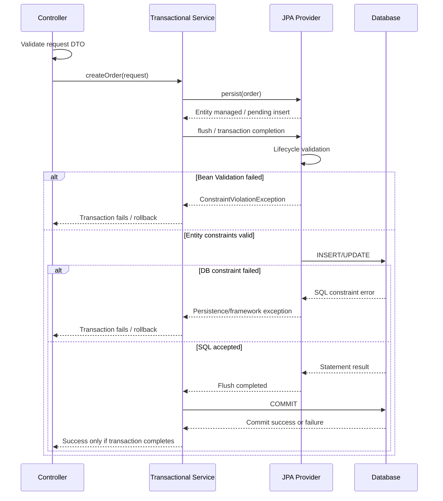
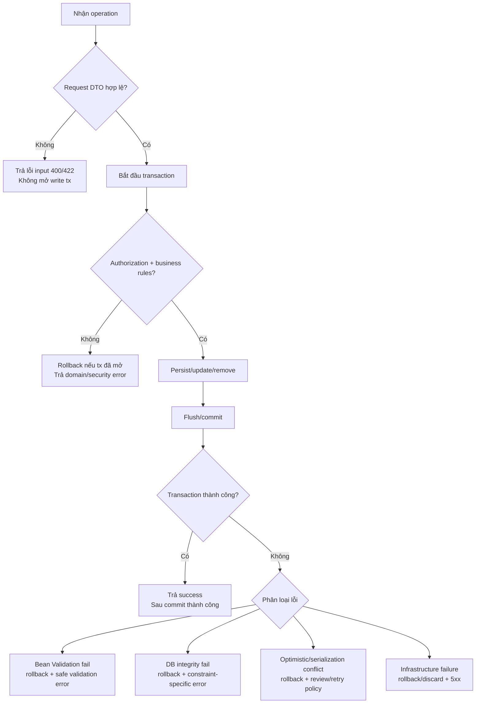

# Xử lý lỗi validation và trạng thái giao dịch

Trong ứng dụng Java sử dụng **Jakarta Persistence (JPA)**, dữ liệu có thể được kiểm tra ở nhiều lớp: khi nhận HTTP request, khi service thực hiện quy tắc nghiệp vụ, khi JPA đồng bộ entity xuống database và khi cơ sở dữ liệu áp dụng các ràng buộc như `NOT NULL`, `UNIQUE`, `CHECK`, foreign key. Khi một phép kiểm tra thất bại, câu hỏi không chỉ là **“trả lỗi nào cho người dùng?”** mà còn là **“transaction đã ghi gì, còn có thể commit không, và cần rollback tại đâu?”**.

Ví dụ một API tạo đơn hàng:

```text
POST /api/orders
       |
       v
Validate request DTO
       |
       v
Service business validation
       |
       v
EntityManager.persist(order)
       |
       v
Flush / Bean Validation / SQL constraints
       |
       v
Commit hoặc rollback
       |
       v
HTTP response
```

Nếu trường `quantity` không hợp lệ ngay tại controller, request có thể bị từ chối **trước khi mở transaction ghi**. Nhưng nếu validation thất bại ở thời điểm `flush()`, transaction JPA đã ở trạng thái có thể phải rollback; bắt exception rồi cố lưu tiếp trên cùng persistence context là cách xử lý nguy hiểm. Nếu database từ chối một khóa ngoại hoặc giá trị unique trùng nhau, lỗi cũng có thể xuất hiện **muộn hơn dòng `persist()`**, thậm chí khi commit.

Bài học này giải thích **xử lý lỗi validation và trạng thái giao dịch** trong chương **Kiểm tra dữ liệu** thuộc module **Data Persistence Relational Access ORM JPA**: cách phân lớp validation, cách JPA tích hợp Jakarta Bean Validation, vị trí phát sinh lỗi và exception wrapping, ý nghĩa của rollback-only, cách viết transaction an toàn với JPA và Spring, cách trả HTTP error, xử lý retry, bulk operations, các tình huống đồng thời và kiểm thử.

## 1. Bốn lớp kiểm tra dữ liệu và trách nhiệm của chúng

Một hệ thống bền vững thường không đặt mọi validation vào duy nhất một annotation.

| Lớp | Kiểm tra gì? | Thời điểm thường gặp | Ví dụ |
|---|---|---|---|
| **Request validation** | Hình dạng, kiểu dữ liệu, giới hạn và field hợp lệ của request | Khi deserialize/validate ở API boundary | `@NotBlank`, `@Size`, `@Positive` trên DTO |
| **Business/domain validation** | Quy tắc phụ thuộc trạng thái, quyền, workflow hoặc nhiều entity | Trong service/domain command | Đơn SHIPPED không được quay lại DRAFT |
| **JPA entity validation** | Jakarta Bean Validation constraints gắn trên entity, theo lifecycle groups | Trước INSERT/UPDATE/REMOVE lifecycle events phù hợp khi persistence provider tích hợp validation | Entity `@NotNull`, `@DecimalMin` |
| **Database constraints** | Bảo toàn tính toàn vẹn khi bất kỳ writer nào ghi DB | Khi DB thực thi SQL, hoặc tại commit nếu constraint deferred | `UNIQUE`, `FOREIGN KEY`, `CHECK`, `NOT NULL` |

Những tầng này **bổ sung** chứ không thay thế nhau. DTO validation có thể từ chối request sớm với thông điệp thân thiện; database constraint bảo vệ race và những writers không đi qua API; JPA entity validation giúp bảo vệ persistent entity state khi các operations chạy qua lifecycle tích hợp.

### 1.1. Ba lỗi có cùng ý nghĩa với người dùng nhưng khác nguồn

Giả sử người dùng gửi số lượng `-5`:

```java
public record CreateItemRequest(
    @Positive int quantity
) {}
```

Nếu controller dùng `@Valid`, validation của DTO có thể dừng request ngay.

Nhưng một background job có thể tạo:

```java
OrderItem item = new OrderItem(-5);
em.persist(item);
```

Lúc đó Bean Validation tích hợp với JPA có thể phát hiện `@Positive` trên entity ở lifecycle event.

Nếu một JDBC job khác bỏ qua cả DTO lẫn JPA, database `CHECK (quantity > 0)` mới là lớp cuối cùng ngăn dữ liệu sai — nếu schema có constraint tương ứng.

### 1.2. Có phải cứ có `@NotNull` trên entity là DB chắc chắn có `NOT NULL`?

Không nên suy ra điều đó. Việc generator sinh DDL từ validation metadata phụ thuộc provider/configuration/schema-generation mode. Khi production sử dụng migrations, cần **quy định ràng buộc database riêng** và xác nhận chúng hiện diện thực sự.

### 1.3. Khi nào cần database constraint dù đã validate?

Ví dụ uniqueness của mã sản phẩm:

```text
T1 kiểm tra mã SKU-101 chưa tồn tại
T2 kiểm tra mã SKU-101 chưa tồn tại
T1 INSERT SKU-101
T2 INSERT SKU-101
```

Cả hai lượt pre-check có thể đều “đúng” tại thời điểm đọc. Chỉ một **UNIQUE constraint thực thi tại DB** (hoặc một cơ chế đồng bộ equivalent được thiết kế đúng) mới bảo vệ tính duy nhất trước race như vậy.

## 2. Một mô hình entity có validation

Giả sử hệ thống có bảng `orders` và `order_items`.

### 2.1. Entity `SalesOrder`

```java
package example.sales.domain;

import jakarta.persistence.*;
import jakarta.validation.constraints.*;
import java.time.Instant;
import java.util.ArrayList;
import java.util.List;

@Entity
@Table(
    name = "sales_orders",
    uniqueConstraints = @UniqueConstraint(
        name = "uq_order_tenant_code",
        columnNames = {"tenant_id", "order_code"}
    )
)
public class SalesOrder {

    @Id
    @GeneratedValue(strategy = GenerationType.SEQUENCE)
    private Long id;

    @Column(name = "tenant_id", nullable = false,
            updatable = false)
    private String tenantId;

    @NotBlank
    @Size(max = 40)
    @Column(name = "order_code", nullable = false,
            length = 40)
    private String orderCode;

    @NotNull
    @Enumerated(EnumType.STRING)
    @Column(nullable = false)
    private OrderStatus status;

    @NotNull
    @Column(name = "created_at", nullable = false,
            updatable = false)
    private Instant createdAt;

    @Version
    private Long version;

    @OneToMany(
        mappedBy = "order",
        cascade = CascadeType.ALL,
        orphanRemoval = true
    )
    private List<OrderItem> items = new ArrayList<>();

    protected SalesOrder() {}

    public SalesOrder(
            String tenantId,
            String orderCode,
            Instant createdAt) {
        this.tenantId = tenantId;
        this.orderCode = orderCode;
        this.createdAt = createdAt;
        this.status = OrderStatus.DRAFT;
    }

    public Long getId() { return id; }
    public String getTenantId() { return tenantId; }
    public String getOrderCode() { return orderCode; }
    public OrderStatus getStatus() { return status; }
    public Long getVersion() { return version; }

    public void addItem(OrderItem item) {
        if (item == null) {
            throw new IllegalArgumentException(
                "Order item is required");
        }
        items.add(item);
        item.assignOrder(this);
    }

    public void markPaid() {
        if (status != OrderStatus.DRAFT) {
            throw new IllegalStateException(
                "Only draft orders can be paid");
        }
        if (items.isEmpty()) {
            throw new IllegalStateException(
                "Cannot pay empty order");
        }
        status = OrderStatus.PAID;
    }
}
```

Enum:

```java
public enum OrderStatus {
    DRAFT, PAID, SHIPPED, CANCELLED
}
```

### 2.2. Child entity `OrderItem`

```java
package example.sales.domain;

import jakarta.persistence.*;
import jakarta.validation.constraints.*;
import java.math.BigDecimal;

@Entity
@Table(name = "order_items")
public class OrderItem {

    @Id
    @GeneratedValue(strategy = GenerationType.SEQUENCE)
    private Long id;

    @ManyToOne(fetch = FetchType.LAZY, optional = false)
    @JoinColumn(name = "order_id", nullable = false)
    private SalesOrder order;

    @NotBlank
    @Size(max = 80)
    @Column(name = "sku", nullable = false, length = 80)
    private String sku;

    @Positive
    @Column(name = "quantity", nullable = false)
    private int quantity;

    @NotNull
    @DecimalMin("0.00")
    @Column(name = "unit_price", nullable = false,
            precision = 15, scale = 2)
    private BigDecimal unitPrice;

    protected OrderItem() {}

    public OrderItem(
            String sku, int quantity,
            BigDecimal unitPrice) {
        this.sku = sku;
        this.quantity = quantity;
        this.unitPrice = unitPrice;
    }

    void assignOrder(SalesOrder order) {
        this.order = order;
    }
}
```

Các snippets nhằm minh họa constraint locations và transaction behavior; để chạy cần JPA bootstrap, constructors/methods, mapping và database schema đầy đủ.

### 2.3. Database constraints tương ứng

DDL khái niệm:

```sql
CREATE TABLE sales_orders (
    id          BIGINT PRIMARY KEY,
    tenant_id   VARCHAR(64) NOT NULL,
    order_code  VARCHAR(40) NOT NULL,
    status      VARCHAR(30) NOT NULL,
    created_at  TIMESTAMP NOT NULL,
    version     BIGINT NOT NULL,
    CONSTRAINT uq_order_tenant_code
        UNIQUE (tenant_id, order_code)
);

CREATE TABLE order_items (
    id          BIGINT PRIMARY KEY,
    order_id    BIGINT NOT NULL,
    sku         VARCHAR(80) NOT NULL,
    quantity    INTEGER NOT NULL,
    unit_price  DECIMAL(15, 2) NOT NULL,
    CONSTRAINT fk_item_order
        FOREIGN KEY (order_id)
        REFERENCES sales_orders(id),
    CONSTRAINT ck_item_quantity
        CHECK (quantity > 0),
    CONSTRAINT ck_item_price
        CHECK (unit_price >= 0)
);
```

DB dialect và migration có thể khác; dữ liệu legacy cần xử lý khi thêm constraints. `@Version` giải quyết optimistic concurrency cho entity, không thay `UNIQUE`, foreign key hoặc `CHECK`.

## 3. DTO validation và entity validation có mục đích khác nhau

Request DTO chỉ cho phép client gửi các trường được phép:

```java
package example.sales.api;

import jakarta.validation.Valid;
import jakarta.validation.constraints.*;
import java.math.BigDecimal;
import java.util.List;

public record CreateOrderItemRequest(
    @NotBlank @Size(max = 80) String sku,
    @Positive int quantity,
    @NotNull @DecimalMin("0.00") BigDecimal unitPrice
) {}

public record CreateOrderRequest(
    @NotBlank @Size(max = 40) String orderCode,
    @NotEmpty
    @Size(max = 100)
    List<@Valid CreateOrderItemRequest> items
) {}
```

Ở đây:

- Client **không** được gửi `tenantId` để đổi ownership.
- Client không tự chọn `status=PAID`.
- Không deserialize trực tiếp entity graph với JPA associations.
- Validation từ request DTO giúp báo lỗi trước khi tạo entity.
- Entity constraints vẫn kiểm tra persistent state nếu được thay đổi từ job/service khác.

### 3.1. Cấu trúc API không nhất thiết giống persistence model

Một API có thể cho client gửi `unitPrice` chỉ với role phù hợp, hoặc hoàn toàn không nhận giá mà lấy từ bảng giá server. DTO validation chỉ kiểm tra giá trị gửi lên có định dạng đúng; **không tự xác minh giá đó là giá được phép**. Phần sau là business authorization/domain logic.

### 3.2. `@Valid` và cascading validation

`@Valid` yêu cầu cascade validation xuống object bên trong. Trong DTO:

```java
List<@Valid CreateOrderItemRequest> items
```

phải xem xét từng item. Nếu thiếu `@Valid` phù hợp trong object graph, một validation call vào parent **không nhất thiết** tự kiểm tra mọi nested object's constraints.

Trong JPA entity model, quan hệ `cascade = CascadeType.PERSIST` là **persistence cascade**, còn `@Valid` là **Bean Validation cascade**. Hai cơ chế này không đồng nghĩa.

### 3.3. Không dùng validation annotations thay business state machine

`@NotNull OrderStatus status` chỉ yêu cầu status khác null; nó không kiểm tra liệu `SHIPPED -> DRAFT` có hợp lệ. Quy tắc trạng thái phải nằm ở domain method, service hoặc một constraint được thiết kế có đủ context.

## 4. Jakarta Bean Validation được JPA gọi khi nào?

Trong Jakarta Persistence, khi một compatible Bean Validation provider hiện diện và validation được cấu hình phù hợp, persistence provider có thể tự thực hiện validation ở những lifecycle events chuẩn.

Mặc định được quan tâm nhiều nhất là:

- **Pre-persist**: entity mới sắp được persistent/INSERT.
- **Pre-update**: entity đã managed có thay đổi cần UPDATE.
- **Pre-remove**: có thể được cấu hình group; mặc định không yêu cầu thực hiện validation như pre-persist/pre-update.

### 4.1. Validation không có nghĩa chạy ngay khi gọi setter

```java
order.setOrderCode("");
```

Setter thuần Java không tự phát `ConstraintViolationException` nếu setter không tự kiểm tra. Với JPA lifecycle integration, lỗi thường được phát hiện khi provider xử lý pre-update/pre-persist validation gần thời điểm flush.

### 4.2. `persist()` không luôn phát SQL ngay

```java
em.persist(order);
// Chưa chắc INSERT SQL đã được gửi.

em.flush();
// Provider đồng bộ pending changes, có thể thực hiện validation.
```

Thời điểm SQL/lifecycle processing chính xác phụ thuộc ID generation, flush mode, provider và transaction context. Do đó không viết code phụ thuộc vào giả định “`persist` đã thành công nghĩa là entity hợp lệ và đã lưu DB”.

### 4.3. `@PreUpdate` có thể không chạy khi không có UPDATE

Nếu không có persistent state change cần database UPDATE, provider có thể không phát pre-update event. Vì vậy JPA entity validation **không phải thay thế** cho một validation run độc lập khi nghiệp vụ cần kiểm tra một object dù nó không có thay đổi.

### 4.4. Một tình huống đã có entity invalid trong context

Giả sử managed entity có một field bị đổi thành invalid:

```java
order.setOrderCode(" ");
```

Khi transaction flush, validation của entity có thể thất bại trước khi UPDATE được thực hiện. Nếu application cố bắt lỗi rồi gán lại giá trị hợp lệ trong **chính transaction đã bị đánh dấu rollback-only**, đó không phải một cách phục hồi portable và an toàn.

## 5. Validation mode của persistence unit

Jakarta Persistence có `ValidationMode` và cấu hình `validation-mode`.

| Mode | Ý nghĩa |
|---|---|
| `AUTO` | Tự tích hợp validation theo điều kiện có provider tương thích |
| `CALLBACK` | Yêu cầu lifecycle validation tích hợp; nếu môi trường không đáp ứng cần báo lỗi theo contract |
| `NONE` | Không thực hiện automatic JPA lifecycle validation |

Ví dụ cấu hình:

```xml
<persistence
    xmlns="https://jakarta.ee/xml/ns/persistence"
    version="3.1">
  <persistence-unit name="salesPU"
                    transaction-type="RESOURCE_LOCAL">
    <class>example.sales.domain.SalesOrder</class>
    <class>example.sales.domain.OrderItem</class>
    <validation-mode>CALLBACK</validation-mode>
  </persistence-unit>
</persistence>
```

Đây là khung minh họa; để chạy cần JPA provider, Bean Validation provider, data source và metadata đầy đủ.

### 5.1. `AUTO` không phải “luôn kiểm tra mọi object”

Không nên khẳng định bật `AUTO` nghĩa là:

- Mọi request DTO đều được validate.
- Mọi entity trong persistence context đều bị validate mỗi lần flush.
- Bulk UPDATE/DELETE cũng validate từng row.
- Mọi constraint database đều có validation equivalent.

`AUTO` nói về **tích hợp lifecycle validation**, không mở rộng phạm vi sang mọi thao tác dữ liệu.

### 5.2. `NONE` không tắt validation của controller

Nếu `validation-mode=NONE`, framework HTTP vẫn có thể validate DTO bằng `@Valid`, service vẫn có thể dùng `Validator.validate(...)` và database vẫn áp constraints. Nó chỉ tắt automatic JPA lifecycle validation theo cấu hình.

### 5.3. Dùng `CALLBACK` khi nào?

Khi ứng dụng yêu cầu JPA entity validation là một thành phần bắt buộc của persistence lifecycle và muốn phát hiện cấu hình thiếu provider sớm. Nhưng không nên phụ thuộc duy nhất vào CALLBACK cho các quy tắc cần database constraints hoặc access control.

## 6. Validation groups cho persist, update và remove

Bean Validation cho phép phân chia ràng buộc theo **groups**.

```java
package example.sales.validation;

public interface OnCreate {}
public interface OnUpdate {}
```

Entity:

```java
@NotBlank(groups = OnCreate.class)
@Column(name = "initial_code")
private String initialCode;

@NotNull(groups = {OnCreate.class, OnUpdate.class})
private Instant effectiveAt;
```

Provider có thể được cấu hình để sử dụng nhóm khác nhau cho từng persistence lifecycle event.

Các property chuẩn:

```properties
jakarta.persistence.validation.group.pre-persist
jakarta.persistence.validation.group.pre-update
jakarta.persistence.validation.group.pre-remove
```

Thông thường, pre-persist/pre-update dùng `Default` group nếu không cấu hình khác; pre-remove không thực hiện validation groups theo mặc định.

### 6.1. Một ví dụ cấu hình

```xml
<properties>
  <property
    name="jakarta.persistence.validation.group.pre-persist"
    value="example.sales.validation.OnCreate"/>
  <property
    name="jakarta.persistence.validation.group.pre-update"
    value="example.sales.validation.OnUpdate"/>
</properties>
```

Cấu hình này minh họa cách chỉ định group theo lifecycle. Nếu muốn ràng buộc từ `Default` group cũng chạy, cần thiết kế/cấu hình groups phù hợp; đừng mặc định chọn `OnCreate` sẽ tự bao gồm mọi constraints vốn chỉ thuộc Default.

### 6.2. Vì sao không mặc định validate trước remove?

Một entity cũ có thể có fields không còn hợp lệ với quy tắc hiện tại, nhưng hệ thống vẫn phải cho phép xóa nó. Nếu bắt entity phải hợp lệ theo toàn bộ constraints mới trước khi xóa, có thể làm cleanup dữ liệu lỗi bị kẹt. Vì vậy pre-remove validation không nên bật bừa bãi; chỉ chọn group có ý nghĩa nghiệp vụ rõ.

### 6.3. Validation group không thay transaction boundary

Việc dùng OnCreate/OnUpdate không thay đổi thời điểm flush/commit hoặc rollback semantics. Nó chỉ xác định **nhóm constraints nào** được đánh giá tại event tương ứng.

## 7. `ConstraintViolationException` của Jakarta Validation

Khi Bean Validation đánh giá entity và phát hiện lỗi, exception trọng tâm là:

```java
jakarta.validation.ConstraintViolationException
```

Nó chứa một tập các `ConstraintViolation<?>` mô tả constraints thất bại.

Ví dụ:

```java
try {
    em.flush();
} catch (jakarta.validation.ConstraintViolationException e) {
    for (var violation : e.getConstraintViolations()) {
        String path =
            violation.getPropertyPath().toString();
        String message = violation.getMessage();

        System.err.printf(
            "Invalid property %s: %s%n",
            path, message);
    }
    throw e;
}
```

Đây là ví dụ **quan sát thông tin lỗi và ném tiếp** để transaction boundary thực hiện rollback; không phải công thức cho phép cố phục hồi transaction bị lỗi rồi tiếp tục flush.

### 7.1. Một violation chứa gì?

Một `ConstraintViolation<T>` có thể cung cấp:

- `getPropertyPath()`: đường dẫn thuộc tính, ví dụ `orderCode` hoặc `items[0].quantity` tùy object graph/validation path.
- `getMessage()`: thông báo validation đã interpolate.
- `getMessageTemplate()`: template gốc, có thể chứa key/message expression.
- `getInvalidValue()`: giá trị bị đánh giá sai.
- `getRootBean()` và `getLeafBean()`: đối tượng liên quan.
- `getConstraintDescriptor()`: metadata constraint.

### 7.2. Không trả nguyên `getInvalidValue()` ra HTTP/log

Invalid value có thể chứa password, token, địa chỉ, thông tin thanh toán hoặc dữ liệu cá nhân. Để gửi lỗi cho client, nên dùng **allowlist path và mã lỗi**, không serialize toàn bộ `ConstraintViolation` object hay entity graph.

### 7.3. Một exception có thể chứa nhiều violations

Nếu entity vừa sai `orderCode`, vừa sai `effectiveAt`, `getConstraintViolations()` có thể chứa cả hai. Tập violations không nên được giả định có thứ tự cố định; để response ổn định có thể sắp xếp theo field/code một cách có chủ đích.

### 7.4. Message không phải error code ổn định

Chuỗi `must not be blank` có thể thay đổi theo locale, validation provider hoặc bundles. Nếu API contract cần ổn định, nên dùng:

```json
{
  "code": "VALIDATION_FAILED",
  "errors": [
    {
      "field": "orderCode",
      "code": "NOT_BLANK",
      "message": "Mã đơn hàng không được để trống"
    }
  ]
}
```

Lưu ý mapping `ConstraintViolation` sang `NOT_BLANK` cần được xác định bởi application policy; không suy ra mã lỗi ổn định chỉ từ human-readable message.

## 8. Cùng tên `ConstraintViolationException` nhưng khác package

Trong hệ thống dùng Hibernate, có thể gặp ít nhất **hai loại exception hoàn toàn khác**:

| Exception | Package | Nguồn lỗi thường gặp |
|---|---|---|
| `ConstraintViolationException` | `jakarta.validation` | Bean Validation constraint không đạt |
| `ConstraintViolationException` | `org.hibernate.exception` | Database từ chối SQL vì một integrity constraint |

Ví dụ:

```java
catch (jakarta.validation.ConstraintViolationException e) {
    // Bean Validation errors:
    // property paths, message templates, groups...
}
```

khác:

```java
catch (org.hibernate.exception.ConstraintViolationException e) {
    // Database constraint error qua Hibernate.
    // Có thể có constraintName/SQLException.
}
```

### 8.1. Vì sao có thể nhầm?

Cả hai có tên class giống nhau nhưng xử lý khác:

- Jakarta Validation exception có tập violations có thể dùng để dựng lỗi theo field.
- Hibernate database exception thường bọc `SQLException` và một constraint name khi driver/dialect cung cấp, **không có `getConstraintViolations()` của Bean Validation**.
- Spring có thể dịch lỗi DB sang `DataIntegrityViolationException` thay vì đưa raw Hibernate exception lên controller.

### 8.2. Tránh import nhầm

Trong service/logging dùng full qualified name nếu cần:

```java
if (failure instanceof
        jakarta.validation.ConstraintViolationException) {
    // ...
}
```

Không bắt Hibernate database exception rồi cố chuyển trực tiếp `SQLException.getMessage()` thành thông báo validation cho người dùng; nó có thể tiết lộ schema, SQL và tên bảng.

### 8.3. Lỗi database khác Bean Validation

Một database constraint có thể thất bại dù tất cả entity constraints đều hợp lệ:

- Hai transactions tạo cùng `order_code` trong cùng tenant.
- Foreign key tham chiếu customer đã bị xóa.
- CHECK về tổng tiền/quantity chưa được biểu diễn trong Bean Validation.
- Deadlock, serialization conflict hoặc optimistic locking.
- Constraint được đánh giá tại commit thay vì khi insert statement chạy.

Lỗi DB cần được phân loại theo **constraint/business semantics**, không coi tất cả là lỗi field 400.

## 9. Lỗi validation có thể phát sinh ở nhiều thời điểm

Một đoạn code đơn giản:

```java
@Transactional
public Long createOrder(CreateOrderRequest request) {
    SalesOrder order =
        mapToOrder(request);

    em.persist(order);
    return order.getId();
}
```

có thể làm người đọc tưởng rằng mọi lỗi xảy ra tại `em.persist(order)`. Thực tế:

1. DTO validation có thể xảy ra **trước khi method service được gọi**.
2. Domain method có thể ném lỗi ngay khi tạo entity.
3. Bean Validation có thể được thực hiện trong lifecycle xử lý persist/update, thường gắn với flush.
4. SQL integrity error xuất hiện khi statement chạy.
5. Một số lỗi được phát hiện ở **transaction commit**, có thể sau khi thân method service đã return.

### 9.1. Chuỗi thời gian



Sơ đồ trình bày logic; không bắt buộc `flush` phải được gọi tường minh, và exception có thể được framework đưa ra ở boundary khác nhau tùy transaction manager.

### 9.2. Flush mode ảnh hưởng thời điểm SQL/validation

Với `FlushModeType.AUTO`, provider có thể flush trước một query phù hợp để bảo đảm query thấy các thay đổi đã pending. Vì vậy lỗi validation có thể xuất hiện khi gọi `getResultList()`, không phải ngay câu `persist` trước đó.

Với `FlushModeType.COMMIT`, hiệu ứng thay đổi trước query có thể khác, nhưng provider vẫn có thể thực hiện flush tại commit. **Đổi flush mode không phải cách tắt validation hoặc bảo đảm transaction commit**.

### 9.3. Database deferred constraints

Một số RDBMS hỗ trợ ràng buộc deferred, ví dụ foreign key/unique được định nghĩa để kiểm tra tại cuối transaction. Khi đó câu INSERT có thể được DB chấp nhận tạm thời nhưng **COMMIT bị từ chối**.

Vì vậy `em.flush()` thành công **không chứng minh transaction chắc chắn sẽ commit**. Không phát thông báo “đã lưu thành công” hoặc external side effect trước khi có kết quả transaction cuối cùng.

## 10. Hiểu đúng `flush()`, `commit()` và `rollback()`

| Operation | Ý nghĩa | Không nên nhầm thành |
|---|---|---|
| `em.persist(entity)` | Đưa entity mới vào persistence context và scheduling INSERT theo lifecycle | SQL đã commit |
| `em.flush()` | Đồng bộ các thay đổi pending xuống DB trong transaction | Commit |
| `transaction.commit()` | Yêu cầu kết thúc transaction thành công, gồm flush cần thiết | Chỉ là “đẩy SQL” |
| `transaction.rollback()` | Hủy các thay đổi transactional chưa commit ở DB | Thu hồi side effects ngoài DB |
| `em.clear()` | Detach managed entities trong context | Rollback hoặc sửa lỗi transaction |

### 10.1. Ví dụ

```java
EntityTransaction tx = em.getTransaction();
tx.begin();

SalesOrder order = new SalesOrder(
    tenantId, "SO-2026-001", Instant.now());
em.persist(order);

em.flush();  // Có thể ném validation/DB exception.
tx.commit(); // Cũng có thể thất bại.
```

Khi flush thành công nhưng commit thất bại, không được coi response thành công. Mọi transaction writes phải được xem là đã lưu **chỉ sau commit thực sự thành công**.

### 10.2. Tại sao không `clear()` để “giải quyết lỗi”?

`clear` chỉ detach objects, không làm một transaction rollback-only trở lại committable. Một constraint violation là thất bại của unit of work, không phải chỉ cache bẩn.

### 10.3. Không gửi sự kiện ngoài DB lúc vừa flush

Nếu flush đã INSERT row nhưng chưa commit, một hệ thống email/message broker độc lập có thể nhận event trong khi database transaction cuối cùng rollback. Cần outbox/after-commit workflow phù hợp thay vì xem flush như commit.

## 11. Trạng thái transaction: active, rollback-only và completed

Mỗi transaction có một lifecycle; cách quan sát khác nhau giữa resource-local JPA, JTA và Spring.

```text
             begin
      NEW -------------> ACTIVE
                           |
             +-------------+-------------+
             |                           |
          all valid              validation/DB error
             |                           |
          commit                  rollback-only
             |                           |
         COMMITTED                     rollback
                                         |
                                      ROLLED BACK
```

Trong một transaction có đánh dấu **rollback-only**, application đã xác định transaction ấy **không được commit thành công**. Các lời gọi tiếp theo có thể vẫn thực thi code Java, nhưng điều đó không biến unit of work thành hợp lệ.

### 11.1. Rollback-only khác rollback đã hoàn tất

- **Rollback-only**: transaction còn có thể đang active nhưng đã bị đánh dấu chỉ được rollback.
- **Rolled back**: rollback thực sự đã diễn ra, transaction kết thúc.
- **Active**: có transaction đang chạy; riêng trạng thái active chưa chứng minh nó committable.
- **Committed**: transaction kết thúc thành công.

Đây là mô hình tổng quát. Không phải mọi transaction API đều có enum state giống nhau hoặc cho phép hỏi mọi trạng thái theo cùng cách.

### 11.2. Lỗi trước transaction

Controller reject request DTO do `@NotBlank` trước khi service mở transaction: **không có transaction ghi cần rollback**. Không nên tạo một transaction chỉ để validation request đơn giản.

### 11.3. Lỗi bên trong transaction

Nếu JPA lifecycle Bean Validation thất bại khi context đã tham gia transaction, persistence provider yêu cầu đánh dấu rollback-only theo integration semantics. Cố sửa entity rồi tiếp tục commit cùng unit of work không phải cách phục hồi portable.

### 11.4. Lỗi SQL của DB

Sau SQLException, một số DB/driver/transaction managers coi transaction đã thất bại và chỉ có thể rollback; provider persistence context cũng có thể không còn an toàn để tiếp tục. **Hãy rollback và mở transaction/context mới**, thay vì cố lưu tiếp những entity khác trong cùng context.

## 12. `EntityTransaction` trong JPA resource-local

Khi application bootstrap resource-local `EntityManager`, bạn có thể quản lý transaction bằng:

```java
EntityTransaction tx = em.getTransaction();
```

Các phương thức:

```java
tx.begin();
tx.commit();
tx.rollback();
tx.isActive();
tx.getRollbackOnly();
tx.setRollbackOnly();
```

### 12.1. Kiểm tra rollback-only

```java
if (tx.isActive() && tx.getRollbackOnly()) {
    // Unit of work không được coi là có thể commit.
    tx.rollback();
}
```

Không cần gọi `getRollbackOnly()` để quyết định trong mọi catch: nếu operation đã ném persistence/validation exception và transaction đang active, nguyên tắc an toàn là **rollback unit of work thất bại**.

### 12.2. Cấu trúc an toàn với `try/catch/finally`

```java
public Long createOrder(
        EntityManagerFactory emf,
        String tenantId,
        String orderCode) {

    EntityManager em = emf.createEntityManager();
    EntityTransaction tx = em.getTransaction();

    try {
        tx.begin();

        SalesOrder order = new SalesOrder(
            tenantId, orderCode, Instant.now());
        em.persist(order);

        tx.commit();
        return order.getId();

    } catch (RuntimeException failure) {
        if (tx.isActive()) {
            try {
                tx.rollback();
            } catch (RuntimeException rollbackFailure) {
                failure.addSuppressed(rollbackFailure);
            }
        }
        throw failure;

    } finally {
        em.close();
    }
}
```

Ý nghĩa:

- EntityManager chỉ phục vụ một unit of work trong ví dụ.
- Nếu persist/flush/commit ném RuntimeException, cố rollback khi transaction còn active.
- Không nuốt exception gốc.
- Đóng EntityManager dù thành công hay thất bại.
- Không reuse context vừa gặp persistence failure.
- `return` xảy ra sau khi `tx.commit()` thành công.

Code rút gọn không xử lý mọi lỗi nghiêm trọng của process/JVM, retry hoặc logging; ứng dụng thật nên có transaction/resource management chuẩn của framework.

### 12.3. Không dùng `getTransaction()` trong JTA-managed EntityManager

Một `EntityManager` được tích hợp JTA/container-managed transaction không cho application tùy ý `em.getTransaction().begin()` như resource-local EM. JTA/Spring/container sẽ sở hữu boundaries. Đừng trộn transaction ownership của hai mô hình.

### 12.4. Lỗi tại commit có thể là exception bọc

Trong resource-local JPA, commit có thể ném `jakarta.persistence.RollbackException` nếu transaction không thể commit; nguyên nhân gốc có thể là validation hoặc DB constraint exception được wrap. Khi phân loại lỗi, cần xét cause chain **có giới hạn**, không chỉ lớp exception ở bề mặt.

## 13. Transaction với Spring `@Transactional`

Spring thường giúp quản lý transaction:

```java
import org.springframework.stereotype.Service;
import org.springframework.transaction.annotation.Transactional;

@Service
public class OrderCommandService {

    @PersistenceContext
    private EntityManager em;

    @Transactional
    public Long create(CreateOrderRequest request,
                       String authorizedTenantId) {
        SalesOrder order =
            toEntity(request, authorizedTenantId);

        em.persist(order);

        return order.getId();
    }
}
```

Ý tưởng: Spring mở transaction khi gọi qua proxy/aspect boundary, thực thi method và commit/rollback theo rules. Code service không tự gọi `em.getTransaction()` khi Spring đã sở hữu transaction.

### 13.1. Lỗi xảy ra sau `return` của method

Thân method có thể return `order.getId()`; nhưng Spring transaction interceptor còn phải flush/commit trước khi lời gọi proxy thực sự hoàn tất. Nếu validation fail ở transaction completion, controller vẫn có thể nhận exception chứ không được xem là thành công.

Vì vậy:

```java
Long id = orderService.create(request, tenantId);
return ResponseEntity.created(...).build();
```

nên chỉ thực thi response success nếu lời gọi transactional service đã hoàn tất bình thường, với điều kiện transaction boundary thực sự nằm ở service và không bị kéo ra một layer bao ngoài.

### 13.2. Quy tắc rollback mặc định của Spring

Với `@Transactional` theo cấu hình thông dụng:

- Unchecked exceptions (`RuntimeException`) và `Error` làm transaction rollback theo mặc định.
- Checked exceptions **không mặc định** gây rollback, trừ khi đặt `rollbackFor` hoặc cấu hình policy khác.

Ví dụ:

```java
@Transactional(rollbackFor = BusinessValidationException.class)
public void submitOrder(...) throws BusinessValidationException {
    // ...
    throw new BusinessValidationException(
        "Order is not eligible");
}
```

Giả định `BusinessValidationException` extends `Exception` (checked). Nếu muốn unchecked domain exception, dùng `RuntimeException` và quy tắc rollback mặc định thường đã phù hợp.

### 13.3. `noRollbackFor` không sửa được transaction do JPA/DB đã thất bại

Khi JPA provider/DB đã đánh dấu transaction rollback-only sau persistence failure, cấu hình:

```java
@Transactional(noRollbackFor = SomeException.class)
```

không có quyền “hồi sinh” transaction thành công. Nó chỉ ảnh hưởng quyết định rollback của transaction interceptor đối với exceptions theo rule; **không ghi đè trạng thái thất bại cấp persistence provider/database**.

### 13.4. Không catch rồi nuốt validation exception trong cùng transaction

Anti-pattern:

```java
@Transactional
public void importOrders(List<CreateOrderRequest> inputs) {
    for (var input : inputs) {
        try {
            em.persist(toEntity(input));
            em.flush();
        } catch (ConstraintViolationException ex) {
            // Nguy hiểm: nuốt lỗi và tiếp tục với cùng tx.
        }
    }
}
```

Sau lỗi flush, persistence context/transaction có thể rollback-only; tiếp tục vòng lặp **không bảo đảm** các bản ghi hợp lệ được commit. Nếu cần partial success, phải tách transaction per item/batch theo chính sách rõ.

### 13.5. Self-invocation làm `@Transactional` không được áp dụng như tưởng

Với Spring proxy mode:

```java
public void outer() {
    this.innerTransactional(); // internal call
}

@Transactional
public void innerTransactional() {
    // ...
}
```

Lời gọi nội bộ qua `this` thường không đi qua proxy, nên transaction advice của `innerTransactional` có thể không chạy. Nếu transaction thực tế khác dự kiến, validation/rollback timing cũng khác. Chọn public service boundary rõ hoặc dùng transaction template phù hợp.

## 14. `UnexpectedRollbackException`: vì sao method “trông như thành công” nhưng vẫn rollback?

Một tình huống thường gặp trong Spring:

```java
@Transactional
public void processOrder(...) {
    try {
        innerService.persistSomething(...);
    } catch (RuntimeException ex) {
        log.warn("Ignored failure", ex);
    }

    // Code tiếp tục và return bình thường.
}
```

Nếu `innerService` tham gia **cùng transaction** (ví dụ propagation `REQUIRED`) và exception đã làm transaction bị đánh dấu rollback-only, việc outer method catch exception **không xóa rollback-only flag**. Khi Spring cố commit, transaction manager có thể ném:

```java
org.springframework.transaction.UnexpectedRollbackException
```

để báo rằng transaction đã rollback dù caller bên ngoài mong đợi commit.

### 14.1. Timeline

```text
Outer @Transactional bắt đầu T1
    |
    v
Inner @Transactional(REQUIRED) tham gia T1
    |
    v
JPA Bean Validation / DB constraint fail
    |
    v
T1 bị mark rollback-only
    |
    v
Outer catch exception rồi return bình thường
    |
    v
Spring cố hoàn tất transaction
    |
    v
UnexpectedRollbackException / rollback
```

Kết quả này **đúng** hơn việc im lặng báo thành công trong khi database không commit.

### 14.2. Không “khắc phục” bằng cách bỏ transaction

Chỉ bỏ `@Transactional` để exception biến mất có thể phá atomicity. Cách sửa là lựa chọn rõ:

- Muốn **all-or-nothing**: để exception lan ra và rollback toàn transaction.
- Muốn **partial success**: tách các independent operations thành transactions riêng thật sự.
- Muốn kiểm tra trước DB: dùng programmatic validation và business checks trước khi bắt đầu write transaction nếu phù hợp.
- Muốn ghi audit dù transaction lỗi: cân nhắc transaction độc lập/outbox theo yêu cầu, tránh implicit coupling.

### 14.3. Bắt exception ở đâu?

Thường bắt ở **bên ngoài transaction boundary** để xây HTTP response, thay vì cố suppress một persistence failure trong transaction đang chạy. Nếu cần dịch lỗi ở service, có thể bắt rồi ném một unchecked domain/application exception khác, vẫn để transaction rollback.

## 15. Programmatic validation: kiểm tra trước khi ghi

Jakarta Bean Validation cung cấp:

```java
import jakarta.validation.Validator;
import jakarta.validation.ConstraintViolation;
```

Ví dụ:

```java
public final class InputValidator {

    private final Validator validator;

    public InputValidator(Validator validator) {
        this.validator = validator;
    }

    public <T> void validate(T input) {
        Set<ConstraintViolation<T>> violations =
            validator.validate(input);

        if (!violations.isEmpty()) {
            throw new InputValidationException(violations);
        }
    }
}
```

`InputValidationException` là exception tự định nghĩa; trong production không nên giữ hoặc serialize nguyên object graph chứa sensitive values khi trả lỗi cho client. Các imports `Set` và classes tương ứng cần được thêm vào project.

### 15.1. Kiểm tra trước transaction khi có thể

```text
Parse request
    |
    v
Validate DTO
    |
    +-- invalid -> 400/422, chưa mở write transaction
    |
    v
Begin transactional command
    |
    v
Business rules + persist
```

Lợi ích: lỗi phổ biến bị phát hiện sớm, giảm chi phí transaction/connection, dễ trả field errors.

### 15.2. Programmatic validation không làm DB check thừa

Ngay cả khi `validator.validate(dto)` trả empty violations:

- Tình trạng database có thể thay đổi do concurrent transaction.
- Unique constraint có thể fail.
- FK có thể bị thay đổi.
- Entity được map sai từ DTO.
- Business rule có thể phụ thuộc giá trị ở server, không có trong DTO.

Vì vậy vẫn cần database constraints và một transaction command đúng.

### 15.3. Validation cả entity trước persist?

Có thể gọi:

```java
Set<ConstraintViolation<SalesOrder>> violations =
    validator.validate(order);
```

để kiểm tra trước khi `persist` nếu ứng dụng cần fail fast. Nhưng phải hiểu **groups** và **cascading validation**: nó không tự mô phỏng mọi lifecycle-specific validation group của JPA trừ khi gọi đúng groups. Và việc entity hiện hợp lệ trước persist không bảo đảm nó vẫn hợp lệ khi state bị thay đổi sau đó.

### 15.4. Có cần validate cùng một object hai lần không?

Đôi khi có: DTO validation đảm bảo request boundary; JPA lifecycle validation là safety net cho persisted state. Tuy nhiên tránh thực hiện nhiều validation đắt đỏ mà không có giá trị; cần phân chia trách nhiệm, không lặp domain checks gọi database trong mọi Bean Validation callback.

## 16. Business validation: ném lỗi có chủ đích

Ví dụ:

```java
public void markPaid() {
    if (status != OrderStatus.DRAFT) {
        throw new InvalidOrderTransitionException(
            status, OrderStatus.PAID);
    }

    if (items.isEmpty()) {
        throw new InvalidOrderTransitionException(
            "Cannot pay an empty order");
    }

    status = OrderStatus.PAID;
}
```

Nếu `InvalidOrderTransitionException` extends `RuntimeException`, Spring `@Transactional` thông thường sẽ rollback transaction khi exception thoát khỏi transactional method. Nhưng đó là **application exception**, không phải `jakarta.validation.ConstraintViolationException`.

### 16.1. Error taxonomy

| Loại | Ví dụ | Thường thuộc |
|---|---|---|
| Input format | Chuỗi quá dài, quantity âm | Request validation |
| Entity state invalid | orderCode trống trước UPDATE | JPA lifecycle validation |
| Domain transition | SHIPPED → DRAFT không hợp lệ | Business validation |
| Authorization | Tenant A sửa order của B | Security |
| Database integrity | UNIQUE/FK/CHECK violation | RDBMS |
| Concurrency | Optimistic version conflict | Transaction consistency |
| Infrastructure | Connection timeout, database unavailable | Reliability |

### 16.2. Không trả mọi lỗi thành 400

Một database outage không phải client validation error. Cũng không nên trả toàn bộ domain state trong 400 response. HTTP status và message cần phản ánh nguyên nhân một cách có kiểm soát.

### 16.3. Authorization trước khi công bố violation details

Nếu một user không có quyền truy cập Order#101, API không nên tiết lộ rằng order tồn tại hoặc field cụ thể của nó không hợp lệ. Service/query scope và HTTP error mapping phải duy trì tenant/ownership policies.

## 17. Mapping HTTP errors: 400, 422, 409, 412, 500

Một API contract điển hình:

| Trường hợp | Status có thể dùng | Lưu ý |
|---|---:|---|
| JSON không parse được, sai kiểu cơ bản | 400 | Request malformed |
| DTO `@NotBlank`/`@Positive` fail | 400 hoặc 422 | Chọn nhất quán theo contract |
| Domain state transition invalid | 409 hoặc 422 | Phụ thuộc cách biểu diễn lỗi |
| Unique business key đã tồn tại | 409 | Cần phân biệt đúng constraint |
| `If-Match` không khớp | 412 | Conditional request semantics |
| Entity không thuộc tenant/không tồn tại | 403 hoặc 404 | Chọn theo security policy |
| Provider/DB connection outage | 500/503 | Không gắn nhầm lỗi client |
| Unexpected application bug | 500 | Log server-side, che internal details |

### 17.1. Response lỗi có cấu trúc

Ví dụ:

```json
{
  "code": "VALIDATION_FAILED",
  "message": "Dữ liệu không hợp lệ",
  "errors": [
    {
      "field": "items[0].quantity",
      "code": "POSITIVE_REQUIRED",
      "message": "Số lượng phải lớn hơn 0"
    },
    {
      "field": "orderCode",
      "code": "ORDER_CODE_REQUIRED",
      "message": "Mã đơn hàng không được để trống"
    }
  ],
  "traceId": "req-7df3"
}
```

`traceId` chỉ là ví dụ; production nên dùng correlation ID do hệ thống phát sinh và tuân thủ logging/privacy policy.

### 17.2. Phân loại lỗi DB bằng constraint mapping

Ví dụ database từ chối `uq_order_tenant_code`. Một application có thể map constraint name được xác nhận:

```text
uq_order_tenant_code -> ORDER_CODE_ALREADY_EXISTS
```

Trả:

```json
{
  "code": "ORDER_CODE_ALREADY_EXISTS",
  "message": "Mã đơn hàng đã được sử dụng trong phạm vi này"
}
```

Không map **mọi** `DataIntegrityViolationException` thành `ORDER_CODE_ALREADY_EXISTS`; nó có thể là FK, NOT NULL hoặc CHECK violation. Thông tin constraint name có thể thiếu hoặc khác nhau theo database/dialect; khi không xác định chính xác, trả lỗi tổng quát phù hợp và log chi tiết an toàn.

### 17.3. Tránh trả raw SQLException

Không gửi:

```json
{
  "sql": "insert into sales_orders ...",
  "constraint": "fk_payment_order_internal",
  "stackTrace": "org.hibernate... "
}
```

cho client cuối. SQL/constraint details nội bộ phục vụ server logs, không phải public API contract.

### 17.4. Xử lý validation error với i18n

Không nên dùng `violation.getMessage()` như một business code để client tự xử lý. Public response nên có `code` ổn định và `message` có thể localize. Field names phải là những fields thuộc DTO contract, không lộ toàn bộ internal JPA entity property paths.

## 18. Spring MVC: xử lý lỗi request DTO

Ví dụ controller:

```java
@RestController
@RequestMapping("/api/orders")
public class OrderController {

    private final OrderCommandService service;
    private final CurrentTenant currentTenant;

    public OrderController(
            OrderCommandService service,
            CurrentTenant currentTenant) {
        this.service = service;
        this.currentTenant = currentTenant;
    }

    @PostMapping
    public ResponseEntity<Void> create(
            @Valid @RequestBody CreateOrderRequest request) {

        Long id = service.create(
            request, currentTenant.authorizedTenantId());

        URI uri = URI.create("/api/orders/" + id);
        return ResponseEntity.created(uri).build();
    }
}
```

`CurrentTenant` là abstraction ứng dụng lấy authenticated tenant từ security context; nó không phải class chuẩn của JPA/Spring.

Trong cấu hình Spring MVC phổ biến, `@Valid @RequestBody` có thể dẫn đến `MethodArgumentNotValidException` nếu validation thất bại. Với Spring MVC versions mới, method-level validation có thể sinh exception type khác như `HandlerMethodValidationException` tùy signature/config; cần xem framework version hiện tại.

### 18.1. Handler cho request validation

```java
@RestControllerAdvice
public class ApiExceptionHandler {

    @ExceptionHandler(MethodArgumentNotValidException.class)
    public ResponseEntity<ApiError> invalidBody(
            MethodArgumentNotValidException ex) {

        List<FieldIssue> issues = ex.getBindingResult()
            .getFieldErrors()
            .stream()
            .map(error -> new FieldIssue(
                error.getField(),
                "INVALID_FIELD",
                safeMessage(error)))
            .toList();

        return ResponseEntity.badRequest().body(
            new ApiError("VALIDATION_FAILED", issues));
    }
}
```

Một response model:

```java
public record FieldIssue(
    String field,
    String code,
    String message
) {}

public record ApiError(
    String code,
    List<FieldIssue> errors
) {}
```

`safeMessage(error)` là hàm do application định nghĩa để áp dụng message mapping/i18n/allowlist. Các imports Spring và các exceptions khác cần được bổ sung. Đây là **handler skeleton**, không phải mã hoàn chỉnh để compile độc lập.

### 18.2. Controller validation chưa chắc mở transaction

Khi `@Valid` fail trước khi gọi `service.create`, không có write transaction của service cần rollback. Đó là một trong các lợi ích quan trọng của request validation ở biên.

### 18.3. Validation trong service vẫn cần

Một batch job hoặc message consumer có thể gọi service không đi qua Spring MVC. Dựa duy nhất vào `@Valid` ở controller khiến các đường gọi khác có thể tạo dữ liệu sai. Service/domain/entity constraints vẫn phải bảo vệ invariants thích hợp.

## 19. Spring: dịch ngoại lệ JPA và database

Trong Spring Data JPA/Spring ORM, lỗi persistence có thể được đưa lên dưới các lớp exception khác:

| Ví dụ exception | Ý nghĩa thường gặp |
|---|---|
| `jakarta.validation.ConstraintViolationException` | Bean Validation failure |
| `org.springframework.dao.DataIntegrityViolationException` | Database integrity failure được dịch qua Spring |
| `org.springframework.orm.ObjectOptimisticLockingFailureException` | Optimistic concurrency conflict |
| `org.springframework.transaction.UnexpectedRollbackException` | Transaction bị rollback dù outer caller mong đợi commit |
| `org.springframework.transaction.TransactionSystemException` | Vấn đề transaction system, có thể bao cause bên trong |
| `jakarta.persistence.RollbackException` | JPA commit thất bại |
| `jakarta.persistence.PersistenceException` | Nhóm lỗi JPA rộng |

Exception translation phụ thuộc:

- Method đi qua repository proxy hay trực tiếp `EntityManager`.
- Transaction manager và JPA provider.
- Lỗi xuất hiện ở repository method, flush hay commit.
- Provider và database dialect.

Không tạo một `catch(DataIntegrityViolationException)` duy nhất rồi giả định xử lý được mọi Bean Validation/commit errors.

### 19.1. Xử lý lỗi tại transaction boundary

Một hướng:

```text
Controller
   -> Transactional service proxy
       -> EntityManager / repository
       -> commit / rollback
   -> Exception handler (ngoài transaction)
       -> classify failure
       -> build safe response
```

Application exception handler là nơi thuận tiện để map những exceptions đã được throw ra sau transaction completion. Nếu exception có cause chain, cần unwrap một cách **có kiểm soát**; không duyệt graph tùy ý hoặc expose nội dung của every nested exception.

### 19.2. Không dùng substring SQL message để phân loại

Anti-pattern:

```java
if (ex.getMessage().contains("duplicate key")) {
    return 409;
}
```

Thông điệp DB khác giữa vendors/locale/driver, có thể đổi theo version và chứa dữ liệu nhạy cảm. Dùng provider-supported constraint metadata, SQLState codes được kiểm chứng cho DB mục tiêu, hoặc error mapping gắn với operation/constraint cụ thể.

### 19.3. Một DB violation không tự chứng minh HTTP client sai

Ví dụ FK violation do một race khi customer bị xóa giữa lúc service check và INSERT: đó có thể là concurrency/domain conflict, không nhất thiết “request JSON sai định dạng”. Trả error code phù hợp với user action, đồng thời giữ DB constraints làm safety net.

## 20. Khi nào nên gọi `flush()` chủ động?

`em.flush()` có thể hữu ích khi:

- Muốn phát hiện validation/SQL errors ở đoạn code có transaction rõ ràng.
- Cần database-generated effects cho bước kế tiếp trong cùng transaction.
- Cần kiểm tra integration behavior trong tests.

Ví dụ:

```java
@Transactional
public Long create(CreateOrderRequest request,
                   String tenantId) {

    SalesOrder order = toEntity(request, tenantId);
    em.persist(order);

    em.flush();
    return order.getId();
}
```

Nhưng:

1. `flush` **không** commit.
2. Nó có thể flush **tất cả** pending changes của persistence context.
3. Lỗi constraint deferred vẫn có thể xuất hiện tại commit.
4. Thêm flush quá nhiều làm tăng round-trips/batch fragmentation.
5. Sau flush failure phải rollback, không tiếp tục dùng context như chưa có gì xảy ra.

### 20.1. Vì sao `saveAndFlush()` không “bảo đảm đã lưu”?

Trong Spring Data JPA:

```java
repository.saveAndFlush(order);
```

đưa thay đổi tới database sớm hơn, nhưng transaction **chưa chắc commit**. Nếu outer transaction rollback sau đó, row có thể không tồn tại. Không đặt external side effect ở ngay sau saveAndFlush với giả định chắc chắn thành công.

### 20.2. Sử dụng flush trong tests khác production

Trong test `@Transactional`, nếu không gọi flush, một invalid entity có thể được persist vào context nhưng không bao giờ gửi SQL trước khi test rollback. Vì vậy test persistence constraints thường cần `em.flush()` để kiểm chứng lỗi thực tế.

## 21. Không xử lý “partial success” bằng catch trong một transaction

Ví dụ import 1000 orders, 10 orders có dữ liệu không hợp lệ. Có ít nhất ba policy:

**Policy A — All-or-nothing**

```text
Nếu bất kỳ order nào không hợp lệ:
rollback toàn batch.
```

**Policy B — Partial success**

```text
Mỗi order hoặc mỗi chunk là transaction độc lập.
Các items hợp lệ commit; items lỗi ghi nhận kết quả riêng.
```

**Policy C — Staging**

```text
Lưu raw imports vào staging table/status.
Validate/correct dữ liệu.
Publish/commit chỉ những records đã được phê duyệt.
```

Mỗi policy có trade-off về atomicity, performance, reporting và idempotency.

### 21.1. Vì sao catch trong cùng transaction không đạt partial success?

Nếu item #12 gây DB constraint violation, transaction có thể rollback-only; items #13–#1000 dù chạy code tiếp cũng không commit. Điều này đặc biệt rõ khi PostgreSQL coi transaction ở trạng thái aborted sau một SQL error đến khi rollback/savepoint recovery.

### 21.2. Tách transaction cho từng record/chunk

Với Spring, một service khác có:

```java
@Service
public class ImportOneOrderService {

    @Transactional(
        propagation = Propagation.REQUIRES_NEW)
    public ImportResult importOne(ImportRow row) {
        // Map, validate, persist, flush.
        // Lỗi -> rollback transaction riêng.
        return ImportResult.success(row.externalId());
    }
}
```

Vòng lặp orchestration ở bên ngoài:

```java
for (ImportRow row : rows) {
    try {
        results.add(importService.importOne(row));
    } catch (RuntimeException failure) {
        results.add(ImportResult.failure(
            row.externalId(), classify(failure)));
    }
}
```

`ImportRow`, `ImportResult` và `classify` là application types/functions giả định. Import service phải được gọi qua **Spring proxy khác** để `REQUIRES_NEW` có hiệu lực; gọi `this.importOne` trong cùng bean theo proxy mode thường không mở transaction mới.

### 21.3. `REQUIRES_NEW` không miễn phí

Nó có thể yêu cầu thêm database connection khi outer transaction vẫn giữ resources, tăng overhead commit và làm connection pool cạn nếu dùng quá nhiều concurrent imports. Cần tính chunk size, timeout, concurrency và connection pool capacity.

### 21.4. `NESTED` và savepoints

`Propagation.NESTED` có thể dùng database savepoints khi transaction manager hỗ trợ. Nhưng không phải mọi JPA provider/`JpaTransactionManager` flow hỗ trợ một recovery semantics portable sau Hibernate/JPA flush exception. **Không suy ra có savepoint là có thể tiếp tục an toàn với cùng EntityManager**; phải kiểm chứng rõ trên stack DB/transaction manager đang dùng.

### 21.5. Report chính xác từng record

Đối với partial success, trả:

```json
{
  "accepted": 2,
  "rejected": 1,
  "results": [
    {"externalId": "R-001", "status": "IMPORTED"},
    {"externalId": "R-002", "status": "INVALID"},
    {"externalId": "R-003", "status": "IMPORTED"}
  ]
}
```

Chỉ báo `IMPORTED` khi transaction của item/chunk **đã commit thành công**, không phải ngay lúc `persist` được gọi. Nếu kết quả được gửi bất đồng bộ, cần thiết kế trạng thái `PENDING`/`COMMITTED`/`FAILED` rõ ràng.

## 22. Optimistic locking cũng là một loại conflict tại transaction boundary

Nếu entity có `@Version`:

```java
@Version
private Long version;
```

hai transactions có thể cùng load version 7:

```text
T1                          T2
----------------------------------------------
Load Order#101 v7           Load Order#101 v7
Change status               Change address
Flush & commit -> v8
                            Flush UPDATE WHERE version=7
                            -> optimistic conflict
                            -> rollback
```

Lỗi có thể là:

```java
jakarta.persistence.OptimisticLockException
```

hoặc được Spring/Hibernate wrap/translate thành exception tương ứng.

### 22.1. Đó không phải `@NotNull` violation

Một entity có thể hoàn toàn hợp lệ theo Jakarta Bean Validation nhưng update vẫn bị từ chối do database version đã thay đổi. Bởi vậy nên dùng error taxonomy riêng:

```text
VALIDATION_FAILED
ORDER_STATE_CONFLICT
ORDER_VERSION_CONFLICT
ORDER_CODE_ALREADY_EXISTS
DATABASE_UNAVAILABLE
```

### 22.2. HTTP request cũ cần `expectedVersion`

Nếu browser GET order v7, một người khác cập nhật lên v8, sau đó browser PATCH, service mới load v8. JPA chỉ biết phiên bản vừa load là v8; nó có thể update thành công nếu request **không gửi version đã được user nhìn thấy**.

Giải pháp:

```java
public record UpdateOrderRequest(
    @NotNull Long expectedVersion,
    @NotBlank String orderCode
) {}
```

Trong service:

```java
if (!Objects.equals(
        order.getVersion(),
        request.expectedVersion())) {
    throw new StaleOrderException();
}
```

Sau compare ở application, `@Version` còn bảo vệ race khi transaction khác update trước SQL write của transaction hiện tại.

### 22.3. HTTP conditional request

Nếu API dùng `ETag` và `If-Match`, một precondition không khớp thường tương ứng `412 Precondition Failed`. Với command-level expectedVersion, `409 Conflict` có thể phù hợp. Không dùng một mapping status duy nhất không xét API contract.

### 22.4. Sau optimistic conflict cũng không tiếp tục transaction cũ

`OptimisticLockException` làm transaction đã tham gia bị đánh dấu rollback theo JPA semantics. Muốn retry, rollback và mở **transaction + persistence context mới**, sau đó đọc lại state và thực hiện lại command nếu nghiệp vụ cho phép.

## 23. Xung đột giữa pre-check và database constraint

Ví dụ service kiểm tra uniqueness:

```java
if (repository.existsByTenantIdAndOrderCode(
        tenantId, request.orderCode())) {
    throw new DuplicateOrderCodeException();
}

SalesOrder order = ...;
em.persist(order);
```

Tuy đã kiểm tra sớm, một transaction khác có thể insert cùng code ngay trước khi transaction hiện tại commit. Khi đó DB UNIQUE constraint từ chối.

### 23.1. Hai lớp kiểm tra bổ sung nhau

**Pre-check**:

- Có thể tạo thông báo UX tốt.
- Có thể giảm các writes chắc chắn bị từ chối.
- Không ngăn race một mình.

**Database UNIQUE constraint**:

- Bảo vệ dữ liệu với các writers đồng thời.
- Bảo vệ cả JDBC jobs/bulk/native code.
- Có thể báo lỗi muộn ở flush/commit.

### 23.2. Cách xử lý

```text
Pre-check known duplicate
    -> throw DuplicateOrderCodeException
    -> rollback/no write
    -> 409

Concurrent race passes pre-check
    -> DB unique constraint fails
    -> rollback
    -> map known unique violation to 409
```

Nếu provider không xác định chắc chắn constraint name, không đoán rằng mọi integrity error trên operation này là duplicate code.

### 23.3. Không retry duplicate insert vô điều kiện

Nếu client gửi cùng `orderCode` hai lần, retry cùng payload không làm UNIQUE violation biến mất. Cần nói user đổi code hoặc thiết kế idempotency key cho operations có semantics được phép retry.

## 24. Validation khi cascading persistence: parent và child

Giả sử:

```java
SalesOrder order = new SalesOrder(
    tenantId, orderCode, Instant.now());

order.addItem(new OrderItem(
    "BOOK-1", -3, new BigDecimal("10.00")));

em.persist(order);
em.flush();
```

Với `cascade = CascadeType.ALL` từ order sang items, JPA có thể persist child. Khi Bean Validation tích hợp hoạt động tại child pre-persist event, constraint `@Positive` trên `OrderItem.quantity` có thể thất bại.

### 24.1. Hai loại cascade cần phân biệt

- JPA `CascadeType.PERSIST`: cascade **persistence operation** tới child entities.
- Bean Validation `@Valid`: cascade **constraint validation** từ object tới nested objects.

Ngay cả khi parent `items` **không đánh dấu `@Valid`**, child được persist qua JPA cascade vẫn có **lifecycle validation riêng** khi child entity pre-persist event được xử lý. Ngược lại, gọi `validator.validate(parent)` không tự kiểm tra children nếu validation cascade không được cấu hình.

### 24.2. Khi child fail thì transaction ra sao?

Nếu cùng một transaction tạo order và items, child validation failure làm **cả unit of work thất bại**. Không nên kỳ vọng order vẫn commit còn một item lỗi tự bị bỏ qua.

Nếu nghiệp vụ cần bỏ một item và vẫn lưu các items khác, phải xác định policy trước khi tạo aggregate hoặc dùng operations/transactions độc lập có tính đúng đắn nghiệp vụ.

### 24.3. Không dựa vào thứ tự validation giữa children

Khi có nhiều items sai, không thiết kế response dựa trên giả định item #0 luôn được validate trước item #1 tại JPA lifecycle. Thứ tự cascade/lifecycle có thể khác giữa provider và associations. Muốn hiển thị **tất cả input errors có thứ tự**, validate DTO collection trước transaction.

### 24.4. Mối quan hệ hai chiều và tính hợp lệ

`order.addItem(item)` vừa thêm vào collection vừa gán `item.order`. Nếu chỉ thêm child vào inverse collection mà quên owning `@ManyToOne`, SQL FK có thể sai; đây là lỗi mapping/domain invariant không được chữa bằng `@Valid`.

## 25. Bean Validation trong lifecycle callback và thứ tự validation

JPA entity callbacks như `@PrePersist`, `@PreUpdate` có thể chuẩn hóa state:

```java
@PrePersist
protected void normalizeBeforeInsert() {
    if (orderCode != null) {
        orderCode = orderCode.trim();
    }
}
```

Validation integration cũng liên quan tới lifecycle event đó. Tuy nhiên, khi thiết kế hệ thống:

- Đừng dựa vào một thứ tự không được bảo đảm portable giữa custom listener callbacks, Bean Validation hooks và provider-specific processing nếu business invariant quan trọng.
- Một field normalize chỉ khi flush có thể gây khác biệt so với kết quả request validation trước đó.
- Nếu cần normalize và validate theo thứ tự chắc chắn, hãy làm điều đó trong **application/domain code trước persist**, rồi để entity constraints kiểm tra bổ sung.

### 25.1. Tránh gọi repository trong Bean Validation constraint validator

Một custom `ConstraintValidator` truy vấn database để kiểm tra uniqueness khi JPA đang flush có thể dẫn tới:

- Reentrant persistence access.
- Implicit extra flushes.
- Database contention.
- Race dù pre-check trả true.
- Khó xử lý transaction rollback khi validator ném lỗi bất ngờ.

Với cross-row uniqueness hãy dùng database constraint; nếu cần pre-check, làm ở service rõ ràng và chấp nhận race được DB chặn.

### 25.2. Constraint validators nên đơn giản, không side-effect

Một validator cho format/magnitude nên là phép kiểm tra deterministic, không gửi email, không sửa entity khác và không phụ thuộc network service không ổn định. Validation thất bại phải là một kết quả dự đoán được, không phải khởi đầu một workflow ngoài transaction.

## 26. Bulk JPQL, native SQL và validation

Một khác biệt lớn: **bulk mutation bỏ qua per-entity lifecycle validation**.

### 26.1. Bulk JPQL UPDATE

```java
int count = em.createQuery(
        "update OrderItem i " +
        "set i.quantity = -1 " +
        "where i.sku = :sku")
    .setParameter("sku", "BOOK-1")
    .executeUpdate();
```

Câu bulk UPDATE không gọi Jakarta Bean Validation trên từng managed `OrderItem` giống normal entity update. Nếu database có:

```sql
CHECK (quantity > 0)
```

DB sẽ từ chối câu UPDATE hoặc commit theo constraint semantics. Nếu schema không có CHECK, bulk operation có thể tạo persistent state sai dù `@Positive` tồn tại trên entity.

### 26.2. Bulk DELETE

```java
em.createQuery(
    "delete from OrderItem i where i.order.id = :orderId")
  .setParameter("orderId", orderId)
  .executeUpdate();
```

Không mong đợi từng `@PreRemove`, Bean Validation remove group hoặc JPA cascade remove trên mỗi entity như normal managed remove.

### 26.3. Native SQL/JDBC cũng bypass Bean Validation

```sql
UPDATE order_items SET quantity = -1 WHERE id = 7;
```

chỉ chịu constraints DB. Vì vậy với hệ thống có nhiều writers, **DB integrity rules phải được thiết kế độc lập**.

### 26.4. Stale persistence context sau bulk

Bulk DML không đồng bộ đầy đủ các managed entity instances đang nằm trong persistence context. Nếu một `OrderItem` đã được load trước khi bulk UPDATE, Java object có thể vẫn giữ quantity cũ.

Sau bulk, hãy cân nhắc `flush`/`clear`/`refresh` hoặc persistence context mới theo operation semantics. Nhưng **không cố dùng clear để phục hồi một transaction đã có DB constraint failure**.

### 26.5. Bulk DML và optimistic version

Bulk JPQL UPDATE cũng không tự thực hiện version check/increment trên từng entity như managed dirty checking. Nếu business yêu cầu version guard, cần thiết kế WHERE/SET version tường minh (khi type phù hợp), kiểm tra affected rows và hiểu tác động tới caches.

## 27. Validation và external side effects

Một lỗi vận hành dễ xảy ra:

```java
@Transactional
public void submitOrder(...) {
    em.persist(order);
    emailService.sendConfirmation(order.getId());
    // Sau đó flush/commit mới phát hiện validation error.
}
```

Email đã gửi không tự rollback khi database transaction thất bại.

### 27.1. Có ba trạng thái tách biệt

```text
Java method returned
JPA flush completed
Database transaction committed
```

Chỉ **commit thành công** xác nhận database transaction đã hoàn tất. Ngay cả khi commit, hệ thống email/message broker là một external system có reliability/consistency riêng.

### 27.2. Transactional outbox

Một hướng xử lý:

```text
Begin DB transaction
  Validate + apply domain command
  Persist SalesOrder
  Persist OutboxEvent
Commit DB transaction
  |
  v
Outbox worker đọc event đã commit
  |
  v
Publish email/message
  |
  v
Mark sent / retry idempotently
```

Nếu validation hoặc DB constraint làm rollback, outbox row cũng rollback nên worker không thấy “order created” chưa commit.

### 27.3. After-commit callback cũng có giới hạn

Spring transaction synchronization có thể thực hiện callback sau commit, nhưng nếu process crash ngay sau commit trước khi gửi event, message có thể thất lạc. Với delivery quan trọng, outbox + retry/idempotency thường bền vững hơn.

### 27.4. Idempotency và retries

Nếu client gửi lại create request vì timeout không rõ đã commit hay chưa, dùng idempotency key hoặc unique business key theo contract để tránh tạo đơn hàng trùng. Validation không tự giải quyết “at-least-once delivery”.

## 28. Retry: chỉ sau rollback và chỉ khi an toàn nghiệp vụ

Không phải lỗi nào cũng nên retry:

| Lỗi | Retry cùng dữ liệu? | Hành động thường phù hợp |
|---|---|---|
| `@NotBlank` fail | Không | Yêu cầu sửa input |
| `@Positive` fail | Không | Yêu cầu sửa quantity |
| Domain transition invalid | Không tự động | Reload/review state |
| UNIQUE code duplicate | Thường không | Đổi code hoặc idempotency lookup |
| FK missing | Không tự động | Kiểm tra reference/authorization |
| Optimistic lock conflict | Có điều kiện | Transaction mới, đọc lại, re-evaluate command |
| Deadlock/serialization failure | Có thể | Transaction mới, bounded retry/backoff |
| Transient connection failure | Có thể | Phân loại DB/driver và xác minh commit outcome |

### 28.1. Retry không được tái sử dụng EntityManager đã lỗi

Sau `ConstraintViolationException` trong flush hoặc một SQL error:

```text
rollback transaction cũ
close/discard affected persistence context
open new transaction + context
read current state
recompute operation
retry nếu policy cho phép
```

Không:

```java
catch (ConstraintViolationException ex) {
    order.setOrderCode("FIXED");
    em.flush(); // retry trong context đã lỗi
}
```

### 28.2. Backoff và retry budget

Với transient technical errors, đặt số lần retry giới hạn, exponential backoff/jitter nếu phù hợp và deadline của request. Retry vô hạn có thể làm DB đang quá tải càng quá tải.

### 28.3. Không retry một external payment operation tùy ý

Nếu transaction gọi payment gateway và nhận timeout, không biết payment đã được capture hay chưa. Cần idempotency key và reconciliation; retry DB transaction không tự bảo vệ money movements ở external system.

## 29. JTA và application-managed resource-local khác nhau

Trong Jakarta EE/JTA, transaction có thể được container quản lý. Thay vì:

```java
EntityTransaction tx = em.getTransaction();
```

ứng dụng dùng CMT (Container-Managed Transactions) hoặc một JTA API/transaction manager phù hợp.

### 29.1. Container-managed transaction

Ví dụ Jakarta EE service:

```java
@Stateless
public class OrderApplicationService {

    @PersistenceContext
    private EntityManager em;

    public void createOrder(SalesOrder order) {
        em.persist(order);
    }
}
```

Ở mô hình EJB CMT, container quản lý transaction theo attributes/cấu hình, và exception handling/rollback semantics tuân thủ contract EJB/JTA. Không copy resource-local `em.getTransaction()` vào lớp này.

### 29.2. JTA rollback-only state

Theo môi trường, có thể dùng transaction APIs như `jakarta.transaction.TransactionSynchronizationRegistry` để đọc trạng thái rollback-only hoặc đánh dấu rollback-only:

```java
@Resource
private TransactionSynchronizationRegistry txRegistry;

boolean rollbackOnly = txRegistry.getRollbackOnly();
```

Ví dụ chỉ hợp lệ khi có JTA transaction context và resource injection phù hợp. Không gọi nó trong Java SE resource-local app rồi mặc định hoạt động.

### 29.3. Validation error không đồng nhất với EJB application exception

CMT rollback rules cho checked/unchecked business exceptions có thể khác Spring `@Transactional`. Hãy tuân thủ framework transaction policy đang sử dụng; không khẳng định một quy tắc rollback chung áp dụng y hệt cho Spring, JTA, EJB và resource-local JPA.

### 29.4. Đừng dùng hai transaction managers cùng lúc cho cùng một unit of work

Trộn Spring JDBC transaction, JTA, resource-local `EntityTransaction` hoặc multiple data sources mà không có chiến lược rõ có thể khiến một phần work commit còn phần khác rollback. Validation error lúc đó phơi bày transaction boundary mismatch, không thể giải quyết bằng đổi exception handler.

## 30. Trạng thái entity và transaction là hai trục khác nhau

Một `SalesOrder` có thể là:

```text
NEW -> MANAGED -> DETACHED
         |
         v
       REMOVED
```

Trong khi transaction có thể là:

```text
ACTIVE -> COMMITTED
ACTIVE -> MARKED_ROLLBACK -> ROLLED_BACK
ACTIVE -> ROLLED_BACK
```

Không nên suy luận:

- Entity **managed** nghĩa là transaction chắc chắn active/committable.
- Gọi `persist` nghĩa là entity đã INSERT thành công.
- Entity có ID nghĩa là row đã commit.
- Gọi `em.remove` nghĩa là row đã bị xóa vĩnh viễn.
- Persistence context còn mở nghĩa là rollback-only đã được gỡ.

### 30.1. Entity có generated ID nhưng transaction rollback

Provider có thể sinh/cấp ID cho entity **trước khi transaction commit**. Nếu rollback, Java object vẫn có thể giữ một ID dù row chưa tồn tại trong database. Vì vậy không dùng “ID khác null” làm bằng chứng commit.

### 30.2. Sau rollback, không tiếp tục xử lý như state đã đồng bộ

Ứng dụng nên coi persistence context đã gặp persistence failure là cần discard và mở context mới. Trạng thái Java objects trong bộ nhớ có thể không phản ánh database state sau rollback.

### 30.3. Detached entity hợp lệ không chứng minh DB hợp lệ

Một detached object có thể pass `validator.validate` nhưng vẫn gặp stale version hoặc unique conflict khi merge/persist. Validation trả lời câu hỏi về **constraints trên object**, không chứng minh toàn transaction sẽ commit.

## 31. Logging và quan sát lỗi mà không làm lộ dữ liệu

Khi validation/transaction lỗi, log phục vụ chẩn đoán nhưng phải phân loại dữ liệu:

**Nên log có kiểm soát:**

- Correlation ID, operation name.
- Mã lỗi đã chuẩn hóa.
- Constraint code/field path được phép.
- Transaction boundary (pre-validation, flush, commit).
- Loại exception và một cause chain được rút gọn.
- SQLState/constraint identifier nếu chính sách cho phép.
- Độ trễ và retry attempt count.

**Không nên log tự động:**

- Toàn bộ request body chứa PII/payment.
- Mọi `ConstraintViolation.getInvalidValue()`.
- Password/access token.
- Raw SQL với bind values nhạy cảm.
- Toàn bộ entity graph và lazy associations.

### 31.1. Metrics hữu ích

| Metric | Giá trị |
|---|---|
| `http.validation.rejected` | Request DTO bị từ chối trước transaction |
| `jpa.validation.failure` | Lifecycle Bean Validation thất bại |
| `db.integrity.conflict` | UNIQUE/FK/CHECK lỗi |
| `tx.rollback.count` | Giao dịch rollback |
| `tx.rollback_only.count` | Giao dịch bị mark rollback-only |
| `optimistic.conflict.count` | Xung đột optimistic locking |
| `retry.attempts` | Số lần retry |
| `batch.import.partial_success` | Tỷ lệ partial success |
| `transaction.duration` | Chi phí transaction |

Không tự giả định mọi framework xuất sẵn những metric names này; đây là các tên minh họa để định hướng instrumentation.

### 31.2. Giảm nhiễu logs

Input invalid là tình huống nghiệp vụ phổ biến, thường không cần log stack trace ERROR cho mọi request sai `@NotBlank`. Ngược lại, database transaction system outage và invariant violation bất thường cần giám sát. Phân loại errors trước khi quyết định severity.

## 32. Integration test: Bean Validation thất bại tại `flush`

Unit test của domain method có thể xác minh invariant cục bộ. Nhưng muốn xác nhận **JPA tự gọi Bean Validation và transaction rollback**, cần integration test với provider và một database tương đương môi trường thật.

### 32.1. Test resource-local JPA

Giả sử `SalesOrder` đã có Bean Validation constraints và persistence unit chạy mode `CALLBACK`.

```java
@Test
void invalidOrderFailsDuringPersistence() {
    EntityManager em = emf.createEntityManager();
    EntityTransaction tx = em.getTransaction();

    try {
        tx.begin();

        SalesOrder invalid = new SalesOrder(
            "TENANT_A", "", Instant.now());

        em.persist(invalid);

        assertThrows(
            jakarta.validation.ConstraintViolationException.class,
            em::flush);

        // Không cố sửa rồi commit trong cùng transaction.
    } finally {
        if (tx.isActive()) {
            tx.rollback();
        }
        em.close();
    }
}
```

Điều cần lưu ý:

- Với một số ID generation/provider, validation error có thể xuất hiện **ngay tại `persist`** thay vì đúng lệnh flush. Test thực tế nên chọn mapping/điểm quan sát phù hợp với provider hoặc assert toàn bộ transactional operation thất bại.
- `ConstraintViolationException` có thể bị bọc trong `PersistenceException`/framework exception ở một số điểm gọi.
- Test cần một Bean Validation provider như Hibernate Validator (đúng version Jakarta) và configuration hợp lệ.
- Không dùng mock `EntityManager` để “chứng minh” callback integration.

### 32.2. Xác minh database không lưu row

Sau rollback, mở **EntityManager mới**:

```java
EntityManager verify = emf.createEntityManager();
try {
    Long count = verify.createQuery(
            "select count(o) from SalesOrder o " +
            "where o.tenantId = :tenantId " +
            "and o.orderCode = :code",
            Long.class)
        .setParameter("tenantId", "TENANT_A")
        .setParameter("code", "")
        .getSingleResult();

    assertEquals(0L, count);
} finally {
    verify.close();
}
```

Fixture cần cô lập dữ liệu; nếu database đã có record `orderCode=""` do legacy data, test có thể cho kết quả nhiễu. Sử dụng test database/test container và dữ liệu mới theo transaction setup rõ.

### 32.3. Nếu validation fail sớm hơn `flush`

Có thể dùng:

```java
assertThrows(
    jakarta.validation.ConstraintViolationException.class,
    () -> {
        em.persist(invalid);
        em.flush();
    });
```

nếu provider thực sự ném đúng class trên. Nếu framework bọc exception, kiểm tra type và cause chain phù hợp. Điểm quan trọng là **transactional persistence operation thất bại, rollback và DB không chứa invalid row**.

## 33. Integration test: database constraint khác Bean Validation

Giả sử application có `@NotBlank` cho `orderCode`, nhưng DB còn có `UNIQUE(tenant_id, order_code)`.

### 33.1. Fixture hai đơn cùng code

```java
SalesOrder first = new SalesOrder(
    "TENANT_A", "SO-101", Instant.now());
SalesOrder second = new SalesOrder(
    "TENANT_A", "SO-101", Instant.now());
```

Mỗi entity **pass `@NotBlank`**; nhưng khi persist cả hai vào database, UNIQUE constraint không cho phép hai rows cùng business key.

Test có thể:

1. Commit first trong transaction T1.
2. Tạo second trong transaction T2.
3. Gọi persist + flush/commit.
4. Assert persistence/database integrity failure.
5. Rollback T2 nếu còn active.
6. Mở context mới xác minh chỉ first tồn tại.

### 33.2. Không assert nhầm Bean Validation exception

Lỗi duplicate thường là:

```text
SQLException / SQLIntegrityConstraintViolationException
   -> provider PersistenceException / Hibernate JDBCException
       -> Spring DataIntegrityViolationException (có thể)
```

Không mặc định nó là `jakarta.validation.ConstraintViolationException`. Integration test nên xác minh **loại lỗi ứng dụng đã chuẩn hóa**, thay vì phụ thuộc một nested driver exception class cho mọi database.

### 33.3. Test race

Nếu mục tiêu là chứng minh pre-check không đủ, dùng hai independent transactions có synchronization:

```text
T1: exists(code) -> false
T2: exists(code) -> false
T1: INSERT, COMMIT
T2: INSERT, constraint failure/ROLLBACK
```

Không cần ép đúng thứ tự exception trong mọi RDBMS, nhưng phải chứng minh database không chứa hai rows vi phạm uniqueness.

## 34. Integration test: rollback-only trong Spring

Một tình huống Spring cần test là inner service tham gia outer transaction và đánh dấu rollback-only.

Ví dụ ý tưởng:

```java
@Service
public class InnerService {

    @Transactional
    public void saveInvalidOrder() {
        em.persist(new SalesOrder(
            "TENANT_A", "", Instant.now()));
        em.flush();
    }
}

@Service
public class OuterService {

    private final InnerService inner;

    public OuterService(InnerService inner) {
        this.inner = inner;
    }

    @Transactional
    public void run() {
        try {
            inner.saveInvalidOrder();
        } catch (RuntimeException ex) {
            // Demonstration of swallowing error.
        }
        // Outer method returns normally.
    }
}
```

Với Spring proxy boundaries hoạt động và inner transaction tham gia same transaction theo `REQUIRED`, transaction có thể bị mark rollback-only. Lời gọi bên ngoài:

```java
assertThrows(
    UnexpectedRollbackException.class,
    outerService::run);
```

có thể quan sát rollback bất ngờ, tùy provider/transaction manager và nơi original persistence exception được propagate. Nếu provider đánh dấu rollback-only và transaction manager phát một exception cụ thể khác, test cần nắm **semantics rollback + DB state**, không cố áp một exception class cho mọi implementation.

### 34.1. Không để test method bao ngoài cùng một transaction

Nếu dùng Spring `@Transactional` trên cả test, outer transaction của fixture có thể che mất transaction boundary bạn định quan sát. Dùng test without surrounding transaction hoặc `TransactionTemplate` để kiểm soát rõ.

### 34.2. Test checked exception rollback rules riêng

Với application checked exception:

```java
@Transactional(rollbackFor = OrderBusinessException.class)
public void operation() throws OrderBusinessException {
    // ...
}
```

Test xác nhận database changes rollback theo policy. Không nhầm checked exception thrown by application với một persistence error vốn đã đánh dấu transaction rollback-only.

### 34.3. Test import partial success

Nếu orchestration gọi `REQUIRES_NEW` service cho mỗi item:

```text
Input A valid  -> commit
Input B invalid -> rollback
Input C valid  -> commit
```

Test DB state cần cho thấy A/C tồn tại, B không; đồng thời không giữ một outer transaction khiến `REQUIRES_NEW` semantics khác dự kiến hoặc cạn connections.

## 35. Integration test: request validation và HTTP error

Với Spring MVC test:

```java
mockMvc.perform(post("/api/orders")
        .contentType(MediaType.APPLICATION_JSON)
        .content("""
            {
              "orderCode": "",
              "items": [
                {
                  "sku": "BOOK-1",
                  "quantity": -3,
                  "unitPrice": 10.00
                }
              ]
            }
            """))
    .andExpect(status().isBadRequest())
    .andExpect(jsonPath("$.code")
        .value("VALIDATION_FAILED"));
```

Đây là test skeleton; endpoint/security context, `@Valid`, handler và dependencies phải được cấu hình. Nếu API dùng 422 theo contract, assertion phải phản ánh policy đó.

Những điều cần xác nhận:

- Không gọi transactional service khi request DTO invalid.
- Không tạo database rows.
- Không trả raw invalid values/sensitive request body.
- Field paths/codes thuộc public DTO contract.
- Với nested items, từng violation được trình bày an toàn.
- Trace/correlation ID không tiết lộ nội bộ.

### 35.1. Test authorization trước thông tin dữ liệu

Một caller tenant B không được biết trạng thái hoặc validation fields nội bộ của order thuộc tenant A. Test đảm bảo response tuân thủ 403/404 security policy và không đưa ra message “order đang có field X invalid” cho resource không được phép xem.

### 35.2. Test lỗi từ service/background entrypoint

API test không thay integration test khi batch job hoặc message consumer gọi service trực tiếp. Cần xác minh những đường gọi ngoài HTTP vẫn gặp domain/entity validation và rollback như thiết kế.

## 36. Ma trận quyết định xử lý lỗi

| Nơi phát hiện | Có transaction ghi không? | Xử lý transaction | Xử lý người dùng/caller |
|---|---|---|---|
| Deserialize JSON thất bại | Thường chưa | Không có gì cần rollback | 400, chỉ ra payload format |
| DTO `@Valid` fail | Thường chưa | Không mở write transaction | 400/422, field errors |
| Domain check fail trước persistence | Có thể có | Rollback nếu đang trong command transaction cần atomicity | 409/422 theo business contract |
| JPA lifecycle Bean Validation fail | Có thể đang active | Rollback affected transaction, discard context | Safe validation/domain error mapping |
| DB UNIQUE fail | Transaction write đang thực thi | Rollback, đừng commit tiếp | 409 nếu xác định đúng business key |
| DB FK/CHECK fail | Transaction write đang thực thi | Rollback | Error mapping theo constraint/context |
| Optimistic locking fail | Write transaction | Rollback, reload trong transaction mới | 409 hoặc 412 theo contract |
| Deadlock/serialization failure | Transaction bị lỗi | Rollback | Retry có giới hạn nếu idempotent |
| DB connection outage | Không xác định outcome ngay | Xác minh transaction/outcome, discard resources lỗi | 5xx, không giả mạo 400 |
| Outbox publish fail sau DB commit | DB đã commit | Không “rollback” commit cũ | Retry/idempotency, monitor delivery |

### 36.1. Một sơ đồ luồng quyết định



### 36.2. Không gộp thành “catch Exception và trả 200”

Anti-pattern:

```java
try {
    service.save(request);
} catch (Exception ex) {
    log.warn("Skipped", ex);
}
return ResponseEntity.ok("Saved");
```

Code này có thể báo thành công dù transaction rollback hoặc không có row nào được lưu. Hệ thống phải thể hiện đúng outcome và nguyên nhân ở boundary phù hợp.

## 37. Những anti-pattern khi xử lý validation và transaction

### 37.1. Chỉ có `@Valid` ở controller

Một command được gọi từ batch job, Kafka consumer hoặc scheduled task không đi qua controller nên không được hưởng request validation tại HTTP boundary. Cần domain/entity/database safeguards phù hợp.

### 37.2. Chỉ có entity annotations, không có database constraints

`@NotBlank`/`@Positive` không bảo vệ được JDBC writer hoặc bulk JPQL mutation. Schema nên có constraints cho những invariants mà database có thể enforce.

### 37.3. Gọi `persist()` rồi xem như đã commit

`persist` có thể chỉ làm entity managed và schedule INSERT. Lỗi xảy ra lúc flush/commit, và ID đã được cấp không chứng minh row đã commit.

### 37.4. Bắt `ConstraintViolationException` trong transaction và tiếp tục flush

Sau validation failure ở JPA flush, transaction có thể rollback-only. Cần rollback và mở context/transaction mới; không sửa input trong cùng failed unit of work rồi kỳ vọng commit.

### 37.5. Dùng `noRollbackFor` để “chữa” DB error

Spring rollback rule không thể làm một transaction mà persistence provider/DB đã đánh dấu failed trở lại hợp lệ.

### 37.6. Không phân biệt Bean Validation với DB constraint error

`jakarta.validation.ConstraintViolationException` khác `org.hibernate.exception.ConstraintViolationException`. Chỉ import nhầm một class có thể khiến exception mapping hoàn toàn không chạy.

### 37.7. Map mọi `DataIntegrityViolationException` thành duplicate key

Database integrity errors bao gồm FK, CHECK, NOT NULL và UNIQUE, chưa kể khác biệt vendor. Chỉ map thành `ORDER_CODE_ALREADY_EXISTS` khi có bằng chứng đủ rõ.

### 37.8. Trả `getInvalidValue()` và stack trace cho client

Điều này có thể lộ dữ liệu nhạy cảm, schema, SQL hoặc entity internals. Dùng safe code, field allowlist, localized message và server-side structured logs.

### 37.9. Retry mọi lỗi vô điều kiện

Input invalid/duplicate code không tự trở nên hợp lệ sau vài lần retry. Chỉ retry transient errors khi operation được thiết kế idempotent/rebasable và dùng transaction mới.

### 37.10. Dùng một transaction cho toàn batch nhưng muốn partial success

Một lỗi SQL có thể làm transaction rollback-only. Nếu thực sự cần partial success, hãy dùng per-record/chunk transactions hoặc staging workflow.

### 37.11. Dùng `REQUIRES_NEW` trong cùng bean thông qua `this`

Ở Spring proxy mode, self-invocation không kích hoạt interceptor như mong đợi. Cần gọi qua bean/proxy thích hợp hoặc dùng programmatic transaction boundary.

### 37.12. Gửi email sau `saveAndFlush()`

Flush không phải commit. Nếu transaction rollback sau đó, email đã gửi vẫn tồn tại. Dùng outbox/after-commit strategy phù hợp.

### 37.13. Tin pre-check uniqueness đủ chống race

Hai transactions có thể cùng thấy “mã chưa tồn tại”. Đặt UNIQUE constraint và xử lý DB conflict.

### 37.14. Nhầm JPA cascade với Bean Validation cascade

`CascadeType.PERSIST` làm child được persist và có lifecycle validation của child; `@Valid` làm Bean Validation đi vào nested object graph khi validate một root. Hai thứ không giống nhau.

### 37.15. Dùng bulk UPDATE rồi chờ `@PreUpdate`/validation chạy cho từng row

Bulk JPQL bỏ qua per-entity lifecycle. Nếu muốn dữ liệu hợp lệ sau bulk, thiết kế SQL predicate/constraint/migration riêng.

### 37.16. Chỉ kiểm tra lỗi ở body method, bỏ qua commit exception

Framework có thể commit sau khi service method đã return; transaction completion có thể ném exception. Handler cần nằm ở transaction outer boundary và thể hiện chính xác outcome.

### 37.17. Dùng `clear()` như một hình thức rollback

`em.clear()` chỉ detach managed objects, không hủy SQL transaction, không gỡ rollback-only và không làm lỗi database biến mất.

### 37.18. Coi checked exception luôn gây rollback trong Spring

Mặc định Spring thường rollback với unchecked exceptions; checked exceptions cần policy như `rollbackFor` nếu muốn rollback. Đồng thời không nhầm application rollback rules với JPA provider rollback-only.

### 37.19. Dùng cùng EntityManager sau một persistence error

Persistence context có thể stale/inconsistent so với DB sau rollback. Hãy đóng/discard context lỗi và nạp entity bằng context mới.

### 37.20. Không kiểm thử với database mục tiêu

Constraint deferral, SQLState, concurrency/locking và transaction failure behavior có thể khác đáng kể giữa H2 và PostgreSQL/Oracle/MySQL. Với integrity rules quan trọng, integration tests cần một RDBMS gần production.

## 38. Bài tập thực hành

### Bài 1 — Phân lớp validation

Cho request `CreateOrderRequest(orderCode="", quantity=-3)`. Hãy chỉ ra lớp request validation, entity validation và DB constraint nào có thể phát hiện lỗi. Giải thích tại sao không nên phụ thuộc chỉ vào một lớp.

### Bài 2 — Validation thất bại tại flush

Viết resource-local transaction dùng `em.persist` một `SalesOrder` có `@NotBlank orderCode` nhưng orderCode rỗng. Gọi flush và xử lý exception bằng rollback/close EM. Không tiếp tục dùng context sau lỗi.

### Bài 3 — Phân biệt exceptions

So sánh:

```java
jakarta.validation.ConstraintViolationException
org.hibernate.exception.ConstraintViolationException
```

Viết cách nhận diện Bean Validation violations qua `getConstraintViolations()` và cách xử lý DB constraint name không tiết lộ SQL.

### Bài 4 — Rollback-only

Một inner Spring service fail do Bean Validation khi flush. Outer service bắt RuntimeException và return bình thường. Giải thích vì sao `UnexpectedRollbackException` có thể xuất hiện ở transaction completion.

### Bài 5 — Checked exception và Spring rollback

Một domain method ném checked `OrderBusinessException` sau khi sửa managed entity. Hãy chọn policy rollback phù hợp, sử dụng `@Transactional(rollbackFor=...)` và viết integration test xác minh database state.

### Bài 6 — Uniqueness race

T1 và T2 cùng kiểm tra `orderCode="SO-1"` chưa có. Cả hai tạo order. Thiết kế UNIQUE constraint và mapping 409; giải thích vì sao pre-check không đủ.

### Bài 7 — DTO vs entity validation

Thiết kế `CreateOrderRequest` có nested `List<@Valid CreateOrderItemRequest>` và entity có `@Positive quantity`. Nêu các đường gọi khác HTTP có thể cần entity validation.

### Bài 8 — Bean Validation groups

Tạo `OnCreate`, `OnUpdate`. Chỉ định constraints và các properties `jakarta.persistence.validation.group.pre-persist`/`pre-update`. Giải thích tác động khi quên Default group.

### Bài 9 — Delete validation

Vì sao không nên bật Default validation group cho mọi pre-remove operation, nhất là khi phải xóa dữ liệu legacy đã không còn đáp ứng constraints mới?

### Bài 10 — Bulk UPDATE

Viết bulk JPQL update đưa quantity thành giá trị sai. Nêu tại sao `@Positive` của entity không chạy cho mỗi row; thiết kế database CHECK constraint.

### Bài 11 — Transaction commit muộn

`em.flush()` thành công nhưng DB có deferred constraint và từ chối commit. Tại sao service không được gửi webhook sau flush? Thiết kế outbox workflow.

### Bài 12 — Partial import

Một batch 5 orders có item #3 không hợp lệ. So sánh all-or-nothing, per-item `REQUIRES_NEW` và staging workflow. Chọn một policy và nêu trade-offs.

### Bài 13 — Optimistic locking

Client GET order version 7; sau đó database lên 8; client PATCH với expectedVersion 7. Hãy thiết kế comparison ở service và optimistic `@Version` check tại DB, rồi ánh xạ response 409/412 theo API contract.

### Bài 14 — Retry

Lập bảng lỗi có/không retry: `@NotBlank`, duplicate key, optimistic conflict, serialization failure, network timeout sau payment capture. Với lỗi có thể retry, nêu vì sao phải dùng transaction mới và idempotency.

### Bài 15 — Spring MVC handler

Thiết kế `@RestControllerAdvice` cho `MethodArgumentNotValidException`, chuyển field errors thành code/messages ổn định và không trả `getRejectedValue()`.

### Bài 16 — Validation ngoài HTTP

Một message consumer gọi `OrderCommandService` không qua controller. Hãy xây unit/integration tests để bảo đảm domain, entity và DB constraints vẫn có hiệu lực.

### Bài 17 — Rollback audit

Một `@PostPersist` listener đã gửi email, rồi transaction rollback do DB FK constraint. Hãy phân tích lỗi và chuyển sang transactional outbox.

### Bài 18 — Test transaction thật

Viết integration test với JPA provider, gọi persist/flush một entity invalid, rollback và mở EntityManager mới xác minh không có row nào được lưu.

### Bài 19 — Rollback and persistence context

Một developer làm `em.clear()` sau ConstraintViolationException rồi tiếp tục `em.persist(validOrder)`. Giải thích vì sao clear không chữa rollback-only; đề xuất quy trình rollback/discard/new transaction.

### Bài 20 — Chẩn đoán lỗi production

Production ghi nhận HTTP 500 khi user tạo mã đơn trùng. Lập kế hoạch xác định lỗi nguồn từ request, Bean Validation, DB UNIQUE hay commit wrapping; thiết kế error mapping và logging có bảo mật.

## 39. Câu hỏi tự kiểm tra

**1. Vì sao cần nhiều lớp validation?**

Vì DTO, domain, JPA lifecycle và DB bảo vệ những ranh giới và invariants khác nhau; một lớp không bao phủ mọi writers/races.

**2. `@Valid` ở controller có bảo vệ scheduled job không?**

Không. Scheduled job không đi qua controller nếu không gọi chính validation boundary đó.

**3. `@NotBlank` trên entity có chắc tạo DB NOT NULL không?**

Không được giả định; schema constraints cần được xác nhận/migration riêng.

**4. `persist` thành công có chứng minh database commit thành công không?**

Không.

**5. `flush` có phải commit không?**

Không. Nó đồng bộ pending SQL trong transaction, có thể rollback sau đó.

**6. Lỗi Bean Validation JPA thường có thể xuất hiện khi nào?**

Khi persistence lifecycle xử lý pre-persist/pre-update validation, thường gắn với flush; timing tùy provider.

**7. `jakarta.validation.ConstraintViolationException` chứa gì?**

Các `ConstraintViolation` với property path, message, constraint metadata và thông tin liên quan.

**8. Có nên trả `getInvalidValue()` ra response không?**

Không, vì có thể lộ dữ liệu nhạy cảm.

**9. Hibernate database `ConstraintViolationException` có phải Bean Validation exception không?**

Không. Nó thuộc `org.hibernate.exception`, thường là SQL integrity constraint error.

**10. Spring có thể dịch DB integrity error thành gì?**

`DataIntegrityViolationException`, tùy persistence entrypoint/exception translation.

**11. JPA `ValidationMode.NONE` có tắt controller DTO validation không?**

Không. Nó kiểm soát automatic persistence lifecycle validation.

**12. Các validation modes chuẩn là gì?**

`AUTO`, `CALLBACK`, `NONE`.

**13. Pre-remove có mặc định chạy Default validation group giống pre-persist không?**

Không; mặc định pre-remove không yêu cầu validation groups.

**14. Bean Validation groups có thể cấu hình theo lifecycle bằng gì?**

`jakarta.persistence.validation.group.pre-persist`, `pre-update` và `pre-remove`.

**15. `@Valid` có giống `CascadeType.PERSIST` không?**

Không; một cái cascade validation, cái kia cascade persistence.

**16. Nếu child được cascade persist và có invalid field thì sao?**

Child lifecycle validation có thể fail và làm transaction chứa aggregate phải rollback.

**17. Rollback-only là gì?**

Transaction vẫn có thể đang active nhưng đã bị đánh dấu không được commit thành công.

**18. Có nên catch persistence validation error rồi commit tiếp cùng transaction không?**

Không. Rollback và tạo unit of work/context mới.

**19. `EntityTransaction` dùng trong mô hình nào?**

JPA resource-local transactions, không tự dùng như vậy với JTA-managed EntityManager.

**20. Spring `@Transactional` mặc định rollback checked exceptions không?**

Thông thường không; cần rollbackFor hoặc policy khác nếu nghiệp vụ yêu cầu.

**21. `noRollbackFor` có sửa DB transaction đã abort không?**

Không.

**22. Vì sao Spring ném `UnexpectedRollbackException`?**

Vì outer caller mong commit nhưng transaction đã bị đánh dấu rollback-only và bị rollback.

**23. `REQUIRES_NEW` có gì khác `REQUIRED`?**

`REQUIRES_NEW` mở transaction độc lập, còn `REQUIRED` tham gia transaction hiện có nếu có; cần hiểu resource/pool overhead.

**24. `NESTED` có bảo đảm safe recovery sau Hibernate flush exception không?**

Không mặc định; phụ thuộc savepoint/transaction manager/provider và persistence context state.

**25. Tại sao unique pre-check không đủ?**

Hai transactions có thể cùng pass pre-check trước khi một commit; DB constraint cần bảo vệ race.

**26. Bulk JPQL có chạy JPA Bean Validation cho từng entity không?**

Không theo per-entity lifecycle.

**27. Native JDBC SQL có tự chạy entity `@Positive` không?**

Không; cần database CHECK constraint.

**28. Optimistic locking exception có phải validation constraint error không?**

Không; đó là concurrency conflict.

**29. Client stale có thể gửi token gì?**

`expectedVersion` trong DTO hoặc `If-Match`/ETag theo HTTP semantics.

**30. Có thể retry một lỗi `@NotBlank` bằng cùng payload không?**

Thường không; phải sửa dữ liệu.

**31. Khi retry transactional failure, có nên reuse EntityManager lỗi không?**

Không. Rollback/discard và tạo transaction/context mới.

**32. Vì sao không gửi email sau flush?**

Transaction còn có thể rollback; email không rollback cùng DB.

**33. Transactional outbox giải quyết vấn đề gì?**

Ghi business state và event record trong cùng DB transaction, sau commit worker gửi/retry side effect.

**34. Lỗi database deferred constraint xuất hiện khi nào?**

Có thể tại commit, dù một số SQL statements/flush trước đó đã hoàn tất.

**35. `clear()` có bỏ rollback-only không?**

Không. Nó detach managed entities.

**36. Generated ID khác null có chứng minh row đã lưu không?**

Không. Transaction vẫn có thể rollback.

**37. Handler API có nên trả raw SQL và stack trace không?**

Không; dùng safe error codes/messages, log có kiểm soát.

**38. Tại sao không map mọi `DataIntegrityViolationException` thành duplicate key?**

Vì lỗi có thể do FK, CHECK hoặc NOT NULL và các constraints khác.

**39. Test JPA constraints có cần flush không?**

Thường cần đẩy pending SQL/lifecycle processing để quan sát failure; tùy provider có thể fail sớm hơn.

**40. Quy tắc quan trọng nhất khi gặp validation failure trong JPA transaction là gì?**

Không coi transaction/context lỗi là tiếp tục commit được; rollback, xác định nguyên nhân và mở transaction/context mới nếu cần.

## 40. Checklist thiết kế xử lý validation và transaction

Khi review một create/update/delete use case:

1. **DTO validation:** request được xác thực type, required fields, size, nested items trước transaction chưa?
2. **Business validation:** trạng thái, quyền, tenant và transitions đã được kiểm tra trong service/domain chưa?
3. **Entity validation:** JPA validation mode/provider/groups có phù hợp workflow không?
4. **Database constraints:** NOT NULL, UNIQUE, FK, CHECK bảo vệ invariants kể cả khi write ngoài JPA chưa?
5. **Error taxonomy:** phân biệt `jakarta.validation.ConstraintViolationException` với DB constraint errors chưa?
6. **SQL failure timing:** application có tính tới flush, implicit flush trước query và commit không?
7. **Transaction ownership:** ai mở/commit/rollback: Spring, JTA hay resource-local `EntityTransaction`?
8. **Rollback-only:** persistence failure có bị nuốt trong transaction rồi gây unexpected rollback không?
9. **Exception rules:** checked/unchecked Spring transaction rollback policy có đúng nghiệp vụ chưa?
10. **Correct recovery:** sau persistence error có rollback và discard affected context chưa?
11. **Partial success:** batch có chiến lược per-record/chunk/staging thay vì catch trong cùng transaction chưa?
12. **Concurrency:** duplicate keys và optimistic version conflicts có được xử lý như conflicts thực tế chưa?
13. **Bulk/native DML:** validation/lifecycle/version checks có bị bypass; database constraints đã đủ chưa?
14. **HTTP errors:** 400/422/409/412/5xx có được map nhất quán mà không lộ nội bộ chưa?
15. **Safe messages:** API có tránh invalid values, SQL, stack traces và property paths không công khai chưa?
16. **External side effects:** email, event và payment có nằm trong outbox/idempotent workflow không?
17. **Retry:** chỉ retry transient/rebasable errors trong transaction mới với giới hạn/backoff chưa?
18. **Integration tests:** kiểm chứng rollback và DB state bằng provider/RDBMS phù hợp, không chỉ mocks chưa?
19. **Observability:** logs/metrics cho biết lỗi xảy ra tại request, flush hay commit chưa?
20. **Commit outcome:** HTTP success hoặc import status “đã lưu” chỉ xuất hiện khi transaction thực sự thành công chưa?

## 41. Tổng kết

**Xử lý lỗi validation trong JPA luôn gắn với transaction semantics.** Một exception có thể biểu thị input sai, entity state vi phạm Bean Validation, business invariant không hợp lệ, database integrity conflict, optimistic concurrency conflict hoặc một sự cố hạ tầng. Các lỗi ấy không có cùng nơi phát sinh, HTTP status, chính sách retry hay yêu cầu rollback.

Những nguyên tắc thực hành quan trọng:

1. **Kiểm tra sớm ở request boundary** để trả thông tin field errors rõ ràng và tránh mở write transaction cho payload chắc chắn sai.
2. **Giữ domain rules ở service/entity methods** và thực thi authorization/tenant checks riêng; annotation validation không thay workflow/security.
3. **Dùng JPA Bean Validation như một lớp bảo vệ persistent state**, hiểu `validation-mode`, validation groups và lifecycle timing.
4. **Dùng database constraints để bảo vệ integrity**, đặc biệt uniqueness, foreign keys, quantities và writes ngoài ORM; pre-check không đủ chống race.
5. **Phân biệt Jakarta Bean Validation exception với Hibernate/DB integrity exception**, đồng thời xử lý exception wrapping khi flush/commit.
6. **`persist`/`flush` không bằng commit.** Lỗi có thể xuất hiện tại commit và làm rollback dù thân service method đã return.
7. **Khi persistence validation/DB error làm transaction thất bại, rollback.** Không nuốt exception rồi cố tiếp tục trên cùng persistence context; `clear` cũng không cứu rollback-only.
8. **Spring `@Transactional` có rollback rules riêng**, đặc biệt với checked exceptions, `REQUIRED`/`REQUIRES_NEW` và self-invocation; `UnexpectedRollbackException` là dấu hiệu outer caller mong commit một transaction đã bị đánh dấu rollback.
9. **Partial success cần transaction boundaries có chủ đích**, thường per-record/chunk hoặc staging workflow; không thể đạt an toàn bằng việc catch một lỗi flush rồi chạy tiếp cùng unit of work.
10. **Retry phải có điều kiện**, bắt đầu ở transaction/context mới, có idempotency và không tự động retry input invalid hay duplicate keys.
11. **External side effects không rollback cùng database**; gửi email/event theo workflow sau commit, thường dùng transactional outbox khi cần reliability.
12. **Integration tests phải quan sát transaction outcome thật**, gồm flush/commit failure, rollback-only, DB constraints, concurrency và trạng thái DB sau rollback.

Luồng triển khai có thể tóm tắt:

```text
HTTP / message / batch input
    |
    v
Validate DTO + authorize
    |
    v
Begin write transaction
    |
    v
Apply domain command + persist
    |
    v
JPA lifecycle validation + DB constraints
    |
    +-- fail -> rollback + safe error
    |
    v
Commit successfully
    |
    v
Success response + reliable post-commit workflow
```

**Quy tắc dễ nhớ:** *Validate càng sớm càng tốt, nhưng không coi validation thành công là commit thành công; khi persistence/transaction đã thất bại thì rollback, xác định đúng loại lỗi và chỉ thực hiện lại trong một transaction mới nếu nghiệp vụ cho phép.*
