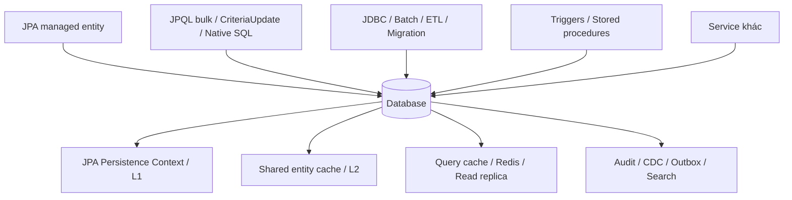
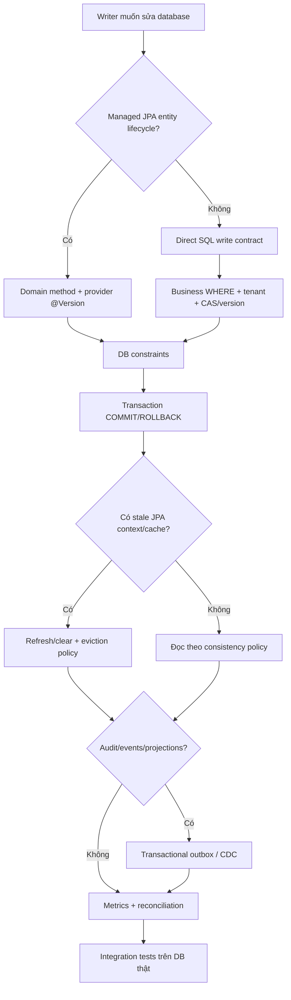

# Bảo đảm tính đúng khi dữ liệu được cập nhật ngoài JPA

Một hệ thống dùng JPA không nhất thiết chỉ có `EntityManager.persist()`, dirty checking và `EntityManager.remove()` là những đường ghi database. Dữ liệu còn có thể được thay đổi bởi **JPQL bulk UPDATE/DELETE, CriteriaUpdate/CriteriaDelete, native SQL, JDBC, batch jobs, ETL, database triggers, stored procedures, data migrations, công cụ quản trị hoặc một service khác**.

Các cập nhật ấy có thể thành công ở cấp SQL nhưng làm một ứng dụng JPA hoạt động sai:

- Entity đang managed giữ state cũ.
- Second-level cache hoặc query cache trả kết quả trước khi batch cập nhật.
- External SQL không tăng cột `@Version`, khiến optimistic locking không phát hiện một thay đổi.
- `@PreUpdate`, `@PostUpdate` và Bean Validation không được chạy trên từng entity.
- SQL bỏ qua tenant/authorization, trạng thái nghiệp vụ hoặc audit metadata.
- Trigger thay giá trị ở DB nhưng Java object không được đồng bộ.
- Migration tạo dữ liệu không còn phù hợp enum, constraint hoặc cách mapping.
- Event được gửi trước commit hoặc không phát ra dù một business transition đã xảy ra.

Bài **“Bảo đảm tính đúng khi dữ liệu được cập nhật ngoài JPA”** thuộc chương **Kiểm tra dữ liệu** của module **Data Persistence Relational Access ORM JPA**. Mục tiêu là xây dựng **hợp đồng tính đúng (*correctness contract*) dùng chung cho mọi writer**, thay vì chỉ bổ sung vài lệnh `refresh()` rồi hy vọng JPA tự xử lý.

> **Nguyên tắc:** JPA entity annotations không phải hàng rào áp dụng cho mọi câu SQL có quyền ghi database. Những bất biến phải đúng bất kể writer nào cần được bảo vệ bằng database constraints, transaction/atomic concurrency protocol, phân quyền và cơ chế đồng bộ/đối soát.

---

## 1. Phân biệt “ngoài JPA” với “ngoài persistence context”

Có hai trường hợp thường bị gọi chung là “cập nhật ngoài JPA”.

**Cập nhật direct DML trong chính ứng dụng JPA:**

- `em.createQuery("update ...").executeUpdate()`.
- `CriteriaUpdate` / `CriteriaDelete`.
- `em.createNativeQuery("update ...")`.
- Spring Data `@Modifying` JPQL.
- Hibernate-specific bulk SQL.

Những thao tác này vẫn chạy qua một phần API JPA/provider, nhưng **không đi qua lifecycle của từng managed entity**.

**Cập nhật từ hệ thống hoặc công cụ khác:**

- `JdbcTemplate`, JDBC driver độc lập.
- Scheduled ETL/batch.
- Flyway/Liquibase data migration.
- Database trigger hoặc procedure.
- Một service khác.
- Import script, DBA console.

Một service khác cũng có thể dùng JPA managed entities và `@Version` rất đúng. Vì vậy câu hỏi quan trọng không phải “nó nằm ngoài JVM này à?”, mà là **writer thực thi cơ chế nào và có tuân cùng quy tắc dữ liệu không?**

## 2. Tính đúng không chỉ là UPDATE thành công

| Khía cạnh | Câu hỏi |
|---|---|
| Schema | NOT NULL, UNIQUE, FOREIGN KEY, CHECK có đúng không? |
| Domain | State machine, stock, price, quota và quyền có hợp lệ không? |
| Concurrent writes | Có lost update, phantom, write skew hoặc duplicate operation không? |
| Version | Cột version có tăng/kiểm tra đồng nhất trên mọi writer không? |
| JPA state | Managed entity có stale không? |
| Cache | L2/query/Redis có bị stale không? |
| Audit | Ai đã đổi, vì sao và khi nào commit? |
| Integration | Event có phát sau commit, có retry và idempotency không? |
| Operations | Có phát hiện và sửa dữ liệu lệch không? |

SQL có thể cập nhật thành công dù domain state sai. Một giá trị status `PAID` nằm trong enum không chứng minh được phép chuyển `CANCELLED → PAID`.

## 3. Kiến trúc nhiều writers



Database là nguồn dữ liệu có thẩm quyền cho các writes, nhưng những bản sao ở memory/cache không tự động được cập nhật bởi mọi tác nhân bên ngoài.

Muốn tính đúng, cần thiết kế cả **write protocol** lẫn **read/refresh/invalidation protocol**.

---

## 4. Mô hình ví dụ: Order và Product

```java
import jakarta.persistence.*;
import java.time.Instant;

@Entity
@Table(name = "purchase_orders")
public class PurchaseOrder {

    @Id
    private Long id;

    @Column(name = "tenant_id", nullable = false)
    private String tenantId;

    @Enumerated(EnumType.STRING)
    @Column(nullable = false)
    private OrderStatus status;

    @Column(length = 500)
    private String note;

    @Column(name = "updated_at", nullable = false)
    private Instant updatedAt;

    @Version
    @Column(nullable = false)
    private Long version;

    protected PurchaseOrder() {}

    public Long getId() { return id; }
    public String getTenantId() { return tenantId; }
    public OrderStatus getStatus() { return status; }
    public String getNote() { return note; }
    public Long getVersion() { return version; }

    public void changeNote(String value, Instant now) {
        note = value;
        updatedAt = now;
    }

    public void markPaid(Instant now) {
        if (status != OrderStatus.NEW) {
            throw new IllegalStateException(
                "Only NEW orders may become PAID"
            );
        }
        status = OrderStatus.PAID;
        updatedAt = now;
    }
}
```

```java
public enum OrderStatus {
    NEW, PAID, CANCELLED
}
```

Product:

```java
@Entity
@Table(name = "products")
public class Product {

    @Id
    private Long id;

    @Column(name = "tenant_id", nullable = false)
    private String tenantId;

    @Column(nullable = false)
    private int stock;

    @Version
    private Long version;

    protected Product() {}

    public int getStock() { return stock; }
    public Long getVersion() { return version; }

    public void reserve(int quantity) {
        if (quantity <= 0 || quantity > stock) {
            throw new IllegalArgumentException(
                "Invalid reservation quantity"
            );
        }
        stock -= quantity;
    }
}
```

Điều kiện `quantity <= stock` trong Java là domain validation hữu ích, nhưng **không tự chống concurrent reservation**. Nếu hai transactions cùng nhìn stock cũ, cần lock/optimistic version/atomic SQL hoặc một strategy tương đương.

## 5. Schema constraints làm lớp bảo vệ cuối

DDL minh họa:

```sql
CREATE TABLE purchase_orders (
    id BIGINT PRIMARY KEY,
    tenant_id VARCHAR(60) NOT NULL,
    status VARCHAR(20) NOT NULL,
    note VARCHAR(500),
    updated_at TIMESTAMP NOT NULL,
    version BIGINT NOT NULL,
    CONSTRAINT ck_order_status
        CHECK (status IN ('NEW', 'PAID', 'CANCELLED'))
);

CREATE TABLE products (
    id BIGINT PRIMARY KEY,
    tenant_id VARCHAR(60) NOT NULL,
    stock INTEGER NOT NULL,
    version BIGINT NOT NULL,
    CONSTRAINT ck_stock CHECK (stock >= 0)
);
```

Khi một JDBC writer chạy trực tiếp, những constraints **thực sự tồn tại trong DB, đang có hiệu lực và được DBMS hỗ trợ** vẫn bảo vệ dữ liệu.

Ngược lại, chỉ nhìn thấy `@Column(nullable=false)` trong code **chưa chứng minh production schema có NOT NULL**. Migrations và schema validation phải xác nhận physical structure.

## 6. Một ví dụ gây lỗi

Ban đầu:

```text
Order#100
  tenant="acme"
  note="Giao buổi sáng"
  version=7
```

JPA transaction A đọc entity version 7.

Batch B chạy:

```sql
UPDATE purchase_orders
SET note = 'Giao sau 15:00'
WHERE id = 100;
```

B commit.

Hậu quả có thể gồm:

- Entity A vẫn giữ `note="Giao buổi sáng"`.
- Version trong database vẫn 7.
- A có thể ghi đè B mà không có optimistic conflict.
- `updated_at` không đổi.
- JPA `@PreUpdate` không được gọi.
- Shared cache có thể vẫn chứa bản cũ.

Từng lớp vấn đề cần giải pháp riêng; không một lệnh `refresh()` nào sửa được tất cả.

---

## 7. Persistence context và first-level cache

Persistence context là tập managed entities gắn với một EntityManager và unit of work.

```java
PurchaseOrder order =
    em.find(PurchaseOrder.class, 100L);
```

Nếu gọi lại `find()` trên cùng ID trong cùng persistence context, provider thường trả chính managed instance đó, nhờ identity map.

```java
PurchaseOrder again =
    em.find(PurchaseOrder.class, 100L);

// Thông thường:
assert order == again;
```

Đây là cơ chế đúng của JPA, giúp identity consistency. Nhưng nếu một external transaction đã cập nhật database, object Java cũ **không tự thay fields**.

## 8. Gọi find() lần nữa không phải refresh()

Ví dụ:

```java
PurchaseOrder a =
    em.find(PurchaseOrder.class, 100L);

// Transaction khác thay note và commit.

PurchaseOrder b =
    em.find(PurchaseOrder.class, 100L);
```

Trong cùng persistence context, `a` và `b` có thể vẫn là cùng object và có cùng state cũ.

Nếu nghiệp vụ cần đọc lại, cân nhắc:

- `em.refresh(a)`.
- Kết thúc unit of work rồi dùng EntityManager/transaction mới.
- `em.clear()` rồi `find()`, nếu đã xử lý pending changes.
- Kiểm tra shared cache và isolation.

**Repeated find() không đảm bảo query DB lần nữa.**

## 9. em.refresh() có ích khi nào?

```java
PurchaseOrder order =
    em.find(PurchaseOrder.class, 100L);

// Một stored procedure hoặc JDBC writer đã commit.
em.refresh(order);
```

`refresh()` yêu cầu nạp lại managed state theo JPA semantics.

Hữu ích khi:

- Trigger cập nhật cột DB-generated.
- Procedure sửa row đã loaded.
- Integration test cần so sánh persisted value.
- Một external writer đã commit và transaction hiện tại có thể nhìn thấy nó.

Nhưng refresh **không vượt transaction isolation**. Nếu B chưa commit hoặc A đang giữ snapshot cũ tại REPEATABLE READ, kết quả phụ thuộc DBMS/transaction semantics.

## 10. refresh() có thể làm mất pending changes

```java
PurchaseOrder order =
    em.find(PurchaseOrder.class, 100L);

order.changeNote("Draft chưa flush", now);

em.refresh(order); // Có thể ghi đè draft bằng DB state.
```

Trước refresh, cần biết:

- Có local modifications chưa flush không?
- Có chủ đích bỏ các modifications này không?
- Có nên rollback và reload từ đầu?
- Nếu flush trước, có gây stale overwrite/conflict không?
- Cache/transaction snapshot có cho giá trị mong muốn không?

**Refresh không phải thao tác “vô hại” để gọi đại trà.**

## 11. em.clear() và tác dụng phụ

```java
em.clear();
```

Clear detach **tất cả** managed entities của persistence context. Nó không tự ghi pending changes.

Sau clear:

```java
PurchaseOrder fresh =
    em.find(PurchaseOrder.class, 100L);
```

có thể nạp lại entity, nhưng:

- Những changes chưa flush trước clear có thể bị mất.
- Những references cũ vẫn giữ detached objects.
- L2/query cache vẫn có thể stale.
- Transaction isolation vẫn áp dụng.

Đừng dùng `clear()` để thay cho transaction design có chủ đích.

## 12. flush() trước bulk/clear

Một pattern:

```java
em.flush();

int affected = em.createQuery(
    """
    update PurchaseOrder o
       set o.note = :note
     where o.id = :id
    """
)
.setParameter("note", "Batch")
.setParameter("id", 100L)
.executeUpdate();

em.clear();
```

Ý định:

1. Flush managed pending changes trước khi bulk DML.
2. Thực hiện direct UPDATE.
3. Clear entities có thể stale.

Tuy nhiên, flush đồng bộ **mọi pending managed changes phù hợp**, không chỉ Order. Nó có thể gây SQL/exception ở thời điểm không mong muốn. Với bulk job lớn, thường rõ hơn khi dùng **transaction/persistence context riêng**.

## 13. em.detach() khác clear()

```java
em.detach(order);
```

Detach một entity (và những đối tượng cascade detach nếu mapping quy định), không phải toàn bộ context.

Nó không tự refresh object cũ. Một detached entity vẫn mang các values trước đó.

Nếu một client giữ detached snapshot lâu, phải dùng optimistic precondition (version/ETag) khi ghi, thay vì tin snapshot đó vẫn là current state.

## 14. Refresh root không đồng nghĩa refresh graph

Order có thể tham chiếu Customer, OrderLines, Promotions.

`em.refresh(order)` không có nghĩa mọi related entity ở mọi depth chắc chắn được reload. Còn có:

- Cascade refresh mapping.
- Already-initialized collections.
- Managed child instances.
- Second-level collection cache.
- Query cache.
- Provider-specific fetch plan.

Nếu external SQL thay toàn aggregate, đôi khi việc **kết thúc persistence context và load một aggregate mới** an toàn hơn refresh từng node theo cách thủ công.

---

## 15. Bulk JPQL UPDATE bỏ qua per-entity lifecycle

```java
int affected = em.createQuery(
    """
    update PurchaseOrder o
       set o.note = :note
     where o.status = :status
    """
)
.setParameter("note", "Batch changed")
.setParameter("status", OrderStatus.NEW)
.executeUpdate();
```

Bulk UPDATE không chạy một lần dirty checking cho từng entity.

Hệ quả:

- Không tự gọi `@PreUpdate`/`@PostUpdate` per entity.
- Không tự gọi domain methods.
- Không tự tăng `@Version` theo managed lifecycle.
- Không tự đồng bộ managed instances đã loaded.
- Không tự chạy Bean Validation của từng entity như managed update.
- Không tự cập nhật audit metadata ngoài những columns được SQL set.

Không coi bulk DML tương đương lặp qua `repository.save(entity)`.

## 16. CriteriaUpdate cũng là bulk DML

```java
CriteriaBuilder cb = em.getCriteriaBuilder();

CriteriaUpdate<PurchaseOrder> update =
    cb.createCriteriaUpdate(PurchaseOrder.class);

Root<PurchaseOrder> o =
    update.from(PurchaseOrder.class);

update.set(o.get("note"), "Batch");
update.where(cb.equal(o.get("status"), OrderStatus.NEW));

int affected = em.createQuery(update).executeUpdate();
```

Sử dụng Criteria API có thể giúp dựng query an toàn hơn nhưng **không biến direct UPDATE thành managed entity lifecycle**.

## 17. Native SQL chạy qua EntityManager vẫn bypass callbacks

```java
int affected = em.createNativeQuery(
    """
    update purchase_orders
       set note = :note
     where id = :id
    """
)
.setParameter("note", "Native change")
.setParameter("id", 100L)
.executeUpdate();
```

Lệnh trên đi qua EntityManager nhưng là SQL native:

- Không gọi `order.changeNote()`.
- Không tự kích hoạt entity callbacks.
- Không tự tăng JPA version.
- Không tự refresh entity đang managed.
- Có thể dùng database-specific syntax/driver semantics.

Do đó cũng cần write protocol cho direct SQL.

## 18. Spring Data @Modifying không tự sửa mọi vấn đề

```java
@Modifying(
    flushAutomatically = true,
    clearAutomatically = true
)
@Query("""
    update PurchaseOrder o
       set o.note = :note
     where o.id = :id
    """)
int changeNote(
    @Param("id") Long id,
    @Param("note") String note
);
```

Hai tùy chọn giúp flush/clear persistence context quanh query, nhưng không:

- Thêm WHERE version.
- Increment @Version.
- Chạy per-entity callbacks/Bean Validation.
- Thêm tenant security.
- Phát domain events.
- Invalidate mọi shared/application caches.

Cần hiểu `clearAutomatically` có thể làm mất unflushed state nếu flush không được thực hiện đúng.

---

## 19. @Version và lost update

Managed JPA entity:

```java
@Version
private Long version;
```

Provider có thể phát SQL minh họa:

```sql
UPDATE purchase_orders
SET note = :note, version = 8
WHERE id = 100 AND version = 7;
```

Nếu một writer khác đã đổi version 7 → 8, câu UPDATE không còn matching row và provider phát hiện optimistic conflict.

**Nhưng nếu external writer thay state mà vẫn để version 7, JPA không có tín hiệu revision change.**

## 20. Tình huống version không tăng

```text
Ban đầu: note="Old", version=7

JPA A: load note="Old", version=7
JDBC B: UPDATE note="Batch" WHERE id=100; COMMIT
        version vẫn 7

JPA A: changeNote("User")
        UPDATE WHERE id=100 AND version=7 → thành công
```

A có thể ghi đè giá trị từ B mà không báo optimistic conflict. Một số providers phát UPDATE nhiều columns, làm tăng rủi ro ghi đè các fields khác.

**@Version chỉ bảo vệ đúng khi mọi writer của state được version hóa đều tuân phiên bản.**

## 21. External SQL cần increment version atomically

Với numeric Long version:

```sql
UPDATE purchase_orders
SET note = :new_note,
    updated_at = :now,
    version = version + 1
WHERE id = :id
  AND tenant_id = :tenant_id;
```

Đặc điểm:

- State và version được thay trong **cùng SQL UPDATE**.
- Không cần SELECT phiên bản cũ rồi tăng ở Java nếu external writer chấp nhận unconditional update theo policy.
- Tenant predicate bảo vệ phạm vi dữ liệu.
- Audit timestamp được cập nhật nhất quán.
- JPA managed instances giữ version cũ sẽ bị phát hiện khi cố ghi, miễn optimistic version checking được áp dụng đúng.

Nếu update có precondition dựa trên snapshot cũ, cần thêm CAS.

## 22. Compare-and-set với expectedVersion

```sql
UPDATE purchase_orders
SET note = :new_note,
    updated_at = :now,
    version = version + 1
WHERE id = :id
  AND tenant_id = :tenant_id
  AND version = :expected_version;
```

Kết quả:

- Match một row: concurrency precondition thỏa.
- Không match: có thể ID không tồn tại, sai tenant, version stale hoặc predicate khác không thỏa.
- Nhiều match: bất thường nếu ID là PK.

Một API không nên luôn trả “stale” nếu affected rows=0, vì việc đó có thể tiết lộ resource thuộc tenant khác.

Khi dùng numeric version, phép increment trong UPDATE giúp tránh hai writers độc lập cùng đọc và tính version theo cách có race.

## 23. CAS cho domain transition

Một business rule chỉ cho `NEW → PAID`:

```sql
UPDATE purchase_orders
SET status = 'PAID',
    updated_at = :now,
    version = version + 1
WHERE id = :id
  AND tenant_id = :tenant_id
  AND status = 'NEW'
  AND version = :expected_version;
```

Bây giờ SQL bảo vệ đồng thời:

- Resource identity/tenant.
- Trạng thái cũ.
- Expected revision.

Nếu 0 rows, service phải phân loại theo policy: not found, not authorized, invalid status hay stale version.

Đây là cách biểu diễn precondition bằng SQL; nó không tự kiểm tra mọi điều kiện phức tạp khác của thanh toán.

## 24. Hai transactions cùng expectedVersion

```mermaid
sequenceDiagram
    participant A as Writer A
    participant B as Writer B
    participant DB as Database
    A->>DB: UPDATE WHERE version=7
    DB-->>A: success; version=8
    B->>DB: UPDATE WHERE version=7
    DB-->>B: no matching version
    Note over B: Stale write / conflict handling
```

Khi contention xảy ra, transaction/cú pháp/locking thực tế có thể khiến B chờ A commit trước khi điều kiện được đánh giá lại.

Không tự retry bằng cách đổi expectedVersion lên 8 rồi ghi đè payload cũ, trừ khi domain policy cho phép reapply/merge.

## 25. @Version ở JPA không được sửa bằng setter

Sai:

```java
PurchaseOrder order =
    em.find(PurchaseOrder.class, id);

order.setVersion(order.getVersion() + 1);
```

Managed entity version do provider quản lý. Application code không nên tăng `@Version` thủ công.

**Phân biệt rõ:**

- Managed entity write: provider quản lý version.
- Bulk/native/JDBC write: SQL tuân quy ước version/compare-and-set.

## 26. Version timestamp không tăng bằng +1

Nếu entity dùng temporal version:

```java
@Version
private Instant revisionInstant;
```

thì không thể copy công thức numeric:

```sql
SET revision_instant = revision_instant + 1
```

Các kiểu temporal version portable thay đổi theo phiên bản JPA/Jakarta Persistence, chẳng hạn Jakarta Persistence 3.2 bổ sung `Instant` và `LocalDateTime`.

Đối với multiple writers, cần một chính sách timestamp generation/comparison đồng bộ giữa provider, JDBC driver và DB precision. Timestamp bị làm tròn có thể khiến revision collision.

Vì vậy `Long` thường dễ định nghĩa CAS protocol hơn trong hệ thống đa ngôn ngữ.

## 27. Trigger và provider không nên cùng tự tăng version

Một trigger:

```text
BEFORE UPDATE purchase_orders:
    NEW.version = OLD.version + 1
```

có thể xung đột với ORM đã set version mới trong UPDATE. Tùy trigger, version có thể tăng hai lần hoặc Java state không khớp DB.

Cần chọn một cơ chế generation chính:

- Provider-managed version cho JPA, external writers increment theo protocol.
- Hoặc DB-managed/generated version được provider cấu hình và đồng bộ đúng.

Nếu dùng DB-generated version, kiểm tra generated-value mapping, flush/refresh và các lệnh native/bulk. Không chỉ thêm trigger rồi mặc định JPA hiểu nó.

## 28. Version không bảo vệ mọi invariant

Một Order version không tự ngăn hai Orders bán cùng Product.stock.

Version cũng không thay thế:

- UNIQUE idempotency key cho Payment.
- FK cho child references.
- CHECK stock nonnegative.
- Atomic increment/decrement.
- Predicate/range protection cho phantom.
- Distributed transaction/outbox.

Concurrency của mỗi shared resource phải được đánh giá theo **rows và invariants thực sự**.

---

## 29. Bean Validation và SQL khác phạm vi

Entity:

```java
@NotNull
@Size(max = 500)
private String note;
```

có thể được kiểm tra qua Jakarta Bean Validation integration trong JPA managed lifecycle phù hợp.

Nhưng JDBC:

```sql
UPDATE purchase_orders
SET note = NULL
WHERE id = 100;
```

không thực hiện Java Bean Validation. Nếu database column cho phép NULL, SQL có thể chạy.

Do đó:

- Java validation dùng cho API feedback và domain state.
- DB NOT NULL/CHECK/UNIQUE/FK bảo vệ mọi SQL writers.
- Không suy tính đúng từ annotations mà không biết production schema.

## 30. @Column(nullable=false) không tự sửa schema production

```java
@Column(nullable = false)
private String note;
```

là mapping/DDL metadata. Nó không chứng minh database hiện tại đã có:

```sql
note VARCHAR(500) NOT NULL
```

Nếu schema từ migration cũ vẫn nullable, external SQL có thể đưa vào NULL. Phải kiểm tra schema và dùng migrations có kiểm soát.

## 31. Các lớp validation cần hợp tác

| Tầng | Đáp ứng tốt | Giới hạn |
|---|---|---|
| DTO/Bean Validation | Input syntax, required fields, message cho client | JDBC/batch không dùng API này |
| Domain method | State transitions, business invariants | External SQL có thể bypass |
| DB constraints | NOT NULL, CHECK, UNIQUE, FK | Không diễn tả mọi workflow |
| Atomic SQL/locking | Races và shared counters | Phải thiết kế đúng predicates |
| Reconciliation | Phát hiện lệch đã xảy ra | Không chặn ngay lúc ghi |

Một invariant “bất cứ writer nào cũng không được tạo stock âm” nên có CHECK hoặc cơ chế DB tương đương ngoài domain validation.

## 32. CHECK bảo vệ giá trị, không tự bảo vệ transition

```sql
CHECK (status IN ('NEW', 'PAID', 'CANCELLED'))
```

ngăn status `UNKNOWN`, nhưng không tự ngăn:

```text
CANCELLED → PAID
```

Cần domain service, conditional UPDATE, stored procedure, trigger hoặc một cơ chế DB-enforced state machine nếu mọi writer đều phải bị ràng buộc.

## 33. Stock: CHECK + atomic UPDATE

```sql
UPDATE products
SET stock = stock - :quantity,
    version = version + 1
WHERE id = :id
  AND tenant_id = :tenant
  AND stock >= :quantity
  AND :quantity > 0;
```

Kiểm tra affected rows và giao dịch.

CHECK `stock >= 0` là tuyến phòng thủ cuối; predicate trong UPDATE bảo đảm business command chỉ được thực hiện nếu điều kiện tồn kho còn đúng tại thời điểm ghi.

Một read-then-write đơn giản ở Java không đủ chống hai transactions cùng đọc stock cũ.

## 34. UNIQUE và idempotency

Payment request có thể retry sau timeout.

Một ràng buộc:

```sql
CREATE UNIQUE INDEX uq_payment_idempotency
ON payments(tenant_id, idempotency_key);
```

có thể ngăn tạo trùng record cùng key qua cả JPA lẫn JDBC.

Tuy nhiên unique key không tự rollback một external payment đã charge trước khi insert. Cần idempotency protocol với payment gateway và transaction/outbox/saga phù hợp.

## 35. FK không thay business status rule

```sql
FOREIGN KEY (order_id)
REFERENCES purchase_orders(id)
```

giữ tính toàn vẹn tham chiếu, không tự kiểm tra Order.status đang NEW khi INSERT OrderLine.

Nếu có external Line writers, có thể yêu cầu mọi writer khóa parent Order trước rồi check status hoặc dùng database enforcement phù hợp. Khóa những child rows đã tồn tại không tự ngăn phantom insert một child mới.

## 36. @Column(updatable=false) không là DB authorization

```java
@Column(updatable = false)
private String externalReference;
```

có thể khiến JPA bỏ field khỏi managed UPDATE SQL, nhưng external JDBC vẫn có thể UPDATE cột nếu quyền DB cho phép.

Nếu field phải immutable với mọi writer, dùng database privileges, trigger/constraint hoặc schema model thích hợp, không dựa duy nhất vào mapping flag.

## 37. Enum mapping và dữ liệu ngoài JPA

```java
@Enumerated(EnumType.STRING)
private OrderStatus status;
```

Khi external writer ghi `'ARCHVIED'` sai chính tả, Java enum mapper có thể lỗi **khi đọc entity**, không phải khi SQL UPDATE diễn ra.

DB CHECK hoặc lookup/reference table giúp ngăn invalid values sớm hơn. Các migrations thêm enum value phải được rollout tương thích giữa writers/readers.

## 38. Precision/timezone/conversion

Một SQL value có thể pass constraint nhưng không round-trip đúng Java mapping:

- DECIMAL precision/scale khác nhau.
- Timestamp microseconds bị làm tròn thành milliseconds.
- UTC vs local timestamp.
- Enum string và collation.
- VARCHAR max length.
- UUID text/bytes encoding.
- JSON long integer không chính xác trong JS Number.
- Null semantics không thống nhất.

Hợp đồng dữ liệu đa ngôn ngữ phải nêu rõ type, timezone, precision, normalization và serialization policy.

---

## 39. Trigger có thể tạo state JPA chưa biết

Một DB trigger:

```text
BEFORE UPDATE purchase_orders:
    updated_at = CURRENT_TIMESTAMP
```

có thể thay `updated_at` bất kể giá trị JPA gửi vào.

Sau flush, Java object có thể giữ `updatedAt` trước trigger nếu provider không được cấu hình để đồng bộ generated value.

Cách xử lý:

- Chọn generated-value mapping được provider hỗ trợ.
- Refresh entity khi cần.
- Dùng RETURNING khi DB/provider hỗ trợ.
- Quy định một owner cho timestamp/version.
- Test exact values sau DB round-trip.

## 40. Đừng để ba writers cùng sở hữu updatedAt

Ba cách:

1. `@PreUpdate` trong Java.
2. SQL bulk/native tự set.
3. Database trigger tự set.

Mỗi cách có thể hợp lý, nhưng nếu cùng tranh quyền trên cùng một cột, giá trị được thấy trong Java, SQL và audit có thể khác nhau.

Một chính sách rõ:

> Mọi writers ghi updated_at trong cùng UPDATE, DB NOT NULL ràng buộc giá trị.

Hoặc:

> Trigger là nguồn sự thật; ORM mapping biết column do DB sinh.

Không coi một chính sách chưa được tài liệu hóa là “đương nhiên”.

## 41. Audit callback không bao phủ external SQL

```java
@PreUpdate
void audit() {
    lastModifiedBy = currentUser();
}
```

Batch JDBC không chạy callback. Nếu audit cần bao phủ toàn bộ writers:

- Ghi actor/job ID trong write contract.
- Hoặc DB trigger/audit table/CDC.
- Hoặc chỉ cho phép ghi qua một service.
- Đồng bộ cách truyền actor/tenant cho scheduled jobs.
- Không suy rằng `lastModifiedBy` luôn đáng tin chỉ vì entity listener tồn tại.

## 42. Stored procedure sửa nhiều entities

Giả sử:

```java
em.createNativeQuery(
    "call normalize_order(:id)"
)
.setParameter("id", orderId)
.executeUpdate();
```

Procedure có thể sửa Order, Lines và Totals.

`em.refresh(order)` không tự làm mới mọi loaded OrderLine hoặc cache related collections. Cần đánh giá:

- Procedure sửa những bảng nào?
- JPA đang giữ những managed instances nào?
- DB transaction visibility ra sao?
- Có pending local changes không?
- Shared/query caches có cần invalidation?
- Procedure đã tuân version/audit protocol chưa?

Nếu thay nhiều rows, transaction/persistence context mới sau procedure thường dễ reasoning hơn refresh từng object tùy tiện.

---

## 43. Transaction visibility: external writer đã commit chưa?

Nếu B UPDATE nhưng chưa COMMIT, A gọi refresh chưa chắc thấy state B.

`refresh()` không vượt qua các quy tắc:

- READ COMMITTED.
- REPEATABLE READ/SNAPSHOT.
- Row locks.
- MVCC visibility.
- Read replica lag.

Để thấy committed state mới, có thể cần transaction mới trên authoritative database và context/cache policy phù hợp.

## 44. READ COMMITTED vs REPEATABLE READ

| Isolation | Điều cần nhớ |
|---|---|
| READ COMMITTED | Một statement mới thường có thể thấy commits trước statement, nhưng L1 cache vẫn có thể che |
| REPEATABLE READ/SNAPSHOT | Transaction có thể tiếp tục nhìn snapshot cũ, tùy DBMS |
| SERIALIZABLE | Mạnh hơn về anomalies nhưng có thể đòi retry khi serialization failure |
| READ UNCOMMITTED | Có thể cho dirty reads ở DBMS hỗ trợ; thường không phù hợp critical correctness |

Không coi isolation names của mọi DBMS có semantics giống hệt nhau.

## 45. Một transaction dài dễ giữ state cũ

Khi EntityManager sống rất lâu, external updates xảy ra trong lúc context vẫn giữ managed entities.

Giải pháp thường là:

- Transaction/persistence context ngắn theo use case.
- Không giữ managed entities qua nhiều HTTP requests.
- DTO snapshots có version.
- Đọc lại ở transaction mới khi cần.
- Không lạm dụng `refresh()` ở mọi getter vì tốn IO và phá in-memory state.

## 46. Read replica lag không phải lỗi JPA

```text
Primary database: Order version=8
Read replica:      Order version=7
```

Ngay cả với EntityManager mới và cache bị vô hiệu hóa, query qua replica vẫn có thể thấy v7.

Nếu cần read-after-write strong consistency:

- Read primary.
- Hoặc dùng replication consistency token/wait khi DB hỗ trợ.
- Đo replica lag.
- Đánh giá SLA của eventual consistency.
- Thực hiện CAS/write precondition trên authoritative primary.

## 47. Refresh không sửa lost update nếu SQL vẫn không atomic

Hai transactions đều đọc stock=5, rồi cùng set stock=4. Kết quả có thể chỉ trừ một lần thay vì hai.

Làm mới dữ liệu trước đó có thể giảm stale read, nhưng giữa read và write vẫn có race.

Cần atomic conditional UPDATE, locks, optimistic version/transaction isolation phù hợp.

**Fresh observation và safe concurrent mutation là hai mục tiêu khác nhau.**

---

## 48. Second-level cache và JPA Cache API

Một provider có thể bật shared L2 cache.

JPA cung cấp:

```java
Cache cache = entityManagerFactory.getCache();

cache.evict(PurchaseOrder.class, 100L);
cache.evict(PurchaseOrder.class);
cache.evictAll();
```

Những APIs này giúp evict cached entities ở lớp shared cache, nhưng:

- Không refresh managed object đang ở L1.
- Không đồng nghĩa xóa provider query cache.
- Không đồng nghĩa xóa Redis/Spring Cache.
- Không chứng minh invalidate đã truyền đến mọi app node.
- `evictAll()` có chi phí lớn và không nên gọi cho từng row update.

## 49. L2 evict không thay đổi L1

```text
A: em.find(Order#100) -> managed version=7
B: JDBC UPDATE version=8, COMMIT
B: evict L2 Order#100
A: em.find(Order#100) -> vẫn managed v7
```

A cần đọc lại trong context/isolation phù hợp hoặc dùng version conflict detection khi ghi. Eviction của shared cache không tác động reference mà A đang giữ.

## 50. Query cache là vấn đề riêng

Một query cached:

```jpql
select o.id
from PurchaseOrder o
where o.status = 'NEW'
```

sau external SQL đổi status có thể vẫn trả danh sách IDs cũ.

Evict một entity khỏi L2 không nhất thiết evict mọi cached query results. Query cache thường là provider-specific; JPA không định nghĩa API query-cache invalidation phổ quát.

Nếu business correctness đòi result set mới nhất, tránh cache hoặc có invalidation/read policy thích hợp.

## 51. Application cache/Redis khác JPA

Spring Cache:

```java
@Cacheable("orderViews")
public OrderView getOrder(Long id) { ... }
```

không tự hết stale khi `em.refresh()`.

Cần:

- Cache keys scope tenant.
- Evict/TTL/versioned keys.
- Invalidation sau commit.
- Cross-node propagation.
- Tránh race: evict trước commit, một reader repopulate dữ liệu cũ.
- Eventual consistency contract và cache repair.

## 52. Delete bên ngoài JPA và stale objects

B chạy:

```sql
DELETE FROM purchase_orders
WHERE id = 100;
```

A vẫn có managed Java object của Order#100.

Khi A cố UPDATE/DELETE, có thể gặp stale state/optimistic lock failure; read từ cache cũng có thể trả bản không còn tồn tại.

Giải pháp bao gồm proper version/CAS delete semantics, cache invalidation, FK constraints và transaction boundary rõ.

## 53. Cache invalidation qua outbox/CDC

Một external writer không mặc nhiên báo cho ORM các rows vừa đổi.

Có thể:

1. Ghi DB changes và outbox event cùng transaction.
2. Commit.
3. Worker/CDC phát invalidation event.
4. Application nodes evict cache entries.
5. Consumers xử lý duplicate/out-of-order messages.
6. Với critical reads, bỏ cache và dùng authoritative DB.

Nếu không cần cache mạnh, tắt L2 cho entities bị thay bên ngoài thường đơn giản hơn một custom invalidation protocol phức tạp.

---

## 54. Tenant và authorization phải có trong direct SQL

Một JPA query:

```jpql
select o from PurchaseOrder o
where o.id = :id
  and o.tenantId = :tenant
```

nhưng external SQL:

```sql
UPDATE purchase_orders
SET status = 'PAID'
WHERE id = :id;
```

có thể bỏ kiểm tra tenant.

Một direct write contract nên chứa:

```sql
WHERE id = :id
  AND tenant_id = :authenticated_tenant;
```

Tenant được lấy từ trusted identity/job context, không từ body client tùy ý.

Không coi `@Filter` hoặc ORM multi-tenancy annotations là DB-level authorization áp dụng cho mọi JDBC writer.

## 55. Database privileges và row-level security

Một hệ thống có nhiều writers nên có least-privilege access:

- App role không được ALTER/DROP constraints.
- ETL role chỉ UPDATE bảng/cột cần thiết.
- Migration role quản lý riêng.
- Row-level security khi DBMS/threat model cho phép.
- Stored procedure contract cho bảng nhạy cảm.
- Logging/auditing theo identity của writer.
- Kiểm tra quyền trên database thật.

Business correctness và security cùng bị ảnh hưởng khi SQL cập nhật nhầm tenant hoặc dữ liệu không thuộc quyền.

## 56. Write contract dùng chung

Một tài liệu nhóm nên quy định:

| Thành phần | Quy tắc |
|---|---|
| Owner | Service/team nào được sửa bảng? |
| Identity | ID, tenant scope và key chính |
| State | Valid transitions và preconditions |
| Version | Khi nào tăng, ai quản lý, CAS semantics |
| Audit | Actor, job ID, reason, time source |
| Transaction | Isolation, locks, rollback, retry |
| Cache | L1/L2/query/app invalidation policy |
| Events | Outbox/CDC, payload, ordering, idempotency |
| Security | DB role, tenant/authorization |
| Migrations | Compatible deployment và data validation |
| Reconciliation | Đo/repair khi có lệch |
| Testing | DBMS/dialect/driver nào được xác minh |

Một write path không tuân hợp đồng này là nguồn rủi ro, dù câu SQL có tối ưu đến đâu.

---

## 57. Managed JPA command theo hợp đồng

Ví dụ application service:

```java
@Service
public class OrderService {

    @PersistenceContext
    private EntityManager em;

    private final Clock clock;

    public OrderService(Clock clock) {
        this.clock = clock;
    }

    @Transactional
    public void pay(
            Long orderId,
            String tenantId,
            Long expectedVersion) {

        PurchaseOrder order = em.createQuery(
            """
            select o
            from PurchaseOrder o
            where o.id = :id
              and o.tenantId = :tenant
            """,
            PurchaseOrder.class
        )
        .setParameter("id", orderId)
        .setParameter("tenant", tenantId)
        .getSingleResult();

        if (!Objects.equals(
                order.getVersion(),
                expectedVersion)) {
            throw new StaleOrderException();
        }

        order.markPaid(clock.instant());
        // JPA @Version kiểm tra tại flush/commit.
    }
}
```

Các imports `Clock`, `Objects`, `EntityManager`, `PersistenceContext`, Spring annotations và exception `StaleOrderException` cần được khai phù hợp. `tenantId` phải là trusted context value.

Đây là một use case managed entity:

- Load có tenant scope.
- Kiểm client expectedVersion nếu có long-running form.
- Domain method check transition.
- Provider quản lý version.
- DB constraints vẫn tồn tại.

## 58. JDBC command theo hợp đồng tương đương

Ví dụ Spring JDBC:

```java
@Transactional
public int payWithJdbc(
        long orderId,
        String tenantId,
        long expectedVersion,
        Instant now) {

    return jdbcTemplate.update(
        """
        UPDATE purchase_orders
        SET status = ?,
            updated_at = ?,
            version = version + 1
        WHERE id = ?
          AND tenant_id = ?
          AND status = 'NEW'
          AND version = ?
        """,
        "PAID",
        Timestamp.from(now),
        orderId,
        tenantId,
        expectedVersion
    );
}
```

Đây là đoạn minh họa `JdbcTemplate`, `java.sql.Timestamp`, `java.time.Instant`.

Cần kiểm tra return count, errors và transaction commit, đồng thời giữ cùng audit/outbox policy với JPA command.

**JDBC không sai; thiếu đồng nhất domain preconditions, version, cache và audit giữa hai writers mới là vấn đề.**

## 59. Khi nào chọn bulk/native thay managed entity?

| Tiêu chí | Managed entity | Bulk/native/JDBC |
|---|---|---|
| Domain methods | Dễ dùng | Phải đưa vào service/SQL |
| Optimistic version | Provider quản lý | Tự tuân version protocol |
| Validation | JPA/Bean Validation integration | DB constraints/tự validate |
| Callbacks | Có theo lifecycle | Không per-entity |
| L1 consistency | Provider giữ managed state | Có thể stale |
| Update nhiều rows | Chi phí hydrate/dirty checking | Có thể hiệu quả hơn |
| SQL đặc thù DB | Có hạn chế | Linh hoạt hơn |
| Audit/events | Vẫn cần service/outbox | Cần thiết kế tường minh |
| Cache | Provider có thể hỗ trợ | Invalidation policy riêng |

Không hydrate một triệu entities chỉ để tăng một counter atomic; cũng không chuyển domain workflow phức tạp thành một bulk UPDATE thiếu invariant chỉ vì performance.

---

## 60. Audit và events phải phản ánh commit

Một JPA `@PostUpdate` không phải after-commit, và external bulk writers không gọi callback.

Nếu cần event `OrderPaid` cho mọi writer, thiết kế tường minh:

1. Áp business transition theo contract.
2. Ghi audit/outbox record trong **cùng DB transaction**.
3. Commit.
4. Publisher xử lý những records đã commit.
5. Consumer xử lý idempotently.

Không gửi Kafka/email/webhook từ callback hoặc trước transaction commit rồi coi side effects sẽ rollback theo DB.

## 61. Transactional outbox

```text
BEGIN TRANSACTION
    UPDATE purchase_orders
    INSERT INTO outbox_messages(...)
COMMIT

Outbox worker:
    đọc committed outbox rows
    publish broker
    mark delivered / retry
```

Nếu DB transaction rollback, cả Order UPDATE và outbox INSERT rollback.

Nếu process crash sau commit, outbox row vẫn tồn tại. Nhưng duplicate publish có thể xảy ra nếu crash sau publish trước khi đánh dấu delivered; consumer cần deduplication/idempotency key.

## 62. CDC: quan sát thay đổi mọi write path

Change Data Capture có thể lấy committed row changes từ database log và dùng để:

- Invalidate caches.
- Đồng bộ search index.
- Audit dữ liệu được thay từ JDBC/native SQL.
- Phát hiện một số external updates.

Nhưng CDC:

- Không tự chặn invalid data tại write time.
- Không tự hiểu đầy đủ domain event semantics.
- Có lag, ordering và duplicate considerations.
- Cần schema evolution và consumer replay policy.

CDC là lớp **quan sát/đồng bộ**, không thay database constraints và concurrency protocol.

## 63. After-commit hook khác durable delivery

Một Spring hook:

```java
@TransactionalEventListener(
    phase = TransactionPhase.AFTER_COMMIT
)
void onOrderPaid(OrderPaid event) { ... }
```

có thể giúp side effect không chạy trước commit, nhưng process crash sau commit trước publish vẫn có thể làm mất event.

Với yêu cầu recovery/delivery bền vững, outbox hoặc cơ chế tương đương phù hợp hơn.

---

## 64. Migration/backfill phải tuân version policy

Một migration:

```sql
UPDATE purchase_orders
SET status = 'CANCELLED'
WHERE status = 'LEGACY_PENDING';
```

có thể bỏ:

- Version increment.
- updated_at.
- Audit metadata.
- Cache invalidation.
- Outbox/domain event.
- Tenant or state-specific conditions.
- Coordination with active JPA transactions.

Dù script chỉ chạy một lần, nó vẫn có thể làm lost updates hoặc khiến app cũ không hiểu state mới.

## 65. Expand–migrate–contract

Quy trình cơ bản khi ứng dụng cũ/mới cùng chạy:

1. **Expand:** thêm schema tương thích ngược.
2. Deploy readers hiểu trạng thái/cột mới.
3. Backfill/migrate dữ liệu theo transaction/version policy.
4. Verify constraints, row counts, caches và events.
5. Chuyển mọi writers sang contract mới.
6. **Contract:** xóa schema/logic legacy sau khi không còn writer cũ.

Không triển khai một NOT NULL column bắt buộc ngay khi app cũ chưa thể ghi nó, trừ khi có default/migration phù hợp.

## 66. Backfill có cần tăng version không?

Nếu backfill thay business fields mà managed JPA writers có thể đọc/ghi, **thường phải tăng version** để giữ optimistic concurrency.

```sql
UPDATE purchase_orders
SET note = :normalized,
    updated_at = :now,
    version = version + 1
WHERE id = :id
  AND tenant_id = :tenant;
```

Nhưng không blindly bump version hàng triệu rows nếu migration chỉ thay internal metadata không thuộc concurrency contract hoặc DB trigger đã quản lý version.

Cần đánh giá scope changes, deployment timing và client ETag conflicts.

## 67. Đừng disable constraints không kiểm soát

Batch import đôi khi muốn tạm tắt constraint/index để tăng tốc. Nếu bắt buộc:

- Có maintenance plan và giới hạn quyền.
- Backup/rollback strategy.
- Stage và validate dữ liệu trước.
- Re-enable **và validate existing rows**.
- Kiểm tra duplicates/FK/corrupt records.
- Ghi job ID, row count, checksum, schema version.
- Chạy reconciliation sau deploy.

Bật lại constraint mà không validate rows có sẵn không luôn chứng minh dữ liệu đã đúng.

---

## 68. Reconciliation: phát hiện dữ liệu vi phạm

Những query kiểm tra có thể chạy như safety net:

```sql
SELECT id, stock
FROM products
WHERE stock < 0;

SELECT id, status
FROM purchase_orders
WHERE status NOT IN ('NEW', 'PAID', 'CANCELLED');

SELECT id
FROM purchase_orders
WHERE updated_at IS NULL;
```

Nếu DB CHECK/NOT NULL đang enforce đúng, các anomalies này thường không thể được tạo qua normal writes; nhưng vẫn hữu ích để phát hiện legacy data, broken migrations hoặc constraints từng bị tắt.

Không dùng reconciliation thay database enforcement.

## 69. Đối soát nhiều bảng

Giả sử Order.total phải bằng tổng Lines:

```sql
SELECT o.id, o.total_amount,
       SUM(l.unit_price * l.quantity) AS computed_total
FROM purchase_orders o
JOIN order_lines l ON l.order_id = o.id
GROUP BY o.id, o.total_amount
HAVING o.total_amount <>
       SUM(l.unit_price * l.quantity);
```

Các cột minh họa cần tồn tại trong schema thực. Production phải xét:

- Orders không có Lines.
- Discounts, taxes, shipping.
- NULL semantics.
- Decimal precision/rounding.
- Snapshot consistency khi đang có concurrent writes.

Reconciliation phát hiện mismatch đã xảy ra; để ngăn cần invariant được enforce ở đúng transaction/DB boundary.

## 70. Không tự sửa lệch bừa

Khi phát hiện total mismatch, không nên luôn ghi đè total bằng SUM(Lines) mà chưa biết source of truth.

Quy trình repair tốt:

1. Phân loại anomaly.
2. Xác định authoritative source.
3. Chụp snapshot nhất quán.
4. Dry-run và review.
5. Ghi corrective SQL với version/tenant/audit.
6. Transaction/idempotency/rollback.
7. Cache invalidation/outbox nếu cần.
8. Verify lại.

Bản thân repair job cũng là một external writer phải tuân correctness contract.

## 71. Observability external writes

Một audit/log record có thể chứa:

```json
{
  "operation": "NORMALIZE_ORDERS",
  "jobId": "job-001",
  "tenantId": "acme",
  "rowsMatched": 1000,
  "rowsUpdated": 997,
  "transactionOutcome": "COMMITTED"
}
```

Đừng log toàn bộ PII hoặc SQL bind values nhạy cảm.

Metrics hữu ích:

- Version mismatches.
- Constraint violations.
- Lock waits/deadlocks.
- Affected rows vs expected rows.
- Cache invalidation lag.
- CDC/outbox backlog.
- Replica lag.
- Reconciliation mismatches.
- Transaction rollbacks.

Affected row count không tự chứng minh một domain transition đã thành công đầy đủ.

---

## 72. Integration test: external update và L1

Kịch bản:

1. Seed Order v7 và commit.
2. EntityManager A load Order v7.
3. JDBC transaction B UPDATE note + version, commit.
4. A giữ Java object state cũ.
5. A gọi `find()` lần nữa trong cùng context; quan sát identity map.
6. A dùng `refresh()` trong isolation thích hợp hoặc mở context mới để load v8.
7. Nếu A sửa old entity rồi flush, kiểm optimistic conflict.
8. Cleanup rollback/clear, không tái sử dụng transaction lỗi.

Hai EntityManagers hoặc JDBC connections độc lập giúp test gần thực tế.

## 73. Test writer bỏ version

Test tiêu cực:

```text
A load Order v7
B UPDATE note không tăng version
B commit
A UPDATE WHERE version=7
```

Có thể không bị optimistic conflict. Test chứng minh vì sao external writer cần version bump.

Sau khi sửa writer B để tăng version, test lại kỳ vọng A bị stale conflict.

## 74. Test bulk DML bypass lifecycle

So sánh:

- A: managed entity update rồi flush.
- B: JPQL bulk UPDATE.
- C: native SQL/JDBC UPDATE.

Đánh giá:

- Callbacks/Bean Validation.
- updatedAt và version.
- Persistence context stale.
- DB constraints.
- Cache invalidation.
- Domain/audit events.

Không chỉ test data value cuối cùng; còn test những metadata và invariants phải được giữ như nhau.

## 75. Test CAS concurrency

Hai transactions dùng cùng expectedVersion:

```text
A UPDATE ... WHERE version=7
B UPDATE ... WHERE version=7
```

Kỳ vọng chỉ một operation đáp ứng precondition.

Dùng `CountDownLatch`/barriers và timeout để điều phối, không dựa hoàn toàn vào `Thread.sleep()`. Nếu một transaction fail, rollback và chỉ retry trong transaction mới theo domain policy.

## 76. Test DB constraints thật

Entity có `@NotNull`/`@Size`; viết test JDBC bỏ qua JPA và thử insert/update giá trị không hợp lệ.

Xác minh DB thực sự có NOT NULL/CHECK/UNIQUE/FK phù hợp. Đừng dùng in-memory DB thay cho database đích nếu constraint/trigger/isolation semantics khác nhau.

## 77. Test trigger/version/generated values

Kịch bản:

1. Managed JPA UPDATE.
2. Read DB authoritative state.
3. Kiểm version increment đúng một lần.
4. Kiểm generated timestamp đúng precision/timezone.
5. JDBC UPDATE cùng bảng.
6. Kiểm trigger/provider không double increment.
7. Kiểm Java managed state sau flush/refresh theo mapping.
8. Kiểm cache invalidation.

## 78. Test cache và nhiều nodes

Node A có cached Order v7. B external update lên v8.

Xác minh:

- Cache invalidation đến mọi nodes hoặc TTL policy đúng.
- Query cache không còn trả IDs sai.
- Redis/application cache được cập nhật theo transaction policy.
- Reader critical path có thể bypass cache.
- CDC/outbox event bị duplicate/delay vẫn xử lý đúng.

## 79. Test tenant và security

Direct SQL integration tests phải kiểm:

- Tenant từ trusted identity.
- SQL binding, không string concatenate input.
- Wrong tenant không sửa row.
- DB roles/RLS nếu có.
- Không lộ resource qua error mapping affectedRows=0.
- Batch credentials không có quyền vượt scope không cần thiết.

## 80. Test migrations và repairs

Migration/backfill test gồm:

- Schema compatibility với app cũ/mới.
- Data precision và enum mapping.
- Version policy với concurrent JPA writes.
- Rows counts/checksums và constraints.
- Cache invalidation.
- Audit/outbox nếu required.
- Retry/idempotency.
- Verify/reconciliation sau chạy.

---

## 81. Bảng lỗi thường gặp

| Hiện tượng | Nguyên nhân | Hướng xử lý |
|---|---|---|
| SQL đã commit mà entity còn cũ | Persistence context L1 | Refresh/context mới, xét isolation |
| find() lần nữa vẫn cũ | Identity map | Không dùng find thay refresh |
| Clear làm mất edits | Pending changes chưa flush | Flush khi phù hợp hoặc transaction khác |
| Refresh làm mất draft | Refresh overwrites state | Có chủ đích rollback/merge |
| L2 evict mà cùng EntityManager vẫn cũ | L1 không bị evict | Transaction boundary/refresh |
| Query cache vẫn liệt kê row cũ | Query-result cache chưa invalidation | Provider strategy/disable |
| Redis trả state trước commit | Evict quá sớm | Post-commit invalidation/outbox |
| JDBC UPDATE không chạy listener | Bypass managed lifecycle | Audit/service/DB policy |
| Bulk JPQL không tăng version | Bypass provider version mgmt | SQL increment/CAS |
| JPA ghi đè external changes | External writer không bump version | Same version contract |
| Version tăng hai lần | Trigger + ORM cùng increment | One owner/version strategy |
| @NotNull không ngăn JDBC NULL | Bean Validation không chạy | DB NOT NULL |
| @Column(nullable=false) nhưng NULL vẫn lưu | Physical schema khác code | Migration/schema check |
| Stock âm | Read-then-write race | Atomic UPDATE, lock, CHECK |
| CANCELLED → PAID | Domain transition bị bypass | Conditional UPDATE/service/trigger |
| Enum không deserialize từ DB | Writer ghi giá trị không hợp lệ | CHECK/reference table |
| Trigger updatedAt mà Java object không đổi | Generated field chưa sync | Refresh/mapping |
| Cùng request lại tạo payment | Thiếu idempotency | Unique key + gateway strategy |
| Delete ngoài JPA nhưng cache còn row | Cache không invalidation | Invalidation/event/TTL |
| Replica trả version cũ | Replication lag | Read primary/consistency token |
| Tenant khác bị update | SQL không scope authorization | Tenant predicates + DB roles |
| Soft delete không có PostRemove | Đây là UPDATE | Domain policy/timestamp/version |
| External job không phát event | JPA callback không chạy | Outbox/CDC |
| Event phát trước DB rollback | Publish trước commit | Outbox |
| Migration tạo version conflicts hàng loạt | Không phối hợp deployment/client state | Migration contract |
| Repair job sửa sai source of truth | Reconciliation policy thiếu | Dry-run/authoritative source |
| Test local pass, production fail | Khác DB isolation/trigger/cache | Test DB mục tiêu |

## 82. Bài tập 1: find() sau JDBC update

A load Order v7. B commit Order v8. A gọi find lại cùng EntityManager.

**Đáp án:** Không chắc lấy v8; có thể trả same managed instance. Dùng refresh/context mới đúng lúc và xét transaction visibility.

## 83. Bài tập 2: external SQL không bump version

B UPDATE note nhưng giữ version 7. A cũng đang giữ Order v7.

**Đáp án:** JPA có thể không phát hiện B đã thay, vì WHERE version=7 vẫn khớp. Phải bump version atomically hoặc dùng concurrency strategy khác được thống nhất.

## 84. Bài tập 3: Bean Validation

JPA entity có `@NotNull` nhưng DB cho phép NULL, batch writer ghi NULL.

**Đáp án:** JDBC không tự gọi Bean Validation. DB NOT NULL/constraints là lớp bảo vệ chung.

## 85. Bài tập 4: CAS zero rows

SQL UPDATE WHERE id, tenant, status, version trả 0 rows.

**Đáp án:** Không kết luận ngay stale version; cũng có thể wrong tenant, no row, invalid status. Error classification phải bảo vệ thông tin và đúng contract.

## 86. Bài tập 5: @Modifying

Spring Data `@Modifying(clearAutomatically=true)` có tự chạy @PreUpdate và tăng @Version không?

**Đáp án:** Không; chỉ hỗ trợ management của persistence context quanh modifying query, không biến bulk thành managed update.

## 87. Bài tập 6: trigger double version

JPA update đã set version=8, trigger lại làm version=9.

**Đáp án:** Version generator đang không đồng bộ. Cần một owner và provider mapping tương thích.

## 88. Bài tập 7: cache L2

External SQL commit, app evict L2, nhưng một transaction A vẫn giữ entity cũ.

**Đáp án:** Evict L2 không làm mới L1. Giải quyết ở persistence context/transaction boundary, và giữ optimistic version check.

## 89. Bài tập 8: read replica

EntityManager mới, không cache, nhưng đọc vẫn cũ.

**Đáp án:** Có thể do replication lag hoặc transaction snapshot. Cần consistency policy/primary read khi critical.

## 90. Bài tập 9: migration

Script đổi 100.000 rows nhưng bỏ version/audit/cache invalidation.

**Đáp án:** Dễ gây lost updates, stale reads và event omission. Migration phải tuân write contract, phối hợp deployment và có verification/reconciliation.

## 91. Bài tập 10: repair

Reconciliation thấy Order.total khác SUM(Lines).

**Đáp án:** Không tự sửa ngay nếu chưa xác định authoritative total và các adjustments. Dùng dry-run, transaction, version, audit, cache invalidation và verify.

---

## 92. Checklist thực hành

**Trước khi cho một writer mới UPDATE database:**

- Xác định owner của bảng và toàn bộ các writer hiện có.
- Xác định invariants có thể enforce ở DB.
- Kiểm tra @Version, timestamps, triggers và ownership.
- Chọn CAS/locking/isolation phù hợp.
- Xác định tenant/authorization và DB role.
- Kiểm tra physical constraints trên production schema.
- Định nghĩa cache invalidation và consistency requirement.
- Thiết kế audit/outbox/CDC nếu cần.
- Xác định transaction/rollback/idempotency và retries.

**Khi thực hiện direct DML:**

- Bind SQL parameters.
- Có WHERE đúng resource/tenant/state/version.
- Increment version trong cùng UPDATE khi state được version bảo vệ thay đổi.
- Duy trì timestamps/audit theo policy.
- Kiểm tra affected rows và phân loại đúng lỗi.
- Không phát external events trước commit.
- Không tắt constraints khi không có validation plan.
- Tránh trộn managed state và bulk DML mà chưa flush/clear theo thiết kế.

**Sau khi commit:**

- Refresh/clear/reload những managed entities bị stale theo nhu cầu.
- Invalidate L2/query/app caches khi policy yêu cầu.
- Đồng bộ DB-generated values.
- Xử lý outbox/CDC và duplicate events.
- Đo anomalies/conflicts/latency.
- Chạy reconciliation và repair khi cần.

**Kiểm thử bắt buộc theo use case:**

- Hai writers JPA/JDBC cùng row.
- Bump version vs không bump.
- Schema constraints dù Bean Validation bị bypass.
- Trigger/provider version coordination.
- Bulk/native không chạy callback.
- L1/L2/query cache và multi-node.
- Transaction isolation/replica lag.
- Tenant cross-access.
- Migration/rollback/repair.
- Crash/retry/idempotency/outbox.

## 93. Sơ đồ quyết định



## 94. Tổng kết

Dữ liệu được cập nhật ngoài JPA **không nhất thiết là sai**, nhưng các lớp bảo vệ mặc định của managed entity lifecycle **không còn tự áp dụng**.

Những điểm cần nhớ:

1. **Bulk JPQL, CriteriaUpdate, native SQL, JDBC, triggers và migrations có semantics khác managed entity writes.**
2. **Persistence context có thể giữ state cũ**; repeated `find()` không là refresh. `refresh()`/`clear()` có rủi ro mất pending changes.
3. **L1, L2, query cache, Redis và replica lag là những nguồn stale data khác nhau**, cần chính sách riêng.
4. **@Version chỉ chống lost updates khi mọi writer tuân version policy.** External SQL phải bump/check version atomically khi phù hợp.
5. **Bean Validation và JPA callbacks không chạy trên mọi SQL writers**, nên database constraints là tuyến phòng thủ quan trọng.
6. **CHECK/UNIQUE/FK/NOT NULL không diễn đạt mọi business invariant**, nhất là state transitions và multi-row concurrency; cần domain/DB transaction protocol.
7. **Triggers/generated columns phải được đồng bộ với provider**, tránh double increment và timestamps không khớp.
8. **Mỗi direct SQL operation phải scope theo tenant/authorization** và dùng least-privilege DB roles.
9. **Events/audit phải phản ánh committed state**, không dựa vào `@PostUpdate` hoặc publish trước commit; outbox/CDC giúp đồng bộ.
10. **Migrations/backfills/repair jobs cũng là writers**, phải có version, cache, audit, rollback và verification plan.
11. **Reconciliation chỉ phát hiện/sửa lệch sau đó**, không thay atomic constraints ở write time.
12. **Integration tests trên database thật là cần thiết** cho concurrency, cache, triggers, transaction isolation và external write paths.

Một hệ thống JPA bền vững không cần cấm mọi cập nhật trực tiếp bằng SQL. Điều quan trọng là **mọi tác nhân được phép ghi cùng tuân một hợp đồng về dữ liệu hợp lệ, phiên bản, tính nguyên tử, phân quyền, cache và khả năng khôi phục**. Khi hợp đồng đó rõ ràng và được kiểm chứng, dữ liệu vẫn có thể nhất quán dù được thay đổi từ batch jobs, JDBC, migration scripts hay những hệ thống không sử dụng JPA.
