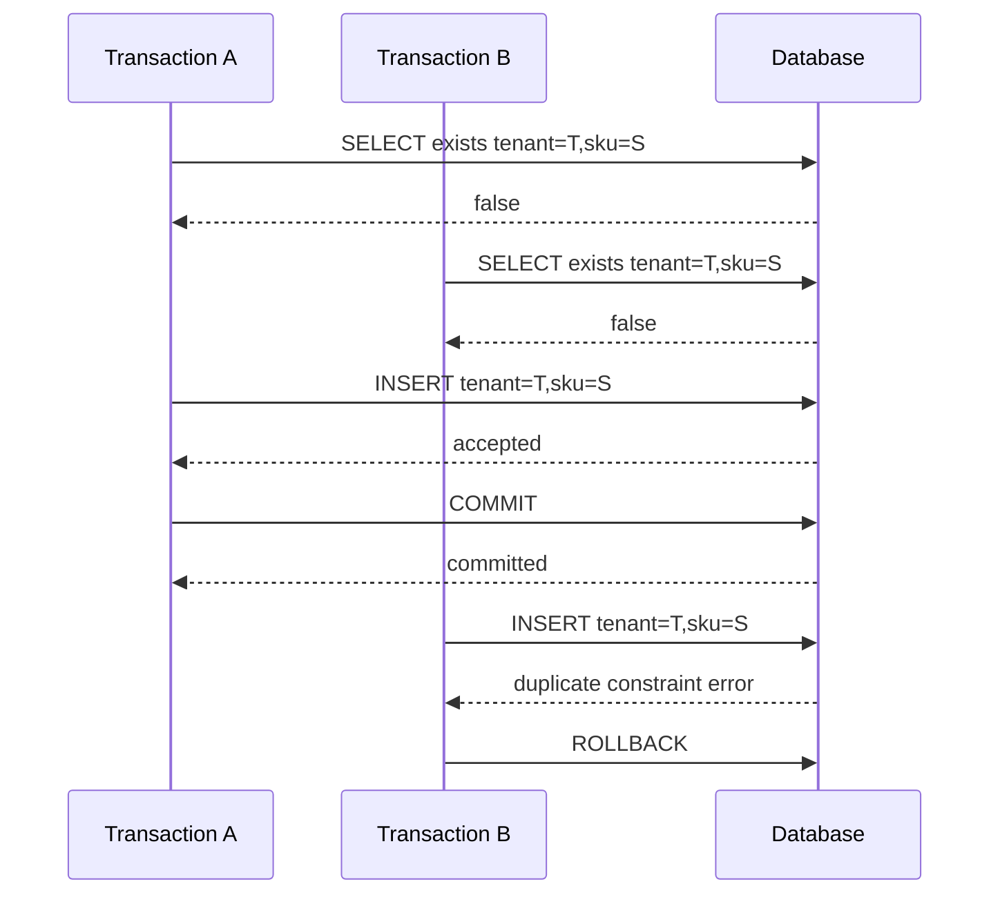
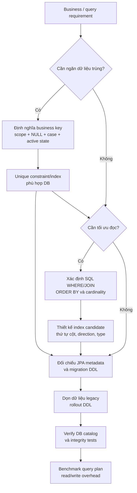

# Khai báo unique constraint và index trong mô hình ánh xạ

Trong ứng dụng Java dùng **Jakarta Persistence (JPA)**, một entity có thể có những quy tắc về dữ liệu không chỉ áp dụng cho từng field mà còn áp dụng cho **toàn bảng**. Chẳng hạn:

- Mã SKU của sản phẩm phải **duy nhất**.
- Mã đơn hàng chỉ cần duy nhất **trong một tenant**, không nhất thiết trên toàn hệ thống.
- Một người dùng chỉ được gắn **một lần** vào cùng nhóm quyền.
- Danh sách đơn hàng thường được lọc theo `tenant_id`, `status` và sắp xếp theo `created_at`.
- Tìm kiếm theo email cần phản hồi nhanh, nhưng email có thể có quy tắc chuẩn hóa chữ hoa/thường riêng.

Hai công cụ lược đồ liên quan là **unique constraint** và **index**:

1. **Unique constraint** là một quy tắc toàn vẹn dữ liệu: cơ sở dữ liệu từ chối các giá trị trùng nhau theo khóa đã khai báo, với quy tắc `NULL` phụ thuộc hệ quản trị và cấu hình.
2. **Index** là một cấu trúc truy cập dữ liệu mà optimizer có thể dùng để giảm công đọc/sắp xếp. Index cũng có thể được khai báo `unique`, nhưng khi đó nó đồng thời tạo ra yêu cầu duy nhất.

Trong JPA, ta thường gặp:

```java
@Column(unique = true)
```

```java
@Table(
    uniqueConstraints = @UniqueConstraint(
        name = "uq_product_sku",
        columnNames = {"sku"}
    )
)
```

và:

```java
@Table(
    indexes = @Index(
        name = "idx_product_category_price",
        columnList = "category_id, price"
    )
)
```

Nhìn gần giống nhau nhưng **mục tiêu, cấp khai báo, tính duy nhất, thứ tự cột và cách kiểm chứng** không giống nhau. Thêm annotation cũng không đảm bảo database hiện hữu tự tạo đúng constraint/index: JPA metadata chủ yếu phục vụ **schema generation** khi chức năng đó được cấu hình; production thường quản lý schema bằng migration.

Bài học **“Khai báo unique constraint và index trong mô hình ánh xạ”** thuộc chương **“Siêu dữ liệu và lược đồ”** của module **Data Persistence Relational Access ORM JPA**. Nội dung sẽ kết nối JPA mappings, lược đồ quan hệ, truy vấn SQL, concurrency, multi-tenancy, migration và kiểm thử để bạn biết không chỉ **cách khai báo** mà còn **khi nào nên chọn cấu trúc nào**.

## 1. Phân biệt ràng buộc duy nhất và index

Một bảng sản phẩm:

```sql
CREATE TABLE products (
    id          BIGINT PRIMARY KEY,
    sku         VARCHAR(80) NOT NULL,
    category_id BIGINT NOT NULL,
    price       DECIMAL(15, 2) NOT NULL
);
```

Ta có thể bổ sung:

```sql
ALTER TABLE products
    ADD CONSTRAINT uq_products_sku UNIQUE (sku);

CREATE INDEX idx_products_category_price
    ON products (category_id, price);
```

Hai câu lệnh giải quyết hai vấn đề khác nhau.

### 1.1. Unique constraint: chặn dữ liệu không hợp lệ

Nếu đã có:

```text
id=101, sku="BOOK-001"
```

thì thêm:

```text
id=102, sku="BOOK-001"
```

phải bị database từ chối nếu `sku` có unique constraint, kể cả khi dữ liệu đến từ JDBC, SQL console hoặc batch job không đi qua JPA.

**Unique constraint là business/data integrity rule được database enforce**; không đơn thuần là một lời khuyên giúp truy vấn nhanh hơn.

### 1.2. Non-unique index: hỗ trợ đường truy cập

Index trên `(category_id, price)` có thể hữu ích cho:

```sql
SELECT *
FROM products
WHERE category_id = 8
  AND price >= 100
ORDER BY price;
```

Nó **không cấm** hai sản phẩm có cùng category và price. Optimizer quyết định có dùng index hay không, tùy thống kê, độ chọn lọc, dữ liệu, khả năng covering và chi phí thực thi.

### 1.3. Unique index: hai mục tiêu giao nhau

Một số hệ quản trị cho phép:

```sql
CREATE UNIQUE INDEX ux_products_sku
    ON products (sku);
```

Unique index vừa hỗ trợ truy cập, vừa cấm duplicate keys. Trong nhiều DB, một unique constraint được thực thi thông qua unique index bên dưới. **Nhưng unique constraint và unique index không phải hai thuật ngữ có thể thay thế hoàn toàn trong mọi DB**, nhất là khi xét deferrability, partial/expression indexes, catalog metadata và chuẩn SQL.

### 1.4. Bảng so sánh

| Tiêu chí | Unique constraint | Index thường | Unique index |
|---|---|---|---|
| Mục tiêu chính | Tính duy nhất dữ liệu | Hiệu năng truy vấn | Tính duy nhất và truy cập |
| Ngăn duplicate keys | Có, theo NULL semantics | Không | Có, theo DB/index semantics |
| Thường có trên một/nhiều cột | Có | Có | Có |
| Có tên riêng | Có thể | Có thể | Có thể |
| Dựa vào SQL optimizer để có lợi ích đọc | Không phải mục đích bắt buộc | Có | Có |
| Có chi phí INSERT/UPDATE/DELETE | Có | Có | Có |
| Có thể là expression/partial | Thường cần giải pháp DB-specific | Tùy DB | Tùy DB |
| Metadata JPA tiêu biểu | `@UniqueConstraint`, `@Column(unique=true)` | `@Index(unique=false)` | `@Index(unique=true)` |

**Quy tắc đầu tiên:** nếu yêu cầu là **“không được có bản ghi trùng”**, hãy mô hình hóa nó thành ràng buộc dữ liệu đáng tin cậy ở database. Nếu yêu cầu là **“truy vấn này đang chậm”**, bắt đầu từ query plan, index và đo lường. Đừng dùng một loại thay cho loại kia chỉ vì tên đều có chữ “unique”.

## 2. JPA cung cấp những annotation nào?

Trong `jakarta.persistence`:

```java
import jakarta.persistence.Column;
import jakarta.persistence.Table;
import jakarta.persistence.UniqueConstraint;
import jakarta.persistence.Index;
```

Những nơi thường khai báo:

| Nơi khai báo | Nội dung chính |
|---|---|
| `@Column(unique = true)` | Unique trên một cột cơ bản được ánh xạ |
| `@Table(uniqueConstraints = ...)` | Một hoặc nhiều unique constraints trên bảng chính của entity |
| `@Table(indexes = ...)` | Các index definitions cho bảng chính |
| `@SecondaryTable(uniqueConstraints=..., indexes=...)` | Constraints/indexes cho bảng phụ của entity |
| `@JoinTable(uniqueConstraints=..., indexes=...)` | Constraints/indexes cho bảng liên kết quan hệ |
| `@CollectionTable(uniqueConstraints=..., indexes=...)` | Constraints/indexes cho bảng chứa element collection |
| `@Index(unique = true)` | Unique index metadata ở bảng tương ứng |

Các tên trên là annotation metadata để JPA provider **sử dụng khi tạo schema**, không phải API quản lý database index online hay bảo đảm thực hiện ALTER TABLE trên một schema hiện hữu.

### 2.1. Ví dụ `@Column(unique = true)`

```java
@Entity
@Table(name = "products")
public class Product {

    @Id
    private Long id;

    @Column(
        name = "sku",
        nullable = false,
        length = 80,
        unique = true
    )
    private String sku;
}
```

`unique = true` là một cách ngắn gọn để khai báo **unique key trên cột sku** khi schema được tạo từ metadata. Nó không tự chuyển một unique theo business key nhiều cột thành một composite unique constraint.

### 2.2. Ví dụ `@Table(uniqueConstraints = ...)`

```java
@Entity
@Table(
    name = "products",
    uniqueConstraints = {
        @UniqueConstraint(
            name = "uq_products_sku",
            columnNames = {"sku"}
        )
    }
)
public class Product {
    @Id
    private Long id;

    @Column(name = "sku", nullable = false)
    private String sku;
}
```

Cách này rõ tên constraint và có thể mở rộng nhiều cột.

### 2.3. Ví dụ `@Table(indexes = ...)`

```java
@Entity
@Table(
    name = "products",
    indexes = {
        @Index(
            name = "idx_products_category_price",
            columnList = "category_id, price"
        )
    }
)
public class Product {
    @Id
    private Long id;

    @Column(name = "category_id", nullable = false)
    private Long categoryId;

    @Column(name = "price", nullable = false)
    private BigDecimal price;
}
```

`@Index` mô tả **cột/index order** và tùy chọn unique. Nó không tự chọn index tối ưu cho mọi `WHERE`, `ORDER BY` hay `JOIN`.

## 3. Một entity hoàn chỉnh có cả constraint và index

Ví dụ đơn hàng trong hệ thống đa tenant:

```java
package example.orders;

import jakarta.persistence.*;
import java.math.BigDecimal;
import java.time.Instant;

@Entity
@Table(
    name = "sales_orders",
    uniqueConstraints = {
        @UniqueConstraint(
            name = "uq_sales_orders_tenant_code",
            columnNames = {"tenant_id", "order_code"}
        )
    },
    indexes = {
        @Index(
            name = "idx_orders_tenant_status_created",
            columnList = "tenant_id, status, created_at DESC"
        ),
        @Index(
            name = "idx_orders_customer_created",
            columnList = "customer_id, created_at DESC"
        )
    }
)
public class SalesOrder {

    @Id
    @GeneratedValue(strategy = GenerationType.SEQUENCE)
    private Long id;

    @Column(name = "tenant_id", nullable = false,
            length = 64, updatable = false)
    private String tenantId;

    @Column(name = "order_code", nullable = false,
            length = 50)
    private String orderCode;

    @ManyToOne(fetch = FetchType.LAZY, optional = false)
    @JoinColumn(
        name = "customer_id",
        nullable = false
    )
    private Customer customer;

    @Enumerated(EnumType.STRING)
    @Column(name = "status", nullable = false,
            length = 24)
    private OrderStatus status;

    @Column(name = "created_at", nullable = false)
    private Instant createdAt;

    @Column(name = "total_amount", nullable = false,
            precision = 16, scale = 2)
    private BigDecimal totalAmount;

    @Version
    private Long version;

    protected SalesOrder() {}

    public SalesOrder(
            String tenantId,
            String orderCode,
            Customer customer,
            Instant createdAt,
            BigDecimal totalAmount) {
        this.tenantId = tenantId;
        this.orderCode = orderCode;
        this.customer = customer;
        this.createdAt = createdAt;
        this.totalAmount = totalAmount;
        this.status = OrderStatus.DRAFT;
    }

    public Long getId() { return id; }
    public String getTenantId() { return tenantId; }
    public String getOrderCode() { return orderCode; }
    public OrderStatus getStatus() { return status; }
}
```

Giả định `Customer` là một entity có `@Id` và `OrderStatus` là enum tương ứng:

```java
public enum OrderStatus {
    DRAFT, PAID, SHIPPED, CANCELLED
}
```

### 3.1. Ba yêu cầu độc lập trong cùng một mapping

1. **`uq_sales_orders_tenant_code`**: tenant A và tenant B có thể đều dùng `SO-001`, nhưng trong cùng tenant không có hai orders trùng code.
2. **`idx_orders_tenant_status_created`**: hỗ trợ một access pattern lọc tenant/status và duyệt theo created_at mới trước.
3. **`idx_orders_customer_created`**: hỗ trợ lịch sử orders của một customer.

### 3.2. SQL schema tương ứng về mặt ý tưởng

```sql
CREATE TABLE sales_orders (
    id           BIGINT PRIMARY KEY,
    tenant_id    VARCHAR(64) NOT NULL,
    order_code   VARCHAR(50) NOT NULL,
    customer_id  BIGINT NOT NULL,
    status       VARCHAR(24) NOT NULL,
    created_at   TIMESTAMP NOT NULL,
    total_amount DECIMAL(16, 2) NOT NULL,
    version      BIGINT NOT NULL,
    CONSTRAINT uq_sales_orders_tenant_code
        UNIQUE (tenant_id, order_code),
    CONSTRAINT fk_sales_orders_customer
        FOREIGN KEY (customer_id)
        REFERENCES customers(id)
);

CREATE INDEX idx_orders_tenant_status_created
    ON sales_orders (tenant_id, status, created_at DESC);

CREATE INDEX idx_orders_customer_created
    ON sales_orders (customer_id, created_at DESC);
```

Đây là SQL **minh họa**, không phải output bắt buộc của tất cả JPA providers hoặc dialects. Generation strategy, tên khóa ngoại, cách xử lý `DESC`, quoting, schema và kiểu cột cần được xem theo database thực tế.

### 3.3. Metadata mô tả kỳ vọng, migration là nguồn thực thi

Nếu ứng dụng production đã có bảng `sales_orders` và dùng migration do DBA/DevOps quản lý, thêm `@Index` không tự tạo index ngay khi deploy trong mọi configuration. Nên có migration tương ứng và kiểm chứng catalog/query plan.

## 4. `@UniqueConstraint`: các thành phần và phạm vi

`@UniqueConstraint` có các thuộc tính chính:

```java
@UniqueConstraint(
    name = "uq_example",
    columnNames = {"column_a", "column_b"}
)
```

### 4.1. `columnNames` là tên **cột database**

Giả sử:

```java
@Column(name = "order_code")
private String orderCode;
```

thì constraint dùng:

```java
columnNames = {"order_code"}
```

không phải:

```java
columnNames = {"orderCode"}
```

trừ khi tên cột vật lý thật sự được đặt là `orderCode`. Đây là chỗ dễ sai khi dùng camelCase property names và snake_case SQL names.

### 4.2. Tên constraint

`name` giúp:

- Phân biệt constraints trong schema.
- Viết migration rõ ràng.
- Điều tra database violation.
- Gắn mapping giữa constraint name và application error code.
- Tránh provider tự sinh tên khó đọc hoặc thay đổi giữa builds.

Tên phải phù hợp identifier length/quoting/case-folding của DB. Không có một tên tối đa portable áp dụng cho mọi RDBMS.

### 4.3. Có thể khai báo nhiều unique constraints

```java
@Table(
    name = "products",
    uniqueConstraints = {
        @UniqueConstraint(
            name = "uq_products_sku",
            columnNames = {"sku"}
        ),
        @UniqueConstraint(
            name = "uq_products_tenant_external",
            columnNames = {"tenant_id", "external_id"}
        )
    }
)
```

Hai constraints này **khác** một unique constraint trên bốn cột. Mỗi constraint đưa ra một quy tắc độc lập.

### 4.4. Cột có thể là khóa ngoại

Ví dụ:

```java
@ManyToOne
@JoinColumn(name = "warehouse_id")
private Warehouse warehouse;
```

Một composite uniqueness:

```java
@UniqueConstraint(
    name = "uq_bin_warehouse_code",
    columnNames = {"warehouse_id", "bin_code"}
)
```

giới hạn một `bin_code` trong mỗi warehouse. `warehouse_id` là tên cột join DB, không phải Java property `warehouse`.

### 4.5. Không có WHERE condition trong `@UniqueConstraint`

`@UniqueConstraint` **không** có thuộc tính như:

```java
where = "deleted_at is null"
```

Do đó không thể biểu diễn partial unique constraint cho soft delete chỉ bằng annotation JPA chuẩn. Đây là điểm sẽ phân tích riêng.

## 5. `@Column(unique = true)`: khi nào dùng?

`@Column(unique = true)` là cách ngắn cho tính duy nhất của **một mapped column** khi JPA tạo schema.

Ví dụ:

```java
@Column(
    name = "email",
    nullable = false,
    unique = true,
    length = 254
)
private String email;
```

### 5.1. Hạn chế

- Chỉ mô tả cột riêng lẻ, không mô tả combination nhiều cột.
- Không cho đặt tên unique constraint ngay trong `@Column`.
- Nếu đang dùng multi-tenancy, email có thể cần unique theo `(tenant_id, email)` thay vì toàn bảng.
- Không diễn tả unique dựa trên `lower(email)` hay filter `deleted_at IS NULL`.
- Chỉ có tác dụng schema DDL theo provider, không tự xác nhận dữ liệu hiện hữu đã duy nhất.

### 5.2. Khi dùng `@Table(uniqueConstraints)` sẽ rõ hơn

Nếu muốn constraint name ổn định:

```java
@Table(
    name = "users",
    uniqueConstraints = @UniqueConstraint(
        name = "uq_users_email",
        columnNames = "email"
    )
)
```

thường dễ phối hợp migration/exception mapping hơn.

### 5.3. Đừng khai báo hai lần vô tình

Tránh:

```java
@Table(
    uniqueConstraints = @UniqueConstraint(
        name = "uq_users_email",
        columnNames = "email"
    )
)
public class UserAccount {
    @Column(unique = true)
    private String email;
}
```

Hai metadata khai báo cùng mục tiêu có thể khiến schema generation tạo hoặc cố tạo constraints/indexes trùng lặp theo provider/dialect, làm schema khó quản lý. **Chọn một cách nhất quán**.

### 5.4. `nullable = false` khác `unique = true`

`nullable = false` là kỳ vọng cột không nhận NULL khi tạo schema. `unique = true` bảo vệ uniqueness theo key. Cả hai có thể cần, nhưng không thay thế nhau.

## 6. Composite unique constraint: khóa nghiệp vụ nhiều cột

Một ví dụ điển hình là **mã sản phẩm chỉ duy nhất trong cửa hàng**:

```java
@Entity
@Table(
    name = "store_products",
    uniqueConstraints = @UniqueConstraint(
        name = "uq_store_products_store_sku",
        columnNames = {"store_id", "sku"}
    )
)
public class StoreProduct {

    @Id
    private Long id;

    @ManyToOne(fetch = FetchType.LAZY, optional = false)
    @JoinColumn(name = "store_id", nullable = false)
    private Store store;

    @Column(name = "sku", nullable = false, length = 80)
    private String sku;
}
```

Tập dữ liệu:

| store_id | sku | Kết quả |
|---:|---|---|
| 10 | `A-100` | Hợp lệ |
| 10 | `A-200` | Hợp lệ |
| 20 | `A-100` | Hợp lệ |
| 10 | `A-100` | **Bị từ chối** |

### 6.1. Hai unique đơn cột không thay composite unique

Sai nếu yêu cầu chỉ unique theo cặp:

```java
@Column(name = "store_id", unique = true)
private Long storeId;

@Column(name = "sku", unique = true)
private String sku;
```

Hai unique constraints đơn cột sẽ **cấm** một cửa hàng có nhiều SKU và cấm một SKU dùng ở nhiều cửa hàng — khác hoàn toàn yêu cầu ban đầu.

### 6.2. Unique constraint không nhất thiết là primary key

`@Id` có thể là surrogate `Long id` trong khi `(store_id, sku)` là business key unique. Dùng surrogate key hay composite primary key là một quyết định mapping khác với việc đặt unique constraint.

`@EmbeddedId`, `@IdClass` hay `@NaturalId` (Hibernate-specific) không tự thay requirement phải đồng bộ đúng database uniqueness trong migration.

### 6.3. Composite uniqueness cần xác định NULL policy

Nếu một trong hai cột nullable, các DB có thể cho phép nhiều rows có NULL theo unique semantics. Nếu cả hai bắt buộc cho business key, khai báo `nullable = false` ở mapping **và** `NOT NULL` trong DB migration.

## 7. Multi-tenant uniqueness: tránh unique toàn hệ thống ngoài ý định

Một hệ thống có nhiều tổ chức:

```text
Tenant A: email "staff@example.com"
Tenant B: email "staff@example.com"
```

Nếu email chỉ cần unique **trong tenant**, annotation:

```java
@Column(name = "email", unique = true)
private String email;
```

có thể tạo ràng buộc quá mạnh: nó cấm tenant B dùng địa chỉ đã có ở tenant A.

Thiết kế phù hợp:

```java
@Entity
@Table(
    name = "tenant_users",
    uniqueConstraints = @UniqueConstraint(
        name = "uq_tenant_users_tenant_email",
        columnNames = {"tenant_id", "email"}
    )
)
public class TenantUser {
    @Id
    private Long id;

    @Column(name = "tenant_id", nullable = false)
    private String tenantId;

    @Column(name = "email", nullable = false)
    private String email;
}
```

### 7.1. Ràng buộc dữ liệu khác authorization

`UNIQUE(tenant_id, email)` không bảo đảm user ở tenant A không xem/sửa row của tenant B. Repository/query/service phải scope theo authenticated tenant:

```java
Optional<TenantUser> findByTenantIdAndId(
    String tenantId, Long id);
```

### 7.2. Với schema-per-tenant hoặc database-per-tenant

Nếu mỗi tenant có schema/bảng riêng, unique email trên từng bảng có thể tương đương với “unique trong tenant”. Nhưng khi dùng shared table, cần đưa tenant discriminator vào composite unique key. Quyết định phải dựa trên **physical data layout** thực tế.

### 7.3. Index cũng phải phản ánh tenant access pattern

Hầu hết queries trong shared-table multitenancy có:

```sql
WHERE tenant_id = ?
  AND status = ?
ORDER BY created_at DESC
```

Một index `(tenant_id, status, created_at DESC)` thường đáng xem xét hơn index chỉ có `status`, nhưng phải đo trên dữ liệu thật và DB optimizer.

## 8. `@Index`: thành phần và mục đích

Annotation:

```java
@Index(
    name = "idx_orders_status_created",
    columnList = "status, created_at DESC",
    unique = false
)
```

Các thuộc tính:

| Thuộc tính | Vai trò |
|---|---|
| `name` | Tên index mong muốn trong schema |
| `columnList` | Danh sách **tên cột database**, theo thứ tự và tùy hướng `ASC`/`DESC` |
| `unique` | Nếu true, khai báo unique index; mặc định false |

### 8.1. `columnList` không phải tên Java properties

Nếu entity:

```java
@Column(name = "created_at")
private Instant createdAt;
```

thì:

```java
columnList = "created_at DESC"
```

không dùng `createdAt DESC` trừ khi đó là tên cột thực tế.

### 8.2. Danh sách cột có thứ tự

```java
@Index(columnList = "tenant_id, status, created_at DESC")
```

không mặc nhiên tương đương:

```java
@Index(columnList = "created_at DESC, status, tenant_id")
```

Một B-tree composite index thường sử dụng thứ tự cột để tối ưu các predicates và ordering nhất định. Các DB có những biến thể query plan, index skip scan, bitmap combinations, nên không tuyệt đối hóa “chỉ dùng được prefix” cho mọi hệ.

### 8.3. Hướng ASC/DESC

JPA cho phép nêu ascending/descending order trong `columnList` theo syntax của annotation. Khả năng tạo DDL và hiệu quả thực tế phụ thuộc dialect, kiểu index và database; một số DB có thể scan index ngược chiều hoặc xử lý hỗn hợp ASC/DESC khác nhau.

### 8.4. `unique = true`

```java
@Index(
    name = "ux_users_login_name",
    columnList = "login_name",
    unique = true
)
```

định nghĩa **unique index** khi schema generation hỗ trợ. Nếu mục đích chính là business data integrity, khai báo một unique constraint phù hợp và tạo index bổ sung chỉ khi query plan thật sự cần. Đừng vô tình thêm `@UniqueConstraint` và một identical `@Index(unique = true)` dẫn đến hai cấu trúc trùng.

### 8.5. Index không phải lệnh ép optimizer

Có index không có nghĩa mọi query phù hợp **bắt buộc** sử dụng nó. Optimizer có thể chọn full scan nếu bảng nhỏ, điều kiện không chọn lọc hoặc index scan tốn nhiều random reads hơn.

## 9. Chọn thứ tự cột trong composite index

Giả sử API:

```sql
SELECT id, order_code, created_at
FROM sales_orders
WHERE tenant_id = ?
  AND status = 'PAID'
ORDER BY created_at DESC
LIMIT 50;
```

Một candidate:

```sql
CREATE INDEX idx_orders_tenant_status_created
    ON sales_orders (tenant_id, status, created_at DESC);
```

Thứ tự mang ý nghĩa:

1. `tenant_id` thường là equality predicate, giới hạn phạm vi tenant.
2. `status` là equality predicate của danh sách.
3. `created_at` hỗ trợ range scan/ordering khi các cột trước đã cố định.

### 9.1. Query khác có thể cần index khác

```sql
SELECT *
FROM sales_orders
WHERE tenant_id = ?
ORDER BY created_at DESC
LIMIT 50;
```

Index `(tenant_id, status, created_at DESC)` có thể **không tối ưu** cho truy vấn không lọc status, bởi rows còn được nhóm theo status. Candidate khác:

```sql
CREATE INDEX idx_orders_tenant_created
    ON sales_orders (tenant_id, created_at DESC);
```

### 9.2. Không thêm một index cho mọi query

Mỗi index tiêu tốn disk/RAM, làm tăng chi phí INSERT/UPDATE/DELETE, WAL/redo và maintenance. Chọn một tập indices dựa trên query workload thực tế, không chạy theo “thấy cột ở WHERE là tạo index”.

### 9.3. Equality, range và sorting

Một nguyên tắc thiết kế B-tree phổ biến: đặt các equality columns liên quan ở đầu, sau đó cân nhắc range/order columns. Nhưng **độ chọn lọc, cardinality, clustering, covering và optimizer** cũng quan trọng. Đây là heuristic, không phải một định luật áp dụng như nhau cho PostgreSQL, MySQL, Oracle, SQL Server.

### 9.4. `@Index` không tự tối ưu pagination

Ngay cả khi có index tốt, `OFFSET 100000` vẫn có thể phải duyệt/bỏ qua nhiều rows. Keyset pagination dựa trên `(created_at, id)` và stable ordering thường phù hợp hơn khi duyệt dữ liệu lớn; index candidate cần khớp điều kiện seek. Việc đó thuộc query design, không được giải quyết chỉ bằng khai báo annotation.

## 10. Index cho foreign key và truy vấn JOIN

Một quan hệ:

```java
@ManyToOne(fetch = FetchType.LAZY)
@JoinColumn(name = "customer_id", nullable = false)
private Customer customer;
```

thường dẫn tới một cột foreign key `customer_id`. Tuy nhiên:

> **Khai báo `@ManyToOne` hoặc `@JoinColumn` không phải bằng chứng portable rằng database đã tạo index trên cột foreign key.**

Mỗi RDBMS có quy tắc riêng về index tự tạo cho PK, UNIQUE và FK. Ví dụ có hệ yêu cầu/duy trì index hỗ trợ FK, có hệ không tự tạo một index riêng trên cột child FK.

### 10.1. Khai báo index tại bảng sở hữu FK

```java
@Entity
@Table(
    name = "sales_orders",
    indexes = @Index(
        name = "idx_orders_customer",
        columnList = "customer_id"
    )
)
public class SalesOrder {
    @Id
    private Long id;

    @ManyToOne(fetch = FetchType.LAZY)
    @JoinColumn(name = "customer_id", nullable = false)
    private Customer customer;
}
```

Index được khai báo ở **bảng `sales_orders` chứa cột `customer_id`**, không khai báo trên entity `Customer` vì trường Java trỏ tới Customer.

### 10.2. Khi nào index trên FK hữu ích?

Ví dụ:

```sql
SELECT *
FROM sales_orders
WHERE customer_id = ?;
```

hoặc:

```sql
SELECT o.*
FROM customers c
JOIN sales_orders o
    ON o.customer_id = c.id
WHERE c.id = ?;
```

Với tập dữ liệu lớn, index trên child FK có thể giảm chi phí tìm related rows. Nó cũng có thể hỗ trợ DB kiểm tra/xử lý quan hệ khi xóa/cập nhật parent, tùy DB implementation.

### 10.3. Không mặc định cần index FK đơn cột nếu đã có composite

Nếu đã có index:

```sql
CREATE INDEX idx_orders_customer_created
    ON sales_orders (customer_id, created_at DESC);
```

thì một index riêng trên chỉ `(customer_id)` có thể trùng chức năng đáng kể đối với một số access patterns. Trước khi tạo cả hai, hãy xem query plan, index usage và chi phí maintenance.

### 10.4. FK constraint khác index FK

Foreign key:

```sql
FOREIGN KEY (customer_id)
    REFERENCES customers(id)
```

bảo vệ tham chiếu hợp lệ. Index:

```sql
CREATE INDEX idx_orders_customer
    ON sales_orders(customer_id);
```

hỗ trợ truy cập. Index không thay foreign key; foreign key không tự bảo đảm một access path tối ưu trên mọi hệ quản trị.

## 11. `@JoinColumn(unique = true)` và quan hệ một-một

Không chỉ `@Column` có thuộc tính unique: `@JoinColumn` cũng có:

```java
@OneToOne(fetch = FetchType.LAZY)
@JoinColumn(
    name = "profile_id",
    unique = true
)
private UserProfile profile;
```

Mục tiêu của unique trên join column là **không cho hai rows ở bảng sở hữu cùng trỏ đến một referenced row**, khi schema được tạo đúng.

### 11.1. Ví dụ

```java
@Entity
@Table(name = "accounts")
public class Account {
    @Id
    private Long id;

    @OneToOne(fetch = FetchType.LAZY)
    @JoinColumn(
        name = "profile_id",
        unique = true
    )
    private UserProfile profile;
}
```

DDL khái niệm:

```sql
ALTER TABLE accounts
    ADD CONSTRAINT uq_accounts_profile
    UNIQUE (profile_id);
```

Không phải cứ dùng `@OneToOne` trong Java là mọi schema production đã có unique constraint. Hãy xác nhận database metadata.

### 11.2. Khi dùng `@ManyToOne` mà gắn unique

```java
@ManyToOne
@JoinColumn(name = "department_id", unique = true)
private Department department;
```

Unique FK khiến database **không cho nhiều employees tham chiếu cùng một department_id**. Điều này thường mâu thuẫn với ý định many-to-one và là lỗi mapping rất hay gặp.

### 11.3. Tự đặt tên unique constraint của FK

Nếu cần tên constraint rõ ràng, khai báo tại owning table:

```java
@Table(
    name = "accounts",
    uniqueConstraints = @UniqueConstraint(
        name = "uq_accounts_profile_id",
        columnNames = {"profile_id"}
    )
)
```

và không đồng thời khai báo `@JoinColumn(unique = true)` trùng ý định mà không có lý do. Chọn một source of mapping metadata.

### 11.4. Shared primary key one-to-one

Với `@MapsId`, association có thể dùng chính primary key của entity phụ, nên uniqueness được bảo vệ bởi PK. Không tạo thêm một duplicate unique/index trên cùng PK nếu không có yêu cầu riêng; xác minh mapping và migration.

## 12. Unique constraint và index trên bảng `@JoinTable`

Quan hệ many-to-many thường dùng bảng liên kết:

```text
users (id)
   |
   v
user_roles (user_id, role_id)
   ^
   |
roles (id)
```

Một requirement điển hình: **một user không có hai bản ghi liên kết trùng cùng role**.

### 12.1. Mapping

```java
@Entity
@Table(name = "users")
public class UserAccount {

    @Id
    private Long id;

    @ManyToMany
    @JoinTable(
        name = "user_roles",
        joinColumns = @JoinColumn(
            name = "user_id",
            referencedColumnName = "id"
        ),
        inverseJoinColumns = @JoinColumn(
            name = "role_id",
            referencedColumnName = "id"
        ),
        uniqueConstraints = @UniqueConstraint(
            name = "uq_user_roles_pair",
            columnNames = {"user_id", "role_id"}
        ),
        indexes = {
            @Index(
                name = "idx_user_roles_role_user",
                columnList = "role_id, user_id"
            )
        }
    )
    private Set<Role> roles = new HashSet<>();
}
```

`Role` là một entity riêng có primary key. Bảng `user_roles` chứa hai FKs; unique constraint được khai báo ở **chính join table**, không phải trên `@Table(name="users")`.

### 12.2. DDL khái niệm

```sql
CREATE TABLE user_roles (
    user_id BIGINT NOT NULL,
    role_id BIGINT NOT NULL,
    CONSTRAINT fk_user_roles_user
        FOREIGN KEY (user_id) REFERENCES users(id),
    CONSTRAINT fk_user_roles_role
        FOREIGN KEY (role_id) REFERENCES roles(id),
    CONSTRAINT uq_user_roles_pair
        UNIQUE (user_id, role_id)
);

CREATE INDEX idx_user_roles_role_user
    ON user_roles (role_id, user_id);
```

Nếu chọn `PRIMARY KEY(user_id, role_id)` ngay trong migration, cặp vốn đã unique; không nhất thiết tạo thêm unique constraint cùng key. JPA mapping và schema nên được thiết kế nhất quán.

### 12.3. Vì sao index chiều ngược?

Unique index trên `(user_id, role_id)` thường hỗ trợ lookup roles của user. Nhưng query “những users nào có role X?” có predicate `role_id=?`; index `(role_id, user_id)` có thể tối ưu chiều truy vấn ngược. Cân nhắc theo workload.

### 12.4. `Set` trong Java không thay database uniqueness

`Set<Role>` ngăn trùng theo Java `equals/hashCode` trong một object collection, nhưng không thay unique constraint:

- Hai transactions khác nhau có thể cùng thêm link.
- Native/JDBC writers không dùng Java Set.
- JPA identity và domain equality có thể không khớp business key.

Nếu “mỗi link chỉ tồn tại một lần” là invariant dữ liệu, hãy enforce tại DB.

### 12.5. Khi join table là entity riêng

Nếu association có thuộc tính như `assignedAt`, `grantedBy`, `expiresAt`, cân nhắc mô hình hóa `UserRoleGrant` thành entity riêng với `@ManyToOne` đến User và Role, cùng `@Table(uniqueConstraints = ...)`. Khi đó có thể đặt constraint nhiều cột khác như `tenant_id`, `source`, `role_id` theo business semantics.

## 13. Unique/index trên bảng `@CollectionTable`

Với `@ElementCollection`, dữ liệu có thể nằm trong một **collection table** riêng.

Ví dụ một product có các tags:

```java
@Entity
@Table(name = "products")
public class Product {

    @Id
    private Long id;

    @ElementCollection
    @CollectionTable(
        name = "product_tags",
        joinColumns = @JoinColumn(name = "product_id"),
        uniqueConstraints = @UniqueConstraint(
            name = "uq_product_tags_product_tag",
            columnNames = {"product_id", "tag"}
        ),
        indexes = @Index(
            name = "idx_product_tags_tag_product",
            columnList = "tag, product_id"
        )
    )
    @Column(name = "tag", nullable = false, length = 80)
    private Set<String> tags = new HashSet<>();
}
```

### 13.1. DDL khái niệm

```sql
CREATE TABLE product_tags (
    product_id BIGINT NOT NULL,
    tag VARCHAR(80) NOT NULL,
    CONSTRAINT fk_product_tags_product
        FOREIGN KEY (product_id) REFERENCES products(id),
    CONSTRAINT uq_product_tags_product_tag
        UNIQUE (product_id, tag)
);

CREATE INDEX idx_product_tags_tag_product
    ON product_tags (tag, product_id);
```

### 13.2. Hai queries khác nhau

Lấy tags của product:

```sql
SELECT tag FROM product_tags
WHERE product_id = ?;
```

Tìm products mang tag:

```sql
SELECT product_id FROM product_tags
WHERE tag = ?;
```

Unique `(product_id, tag)` có thể hỗ trợ query đầu; index `(tag, product_id)` có thể phù hợp query thứ hai.

### 13.3. Collection uniqueness và duplicate data

Giống `Set` của entity association, Java Set không bảo vệ database khỏi duplicate rows do concurrent writers hoặc SQL trực tiếp. Unique constraint tạo một ranh giới integrity độc lập.

### 13.4. List và `@OrderColumn`

Nếu dùng `List` với `@OrderColumn(name="position")`, có thể cần ràng buộc `UNIQUE(owner_id, position)` tùy schema/business rule. Nhưng quá trình reorder có thể thực hiện nhiều UPDATE tạm thời gây unique conflict nếu provider không sắp thứ tự SQL như mong đợi. Đừng thêm unique position constraint mà không test insert/remove/reorder/flush thật với provider và DB mục tiêu.

## 14. Unique/index trên bảng `@SecondaryTable`

Một entity có thể được ánh xạ sang **nhiều bảng**:

```java
@Entity
@Table(name = "customer_accounts")
@SecondaryTable(
    name = "customer_profiles",
    pkJoinColumns = @PrimaryKeyJoinColumn(
        name = "customer_id",
        referencedColumnName = "id"
    ),
    uniqueConstraints = @UniqueConstraint(
        name = "uq_customer_profiles_external_ref",
        columnNames = {"external_ref"}
    ),
    indexes = @Index(
        name = "idx_customer_profiles_country",
        columnList = "country_code"
    )
)
public class CustomerAccount {

    @Id
    private Long id;

    @Column(
        name = "external_ref",
        table = "customer_profiles"
    )
    private String externalRef;

    @Column(
        name = "country_code",
        table = "customer_profiles"
    )
    private String countryCode;
}
```

Ở đây:

- `@Table` mô tả bảng chính `customer_accounts`.
- `@SecondaryTable` mô tả bảng phụ `customer_profiles`.
- Unique/index được khai báo trên **bảng thực sự chứa cột**.
- `@Column(table = "customer_profiles")` chỉ định field ánh xạ đến bảng phụ.

### 14.1. Đặt nhầm bảng

Nếu đặt:

```java
@Table(indexes = @Index(columnList = "country_code"))
```

trong khi `country_code` chỉ tồn tại ở `customer_profiles`, provider có thể báo lỗi schema generation hoặc tạo DDL không hợp lệ. Metadata phải phù hợp **đúng physical table**.

### 14.2. Uniqueness trên secondary-table columns

Unique trên `external_ref` ở bảng phụ bảo vệ uniqueness của giá trị đó theo scope **toàn bảng customer_profiles**. Nếu yêu cầu unique theo tenant, bảng phụ phải có tenant discriminator thực sự hoặc áp dụng chiến lược dữ liệu/index khác; không thể tham chiếu cột `tenant_id` ở bảng chính trong một unique constraint đơn bảng.

### 14.3. Primary key join đã có uniqueness

`customer_profiles.customer_id` có thể đồng thời là PK của bảng phụ theo shared PK mapping. Không cần tạo duplicate unique constraint trên chính PK đó nếu schema đã enforce uniqueness.

## 15. `@MappedSuperclass` và inheritance strategy: index nằm ở đâu?

`@MappedSuperclass` chia sẻ field mappings cho subclasses, nhưng **không có bảng riêng**.

```java
@MappedSuperclass
public abstract class TenantOwnedEntity {
    @Column(name = "tenant_id", nullable = false)
    protected String tenantId;
}

@Entity
@Table(
    name = "sales_orders",
    indexes = @Index(
        name = "idx_sales_orders_tenant",
        columnList = "tenant_id"
    )
)
public class SalesOrder extends TenantOwnedEntity {
    @Id
    private Long id;
}
```

Index gắn với **concrete table `sales_orders`**, không tự có bảng `tenant_owned_entity` để index.

### 15.1. `SINGLE_TABLE`

Với:

```java
@Entity
@Inheritance(strategy = InheritanceType.SINGLE_TABLE)
public abstract class Payment { /* ... */ }
```

các subclasses chia sẻ một bảng. Unique constraint trên một field chỉ xuất hiện ở một subtype có thể tác động **toàn shared table**, kể cả rows của subtype khác. Khi subtype-specific columns nullable, unique/NULL semantics càng cần xem kỹ.

Một rule “mã thẻ chỉ unique cho CardPayment” thường cần cân nhắc subtype discriminator, partial unique index hoặc thiết kế khác — annotation table-level portable có thể không diễn tả hết.

### 15.2. `JOINED`

Với JOINED inheritance, dữ liệu nằm ở root table và các subclass tables. Một unique constraint không thể tự trải qua nhiều bảng chỉ bằng `@UniqueConstraint` trên một `@Table`. Đặt constraint tại **bảng chứa business key columns**, hoặc redesign invariant/migration.

### 15.3. `TABLE_PER_CLASS`

Mỗi concrete entity type có bảng riêng; unique trên từng table **không đảm bảo uniqueness giữa toàn bộ các bảng** nếu business key phải duy nhất xuyên type hierarchy. Constraint/index trong một bảng không tự cấm duplicate ở bảng anh em.

### 15.4. Đừng giả định inheritance annotations có cùng vị trí DDL

Khi thay strategy, index/constraint DDL có thể thay đổi lớn dù Java hierarchy nhìn tương tự. Migration phải review physical tables, nullability và index usage trước khi chuyển strategy.

## 16. Embedded fields, attribute overrides và tên cột

Một `@Embeddable` có thể được nhúng ở nhiều entity và override tên cột:

```java
@Embeddable
public class Address {
    private String countryCode;
    private String postalCode;
}

@Entity
@Table(
    name = "customers",
    indexes = @Index(
        name = "idx_customers_country_postal",
        columnList = "billing_country, billing_postal"
    )
)
public class Customer {

    @Id
    private Long id;

    @Embedded
    @AttributeOverrides({
        @AttributeOverride(
            name = "countryCode",
            column = @Column(name = "billing_country")
        ),
        @AttributeOverride(
            name = "postalCode",
            column = @Column(name = "billing_postal")
        )
    })
    private Address billingAddress;
}
```

### 16.1. Constraint/index dùng cột sau override

`columnList = "billing_country, billing_postal"` chứ không phải Java path `billingAddress.countryCode`. Tên cột hiệu dụng sau `@AttributeOverride` là thứ schema generation và database nhìn thấy.

### 16.2. Tránh phụ thuộc tên implicit không ổn định

Nếu mapping dùng implicit/physical naming strategy của Hibernate, tên thực tế có thể bị biến đổi. Với các constraints/indexes quan trọng, đặt `@Column(name=...)`/`@JoinColumn(name=...)` rõ ràng và thống nhất với migration giúp tránh drift.

### 16.3. Quoted identifiers

Tên cột dùng chữ hoa có quote, dấu cách hoặc reserved words có thể yêu cầu quoting theo dialect. Không trộn tên Java `order` với DB column `"Order"` mà không kiểm chứng generated DDL. Ưu tiên snake_case, tránh reserved words để portability tốt hơn.

## 17. `NULL` trong unique constraints: một nguồn sai lầm phổ biến

Giả sử bảng có:

```sql
CREATE TABLE users (
    id BIGINT PRIMARY KEY,
    recovery_email VARCHAR(254),
    CONSTRAINT uq_users_recovery_email
        UNIQUE (recovery_email)
);
```

Các giá trị:

```text
user #1 recovery_email = NULL
user #2 recovery_email = NULL
```

Ở nhiều RDBMS, unique constraint **cho phép nhiều NULL** vì NULL được xử lý khác một giá trị thông thường. Nhưng **không phải mọi DB hoặc cấu hình unique index đều xử lý NULL giống nhau**.

### 17.1. Không có một chính sách NULL portable chỉ từ `@UniqueConstraint`

`@UniqueConstraint(columnNames={"recovery_email"})` không cho chỉ định:

- `NULLS NOT DISTINCT`.
- Một quy tắc NULLs-equal tùy DB.
- Một expression chuẩn hóa NULL.
- Một partial predicate để chỉ xét non-null rows.

Nếu nghiệp vụ yêu cầu “tối đa một NULL” hoặc “NULL cũng phải được coi như một giá trị unique”, cần DB-specific DDL/design phù hợp và test trên database mục tiêu.

### 17.2. Composite unique và cột nullable

`UNIQUE(tenant_id, external_ref)` có thể cho nhiều rows cùng tenant với `external_ref=NULL` trong những DB chấp nhận nhiều NULL. Nếu external_ref phải là business key bắt buộc, thêm `NOT NULL`. Nếu external_ref tùy chọn, quyết định đó có đúng nghiệp vụ không.

### 17.3. String rỗng khác NULL

Ở một số RDBMS, empty string và NULL được xử lý khác, thậm chí có DB coi chuỗi rỗng là NULL trong kiểu dữ liệu nhất định. Unique semantics vì vậy phụ thuộc database và normalization policy. Bean Validation `@NotBlank` giúp chống input rỗng trong JPA/API path, nhưng DB CHECK/NOT NULL vẫn cần nếu invariant quan trọng.

### 17.4. Case-sensitive/collation semantics

Với `email`:

```text
Alice@Example.com
alice@example.com
```

có được xem là trùng hay không phụ thuộc collation, data type, index expression và normalization. `@UniqueConstraint` đơn thuần không định nghĩa case folding trên mọi database.

## 18. Unique email không phân biệt hoa/thường

Một business requirement rất phổ biến:

> `User@Example.com` và `user@example.com` được coi là cùng một email identifier trong hệ thống.

Nếu database dùng collation case-sensitive trên cột `email`, unique constraint trực tiếp có thể cho phép hai chuỗi này. Cần một chính sách normalization hoặc DB-specific unique structure phù hợp.

### 18.1. Cách A: lưu normalized business key

Entity có:

```java
@Entity
@Table(
    name = "users",
    uniqueConstraints = @UniqueConstraint(
        name = "uq_users_email_normalized",
        columnNames = "email_normalized"
    )
)
public class UserAccount {

    @Id
    private Long id;

    @Column(name = "email_display", nullable = false)
    private String emailDisplay;

    @Column(name = "email_normalized", nullable = false)
    private String emailNormalized;
}
```

Ứng dụng xác định hàm chuẩn hóa theo **business policy** rồi lưu `email_normalized` để enforce unique bằng constraint chuẩn trên một cột thực.

**Lưu ý:** xử lý email thực tế phức tạp hơn việc luôn gọi `toLowerCase()`; cần chính sách Unicode/canonicalization, domain name handling, local-part semantics và yêu cầu sản phẩm. Không dùng lowercasing tùy tiện khi chưa định nghĩa cách nhận diện tài khoản.

### 18.2. Cách B: expression unique index trong DB

Ví dụ PostgreSQL:

```sql
CREATE UNIQUE INDEX ux_users_email_lower
    ON users (lower(email));
```

Index này không được biểu diễn portable bằng:

```java
@Index(columnList = "lower(email)", unique = true)
```

vì `@Index.columnList` chuẩn JPA nhắm tới **tên cột** và thứ tự, không phải biểu thức SQL tùy ý. Đừng giả định provider chuyển expression đó thành DDL đúng trên mọi dialect.

### 18.3. Cách C: kiểu dữ liệu/collation DB-specific

Một số DB hỗ trợ case-insensitive collation hoặc kiểu dữ liệu chuyên dụng. Có thể dùng migration DB-specific và mapping JPA phù hợp, nhưng cần test behavior khi migrate database hoặc đổi collation.

### 18.4. Unique phụ thuộc scope

Nếu email unique theo tenant, cần:

```sql
CREATE UNIQUE INDEX ux_users_tenant_email_lower
    ON users (tenant_id, lower(email));
```

thay vì toàn bảng. Authorization và identity mapping vẫn là trách nhiệm riêng của application.

## 19. Soft delete: “chỉ unique khi record còn active”

Giả sử sản phẩm có:

```text
id
tenant_id
sku
deleted_at
```

Yêu cầu:

- Một tenant không có hai **active** products cùng SKU.
- Sau khi soft delete product cũ, tenant được phép tạo product mới cùng SKU.
- Các rows đã soft delete cần được giữ cho audit.

### 19.1. Unique thường không đáp ứng yêu cầu

```sql
UNIQUE (tenant_id, sku)
```

cấm tái sử dụng SKU **ngay cả khi row cũ đã deleted**, vì row vẫn tồn tại.

### 19.2. Thêm `deleted_at` vào unique key có thể không đúng

```sql
UNIQUE (tenant_id, sku, deleted_at)
```

trông có vẻ hợp lý nhưng với DB cho phép nhiều NULL trong unique keys, hai active rows cùng `deleted_at=NULL` **vẫn có thể cùng tồn tại**. Việc thêm nullable column vào unique key không tự biến điều kiện “chỉ active” thành đúng.

### 19.3. Partial unique index

Ở PostgreSQL:

```sql
CREATE UNIQUE INDEX ux_products_active_tenant_sku
    ON products (tenant_id, sku)
    WHERE deleted_at IS NULL;
```

Ý nghĩa: chỉ rows active (`deleted_at IS NULL`) tham gia kiểm tra unique. Rows soft deleted được giữ lại và không chặn SKU mới.

### 19.4. JPA không có annotation chuẩn cho partial index

`@Index` không hỗ trợ `where` predicate; `@UniqueConstraint` cũng không. Với yêu cầu này, hãy đưa DDL vào **Flyway/Liquibase/SQL migration** và kiểm tra schema thực.

### 19.5. Cần kiểm soát tính duy nhất đồng thời

Hai transactions cùng soft delete/recreate một SKU có thể cạnh tranh; unique partial index là chốt chặn integrity tại DB. Service vẫn phải map constraint conflict, rollback khi SQL bị từ chối và xử lý status/tenant authorization.

### 19.6. Những RDBMS không có partial index syntax tương tự

Cách thực hiện có thể khác: generated/computed column, functional index, filtered index, separate active table hoặc domain model khác. Không copy SQL PostgreSQL sang MySQL/Oracle/SQL Server và mặc định chạy giống hệt.

## 20. Expression, partial, covering và full-text indexes

Không phải mọi tính năng index hiện đại đều có annotation tương đương trong JPA.

### 20.1. Function/expression index

```sql
CREATE INDEX idx_users_lower_name
    ON users (lower(display_name));
```

Hữu ích cho một số queries so sánh `lower(display_name)`, nhưng cần kiểm tra cách database optimizer khớp expression.

### 20.2. Partial/filtered index

```sql
CREATE INDEX idx_orders_paid_recent
    ON sales_orders (tenant_id, created_at DESC)
    WHERE status = 'PAID';
```

Chỉ index rows thỏa điều kiện; có thể giảm kích thước nếu trạng thái PAID ít hơn dữ liệu toàn bảng. Nhưng query predicate và planner phải tương thích; không chỉ cứ có index là được dùng.

### 20.3. Covering/index INCLUDE

Ví dụ PostgreSQL:

```sql
CREATE INDEX idx_orders_tenant_created_include
    ON sales_orders (tenant_id, created_at DESC)
    INCLUDE (order_code, status);
```

`INCLUDE` nhằm bổ sung columns để một số queries có thể lấy thông tin từ index, nhưng index-only scan còn phụ thuộc visibility map/optimizer và cấu trúc DB. JPA `@Index` chuẩn không có portable `includeColumns` option.

### 20.4. Full-text, spatial và JSON indexes

Truy vấn toàn văn, tọa độ không gian, JSONB và specialized index types thường cần engine-specific operators/index methods (GIN, GiST, trigram, full-text catalog...). JPA `@Index(columnList=...)` không đủ để diễn tả đầy đủ những feature đó.

### 20.5. Khi cần SQL migration

Với partial/expression/covering indexes:

1. Định nghĩa business/query requirement.
2. Viết migration DB-specific.
3. Ghi tài liệu tại entity/repository nếu cần để người đọc biết index tồn tại.
4. Kiểm chứng schema/catalog thực và explain plan.
5. Tạo integration test hoặc schema verification theo môi trường.

**Đừng chế ra annotation JPA không tồn tại hoặc nhét raw SQL expression vào `columnList` rồi coi đó là portable mapping.**

## 21. Unique constraint bảo vệ concurrency, pre-check không đủ

Một service có thể kiểm tra:

```java
if (productRepository.existsByTenantIdAndSku(
        tenantId, request.sku())) {
    throw new DuplicateSkuException();
}
```

Rồi:

```java
Product product = ...;
productRepository.save(product);
```

Nhưng hai transactions có thể cùng thấy “chưa tồn tại”.

### 21.1. Race timeline



Trình tự cụ thể có thể khiến B chờ khóa hoặc fail lúc statement/commit, phụ thuộc database/constraint deferrability. Kết quả integrity mong muốn: **không commit hai active rows có cùng unique key**.

### 21.2. Tại sao cả hai lớp kiểm tra vẫn có ích?

**Application pre-check:** cải thiện UX và phát hiện duplicate đã biết sớm.

**Database unique constraint:** bảo vệ race và mọi writers, kể cả những writers không qua service.

Không xem pre-check là thay thế cho unique DB constraint.

### 21.3. Sau unique violation

Khi database/provider ném persistence/constraint error trong transaction, **rollback unit of work**. Không bắt lỗi rồi cố tiếp tục commit trong cùng EntityManager/persistence context đã bị lỗi.

### 21.4. Unique không tự xử lý “upsert”

Nếu business operation là “tạo nếu chưa có, nếu đã có thì dùng lại”, cần idempotent API hoặc upsert được thiết kế cụ thể. Unique constraint chỉ quyết định **không cho duplicate commit**, không tự biết có nên cập nhật row cũ hay trả lỗi.

### 21.5. Rủi ro khi dùng `ON CONFLICT DO NOTHING`

Với PostgreSQL:

```sql
INSERT INTO products (tenant_id, sku, name)
VALUES (?, ?, ?)
ON CONFLICT (tenant_id, sku) DO NOTHING;
```

đây là native SQL dialect-specific. Nếu row không được insert, application phải xác định semantic: skip, load existing, report idempotent success hay reject? Nó không tự giải quyết authorization, version checks hoặc lost update.

## 22. Hai `ConstraintViolationException` khác nhau

Khi unique database constraint bị vi phạm, ứng dụng Hibernate có thể nhận:

```java
org.hibernate.exception.ConstraintViolationException
```

Trong khi Bean Validation failure dùng:

```java
jakarta.validation.ConstraintViolationException
```

| Exception | Nguồn | Thông tin đặc trưng |
|---|---|---|
| Jakarta Validation | `@NotBlank`, `@Positive`, `@Size`, custom validation | `getConstraintViolations()` |
| Hibernate JDBC/database | Unique/FK/CHECK/NOT NULL SQL constraint | Có thể có constraint name/SQLException |

### 22.1. Khi dùng Spring

Spring ORM/Data JPA có thể dịch lỗi DB thành:

```java
org.springframework.dao.DataIntegrityViolationException
```

Nhưng dạng exception bên ngoài còn tùy chỗ lỗi xuất hiện (repository method, `flush`, `commit`) và provider/transaction manager. Không giả định chỉ một catch block bao được mọi duplicate errors.

### 22.2. Xây error mapping an toàn

Ứng dụng có thể map một **constraint name được xác định chắc chắn**:

```text
uq_sales_orders_tenant_code
    -> ORDER_CODE_ALREADY_EXISTS
```

Trả HTTP 409 khi phù hợp:

```json
{
  "code": "ORDER_CODE_ALREADY_EXISTS",
  "message": "Mã đơn hàng đã được sử dụng trong tổ chức này"
}
```

Không trả raw database error message, SQL, identifier nội bộ hoặc stack trace ra client.

### 22.3. Không map mọi database integrity violation thành duplicate

`DataIntegrityViolationException` có thể là:

- Unique violation.
- Foreign key violation.
- Check constraint violation.
- Not-null violation.
- Data truncation/conversion issue (tùy driver).

Nếu không xác định đúng constraint/SQLState, trả lỗi tổng quát phù hợp và log server-side an toàn. Đừng đánh lừa user bằng “SKU đã tồn tại” khi thực chất customer ID không hợp lệ.

### 22.4. Naming ổn định hỗ trợ support/debug

Đặt tên `uq_sales_orders_tenant_code` trong cả mapping và migration cho phép database catalog và error classification có một referent rõ. Nhưng các database có giới hạn độ dài tên, case folding/quoting; hãy xác nhận **tên physical thực tế**, không chỉ tên annotation.

## 23. Khi nào unique/index được tạo?

JPA metadata không tự chạy DDL mỗi lần entity được persist. Việc tạo index/constraint gắn với **schema generation** được cấu hình cho persistence unit hoặc framework.

Ví dụ khái niệm khi phát triển:

```properties
jakarta.persistence.schema-generation.database.action=create
```

Các tên property/schema-generation actions chính xác cần được đặt theo JPA version/provider/bootstrap. Nếu Spring Boot truyền qua:

```properties
spring.jpa.properties.jakarta.persistence.schema-generation.database.action=create
```

phải hiểu đây chỉ là đường chuyển property đến provider, không phải recommendation bật DDL creation trong production.

### 23.1. Hibernate `hbm2ddl.auto`

Một cấu hình quen thuộc:

```properties
hibernate.hbm2ddl.auto=validate
```

hoặc:

```properties
spring.jpa.hibernate.ddl-auto=validate
```

`validate` thường phục vụ xác minh một số khía cạnh schema mapping, **không nên coi là một hệ thống kiểm tra đầy đủ mọi unique constraint và index đã có hoặc đúng như annotations**. Cần schema/catalog verification riêng.

### 23.2. Tại sao không bật `update` bừa bãi?

Provider-specific auto schema update không phải quy trình migration production đáng tin cậy cho:

- Backfill/deduplicate dữ liệu cũ.
- Đổi tên constraint/index mà không downtime.
- Phân biệt renaming với drop/create.
- Tạo partial/expression index.
- Index creation concurrent/online.
- Kiểm soát lock/timeouts.
- Rollback release và phối hợp nhiều application nodes.

### 23.3. Production nên dùng migration

Với Flyway/Liquibase/SQL migration:

1. Review business key và query plan.
2. Kiểm tra/cleanup dữ liệu hiện hữu vi phạm constraint.
3. Deploy migration DDL có version.
4. Kiểm chứng catalog và performance.
5. Deploy code JPA mapping đồng bộ.

Annotation vẫn hữu ích để ghi lại mô hình mapping, nhưng **migration thường là nguồn sự thật của physical schema**.

### 23.4. DDL thành công mới có integrity guarantee

Nếu migration thêm UNIQUE thất bại vì dữ liệu trùng, database **chưa có** unique rule đó. Source code có `@UniqueConstraint` không làm các duplicate inserts tự nhiên bị chặn. Cần xử lý lỗi migration, không tuyên bố invariant đã được enforce.

## 24. Migration thêm unique constraint cho dữ liệu hiện có

Giả sử bảng `sales_orders` hiện chưa có uniqueness theo `(tenant_id, order_code)` và chứa bản ghi cũ.

### 24.1. Xác định duplicate keys trước

```sql
SELECT tenant_id, order_code, COUNT(*) AS cnt
FROM sales_orders
GROUP BY tenant_id, order_code
HAVING COUNT(*) > 1;
```

Đây là query để **phát hiện** duplicates, không tự quyết định xóa row nào. Cần business reconciliation: giữ bản ghi nào, merge references, lưu audit/history như thế nào.

### 24.2. Đánh giá NULL/blank cases

```sql
SELECT *
FROM sales_orders
WHERE tenant_id IS NULL
   OR order_code IS NULL
   OR TRIM(order_code) = '';
```

Nếu business key phải non-null/non-blank, cần backfill dữ liệu hoặc giải quyết record lỗi trước khi thêm constraints. Syntax `TRIM`, whitespace normalization và case rules có thể khác theo DB.

### 24.3. Thêm constraint trong migration

```sql
ALTER TABLE sales_orders
ADD CONSTRAINT uq_sales_orders_tenant_code
UNIQUE (tenant_id, order_code);
```

Với bảng lớn, thao tác này có thể quét dữ liệu, tạo index vật lý và giữ locks đáng kể. Chọn online/concurrent index strategy theo DB phiên bản và kiến trúc deployment.

### 24.4. Khi có concurrent writers trong lúc migrate

Giữa lúc chạy duplicate detection và lúc thêm unique constraint, transactions khác có thể tạo duplicates mới. Migration phải xử lý concurrency/cutover: lock/write freeze tạm thời, online-safe method, backfill retries hoặc rollout nhiều bước, tùy yêu cầu availability.

### 24.5. Đổi quy tắc unique còn khó hơn thêm mới

Chuyển từ:

```sql
UNIQUE (email)
```

sang:

```sql
UNIQUE (tenant_id, email)
```

cần review giao diện dữ liệu, thứ tự deploy, code đang giả định global uniqueness, foreign key/reference logic và xử lý dữ liệu cũ. Không chỉ thay annotation rồi cho rằng hệ thống đã hỗ trợ tenant-scoped emails.

## 25. Tạo index cho bảng lớn trong production

Tạo index có thể là operation tốn CPU, I/O, disk, memory và lock.

### 25.1. PostgreSQL concurrent index

Ví dụ:

```sql
CREATE INDEX CONCURRENTLY idx_orders_tenant_created
    ON sales_orders (tenant_id, created_at DESC);
```

Mục đích: giảm mức chặn những ghi đồng thời so với cách tạo index thông thường trong một số workloads. Tuy nhiên:

- Đây là PostgreSQL-specific SQL, không portable JPA.
- `CREATE INDEX CONCURRENTLY` không được thực thi trong một transaction block thông thường.
- Tool migration cần được cấu hình transaction handling riêng cho migration đó.
- Operation vẫn có thể tốn thời gian/tài nguyên và có failure states cần cleanup.

### 25.2. Unique constraint rollout online

Ở một số DB có thể tạo unique index trước rồi attach nó làm constraint. Nhưng từng database có restrictions và locking semantics riêng, đặc biệt với partial/expression index hoặc deferrability. Không ghi một công thức chung cho mọi hệ.

### 25.3. Khi index được tạo nhưng chưa được dùng

Query optimizer có thể cần statistics mới (`ANALYZE` hoặc cơ chế tương đương) và query predicate phù hợp. Index existence không đủ; xem plan và performance.

### 25.4. Drop/rename index cũng là migration

Nếu index không còn dùng, việc drop có thể giảm write cost/disk nhưng cần đảm bảo nó không phục vụ constraint hoặc truy vấn khác. Đặc biệt, một unique constraint có thể được backing bởi index mà DB quản lý; đừng drop backing index trực tiếp khi nó là phần thiết yếu của integrity rule.

## 26. Naming convention cho constraint và index

Tên có ý nghĩa giúp schema dễ đọc, migration dễ review và lỗi dễ phân loại.

Một gợi ý quy ước:

| Loại | Tiền tố | Ví dụ |
|---|---|---|
| Primary key | `pk_` | `pk_sales_orders` |
| Unique constraint | `uq_` | `uq_sales_orders_tenant_code` |
| Unique index | `ux_` | `ux_products_active_tenant_sku` |
| Non-unique index | `idx_` | `idx_orders_tenant_created` |
| Foreign key | `fk_` | `fk_orders_customer` |
| Check constraint | `ck_` | `ck_order_items_quantity` |

Quy ước này **không phải bắt buộc của JPA**. Một nhóm khác có thể dùng `uk_` hoặc tên ngắn hơn tùy database identifier limits.

### 26.1. Vì sao không để tất cả tên do provider sinh?

Tùy provider, tên tự sinh có thể thay đổi khi:

- Entity/class/package names được refactor.
- Thứ tự thuộc tính/metadata thay đổi.
- Naming strategy thay đổi.
- Nâng Hibernate/JPA provider.
- Schema-generation implementation đổi.

Nếu DB migration và error classification phụ thuộc vào một tên do provider sinh, những thay đổi đó có thể gây drift khó nhận ra. Đặt tên có chủ đích cho business constraints và indexes quan trọng giúp tránh điều này.

### 26.2. Identifier length

Một số DB tự truncate names hoặc báo lỗi khi tên vượt giới hạn. Nếu dùng tên dài gồm table/tenant/columns, nên có convention thống nhất với giới hạn nhỏ nhất trong các DB được hỗ trợ.

### 26.3. Tên index không phải tên của Java field

`idx_orders_tenant_created` là tên physical index. Nó không thay JPQL property names và không trực tiếp xuất hiện trong entity fields hay query parameters.

### 26.4. Đừng encode hết logic vào tên

Tên dài không thay tài liệu nghiệp vụ. Một comment migration rõ “chỉ một active SKU trong tenant” có thể quan trọng hơn một identifier 100 ký tự.

## 27. Metadata, naming strategy và schema drift

Trong một dự án Spring Boot/Hibernate, có thể có các tầng đặt tên:

```text
Java property: createdAt
       |
       v
JPA explicit name hoặc implicit name
       |
       v
Hibernate physical naming strategy
       |
       v
Database identifier: created_at
```

### 27.1. Những tên nào dùng trong `@Index.columnList`?

`@Index.columnList` cần **tên cột database mapping**, không phải expression JPQL `o.createdAt` hoặc attribute path `customer.id`.

Nếu đặt tên tường minh:

```java
@Column(name = "created_at")
private Instant createdAt;

@Index(columnList = "created_at DESC")
```

thì metadata dễ đọc và đối chiếu migration. Nhưng nếu provider physical naming strategy biến đổi tên tường minh hoặc thêm quoting theo cấu hình, phải xác nhận generated DDL/catalog thực tế.

### 27.2. Schema/catalog

Entity có thể được khai báo:

```java
@Table(
    name = "sales_orders",
    schema = "sales",
    indexes = @Index(
        name = "idx_orders_created",
        columnList = "created_at"
    )
)
```

Tên schema ở metadata phải khớp deployment. Nếu ứng dụng dùng multi-schema per tenant, naming/collision/physical locations cần được quản lý theo tenant routing và migration setup.

### 27.3. Index/constraint name collision

Một DB có thể yêu cầu index names unique trong schema, không chỉ table; DB khác có naming scope khác. Đừng tạo `idx_created` cho hàng chục bảng rồi giả định mọi dialect chấp nhận. Dùng table prefix trong tên là một cách giảm rủi ro.

### 27.4. Quoted identifiers

`"Order"`, `ORDER` và `order` có thể được DB phân biệt theo quy tắc quoting/case folding. Khi mapping chứa tên reserved words/uppercase, index column names cũng cần đúng physical spelling/quoting. Tránh tên mơ hồ sẽ nâng portability.

### 27.5. Drift giữa annotation và migration

Một mapping:

```java
@UniqueConstraint(
    name = "uq_orders_tenant_code",
    columnNames = {"tenant_id", "order_code"}
)
```

nhưng DB thật:

```sql
UNIQUE (order_code)
```

tạo ra hành vi sai: tenant B không thể dùng code của tenant A. Đây là drift **về dữ liệu nghiệp vụ**, dù application build vẫn thành công.

### 27.6. Schema validation không thay catalog assertion

Một số schema validators chỉ kiểm tra tables/columns/types, không kiểm tra đủ constraints/index definitions. Vì vậy cần một kiểm chứng vật lý độc lập nếu integrity rule quan trọng.

## 28. Kiểm tra physical schema thực tế

Sau khi migration chạy, kiểm chứng:

1. Unique constraint/index **đã tồn tại**.
2. Nó nằm trên **đúng bảng/schema**.
3. Đúng thứ tự/danh sách cột hoặc expression/predicate.
4. Đúng tính unique/non-unique.
5. Đúng null/collation behavior được kỳ vọng.
6. Không có một index khác trùng lặp vô ích.
7. Với partial/functional index, predicate/expression đúng.

### 28.1. Query catalog PostgreSQL

Ví dụ:

```sql
SELECT schemaname, tablename, indexname, indexdef
FROM pg_indexes
WHERE schemaname = 'public'
  AND tablename = 'sales_orders'
ORDER BY indexname;
```

Và constraints:

```sql
SELECT
    c.conname,
    c.contype,
    pg_get_constraintdef(c.oid) AS definition
FROM pg_constraint c
JOIN pg_class t ON t.oid = c.conrelid
JOIN pg_namespace n ON n.oid = t.relnamespace
WHERE n.nspname = 'public'
  AND t.relname = 'sales_orders';
```

Các queries này **PostgreSQL-specific**. Với MySQL/Oracle/SQL Server dùng catalog hoặc `information_schema` phù hợp vendor/version.

### 28.2. Database metadata qua JDBC

JDBC `DatabaseMetaData` có các APIs:

```java
DatabaseMetaData meta = connection.getMetaData();

try (ResultSet rs = meta.getIndexInfo(
        null, "public", "sales_orders", false, false)) {
    while (rs.next()) {
        String name = rs.getString("INDEX_NAME");
        String column = rs.getString("COLUMN_NAME");
        boolean nonUnique = rs.getBoolean("NON_UNIQUE");
        // Dùng kết quả để báo cáo/kiểm chứng metadata.
    }
}
```

Nhưng JDBC metadata cũng có khác biệt vendor; `getIndexInfo` không luôn diễn tả đầy đủ partial/expression predicates hoặc included columns. Với những features đó, cần catalog-specific checks.

### 28.3. “Index có” chưa phải “index đang giúp truy vấn”

Catalog chứng minh DDL tồn tại. Hiệu năng phải quan sát **execution plan và runtime metrics**, không chỉ schema objects.

## 29. Dùng `EXPLAIN` và `EXPLAIN ANALYZE`

Ví dụ PostgreSQL:

```sql
EXPLAIN
SELECT id, order_code, created_at
FROM sales_orders
WHERE tenant_id = 'TENANT_A'
  AND status = 'PAID'
ORDER BY created_at DESC
LIMIT 50;
```

Muốn đo actual execution:

```sql
EXPLAIN (ANALYZE, BUFFERS)
SELECT id, order_code, created_at
FROM sales_orders
WHERE tenant_id = 'TENANT_A'
  AND status = 'PAID'
ORDER BY created_at DESC
LIMIT 50;
```

### 29.1. Cách đọc kết quả

Quan sát:

- `Seq Scan`, `Index Scan`, `Index Only Scan` hoặc dạng khác.
- Estimated rows và actual rows.
- Total/planning/execution time.
- Buffers read/hit.
- Có sort step hay tận dụng index ordering.
- Rows removed by filter.
- Parameter selectivity với các tenants/status khác nhau.

### 29.2. `EXPLAIN ANALYZE` thực sự chạy statement

Với SELECT, nó có thể gây tải đáng kể. Với UPDATE/DELETE, `EXPLAIN ANALYZE` có thể **thực thi thay đổi dữ liệu** nếu không được bao trong chiến lược transaction/test an toàn. Không chạy tùy tiện trên production hoặc dữ liệu quan trọng.

### 29.3. Test với dữ liệu đủ đại diện

Bảng 100 rows có thể full-scan nhanh hơn index. Query plan trên DB nhỏ không phản ánh bảng 100 triệu rows. Hãy dùng tập dữ liệu có size/skew/tần suất gần thực tế, statistics cập nhật và parameters tương ứng workload.

### 29.4. Query shapes quan trọng hơn số lượng indexes

Một API có:

```sql
WHERE tenant_id = ?
  AND status = ?
ORDER BY created_at DESC
LIMIT 50
```

khác:

```sql
WHERE lower(order_code) LIKE '%abc%'
```

Index thường trên `(tenant_id, status, created_at)` có thể giúp query đầu nhưng không giải quyết tốt query thứ hai. Cần thiết kế index theo predicate/algorithm thực tế.

### 29.5. Không quên query trên bảng join

Nếu query nhiều `user_roles` theo `role_id`, index trên `(role_id, user_id)` có thể quan trọng hơn index trên bảng `users`. Đánh giá SQL thực sự do ORM phát ra.

## 30. Chi phí của việc tạo quá nhiều index

Một index không miễn phí:

| Chi phí | Ảnh hưởng |
|---|---|
| Disk storage | B-tree/index pages chiếm dung lượng |
| Buffer/cache footprint | Index pages cạnh tranh bộ nhớ với dữ liệu |
| INSERT overhead | Mỗi index liên quan phải được cập nhật |
| UPDATE overhead | Cột indexed đổi có thể gây index maintenance lớn |
| DELETE overhead | Index entries phải được xử lý |
| Transaction log/WAL | Thêm I/O ghi/redo |
| Vacuum/rebuild/statistics | Maintenance overhead |
| Migration/deployment | Index build có thể tốn I/O, locks |
| Backup/restore | Dung lượng và thời gian phục hồi tăng |

### 30.1. Ví dụ duplicate indexes

Giả sử có:

```sql
UNIQUE (tenant_id, order_code)
```

và:

```sql
CREATE INDEX idx_orders_tenant_code
    ON sales_orders (tenant_id, order_code);
```

Trong DB dùng unique index để enforce constraint, index thứ hai có thể gần như trùng hoàn toàn, làm tăng write cost mà ít lợi ích. Cần xem catalog và planner trước khi giữ cả hai.

### 30.2. Một index rộng chưa chắc luôn tốt

`(tenant_id, status, created_at, customer_id, total_amount)` có thể hỗ trợ một số queries nhưng làm index lớn, tăng maintenance và không hẳn được optimizer chọn. Cân nhắc covering/included columns DB-specific hoặc nhiều query-specific designs.

### 30.3. Đo read/write trade-off

Một dịch vụ catalog chủ yếu đọc có thể hưởng lợi từ nhiều indexes hơn một bảng inventory counter bị cập nhật hàng nghìn lần/giây. Việc tạo index phải dựa vào ratio reads/writes, latency targets và dữ liệu.

## 31. Index và các kiểu predicate dễ bị bỏ qua

### 31.1. Prefix LIKE và contains LIKE

```sql
WHERE sku LIKE 'BOOK-%'
```

và:

```sql
WHERE sku LIKE '%BOOK%'
```

có khả năng tận dụng B-tree index rất khác nhau theo database/collation. Contains search thường cần full-text/trigram/specialized index.

### 31.2. Function on indexed column

```sql
WHERE lower(email) = 'a@example.com'
```

Index B-tree trên raw `email` không nhất thiết giúp predicate expression này. Có thể cần normalized column hoặc expression index.

### 31.3. Implicit conversions

Nếu parameter type không khớp column type, DB có thể thực hiện cast làm giảm khả năng dùng index (tùy dialect/plan). Map Java field types đúng với SQL columns và bind parameters đúng type.

### 31.4. Low-selectivity columns

Một cột boolean `is_active` với 99% rows true có thể không hưởng lợi nhiều từ index chỉ trên `is_active`. Một partial index cho 1% false rows hoặc composite index với tenant/time có thể hiệu quả hơn, tùy workload.

### 31.5. Partitioned tables

Nếu database partition bảng theo tenant/time, unique constraints/indexes có restrictions riêng về partition key và global/local index scope. `@Table(uniqueConstraints)` không diễn tả đầy đủ partition strategy. Cần DB-specific migration và test uniqueness đúng phạm vi.

## 32. Tham chiếu tới alternate unique keys

JPA association mặc định thường trỏ tới **primary key** của target entity. Một số mappings có thể dùng:

```java
@JoinColumn(
    name = "customer_code",
    referencedColumnName = "code"
)
private Customer customer;
```

Nếu `Customer.code` là alternate unique key, database cần bảo đảm cột referenced là candidate key thích hợp cho FK (theo DB rules).

### 32.1. Unique constraint không tự tạo association

`@UniqueConstraint(columnNames={"code"})` trên Customer chỉ mô tả uniqueness. Nó **không** khiến JPA tự hiểu mọi tham chiếu phải dùng code thay vì ID. Mapping association vẫn cần `@JoinColumn(referencedColumnName=...)` và chiến lược key rõ.

### 32.2. Alternate key mutation có chi phí

Nếu `code` có thể đổi, FKs tham chiếu code và related indexes/constraints bị ảnh hưởng. Thường dùng immutable surrogate PK cho joins và unique business key cho lookup, nhưng đây là thiết kế, không phải luật JPA bắt buộc.

### 32.3. Association đến unique key phải được kiểm chứng

Referenced unique key có thể có NULL/collation semantics hoặc DB restrictions. Đừng giả định một field Java `@Column(unique=true)` là đủ để foreign key tham chiếu vào DB hiện hữu; kiểm tra generated/migrated DDL.

## 33. Index không thay đổi semantics của JPQL

`@Index` chỉ ảnh hưởng schema generation; nó không thay đổi biểu thức:

```java
List<SalesOrder> orders = em.createQuery(
        "select o from SalesOrder o " +
        "where o.tenantId = :tenant " +
        "and o.status = :status " +
        "order by o.createdAt desc",
        SalesOrder.class)
    .setParameter("tenant", tenantId)
    .setParameter("status", OrderStatus.PAID)
    .setMaxResults(50)
    .getResultList();
```

JPQL dùng **Java property paths**:

```text
o.tenantId
o.createdAt
```

Trong khi `@Index.columnList` dùng:

```text
tenant_id
created_at DESC
```

Provider dịch JPQL thành SQL theo mapping; optimizer của database quyết định sử dụng index.

### 33.1. Index không sửa lỗi N+1

JPQL trả 100 SalesOrder rồi truy cập `o.customer` bằng lazy loading có thể phát N+1 queries. Index trên FK có thể làm từng lookup rẻ hơn nhưng không loại bỏ round trips. Cần fetch plan/DTO projection/batch fetching phù hợp.

### 33.2. Index không bảo đảm thứ tự kết quả

Một index `(created_at DESC)` không khiến query thiếu `ORDER BY` tự động trả rows từ mới đến cũ. SQL result order chỉ có contract khi query nêu `ORDER BY` thích hợp.

### 33.3. Thêm index không đồng nghĩa cache warm

Index là cấu trúc DB, không phải JPA first-level/second-level entity cache. Chúng giải quyết các tầng performance khác nhau.

### 33.4. Join fetch và pagination

Một query fetch join to-many collections rồi pagination có thể gây row multiplication hoặc pagination không tối ưu dù có index trên FK. Cần thiết kế query theo use case, không lấy index thay ORM fetch plan.

## 34. Quy trình từ requirement đến mapping và migration

Thay vì thêm index theo cảm giác, thực hiện:



### 34.1. Bước 1: viết invariant bằng câu nghiệp vụ

Ví dụ:

> Trong mỗi tenant, mã order phải duy nhất cho tất cả orders, kể cả đã canceled.

Khác:

> Trong mỗi tenant, mã order chỉ cần duy nhất với những orders còn active.

Câu đầu có thể dùng `UNIQUE(tenant_id,order_code)` thường. Câu sau có thể cần partial unique index/soft-delete policy. Nếu chưa xác định rõ yêu cầu, chọn annotation nào cũng có nguy cơ sai.

### 34.2. Bước 2: xác định physical columns

Liệt kê:

```text
table=sales_orders
tenant_id NOT NULL
order_code NOT NULL
deleted_at NULLABLE
```

Kiểm tra mapping names, column overrides, association join columns, schema/collation.

### 34.3. Bước 3: chọn portable hay DB-specific

Nếu chỉ là:

```sql
UNIQUE (tenant_id, order_code)
```

thì `@UniqueConstraint` diễn tả tốt. Nếu:

```sql
UNIQUE (tenant_id, lower(order_code))
WHERE deleted_at IS NULL
```

thì cần migration DB-specific.

### 34.4. Bước 4: triển khai với dữ liệu có sẵn

Query duplicates, xác định cleanup, đánh giá write downtime/locking và rollout order. Không deploy unique constraint vào bảng chứa duplicates rồi mong JPA “tự bỏ qua các rows trùng”.

### 34.5. Bước 5: đo và bảo trì

Sau khi DDL được tạo:

- Run schema/catalog checks.
- Test duplicate insert có bị từ chối.
- Test các NULL/case/tenant/soft-delete cases quan trọng.
- Đo query plan với access patterns phổ biến.
- Quan sát index usage và write latency theo thời gian.

## 35. Integration test: unique constraint hoạt động thật

Một unit test chỉ tạo hai objects Java không chứng minh database đã enforce unique. Cần **integration test** với JPA provider và physical schema có constraint.

### 35.1. Fixture nên độc lập

Giả sử có repository/service tạo `SalesOrder` và database/migration đã tạo unique `(tenant_id,order_code)`.

```java
@Test
void rejectsDuplicateOrderCodeInSameTenant() {
    String tenantId = "TEST_TENANT";
    String code = "SO-UNIQUE-001";

    persistAndCommit(tenantId, code);

    assertThrows(
        RuntimeException.class,
        () -> persistAndCommit(tenantId, code));

    assertEquals(
        1L,
        countByTenantAndCode(tenantId, code));
}
```

`persistAndCommit` và `countByTenantAndCode` là **test helpers cần định nghĩa** sử dụng transaction/EntityManager độc lập. Đây là skeleton để nêu contract: **chỉ một row được commit**.

### 35.2. Resource-local transaction helper minh họa

```java
void persistAndCommit(String tenantId, String code) {
    EntityManager em = emf.createEntityManager();
    EntityTransaction tx = em.getTransaction();
    try {
        tx.begin();

        SalesOrder order = new SalesOrder(
            tenantId,
            code,
            loadCustomerForTenant(em, tenantId),
            Instant.now(),
            BigDecimal.ZERO);

        em.persist(order);
        tx.commit();

    } catch (RuntimeException ex) {
        if (tx.isActive()) {
            tx.rollback();
        }
        throw ex;
    } finally {
        em.close();
    }
}
```

Ở đây `loadCustomerForTenant` là helper fixture; các dependencies/types phải được bổ sung theo project thật. Một số providers báo UNIQUE error ở `flush()`, một số ở commit, nên test **cả unit of work** thất bại, không chỉ đúng dòng `em.persist`.

### 35.3. Sau lỗi constraint phải rollback

Khi database/provider từ chối INSERT, không thử đổi `orderCode` rồi tiếp tục commit trong cùng transaction/persistence context đã lỗi. Sau persistence failure, rollback và dùng transaction/context mới.

### 35.4. Test khác tenant cùng code

```text
Persist TENANT_A / SO-001 -> success
Persist TENANT_B / SO-001 -> success
Persist TENANT_A / SO-001 -> duplicate failure
```

Case này đặc biệt quan trọng để phát hiện mapping sai thành unique trên `order_code` đơn cột.

### 35.5. Test nullable business key

Nếu key được phép NULL, test NULL semantics trên DB mục tiêu; nếu không được phép, test DB `NOT NULL`. Đừng chỉ rely vào `@NotNull` trong Java service.

### 35.6. Test collation/case normalization

Nếu email/sku cần case-insensitive uniqueness, test:

```text
User@Example.com
user@example.com
```

trên DB schema thực, không chỉ so sánh strings trong Java. Các khác biệt ICU/collation có thể ảnh hưởng production.

## 36. Integration test: unique conflict khi có concurrent transactions

Một pre-check:

```java
existsByTenantIdAndSku(...)
```

có thể pass đồng thời. Để xác minh DB integrity, test hai transaction độc lập:

```text
T1: SELECT exists(T,S) -> false
T2: SELECT exists(T,S) -> false
T1: INSERT(T,S)
T2: INSERT(T,S)
T1: COMMIT
T2: COMMIT or reject
```

Kỳ vọng: database không chấp nhận hai committed rows với cùng unique key. T2 có thể chờ cho đến khi T1 commit/rollback; thông điệp và timing khác theo isolation/dialect.

### 36.1. Không dùng một EntityManager cho cả hai

Hai operations trong cùng persistence context/transaction không tái hiện race. Dùng separate connections, transaction templates hoặc hai service calls với synchronization barriers.

### 36.2. Tránh deadlock trong test setup

Concurrency tests cần timeouts, deterministic synchronization và cleanup; không tạo bài test chờ vô hạn. Nếu không cần chứng minh race cụ thể, sequential duplicate test đã đủ kiểm tra unique constraint tồn tại.

### 36.3. Assertion business outcome, không phụ thuộc một exception vendor

DB có thể ném SQLState unique violation, Hibernate exception hoặc Spring translation tùy stack. Application nên dịch thành error code ổn định; integration test có thể assert error code đó và final row count.

### 36.4. Không “bắt duplicate và trả record cũ” khi chưa xác minh ownership

Trong multi-tenant APIs, load existing record sau unique conflict phải scope theo authenticated tenant và permissions, không lộ record thuộc tenant khác. Unique key không phải authorization token.

## 37. Kiểm thử index schema: có mặt và đúng cột

Index không được xác minh bằng “repository query có trả dữ liệu đúng không”, vì SQL query vẫn có thể chạy đúng **khi không có index**.

### 37.1. Chọn cách kiểm tra

Với database hỗ trợ catalog inspection:

```sql
SELECT indexname, indexdef
FROM pg_indexes
WHERE tablename = 'sales_orders';
```

Test có thể assert:

- `idx_orders_tenant_status_created` tồn tại.
- Definition chứa đúng `tenant_id`, `status`, `created_at` theo thứ tự mong muốn.
- Không phải unique nếu requirement chỉ là performance index.

### 37.2. JDBC DatabaseMetaData

`getIndexInfo` giúp viết một số kiểm tra tương đối portable, nhưng chi tiết expression/partial index thường cần catalog vendor-specific.

### 37.3. Không dùng schema auto-create cho test migration mà quên migration

Nếu integration test tạo schema hoàn toàn từ JPA annotations, nó có thể pass dù production Flyway migration **không chứa unique/index tương ứng**. Muốn kiểm chứng deployment, chạy migrations trong test database như production.

### 37.4. Index performance cần benchmark riêng

Test catalog xác nhận cấu trúc; benchmark SQL/EXPLAIN và p95 latency xác nhận giá trị. Không viết assertion rằng một query “luôn dùng index X” trên mọi DB/versions, vì optimizer có quyền chọn plan khác.

## 38. Ma trận các lựa chọn mapping

| Requirement | Giải pháp JPA/DB chính | Điều phải xác minh |
|---|---|---|
| Single column unique | `@Column(unique=true)` hoặc `@Table(uniqueConstraints=...)` | Physical UNIQUE + NOT NULL/NULL policy |
| Unique cặp tenant/code | `@UniqueConstraint(columnNames={"tenant_id","code"})` | Cùng tenant không trùng, khác tenant được dùng lại |
| Có tên unique constraint ổn định | `@Table(uniqueConstraints = @UniqueConstraint(name=...))` | Tên/độ dài/case ở DB catalog |
| Tăng tốc lọc tenant/status/date | `@Index(columnList="tenant_id,status,created_at DESC")` | Query plan và write overhead |
| Unique join-table pair | `@JoinTable(uniqueConstraints=...)` | Không có duplicate link rows |
| Tìm theo chiều ngược join table | `@JoinTable(indexes=...)` | Index order và query usage |
| ElementCollection tags unique per owner | `@CollectionTable(uniqueConstraints=...)` | Owner_id/tag uniqueness |
| Index secondary-table column | `@SecondaryTable(indexes=...)` | Đúng bảng chứa cột |
| Unique one-to-one FK | `@JoinColumn(unique=true)` hoặc table constraint | FK column thực sự unique |
| Case-insensitive unique | Normalized column + UNIQUE hoặc DB expression index | Unicode/collation business semantics |
| Unique chỉ active rows | Partial/filtered unique index bằng migration | DB dialect, soft-delete races |
| Covering/INCLUDE index | DB-specific migration | Index-only plan và storage |
| Index function/JSON/full-text | DB-specific index | Query predicate và specialized index type |
| Unique xuyên nhiều tables/subtypes | Domain/schema redesign hoặc DB-specific mechanism | Constraint scope thực tế |
| Migration trên bảng rất lớn | Online/concurrent rollout theo DB | Locks, availability, data cleanup |
| Bắt duplicate request | DB UNIQUE + exception mapping | Transaction rollback, HTTP conflict |
| Có index nhưng query chậm | EXPLAIN + statistics + SQL redesign | Không chỉ “thêm index nữa” |

### 38.1. Một cách ra quyết định

Nếu cần **correctness**, bắt đầu từ constraints và transaction semantics.

Nếu cần **performance**, bắt đầu từ workload, SQL thực tế và query plans.

Nếu muốn **portable metadata**, dùng `@Table`/`@UniqueConstraint`/`@Index` trong phạm vi JPA hỗ trợ.

Nếu cần **feature DB-specific**, dùng migration tường minh và document tại entity/repository.

## 39. Những anti-pattern dễ gặp

### 39.1. Nhầm business-key uniqueness với single-column uniqueness

Yêu cầu `(tenant_id, sku)` duy nhất, nhưng gắn `@Column(unique=true)` lên `sku`. Kết quả: hai tenants khác nhau không được dùng cùng SKU.

**Giải pháp:** xác định scope chính xác và dùng composite `@UniqueConstraint`.

### 39.2. Dùng hai unique đơn cột thay vì một composite unique

`UNIQUE(tenant_id)` và `UNIQUE(code)` cấm nhiều rows cùng tenant; nó khác hoàn toàn `UNIQUE(tenant_id, code)`.

### 39.3. Đặt tên Java field vào `columnNames`/`columnList`

`orderCode` khác `order_code`. JPA metadata cho database structures cần physical column names, không phải JPQL property paths.

### 39.4. Gắn `@Index` vào sai table

Field ở `@SecondaryTable` hoặc association join table nhưng index đặt ở main `@Table`. DDL có thể fail hoặc không bảo vệ dữ liệu mong đợi.

### 39.5. Nghĩ `@Index` tự tạo index khi deploy

Production có thể tắt schema generation; annotation không tự chạy migration. Kiểm tra physical schema và có DDL versioned.

### 39.6. Để schema auto-update tự quyết migration

Thêm unique vào bảng có duplicate rows, rename index trên bảng lớn hoặc cần online concurrent build không phù hợp để phó mặc cho automatic schema update.

### 39.7. Khai báo duplicate unique/index

Đã có unique constraint trên `(tenant_id, code)` nhưng tạo thêm identical unique index mà không có lý do. Tăng write overhead, disk và maintenance.

### 39.8. Dùng index để thay unique constraint

`@Index(columnList="sku")` mặc định `unique=false`, **không cấm duplicate SKU**.

### 39.9. Dùng unique constraint để “làm nhanh mọi query”

Unique có mục đích integrity; một query theo `status` có thể không tận dụng unique trên `(tenant_id, code)`. Cần access-path index phù hợp.

### 39.10. Thêm cột nullable vào unique key để xử lý soft delete

`UNIQUE(tenant_id, sku, deleted_at)` không chắc chặn hai active rows nếu cả hai `deleted_at=NULL`. Cần test NULL semantics và dùng partial unique/mapping khác phù hợp.

### 39.11. Giả định mọi database coi NULL giống nhau

Uniqueness của NULL, empty string, case/collation và deferred constraints là các điểm không hoàn toàn portable. Test trên RDBMS mục tiêu.

### 39.12. Dùng `lower(email)` trong JPQL nhưng index raw `email`

Expression predicate có thể không tận dụng index B-tree raw. Cân nhắc normalized column/collation/expression index DB-specific.

### 39.13. Dùng `columnList="lower(email)"` như một expression index portable

Annotation `@Index` chuẩn không có contract cho arbitrary function expression trong `columnList`. Dùng migration.

### 39.14. Tạo index trên mọi foreign key theo một quy tắc máy móc

Nhiều FK thực sự cần index cho queries/deletes, nhưng có thể composite index đã bao phủ. Xem query usage/catalog trước để tránh duplicates.

### 39.15. Dùng `@JoinColumn(unique=true)` trên ManyToOne không đúng nghĩa

Điều này có thể ngăn nhiều child rows tham chiếu cùng parent, làm mâu thuẫn quan hệ many-to-one đã chọn.

### 39.16. Dựa vào Java `Set` để enforce unique links

Java Set không ngăn JDBC/concurrent transactions thêm duplicate association rows. Cần unique pair/PK trên join table.

### 39.17. Dựa vào pre-check `existsBy...` để ngăn duplicate

Hai transactions có thể pass cùng lúc. Chỉ constraint enforce ở DB mới chặn race xuyên writers.

### 39.18. Bắt unique SQL error rồi commit tiếp

Sau một SQL constraint error, transaction có thể rollback-only/DB-aborted. Rollback và mở context/transaction mới; không cố sửa entity trong cùng failed unit of work.

### 39.19. Trả raw SQL/constraint details cho end user

Có thể lộ schema, tenant IDs và dữ liệu. Map known constraints thành safe application error codes và log có kiểm soát.

### 39.20. Chỉ đo tốc độ SELECT, bỏ qua ghi

Mỗi index làm tăng write amplification và storage. Đánh giá workload đọc-ghi, không tối ưu p50 reads bằng mọi giá.

### 39.21. Tưởng index tạo thứ tự kết quả mặc định

Nếu JPQL/SQL không có `ORDER BY`, thứ tự rows không được bảo đảm dù tồn tại index `created_at DESC`.

### 39.22. Tưởng index đã giải quyết N+1

N+1 là vấn đề số round trips/fetch plan. Index có thể làm từng query rẻ hơn nhưng không loại bỏ hàng trăm queries.

### 39.23. Test schema bằng JPA auto-create khi production dùng migration

Test có thể pass nhờ metadata trong khi migration production thiếu constraints. Chạy migrations thật trong môi trường kiểm thử.

### 39.24. Bỏ qua soft-delete restoration

Một row soft-deleted được restore có thể xung đột với active row mới cùng business key. Unique partial index bảo vệ database, nhưng service phải có policy rõ cho restore/rename/merge.

### 39.25. Không định nghĩa uniqueness qua inheritance

Với `TABLE_PER_CLASS`, unique trên mỗi concrete table không bảo đảm unique xuyên hierarchy. Với `SINGLE_TABLE`, cột nullable/subtype discriminator làm semantics khác. Constraint scope phải dựa trên physical layout.

## 40. Một ví dụ đầy đủ từ đặc tả nghiệp vụ đến SQL và JPA

Bài toán:

> Mỗi tenant có thể quản lý nhiều sản phẩm. Trong cùng tenant, không được có hai sản phẩm **đang hoạt động** trùng SKU (không phân biệt hoa/thường). Sản phẩm đã xóa mềm vẫn được lưu lịch sử. Màn hình danh sách lọc theo tenant, trạng thái và sắp xếp theo thời điểm cập nhật.

### 40.1. Tách ba yêu cầu

| Requirement | Loại vấn đề |
|---|---|
| Active SKU unique theo tenant, case-insensitive | Data integrity, conditional/expression uniqueness |
| Giữ deleted records | Soft delete data lifecycle |
| List/filter/sort nhanh | Query performance/index |

### 40.2. Entity mapping

```java
@Entity
@Table(
    name = "tenant_products",
    indexes = @Index(
        name = "idx_products_tenant_status_updated",
        columnList = "tenant_id, status, updated_at DESC"
    )
)
public class TenantProduct {

    @Id
    private Long id;

    @Column(name = "tenant_id", nullable = false)
    private String tenantId;

    @Column(name = "sku", nullable = false)
    private String sku;

    @Column(name = "status", nullable = false)
    private String status;

    @Column(name = "updated_at", nullable = false)
    private Instant updatedAt;

    @Column(name = "deleted_at")
    private Instant deletedAt;
}
```

**Có chủ ý không thêm `@UniqueConstraint(tenant_id,sku)`** vì nó sẽ cấm tái sử dụng SKU sau soft delete và không tự bảo đảm case-insensitive semantics.

### 40.3. DB migration (ví dụ PostgreSQL)

```sql
CREATE TABLE tenant_products (
    id          BIGINT PRIMARY KEY,
    tenant_id   VARCHAR(64) NOT NULL,
    sku         VARCHAR(100) NOT NULL,
    status      VARCHAR(24) NOT NULL,
    updated_at  TIMESTAMP NOT NULL,
    deleted_at  TIMESTAMP NULL
);

CREATE UNIQUE INDEX ux_products_active_tenant_sku
    ON tenant_products (tenant_id, lower(sku))
    WHERE deleted_at IS NULL;

CREATE INDEX idx_products_tenant_status_updated
    ON tenant_products (tenant_id, status, updated_at DESC);
```

DDL ở đây chỉ mô tả cấu trúc phù hợp với requirement. Một hệ thống thật cần xác định sequence/ID generation, FK tenant ownership, check statuses, transaction/locking và các migration của bảng liên quan.

### 40.4. Test dữ liệu

```text
TENANT_A / SKU-001 / active      -> success
TENANT_A / sku-001 / active      -> duplicate error
TENANT_B / sku-001 / active      -> success
TENANT_A / SKU-001 / soft delete -> vẫn lưu history
TENANT_A / sku-001 / active      -> success sau khi bản cũ soft deleted
Restore bản cũ thành active      -> duplicate error nếu bản mới còn active
```

### 40.5. Query performance

```sql
SELECT id, sku, updated_at
FROM tenant_products
WHERE tenant_id = ?
  AND status = 'ACTIVE'
  AND deleted_at IS NULL
ORDER BY updated_at DESC
LIMIT 50;
```

Index `(tenant_id,status,updated_at DESC)` là một candidate, nhưng nếu phần lớn rows đã deleted và query luôn lọc active, partial index thêm điều kiện `deleted_at IS NULL` có thể đáng cân nhắc. Phải benchmark real data; không tạo thêm duplicate index chỉ vì annotation dễ viết.

### 40.6. Xử lý application

Luồng tạo sản phẩm:

```text
1. Validate DTO và authenticated tenant.
2. Normalize/validate SKU theo business rules.
3. Begin transaction.
4. Persist entity.
5. DB unique partial index kiểm tra active SKU.
6. Commit thành công -> trả success.
7. Nếu duplicate -> rollback, trả safe 409 conflict.
```

Application pre-check có thể thêm để cải thiện UX, nhưng database vẫn là authority cuối cho uniqueness.

### 40.7. Nếu muốn portable qua nhiều DB?

Cân nhắc lưu thêm `sku_normalized` và mô hình hóa active key thành dữ liệu riêng/constraint có thể triển khai trên tất cả DB mục tiêu; hoặc cung cấp migration khác theo từng dialect. **Đừng tuyên bố một annotation JPA đơn lẻ có thể diễn tả mọi điều kiện trên trong mọi RDBMS**.

## 41. Bài tập thực hành

### Bài 1 — Một cột duy nhất

Tạo entity `Book` có `isbn` không null và duy nhất. Viết hai phiên bản metadata: dùng `@Column(unique=true)` và dùng `@Table(uniqueConstraints=...)`. Giải thích khác biệt về khả năng đặt tên constraint.

### Bài 2 — Composite unique theo tenant

Cho bảng:

```text
tenant_users(id, tenant_id, username, email)
```

Yêu cầu `username` duy nhất trong tenant. Khai báo entity với `UNIQUE(tenant_id,username)` và nêu vì sao `@Column(unique=true)` trên `username` sẽ sai scope.

### Bài 3 — Sửa mapping sai

Entity có:

```java
@Column(name = "tenant_id", unique = true)
private String tenantId;

@Column(name = "order_code", unique = true)
private String orderCode;
```

Hãy sửa để chỉ **cặp** `(tenant_id,order_code)` duy nhất. Viết SQL kiểm thử hai tenants có cùng code nhưng một tenant không có duplicate.

### Bài 4 — Index theo access pattern

Ứng dụng chạy:

```sql
SELECT id, order_code
FROM sales_orders
WHERE tenant_id = ?
  AND status = 'PAID'
ORDER BY created_at DESC
LIMIT 100;
```

Đề xuất một composite index; giải thích vai trò từng cột và điều gì cần đo bằng `EXPLAIN` trước khi kết luận.

### Bài 5 — Query không có status

Với index `(tenant_id,status,created_at DESC)`, người dùng muốn list **mọi** status của một tenant theo created_at. Đề xuất thêm/chỉnh index candidate, phân tích trade-off và nguy cơ duplicate indexes.

### Bài 6 — ManyToMany join table

Tạo `UserAccount` ↔ `Role` qua `user_roles(user_id,role_id)`. Khai báo `@JoinTable` với unique pair và index ngược `(role_id,user_id)`. Nêu vì sao Java `Set<Role>` không đủ để enforce unique ở database.

### Bài 7 — Element collection tags

Một product có `Set<String> tags` lưu trong `product_tags`. Khai báo `@CollectionTable`, unique `(product_id,tag)` và index phục vụ query “tìm products theo tag”.

### Bài 8 — Secondary table

`CustomerAccount` chứa `externalRef` ở `customer_profiles` qua `@SecondaryTable`. Khai báo unique `external_ref` trên bảng phụ; giải thích vì sao đặt index ở `@Table(name="customer_accounts")` là sai.

### Bài 9 — One-to-one và many-to-one

Phân tích tác dụng của:

```java
@ManyToOne
@JoinColumn(name = "department_id", unique = true)
private Department department;
```

Nếu 100 employees được phép thuộc cùng department, cần thay đổi gì? Với `@OneToOne` profile, unique FK lại có ý nghĩa gì?

### Bài 10 — NULL semantics

Bảng có `UNIQUE(email)` nhưng `email` nullable. Viết các test scenarios với 2 NULLs và 2 same non-null emails. Nêu vì sao expected result phải được xác nhận trên RDBMS mục tiêu.

### Bài 11 — Case-insensitive email

Yêu cầu `User@Example.com` và `user@example.com` là cùng một business identifier. So sánh normalized column + unique constraint với PostgreSQL expression unique index. Nêu phần nào JPA diễn tả portable và phần nào cần migration.

### Bài 12 — Soft delete unique

Một tenant có thể tái sử dụng SKU sau khi row cũ soft deleted. Chứng minh bằng ví dụ vì sao `UNIQUE(tenant_id,sku)` quá chặt và `UNIQUE(tenant_id,sku,deleted_at)` có thể không chặt đủ. Viết partial unique index theo PostgreSQL.

### Bài 13 — Query plan

Thực hiện `EXPLAIN` cho query lọc tenant/status và sắp xếp created_at. So sánh trước/sau khi tạo candidate index trên test DB. Thu thập estimated/actual rows, execution time và buffer usage.

### Bài 14 — Index write amplification

Một bảng event có 20 indices, ghi 100.000 rows mỗi phút. Lập kế hoạch xác định unused/redundant indexes, đo INSERT latency và chọn indices cần giữ mà không phá unique/FK integrity.

### Bài 15 — External writer

Một batch JDBC thêm Product có SKU trùng dù service Java đã dùng `existsBySku`. Thiết kế unique constraint ở DB và transaction error mapping để chặn mọi writer.

### Bài 16 — Migration unique trên dữ liệu cũ

Bảng `sales_orders` chứa 2.000 rows trùng `(tenant_id,order_code)`. Viết SQL tìm duplicates, nêu bước business reconciliation, thiết kế migration rollout và cách tránh duplicate mới trong quá trình chuyển đổi.

### Bài 17 — Index online

Với bảng PostgreSQL lớn đang phục vụ production, tại sao `CREATE INDEX CONCURRENTLY` có thể phù hợp? Những hạn chế transaction/migration runner nào cần tính?

### Bài 18 — Schema drift

Annotation khai báo `UNIQUE(tenant_id,order_code)` nhưng DB chỉ có unique trên `order_code`. Giải thích lỗi business có thể phát sinh, cách kiểm tra `pg_constraint` và quy trình sửa bằng migration.

### Bài 19 — Integration test

Tạo hai transaction JPA độc lập, cùng insert `(TENANT_A,SO-101)`; assert chỉ một commit thành công và DB có đúng một row. Không dựa vào việc gọi `em.persist` thành công là đủ.

### Bài 20 — Inheritance

So sánh vị trí unique constraints khi Payment hierarchy dùng `SINGLE_TABLE`, `JOINED` và `TABLE_PER_CLASS`. Với yêu cầu reference code unique xuyên toàn hệ thống, chiến lược nào có thể đáp ứng bằng constraint trên một bảng và chiến lược nào cần schema redesign?

### Bài 21 — Attribute overrides

`Address.countryCode` được `@AttributeOverride` thành `billing_country`. Viết `@Index` đúng physical column name, giải thích vì sao `billingAddress.countryCode` không hợp lệ trong `columnList`.

### Bài 22 — Cross-tenant authorization

Một user biết SKU và tenant ID của tổ chức khác. Vì sao `UNIQUE(tenant_id,sku)` không ngăn user truy vấn/sửa product thuộc tenant đó? Thiết kế repository lookup có authorized tenant scoping.

### Bài 23 — Duplicate index

DB có:

```sql
UNIQUE (tenant_id, order_code)
CREATE INDEX idx_tenant_code
    ON sales_orders(tenant_id, order_code);
```

Phân tích vì sao index thứ hai có thể trùng, điều gì cần quan sát trong catalog/query plan trước khi drop.

### Bài 24 — Lựa chọn portable hay DB-specific

Phân loại những yêu cầu sau: unique đơn cột, composite unique, ASC/DESC composite index, partial index, expression index, covering INCLUDE index, full-text search index. Yêu cầu nào có metadata JPA chuẩn và yêu cầu nào cần migration đặc thù?

### Bài 25 — Thiết kế tổng thể

Thiết kế entity + migration cho `tenant_products` với active SKU unique case-insensitive, soft delete và list theo tenant/status/updated_at. Chuẩn bị bốn lớp kiểm tra: mapping review, schema catalog, integrity integration tests và performance benchmarks. Giải thích lỗi nào sẽ chỉ được phát hiện ở tầng database.

## 42. Câu hỏi tự kiểm tra

**1. Unique constraint có mục tiêu chính là gì?**

Enforce dữ liệu không trùng theo tổ hợp cột và NULL semantics của database.

**2. Index thường có mục tiêu chính là gì?**

Cung cấp access path mà SQL optimizer có thể dùng để giảm chi phí truy vấn.

**3. `@Column(unique=true)` mô tả bao nhiêu cột?**

Một mapped column.

**4. Muốn unique theo `(tenant_id, sku)` nên khai báo đâu?**

`@Table(uniqueConstraints=@UniqueConstraint(columnNames={"tenant_id","sku"}))` trên bảng chứa các cột đó, cùng migration tương ứng.

**5. Hai `@Column(unique=true)` có tương đương composite unique không?**

Không; chúng tạo hai yêu cầu unique riêng lẻ.

**6. `@UniqueConstraint.columnNames` dùng Java property names hay SQL column names?**

Tên mapped database columns.

**7. `@Index.columnList` dùng property path `o.createdAt` không?**

Không; nó dùng physical column name như `created_at DESC`.

**8. `@Index` mặc định có unique không?**

Không; `unique` mặc định `false`.

**9. `@Index(unique=true)` dùng làm gì?**

Định nghĩa metadata của unique index khi provider tạo schema.

**10. Có nên thêm identical unique index và unique constraint cho cùng cặp cột không?**

Không nên nếu không có lý do rõ; nhiều DB đã dùng backing index cho unique constraint.

**11. `nullable=false` có thay unique constraint không?**

Không. Nó yêu cầu non-NULL, không chặn duplicate non-NULL values.

**12. `UNIQUE(tenant_id,sku)` có cho tenant khác dùng cùng sku không?**

Có, nếu tenant_id khác, theo semantics composite unique.

**13. Có nên dùng global unique SKU khi business key chỉ unique trong tenant không?**

Không, vì nó quá hạn chế cross-tenant reuse.

**14. `@UniqueConstraint` có thể nêu `WHERE deleted_at IS NULL` không?**

Không theo chuẩn JPA.

**15. `@Index` có chuẩn portable cho partial index không?**

Không.

**16. Index trên `lower(email)` có diễn tả portable bằng `@Index(columnList)` không?**

Không; dùng normalized column hoặc DB-specific expression index.

**17. Vì sao `UNIQUE(tenant_id,sku,deleted_at)` có thể không bảo vệ active SKU?**

Trong DB cho phép nhiều NULL unique key, các active rows có `deleted_at=NULL` có thể vẫn trùng.

**18. Mọi database xử lý NULL trong UNIQUE giống nhau không?**

Không; phải kiểm chứng vendor/configuration.

**19. Collation ảnh hưởng unique email như thế nào?**

Nó có thể quyết định hai chuỗi khác hoa/thường có so sánh bằng nhau hay không.

**20. Unique constraint trên association FK gắn ở bảng nào?**

Bảng thực sự chứa FK/unique columns.

**21. `@JoinColumn(unique=true)` trên ManyToOne có thể gây lỗi gì?**

Nó có thể cấm nhiều rows cùng tham chiếu một parent, trái nghĩa many-to-one.

**22. Dùng gì để unique một pair trong ManyToMany join table?**

`@JoinTable(uniqueConstraints=...)` hoặc primary key/unique DDL tương ứng trên join table.

**23. Java `Set` có thay database UNIQUE pair không?**

Không; không bảo vệ writers khác/concurrency.

**24. `@CollectionTable` có thể có unique/index definitions không?**

Có, trên collection table.

**25. `@SecondaryTable` có thể có index/unique riêng không?**

Có, theo đúng các cột thuộc secondary table.

**26. `@MappedSuperclass` có bảng riêng để tạo index không?**

Không; index nằm ở concrete mapped tables.

**27. `TABLE_PER_CLASS` unique trên từng table có bảo vệ uniqueness xuyên subtypes không?**

Không mặc định.

**28. `@Index` có tự ép optimizer dùng index không?**

Không.

**29. Index `(tenant_id,status,created_at)` và `(created_at,status,tenant_id)` có giống nhau không?**

Không; thứ tự cột ảnh hưởng access patterns.

**30. Vì sao một FK thường đáng xem xét index?**

Để hỗ trợ queries/join tìm child rows và đôi khi các thao tác referential integrity, tùy DB.

**31. Foreign key có tự tạo index ở mọi RDBMS không?**

Không; chính sách tự index phụ thuộc database.

**32. Unique constraint có thể được DB enforce bằng index không?**

Có, trong nhiều RDBMS; không nên thêm duplicate index vô ích.

**33. Thêm `@Index` vào entity có làm production DB tự tạo index không?**

Không đảm bảo; cần schema-generation configuration hoặc migration.

**34. `hibernate.hbm2ddl.auto=validate` có kiểm tra đầy đủ mọi index không?**

Không nên giả định; cần catalog/schema verification riêng.

**35. Vì sao migration thêm unique có thể fail?**

Vì dữ liệu legacy trùng, NULL/schema issues, locks hoặc concurrent writers.

**36. Tại sao pre-check `existsBySku` không đủ?**

Hai transactions có thể cùng pass rồi insert; database unique constraint chặn race.

**37. Unique violation ở Hibernate có cùng class với Jakarta Bean Validation không?**

Không; package và nguyên nhân khác nhau.

**38. Sau unique SQL error có nên commit tiếp cùng transaction không?**

Không; rollback affected unit of work và dùng transaction/context mới nếu cần.

**39. Query đúng có chứng minh index tồn tại không?**

Không; query có thể chạy full table scan. Kiểm tra catalog.

**40. Index tồn tại có chứng minh truy vấn nhanh không?**

Không; đo EXPLAIN/ANALYZE, statistics và end-to-end latency.

**41. Index làm tăng chi phí ghi không?**

Có, vì INSERT/UPDATE/DELETE phải duy trì index structures.

**42. Index `created_at DESC` có khiến query thiếu ORDER BY tự trả theo thời gian không?**

Không; query cần ORDER BY để bảo đảm thứ tự.

**43. Có nên dùng unique constraint để bảo vệ tenant authorization không?**

Không. Uniqueness không thay tenant/ownership access control.

**44. Index covering/INCLUDE có biểu diễn hoàn toàn bằng JPA `@Index` không?**

Không; dùng DB-specific DDL.

**45. Test tốt nhất chứng minh unique constraint hoạt động là gì?**

Integration test persist/commit duplicate key qua transactions độc lập và xác minh database chỉ chứa rows hợp lệ.

## 43. Checklist thiết kế unique constraint và index

1. **Định nghĩa business key:** uniqueness áp dụng global, tenant, user, group hay chỉ active records?
2. **NULL policy:** key columns có bắt buộc non-null không; database xử lý NULL unique thế nào?
3. **Case/normalization:** SKU/email có phân biệt hoa/thường/Unicode hay không?
4. **Mô hình ánh xạ:** unique trên một cột hay nhiều cột; mapping có đúng physical column names không?
5. **Vị trí bảng:** main `@Table`, `@JoinTable`, `@CollectionTable`, `@SecondaryTable` hay subtype table?
6. **Quan hệ:** unique trên FK có phù hợp cardinality `@OneToOne`/`@ManyToOne` không?
7. **Scope tenant:** shared table hay schema-per-tenant, constraint có áp đúng phạm vi không?
8. **Soft delete:** cần partial/conditional uniqueness không, restoration xử lý thế nào?
9. **Index workload:** SQL thực tế lọc/join/order theo cột nào, data distribution ra sao?
10. **Index column order:** đã cân nhắc equality/range/sort/cardinality và plans chưa?
11. **Duplicate structures:** PK/UNIQUE đã có backing index hoặc composite prefix index phù hợp chưa?
12. **Provider portability:** yêu cầu có cần expression/partial/covering/full-text DB-specific migration không?
13. **Metadata names:** index/constraint names có nhất quán với migrations và DB limits không?
14. **Schema ownership:** production dùng Flyway/Liquibase hay provider schema generation?
15. **Legacy data:** đã tìm và giải quyết duplicates/NULL/collation problems trước migration chưa?
16. **Deployment safety:** index/constraint migration có cần online/concurrent build hoặc lock window không?
17. **Catalog verification:** đã xác nhận physical constraint/index tồn tại đúng schema/cột/thứ tự chưa?
18. **Integrity tests:** đã test duplicate inserts, tenant scope, NULL/case, soft delete và concurrency chưa?
19. **Performance tests:** đã đo EXPLAIN, p95 latency, I/O và write overhead chưa?
20. **Error handling:** DB duplicate được map thành safe error, transaction rollback đúng chưa?
21. **Authorization:** cache/index/unique checks không được thay tenant/role validation.
22. **Long-term maintainability:** có theo dõi unused indexes và schema drift khi refactor không?

## 44. Tổng kết

**Unique constraint** và **index** đều là một phần quan trọng của mô hình quan hệ, nhưng chúng giải quyết hai mục tiêu khác nhau. Unique constraint bảo vệ quy tắc dữ liệu không trùng; index tạo đường truy cập giúp một số queries chạy hiệu quả hơn. JPA cung cấp annotation để **khai báo mong muốn lược đồ**, còn database mới là nơi enforcement và optimization thực sự xảy ra.

Các điểm cần nhớ:

1. **`@Column(unique = true)`** phù hợp với unique đơn cột, nhưng không diễn tả composite business key.
2. **`@Table(uniqueConstraints = @UniqueConstraint(...))`** biểu diễn unique trên một hoặc nhiều **database columns**, có thể đặt tên constraint rõ ràng.
3. **`@Table(indexes = @Index(...))`** biểu diễn non-unique/unique index metadata; `columnList` là tên cột vật lý theo thứ tự và có thể chỉ định `ASC`/`DESC`.
4. **Composite unique khác nhiều single-column uniques**. `UNIQUE(tenant_id,sku)` không tương đương `UNIQUE(tenant_id)` cộng `UNIQUE(sku)`.
5. **Bảng chứa dữ liệu quyết định vị trí khai báo**: dùng `@JoinTable`, `@CollectionTable`, `@SecondaryTable` cho các physical tables tương ứng; `@MappedSuperclass` không tự có bảng riêng.
6. **Index/unique trên FK cần phù hợp cardinality**. Gắn unique sai lên `@ManyToOne` có thể làm database cấm một quan hệ hợp lệ.
7. **NULL, collation, case-folding, soft delete và inheritance** có thể làm uniqueness khác mong đợi. Partial/expression/covering indexes thường cần database-specific migrations.
8. **Pre-check bằng application không thay DB UNIQUE** vì concurrent transactions có thể cùng thấy key chưa tồn tại.
9. **JPA annotation không đồng nghĩa production schema đã được cập nhật**. Migration, catalog verification và data cleanup là các bước độc lập.
10. **Index không tự ép optimizer**; cần đo SQL/query plans với data đại diện, đồng thời cân nhắc write amplification và duplicate indexes.
11. **Database constraint violation có thể xuất hiện lúc flush/commit**. Cần rollback transaction lỗi, phân loại đúng exception và trả safe application error.
12. **Kiểm thử bằng RDBMS thật** giúp xác nhận invariants và chỉ số performance mà unit tests hoặc source annotation alone không chứng minh được.

Quy tắc thực hành ngắn gọn:

> **Chọn unique constraint để bảo vệ sự thật của dữ liệu, chọn index theo đường truy vấn thực tế; thể hiện cả hai đúng bảng và đúng cột, triển khai bằng migration đáng tin cậy và kiểm chứng trực tiếp trong database.**

Khi tuân thủ nguyên tắc này, mô hình JPA không chỉ đẹp ở annotation mà còn có **database integrity**, **access paths hiệu quả** và một quy trình schema evolution an toàn khi ứng dụng phát triển.
