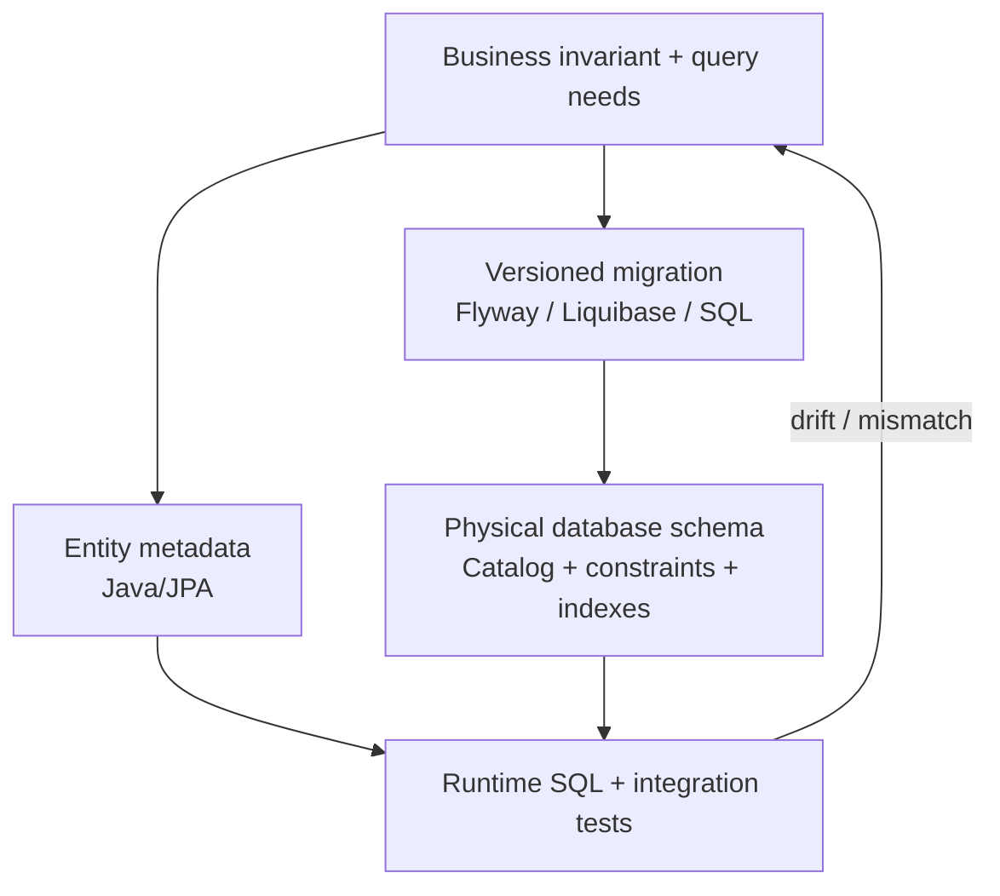

# Đối chiếu mô hình entity với lược đồ thực tế

Một lớp Java được đánh dấu `@Entity` không phải là bản sao chính xác của một bảng SQL. **Mô hình entity** diễn tả cách Jakarta Persistence (JPA) ánh xạ đối tượng, thuộc tính và quan hệ vào dữ liệu quan hệ; **lược đồ thực tế** là các bảng, cột, kiểu dữ liệu, khóa và ràng buộc đang tồn tại trong database mà ứng dụng kết nối tới. Hai phía phải tương thích để ứng dụng đọc, ghi và bảo vệ dữ liệu đúng.

Ví dụ, mã nguồn có thể khai báo:

```java
@Column(name = "order_code", nullable = false, length = 50)
private String orderCode;
```

nhưng database sản xuất lại đang có:

```sql
order_code VARCHAR(20) NULL
```

Một truy vấn đọc bình thường vẫn có thể chạy, thậm chí vài integration tests cũng pass. Tuy nhiên, khi ghi mã dài 35 ký tự, database có thể từ chối hoặc xử lý không như mong muốn; với writer ngoài JPA, giá trị NULL có thể lọt vào bảng. Đây là **schema drift**: kỳ vọng của code và cấu trúc database không còn đồng nhất.

Tình huống khác:

```java
@Table(
    uniqueConstraints = @UniqueConstraint(
        name = "uq_orders_tenant_code",
        columnNames = {"tenant_id", "order_code"}
    )
)
```

Nếu production database **không có unique constraint này**, annotation không đủ ngăn hai transactions ghi trùng mã đơn hàng. Ngược lại, một foreign key hoặc CHECK constraint chỉ tồn tại trong database có thể làm JPA `flush()` thất bại dù không có annotation tương ứng.

Bài **“Đối chiếu mô hình entity với lược đồ thực tế”** thuộc chương **“Siêu dữ liệu và lược đồ”** của module **Data Persistence Relational Access ORM JPA**. Mục tiêu là xây dựng cách kiểm tra có hệ thống: từ Java entity mappings, physical tables/columns, schema migrations và database catalog đến dữ liệu hiện hữu, hành vi runtime, integration tests và quy trình triển khai an toàn.

## 1. Vì sao phải đối chiếu entity và database?

JPA giúp ứng dụng tránh viết phần lớn SQL CRUD thủ công, nhưng provider vẫn phải gửi SQL dựa trên **metadata mapping**. Nếu metadata không khớp database:

- `INSERT` có thể bị từ chối do cột bắt buộc hoặc constraint không được mô hình hóa.
- `SELECT` có thể không tìm thấy bảng/cột vì tên vật lý khác.
- `UPDATE` có thể mất precision, đổi kiểu sai hoặc không phát hiện concurrent update theo kỳ vọng.
- `JOIN` có thể sai khóa ngoại, trả kết quả không đúng hoặc tạo dữ liệu mồ côi.
- `UNIQUE`/`CHECK` có thể thiếu khiến nhiều writers lưu dữ liệu bất hợp lệ.
- Index có thể thiếu làm query chậm dù Java repository không thay đổi.
- Sequence/identity column cấu hình sai gây lỗi sinh khóa.
- Data migration đã thay schema nhưng ứng dụng cũ vẫn chạy, gây lỗi trong giai đoạn rolling deployment.
- Test dùng database/schema tự sinh có thể xanh trong khi production dùng schema từ Flyway/Liquibase khác.

**Đối chiếu không chỉ là hỏi “entity có chạy được không?”** mà còn hỏi “mapping có biểu diễn đúng contract dữ liệu không; database có enforce đúng invariant không; các đường ghi/đọc hiện hữu có tương thích không?”.

### 1.1. Bốn lớp cần kiểm tra

| Lớp | Cần xem gì? | Ví dụ |
|---|---|---|
| **Java mapping** | `@Entity`, `@Table`, `@Column`, `@Id`, `@JoinColumn`, converters | `@Column(length = 50)` |
| **Physical schema** | Bảng/cột, type, nullability, PK/FK, UNIQUE, CHECK, index, sequence | `VARCHAR(20) NULL` |
| **Dữ liệu hiện hữu** | NULLs, duplicates, orphan rows, invalid enum values, precision, timestamps | `order_code=NULL` |
| **Runtime behavior** | SQL provider tạo, transaction/flush, generated IDs, query plan, exception | INSERT bị `NOT NULL` fail |

Một hệ thống chỉ đạt an toàn khi các lớp liên quan cùng tuân thủ business requirement.

### 1.2. Hai hướng sai lệch

**Code kỳ vọng nhiều hơn DB bảo đảm:**

```text
Entity: @Column(nullable=false), @UniqueConstraint(...)
DB:     nullable column, no UNIQUE
```

JPA code có thể tuân thủ ràng buộc trong đường gọi của nó, nhưng SQL writer khác có thể không.

**DB áp nhiều hơn code thể hiện:**

```text
Entity: field length 100, no extra check
DB:     VARCHAR(40), CHECK(status IN (...))
```

Entity objects có thể trông hợp lệ trong Java nhưng SQL write thất bại.

### 1.3. Tương thích không nhất thiết là “text annotation bằng SQL”

Một `String` có thể được ánh xạ tới `VARCHAR`, `TEXT`, `NVARCHAR` hoặc kiểu khác phù hợp dialect/converter. `Instant` có thể được xử lý với nhiều timezone storage strategies. Nhiều ORM metadata có thuộc tính **schema generation hint**, không phải ràng buộc mọi database phải dùng literal SQL type giống nhau.

Vì vậy cần đối chiếu theo **ngữ nghĩa dữ liệu, capabilities của dialect, transaction behavior và yêu cầu nghiệp vụ**, không chỉ so sánh chuỗi DDL.

## 2. Ba nguồn sự thật và sự phân công

Một hệ thống thực tế thường có ba biểu diễn:



- **Business requirements** xác định điều gì đúng.
- **Entity mappings** xác định JPA phải đọc/ghi thông qua Java model thế nào.
- **Migration files** xác định schema thay đổi qua các phiên bản khi được chạy.
- **Database catalog** cho biết schema **thực sự đang tồn tại** ở môi trường đang kết nối.
- **Integration tests và SQL logs/plans** giúp xác minh hành vi.

### 2.1. Khi production dùng migration

Nếu Flyway/Liquibase quản lý production DB, migration là nguồn thay đổi **có kiểm soát** của physical schema. Annotations không được mặc nhiên xem như các lệnh ALTER TABLE tự chạy.

### 2.2. Khi thử nghiệm dùng schema generation

JPA/Hibernate có thể tạo schema từ metadata để phát triển hoặc test. Tính năng này hữu ích để kiểm tra một số mapping, nhưng schema tự sinh **không chứng minh migrations production đã chính xác**.

### 2.3. Database catalog là bằng chứng triển khai

Nếu code ghi `unique = true` và migration cũng có UNIQUE, nhưng môi trường production chưa chạy migration, database vẫn có thể thiếu constraint. Cần xác minh catalog trên **đúng database/schema instance**.

### 2.4. Không để Java và migration trở thành hai đặc tả độc lập không ai quản lý

Khi thay đổi domain, người review cần nhìn **entity metadata + migration + tests** cùng nhau. Một PR chỉ đổi field Java nhưng không đổi migration có thể làm schema drift; một migration đổi cột nhưng không đổi entity mapping cũng nguy hiểm.

## 3. Ví dụ xuyên suốt: quản lý đơn hàng

Giả định ứng dụng multi-tenant lưu đơn hàng theo mã riêng trong từng tenant. Mỗi order thuộc một customer, có status, tổng tiền, thời gian tạo và version để optimistic locking.

### 3.1. Entity customer

```java
package example.sales;

import jakarta.persistence.*;

@Entity
@Table(name = "customers", schema = "sales")
public class Customer {

    @Id
    @GeneratedValue(strategy = GenerationType.IDENTITY)
    private Long id;

    @Column(name = "display_name", nullable = false,
            length = 120)
    private String displayName;

    protected Customer() {}

    public Long getId() { return id; }
}
```

### 3.2. Entity order

```java
package example.sales;

import jakarta.persistence.*;
import java.math.BigDecimal;
import java.time.Instant;

@Entity
@Table(
    name = "sales_orders",
    schema = "sales",
    uniqueConstraints = @UniqueConstraint(
        name = "uq_orders_tenant_code",
        columnNames = {"tenant_id", "order_code"}
    ),
    indexes = @Index(
        name = "idx_orders_tenant_status_created",
        columnList = "tenant_id, status, created_at DESC"
    )
)
public class SalesOrder {

    @Id
    @GeneratedValue(strategy = GenerationType.IDENTITY)
    private Long id;

    @Column(name = "tenant_id", nullable = false,
            updatable = false, length = 64)
    private String tenantId;

    @Column(name = "order_code", nullable = false,
            length = 50)
    private String orderCode;

    @ManyToOne(fetch = FetchType.LAZY, optional = false)
    @JoinColumn(name = "customer_id", nullable = false)
    private Customer customer;

    @Enumerated(EnumType.STRING)
    @Column(name = "status", nullable = false,
            length = 20)
    private OrderStatus status;

    @Column(name = "total_amount", nullable = false,
            precision = 15, scale = 2)
    private BigDecimal totalAmount;

    @Column(name = "created_at", nullable = false)
    private Instant createdAt;

    @Version
    private Long version;

    protected SalesOrder() {}

    public SalesOrder(
            String tenantId,
            String orderCode,
            Customer customer,
            BigDecimal totalAmount,
            Instant createdAt) {
        this.tenantId = tenantId;
        this.orderCode = orderCode;
        this.customer = customer;
        this.totalAmount = totalAmount;
        this.createdAt = createdAt;
        this.status = OrderStatus.DRAFT;
    }
}

enum OrderStatus {
    DRAFT, PAID, SHIPPED, CANCELLED
}
```

Các fields không có getters/setters trong ví dụ được ánh xạ theo **field access** vì `@Id` đặt trên field. Mã chỉ minh họa entity mapping; application cần validation, transaction boundary, tenant authorization và domain methods phù hợp.

### 3.3. Lược đồ PostgreSQL minh họa

```sql
CREATE SCHEMA IF NOT EXISTS sales;

CREATE TABLE sales.customers (
    id BIGINT GENERATED BY DEFAULT AS IDENTITY PRIMARY KEY,
    display_name VARCHAR(120) NOT NULL
);

CREATE TABLE sales.sales_orders (
    id BIGINT GENERATED BY DEFAULT AS IDENTITY PRIMARY KEY,
    tenant_id VARCHAR(64) NOT NULL,
    order_code VARCHAR(50) NOT NULL,
    customer_id BIGINT NOT NULL,
    status VARCHAR(20) NOT NULL,
    total_amount NUMERIC(15, 2) NOT NULL,
    created_at TIMESTAMP WITH TIME ZONE NOT NULL,
    version BIGINT NOT NULL,

    CONSTRAINT uq_orders_tenant_code
        UNIQUE (tenant_id, order_code),
    CONSTRAINT fk_orders_customer
        FOREIGN KEY (customer_id)
        REFERENCES sales.customers(id),
    CONSTRAINT ck_orders_nonnegative_amount
        CHECK (total_amount >= 0)
);

CREATE INDEX idx_orders_tenant_status_created
    ON sales.sales_orders
       (tenant_id, status, created_at DESC);
```

Đây là **schema minh họa** để so sánh. PostgreSQL `TIMESTAMP WITH TIME ZONE` và JDBC/Hibernate mapping cho `Instant` cần được đối chiếu với Hibernate version/timezone configuration cụ thể. `CHECK` là một invariant bổ sung của DB; không có nghĩa mọi JPA provider tự sinh nó chỉ từ `BigDecimal`.

### 3.4. Bảng đối chiếu tổng hợp

| Entity metadata | Physical schema cần xác minh | Ý nghĩa |
|---|---|---|
| `@Table(name="sales_orders",schema="sales")` | `sales.sales_orders` tồn tại | Đúng object và schema |
| `Long id` + `IDENTITY` | `BIGINT GENERATED ... AS IDENTITY`/capability tương thích | Insert và lấy generated key |
| `tenantId` / `length=64` | `tenant_id VARCHAR(64) NOT NULL` | Scope tenant |
| `orderCode` / `length=50` | `order_code VARCHAR(50) NOT NULL` | Business key field |
| `@ManyToOne` + `@JoinColumn` | `customer_id BIGINT NOT NULL` + FK | Referential integrity |
| `@Enumerated(STRING)` | `status VARCHAR(20)` + dữ liệu enum hợp lệ | Enum persistence |
| `BigDecimal(15,2)` | `NUMERIC(15,2)` hoặc tương đương | Monetary precision |
| `Instant createdAt` | Temporal SQL type/storage semantics hợp lý | Timeline |
| `@Version Long` | `version BIGINT NOT NULL` + provider update semantics | Optimistic locking |
| Composite `@UniqueConstraint` | UNIQUE(tenant_id,order_code) | Chống mã trùng trong tenant |
| `@Index` | Index thật có đúng cột/thứ tự | Query access path |
| Domain amount ≥0 | `CHECK (total_amount >= 0)` | Bảo vệ dữ liệu ngoài JPA |

Từ đây có thể đối chiếu từng khía cạnh chi tiết.

## 4. Bắt đầu bằng đúng database/schema

Nhiều ca “mapping đúng nhưng app không chạy” thực chất do ứng dụng đang kết nối sai database, schema hoặc tenant namespace.

### 4.1. Kiểm tra connection target

Xác nhận:

- Host, port và database name.
- User/role thực hiện SQL.
- Default schema/search path.
- Transaction isolation và read replica routing.
- Environment: local, test, staging, production.
- Migration version đã áp dụng ở chính DB đó.

Không log connection string chứa credentials hoặc các secret keys.

### 4.2. Tên bảng và schema

```java
@Entity
@Table(name = "sales_orders", schema = "sales")
class SalesOrder { ... }
```

phải map tới table phù hợp. Nếu DB có `public.sales_orders` thay vì `sales.sales_orders`, entity có thể gặp “relation does not exist” dù một bảng cùng tên có tồn tại.

### 4.3. `@Entity(name=...)` khác `@Table(name=...)`

```java
@Entity(name = "Order")
@Table(name = "sales_orders")
public class SalesOrder { ... }
```

`Order` là entity name dùng trong JPQL như `select o from Order o`; `sales_orders` là table name SQL. Đổi JPQL entity name không nhất thiết đổi physical table và ngược lại.

### 4.4. Identifier quoting và chữ hoa/thường

`order_items`, `ORDER_ITEMS` và `"Order_Items"` có thể được DB xử lý khác nhau theo quoting/case folding. Naming strategy và dialect phải thống nhất với physical identifiers. Ưu tiên explicit snake_case naming khi cần schema kiểm soát qua migrations.

### 4.5. View, materialized view và synonym

Một entity có thể map tới database view hoặc object thông qua synonym/search path. Khi đó “bảng tồn tại” chưa đủ; phải xem view updateability, permissions, generated IDs và DML support. Đừng mặc định mọi `@Entity` luôn map tới một physical base table có thể INSERT/UPDATE.

## 5. Đối chiếu cột: sự hiện diện và tên vật lý

JPA field/property name không nhất thiết bằng DB column name:

```java
@Column(name = "created_at")
private Instant createdAt;
```

Metadata cho biết Java `createdAt` map sang cột `created_at`.

### 5.1. Một bảng kiểm kê cột

| Java property | Explicit SQL name | DB type | Nullable | Length/precision |
|---|---|---|---|---|
| `tenantId` | `tenant_id` | VARCHAR(64) | No | 64 |
| `orderCode` | `order_code` | VARCHAR(50) | No | 50 |
| `customer` | `customer_id` | BIGINT | No | FK |
| `totalAmount` | `total_amount` | NUMERIC(15,2) | No | 15,2 |
| `createdAt` | `created_at` | TIMESTAMPTZ | No | Temporal |

### 5.2. Missing column

Nếu code mới thêm:

```java
@Column(name = "external_source")
private String externalSource;
```

nhưng DB chưa có cột đó, SQL SELECT/INSERT/UPDATE do JPA tạo có thể lỗi `column does not exist`. Cần migration thêm cột vào đúng schema trước khi code dựa vào nó.

### 5.3. Extra column

Nếu DB có thêm `legacy_flag` nhưng entity không map cột đó, chưa chắc là lỗi. Nó có thể phục vụ trigger, migration cũ hoặc writer khác. Tuy nhiên nếu cột `NOT NULL` **không có default** mà JPA INSERT không cung cấp giá trị, việc insert có thể fail. Vì vậy đối chiếu phải xét **cột ở DB mà entity không biết**.

### 5.4. Cột mapping sai ở superclass/embeddable

Khi field được thừa kế từ `@MappedSuperclass` hoặc nhúng qua `@Embedded`, cột có thể không xuất hiện trực tiếp trong entity source. Cần tính **effective mapping** sau overrides. Không tự kết luận field thiếu chỉ vì không thấy `@Column` trong lớp con.

## 6. Access type: field access và property access

JPA có thể ánh xạ theo **fields** hoặc **getters**, phụ thuộc vị trí `@Id`/`@Access` và quy tắc mapping.

### 6.1. Field access

```java
@Entity
public class Product {
    @Id
    private Long id;

    @Column(name = "product_name")
    private String name;

    public String getName() { return name; }
}
```

Provider đọc metadata ở fields.

### 6.2. Property access

```java
@Entity
@Access(AccessType.PROPERTY)
public class Product {
    private Long id;
    private String name;

    @Id
    public Long getId() { return id; }

    @Column(name = "product_name")
    public String getName() { return name; }

    public void setId(Long id) { this.id = id; }
    public void setName(String name) { this.name = name; }
}
```

### 6.3. Đặt annotation sai vị trí gây mismatch

Nếu class dùng field access nhưng developer đặt `@Column(name="product_name")` lên getter mà không có `@Access` hợp lệ, provider có thể không diễn giải mapping theo ý định. Physical name sau naming strategy có thể khác, khiến runtime báo thiếu cột.

### 6.4. `@Transient` khác Java `transient`

`jakarta.persistence.Transient` loại một field/property khỏi persistent mapping. Java keyword `transient` cũng liên quan exclusion theo quy tắc JPA access/mapping. Khi đối chiếu columns, xác định field nào thực sự persistent trước khi báo “DB thiếu cột”.

## 7. Kiểu Java, kiểu SQL và khả năng chuyển đổi

Một bảng/cột có thể tồn tại đúng tên nhưng vẫn không tương thích với Java type. Ví dụ:

```java
private BigDecimal totalAmount;
```

nếu DB dùng `INTEGER`, ứng dụng có thể gặp giới hạn precision hoặc conversion tùy provider. Ngược lại, một field `Long` map tới `VARCHAR` chứa chuỗi chữ có thể lỗi khi hydrate.

### 7.1. Các loại phổ biến

| Java type | Các SQL types có thể gặp | Điều cần so sánh |
|---|---|---|
| `String` | VARCHAR, CHAR, TEXT, NVARCHAR | length, collation, encoding, truncation |
| `int`/`Integer` | SMALLINT, INTEGER | range, nullable primitive vs wrapper |
| `long`/`Long` | BIGINT, NUMERIC | range, signed/unsigned, generated ID |
| `BigDecimal` | DECIMAL/NUMERIC | precision, scale, rounding |
| `Boolean` | BOOLEAN, BIT, CHAR/NUMBER qua converter | Giá trị lưu và NULL |
| `LocalDate` | DATE | Chỉ ngày, không timezone |
| `LocalDateTime` | TIMESTAMP/DATETIME | Không mang timezone |
| `Instant` | TIMESTAMP hoặc kiểu timezone-aware phù hợp provider | Lưu thời điểm tuyệt đối, timezone strategy |
| `UUID` | UUID, BINARY, VARCHAR | Storage encoding, conversion, ID generator |
| `byte[]` | BLOB/BYTEA/VARBINARY | Kích thước, streaming, performance |
| Enum | VARCHAR/CHAR/INTEGER theo mapping | Persistence strategy và dữ liệu legacy |

Bảng chỉ mang tính **định hướng**. Mapping chính xác còn phụ thuộc Jakarta Persistence version, JDBC driver, Hibernate version, dialect, `@JdbcTypeCode`, `@Convert` hoặc custom type mappings.

### 7.2. Numeric precision và scale

```java
@Column(
    name = "total_amount",
    precision = 15,
    scale = 2,
    nullable = false
)
private BigDecimal totalAmount;
```

DDL khái niệm:

```sql
total_amount NUMERIC(15, 2) NOT NULL
```

Kiểm tra:

- `15` là tổng số chữ số tối đa, `2` chữ số sau dấu thập phân.
- Có chấp nhận số tiền cực lớn hoặc âm không?
- Khi đổi từ scale 2 sang scale 4, dữ liệu legacy có mất phần lẻ không?
- Code có làm tròn theo đúng nghiệp vụ không?
- Database có CHECK nonnegative hoặc currency-specific constraint chưa?

Không dùng `double`/`float` cho tiền nếu cần decimal precision ổn định.

### 7.3. String length và Unicode

`VARCHAR(50)` có thể đo độ dài theo ký tự hoặc byte tùy DB/kiểu/cấu hình. Java `String.length()` đếm UTF-16 code units, không trực tiếp là “số ký tự người dùng nhìn thấy” hoặc số bytes UTF-8. Những trường có Unicode/emoji cần test giới hạn trên **database thực tế**, không suy luận từ một phép đếm Java.

### 7.4. Primitive và nullable

`int quantity` không biểu diễn NULL trong Java, nhưng DB column có thể nullable. Nếu DB chứa NULL, hydration sang primitive có thể fail hoặc dẫn đến behavior không như mong muốn. Với giá trị optional, dùng wrapper `Integer` và xác định nullability. Với dữ liệu bắt buộc, enforce `NOT NULL` ở DB.

### 7.5. Temporal types và timezone

`Instant`, `LocalDateTime` và `OffsetDateTime` có semantics khác nhau. Nếu DB lưu local timestamp nhưng app coi như UTC instant, mọi giờ có thể bị lệch. Khi đối chiếu, cần kiểm tra:

1. Java temporal type.
2. SQL column type.
3. JDBC/provider timezone storage strategy.
4. Connection/session timezone và DB timezone.
5. Serialization/API timezone.
6. Giá trị thực tế qua test có DST/timezone boundaries.

Đừng khẳng định `TIMESTAMP WITH TIME ZONE` lưu nguyên timezone ID; ví dụ PostgreSQL `timestamptz` chuẩn hóa thời điểm và hiển thị theo session timezone, không nhất thiết giữ original zone name.

### 7.6. Enum string so với ordinal

```java
@Enumerated(EnumType.STRING)
private OrderStatus status;
```

thường biểu diễn tên enum dưới dạng chuỗi; nếu DB đang lưu `0,1,2` do mapping `ORDINAL` cũ, đổi annotation đơn thuần có thể khiến đọc dữ liệu lỗi. Cần migration dữ liệu tương ứng.

### 7.7. JSON, arrays và custom mappings

Một số DB hỗ trợ JSON/JSONB, ARRAY hoặc specialized types. Mapping bằng provider-specific annotations/converters có thể không tương thích với Java type inference mặc định. Cần đối chiếu SQL type, JDBC driver version, converter logic, null semantics và query operators.

## 8. `@Column` và physical constraints: đừng coi annotations là đủ

`@Column` có các attributes như:

```java
@Column(
    name = "product_code",
    nullable = false,
    unique = true,
    length = 64,
    insertable = true,
    updatable = false
)
private String productCode;
```

### 8.1. `nullable=false`

Là mapping/schema-generation hint, không phải validation tự động giống `@NotNull`. Nếu production DB vẫn nullable, JDBC writers có thể lưu NULL. Nếu application cần bảo đảm non-NULL, có DB constraint thực.

### 8.2. `unique=true`

Có ý nghĩa schema-generation cho unique key một cột. Không thay unique constraint trong DB đã triển khai. Với uniqueness theo cặp nhiều cột, dùng `@Table(uniqueConstraints=...)` và migration tương ứng.

### 8.3. `insertable=false` và `updatable=false`

Đây là cách provider tạo SQL INSERT/UPDATE đối với **mapped column**, không phải cấu hình quyền hoặc immutability tại DB.

Ví dụ:

```java
@Column(
    name = "created_at",
    insertable = false,
    updatable = false
)
private Instant createdAt;
```

Nếu DB không có default/trigger để cung cấp `created_at`, INSERT có thể fail vì ứng dụng không gửi cột mà schema yêu cầu NOT NULL.

### 8.4. `columnDefinition` và portability

```java
@Column(
    name = "payload",
    columnDefinition = "jsonb"
)
private String payload;
```

`columnDefinition` là SQL fragment dùng khi schema generation, thường DB-specific. Nó không có nghĩa runtime mapping đã tự động có correct JSON serialization/converter. Cần chọn Java type/provider mapping phù hợp và test đọc/ghi.

### 8.5. Default value trong DB

Một DB column:

```sql
created_at TIMESTAMPTZ NOT NULL DEFAULT now()
```

có thể tự điền giá trị nếu INSERT **bỏ cột**. Nhưng nếu provider gửi `created_at = NULL` thì default thường không áp dụng và NOT NULL có thể fail. Phải xem SQL thực tế và `insertable`/generated mapping thay vì chỉ nhìn `DEFAULT` trong schema.

### 8.6. Computed/generated columns

Nếu DB có generated column `full_name` dựa trên `first_name` và `last_name`, entity thường phải coi nó là read-only hay dùng provider-generated mapping phù hợp. Gửi INSERT/UPDATE vào generated column có thể bị từ chối. JPA không thể suy ra toàn bộ semantics của DB-generated expressions chỉ từ tên field.

## 9. Primary key: `@Id`, composite keys và physical PK

```java
@Id
private Long id;
```

là khai báo identity của entity. Database phải có một key strategy tương thích.

### 9.1. PK thực tế

Kiểm tra:

- Bảng có primary key không?
- Những cột nào thuộc PK và thứ tự?
- SQL type có phù hợp Java identifier?
- Nullability của PK?
- Trong shared-table multi-tenancy, `id` có unique toàn bảng hay chỉ unique theo tenant?
- Các referenced FKs trỏ vào đúng key chưa?

### 9.2. Surrogate key và business unique

`@Id Long id` có thể cùng tồn tại với:

```sql
UNIQUE (tenant_id, order_code)
```

Đừng nhầm business key unique với primary key. Unique constraint không biến hai cột thành composite JPA ID.

### 9.3. Composite ID

Với:

```java
@Embeddable
public class OrderKey implements Serializable {
    private String tenantId;
    private String orderCode;
    // equals/hashCode và constructor thích hợp
}

@Entity
public class Order {
    @EmbeddedId
    private OrderKey id;
}
```

database PK phải phản ánh **các cột tương ứng của embedded ID**. Nếu DB chỉ có `id BIGINT PRIMARY KEY`, mapping composite key và schema không khớp. `@IdClass` cũng đòi đối chiếu đúng key columns.

### 9.4. Entity identity trong persistence context

EntityManager nhận diện managed entity dựa trên entity type + primary key semantics. Nếu database không enforce uniqueness của key mà JPA tin là ID, hai rows có cùng key có thể gây behavior sai nghiêm trọng; không dùng JPA identity map để thay DB PK.

### 9.5. Primary key không được tự nhiên thay đổi

Nếu business key mutable nhưng được chọn làm `@Id`, việc thay đổi nó có thể làm foreign keys, persistence identity và cache behavior khó quản lý. Thiết kế key cần nhất quán qua schema, entity và domain rules.

## 10. `@GeneratedValue` và generator phải khớp database

Ví dụ:

```java
@Id
@GeneratedValue(strategy = GenerationType.IDENTITY)
private Long id;
```

với PostgreSQL:

```sql
id BIGINT GENERATED BY DEFAULT AS IDENTITY PRIMARY KEY
```

Đây là một cặp mapping/schema thường tương thích, phụ thuộc provider/dialect/version.

### 10.1. IDENTITY khác SEQUENCE

| JPA strategy | Kỳ vọng schema |
|---|---|
| `IDENTITY` | Cột tự sinh key kiểu identity/auto-increment theo DB |
| `SEQUENCE` | Database sequence tương ứng và provider có quyền truy cập |
| `TABLE` | Generator table được cấu hình đúng |
| `UUID` | ID generation kiểu UUID theo JPA version/provider, Java type phù hợp |
| `AUTO` | Provider tự chọn strategy; phải quan sát physical schema |

Không thay từ `SEQUENCE` sang `IDENTITY` chỉ bằng annotation khi production DB vẫn dựa vào một generator khác.

### 10.2. `@SequenceGenerator`

```java
@Id
@GeneratedValue(
    strategy = GenerationType.SEQUENCE,
    generator = "order_seq_gen"
)
@SequenceGenerator(
    name = "order_seq_gen",
    sequenceName = "sales.order_id_seq",
    allocationSize = 50
)
private Long id;
```

Cần đối chiếu sequence **thực sự tồn tại**, permission, allocation/increment semantics và initial/current values. Nếu provider dùng pooled optimizer với `allocationSize` lớn, mismatch với sequence increment có thể gây cảnh báo/lỗi hoặc allocation behavior không như mong đợi, tùy version.

### 10.3. Sequence bị tụt sau data import

Một job import IDs trực tiếp có thể tạo row `id=100000` trong khi sequence vẫn sinh `id=500`. Unique PK conflict có thể xảy ra sau đó. Đây là **drift của generator state**, không chỉ DDL schema. Migration/import cần đồng bộ generator theo DB rules.

### 10.4. ID có giá trị không chứng minh transaction đã commit

Provider có thể cấp ID trước commit. Nếu transaction rollback, Java object vẫn có thể giữ ID nhưng DB không có row tương ứng. Đừng dùng non-null ID thay cho xác nhận transaction completion.

### 10.5. Sequence/identity permissions

Một production database user có thể SELECT bảng nhưng thiếu quyền USAGE sequence hoặc quyền INSERT. Mapping đúng vẫn có thể fail ở runtime do permissions. Việc đối chiếu **môi trường thực** phải kiểm tra cả privileges cần thiết.

## 11. `@Version` và optimistic locking

```java
@Version
private Long version;
```

JPA sử dụng version field cho optimistic concurrency control khi thực hiện versioned writes. DB cần một column có type, nullability và default/initialization tương thích provider.

### 11.1. Mapping và lược đồ

```text
Entity: Long version, @Version
DB:     version BIGINT NOT NULL
```

Điều này tương thích về mục tiêu nhưng vẫn cần xem provider SQL INSERT/UPDATE.

### 11.2. SQL UPDATE với version check

Một câu DML khái niệm:

```sql
UPDATE sales.sales_orders
SET status = ?, version = ?
WHERE id = ?
  AND version = ?;
```

Nếu update không ảnh hưởng row do version đã đổi, provider có thể phát hiện optimistic conflict. SQL thật do Hibernate/provider tạo có thể khác.

### 11.3. Bulk/native SQL có thể bỏ qua version

Một JDBC job:

```sql
UPDATE sales.sales_orders
SET status = 'PAID'
WHERE id = 101;
```

nếu không cập nhật/check `version`, có thể phá kỳ vọng concurrency của JPA. Đối chiếu schema chỉ thấy cột version **chưa đủ**; cần review mọi đường ghi ngoài managed entity lifecycle.

### 11.4. Legacy version data

Nếu bảng cũ có rows với `version=NULL` nhưng entity dùng `@Version Long version` theo strategy yêu cầu non-null, migration backfill và NOT NULL có thể cần thiết. Đừng đặt DB default mà không kiểm tra behavior của writer/provider.

### 11.5. Thêm `@Version` không tự sửa mọi lost update

Nếu client GET stale state rồi service load latest entity mới trước khi cập nhật mà không so sánh expected version, JPA chỉ bảo vệ race **sau lần load latest đó**. Cần client-supplied expectedVersion/ETag nếu nghiệp vụ yêu cầu phát hiện stale edits xuyên requests.

## 12. Quan hệ `@ManyToOne`, `@OneToOne` và foreign keys

Một association:

```java
@ManyToOne(fetch = FetchType.LAZY, optional = false)
@JoinColumn(name = "customer_id", nullable = false)
private Customer customer;
```

có nhiều thành phần:

- Entity target `Customer`.
- Cột FK `customer_id` ở bảng owner `sales_orders`.
- Cột referenced target, mặc định thường primary key `customers.id`.
- Nullability.
- Foreign key constraint có được enforce tại DB không.
- Cascade semantics của JPA và referential actions của DB.

### 12.1. Tên join column

`@JoinColumn(name="customer_id")` phải tương ứng với DB cột thật. Nếu DB dùng `client_id`, SQL join/insert có thể fail. `referencedColumnName` cần được chỉ định nếu tham chiếu alternate key.

### 12.2. `optional=false` và `nullable=false`

`optional=false` mô tả association bắt buộc ở mô hình JPA; `nullable=false` là schema hint của join column. Nhưng integrity vẫn cần `customer_id NOT NULL` và FK thực sự ở DB nếu mọi writers phải tuân thủ.

### 12.3. Foreign key thiếu

Nếu bảng có `customer_id` nhưng **không có FK**, JDBC writer có thể insert order tham chiếu customer không tồn tại. JPA mapping association không có nghĩa database đã enforce referential integrity.

### 12.4. Foreign key trỏ sai bảng/cột

Ví dụ multi-tenant: DB FK chỉ trỏ `customers(id)`, trong khi application yêu cầu order/customer thuộc **cùng tenant**. FK đơn cột có thể không bảo vệ tenant integrity nếu dữ liệu cho phép cross-tenant relationships. Có thể cần composite FK có `tenant_id`, unique reference key, authorization/domain rule hoặc thiết kế schema khác.

### 12.5. `@OneToOne` và unique FK

`@OneToOne` có thể dựa trên unique FK hoặc shared PK. Nếu bảng owner chứa hai rows cùng trỏ một profile, data relationship thực chất many-to-one dù Java khai báo one-to-one. Kiểm chứng unique FK/PK tại DB.

### 12.6. `@OneToMany(mappedBy=...)`

Collection inverse side thường không chứa foreign key ngay tại bảng parent; owning side là `@ManyToOne` ở child. Khi đối chiếu, tìm FK ở **đúng physical table**, không kỳ vọng parent table có một cột cho toàn collection.

### 12.7. Cascades không phải database `ON DELETE CASCADE`

```java
@OneToMany(
    mappedBy = "order",
    cascade = CascadeType.REMOVE
)
private List<OrderItem> items;
```

JPA cascade remove tác động entity lifecycle qua provider; DB `ON DELETE CASCADE` tác động referential action. Hai cơ chế có thể cùng tồn tại nhưng không thay thế nhau trong mọi tình huống, đặc biệt với bulk/native SQL và callbacks.

### 12.8. Deferrable constraints và transaction

Một số DB hỗ trợ FK/UNIQUE constraints kiểm tra deferred tới commit. `flush()` hoàn tất không bảo đảm commit sẽ thành công. Điều này quan trọng khi review exception handling và integration tests.

## 13. Many-to-many, join tables và element collections

Một quan hệ nhiều-nhiều thường không map trực tiếp qua FK ở hai bảng entity, mà qua **join table**.

### 13.1. Mapping many-to-many

```java
@Entity
@Table(name = "app_users")
public class UserAccount {
    @Id
    private Long id;

    @ManyToMany
    @JoinTable(
        name = "user_roles",
        joinColumns = @JoinColumn(name = "user_id"),
        inverseJoinColumns =
            @JoinColumn(name = "role_id"),
        uniqueConstraints = @UniqueConstraint(
            name = "uq_user_roles_user_role",
            columnNames = {"user_id", "role_id"}
        )
    )
    private Set<Role> roles = new HashSet<>();
}
```

Cần kiểm tra physical `user_roles` table có:

```sql
CREATE TABLE user_roles (
    user_id BIGINT NOT NULL,
    role_id BIGINT NOT NULL,
    CONSTRAINT fk_user_roles_user
        FOREIGN KEY (user_id) REFERENCES app_users(id),
    CONSTRAINT fk_user_roles_role
        FOREIGN KEY (role_id) REFERENCES roles(id),
    CONSTRAINT uq_user_roles_user_role
        UNIQUE (user_id, role_id)
);
```

`Set<Role>` ở Java không tự enforce uniqueness khi một JDBC writer hoặc transaction khác thêm trùng link. Physical unique key bảo vệ invariant xuyên writers.

### 13.2. Hai chiều ownership

Nếu cả hai entity cùng khai báo `@ManyToMany` mà không dùng `mappedBy` thích hợp, provider có thể kỳ vọng hai join tables hoặc metadata association khác ý định. Trong DB cần một join table đúng, ở code cần owner/inverse mapping nhất quán.

### 13.3. Entity thay thế join table

Nếu link có fields như `assigned_at`, `expires_at`, `assigned_by`, model hóa `UserRoleGrant` thành entity riêng với hai FKs thường rõ hơn. Khi đó phải đối chiếu PK, unique business pair và data lifecycle trong chính bảng grants.

### 13.4. `@ElementCollection`

```java
@ElementCollection
@CollectionTable(
    name = "product_tags",
    joinColumns = @JoinColumn(name = "product_id")
)
@Column(name = "tag", nullable = false)
private Set<String> tags = new HashSet<>();
```

Đối chiếu:

- `product_tags` có tồn tại không?
- Cột owner FK tên `product_id`?
- Cột element `tag` đúng type/length?
- FK về products đã có?
- Nếu tags duy nhất theo product, DB có unique `(product_id,tag)` không?
- Nếu dùng `List` với `@OrderColumn`, cột index/order và cập nhật reorder có đúng không?

### 13.5. Map collection

`Map<K,V>` có thể được lưu với `@MapKeyColumn` và value columns. Metadata keys/values ảnh hưởng columns trong collection table; khi refactor từ List sang Map, physical schema có thể cần migration dù method signatures của entity chỉ đổi trong Java.

## 14. `@SecondaryTable` và nhiều bảng cho một entity

Một entity có thể có data phân bố trên **bảng chính và bảng phụ**:

```java
@Entity
@Table(name = "customer_accounts")
@SecondaryTable(
    name = "customer_profiles",
    pkJoinColumns = @PrimaryKeyJoinColumn(
        name = "customer_id",
        referencedColumnName = "id"
    )
)
public class CustomerAccount {
    @Id
    private Long id;

    @Column(name = "login_name", nullable = false)
    private String loginName;

    @Column(name = "biography",
            table = "customer_profiles")
    private String biography;
}
```

### 14.1. Schema cần có gì?

```text
customer_accounts
    id PRIMARY KEY
    login_name

customer_profiles
    customer_id PRIMARY KEY + FOREIGN KEY to customer_accounts.id
    biography
```

`customer_profiles.customer_id` phải tham chiếu đúng PK theo mapping, không nhất thiết là cột `id` tên giống bảng chính.

### 14.2. Extra nullable/optional rows

Một provider có thể xử lý secondary table row optional khác với mandatory table; DB có/không row ở bảng phụ ảnh hưởng hydration và update. Khi đối chiếu cần xem `@SecondaryTable(optional=...)` nếu version/provider hỗ trợ tương ứng, DB constraints và SQL thực.

### 14.3. Index/unique thuộc đúng bảng

Nếu `biography` hoặc `country_code` được lưu ở `customer_profiles`, index trên cột đó phải được tạo ở physical bảng phụ. Đặt `@Index(columnList="country_code")` trong `@Table(name="customer_accounts")` có thể sai bảng.

### 14.4. Hai bảng, một entity version

Khi entity trải qua nhiều tables, optimistic version và SQL UPDATE có thể liên quan nhiều statements. Không tự giả định database transaction gồm một câu UPDATE duy nhất. Test lifecycle, rollback và locking với schema thực.

## 15. `@Embeddable`, `@Embedded` và attribute overrides

Không phải mỗi Java class đều có một table:

```java
@Embeddable
public class PostalAddress {
    private String city;
    private String postalCode;
}

@Entity
@Table(name = "customers")
public class Customer {
    @Id
    private Long id;

    @Embedded
    @AttributeOverrides({
        @AttributeOverride(
            name = "city",
            column = @Column(name = "billing_city")
        ),
        @AttributeOverride(
            name = "postalCode",
            column = @Column(name = "billing_postal")
        )
    })
    private PostalAddress billingAddress;
}
```

Kết quả thường là:

```sql
customers (
    id,
    billing_city,
    billing_postal
)
```

không phải một bảng `postal_address` riêng.

### 15.1. Effective column names

`PostalAddress.city` có thể được override thành `billing_city` ở Customer và `shipping_city` ở Order. Khi so sánh catalog cần sử dụng **tên sau override**, không chỉ định nghĩa gốc trong embeddable.

### 15.2. Nested embeddables

Một embeddable có thể chứa embeddable khác. Các paths lồng nhau ảnh hưởng `@AttributeOverride(name="...")` và physical columns; đừng chỉ đếm fields trực tiếp trên entity.

### 15.3. `@AssociationOverride`

Nếu embeddable có association, `@AssociationOverride` có thể thay join column name. Physical FK khi đó nằm ở bảng embedding entity theo effective override.

### 15.4. Không kết luận thiếu bảng từ `@Embeddable`

`@Embeddable` thường mô tả value object được lưu trong owning table hoặc một container phù hợp, không phải entity table độc lập. Hãy xác định mapping kind trước khi tìm physical table.

## 16. Inheritance strategy thay đổi hình dạng schema

Java:

```text
Payment
  |- CardPayment
  |- BankTransferPayment
  |- WalletPayment
```

JPA có những inheritance strategies tạo schema rất khác.

### 16.1. `SINGLE_TABLE`

```java
@Entity
@Inheritance(strategy = InheritanceType.SINGLE_TABLE)
@DiscriminatorColumn(name = "payment_type")
public abstract class Payment { ... }
```

Các subtypes thường chia sẻ **một table** với discriminator:

```text
payments
  id
  payment_type
  amount
  card_last4
  bank_reference
  wallet_provider
```

Những subtype-specific columns có thể nullable cho rows của subtype khác. Nếu thêm `NOT NULL` toàn cột theo một subtype mà không xét discriminator, inserts của subtype khác có thể fail.

### 16.2. `JOINED`

```java
@Inheritance(strategy = InheritanceType.JOINED)
```

Thường có:

```text
payments (id PK, amount, ...)
card_payments (id PK + FK to payments.id, ...)
bank_transfer_payments (id PK + FK to payments.id, ...)
```

Khi đối chiếu, kiểm tra:

- Subclass tables tồn tại.
- PK/FK join columns đúng.
- Root/subclass IDs đồng nhất.
- Query polymorphic joins hợp lệ.
- Delete/cascade semantics không tạo orphan rows.

### 16.3. `TABLE_PER_CLASS`

Mỗi concrete subclass có table chứa cả common fields:

```text
card_payments (id, amount, card_last4, ...)
bank_transfer_payments (id, amount, bank_reference, ...)
```

Một unique constraint trên từng table **không bảo vệ uniqueness xuyên toàn hierarchy** nếu business key cần unique global. Polymorphic query thường phải kết hợp dữ liệu nhiều tables theo implementation; schema và ID generation phải phù hợp.

### 16.4. Đổi inheritance strategy không phải refactor annotation đơn giản

Chuyển từ SINGLE_TABLE sang JOINED có thể cần:

- Tạo subclass tables.
- Phân chia dữ liệu legacy theo discriminator.
- Tạo PK/FK references.
- Backfill, validate row counts và uniqueness.
- Chuyển read/write code và query shapes.
- Phối hợp rolling deployment/cutover.

Một schema validator đơn giản không thực hiện migration dữ liệu này thay bạn.

### 16.5. `@MappedSuperclass`

`@MappedSuperclass` **không có table riêng**. Fields/mappings của nó được thừa kế vào các entity tables phù hợp. Đừng tìm “bảng của mapped superclass” khi kiểm tra schema.

## 17. Entity converters và provider-specific data types

`@Convert` cho phép chuyển Java attribute sang database representation:

```java
@Converter
public class CurrencyCodeConverter
        implements AttributeConverter<CurrencyCode, String> {

    @Override
    public String convertToDatabaseColumn(CurrencyCode code) {
        return code == null ? null : code.value();
    }

    @Override
    public CurrencyCode convertToEntityAttribute(String value) {
        return value == null ? null : new CurrencyCode(value);
    }
}
```

Entity:

```java
@Convert(converter = CurrencyCodeConverter.class)
@Column(name = "currency_code", length = 3)
private CurrencyCode currency;
```

### 17.1. Kiểu DB là representation sau converter

Nếu converter chuyển `CurrencyCode` thành `String` ba ký tự, physical schema nên có SQL type/string length tương thích. Nếu DB lưu `INTEGER`, runtime có thể lỗi dù Java field nhìn đúng.

### 17.2. Converter phải tương thích dữ liệu legacy

Nếu DB có code `US_DOLLAR` nhưng converter chỉ chấp nhận `USD`, entity hydration có thể fail. Schema comparison không thể phát hiện tất cả value-level incompatibility; cần **data profiling**.

### 17.3. `@Enumerated` và converter

Nếu một field dùng enum mapping và custom converter, phải hiểu constraints của Jakarta Persistence về cách kết hợp annotations/autoApply; tránh định nghĩa hai chiến lược chuyển đổi cạnh tranh cho cùng attribute. Dùng một representation được xác định rõ.

### 17.4. Hibernate-specific type annotations

`@JdbcTypeCode`, `@Type` hoặc custom user types (tùy Hibernate version) có thể thay cách JDBC truyền/đọc dữ liệu. Một JPA model nhìn là `Map<String,Object>` nhưng schema dùng JSONB đòi provider configuration và DB-specific operators phù hợp. Phân tích effective provider metadata, không chỉ JPA annotations.

### 17.5. Encryption at rest qua converter

Nếu converter mã hóa field, physical cột lưu ciphertext có thể cần length lớn hơn plaintext, format/versioning metadata và migration khi đổi key. Unique/index trên ciphertext không tự có cùng semantics với unique/index plaintext; cần thiết kế riêng theo security requirements.

## 18. Unique constraints: business invariants ngoài Java

```java
@Table(
    uniqueConstraints = @UniqueConstraint(
        name = "uq_orders_tenant_code",
        columnNames = {"tenant_id", "order_code"}
    )
)
```

Đối chiếu database:

```sql
ALTER TABLE sales.sales_orders
ADD CONSTRAINT uq_orders_tenant_code
UNIQUE (tenant_id, order_code);
```

### 18.1. Unique ở đúng phạm vi?

`UNIQUE(order_code)` cấm các tenant khác nhau dùng chung mã. `UNIQUE(tenant_id, order_code)` cho phép cùng code ở hai tenant nhưng không cho trùng trong một tenant.

### 18.2. `@Column(unique=true)` không thay composite unique

Hai single-column uniques trên `tenant_id` và `order_code` sẽ tạo behavior sai. Khi đối chiếu, phải so **tập cột cùng nằm trong một constraint**, không chỉ tìm xem từng cột có tham gia unique nào đó hay không.

### 18.3. NULL semantics

Ở nhiều RDBMS, unique key cho phép nhiều rows chứa NULL. Với business key bắt buộc, DB `NOT NULL` là cần thiết. Nếu yêu cầu “NULL được coi như một giá trị đã chiếm chỗ”, có thể cần DB-specific design.

### 18.4. Case/collation

`ABC` và `abc` có bị coi là trùng không phụ thuộc DB collation/index expression/normalization. `@UniqueConstraint` không tự giải thích business case-folding. Với case-insensitive uniqueness, cần normalized column hoặc DB-specific functional index/collation phù hợp.

### 18.5. Soft delete

Nếu chỉ active rows được unique:

```sql
CREATE UNIQUE INDEX ux_active_tenant_code
ON sales.sales_orders (tenant_id, order_code)
WHERE deleted_at IS NULL;
```

Đây là **PostgreSQL-specific partial unique index**; không thể diễn tả portable bằng `@UniqueConstraint`/`@Index` chuẩn. Schema migration và entity model phải thừa nhận feature DB-specific này.

### 18.6. Pre-check không chặn race

`existsByTenantAndCode()` trước insert hữu ích cho UX nhưng hai transactions có thể cùng pass. Chỉ DB unique rule mới enforce xuyên concurrent writers khi đã được tạo đúng.

### 18.7. Sau constraint violation

Nếu DB từ chối INSERT/UPDATE, transaction/persistence context có thể không còn an toàn để tiếp tục. Rollback, phân loại exception và chỉ retry trong transaction/context mới nếu nghiệp vụ cho phép. Không bắt lỗi rồi cố commit phần còn lại trong cùng unit of work.

## 19. Indexes: schema drift hiệu năng khác drift integrity

```java
@Table(
    indexes = @Index(
        name = "idx_orders_tenant_status_created",
        columnList = "tenant_id, status, created_at DESC"
    )
)
```

Nếu index này thiếu, database vẫn có thể trả kết quả **đúng** nhưng query chậm. Đây là drift ảnh hưởng performance/operations; khác constraint thiếu có thể ảnh hưởng correctness.

### 19.1. Physical column order

`(tenant_id,status,created_at DESC)` khác `(created_at,status,tenant_id)`. So đúng **thứ tự cột và hướng sort** khi yêu cầu access pattern phụ thuộc chúng.

### 19.2. Unique/index duplicate

Unique constraint thường có backing index. Nếu DB đã có unique `(tenant_id,order_code)`, thêm index thường y hệt có thể tăng write overhead mà ít lợi ích. Schema review cần phát hiện redundant indexes.

### 19.3. Partial/expression/covering index

Các tính năng như:

```sql
CREATE INDEX idx_orders_active_tenant_time
    ON sales.sales_orders (tenant_id, created_at DESC)
    WHERE status = 'PAID';
```

hoặc PostgreSQL `INCLUDE`, `lower(email)` expression index không được mô tả đầy đủ bởi JPA `@Index` portable. Catalog/DDL migration là nguồn kiểm tra.

### 19.4. Không dùng index như bằng chứng thứ tự SQL

Index `created_at DESC` không đảm bảo query thiếu `ORDER BY` trả rows từ mới đến cũ.

### 19.5. Index trên foreign key

`@ManyToOne`/`@JoinColumn` không bảo đảm mọi RDBMS tự tạo non-unique index tại child FK. Với truy vấn theo `customer_id`, cân nhắc `(customer_id,created_at DESC)` nhưng kiểm chứng query plan và duplicate existing indexes trước khi tạo.

### 19.6. Query optimizer tự quyết định

Index tồn tại không đồng nghĩa optimizer buộc dùng. Cần `EXPLAIN`, statistics và workload đại diện để đánh giá chi phí, đặc biệt với bảng nhỏ hoặc predicate ít chọn lọc.

## 20. Đọc database catalog: bằng chứng schema đang triển khai

Khi có quyền truy vấn metadata, cách kiểm tra rõ nhất là hỏi **database catalog** trên đúng DB/schema.

### 20.1. PostgreSQL: liệt kê cột

```sql
SELECT
    table_schema,
    table_name,
    column_name,
    data_type,
    udt_name,
    character_maximum_length,
    numeric_precision,
    numeric_scale,
    is_nullable,
    column_default,
    identity_generation
FROM information_schema.columns
WHERE table_schema = 'sales'
  AND table_name = 'sales_orders'
ORDER BY ordinal_position;
```

Các cột metadata thể hiện:

- Cột vật lý nào tồn tại.
- SQL type và underlying type.
- VARCHAR length.
- NUMERIC precision/scale.
- Nullability.
- Default/identity metadata.

Trường nào có sẵn còn tùy RDBMS/version; câu SQL này minh họa PostgreSQL, không hứa chạy nguyên văn trên mọi database.

### 20.2. PostgreSQL: constraints

```sql
SELECT
    c.conname AS constraint_name,
    c.contype AS constraint_type,
    pg_get_constraintdef(c.oid) AS definition
FROM pg_constraint c
JOIN pg_class t
  ON t.oid = c.conrelid
JOIN pg_namespace n
  ON n.oid = t.relnamespace
WHERE n.nspname = 'sales'
  AND t.relname = 'sales_orders'
ORDER BY c.conname;
```

Trong PostgreSQL `pg_constraint.contype` thường có mã cho primary key, unique, foreign key, check và các loại khác. Đọc `definition` giúp xác nhận tập cột, referenced table và check expression.

### 20.3. PostgreSQL: indexes

```sql
SELECT
    schemaname,
    tablename,
    indexname,
    indexdef
FROM pg_indexes
WHERE schemaname = 'sales'
  AND tablename = 'sales_orders'
ORDER BY indexname;
```

Đối chiếu:

- Index name.
- Unique/non-unique.
- Index columns/order/direction.
- Predicate của partial index.
- Expressions/index methods.

Một index có thể được tạo do primary/unique key, không nhất thiết xuất phát từ `@Index` của JPA.

### 20.4. PostgreSQL: foreign keys

```sql
SELECT
    c.conname,
    pg_get_constraintdef(c.oid) AS definition
FROM pg_constraint c
JOIN pg_class t
  ON t.oid = c.conrelid
JOIN pg_namespace n
  ON n.oid = t.relnamespace
WHERE c.contype = 'f'
  AND n.nspname = 'sales'
  AND t.relname = 'sales_orders';
```

Từ definition xem `customer_id` tham chiếu bảng/cột nào, có `ON DELETE`/`ON UPDATE` behavior và deferrability thích hợp không.

### 20.5. PostgreSQL: bảng/sequence

```sql
SELECT table_schema, table_name, table_type
FROM information_schema.tables
WHERE table_schema = 'sales'
ORDER BY table_name;
```

```sql
SELECT sequence_schema, sequence_name
FROM information_schema.sequences
WHERE sequence_schema = 'sales'
ORDER BY sequence_name;
```

Nếu entity dùng `GenerationType.IDENTITY`, cũng xem identity metadata trên column; nếu dùng SEQUENCE, đối chiếu sequenceName, permissions và current/increment settings tương ứng.

### 20.6. Đối với MySQL/Oracle/SQL Server

Database catalog views khác nhau. Có thể bắt đầu từ `information_schema` (nếu DB hỗ trợ đầy đủ) hoặc vendor catalogs như MySQL `INFORMATION_SCHEMA`, Oracle data dictionary, SQL Server `sys.*`. Không sao chép PostgreSQL `pg_constraint` sang những DB khác.

### 20.7. Quyền metadata

Ứng dụng runtime user có thể không được cấp quyền đọc toàn catalog. Kiểm tra schema có thể dùng tài khoản read-only/CI migrations có quyền metadata thích hợp, nhưng không cấp superuser cho app chỉ để debug mapping.

## 21. Đọc schema qua JDBC `DatabaseMetaData`

Khi muốn có một lớp metadata tương đối portable ở Java, JDBC cung cấp `java.sql.DatabaseMetaData`.

### 21.1. Ví dụ liệt kê columns

```java
import java.sql.*;

DatabaseMetaData meta = connection.getMetaData();

try (ResultSet rs = meta.getColumns(
        null,
        "sales",
        "sales_orders",
        "%")) {

    while (rs.next()) {
        String column = rs.getString("COLUMN_NAME");
        String sqlType = rs.getString("TYPE_NAME");
        int length = rs.getInt("COLUMN_SIZE");
        int scale = rs.getInt("DECIMAL_DIGITS");
        int nullable = rs.getInt("NULLABLE");

        System.out.printf(
            "%s %s length=%d scale=%d nullable=%d%n",
            column, sqlType, length, scale, nullable);
    }
}
```

`connection` ở ví dụ là một JDBC Connection đã mở qua datasource/test setup; code cần resource management và quyền metadata phù hợp.

### 21.2. APIs hữu ích

| API JDBC | Dùng để xác minh |
|---|---|
| `getTables(...)` | Tables/views |
| `getColumns(...)` | Column names, JDBC types, length/scale, NULL |
| `getPrimaryKeys(...)` | PK columns |
| `getImportedKeys(...)` | Foreign keys do table này tham chiếu |
| `getExportedKeys(...)` | Foreign keys từ tables khác tham chiếu table này |
| `getIndexInfo(...)` | Index metadata |
| `getSchemas(...)` | Namespaces/schemas |
| `getTypeInfo()` | DB-supported SQL types |

### 21.3. Portability có giới hạn

JDBC metadata giúp trích xuất thông tin cơ bản, nhưng:

- Partial index predicate không luôn đầy đủ.
- Expression/index INCLUDE columns có thể thiếu.
- Name casing/scope thay đổi theo driver.
- Default/generated column semantics khác nhau.
- Views/materialized views có thể được báo khác nhau.
- Constraint deferrability/collation/partitioning cần catalog vendor-specific.

Nếu bài toán là bảo vệ tính đúng đắn của những feature đó, dùng SQL catalog chuyên biệt và integration tests.

### 21.4. Chọn một adapter per database

Hệ thống hỗ trợ nhiều DB có thể tạo `SchemaInspector` abstraction rồi triển khai `PostgresSchemaInspector`/`MysqlSchemaInspector` tương ứng. Không cố ép tất cả vendor-specific metadata thành một vài trường JDBC tối giản rồi bỏ mất business-critical differences.

## 22. So sánh mapping và schema theo ma trận

Một quy trình thường bắt đầu bằng một bảng đối chiếu **entity expectation → actual DB evidence → severity**:

| Hạng mục | Mapping mong đợi | DB thực tế | Ý nghĩa nếu lệch |
|---|---|---|---|
| Table | `sales.sales_orders` | `public.sales_orders` | Runtime missing relation/schema |
| Column | `order_code` | `order_no` | SELECT/INSERT mapping error |
| Length | 50 | 20 | Runtime truncation/reject |
| Nullability | NOT NULL | NULL | DB không bảo vệ invariant |
| Decimal | 15,2 | 10,0 | Mất precision/range |
| FK | `customer_id→customers.id` | Không FK | Orphan/cross-table integrity |
| UNIQUE | tenant+code | Chỉ code | Quá chặt với multi-tenant |
| Index | tenant,status,time | Không có | Performance risk |
| Enum | STRING | ORDINAL legacy values | Hydration/conversion error |
| PK generation | IDENTITY | BIGINT no default | INSERT key failure |
| Version | Long @Version | NULL/absent | Concurrency/UPDATE failure |
| Temporal | Instant | Local naive timestamp | Timezone drift |
| Soft delete | active-only unique | global unique | Không thể reuse key |

### 22.1. Không đánh đồng mọi mismatch

**Critical correctness**:

- Primary key mapping sai.
- Missing NOT NULL/UNIQUE/FK bảo vệ business invariant quan trọng.
- Enum conversion khiến dữ liệu đọc sai.
- Wrong tenant scoping.

**Runtime compatibility**:

- Missing column/table.
- Generator không tồn tại.
- Type không tương thích.

**Performance/operations**:

- Missing index.
- Bad column order in composite index.
- Redundant indexes.

**Documented intentional divergence**:

- DB CHECK không có annotation JPA portable.
- Partial/expression index chỉ có trong migration.
- Generated columns/trigger-managed fields.

Đối chiếu tốt phải cho phép **ngoại lệ được giải thích**, thay vì ép mọi chi tiết DB phải giống từng annotation.

### 22.2. Một mẫu báo cáo

```yaml
mapping: example.sales.SalesOrder
table: sales.sales_orders
finding: MISSING_UNIQUE_CONSTRAINT
expected: [tenant_id, order_code]
actual: []
severity: CRITICAL
impact: Duplicate order codes may commit in a tenant
fix: Versioned database migration
verification:
  - catalog_has_unique_tenant_code
  - duplicate_insert_rejected
```

Đây chỉ là format minh họa cho báo cáo, không phải schema của công cụ hiện hữu. Thực hành STEP 4 không tự chạy validation/report generator; ví dụ nhằm chỉ ra cách diễn đạt một discrepancy có hành động cụ thể.

### 22.3. Baseline khác môi trường

Nếu staging dùng schema version V42 và production V41 trong deployment plan, một số khác biệt có thể **được dự kiến tạm thời**. Báo cáo drift cần nêu environment và release phase, tránh gắn lỗi sai cho những trạng thái chuyển tiếp đã được thiết kế.

## 23. Hibernate schema validation làm được gì?

Hibernate thường hỗ trợ:

```properties
hibernate.hbm2ddl.auto=validate
```

Với Spring Boot:

```properties
spring.jpa.hibernate.ddl-auto=validate
```

Khi ứng dụng bootstrap, `validate` so sánh một số điểm cơ bản giữa mapping và DB metadata, ví dụ tables/columns/types, và có thể fail nếu sai.

### 23.1. Giá trị chính

- Phát hiện sớm missing table/column.
- Phát hiện một số type mismatch.
- Giảm nguy cơ service khởi động với schema quá khác.
- Hữu ích khi migrations là nguồn tạo schema, Hibernate chỉ kiểm tra compatibility.

### 23.2. Không phải bộ kiểm tra toàn bộ invariant

**Đừng giả định Hibernate `validate` chứng minh tất cả dưới đây:**

- Unique constraints đúng cột và scope.
- Indexes đầy đủ đúng order/ASC/DESC/predicate.
- Foreign key `ON DELETE` behavior.
- CHECK constraints tồn tại.
- DB default values, triggers.
- Collation/case-insensitive uniqueness.
- Sequence state/current values.
- Existing rows hợp lệ về nghiệp vụ.
- Partial/expression indexes.
- Query plans và performance.

Các giới hạn chính xác thay đổi theo Hibernate version/dialect. `validate` là một lớp kiểm tra hữu ích, không thay migration verification và integration tests.

### 23.3. `update` không phải thay thế migrations

`hibernate.hbm2ddl.auto=update` có thể cố điều chỉnh schema, nhưng không phải cơ chế quản lý thay đổi an toàn cho data backfill, rename, online indexes, zero-downtime rollouts và rollback release. Với production, sử dụng versioned migrations được review.

### 23.4. `create` và `create-drop` có thể xóa dữ liệu

Trong môi trường test cô lập chúng hữu ích. Không bật bừa bãi ở production, nơi việc tái tạo schema có thể phá dữ liệu hiện có.

### 23.5. Không chỉ dựa vào startup passing

Ứng dụng khởi động thành công không chứng minh:

- SQL write paths đều đúng.
- Concurrency constraints đúng.
- Dữ liệu hiện hữu không có giá trị enum invalid.
- Query p95 latency đủ nhanh.

Runtime integration tests là phần bổ sung cần thiết.

## 24. Jakarta Persistence schema generation và metadata

Jakarta Persistence có các properties cho schema-generation actions theo phiên bản:

```properties
jakarta.persistence.schema-generation.database.action=none
```

Hoặc cấu hình được sử dụng trong môi trường test:

```properties
jakarta.persistence.schema-generation.database.action=create
```

Giá trị/actions và hỗ trợ đầy đủ phụ thuộc Jakarta Persistence version/provider. Điều quan trọng là **phân biệt schema generation với schema validation và migration**.

### 24.1. Schema create từ annotations

Provider có thể sinh tables/columns/constraints/indexes hỗ trợ từ mapping. Nhưng DB-specific features hoặc custom migrations có thể không được phản ánh.

### 24.2. DDL script generation

Một số JPA providers có thể xuất SQL scripts từ metadata. So sánh generated SQL với migration SQL giúp phát hiện chênh lệch, nhưng generated DDL không bắt buộc là thiết kế production tối ưu hay đầy đủ.

### 24.3. Schema là artifact sống độc lập

Sau khi migration chạy, DB objects tồn tại bất kể Java code còn annotation hay không. Nếu xóa `@Index` khỏi code mà không có migration drop index, physical index vẫn có thể nằm trong DB. Nếu thêm annotation mà không chạy DDL, index vẫn thiếu.

### 24.4. Không chạy create/update chỉ để “kiểm tra”

Một hoạt động kiểm tra phải **read-only hoặc trên môi trường test cô lập**. Không gọi schema create/update trên production nhằm so sánh vì nó có thể thay đổi hoặc xóa dữ liệu/objects.

## 25. Migrations làm cầu nối giữa hai mô hình

Trong phần lớn hệ thống production, schema thay đổi qua các migration files được chạy theo thứ tự/version.

### 25.1. Ví dụ migration thêm cột

Giả sử ứng dụng muốn thêm `external_source` cho SalesOrder:

```java
@Column(name = "external_source", length = 40)
private String externalSource;
```

Migration tương ứng:

```sql
ALTER TABLE sales.sales_orders
ADD COLUMN external_source VARCHAR(40);
```

Thêm nullable field thường là thay đổi tương đối thuận lợi cho backward compatibility, nhưng phải kiểm tra query `SELECT *` consumers, triggers, materialized views và permissions nếu có.

### 25.2. Nếu field mới phải NOT NULL

Không nên lập tức:

```sql
ALTER TABLE sales.sales_orders
ADD COLUMN source_system VARCHAR(40) NOT NULL;
```

trên bảng có hàng triệu rows nếu thiếu default/backfill và nhiều phiên bản ứng dụng đang ghi. Chiến lược **expand → backfill → enforce → contract** thường an toàn hơn:

1. Thêm column nullable.
2. Deploy code tương thích đọc/ghi field mới.
3. Backfill dữ liệu cũ.
4. Xác minh không còn NULL.
5. Bật NOT NULL constraint.
6. Đơn giản hóa code/fallback về sau.

### 25.3. Rename column

Đổi `order_code` thành `external_ref` có thể ảnh hưởng Java entity, SQL migrations, reports, ad hoc queries, ETL và các phiên bản app đang chạy. Một rolling deployment có thể cần giữ cả hai cột tạm thời và đồng bộ dữ liệu trong giai đoạn chuyển tiếp, thay vì rename trực tiếp khiến bản app cũ fail.

### 25.4. Đổi kiểu dữ liệu

Chuyển `VARCHAR` sang `BIGINT` yêu cầu kiểm tra dữ liệu legacy có parse được không và business semantics có thay đổi không. Với mã như `"00123"`, ép sang số sẽ mất leading zero — đây là thay đổi **nghĩa dữ liệu**, không chỉ kỹ thuật.

### 25.5. Drop column

Trước khi drop:

- Đảm bảo không còn app version nào đọc/ghi nó.
- Không có trigger/DB view/report phụ thuộc.
- Đã migrate/back up dữ liệu cần thiết.
- Đã review rollback/recovery.

### 25.6. Thêm unique constraint trên dữ liệu cũ

Kiểm tra duplicates trước:

```sql
SELECT tenant_id, order_code, COUNT(*) AS total
FROM sales.sales_orders
GROUP BY tenant_id, order_code
HAVING COUNT(*) > 1;
```

Nếu có duplicates, quyết định business reconciliation trước khi thêm UNIQUE. Không dùng migration tự xóa rows trùng mà không xét foreign references và audit.

### 25.7. Thêm foreign key khi đã có orphan data

```sql
SELECT o.id, o.customer_id
FROM sales.sales_orders o
LEFT JOIN sales.customers c
    ON c.id = o.customer_id
WHERE o.customer_id IS NOT NULL
  AND c.id IS NULL;
```

Nếu query trả rows, cần quyết định sửa reference, tạo missing customer, archive order hay bỏ orphan association theo nghiệp vụ trước khi enforce FK.

### 25.8. Migration là thay đổi sản xuất có rủi ro

Thêm index/constraint trên bảng lớn có thể giữ locks, tạo load I/O và làm chậm writes. Cân nhắc online/concurrent DDL theo DB cụ thể, maintenance window, timeout, metrics, rollback plan và kiểm soát đồng thời các writers.

### 25.9. Không chỉ chạy migration rồi tin đã xong

Sau migration:

- Xác minh migration tool báo applied đúng database.
- Đọc catalog physical schema.
- Chạy smoke tests read/write.
- Đo query plans nếu thêm index.
- Kiểm tra row counts/checksums khi backfill.
- Giám sát application errors.

Chỉ khi những bằng chứng đó phù hợp mới coi mapping/schema hợp nhau về mục tiêu release.

## 26. Zero-downtime deployment: tương thích hai chiều

Khi nhiều instances cùng phục vụ, trong vài phút/hàng giờ có thể tồn tại:

```text
Application v1 + Schema S2
Application v2 + Schema S2
```

với code v1 và v2 cùng dùng một physical DB.

### 26.1. Expand trước

Thêm cột/bảng/index mới theo cách app cũ vẫn hoạt động. Tránh ngay lập tức drop/rename cột mà bản cũ dùng.

### 26.2. Deploy code tương thích

Bản mới đọc/ghi cột mới, trong khi vẫn xử lý dữ liệu old rows và có thể cùng tồn tại với bản cũ. Nếu cần dual writes, quyết định cách reconcile khi writers cũ chỉ ghi old field.

### 26.3. Backfill

Đưa dữ liệu cũ sang representation mới qua batch/chunk, có checkpoints và idempotency. Theo dõi tiến độ và lỗi thay vì giả định migration chỉ chạy một lần chắc chắn thành công.

### 26.4. Enforce constraints

Sau khi mọi active writers có thể đáp ứng schema mới và data đã sạch, thêm NOT NULL/UNIQUE/FK/check tương ứng.

### 26.5. Contract

Chỉ drop old columns/compatibility paths sau khi chắc chắn không còn app phiên bản cũ/consumers phụ thuộc. Một migration không nhất thiết thực hiện đầy đủ mọi bước trong một release.

### 26.6. Schema rollback không luôn khả thi

Rollback code không tự phục hồi dữ liệu đã chuyển đổi hoặc column đã drop. Với destructive migrations, cần forward-fix/recovery plan thực tế và backup strategy.

## 27. Data profiling: schema đúng chưa đủ

Ngay cả khi bảng/cột/types/constraints đã khớp, database có thể chứa **dữ liệu legacy** không còn hợp lệ với Java model mới.

### 27.1. NULL trước khi thêm NOT NULL

```sql
SELECT COUNT(*) AS missing_order_code
FROM sales.sales_orders
WHERE order_code IS NULL;
```

Nếu >0, migration cần backfill/reconcile trước khi enforce. Không sửa `@Column(nullable=false)` rồi cho rằng dữ liệu cũ tự trở nên hợp lệ.

### 27.2. Blank values và domain validation

```sql
SELECT COUNT(*) AS blank_order_code
FROM sales.sales_orders
WHERE BTRIM(order_code) = '';
```

`BTRIM` là PostgreSQL function. Một cột `NOT NULL` vẫn có thể chứa `''` hoặc chuỗi chỉ có khoảng trắng. Nếu business requirement là “non-blank”, cần domain/Bean Validation và DB CHECK/normalization policy phù hợp.

### 27.3. Duplicates

```sql
SELECT
    tenant_id,
    order_code,
    COUNT(*) AS duplicates
FROM sales.sales_orders
GROUP BY tenant_id, order_code
HAVING COUNT(*) > 1;
```

Khi thêm composite unique, phải xử lý các groups này trước. Nếu collation/case-insensitive business key được yêu cầu, thử nhóm theo normalized form tương ứng.

### 27.4. Invalid enum values

```sql
SELECT DISTINCT status
FROM sales.sales_orders
WHERE status NOT IN (
    'DRAFT', 'PAID', 'SHIPPED', 'CANCELLED'
);
```

Giả định status NOT NULL. Với `@Enumerated(EnumType.STRING)`, giá trị không khớp enum constants có thể khiến hydration lỗi. Nếu enum đã được rename, cần migration dữ liệu, không chỉ đổi Java enum name.

### 27.5. Numeric range

```sql
SELECT
    MIN(total_amount) AS min_amount,
    MAX(total_amount) AS max_amount
FROM sales.sales_orders;
```

Nếu chuẩn bị đổi `NUMERIC(15,2)` thành `NUMERIC(10,2)`, phải biết liệu values hiện tại có vượt range mới không.

### 27.6. Temporal anomalies

Ví dụ:

```sql
SELECT COUNT(*)
FROM sales.sales_orders
WHERE created_at > CURRENT_TIMESTAMP
      + INTERVAL '1 day';
```

Một số orders trong tương lai có thể hợp lệ (scheduled imports), nên **đừng tự coi mọi outlier là lỗi**. Chọn checks dựa trên domain invariant và hệ timezone. Các biểu thức là SQL PostgreSQL minh họa.

### 27.7. Orphan references

```sql
SELECT COUNT(*)
FROM sales.sales_orders o
LEFT JOIN sales.customers c
  ON c.id = o.customer_id
WHERE o.customer_id IS NOT NULL
  AND c.id IS NULL;
```

Kết quả >0 có thể báo thiếu FK hoặc historical data sai. Một FK constraint có thể chưa được validate với data legacy theo cách tạo constraint/DB version; kiểm tra trạng thái enforce/validate.

### 27.8. Discriminator values

Với `SINGLE_TABLE`, query:

```sql
SELECT payment_type, COUNT(*)
FROM payments
GROUP BY payment_type;
```

giúp nhận diện discriminator values mà entity hierarchy hiện tại không còn map. Trước khi bỏ subtype Java, phải quyết định xử lý rows của subtype cũ.

### 27.9. Sai nghĩa dữ liệu không hiện qua type

Một cột `amount NUMERIC(15,2)` có thể chứa số hợp lệ theo type nhưng thật ra đơn vị đã đổi từ dollars sang cents. Schema validator không biết business units; cần data migration và contract review.

### 27.10. Bảo vệ dữ liệu nhạy cảm khi profiling

Queries chỉ đếm/group dữ liệu thường ít rủi ro hơn dump toàn bộ rows. Không log raw email/password/tokens/PII khi điều tra drift. Dùng masked aggregate report và role quyền tối thiểu.

## 28. Dấu hiệu schema drift khi chạy ứng dụng

Một số triệu chứng thường gặp:

| Triệu chứng | Mismatch có thể liên quan |
|---|---|
| `relation/table does not exist` | Sai schema/table, migration thiếu, search_path |
| `column does not exist` | Tên cột sai, migration thiếu, mapping override |
| `SQLGrammarException` | DDL/SQL dialect/name/type mismatch |
| `DataException` | Length/precision/conversion/truncation |
| Duplicate key failure | UNIQUE/PK constraint có thật và code vi phạm |
| FK violation | Association tham chiếu key không hợp lệ |
| NOT NULL violation | Missing required value/default, insertable=false |
| OptimisticLockException | Version mismatch hoặc row/version không như kỳ vọng |
| SQLState invalid type/conversion | Java/SQL type mismatch, converter |
| Enum hydration failure | Unexpected DB enum representation |
| Sequence not found / permission denied | Generator config/schema/permissions |
| Query chậm đột ngột sau migration | Missing index, changed statistics/data distribution |
| INSERT bất ngờ chạy thêm SQL | IDENTITY/generator/fetch plan changes |
| Data cũ đọc sai timezone | Temporal SQL type/session config mismatch |

### 28.1. Error text không phải kết luận cuối

“column not found” có thể do:

- Cột thiếu thật.
- Query truy cập sai schema.
- Quoted name khác case.
- Mapping `@SecondaryTable` sai.
- Database view chưa refresh.
- App đang dùng bản entity khác so với migration.

Xác định root cause bằng effective mapping, generated SQL, connection target và catalog.

### 28.2. ORM exception wrapping

Hibernate có thể bọc SQL exceptions trong provider-specific exceptions; Spring có thể tiếp tục dịch sang `DataAccessException`. Đừng suy ra exact root cause từ tên wrapper. Inspect nested causes/SQLState/constraint names **một cách có kiểm soát**.

### 28.3. Tại sao lỗi chỉ xuất hiện khi gọi flush?

`em.persist(entity)` có thể chưa phát INSERT. SQL/constraint lỗi thường lộ ra ở `flush()` hoặc `commit()`. Một số generated ID strategies phát INSERT sớm hơn. Để tái hiện lỗi, dùng transaction thật và xét mọi điểm phát sinh phù hợp.

### 28.4. Database trigger cũng có thể làm khác state

Một trigger cập nhật `updated_at` hoặc generated values có thể khiến DB row khác managed entity state đến khi refresh/new context. Nếu application cần đọc giá trị DB-generated ngay, phải có mapping/generation strategy hoặc refresh thích hợp. Cần review trigger definitions như một phần physical schema.

## 29. Đối chiếu runtime SQL do JPA phát ra

Một cách kiểm tra thiết thực là so SQL provider tạo với physical schema, không chỉ đọc annotations.

### 29.1. Ví dụ đọc order

JPQL:

```java
SalesOrder order = em.createQuery(
        "select o from SalesOrder o " +
        "where o.tenantId = :tenant " +
        "and o.orderCode = :code",
        SalesOrder.class)
    .setParameter("tenant", tenantId)
    .setParameter("code", orderCode)
    .getSingleResult();
```

SQL có thể tương tự:

```sql
SELECT
    o.id,
    o.tenant_id,
    o.order_code,
    o.customer_id,
    o.status,
    o.total_amount,
    o.created_at,
    o.version
FROM sales.sales_orders o
WHERE o.tenant_id = ?
  AND o.order_code = ?;
```

Đây là SQL **minh họa**; provider có thể dùng alias/casts/joins hoặc columns khác tùy fetch strategy và version.

### 29.2. Khi SELECT thiếu cột

Nếu DB không có `version`, entity có `@Version` có thể fail ngay khi load vì generated SELECT tham chiếu cột thiếu. Không nhất thiết phải chờ UPDATE mới phát hiện.

### 29.3. Khi INSERT bị lỗi

SQL logs/bind tracing trong môi trường an toàn có thể giúp xác định:

- JPA có gửi `created_at` hay bỏ qua?
- ID có được cấp bởi DB?
- `customer_id` được bind là gì?
- Amount scale/precision có đúng?
- SQL access đúng schema không?

Trên production, tránh bật trace toàn bind values vì có thể lộ PII/secrets. Ưu tiên instrumentation có redaction.

### 29.4. Khi UPDATE dường như không hoạt động

Kiểm tra:

- Entity có managed trong transaction không?
- `@Column(updatable=false)` có làm field bị bỏ khỏi SQL không?
- `@Version` có conflict không?
- DB trigger có ghi đè field không?
- Một bulk SQL writer có thay row/version ngoài JPA không?
- Transaction có rollback ở cuối không?

Không kết luận ngay “schema thiếu cột” khi vấn đề là persistence context/transaction state.

### 29.5. `EXPLAIN` cho query chậm

PostgreSQL:

```sql
EXPLAIN (ANALYZE, BUFFERS)
SELECT id, order_code, created_at
FROM sales.sales_orders
WHERE tenant_id = 'TENANT_A'
  AND status = 'PAID'
ORDER BY created_at DESC
LIMIT 50;
```

Theo dõi index scan/full scan, estimated vs actual rows, sort, buffers và latency. `EXPLAIN ANALYZE` chạy query thật và có chi phí; với statements thay đổi dữ liệu phải cẩn trọng vì có thể thực thi DML.

## 30. So sánh schema generation output và migration output

Trong một môi trường **test cô lập**:

```text
Entity metadata
    -> Provider generates DDL script

Versioned migrations
    -> Fresh database schema

Compare structural expectations
    -> Review intentional differences
```

### 30.1. Những khác biệt hợp lệ

- Migration có CHECK constraint không portable trong JPA.
- Migration có partial/index INCLUDE/functional index.
- Migration thêm trigger/partitioning policy.
- Provider chọn một SQL type tương đương nhưng literal DDL khác.
- DB có audit tables không được map JPA.

### 30.2. Những khác biệt cần điều tra

- Mapping thêm field mới nhưng migration thiếu column.
- Entity dùng IDENTITY nhưng migration tạo plain BIGINT không generator.
- Mapping unique tenant+code nhưng DB chỉ unique code.
- FK ở child table thiếu hoặc tham chiếu sai table.
- Nullable mapping với DB NOT NULL không default.
- Version type hoặc enum representation không tương thích.

### 30.3. Không dùng string diff thô làm nguồn quyết định duy nhất

SQL DDL có thể khác thứ tự columns, quoting, constraint generated names, dialect syntax và type aliases. Một comparator tốt phải **hiểu semantic objects**, không chỉ báo mọi thay đổi whitespace hay identifier quoting là lỗi.

### 30.4. Drift có thể nằm ở data, không ở DDL

Hai DB có schema giống nhau nhưng khác sequence current value, enum contents hoặc dữ liệu duplicate trước khi constraint được bật. Cần data profiling và runtime tests song song structural checks.

## 31. Schema drift giữa local, CI, staging và production

Một lỗi hay gặp:

```text
Local: Hibernate ddl-auto=create-drop
CI: H2 auto-generated schema
Staging: PostgreSQL Flyway V42
Production: PostgreSQL Flyway V41
```

Tests ở local/CI có thể không phát hiện migration thiếu hoặc dialect behavior khác.

### 31.1. Sử dụng cùng migration chain trong integration tests

Để đảm bảo migrations thật được kiểm chứng, khởi tạo test database trống rồi chạy **chính các migration versions** mà production dùng, sau đó bootstrap EntityManagerFactory với validation mode phù hợp.

### 31.2. Testcontainers hoặc database tương đương

Với PostgreSQL production, dùng PostgreSQL test instance/container giúp phát hiện:

- Enum/type/collation differences.
- Partial unique index behavior.
- Identity/sequence behavior.
- Deferred constraints.
- PostgreSQL-specific SQL migrations.

In-memory DB có thể vẫn hữu ích cho một số unit/fast tests nhưng **không thay DB-specific integration tests**.

### 31.3. Schema version là một invariant vận hành

Ứng dụng v2 có thể yêu cầu schema tối thiểu S2. Startup/readiness check nên xác nhận migration history hoặc compatibility window phù hợp, tránh service v2 xử lý traffic trước khi schema sẵn sàng.

### 31.4. Không đồng nhất tất cả môi trường bằng cách tự tạo mới production

Giải pháp không phải bật `create-drop` trên production cho giống CI. Giải pháp là để test **sử dụng cách triển khai schema giống production**, và để production **áp migrations có review**.

### 31.5. Tính nhất quán trong nhiều services

Nếu nhiều services cùng truy cập một database/schema, một service đổi column có thể phá service khác không sử dụng cùng entity class. Schema contract phải xét các consumers và rolling deployments, không chỉ một codebase JPA.

## 32. Runtime integration tests: đọc, ghi và rollback

Một bài test mapping đáng tin không chỉ gọi repository mock.

### 32.1. Smoke test đọc

```java
EntityManager em = emf.createEntityManager();
try {
    SalesOrder order =
        em.find(SalesOrder.class, existingOrderId);

    assertNotNull(order);
    // Kiểm tra business fields/associations phù hợp fixture.
} finally {
    em.close();
}
```

Kiểm tra SELECT/hydration không gặp missing columns/type mismatch. `existingOrderId` phải là fixture do test setup tạo.

### 32.2. Smoke test ghi

```java
EntityManager em = emf.createEntityManager();
EntityTransaction tx = em.getTransaction();
try {
    tx.begin();

    Customer customer =
        em.getReference(Customer.class, customerId);

    SalesOrder order = new SalesOrder(
        "TEST_TENANT",
        "TEST-SO-001",
        customer,
        new BigDecimal("120.50"),
        Instant.now());

    em.persist(order);
    em.flush();
    tx.commit();

    assertNotNull(order);
} catch (RuntimeException failure) {
    if (tx.isActive()) {
        tx.rollback();
    }
    throw failure;
} finally {
    em.close();
}
```

Đây là resource-local JPA **test skeleton**, không phải phương pháp khuyến nghị hardcode fixture IDs trong production code. `getReference` có thể chỉ tạo proxy; referenced customer phải thực sự tồn tại và có quyền phù hợp.

### 32.3. Reload bằng EntityManager mới

Sau commit, mở một context mới để kiểm tra persisted state:

```java
EntityManager verify = emf.createEntityManager();
try {
    SalesOrder saved =
        verify.find(SalesOrder.class, persistedId);
    assertNotNull(saved);
} finally {
    verify.close();
}
```

Không chỉ dựa vào managed object trong EM đã persist: nó có thể chứa fields trong RAM ngay cả khi transaction chưa commit.

### 32.4. Test update/version

Tạo hai independent EntityManagers, cùng load version N, một EM commit update N→N+1, EM còn lại thử update stale version. Kiểm tra optimistic conflict/rollback theo provider và DB. Điều này xác minh mapping `@Version` ngoài kiểm tra cột tồn tại.

### 32.5. Test FK

Tạo order tham chiếu customer không tồn tại, thực hiện flush/commit trong transaction riêng, xác minh DB từ chối theo FK constraint. Nếu application có validation sớm, cần một DB-level test riêng để chứng minh schema **thực sự** có FK.

### 32.6. Test unique

Persist `(tenant=A, code=SO-001)` hai lần trong các transactions độc lập, xác minh chỉ một commit thành công; thêm test tenant B dùng cùng code để xác nhận constraint scope.

### 32.7. Test numeric/date conversion

Lưu/reload:

- `BigDecimal("0.01")`, giá trị sát precision maximum.
- Unicode/Vietnamese tên dài.
- `Instant` ở timezone boundary.
- Enum values của mọi subtype.
- Nullable/optional values.

So sánh sau round-trip theo **business precision contract** chứ không nhất thiết Java object representation giống từng bit nếu DB lưu có normalization hợp lệ.

### 32.8. Transaction không thành công không phải mapping thành công

Nếu `flush()` thành công nhưng `commit()` fail do deferred constraint, test phải assert database state sau rollback, không chỉ câu flush. Use case thành công được xác nhận **sau transaction commit**.

### 32.9. Tách test transaction boundary khỏi @Transactional test wrapper

Một số Spring tests mặc định rollback transaction sau mỗi test. Nếu muốn chứng minh commit behavior, dùng setup không bọc test trong transaction ngoài hoặc transaction templates để kiểm soát commit/rollback rõ.

## 33. Schema-level integration tests: cột/constraint/index

Ngoài persistence smoke tests, nên có structural assertions đối với schema có ý nghĩa nghiệp vụ.

### 33.1. Kiểm tra nullability

Từ `information_schema.columns`:

```sql
SELECT column_name, is_nullable
FROM information_schema.columns
WHERE table_schema = 'sales'
  AND table_name = 'sales_orders'
  AND column_name IN (
      'tenant_id',
      'order_code',
      'customer_id',
      'total_amount'
  );
```

Expected: mỗi cột trong danh sách có `is_nullable='NO'`. Thêm test dữ liệu/DB constraint error để không chỉ tin metadata.

### 33.2. Kiểm tra composite unique

Không đủ chỉ assert tên constraint tồn tại; xem definition thực:

```sql
SELECT
    conname,
    pg_get_constraintdef(oid)
FROM pg_constraint
WHERE conrelid = 'sales.sales_orders'::regclass
  AND contype = 'u';
```

Đảm bảo có unique trên **cặp `(tenant_id,order_code)`**, không phải hai uniques đơn cột.

### 33.3. Kiểm tra FK đúng target

```sql
SELECT conname, pg_get_constraintdef(oid)
FROM pg_constraint
WHERE conrelid = 'sales.sales_orders'::regclass
  AND contype = 'f';
```

Đọc referenced table/schema/columns và referential actions.

### 33.4. Kiểm tra index

```sql
SELECT indexname, indexdef
FROM pg_indexes
WHERE schemaname = 'sales'
  AND tablename = 'sales_orders';
```

Xác nhận index phù hợp query workload, đặc biệt order của composite columns. `pg_indexes` cho PostgreSQL; dùng catalog tương ứng cho DB khác.

### 33.5. Không chỉ dùng tên object làm assertion

Một constraint `uq_orders_tenant_code` có thể tồn tại nhưng trên sai cột; một index tên đúng có thể là unique khi đáng lẽ non-unique hoặc predicate khác. Kiểm tra **definition semantics**.

### 33.6. Schema migration test phải khởi tạo DB như production

Nếu test database được tạo từ Hibernate auto DDL, nó có thể vô tình dựng correct UNIQUE còn production migration thiếu. Để bắt lỗi migration, chạy migrations thật trên một database trống rồi introspect.

### 33.7. Không hardcode environment bí mật vào tests

Sử dụng testcontainers/ephemeral DB và credentials test do framework cấp; không để production JDBC URL/password trong test source.

## 34. Dùng migration history và schema drift report

Flyway/Liquibase hoặc công cụ tương đương duy trì lịch sử migrations đã chạy. Một môi trường cần biết:

```text
Application artifact version
Required DB schema/migration version
Observed DB migration version
Detected structural drift
```

### 34.1. Migration version có đủ không?

Không phải lúc nào. Hai database có thể đều báo đã chạy V42 nhưng một DB đã bị **manual ALTER TABLE** sau đó. Migration history là bằng chứng quy trình, còn **catalog** là bằng chứng physical state.

### 34.2. Drift do thao tác tay

Ví dụ DBA khẩn cấp thêm index hoặc sửa column type ngoài migration. Có thể là thay đổi hợp lý để xử lý sự cố, nhưng nên đưa vào migration/DB change log được kiểm soát để môi trường khác không bị lệch.

### 34.3. Drift do thay đổi naming strategy

Nếu nâng Hibernate và thay đổi physical naming strategy, entity metadata hiệu dụng có thể đổi `orderCode` → `order_code` khi DB vẫn giữ `ordercode` hoặc tên cũ. Đây là thay đổi mapping contract dù class fields không đổi.

### 34.4. Drift do nhiều branches triển khai

Hai release branches có thể cùng thay schema khác nhau. Khi cherry-pick hoặc deploy lệch thứ tự, migration IDs/checksums/physical objects có thể conflict. Cần versioning, release ordering và checksums review.

### 34.5. Drift do multi-tenancy

Trong schema-per-tenant mode, một số tenant schemas có thể đã migrate, một số chưa. Đối chiếu chỉ default schema không đủ; cần coverage/rollout trạng thái cho **mọi tenant schemas** có thể phục vụ traffic.

### 34.6. Drift báo cáo phải có hướng khắc phục

Một finding hữu ích không chỉ nói “cột sai” mà nêu:

```text
Environment: staging
Entity: SalesOrder
Physical table: sales.sales_orders
Finding: order_code VARCHAR(20) vs expected 50
Risk: insert may fail for valid order codes
Remediation: migration widening column to 50
Verification: catalog + 50-char round-trip test
```

Kèm release/blocker severity để người triển khai biết phải ưu tiên cái nào.

## 35. Các mức độ ưu tiên khi phát hiện mismatch

Không phải mọi khác biệt đều ngăn release như nhau:

<escape>1.</escape> **Blocker về data correctness/security**: missing tenant scoping FK/UNIQUE, wrong PK, mapping viết nhầm bảng người dùng khác, silent numeric precision loss.

<escape>2.</escape> **Blocker về runtime compatibility**: missing mandatory table/column, type không hydrate được, missing sequence, NOT NULL DB constraint khiến insert path chính thất bại.

<escape>3.</escape> **Major về operations/performance**: index thiếu ở bảng lớn, không có migration cho query hot path, backfill nguy cơ lock downtime, excessive indexes.

<escape>4.</escape> **Documented intentional difference**: DB CHECK/partial index/trigger không có annotation portable; được lưu trong migration và tests.

### 35.1. Đặt ngưỡng theo mục tiêu dịch vụ

Index thiếu ở một báo cáo chạy mỗi tháng có thể ít nghiêm trọng hơn index thiếu ở endpoint được gọi 5.000 lần/giây. Severity phải dựa trên workload/SLO chứ không chỉ tên loại mismatch.

### 35.2. Mismatch của dữ liệu nhạy cảm

Wrong tenant FK hoặc unique scope có thể gây cross-tenant data integrity, không chỉ crash. Những lỗi này cần được xử lý như correctness/security incidents với kiểm tra dữ liệu hiện hữu và authorization.

### 35.3. Không đánh giá một mismatch bằng cách “chạy được là ổn”

DB cho phép NULL dù entity đánh dấu nullable=false có thể không lỗi trong happy-path tests, nhưng sẽ tạo lỗ hổng integrity cho các writers khác. Kiểm tra invariant bằng DB constraints/tests.

## 36. Khi provider dialect hoặc DB version thay đổi

Đôi khi **entity không đổi** nhưng SQL/schema behavior thay đổi do nâng cấp runtime:

- Hibernate version đổi cách map temporal/UUID/enum types.
- JDBC driver thay behavior SQL type binding.
- Database version thay optimizer/index support.
- Naming strategy/case handling đổi.
- Default schema/search path đổi.
- JPA version bổ sung annotations/type semantics.

### 36.1. Không suy ra từ Java annotations một mình

Một `Instant` với `@Column(name="created_at")` chưa đủ mô tả mọi timezone storage detail. Khi nâng Hibernate, cần test actual SQL type và round-trip.

### 36.2. Test migration trên target DB version

Một migration dùng `CREATE INDEX CONCURRENTLY`/generated columns/constraint options có thể được DB version cũ hỗ trợ khác hoặc không hỗ trợ. Build/test thành công trên H2 không chứng minh deployment trên PostgreSQL/Oracle/MySQL tương ứng.

### 36.3. Existing data có thể kích hoạt lỗi sau upgrade

Một converter hoặc enum handler mới nghiêm ngặt hơn có thể từ chối dữ liệu legacy mà provider cũ đọc lỏng hơn. Chạy data profiling trước khi nâng production.

### 36.4. Rolling upgrade và cross-version compatibility

Khi hai app versions đồng thời đọc/ghi cùng schema, cần test cả hai với schema ở giai đoạn chuyển tiếp. Một thay đổi serialization/converter có thể tạo dữ liệu mới mà version cũ không đọc được ngay cả khi SQL column type không đổi.

## 37. Những nhầm lẫn thường gặp

| Suy luận sai | Thực tế |
|---|---|
| Có `@Entity` nghĩa là DB table chắc chắn tồn tại | Mapping không tự chạy migration |
| `@Entity(name="...")` đặt SQL table name | Entity name dùng trong JPQL; `@Table` đặt table name |
| `@Column(nullable=false)` đủ bảo vệ mọi writers | DB cần NOT NULL |
| `@Column(unique=true)` đủ bảo vệ production | DB phải có UNIQUE thực |
| `@ManyToOne` tự bảo đảm DB FK | Cần kiểm tra physical FK |
| `@OneToOne` lúc nào cũng có unique FK đúng | Phải xem schema |
| `@Version` tự bảo vệ native SQL writes | Writers khác có thể bỏ version check |
| `@Enumerated(STRING)` đọc được mọi dữ liệu ordinal cũ | Cần data migration |
| `@Column(length=50)` chắc sẽ cho mọi Unicode strings Java length≤50 | DB length semantics có thể khác |
| `@Column(columnDefinition="jsonb")` tự serialize object thành JSON chuẩn | Cần type/converter support |
| `@Index` chắc optimizer dùng index | Query optimizer tự quyết định |
| `validate` chứng minh mọi UNIQUE/FK/CHECK/index đều đúng | Validation thường chỉ bao phủ một số mapping aspects |
| Hibernate auto DDL test pass nghĩa là Flyway production đúng | Test có thể dùng schema hoàn toàn khác |
| `em.persist` thành công nghĩa là DB row committed | Lỗi có thể ở flush/commit |
| `@MappedSuperclass` phải có table riêng | Nó chia sẻ mappings, không tạo entity table độc lập |
| Một `@Embeddable` phải có bảng riêng | Fields thường nằm ở owner table |
| `@JoinColumn(name="customer_id")` xuất hiện ở bảng Customer | FK nằm ở owning table |
| DB có default nên NULL do JPA gửi sẽ thành default | Default thường chỉ khi column omitted |
| Schema migration history đủ chứng minh physical state | Manual drift có thể xảy ra |
| Không thấy lỗi runtime tức là data cũ hợp lệ | Invalid values có thể chỉ lộ khi access một row cụ thể |

## 38. Kịch bản chẩn đoán số 1: thiếu cột sau deploy

Tình huống:

```text
Entity mới có SalesOrder.externalSource.
Code deploy trước migration.
GET /orders/101 trả lỗi "column external_source does not exist".
```

### 38.1. Xác định

Kiểm tra:

1. Đúng app artifact/entity class phiên bản nào?
2. SQL SELECT phát sinh tham chiếu `external_source` trên bảng nào?
3. Connection target/sales schema?
4. Catalog có column không?
5. Migration version có đúng?

### 38.2. Khắc phục

Triển khai migration có kiểm soát hoặc rollback app version tới bản tương thích; không bật `ddl-auto=update` trên production như phản ứng tự động. Nếu schema đang trong rolling deployment, chọn giải pháp expand trước.

### 38.3. Ngăn lặp lại

Tạo CI test chạy migrations trước, Hibernate validate, smoke test SELECT từ entity và release gate kiểm tra migration readiness.

## 39. Kịch bản chẩn đoán số 2: unique annotation có nhưng mã trùng vẫn lưu

```java
@Table(
    uniqueConstraints = @UniqueConstraint(
        name = "uq_orders_tenant_code",
        columnNames = {"tenant_id", "order_code"}
    )
)
```

Production có 2 orders cùng tenant/code.

### 39.1. Nguyên nhân khả dĩ

- Migration chưa tạo constraint.
- Constraint được tạo trên sai bảng/schema.
- Constraint từng bị drop thủ công.
- Business key có nullable column và NULL semantics làm trùng theo nghiệp vụ.
- Collation/case/normalization khác rule nghiệp vụ.
- Hai records thực chất thuộc hai tenant IDs khác nhau do dữ liệu/normalization.

### 39.2. Kiểm tra

```sql
SELECT tenant_id, order_code, COUNT(*)
FROM sales.sales_orders
GROUP BY tenant_id, order_code
HAVING COUNT(*) > 1;
```

Đọc `pg_constraint`/`pg_indexes` để xác minh unique definition thực; không chỉ grep source code.

### 39.3. Sửa

Reconcile duplicate rows, xây migration unique đúng scope, chạy concurrent-write/integrity tests và theo dõi DB errors. Application pre-check `existsBy...` không thay constraint.

## 40. Kịch bản chẩn đoán số 3: giá tiền thay đổi sau round-trip

JPA:

```java
@Column(precision = 15, scale = 2)
private BigDecimal totalAmount;
```

DB thực:

```sql
total_amount NUMERIC(12, 0)
```

### 40.1. Triệu chứng

Giá `123.45` có thể bị làm tròn/cắt phần thập phân hoặc SQL rejected tùy DB/config. Application có thể phát hiện chậm nếu test chỉ dùng số nguyên.

### 40.2. Kiểm tra

Đọc `numeric_precision`/`numeric_scale`, test lưu `BigDecimal("123.45")` rồi load trong EntityManager mới, kiểm tra chính sách rounding/range.

### 40.3. Khắc phục

Migration đổi SQL type với đánh giá dữ liệu cũ và chi phí ALTER TABLE. Không đổi column type trong lúc dữ liệu lớn đang ghi mà không xem locking/cutover.

## 41. Kịch bản chẩn đoán số 4: liên kết user-role bị trùng

Entity:

```java
@ManyToMany
private Set<Role> roles;
```

DB join table thiếu unique `(user_id,role_id)`.

### 41.1. Vì sao vẫn có trùng?

Set chỉ quản lý local Java collection; concurrent transactions và JDBC writers có thể insert hai identical links. Nếu Java equals/hashCode của Role không phản ánh persistent identity, Set cũng không nhất thiết hoạt động như business key mong đợi.

### 41.2. Cách sửa

Review ownership/`@JoinTable` names, unique pair/primary key, cleanup duplicates và add constraint. Test two-transaction duplicate insertion và query reading associated roles.

## 42. Kịch bản chẩn đoán số 5: application startup pass nhưng query rất chậm

Entity mappings có thể đúng types/tables, Hibernate validate pass, nhưng index:

```sql
(tenant_id, status, created_at DESC)
```

chưa tồn tại ở production.

### 42.1. Triệu chứng

Màn hình list orders lọc tenant/status mất vài giây trên bảng lớn. Không có runtime exception.

### 42.2. Kiểm tra

- Generated SQL đúng filters/pagination?
- Catalog có index và đúng column order?
- `EXPLAIN`/`EXPLAIN ANALYZE` có sort/full scan lớn?
- Statistics mới/cũ?
- Tenant distribution có skew lớn?
- Có N+1 hoặc fetch join row explosion?

### 42.3. Khắc phục

Thiết kế index/query phù hợp dựa trên workload; tạo index theo migration online/concurrent nếu DB hỗ trợ và đo read/write trade-off. Không coi việc tăng connection pool là giải pháp thay index.

## 43. Kịch bản chẩn đoán số 6: sequence hoặc identity sai

Source code:

```java
@Id
@GeneratedValue(strategy = GenerationType.SEQUENCE,
                generator = "order_seq")
@SequenceGenerator(
    name = "order_seq",
    sequenceName = "sales.order_id_seq")
private Long id;
```

DB lại có:

```sql
id BIGINT GENERATED BY DEFAULT AS IDENTITY
```

nhưng không có sequence với tên mà mapping yêu cầu.

### 43.1. Dấu hiệu

Provider có thể báo sequence not found hoặc permission denied khi persist. Mapping `SEQUENCE` không tự động chuyển sang identity chỉ vì DB column auto generates.

### 43.2. Cách kiểm tra

- Effective ID generation strategy/provider dialect.
- SQL truy cập sequence.
- Sequence/schema actual names.
- Permission của runtime DB user.
- Sequence increment/allocationSize configuration.
- Current generator value so với IDs đã import.

### 43.3. Sửa

Chọn một chiến lược generator có chủ đích; đồng bộ entity mapping và migrations; kiểm tra behavior insert/flush/commit trong integration tests.

## 44. Kịch bản chẩn đoán số 7: enum đổi tên nhưng DB giữ giá trị cũ

Trước đây:

```java
enum OrderStatus {
    DRAFT, APPROVED, SHIPPED
}
```

Bây giờ:

```java
enum OrderStatus {
    DRAFT, PAID, SHIPPED
}
```

Với `EnumType.STRING`, DB có thể vẫn chứa `APPROVED` trong cột `status`.

### 44.1. Hiệu ứng

Khi provider hydrate row chứa `APPROVED` mà enum mới không có constant đó, runtime có thể fail. Schema `status VARCHAR(20)` vẫn hoàn toàn đúng về type/length — **type validation không bắt lỗi semantics này**.

### 44.2. Cách sửa

Nếu business meaning `APPROVED → PAID` thực sự tương đương, cần data migration explicit:

```sql
UPDATE sales.sales_orders
SET status = 'PAID'
WHERE status = 'APPROVED';
```

Nếu hai trạng thái không tương đương về nghiệp vụ, không đổi dữ liệu máy móc. Có thể cần thêm transitional enum support hoặc reconciliation workflow.

### 44.3. Rolling deployment

Nếu app v1 chỉ hiểu `APPROVED` còn app v2 chỉ hiểu `PAID`, migration dữ liệu ngay lập tức có thể phá v1. Thiết kế compatibility window: tạm hỗ trợ cả hai, backfill, ngừng v1 rồi loại giá trị cũ.

## 45. Kịch bản chẩn đoán số 8: timezone lệch sau đổi mapping

Giả sử code chuyển:

```java
private LocalDateTime createdAt;
```

sang:

```java
private Instant createdAt;
```

nhưng physical column và dữ liệu vẫn được diễn giải như local wall-clock time.

### 45.1. Dấu hiệu

User ở Việt Nam thấy thời điểm đơn hàng lệch nhiều giờ sau upgrade; DB column vẫn tên `created_at` và Hibernate schema validation có thể không báo rõ ý nghĩa timezone.

### 45.2. Hướng xử lý

Xác định:

- Data đang biểu diễn UTC instant hay local time?
- SQL type ban đầu, JDBC/provider timezone strategy.
- Connection/session timezone và application default timezone.
- Serialization format của REST API.
- Cách migrate legacy timestamps sang representation mới.

### 45.3. Test

Lưu/đọc các instants quanh ranh giới ngày và daylight-saving của các timezone liên quan. Không chỉ test `Instant.now()` cùng server timezone; một test chạy trên developer laptop có thể che lỗi.

## 46. Kịch bản chẩn đoán số 9: cột DB có default nhưng JPA vẫn gặp NOT NULL

DB:

```sql
created_at TIMESTAMPTZ NOT NULL DEFAULT now()
```

Entity:

```java
@Column(name = "created_at", nullable = false)
private Instant createdAt;
```

Service không set `createdAt`, provider gửi:

```sql
INSERT INTO sales.sales_orders (
    tenant_id, order_code, created_at, ...
) VALUES (?, ?, NULL, ...);
```

### 46.1. Vì sao DB default không chạy?

Default thường áp dụng khi INSERT **không cung cấp cột**, không phải khi cột được cung cấp với explicit NULL. DB từ chối NOT NULL.

### 46.2. Ba hướng thiết kế

1. Application set createdAt trước persist, ví dụ domain constructor/`@PrePersist` với chiến lược clock rõ.
2. DB chịu trách nhiệm timestamp; mapping dùng insertable/generated handling để provider bỏ cột và đọc giá trị generated đúng.
3. Dùng trigger/default theo DB contract, thêm refresh/provider-specific generated mapping khi cần.

Đừng đồng thời để hai bên ghi timestamp theo hai quy tắc khác nhau mà không có precedence rõ.

### 46.3. Test

Tạo entity không tự set createdAt trong transaction thật, flush/commit và reload; kiểm tra giá trị DB generated/managed state như thiết kế. Một unit test chỉ kiểm tra annotation không chứng minh default hoạt động.

## 47. Một quy trình điều tra schema mismatch từ đầu đến cuối

Khi gặp lỗi chưa rõ nguyên nhân, có thể theo thứ tự:

<escape>1.</escape> **Xác định điều kiện thực tế:** app version, request/command, tenant, DB host/schema, transaction boundary.

<escape>2.</escape> **Thu thập dấu hiệu:** exception class/cause, SQLState, safe SQL statement (không bind values nhạy cảm), thời điểm persist/flush/commit.

<escape>3.</escape> **Đọc effective mapping:** class entity, `@Table`/`@Column`/`@JoinColumn`, inherited mappings, converters, provider overrides.

<escape>4.</escape> **Đọc physical schema:** catalog tables/columns/types/nullability/PK/FK/UNIQUE/index/defaults.

<escape>5.</escape> **So sánh theo invariant:** drift về tên, cấu trúc, dữ liệu hay hành vi?

<escape>6.</escape> **Profiling dữ liệu:** NULL, duplicates, orphan references, enum values, numeric/time anomalies.

<escape>7.</escape> **Xác nhận bằng reproduction:** test database gần production, migrations thật, transaction và generated SQL thật.

<escape>8.</escape> **Lập phương án sửa:** migration, backfill, code mapping, compatibility window, index rebuild, data cleanup.

<escape>9.</escape> **Định nghĩa test bảo vệ:** runtime read/write, DB constraints, concurrency, schema introspection, performance.

<escape>10.</escape> **Rollout và giám sát:** migration status, latency, exception counts, DB locks, rollback/forward-fix.

### 47.1. Không thay DB trực tiếp khi chưa xác nhận nguyên nhân

Đổi `nullable` hay drop constraint để “cho INSERT chạy được” có thể phá invariant dữ liệu. Cần tìm **nguyên nhân từ domain/mapping/migration**, không làm DB lỏng hơn một cách cảm tính.

### 47.2. Không chỉ sửa annotation rồi đóng ticket

Nếu database schema do migrations quản lý, sửa annotation không khiến DB đổi. Một fix cần code + migration + tests/verification phù hợp.

### 47.3. Không chỉ sửa migration rồi bỏ qua app cũ

Một DB migration có thể làm application cũ fail, nhất là rename/drop/type conversion. Đánh giá compatibility của rolling instances và external consumers.

### 47.4. Có giới hạn quyền ở production?

Nếu runtime user không thể đọc catalog, dùng monitoring/DBA/CI role được phép đọc metadata hoặc trích xuất report sanitized. Không cấp quyền DDL tùy tiện chỉ để ứng dụng tự “sửa” drift.

## 48. Bộ ví dụ SQL hỗ trợ điều tra

Những câu SQL dưới đây dùng PostgreSQL và schema `sales` minh họa, cần review trước khi chạy trên DB thật.

### 48.1. Tìm dữ liệu bị trùng

```sql
SELECT tenant_id, order_code, COUNT(*) AS n
FROM sales.sales_orders
GROUP BY tenant_id, order_code
HAVING COUNT(*) > 1;
```

### 48.2. Tìm bản ghi thiếu customer

```sql
SELECT o.id, o.customer_id
FROM sales.sales_orders o
LEFT JOIN sales.customers c
  ON c.id = o.customer_id
WHERE o.customer_id IS NOT NULL
  AND c.id IS NULL;
```

### 48.3. Tìm enum values khác tập ứng dụng hỗ trợ

```sql
SELECT status, COUNT(*)
FROM sales.sales_orders
GROUP BY status
ORDER BY status;
```

### 48.4. Kiểm tra numeric precision/scale

```sql
SELECT
    column_name,
    numeric_precision,
    numeric_scale
FROM information_schema.columns
WHERE table_schema = 'sales'
  AND table_name = 'sales_orders'
  AND column_name = 'total_amount';
```

### 48.5. Kiểm tra composite unique

```sql
SELECT conname, pg_get_constraintdef(oid) AS ddl
FROM pg_constraint
WHERE conrelid = 'sales.sales_orders'::regclass
  AND contype = 'u';
```

### 48.6. Kiểm tra indexes

```sql
SELECT indexname, indexdef
FROM pg_indexes
WHERE schemaname = 'sales'
  AND tablename = 'sales_orders'
ORDER BY indexname;
```

### 48.7. Kiểm tra constraints khác

```sql
SELECT conname, contype, pg_get_constraintdef(oid)
FROM pg_constraint
WHERE conrelid = 'sales.sales_orders'::regclass;
```

### 48.8. Xác nhận DB/schema hiện tại

```sql
SELECT
    current_database() AS database_name,
    current_schema() AS current_schema_name,
    current_user AS database_user;
```

Trong multi-tenant application, kết quả trên còn phụ thuộc connection routing/search_path và từng transaction; không thay thế xác nhận tenant scoping.

## 49. Bài tập thực hành

### Bài 1 — Tìm chênh lệch cột

Entity:

```java
@Column(name = "sku", nullable = false, length = 80)
private String sku;
```

DB:

```sql
sku VARCHAR(40) NULL
```

**Yêu cầu:** liệt kê hai mismatches, rủi ro với dữ liệu hiện hữu và migration cần thiết. Tại sao chỉ thay annotation không đủ?

### Bài 2 — Table name và entity name

`@Entity(name="Order") @Table(name="sales_orders", schema="sales")`. Giải thích tên nào dùng trong JPQL, tên nào trong SQL, và cách kiểm tra database target khi gặp lỗi relation not found.

### Bài 3 — Property access

Một class đặt `@Id` trên getter nhưng `@Column(name="created_at")` trên field. Hãy giải thích nguy cơ mapping sai access mode và thiết kế lại annotation placement/`@Access` phù hợp.

### Bài 4 — Nullability

DB có field `external_source NOT NULL` không có default; entity không map field đó. Mô tả vì sao `persist` có thể fail dù các field Java đã đầy đủ.

### Bài 5 — Numeric precision

Entity có `BigDecimal amount` với `precision=15, scale=2`; DB có `NUMERIC(8,0)`. Viết một test persist/commit/reload để phát hiện rounding/range sai khác, và migration proposal.

### Bài 6 — Temporal mapping

Một ứng dụng chuyển từ `LocalDateTime` sang `Instant`. Xác định các yếu tố DB/JDBC/provider timezone cần đối chiếu và test quanh ngày đổi múi giờ.

### Bài 7 — Enum data migration

`@Enumerated(EnumType.STRING)` từng dùng `APPROVED`, nay enum chỉ còn `PAID`. Thiết kế kiểm tra dữ liệu legacy, compatibility window và migration an toàn.

### Bài 8 — Foreign key

`@ManyToOne @JoinColumn(name="customer_id")` nhưng DB không có FK. Viết SQL tìm orphan orders và SQL migration để thêm FK sau khi dữ liệu sạch.

### Bài 9 — Composite unique

Yêu cầu `(tenant_id,order_code)` unique. DB chỉ unique trên `order_code`. Hãy nêu case cross-tenant thất bại, cách phát hiện và kế hoạch migration.

### Bài 10 — IDENTITY và SEQUENCE

Entity dùng `GenerationType.SEQUENCE` với `sequenceName="sales.order_seq"` nhưng DB có identity column. Chọn một hướng đồng bộ mapping/schema và viết smoke test insert lấy ID.

### Bài 11 — Sequence sau import

Batch import tạo row ID lớn nhưng sequence chưa tăng. Hãy đề xuất cách xác minh generator current value và sửa bằng DB-specific administrative operation, có kiểm soát concurrent inserts.

### Bài 12 — Optimistic locking

Entity có `@Version Long version` nhưng DB column có nhiều NULLs, background job UPDATE bỏ qua version. Thiết kế migration/backfill và quy tắc external writers.

### Bài 13 — Join table

`UserAccount.roles` là `@ManyToMany`. DB thiếu unique `(user_id, role_id)`. Hãy mô tả vì sao `Set<Role>` không đủ và viết database integrity test.

### Bài 14 — Collection table

`@ElementCollection Set<String> tags` dùng `product_tags`. Liệt kê columns, FK, UNIQUE pair và index candidates cho hai queries “tags của product” và “products có tag X”.

### Bài 15 — Secondary table

Entity `CustomerAccount` có `biography` ở `customer_profiles`. Developer đặt index cho biography ở `@Table(name="customer_accounts")`. Hãy sửa metadata và đối chiếu physical tables.

### Bài 16 — Embedded address

`Address.city` được override thành `billing_city` và `shipping_city` ở hai paths. Liệt kê cột cần tồn tại và giải thích vì sao không có table Address độc lập.

### Bài 17 — SINGLE_TABLE

Payment hierarchy dùng `SINGLE_TABLE`, subtype CardPayment có `card_last4`. Tại sao đặt NOT NULL cho cả cột có thể phá các rows của BankPayment? Đề xuất DB CHECK conditional theo discriminator hoặc thiết kế khác.

### Bài 18 — JOINED

Payment sử dụng `JOINED` nhưng DB thiếu FK từ `card_payments.id` đến `payments.id`. Nêu nguy cơ orphan subclass rows và cách kiểm chứng.

### Bài 19 — TABLE_PER_CLASS

Business yêu cầu `reference_code` unique xuyên mọi payment subtypes, trong khi mỗi subtype có table riêng. Giải thích vì sao unique trên từng table không đủ, đề xuất schema-level design.

### Bài 20 — Convert

`CurrencyCodeConverter` ghi `String` nhưng DB đã đổi column thành integer. Viết một test round-trip và một migration/data conversion plan nếu muốn chuyển representation.

### Bài 21 — Data profile

Viết SQL thống kê NULLs, duplicates, orphan customer IDs, status enum values và numeric outliers trên bảng orders. Xác định bước nào cần human business reconciliation.

### Bài 22 — Schema validation

Bật `hibernate.hbm2ddl.auto=validate` trong test và liệt kê những mismatch nó có thể phát hiện; nêu những thứ nó **không bảo đảm** như UNIQUE/FK/index/CHECK/data.

### Bài 23 — Generated DDL vs migration

Provider auto tạo schema từ entity và Flyway tạo schema riêng. Chọn một workflow so sánh physical structure, ghi nhận intentional differences do partial index/trigger/check constraints.

### Bài 24 — Zero-downtime add column

Muốn thêm `source_system NOT NULL` khi nhiều app versions đang ghi. Đề xuất expand/backfill/enforce/contract từng release mà không làm v1 bị phá ngay.

### Bài 25 — Drop column

Ứng dụng mới bỏ `legacy_code`, nhưng reporting service cũ còn dùng. Thiết kế compatibility/retirement checks trước khi drop physical column.

### Bài 26 — Database index

`@Table(indexes=@Index(columnList="tenant_id,status,created_at DESC"))` nhưng production index `(status,created_at,tenant_id)`. Đọc `EXPLAIN` và so impact của order với workload.

### Bài 27 — Constraint name

Entity khai báo `uq_orders_tenant_code`, DB có `uq_order_code`. Xem definitions để xác định khác nhau về semantics hay chỉ khác tên; thiết kế exception mapping không dựa vào giả định tên sai.

### Bài 28 — Multi-tenant schema

Schema-per-tenant: tenant A đã migrate V42, tenant B vẫn V41. Thiết kế deployment gate và coverage report để không route traffic v2 đến tenant schema chưa sẵn sàng.

### Bài 29 — Hibernate upgrade

Hibernate version mới thay mapping của `UUID`/temporal type. Lập checklist migration/tests cần làm trước khi deploy.

### Bài 30 — Tích hợp toàn diện

Tạo một test database PostgreSQL:

1. Chạy migrations.
2. Bootstrap JPA với schema validation.
3. Persist SalesOrder hợp lệ, commit rồi reload.
4. Thử duplicate tenant+code và FK invalid.
5. Tạo hai transactions kiểm tra optimistic version.
6. Introspect columns, constraints, indexes.
7. So sánh query plan của list orders.

Nêu rõ kết quả mong đợi và bằng chứng đủ để kết luận model phù hợp schema theo yêu cầu hiện tại.

## 50. Câu hỏi tự kiểm tra

**1. Entity model và physical schema có giống nhau hoàn toàn không?**

Không. Entity metadata mô tả mapping đối tượng; physical schema là các tables/columns/constraints/indexes đang thực thi trong DB. Hai bên phải tương thích về semantics.

**2. `@Entity(name="Order")` có đổi SQL table name không?**

Không; `@Entity(name=...)` chủ yếu đặt entity name cho JPQL. `@Table(name=...)` chỉ định table mapping.

**3. Có `@Column(name="order_code")` thì DB chắc chắn có cột đó chưa?**

Chưa. Cần schema generation/migration đã thực thi và catalog verification.

**4. `@Column(nullable=false)` có phải DB NOT NULL chắc chắn không?**

Không. Nó là metadata/schema-generation hint; cần xác nhận physical NOT NULL constraint.

**5. Nếu DB có cột NOT NULL không default mà entity không ánh xạ, điều gì có thể xảy ra?**

INSERT có thể fail vì provider không gửi giá trị cho cột đó.

**6. Cột VARCHAR của DB có bắt buộc trùng tên Java field?**

Không; có explicit/implicit naming strategy và column overrides.

**7. `@Entity` dùng field access hay property access dựa vào đâu?**

Vị trí metadata như `@Id`/`@Access` và quy tắc JPA access type.

**8. `@Transient` có tạo SQL column không?**

Không; nó loại attribute khỏi persistence mapping.

**9. `BigDecimal` cần đối chiếu yếu tố SQL nào?**

DECIMAL/NUMERIC type, precision, scale, range và rounding semantics.

**10. `Instant` và `LocalDateTime` có cùng nghĩa không?**

Không; Instant biểu diễn một thời điểm tuyệt đối, LocalDateTime không chứa timezone/offset.

**11. `@Enumerated(EnumType.STRING)` có đọc được integer ordinals legacy không?**

Không mặc định; thường cần migration data representation.

**12. `@Convert` ảnh hưởng schema comparison thế nào?**

Phải xét SQL representation sau converter, không chỉ Java field type.

**13. `@Id Long id` có bắt buộc là AUTO_INCREMENT ở DB?**

Không. ID generation strategy phải được xem riêng.

**14. `GenerationType.IDENTITY` nên khớp kiểu schema nào?**

Một DB identity/auto-increment generation mechanism tương thích với provider/dialect.

**15. `@SequenceGenerator` cần kiểm tra những gì?**

Sequence name/schema, tồn tại/permissions, increment/allocation semantics và state.

**16. ID đã sinh có chứng minh transaction commit không?**

Không. Transaction vẫn có thể rollback.

**17. `@Version` là gì?**

Metadata optimistic locking của JPA; DB version column và các đường write phải tương thích.

**18. Native SQL UPDATE có tự increment version cho JPA không?**

Không được mặc định; writer ngoài ORM phải được thiết kế có version semantics phù hợp.

**19. `@ManyToOne` có thể thiếu DB FK không?**

Có, nếu migration/schema không tạo constraint; Java mapping không tự chứng minh physical FK.

**20. Foreign key nằm ở bảng nào với `@ManyToOne`?**

Thông thường ở bảng owning side có join column.

**21. `@OneToMany(mappedBy=...)` có đòi một FK column ở bảng parent không?**

Không; FK thường nằm ở child owning side.

**22. `CascadeType.REMOVE` có giống DB `ON DELETE CASCADE` không?**

Không. JPA entity lifecycle cascade và DB referential action là hai cơ chế khác nhau.

**23. Java `Set<Role>` có bảo vệ unique join-table link xuyên transactions không?**

Không. Cần DB primary/unique key phù hợp.

**24. `@ElementCollection` thường lưu ở đâu?**

Collection table theo `@CollectionTable` hoặc mapping tương ứng, không nhất thiết ở owner entity table.

**25. `@SecondaryTable` có cần physical table riêng không?**

Có; entity trải qua bảng chính và bảng phụ với key join phù hợp.

**26. `@Embeddable` có table riêng không?**

Không mặc định; các attributes được lưu trong owning table hoặc container mapping.

**27. `@AttributeOverride` có ảnh hưởng tên physical column không?**

Có. Đối chiếu effective mapping sau override.

**28. `@MappedSuperclass` có DB table riêng không?**

Không; nó chia sẻ mappings cho entity subclasses.

**29. `SINGLE_TABLE` chứa subtype-specific fields ở đâu?**

Thường trong một shared table, có discriminator và các subtype-specific columns có thể nullable.

**30. `JOINED` inheritance cần kiểm tra gì?**

Root/subclass tables và PK/FK join relationships đúng.

**31. Unique trên từng table trong `TABLE_PER_CLASS` có bảo vệ unique xuyên hierarchy không?**

Không mặc định; cần thiết kế khác nếu invariant global.

**32. `@UniqueConstraint` có tự ngăn duplicate trên production chưa có constraint không?**

Không. DB phải có constraint/index enforce thật.

**33. Multi-tenant business key thường có yêu cầu gì?**

Ràng buộc uniqueness theo tenant scope, ví dụ `UNIQUE(tenant_id, order_code)`.

**34. Tại sao pre-check uniqueness không đủ?**

Hai transactions có thể cùng pass rồi ghi trùng; DB UNIQUE chặn race.

**35. `@Index` có đảm bảo query nhanh không?**

Không. DB optimizer có thể chọn plan khác; cần EXPLAIN và đo workload.

**36. Hibernate `ddl-auto=validate` có chắc kiểm tra mọi index không?**

Không nên giả định; phạm vi validation tùy provider/version và không thay catalog assertions.

**37. Hibernate `ddl-auto=update` có nên là migration strategy mặc định cho production không?**

Không. Cần versioned migrations cho backfill, rename, locking và rollback planning.

**38. `@Column(columnDefinition="jsonb")` có tự giải quyết JSON converter không?**

Không. Phải có JDBC/provider mapping đúng.

**39. DB default có áp dụng nếu JPA gửi explicit NULL không?**

Thường không; default thường áp khi cột bị bỏ qua trong INSERT.

**40. Làm sao biết physical schema thực?**

Đọc database catalog/information_schema/JDBC DatabaseMetaData trên đúng DB/schema.

**41. PostgreSQL dùng catalog nào để xem unique/FK definitions?**

Có thể dùng `pg_constraint` kết hợp `pg_get_constraintdef`.

**42. Dùng gì xem index definitions ở PostgreSQL?**

`pg_indexes` hoặc các system catalog APIs tương ứng.

**43. `DatabaseMetaData.getColumns` có biết partial index predicate không?**

Không; đó là API cho columns. Các index/expression details cần metadata/catal​og khác.

**44. Database catalog có thay performance benchmark không?**

Không. Nó chứng minh schema structures, không chứng minh optimizer dùng index hay đáp ứng SLO.

**45. Data profiling bổ sung schema validation như thế nào?**

Phát hiện duplicate rows, NULLs, orphan references, invalid enum values và meaning-level discrepancies mà DDL comparison có thể bỏ qua.

**46. Migration history có chứng minh không có manual drift không?**

Không. DBA/manual SQL có thể thay đổi objects sau migrations.

**47. Test H2 auto-created schema có đủ cho PostgreSQL production không?**

Không nếu có PostgreSQL-specific types, constraints, indexes hoặc migration behavior.

**48. Vì sao phải thử persist/flush/commit trong integration test?**

Vì nhiều mapping/SQL constraint errors chỉ xuất hiện khi provider thực thi SQL hoặc transaction commit.

**49. Nếu constraint error xảy ra lúc flush, có nên tiếp tục cùng EntityManager không?**

Không. Rollback affected transaction và dùng persistence context mới nếu cần.

**50. `expand-backfill-enforce-contract` giúp gì?**

Giúp chuyển schema qua nhiều release trong khi app versions cũ/mới cùng chạy, dữ liệu được migrate và constraints được bật an toàn.

**51. Extra DB column không có ở entity luôn là lỗi không?**

Không. Có thể là legacy/trigger/report column; nhưng nếu NOT NULL không default và JPA không cung cấp giá trị, INSERT có thể fail.

**52. Index thiếu có giống unique constraint thiếu không?**

Không. Index thiếu thường ảnh hưởng performance; unique constraint thiếu có thể ảnh hưởng integrity.

**53. Khi DB enum values không khớp Java enum, sửa annotation có đủ không?**

Không. Thường cần data migration và compatibility plan.

**54. Khi đổi timezone mapping, chỉ kiểm tra SQL type là đủ không?**

Không. Phải xem existing data meaning, provider/JDBC timezone strategy, connection settings và round-trip.

**55. Một entity field bị `updatable=false` có tạo DB immutability rule không?**

Không. Nó tác động SQL JPA phát, không tự chặn JDBC writer khác.

**56. JPA entity hợp lệ có chứng minh uniqueness toàn DB không?**

Không. Bean Validation/annotations không thay database UNIQUE.

**57. Có thể deploy schema migration và code theo thứ tự tùy ý không?**

Không. Phải xét compatibility giữa versions và deployment plan.

**58. Khi phát hiện drift, nên sửa gì trước?**

Xác định business contract, physical schema, data state và runtime behavior; sau đó chọn code/migration/data fix với release safety.

**59. Trường hợp nào là “intentional divergence”?**

Ví dụ DB có partial unique index/trigger/CHECK mà JPA annotations portable không biểu diễn đầy đủ, nhưng được quản lý trong migrations và tests.

**60. Một nguyên tắc tổng quát?**

Đối chiếu **effective entity metadata → physical schema → dữ liệu → transaction/runtime behavior**, không dựa vào annotations hoặc startup success một mình.

## 51. Checklist đối chiếu trước khi release

### 51.1. Mapping model

1. Xác định chính xác entities/tables bị ảnh hưởng.
2. Kiểm tra entity name vs table name/schema.
3. Kiểm tra access type: field/property/`@Access`.
4. Kiểm tra inherited mappings: `@MappedSuperclass`, entity inheritance.
5. Kiểm tra embedded fields và `@AttributeOverride`/`@AssociationOverride`.
6. Kiểm tra `@Convert` và provider-specific types.
7. Kiểm tra named generators, `@Id`, `@EmbeddedId`, `@IdClass`.

### 51.2. Physical schema

8. Tables/views tồn tại đúng schema không?
9. Physical column names đúng mapping không?
10. SQL types/length/precision/scale tương thích không?
11. NULL/default/generated semantics có đúng không?
12. Primary keys và generation state có đúng không?
13. FKs, target columns, delete/update referential actions phù hợp không?
14. Unique constraints đúng business scope/NULL/collation policy không?
15. CHECK constraints và triggers cần thiết có tồn tại không?
16. Indexes/partial indexes/expressions đúng query workload không?
17. Object names, quoting, permissions và schema search path phù hợp không?

### 51.3. Data và behavior

18. Không có legacy NULLs/duplicates gây migration fail?
19. Orphan references và invalid enum values đã được xử lý?
20. Numeric/Unicode/temporal round-trip đúng business semantics?
21. Optimistic version và external writers thống nhất?
22. Persist/flush/commit/read/update/delete tests đã chạy với DB tương đương production?
23. Unique/FK/NOT NULL/CHECK failures được test trực tiếp tại DB?
24. Query plans/latency và index write overhead được xem?
25. Error handling rollback và phân loại SQL/validation errors đúng?

### 51.4. Deployment

26. Migration version/DDL đã được review?
27. Dữ liệu legacy có backfill/reconciliation plan?
28. Migration locks/timeouts/online index strategy phù hợp?
29. Schema mới tương thích các app versions đang chạy?
30. Có rollback/forward-fix và backup/recovery plan?
31. Sau migration sẽ kiểm tra catalog/schema thực tế?
32. Readiness/deployment gate xác nhận minimum schema version?
33. Mọi tenant schemas/services liên quan đã được đánh giá?
34. CI chạy chính migration chain của production?
35. Theo dõi error rates, locks, p95 latency sau rollout?

## 52. Tổng kết

**Đối chiếu mô hình entity với lược đồ thực tế** không phải một phép so tên field Java với tên cột SQL. Nó là quá trình xác minh **toàn bộ hợp đồng dữ liệu** giữa Java objects, JPA provider, physical RDBMS, migrations, dữ liệu hiện hữu và transaction/runtime behavior.

Những kết luận quan trọng:

1. **Entity metadata không phải lược đồ thực tế.** `@Table`/`@Column`/`@UniqueConstraint`/`@Index` mô tả mapping/schema-generation intent, nhưng physical objects chỉ tồn tại khi DDL/migration đã triển khai.
2. **Đọc catalog để xác nhận sự thật ở DB.** Sử dụng `information_schema`, vendor catalogs và `DatabaseMetaData` để kiểm tra tables/columns/types/PK/FK/UNIQUE/index/defaults.
3. **So sánh semantics, không chỉ SQL text.** Một SQL type có thể tương đương qua dialect; ngược lại hai columns cùng type có thể khác timezone, collation, NULL hoặc business meaning.
4. **Đối chiếu mapping phức tạp.** `@ManyToOne`, `@ManyToMany`, `@ElementCollection`, `@SecondaryTable`, embeddables, converters và inheritance strategies đều làm thay đổi physical table/column locations.
5. **Khóa chính và generator phải phù hợp.** `IDENTITY`, `SEQUENCE`, composite IDs và `@Version` cần DB structure, permissions, data state và write semantics tương thích.
6. **DB constraints bảo vệ correctness xuyên writers.** NOT NULL, UNIQUE, FK và CHECK không nên chỉ tồn tại dưới dạng annotations; pre-check ứng dụng không thay thế enforcement của database.
7. **Indexes phục vụ performance, không thay invariant.** Cần đúng thứ tự cột/query workload và đo `EXPLAIN`/runtime; `@Index` không ép optimizer dùng index.
8. **Hibernate `validate` hữu ích nhưng không toàn diện.** Nó không chứng minh mọi constraint/index, dữ liệu và behavior đều đúng; cần migrations, catalog checks và integration tests.
9. **Data profiling là bắt buộc khi thay schema chứa legacy data.** NULLs, duplicate business keys, orphan references, enum/precision/timezone mismatches có thể không lộ qua validation của schema.
10. **Đổi schema trong production cần kế hoạch tương thích.** Expand–backfill–enforce–contract giúp code cũ/mới cùng hoạt động và hạn chế downtime/rollback risk.
11. **Kiểm thử bằng database gần production.** Chạy migrations thật, xác minh catalog rồi persist/flush/commit/reload, test constraints, optimistic concurrency và query plans.
12. **Không sửa database theo cảm tính sau một exception.** Tìm đúng nguyên nhân từ code mapping, physical schema, dữ liệu và transaction trước khi chọn migration hoặc refactor.

Sơ đồ ghi nhớ:

```text
Business rules
    |
    +--> JPA entity metadata
    |       (tables/fields/relations/types)
    |
    +--> Versioned database migrations
            (DDL, backfill, constraints, indexes)
                  |
                  v
         Physical DB schema + existing data
                  |
                  v
         JPA runtime SQL + transactions
                  |
                  v
         Integration tests + catalog/plan checks
                  |
                  v
         Evidence of compatibility
```

**Nguyên tắc dễ nhớ nhất:** *Không kết luận entity và database đã đồng nhất chỉ vì code biên dịch hoặc ứng dụng khởi động. Hãy đọc effective mapping, kiểm tra schema đã triển khai, đối chiếu dữ liệu hiện hữu và xác nhận hành vi bằng giao dịch thật trên database phù hợp.*
