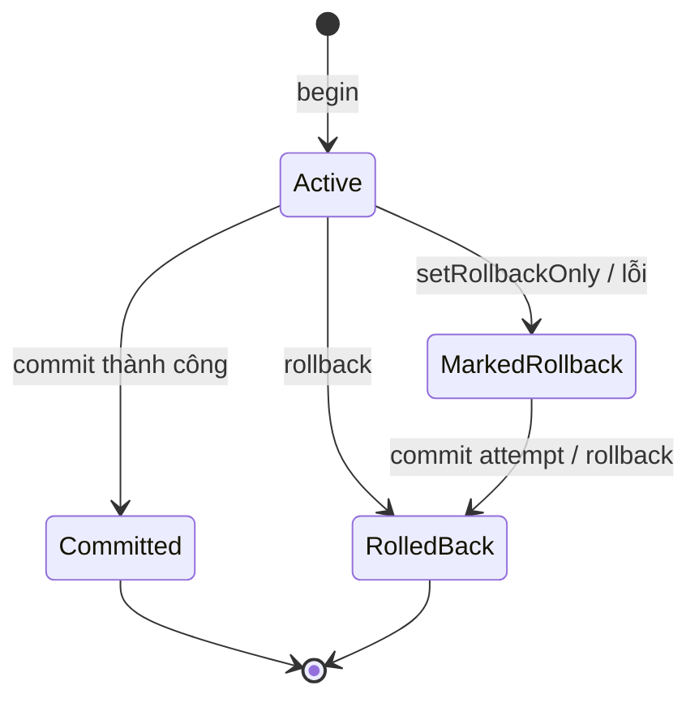
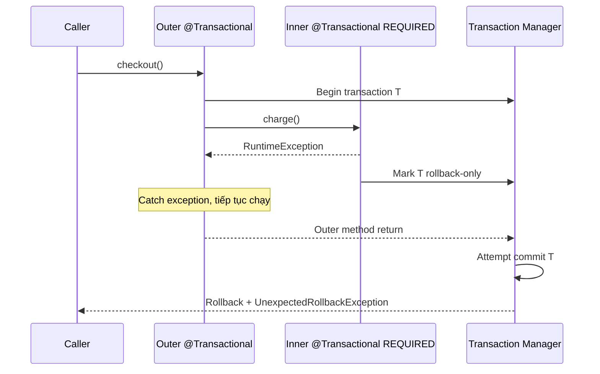
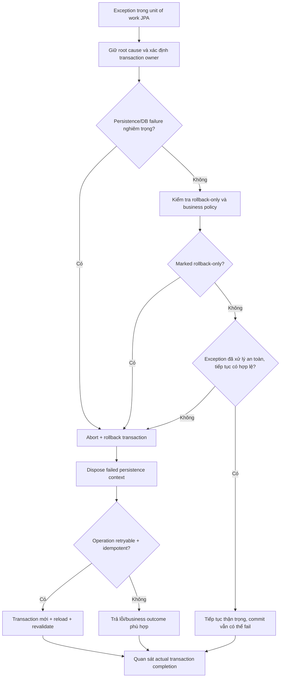

# Kiểm tra trạng thái rollback-only sau ngoại lệ trong JPA

Khi làm việc với JPA, một ngoại lệ không chỉ có ý nghĩa là “câu lệnh vừa gọi đã thất bại”. Nó còn có thể khiến **transaction hiện tại không còn được phép commit**, ngay cả khi code bắt ngoại lệ bằng `catch` và cố tiếp tục xử lý.

Trạng thái đó thường được gọi là **rollback-only**: transaction đang tồn tại nhưng đã được **đánh dấu phải rollback khi kết thúc**. Nếu application vẫn cố commit, kết quả có thể là rollback và một exception tại transaction boundary, chẳng hạn `RollbackException` hoặc `UnexpectedRollbackException` tùy JPA/JTA/Spring stack.

Tình huống:

```java
@Transactional
public void confirmOrder(Long id) {
    try {
        orderRepository.save(...);
        paymentRepository.save(...); // Có thể thất bại ở flush.
    } catch (RuntimeException ex) {
        log.warn("Đã bắt lỗi, tiếp tục xử lý", ex);
    }

    // Đoạn code chạy được không có nghĩa transaction sẽ commit.
}
```

Nếu provider, database hoặc transaction manager đã đánh dấu rollback-only, việc bắt lỗi **không gỡ bỏ dấu này**.

Bài **“Kiểm tra trạng thái rollback-only sau ngoại lệ”** thuộc chương **Lỗi và phục hồi**, module **Data Persistence Relational Access ORM JPA**. Nội dung giải thích:

- Ý nghĩa và vòng đời của rollback-only.
- Cách kiểm tra với JPA `EntityTransaction` trong môi trường `RESOURCE_LOCAL`.
- Cách kiểm tra trong JTA/container-managed transaction.
- Cách kiểm tra và chủ động đánh dấu rollback-only trong Spring `@Transactional` và `TransactionTemplate`.
- Vì sao `UnexpectedRollbackException` xuất hiện sau khi đã `catch` một lỗi.
- Các loại ngoại lệ có thể hoặc không mặc định đánh dấu rollback.
- Tác động của `flush()`, lỗi constraint, optimistic/pessimistic locking và trạng thái lỗi của database.
- Quy trình phục hồi an toàn bằng **rollback, transaction mới, kiểm tra lại dữ liệu và retry có kiểm soát**.
- Test transaction thực thay vì chỉ kiểm tra mock/service code.

> **Nguyên tắc:** Sau lỗi persistence nghiêm trọng, không mặc định transaction còn an toàn để sử dụng. Kiểm tra trạng thái bằng API phù hợp, kết thúc transaction bị hỏng và chỉ retry trong **transaction mới** khi nghiệp vụ cho phép.

---

## 1. Rollback-only là gì?

Một transaction có thể đang ở giai đoạn:

1. **Chưa bắt đầu**.
2. **Đang hoạt động**.
3. **Đang hoạt động nhưng bị đánh dấu rollback-only**.
4. **Đang commit/rollback**.
5. **Đã kết thúc** bằng commit hoặc rollback.

Rollback-only không phải một exception class. Nó là **trạng thái/đánh dấu** ở transaction layer.



Khi transaction đã marked rollback-only, code có thể vẫn đang thực thi các câu Java hoặc thậm chí một số statements. Nhưng **không được suy rằng commit sau đó sẽ thành công**.

## 2. Phân biệt ba câu hỏi dễ nhầm

| Câu hỏi | Ý nghĩa | API ví dụ |
|---|---|---|
| “Transaction đang hoạt động?” | Có một transaction active không? | `EntityTransaction.isActive()` |
| “Transaction đã rollback-only?” | Có đánh dấu không thể commit theo transaction manager? | `EntityTransaction.getRollbackOnly()`, `TransactionStatus.isRollbackOnly()` |
| “Commit đã thành công?” | Transaction thực tế được xác nhận chưa? | Kết quả commit/transaction completion |

**Active không đồng nghĩa committable.** Một transaction rollback-only vẫn có thể được coi là active trước khi kết thúc.

**Chưa rollback-only không đồng nghĩa chắc chắn commit thành công.** Commit có thể thất bại sau đó do constraint, concurrency, network hoặc database error.

## 3. Bắt ngoại lệ không phục hồi transaction

Một pattern sai:

```java
try {
    em.flush();
} catch (PersistenceException ex) {
    log.warn("Bỏ qua lỗi flush", ex);
}

// Không an toàn khi coi persistence context/transaction còn bình thường.
createMoreOrders();
commit();
```

Sau một persistence failure:

- JPA provider có thể đã mark transaction rollback-only.
- Database transaction có thể đang ở trạng thái aborted.
- Persistence context có thể giữ in-memory state không khớp database.
- Flush tiếp có thể ném lỗi khác.
- Commit có thể rollback thay vì commit.

Một `catch` chỉ điều khiển **luồng Java**, không tự đảo ngược state của JPA/DB transaction.

## 4. “Lỗi đã bị bắt” khác “lỗi đã được xử lý”

Một lỗi có thể được coi là đã xử lý đúng khi application biết:

- Điều gì thất bại?
- Có thay đổi nào đã commit chưa?
- Transaction còn hợp lệ hay cần rollback?
- Persistence context có được tiếp tục sử dụng không?
- Có thể retry không?
- External side effects đã xảy ra chưa?
- User cần nhận HTTP conflict, validation error hay service unavailable?

Nếu chỉ ghi:

```java
catch (Exception ex) {
    return "OK";
}
```

thì ứng dụng có thể báo thành công dù transaction rollback ở boundary sau đó.

## 5. Ba môi trường transaction phổ biến

Cùng một entity JPA có thể chạy trong ba mô hình:

| Môi trường | Chủ thể quản lý transaction | Cách kiểm tra rollback-only thường dùng |
|---|---|---|
| JPA `RESOURCE_LOCAL` | `EntityManager.getTransaction()` / `EntityTransaction` | `getRollbackOnly()` |
| JTA/container-managed | Transaction manager của container | `TransactionSynchronizationRegistry.getRollbackOnly()` hoặc JTA status |
| Spring `@Transactional` | `PlatformTransactionManager` / interceptor | `TransactionAspectSupport.currentTransactionStatus().isRollbackOnly()` |

Không dùng cùng một đoạn kiểm tra cho cả ba. Ví dụ `em.getTransaction()` **không hợp lệ với JTA EntityManager** theo cách dùng chuẩn.

---

## 6. JPA RESOURCE_LOCAL là gì?

Một persistence unit cấu hình transaction kiểu `RESOURCE_LOCAL` được ứng dụng tự quản lý qua `EntityTransaction`.

Ví dụ setup ý tưởng:

```java
EntityManagerFactory emf =
    Persistence.createEntityManagerFactory("ordersPU");

EntityManager em = emf.createEntityManager();
EntityTransaction tx = em.getTransaction();
```

Sau đó:

```java
tx.begin();
// JPA operations...
tx.commit();
```

Các methods quan trọng của `EntityTransaction`:

```java
begin()
commit()
rollback()
setRollbackOnly()
getRollbackOnly()
isActive()
```

Chỉ dùng pattern này khi application thực sự quản lý **RESOURCE_LOCAL transaction**. Nếu đã dùng Spring-managed JPA/JTA, nên hỏi transaction manager của framework/container thay vì tự điều khiển `EntityTransaction`.

## 7. Kiểm tra trực tiếp bằng EntityTransaction.getRollbackOnly()

```java
EntityTransaction tx = em.getTransaction();
tx.begin();

try {
    // Thao tác với entity.
    createOrder(em);

    if (tx.getRollbackOnly()) {
        // Không cố commit như một giao dịch thành công.
        tx.rollback();
    } else {
        tx.commit();
    }
} catch (RuntimeException ex) {
    if (tx.isActive()) {
        tx.rollback();
    }
    throw ex;
}
```

Đây là mô hình minh họa; trong chương trình thật nên tách cleanup ra `finally` và bảo đảm EntityManager được đóng.

Điểm chính:

- Chỉ gọi `getRollbackOnly()` khi transaction phù hợp **đang active**.
- Giá trị `true` là tín hiệu transaction đã bị marked rollback-only.
- Không có API `setRollbackOnly(false)` để “bỏ đánh dấu”.
- Giá trị `false` chỉ là snapshot tại thời điểm kiểm tra, không phải giấy bảo hành commit.

## 8. Kiểm tra isActive() trước getRollbackOnly()

Ví dụ helper:

```java
static boolean rollbackOnlyIfActive(EntityTransaction tx) {
    if (!tx.isActive()) {
        throw new IllegalStateException(
            "Không có RESOURCE_LOCAL transaction đang hoạt động"
        );
    }
    return tx.getRollbackOnly();
}
```

Theo semantics `EntityTransaction`, gọi `getRollbackOnly()` khi transaction không active có thể ném `IllegalStateException`.

Vì vậy tránh:

```java
boolean rollbackOnly = em.getTransaction().getRollbackOnly();
```

trong một method không biết chắc transaction đã bắt đầu hay đã kết thúc.

**Không có transaction** và **transaction đang rollback-only** là hai tình huống khác nhau, không được gộp thành cùng một boolean trả về mặc định.

## 9. Ví dụ RESOURCE_LOCAL đầy đủ với cleanup

```java
public Long createOrder(EntityManagerFactory emf) {
    EntityManager em = emf.createEntityManager();

    try {
        EntityTransaction tx = em.getTransaction();
        tx.begin();

        try {
            PurchaseOrder order =
                PurchaseOrder.newOrder("Demo");

            em.persist(order);
            em.flush();

            if (tx.getRollbackOnly()) {
                throw new IllegalStateException(
                    "Transaction không thể commit"
                );
            }

            tx.commit();
            return order.getId();

        } catch (RuntimeException | Error failure) {
            if (tx.isActive()) {
                try {
                    tx.rollback();
                } catch (RuntimeException rollbackFailure) {
                    failure.addSuppressed(rollbackFailure);
                }
            }
            throw failure;
        }

    } finally {
        em.close();
    }
}
```

Ví dụ giả định entity có factory `newOrder()` và generated ID đúng mapping; import JPA types tương ứng.

Một số lưu ý:

- Dùng `flush()` để phát hiện sớm SQL/constraint error nếu use case cần, nhưng **flush không phải commit**.
- Exception ở `commit()` vẫn được xử lý trong catch; rollback nếu transaction còn active.
- Việc rollback cũng có thể thất bại; giữ exception gốc và attach rollback failure.
- Nếu lỗi do mất kết nối đúng thời điểm commit, outcome có thể **không chắc chắn**; không mù quáng retry side effects không idempotent.
- Sau transaction lỗi, EntityManager thường nên đóng và tạo mới cho một attempt khác.

## 10. Vì sao không gọi commit khi rollback-only?

Nếu đã biết:

```java
tx.getRollbackOnly() == true
```

thì mục tiêu “commit thành công” không còn đạt được trong transaction đó.

Dù một implementation có thể chấp nhận `commit()` call rồi thực hiện rollback và ném exception tương ứng, code business không nên coi đó là đường phục hồi.

Tốt hơn:

1. Ghi lại nguyên nhân/diagnostics.
2. Chủ động rollback khi còn active.
3. Kết thúc EntityManager/unit of work lỗi.
4. Quyết định trả lỗi hoặc retry trong transaction mới.

## 11. Chủ động setRollbackOnly()

Một nghiệp vụ có thể phát hiện điều kiện không thể tiếp tục sau khi đã thực hiện nhiều DML:

```java
if (!paymentPolicy.allows(order)) {
    tx.setRollbackOnly();
}
```

Sau khi đánh dấu, các writes trong transaction **không được commit**.

Nhưng nếu business validation có thể thực hiện **trước khi mutation**, nên kiểm tra trước để tránh làm DB work không cần thiết.

Không dùng `setRollbackOnly()` như cách “ghi nhận cảnh báo” rồi vẫn mong trả success.

## 12. Không có setRollbackOnly(false)

Các transaction APIs cho phép đánh dấu rollback-only, nhưng **không cung cấp thao tác portable gỡ dấu đó sau một lỗi nghiêm trọng**.

Một sequence sai về ý tưởng:

```text
Exception xảy ra
Transaction bị rollback-only
Application catch lỗi
Application muốn "clear rollback-only"
Application tiếp tục commit
```

Không có lệnh “clear rollback-only” tương đương `em.clear()`. `EntityManager.clear()` chỉ detach managed entities, **không reset trạng thái transaction**.

Muốn một đơn vị công việc mới có khả năng commit, phải **kết thúc transaction cũ và mở transaction mới**.

---

## 13. JTA là gì?

JTA (Jakarta Transactions) thường được dùng khi transaction do container hoặc application transaction manager quản lý.

Các tên thường gặp:

```java
jakarta.transaction.UserTransaction
jakarta.transaction.TransactionManager
jakarta.transaction.TransactionSynchronizationRegistry
jakarta.transaction.Status
```

Dự án cũ dùng namespace `javax.transaction.*`.

Trong JTA context, một JPA EntityManager thường tham gia transaction hiện tại, nhưng application **không nên gọi `em.getTransaction()`** như RESOURCE_LOCAL.

## 14. JTA: kiểm tra qua TransactionSynchronizationRegistry

Khi container cho phép injection:

```java
import jakarta.annotation.Resource;
import jakarta.transaction.TransactionSynchronizationRegistry;

public class OrderCoordinator {

    @Resource
    private TransactionSynchronizationRegistry registry;

    public boolean isRollbackOnly() {
        return registry.getRollbackOnly();
    }
}
```

`TransactionSynchronizationRegistry.getRollbackOnly()` trả trạng thái đánh dấu rollback-only của **JTA transaction gắn với thread/context hiện tại**, khi có transaction hợp lệ.

Cần:

- Gọi trong context có JTA transaction.
- Không giả định thread khác có cùng transaction context.
- Xử lý trường hợp không có active transaction theo API/container.
- Không dùng nó để quyết định rằng commit chắc chắn sẽ thành công nếu kết quả false.

Đây là lựa chọn JTA-centric rõ nghĩa hơn `EntityManager.getTransaction()`.

## 15. JTA: kiểm tra qua UserTransaction.getStatus()

Trong môi trường cho phép application quản lý transaction bằng `UserTransaction`:

```java
import jakarta.transaction.Status;
import jakarta.transaction.UserTransaction;

int state = userTransaction.getStatus();

if (state == Status.STATUS_MARKED_ROLLBACK) {
    // Transaction đã bị đánh dấu rollback-only.
}
```

Các trạng thái JTA có thể gồm:

| JTA Status | Ý nghĩa khái quát |
|---|---|
| `STATUS_ACTIVE` | Transaction active |
| `STATUS_MARKED_ROLLBACK` | Đã đánh dấu rollback-only |
| `STATUS_PREPARING` | Đang chuẩn bị commit, nếu applicable |
| `STATUS_PREPARED` | Đã chuẩn bị theo protocol |
| `STATUS_COMMITTING` | Đang commit |
| `STATUS_COMMITTED` | Đã commit |
| `STATUS_ROLLING_BACK` | Đang rollback |
| `STATUS_ROLLEDBACK` | Đã rollback |
| `STATUS_NO_TRANSACTION` | Không có transaction |
| `STATUS_UNKNOWN` | Không xác định được trạng thái |

**Không đồng nhất `STATUS_MARKED_ROLLBACK` với `STATUS_ROLLEDBACK`**: một cái là đánh dấu trước khi kết thúc; một cái là kết quả đã rollback.

Trong container-managed transaction, application có thể **không được phép tự `begin()/commit()` qua UserTransaction**. Hãy dùng interface/status mechanism đúng với transaction ownership của container.

## 16. JTA: sự khác nhau giữa STATUS_MARKED_ROLLBACK và exception

Một JTA transaction có thể bị đánh dấu rollback-only:

- Do code gọi `setRollbackOnly()`.
- Do component/container rule.
- Do lỗi resource manager.
- Do persistence exception.
- Do timeout hoặc failure trong một participant.

Khi kiểm tra `STATUS_MARKED_ROLLBACK`, ta biết transaction không thể commit như bình thường, nhưng **không nhất thiết biết ngoại lệ nào là nguyên nhân đầu tiên**.

Phải giữ root-cause exception trong logs/traces; status chỉ là tín hiệu điều phối phục hồi.

## 17. JTA: lỗi có thể ở coordinator/resource manager

Với transaction bao nhiều resources, commit có thể liên quan các giai đoạn prepare/commit hoặc resource-manager failures.

Kết quả `getRollbackOnly() == false` ở giữa transaction không loại trừ:

- Resource failure sau đó.
- Timeout ngay trước commit.
- Database constraint ở cuối flush.
- Network problem tại commit.
- Heuristic/in-doubt outcomes trong những distributed transaction scenarios.

**Trạng thái là quan sát tại một thời điểm, không phải lời hứa về kết quả tương lai.**

---

## 18. Spring @Transactional là tầng abstraction khác

Khi dùng Spring:

```java
@Service
public class OrderService {

    @Transactional
    public void confirmOrder(Long id) {
        // JPA managed operations.
    }
}
```

Spring transaction interceptor/transaction manager thường tạo hoặc tham gia transaction quanh method.

Trong cấu hình phổ biến `JpaTransactionManager` hoặc `JtaTransactionManager`, application code không tự begin/commit JPA `EntityTransaction`.

Một câu hỏi hay gặp:

> “Tôi đang ở giữa method @Transactional; kiểm tra rollback-only bằng cách nào?”

## 19. Spring: TransactionAspectSupport.currentTransactionStatus()

Một cách trong code chạy **bên trong lời gọi đi qua Spring transaction interceptor**:

```java
import org.springframework.transaction.TransactionStatus;
import org.springframework.transaction.interceptor.TransactionAspectSupport;

TransactionStatus status =
    TransactionAspectSupport.currentTransactionStatus();

boolean rollbackOnly = status.isRollbackOnly();
```

Lưu ý quan trọng:

- Phải đang ở context phù hợp của Spring AOP transaction invocation.
- Nếu không có transaction aspect status gắn với thread, có thể ném exception như `NoTransactionException`.
- Với reactive transactions, model context propagation khác thread-bound imperatives; không copy nguyên pattern này sang reactive stream.
- `status.isRollbackOnly()` diễn đạt trạng thái được Spring transaction status ghi nhận; nếu provider/database vừa gặp lỗi chưa được đồng bộ lên status, kiểm tra false **không bảo đảm SQL/commit tiếp theo thành công**.

## 20. Spring: mark rollback-only có chủ đích

```java
@Transactional
public void processOrder(Long id) {
    PurchaseOrder order = repository.findById(id)
        .orElseThrow();

    if (!policyAllows(order)) {
        TransactionAspectSupport
            .currentTransactionStatus()
            .setRollbackOnly();
        return;
    }

    order.confirm();
}
```

Đoạn trên là ví dụ kỹ thuật về API, không phải cách tổ chức business contract lý tưởng.

Nếu policy không cho phép xử lý, thường tốt hơn **ném domain exception được ánh xạ rõ** hoặc trả một kết quả business có chủ đích trước khi có writes.

Nếu đã gọi `setRollbackOnly()`, đoạn code phía ngoài **không được coi return bình thường từ method là transaction đã commit**.

## 21. Spring TransactionStatus.isRollbackOnly() khác isCompleted()

```java
TransactionStatus status =
    TransactionAspectSupport.currentTransactionStatus();

boolean rollbackOnly = status.isRollbackOnly();
boolean completed = status.isCompleted();
```

Hai flags trả lời:

- `rollbackOnly`: current transaction status đang yêu cầu/đã bị đánh dấu rollback?
- `completed`: transaction status do Spring quản lý đã hoàn tất?

Trong thân `@Transactional` trước method return, `completed` thường false.

Sau khi interceptor kết thúc transaction, context currentTransactionStatus() có thể không còn khả dụng. Không dùng nó như API lấy outcome của một transaction đã kết thúc từ controller khác.

## 22. Spring TransactionSynchronizationManager không cho rollback-only

Một nhầm lẫn:

```java
TransactionSynchronizationManager
    .isActualTransactionActive();
```

nó kiểm tra dấu hiệu transaction active theo Spring transaction synchronization, **không** trả rollback-only.

Các APIs như `isSynchronizationActive()` cũng không thay thế `TransactionStatus.isRollbackOnly()`.

Đừng diễn giải “transaction active” thành “transaction chắc chắn có thể commit”.

## 23. @Transactional không chạy nếu bypass proxy

Ví dụ:

```java
@Service
public class OrderService {

    public void entry() {
        this.updateWithTransaction();
    }

    @Transactional
    public void updateWithTransaction() {
        // ...
    }
}
```

Trong Spring proxy mode mặc định, **self-invocation** qua `this` có thể không đi qua transaction interceptor, nên annotation chưa chắc tạo transaction như developer tưởng.

Khi đó lời gọi `currentTransactionStatus()` có thể không thấy status cần thiết.

Kiểm thử transaction boundary thực tế và tổ chức entrypoint qua Spring-managed bean/proxy hoặc programmatic transaction phù hợp.

---

## 24. Vì sao UnexpectedRollbackException xuất hiện?

Tình huống điển hình:

- Method ngoài dùng `@Transactional`.
- Method trong cũng dùng `@Transactional`, với propagation mặc định `REQUIRED`.
- Method trong ném runtime exception qua transaction interceptor.
- Spring đánh dấu **transaction chung** rollback-only.
- Method ngoài `catch` và không rethrow.
- Outer method return như thành công.
- Spring cố commit ở transaction boundary.
- Spring nhận ra transaction đã rollback-only và ném `UnexpectedRollbackException`.

Đây không phải hiện tượng Spring “tự dưng đổi ý” — nó ngăn người gọi hiểu nhầm rằng transaction được commit trong khi đã rollback.

## 25. Minh họa bằng hai Spring services

Inner service:

```java
@Service
public class PaymentService {

    @Transactional(
        propagation = Propagation.REQUIRED
    )
    public void chargeInDatabase(Long orderId) {
        paymentRepository.save(
            Payment.forOrder(orderId)
        );

        // Ví dụ lỗi chưa được xử lý.
        throw new IllegalStateException(
            "Payment step failed"
        );
    }
}
```

Outer service:

```java
@Service
public class CheckoutService {

    private final PaymentService payments;
    private final OrderRepository orders;

    public CheckoutService(
            PaymentService payments,
            OrderRepository orders) {
        this.payments = payments;
        this.orders = orders;
    }

    @Transactional
    public void checkout(Long orderId) {
        orders.markProcessing(orderId);

        try {
            payments.chargeInDatabase(orderId);
        } catch (IllegalStateException ex) {
            log.warn("Đã bắt lỗi payment", ex);
        }

        orders.markChecked(orderId);
    }
}
```

Giả định `Payment.forOrder`, repositories và logger là các thành phần minh họa cần định nghĩa.

**Kết quả kỳ vọng theo setup REQUIRED/proxy thông thường:** lỗi từ inner đi qua transactional advice khiến transaction chung bị đánh dấu rollback-only. Catch ở outer không tự làm nó committable; khi outer method kết thúc, caller có thể nhận `UnexpectedRollbackException`.

## 26. Sơ đồ REQUIRED với exception bị nuốt



Nếu runtime failure đến từ provider/DB, transaction có thể bị marked rollback-only **ngay trước khi exception vượt qua advice**, nên không được coi Spring interceptor là nguồn đánh dấu duy nhất.

## 27. Vì sao outer catch không giúp?

Một `catch` ở ngoài chỉ nhận exception object. Nó không có quyền tự đổi JTA/JPA transaction từ rollback-only về active/committable.

```java
try {
    innerService.doWork();
} catch (RuntimeException ex) {
    // Lỗi đã được bắt ở tầng Java.
}
// Transaction manager vẫn có thể giữ rollback-only.
```

Cách xử lý phù hợp:

- Nếu lỗi khiến cả business command không hợp lệ: **propagate error và rollback toàn transaction**.
- Nếu bước phụ thật sự tùy chọn: cần thiết kế **transaction boundary riêng** trước khi bắt đầu hoặc use case không phụ thuộc kết quả phụ.
- Nếu muốn dùng savepoint: cân nhắc `NESTED` dưới điều kiện hỗ trợ thực tế, không nhầm với JPA entity state.
- Không cố “clear rollback-only” ở outer.

## 28. Catch bên trong cùng @Transactional method thì sao?

Một trường hợp **khác**:

```java
@Transactional
public void doWork() {
    try {
        throw new IllegalArgumentException(
            "Business warning"
        );
    } catch (IllegalArgumentException ex) {
        // Cùng method bắt exception trước khi nó đi qua advice.
    }
}
```

Nếu đây chỉ là exception Java thuần và chưa có provider/DB/transaction manager đánh dấu rollback-only, Spring interceptor có thể thấy method return bình thường và commit.

Nhưng nếu exception nảy sinh từ `em.flush()`/SQL/constraint, provider hoặc DB có thể **đã** mark rollback-only dù được catch bên trong.

Do đó phải phân biệt:

1. Exception Java được xử lý trước transactional boundary, không làm hỏng DB.
2. Exception đã vượt qua một transactional advice tham gia chung transaction.
3. Exception persistence/DB đã thay transaction state.

Không có quy tắc “mọi exception bị catch đều commit” hoặc “mọi exception từng xuất hiện đều rollback”.

## 29. Đặt kiểm tra rollback-only ở đâu?

Nếu method dùng Spring imperative transaction, có thể ghi chẩn đoán ở outer sau catch:

```java
@Transactional
public void checkout(Long id) {
    try {
        payments.process(id);
    } catch (RuntimeException failure) {
        boolean rollbackOnly =
            TransactionAspectSupport
                .currentTransactionStatus()
                .isRollbackOnly();

        log.error(
            "Payment failed; rollbackOnly={}",
            rollbackOnly,
            failure
        );

        // Không tiếp tục tạo side effects hoặc trả success.
        throw failure;
    }
}
```

Trường hợp này kiểm tra status để **chẩn đoán**, không phải để đảo trạng thái.

Nếu Spring status còn false nhưng DB/session đã invalid, vẫn phải rollback/abort thay vì coi false là lý do tiếp tục.

## 30. UnexpectedRollbackException không phải “exception của query trước”

`UnexpectedRollbackException` thường xuất hiện **lúc outer transaction kết thúc**, chứ không phải đúng vị trí original constraint/validation failure.

Vì vậy khi debug:

- Tìm exception **đầu tiên** trong request/correlation trace.
- Kiểm logs của inner transactional method.
- Xem `@Transactional` propagation của từng bean.
- Xem có catch/suppress exception hay không.
- Kiểm provider/DB exception tại `flush()`.
- Kiểm transaction rollback-only ở thời điểm gần lỗi gốc.

Đừng chỉ sửa nơi cuối stack trace chứa `UnexpectedRollbackException` mà không truy tìm nguyên nhân marked rollback.

---

## 31. Spring rollback rules mặc định

Trong cấu hình Spring transaction thường gặp:

- `RuntimeException` và `Error` qua transactional advice mặc định gây rollback.
- Checked exception có thể **không** làm Spring tự rollback nếu không cấu hình.
- Có thể tùy chỉnh bằng `rollbackFor`, `noRollbackFor` hoặc global rollback configuration tùy Spring version.

Ví dụ:

```java
@Transactional(
    rollbackFor = PaymentRejectedException.class
)
public void capturePayment() throws PaymentRejectedException {
    // ...
}
```

Nếu `PaymentRejectedException` là checked exception và muốn toàn transaction rollback, cần policy rõ ràng.

**Nhớ:** Quy tắc Spring interceptor chỉ là một lớp. Nếu JPA provider/DB đã mark rollback-only vì SQL lỗi, `noRollbackFor` không “cứu” được transaction.

## 32. Checked exception có thể bị commit ngoài ý muốn

Ví dụ:

```java
@Transactional
public void processOrder() throws BusinessCheckedException {
    repository.save(...);

    throw new BusinessCheckedException(
        "Cannot finish"
    );
}
```

Nếu checked exception này không nằm trong rollback rules, Spring có thể cố commit khi method ném lỗi.

Trong domain, có thể đây là bug nếu toàn operation phải atomic.

Giải pháp:

```java
@Transactional(
    rollbackFor = BusinessCheckedException.class
)
```

hoặc một rollback policy thống nhất tại application level.

Không mặc định mọi checked exception phải commit hay rollback: phải dựa vào semantics của command và cấu hình transaction cụ thể.

## 33. noRollbackFor không chữa transaction đã hỏng

```java
@Transactional(
    noRollbackFor = DataIntegrityViolationException.class
)
```

không bảo đảm rằng sau một database integrity violation, transaction vẫn commit được.

Một số DBMS như PostgreSQL có thể đặt toàn transaction vào trạng thái aborted sau statement error cho tới rollback (hoặc rollback về savepoint hợp lệ). Provider cũng có thể mark rollback-only.

**Spring rollback rule và database transaction validity là hai tầng khác nhau.**

## 34. Spring rollbackOnly flag có thể là local hoặc global

Trong một số implementations, transaction status kết hợp:

- Local rollback-only do code/service/request đánh dấu.
- Global rollback-only do transaction manager/resource/provider đánh dấu.

`TransactionStatus.isRollbackOnly()` là API ứng dụng để hỏi; chi tiết local/global detection nằm ở transaction manager.

Điều này giải thích vì sao có các tình huống status mà bạn đặt, status do inner REQUIRED đánh dấu, và status do JPA/DB đánh dấu ở những thời điểm khác nhau.

Không dựa vào private implementation của một transaction manager như contract portable của toàn ứng dụng.

---

## 35. TransactionTemplate: kiểm soát status tường minh

Nếu muốn một unit of work rõ rollback outcome:

```java
TransactionTemplate template =
    new TransactionTemplate(transactionManager);

CommandResult result = template.execute(status -> {
    PurchaseOrder order = repository.findById(orderId)
        .orElseThrow();

    if (!order.canBeConfirmed()) {
        status.setRollbackOnly();

        return CommandResult.rejected(
            "Invalid order state"
        );
    }

    order.confirm();
    repository.save(order);

    return CommandResult.accepted();
});
```

Ví dụ dùng classes `CommandResult` và methods domain giả định.

Ý nghĩa:

- `TransactionStatus` được truyền trực tiếp, không cần tìm qua `TransactionAspectSupport`.
- Khi set rollback-only, template kết thúc transaction bằng rollback.
- Giá trị business trả về có thể biểu diễn `rejected` thay vì nói “commit thành công”.
- Nếu có exception database, vẫn cần cleanup/rollback và phân loại lỗi.

Không dùng return value của một transaction đã rollback như bằng chứng dữ liệu được lưu.

## 36. Không nên xử lý “thất bại phụ” bằng cách nuốt exception

Ví dụ yêu cầu “đơn hàng vẫn phải được tạo dù gửi email thất bại”.

Không nên:

```java
@Transactional
public void createOrder() {
    saveOrder();
    try {
        sendEmailInsideTransaction();
    } catch (Exception ignored) {
        // Hy vọng Order vẫn commit.
    }
}
```

Vấn đề:

- Email có side effect ngoài DB, không tham gia transaction.
- Nếu email service dùng transactional DB component trong cùng transaction và ném runtime exception qua proxy, có thể mark rollback-only.
- Transaction giữ locks khi gọi mạng.
- Không có durable retry.

Tốt hơn là **commit Order cùng outbox EmailRequested**, sau đó worker gửi email với retry.

## 37. REQUIRES_NEW: transaction độc lập

Spring có propagation:

```java
@Transactional(
    propagation = Propagation.REQUIRES_NEW
)
public void writeIndependentAudit(AuditRecord record) {
    auditRepository.save(record);
}
```

Nếu gọi qua Spring proxy, nó có thể suspend transaction hiện tại và bắt đầu một transaction mới.

Hệ quả:

- Inner transaction có thể rollback mà outer transaction vẫn có khả năng commit, **nếu outer chưa bị đánh dấu rollback-only bởi lỗi khác**.
- Inner transaction có thể **commit dù outer cuối cùng rollback**, nên chỉ dùng cho việc thực sự độc lập.
- Thường cần connection/resource capacity bổ sung; nếu nhiều threads mỗi thread giữ outer connection và chờ inner connection, có nguy cơ pool exhaustion/deadlock.
- Không dùng REQUIRES_NEW chỉ để “làm transaction lỗi trở nên khỏe lại”.

## 38. Ví dụ REQUIRES_NEW cho ghi nhận thất bại độc lập

Một chính sách có thể cần ghi một technical failure record dù business transaction rollback:

```java
@Service
public class FailureAuditService {

    @Transactional(
        propagation = Propagation.REQUIRES_NEW
    )
    public void recordFailure(FailureRecord record) {
        failureRepository.save(record);
    }
}
```

Caller ở bean khác:

```java
try {
    businessService.performCommand();
} catch (RuntimeException ex) {
    failureAuditService.recordFailure(
        FailureRecord.from(ex)
    );
    throw ex;
}
```

Nếu audit cần lưu **ngoài transaction lỗi**, một transaction mới có thể phù hợp.

Nhưng:

- Không lưu dữ liệu nhạy cảm từ exception tùy tiện.
- Audit commit không có nghĩa business commit.
- Với outbox bảo vệ atomic state/event, phải ghi **trong cùng transaction**, không REQUIRES_NEW.
- Tách service qua proxy thực sự, không self-invocation.

## 39. REQUIRES_NEW không thay NESTED

`REQUIRES_NEW` sử dụng một transaction độc lập; commit của nó **không rollback theo outer**.

`NESTED` thường dùng **savepoint trong cùng physical transaction**, nếu transaction manager và underlying resource hỗ trợ.

```java
@Transactional(
    propagation = Propagation.NESTED
)
public void doOptionalPart() {
    // ...
}
```

Cần chú ý:

- `JpaTransactionManager` không mặc định cho phép nested transactions cho JPA persistence state; savepoints ở JDBC layer không tự rollback Java-managed entity state.
- `DataSourceTransactionManager` thường hỗ trợ JDBC savepoints khi driver cho phép.
- Nested behavior bị giới hạn bởi transaction manager/config.
- Một provider/database error có thể làm transaction rollback-only hoặc invalid dù có savepoint.
- Không tự dùng NESTED như cách chữa một transaction đã mark rollback-only.

## 40. Savepoint không phải phép màu

Một savepoint cho phép rollback **một phần database work** trong một transaction hỗ trợ nó:

```sql
SAVEPOINT before_optional_step;
-- Thực hiện operation tùy chọn.
ROLLBACK TO SAVEPOINT before_optional_step;
```

Nhưng:

- JPA persistence context vẫn có thể giữ những entity changes tương ứng đã thực hiện.
- Provider có thể đã đánh dấu toàn transaction rollback-only.
- Một số loại DB errors bắt buộc rollback toàn transaction.
- Không dùng savepoint sau khi transaction đã đánh dấu rollback-only và giả định rollback marker sẽ tự xóa.

Khi requirement chỉ cần “bước này thất bại không kéo theo bước kia”, hãy quyết định transaction boundary **trước** khi chạy operation.

---

## 41. Ngoại lệ nào thường khiến JPA rollback-only?

Một số tình huống điển hình:

| Ngoại lệ/tình huống | Nhận định thực hành |
|---|---|
| `OptimisticLockException` | Transaction thường bị mark rollback-only theo JPA semantics |
| `PessimisticLockException` | Lỗi lock mức transaction; có thể buộc rollback toàn transaction |
| `LockTimeoutException` | JPA định nghĩa trường hợp chỉ statement rollback, không bắt buộc mark transaction-only |
| `QueryTimeoutException` | JPA định nghĩa trường hợp statement-level timeout khi transaction không bị buộc rollback |
| `NoResultException` | Không tự làm transaction rollback-only theo JPA exception semantics |
| `NonUniqueResultException` | Không tự làm transaction rollback-only theo JPA exception semantics |
| `PersistenceException` khác | Nhiều trường hợp làm current transaction marked rollback-only |
| Database constraint/SQL failure | Phải kiểm tra provider/DB state và thường abort unit of work |
| Java domain exception | Phụ thuộc transaction manager/rollback rules và nơi exception được catch |

**Không sử dụng bảng này như bảng quyết định duy nhất cho mọi provider/framework.** Spring exception translation, DB SQLSTATE và transaction manager có thể bổ sung hoặc thay đổi kết quả thực tế.

## 42. OptimisticLockException và rollback-only

Entity:

```java
@Version
private Long version;
```

Nếu hai transactions cùng sửa state version cũ:

```text
A: UPDATE WHERE version=7 → success, version=8
B: UPDATE WHERE version=7 → 0 rows
```

Provider có thể ném:

```java
jakarta.persistence.OptimisticLockException
```

Transaction nơi optimistic lock failure xảy ra được xem là thất bại/rollback theo JPA semantics.

Không nên:

```java
catch (OptimisticLockException ex) {
    em.refresh(order);
    em.flush(); // Cố cứu trong transaction đã hỏng.
}
```

Tốt hơn: rollback, đóng/reset persistence context, load lại trong **transaction mới**, quyết định reapply/merge theo domain policy.

## 43. PessimisticLockException khác LockTimeoutException

JPA phân biệt hai tình huống:

**`PessimisticLockException`:** thất bại lấy pessimistic lock theo semantics mức transaction; transaction có thể bị đánh dấu rollback.

**`LockTimeoutException`:** lỗi lấy khóa theo semantics statement-level; JPA mô tả transaction không nhất thiết bị marked rollback-only chỉ vì exception này.

Nhưng cần nhớ:

- Database deadlock có thể abort toàn transaction.
- Provider có thể wrap hoặc dịch exception.
- Một DB không hỗ trợ chính xác lock timeout hint.
- Spring transactional advice có thể mark rollback do unchecked exception **thoát ra khỏi method**, kể cả khi JPA mô tả statement-only case.
- Session/connection state có thể không còn phù hợp để tiếp tục.

Do đó sau lock-related exception: **kiểm tra transaction status và actual DB/provider state, rồi ưu tiên rollback và retry transaction mới** nếu không chắc.

## 44. NoResultException không tự bắt buộc rollback theo JPA

```java
try {
    PurchaseOrder order = em.createQuery(
        """
        select o from PurchaseOrder o
        where o.id = :id
        """,
        PurchaseOrder.class
    )
    .setParameter("id", id)
    .getSingleResult();
} catch (NoResultException notFound) {
    // Không có result là tình huống truy vấn có thể dự đoán.
}
```

Theo JPA, `NoResultException` bản thân không tự mark transaction rollback-only.

Nhưng nếu exception này **thoát khỏi một Spring @Transactional method**, Spring rollback rule mặc định cho unchecked exceptions có thể mark rollback.

Cách API-friendly thường là:

```java
Optional<PurchaseOrder> result =
    em.createQuery(
        "select o from PurchaseOrder o where o.id = :id",
        PurchaseOrder.class
    )
    .setParameter("id", id)
    .getResultStream()
    .findFirst();
```

Không dùng ngoại lệ như một điều khiển luồng duy nhất cho mọi “not found” nếu domain có lựa chọn rõ ràng hơn.

## 45. NonUniqueResultException là một lỗi dữ liệu/query

Nếu `getSingleResult()` trả nhiều rows:

```java
NonUniqueResultException
```

JPA không mặc định mark transaction rollback-only chỉ vì ngoại lệ này.

Nhưng business operation có thể không thể tiếp tục vì kỳ vọng uniqueness đã bị phá.

Cần:

- Kiểm tra query predicate.
- Thêm DB UNIQUE constraint nếu logic yêu cầu.
- Tránh chọn ngẫu nhiên row đầu tiên để “chữa” lỗi.
- Quyết định application command cần rollback hay trả error.

**Transaction có thể còn committable về mặt JPA, nhưng business operation vẫn không hợp lệ.**

## 46. QueryTimeoutException có thể vẫn cho rollback ở tầng khác

JPA mô tả `QueryTimeoutException` theo trường hợp query timeout chỉ rollback statement, không bắt buộc toàn transaction.

Nhưng một provider có thể báo một exception khác nếu database buộc rollback transaction.

Spring rollback rules, JTA resource state và DB driver error class cũng có thể dẫn tới rollback.

Vì vậy không dùng:

```java
catch (QueryTimeoutException ex) {
    // Chắc chắn tiếp tục ghi được!
}
```

Thay vào đó cân nhắc terminate unit of work, đo timeout, retry **từ transaction mới** khi phù hợp.

## 47. PersistenceException khi flush

```java
try {
    em.flush();
} catch (PersistenceException ex) {
    // Có thể đã marked rollback-only.
}
```

Flush có thể gửi một loạt INSERT/UPDATE/DELETE, không chỉ một row.

Một exception tại flush có thể đến từ:

- FK violation.
- UNIQUE/NOT NULL/CHECK violation.
- Optimistic version mismatch.
- Deadlock.
- Lock timeout.
- Serialization failure.
- Connection failure.
- Database trigger failure.
- Invalid generated key.

Không nhất thiết biết **những statements nào đã chạy trước khi lỗi**. Nếu transaction rollback, chúng không được commit; nhưng external side effects phát trước đó không tự rollback.

**Sau flush failure, một hướng an toàn là rollback transaction và bỏ persistence context lỗi.**

## 48. PostgreSQL: transaction aborted sau statement error

Trong PostgreSQL, một SQL error bên trong transaction có thể khiến transaction vào trạng thái aborted.

Các lệnh tiếp theo thường báo dạng:

```text
current transaction is aborted,
commands ignored until end of transaction block
```

SQLSTATE thường gặp:

```text
25P02
```

Trong DB thuần có cơ chế savepoint phù hợp, có thể rollback tới savepoint để phục hồi một số statement errors, nhưng JPA provider vẫn có thể xem persistence context là không hợp lệ và mark transaction rollback-only.

**Không vì bắt được `DataIntegrityViolationException` mà tiếp tục dùng Hibernate/JPA session như chưa xảy ra lỗi.**

## 49. Một số database errors không được phản ánh ngay trong status flag

Có trường hợp:

```java
status.isRollbackOnly() == false
```

nhưng database connection/session đã ở trạng thái không thể thực thi lệnh tiếp theo hoặc commit sẽ lỗi.

Lý do có thể là:

- Transaction manager chưa cập nhật global marker.
- SQL/driver error làm connection state thay đổi.
- Resource manager failure được phát hiện khi commit.
- Timeout/deadlock đến sau thời điểm kiểm tra.

**Flag false chỉ nói “chưa được đánh dấu theo nguồn này tại thời điểm kiểm tra”**, không có nghĩa “transaction chắc chắn khỏe”.

## 50. Hibernate Session sau exception

Khi dùng Hibernate làm JPA provider, lỗi SQL/flush nghiêm trọng thường khiến Hibernate Session/persistence context không còn an toàn để tiếp tục sử dụng.

Các managed entities có thể đã được:

- Gán IDs.
- Cập nhật versions trong memory.
- Đánh dấu dirty/removed.
- Tham gia cascades chưa hoàn tất.
- Thêm vào action queue cho SQL chưa chạy.

Một rollback không có nghĩa mọi Java object được tự reset thành đúng committed DB state.

**Đừng tái sử dụng persistence context lỗi cho một business attempt mới.** Kết thúc unit of work rồi tạo context/transaction mới.

---

## 51. Spring exception translation

Một `SQLException` có thể được dịch qua Spring Data/JPA thành:

- `DataIntegrityViolationException`.
- `OptimisticLockingFailureException`.
- `CannotAcquireLockException`.
- `PessimisticLockingFailureException`.
- `TransactionSystemException`.
- `UnexpectedRollbackException`.
- Các subclass/vendor-specific exceptions khác.

Các classes này thuộc abstraction của Spring chứ không luôn trùng exact JPA exception.

Khi log hoặc phân loại:

- Giữ exception chain/root cause.
- Xem SQLSTATE/error code ở JDBC layer khi cần.
- Xem transaction status.
- Xem thời điểm exception xảy ra: query, flush, commit hay connection.
- Không dựng recovery policy chỉ từ một string message.

## 52. TransactionSystemException và commit failure

Một lỗi có thể chỉ xuất hiện lúc commit transaction, ví dụ database không cho commit hoặc provider phát hiện lỗi khi flush on commit.

Spring có thể bọc trong:

```java
org.springframework.transaction.TransactionSystemException
```

hoặc exception phù hợp khác.

Không xử lý như “đã commit phần lớn, phần còn lại bỏ qua”. Database transaction atomicity thường đảm bảo committed-or-rolled-back trong một resource, nhưng **network failure tại commit có thể làm client chưa biết chính xác outcome**.

Với payment, booking hoặc event publishing cần idempotency/reconciliation, không blindly retry khi outcome chưa chắc.

---

## 53. Quy trình xử lý sau exception: 6 bước

Khi gặp persistence exception giữa transaction:

1. **Giữ exception gốc** — lưu cause, SQLSTATE, command/context và correlation ID.
2. **Xác định transaction owner** — RESOURCE_LOCAL, JTA hay Spring-managed.
3. **Kiểm rollback-only khi có active transaction** bằng API phù hợp, nếu việc kiểm tra thực sự có ích cho diagnostics.
4. **Không tiếp tục business writes** vào persistence context có thể hỏng.
5. **Rollback/kết thúc transaction** và đóng/bỏ context của attempt đó.
6. **Từ unit of work mới**, quyết định trả lỗi, đọc lại rồi retry hoặc xử lý bù/idempotency.

Không buộc mọi code phải đọc flag trước rollback. Nếu ngoại lệ đã xác định transaction không dùng tiếp được, **rollback ngay** thường là cách rõ nhất.

## 54. Khi nào cần kiểm tra flag thay vì rollback luôn?

Kiểm tra rollback-only có giá trị khi:

- Chẩn đoán `UnexpectedRollbackException` do inner method.
- Một framework muốn ghi telemetry status.
- Điều phối business result trong `TransactionTemplate`.
- Làm rõ tại sao outer method không thể commit.
- Kiểm thử transaction propagation.
- JTA component cần chọn đường xử lý.

Nhưng không cần hỏi flag để “xin phép” rollback sau một lỗi nghiêm trọng. Rollback thường là hành động đúng của unit of work thất bại.

## 55. Không dùng rollback-only như cơ chế retry

Sai:

```java
if (status.isRollbackOnly()) {
    // Thử lại ngay trong method và transaction cũ.
    repository.save(entity);
}
```

Không tồn tại reset marker portable; persistence context vẫn có thể invalid.

Đúng:

```text
Attempt 1:
    begin T1
    execute
    failure
    rollback T1
    close / clear failed persistence context

Attempt 2:
    begin T2
    reload authoritative state
    revalidate business rules
    execute
    commit T2
```

T2 phải là transaction mới, không phải chạy thêm SQL trong T1.

## 56. Retrying conflict khác retrying business rejection

| Lỗi | Có nên retry ngay? | Điều cần làm |
|---|---|---|
| Optimistic version conflict | Có thể, nếu operation idempotent/re-evaluable | Reload, revalidate, bounded retry |
| Deadlock/serialization failure | Thường có thể retry transaction mới | Backoff/jitter, giới hạn attempts |
| Temporary connection outage | Có thể sau recovery | Xác định commit outcome, idempotency |
| Unique constraint do duplicate request | Tùy domain | Đọc lại record theo idempotency key |
| FK violation do input sai | Không retry mù | Trả validation/conflict |
| Insufficient stock | Không chỉ retry | Business rejection |
| Authentication/authorization failure | Không retry | Trả 401/403 theo policy |
| Data migration schema mismatch | Không retry liên tục | Sửa deployment/data contract |

**Transaction mới là điều kiện cần cho nhiều retries, nhưng chưa đủ để retry đúng.** Domain và external side effects quyết định.

## 57. Idempotency khi một request được retry

Giả sử create payment:

```text
POST /payments
  idempotencyKey = "req-123"
```

Nếu timeout xảy ra đúng lúc commit, caller có thể không biết payment record đã commit chưa.

Không gửi lại một lệnh “charge card” không có idempotency key.

Thiết kế:

- Unique key theo tenant/operation.
- Lưu command/result state.
- Khi retry, đọc trạng thái cũ theo key.
- Dùng idempotency key tương ứng với external provider.
- Không nhân đôi outbox events.
- Phân biệt commit unknown với known rollback.

## 58. External side effects không tự rollback

Trong transaction:

```java
repository.save(order);
emailClient.send(...);
em.flush(); // Có thể ném exception.
```

Email đã gửi, database rollback.

Không đặt external side effects trong JPA callback hoặc giữa transaction rồi nghĩ rollback sẽ thu hồi chúng.

Dùng **transactional outbox** cho event cần reliability, hoặc after-commit best-effort với giới hạn rõ.

## 59. Transactional outbox và rollback-only

Pattern:

```text
T1:
    UPDATE Order
    INSERT OutboxEvent
    COMMIT

Nếu T1 rollback-only:
    ROLLBACK Order + OutboxEvent

Publisher:
    đọc committed OutboxEvent
    publish broker
```

Khi transaction thất bại, outbox row cũng rollback.

Nếu process crash sau commit, outbox event vẫn tồn tại để retry publish. Consumer vẫn cần idempotency vì duplicate delivery có thể xảy ra.

Một service không nên phát outbox event **trong REQUIRES_NEW riêng** nếu yêu cầu event chỉ tồn tại khi Order update đã commit.

## 60. Transaction synchronization cho observability

Spring có transaction synchronization callbacks để theo dõi completion, ví dụ `TransactionSynchronization.afterCompletion(status)`.

Ý tưởng:

```java
TransactionSynchronizationManager
    .registerSynchronization(
        new TransactionSynchronization() {
            @Override
            public void afterCompletion(int completionStatus) {
                // Ghi metric/log technical outcome.
            }
        }
    );
```

Khi đăng ký cần có transaction synchronization active; không gọi mù ngoài context.

Sau completion, có thể có:

- COMMITTED.
- ROLLED_BACK.
- UNKNOWN.

Không hiểu “@PostUpdate chạy” là committed; dùng transaction completion mechanism để đo outcome đúng hơn.

## 61. @TransactionalEventListener AFTER_ROLLBACK

Spring cho phép:

```java
@TransactionalEventListener(
    phase = TransactionPhase.AFTER_ROLLBACK
)
public void whenRolledBack(CommandFailedEvent event) {
    // Local follow-up/observability.
}
```

Đây là Spring transaction event, không phải JPA lifecycle callback.

Hữu ích cho best-effort observation nhưng:

- Không đảm bảo durable delivery qua process crash.
- Không nên ghi data mutation vào transaction đã kết thúc.
- Nếu muốn ghi DB sau rollback, cần transaction mới phù hợp.
- Không phụ thuộc vào event phát ra rồi rollback để làm audit bền vững nếu event chỉ ở memory.

---

## 62. Spring @Transactional tests có thể che lỗi

Các test dùng:

```java
@SpringBootTest
@Transactional
class OrderServiceTest {
    // ...
}
```

thường được Spring test infrastructure rollback cuối test, thay vì commit.

Một bug chỉ xuất hiện tại outer commit (như `UnexpectedRollbackException`) có thể bị che nếu test không tạo **transaction boundary thật** hoặc test method đang nắm một transaction bao ngoài.

Để kiểm tra commit behavior, có thể:

- Không đặt `@Transactional` ở test method.
- Gọi proxied service method thực sự.
- Dùng `TransactionTemplate` hoặc explicit transaction.
- Kiểm tra exception được ném **sau khi service method kết thúc**.
- Đọc lại database bằng context mới.

## 63. Test UnexpectedRollbackException qua hai services

Setup:

```java
@Service
public class InnerService {

    @Transactional
    public void fail() {
        throw new IllegalStateException("boom");
    }
}
```

```java
@Service
public class OuterService {

    private final InnerService inner;

    public OuterService(InnerService inner) {
        this.inner = inner;
    }

    @Transactional
    public void catchAndReturnNormally() {
        try {
            inner.fail();
        } catch (IllegalStateException ignored) {
            // Cố ý nuốt lỗi.
        }
    }
}
```

Một integration test (không có outer test transaction) có thể assert:

```java
assertThrows(
    UnexpectedRollbackException.class,
    () -> outerService.catchAndReturnNormally()
);
```

Điều kiện: cả hai calls đi qua Spring proxies, chung transaction REQUIRED và transaction manager thể hiện unexpected rollback theo setup.

Nếu test dùng cùng bean/self-invocation hoặc inner không tham gia cùng transaction, kết quả sẽ khác.

## 64. Test rollback-only ngay trong outer method

Có thể ghi một flag chẩn đoán, nhưng không để test chỉ phụ thuộc vào logging.

```java
@Transactional
public boolean didInnerMarkRollbackOnly() {
    try {
        inner.fail();
    } catch (IllegalStateException ignored) {
        return TransactionAspectSupport
            .currentTransactionStatus()
            .isRollbackOnly();
    }

    return false;
}
```

**Cảnh báo:** Method return boolean không có nghĩa caller sẽ nhận boolean. Transaction interceptor còn phải hoàn tất transaction; nếu rollback xảy ra không được kỳ vọng, caller có thể nhận `UnexpectedRollbackException` trước khi thấy return value.

Để test flag riêng, dùng `TransactionTemplate` hoặc injection/state capture chỉ dành cho test, không dùng response của transaction lỗi làm success API.

## 65. Test RESOURCE_LOCAL getRollbackOnly()

```java
EntityManager em = emf.createEntityManager();

try {
    EntityTransaction tx = em.getTransaction();
    tx.begin();

    tx.setRollbackOnly();

    assertTrue(tx.isActive());
    assertTrue(tx.getRollbackOnly());

    tx.rollback();

    assertFalse(tx.isActive());

} finally {
    em.close();
}
```

Đây là test API status cơ bản, không phải test exception từ database.

Sau rollback, **không gọi `getRollbackOnly()`** rồi giả định luôn trả false; transaction không active có thể làm method ném `IllegalStateException`.

## 66. Test lỗi constraint cần database thật

Một integration test:

1. Seed một row có unique key.
2. Bắt đầu transaction mới.
3. Persist một entity có duplicate key.
4. Gọi `flush()`.
5. Catch exception ngoài phạm vi quyết định transaction.
6. Quan sát status/rollback behavior.
7. Rollback.
8. Dùng EntityManager mới đọc DB, xác minh row duplicate không commit.

Không dùng H2 thay hoàn toàn PostgreSQL/MySQL nếu behavior transaction-aborted/deadlock/constraint khác nhau.

## 67. Test optimism/lock timeout

Chuẩn bị hai EntityManagers/transactions độc lập:

```text
A load Order version=7
B load Order version=7
B update + commit
A update + flush
```

Kỳ vọng optimistic conflict theo `@Version` và transaction A rollback.

Với lock timeout:

- A giữ `PESSIMISTIC_WRITE`.
- B yêu cầu incompatible lock.
- B gặp timeout/failure theo provider.
- Kiểm tra exact exception type/transaction state.
- Cleanup rollback cả transactions khi cần.

Dùng latches/barriers và timeouts, không dùng `Thread.sleep()` như synchronization duy nhất.

## 68. Test recovery phải dùng transaction mới

Một test retry đúng:

1. Transaction T1 gặp optimistic conflict.
2. T1 kết thúc rollback.
3. Tạo EntityManager/transaction T2 mới.
4. Reload Order từ DB.
5. Revalidate business state.
6. Retry command nếu hợp lệ.
7. Commit T2.
8. Xác minh không double event/payment.

Test sai thường gọi `em.clear()` trong T1 lỗi rồi cố `em.persist()` lại, nhưng clear không reset rollback-only.

---

## 69. API response khi rollback-only

Một REST API không nên trả 200 OK chỉ vì body service method đã return bình thường.

Transaction commit thường được thực hiện bởi interceptor trước khi control trả đầy đủ cho caller, và một failure có thể xuất hiện ở boundary đó.

Gợi ý mapping tùy lỗi:

| Lỗi | HTTP response thường cân nhắc |
|---|---|
| Optimistic concurrency conflict | 409 Conflict hoặc 412 Precondition Failed với If-Match |
| Domain invalid transition | 409 Conflict hoặc 422 Unprocessable Content |
| Request validation lỗi | 400 Bad Request |
| Constraint duplicate idempotency | Trả stored result hoặc conflict theo contract |
| Lock timeout/deadlock tạm thời | 503 Service Unavailable hoặc 409/429 theo API policy |
| Internal persistence failure | 500 nếu không phân loại được |
| Unauthorized/forbidden | 401/403, không lộ tenant khác |

Không buộc mọi `UnexpectedRollbackException` trở thành 409 — nguyên nhân có thể là infrastructure failure hoặc bug.

## 70. Không trả success trước commit

Sai về mặt quan sát:

```java
@Transactional
public Result process() {
    repository.save(...);
    return Result.success();
}
```

Nếu commit xảy ra sau khi method body return, `Result.success()` đã được **tạo** nhưng chưa chắc **được nhận bởi caller**, vì interceptor vẫn có thể ném exception khi commit.

Vì vậy đừng log “committed success” ngay trước return khi giao dịch chưa hoàn tất.

Để ghi chính xác committed outcomes, dùng transaction completion hook, outbox hoặc metrics ở tầng wrapper sau commit.

## 71. Logging sau exception nên chứa gì?

Một structured log:

```json
{
  "operation": "ConfirmOrder",
  "orderId": 100,
  "transactionManager": "JpaTransactionManager",
  "rollbackOnlyObserved": true,
  "exceptionClass": "OptimisticLockException",
  "retryable": false,
  "transactionOutcome": "ROLLED_BACK"
}
```

Đây là output minh họa; trong thực tế `retryable` phải do error classifier xác định và có thể là unknown chứ không mặc định false.

Không gộp `rollbackOnlyObserved` và `transactionOutcome`:

- Đã quan sát flag true **trước khi kết thúc**.
- ROLLED_BACK là **kết quả** sau transaction completion.
- Không phải mọi log sẽ có đủ hai trường ở cùng thời điểm.

Không log raw passwords, tokens, card data hoặc toàn SQL bind parameters nhạy cảm.

## 72. Trace nguyên nhân ban đầu

Nếu chỉ thấy:

```text
UnexpectedRollbackException: Transaction rolled back
```

hãy điều tra theo thứ tự:

1. Có inner REQUIRED method ném exception không?
2. Exception đó có bị catch/suppress ở outer không?
3. Spring rollback rules là gì?
4. Có code gọi `setRollbackOnly()` trực tiếp không?
5. Có JPA/DB exception ở `flush()` trước đó không?
6. Có JTA timeout/global transaction mark không?
7. Có savepoint/NESTED/REQUIRES_NEW configuration không?
8. Có SQLSTATE chỉ transaction aborted không?
9. Có external side effect trước rollback cần bù/idempotency không?
10. Test có transaction boundary giống production không?

**Tìm exception sớm nhất**, không chỉ stack trace cuối.

---

## 73. Các lỗi thường gặp

| Triệu chứng | Nguyên nhân thường gặp | Hướng xử lý |
|---|---|---|
| Outer catch lỗi nhưng commit vẫn fail | Inner REQUIRED đã mark rollback-only | Propagate/rollback hoặc thiết kế boundary riêng |
| `UnexpectedRollbackException` cuối request | Transaction chung đã marked rollback-only | Tìm root cause trước đó |
| `isActive() == true` nhưng không commit | Active + rollback-only | Kiểm `getRollbackOnly()`/status |
| `getRollbackOnly()` ném IllegalStateException | Transaction không active | Guard bằng `isActive()` |
| `em.getTransaction()` lỗi trong JTA | JTA-managed EM không dùng EntityTransaction | JTA/Spring status API |
| `currentTransactionStatus()` không khả dụng | Không đi qua Spring transaction advice | Kiểm proxy/transaction boundary |
| `@Transactional` không hiệu lực | Self-invocation hoặc cấu hình proxy | Gọi qua managed bean/proxy |
| Catch trong same method vẫn commit | Exception Java thuần bị bắt trước advice | Phân biệt Java exception và DB failure |
| Catch lỗi SQL nhưng lệnh sau lỗi | DB transaction aborted | Rollback và transaction mới |
| `noRollbackFor` mà vẫn rollback | Provider/DB đã mark rollback-only | Không cố cứu transaction hỏng |
| Checked exception không rollback | Spring rollback rules mặc định/config | `rollbackFor` hoặc policy phù hợp |
| `LockTimeoutException` có behavior bất ngờ | DB/provider/Spring rules khác nhau | Kiểm actual status, rollback an toàn |
| OptimisticLockException rồi refresh vẫn fail | Transaction đã hỏng | Rollback, EM mới, reload/retry |
| Flush lỗi nhưng commit ở cuối | Không dừng unit of work | Abort và rollback sớm |
| em.clear() không giải cứu transaction | Clear chỉ detach entities | Kết thúc transaction |
| REQUIRES_NEW audit vẫn commit khi outer rollback | Independent transaction semantics | Chỉ dùng cho việc thật sự độc lập |
| NESTED không làm như savepoint | JPA/manager không hỗ trợ đúng | Kiểm capability, JDBC state |
| Test không thấy UnexpectedRollbackException | Test đã có @Transactional bao ngoài | Test boundary commit thật |
| False rollback-only nhưng commit fail | Lỗi phát sinh sau check hoặc DB state | Không coi flag false là guarantee |
| Lỗi xuất hiện sau method return | Flush/commit tại interceptor | Log/handle transaction boundary |
| Retry trong transaction cũ | Rollback-only không reset | Transaction/EM mới |
| Retry gây double payment | Thiếu idempotency | Unique key/outbox/provider key |
| Gửi event trước commit | Side effect không transactional | Outbox/after-commit policy |
| Rollback thất bại và mất exception gốc | Cleanup exception che root cause | Add suppressed, preserve cause |
| JTA getStatus() là NO_TRANSACTION | Sai context/đã kết thúc | Không truy vấn status như active |
| DataIntegrityViolationException bị coi warning | Constraint failure là unit of work error | Rollback và classify |
| Tự ghi audit sau lỗi trong same tx | Audit cũng rollback | Separate tx nếu thật sự cần failure audit |
| Duplicate command sau timeout | Commit outcome chưa chắc | Idempotency + query authoritative state |

## 74. Bài tập 1: rollbackOnly và active

Transaction đang active nhưng `getRollbackOnly() == true`.

**Hỏi:** Có nên cố commit?

**Đáp án:** Không nên coi đó là đường thành công. Rollback và kết thúc unit of work; tìm nguyên nhân khiến nó bị mark.

## 75. Bài tập 2: getRollbackOnly khi không active

```java
EntityTransaction tx = em.getTransaction();
boolean value = tx.getRollbackOnly(); // Chưa tx.begin().
```

**Đáp án:** Không hợp lệ theo semantics khi transaction không active; có thể ném `IllegalStateException`. Guard bằng `isActive()` và xử lý “không có transaction” riêng.

## 76. Bài tập 3: JTA EntityManager

Một app dùng JTA EntityManager nhưng gọi `em.getTransaction().getRollbackOnly()`.

**Đáp án:** Không dùng EntityTransaction để điều khiển JTA-managed EM. Dùng `TransactionSynchronizationRegistry.getRollbackOnly()` hoặc JTA/Spring transaction status phù hợp.

## 77. Bài tập 4: Spring inner REQUIRED

Outer `@Transactional` gọi inner `@Transactional(REQUIRED)`. Inner ném RuntimeException, outer catch rồi return success.

**Đáp án:** Inner advice có thể mark chung transaction rollback-only, nên outer commit phát `UnexpectedRollbackException`. Không nuốt lỗi rồi mong commit.

## 78. Bài tập 5: checked exception

Một Spring `@Transactional` method ném checked `BusinessException`, không có `rollbackFor`.

**Đáp án:** Theo rollback rules mặc định thường gặp, Spring có thể cố commit nếu provider/DB chưa mark rollback-only. Cấu hình rollback policy phù hợp business semantics.

## 79. Bài tập 6: NoResultException

JPA `getSingleResult()` ném `NoResultException` và được catch trong cùng transaction.

**Đáp án:** Ngoại lệ này tự nó không bắt buộc JPA mark rollback-only. Tuy nhiên nếu thoát qua Spring transactional advice với default rollback rules, Spring có thể mark transaction; phân biệt tầng JPA và Spring.

## 80. Bài tập 7: Constraint violation

Hibernate flush SQL INSERT bị unique constraint violation. Code catch và tiếp tục em.persist entity khác.

**Đáp án:** Không an toàn. Provider/DB transaction có thể invalid hoặc marked rollback-only. Rollback, bỏ persistence context lỗi và bắt đầu transaction mới.

## 81. Bài tập 8: REQUIRES_NEW

Inner `REQUIRES_NEW` ghi một audit record rồi commit, outer business transaction sau đó rollback.

**Đáp án:** Audit record có thể vẫn tồn tại vì independent transaction. Chỉ chấp nhận nếu requirement là lưu failure audit độc lập; không dùng cho event phải atomic với business row.

## 82. Bài tập 9: em.clear()

Transaction đã rollback-only. Developer gọi `em.clear()` rồi cố commit.

**Đáp án:** `clear()` chỉ detach entities, không reset transaction rollback-only. Phải rollback và mở transaction mới.

## 83. Bài tập 10: rollback-only false

Spring `TransactionStatus.isRollbackOnly()` trả false ngay trước commit, nhưng commit ném exception.

**Đáp án:** Không mâu thuẫn. Flag là quan sát tại thời điểm đó; lỗi có thể chỉ lộ ở flush/commit hoặc DB/resource state chưa được phản ánh thành flag.

## 84. Bài tập 11: retry payment

Một timeout xảy ra ngay lúc commit payment, outcome chưa biết. Caller muốn retry charge ngay.

**Đáp án:** Không retry blind. Dùng idempotency key, truy vấn authoritative payment state và external provider, phân loại known rollback/unknown commit, rồi mới quyết định.

## 85. Bài tập 12: TransactionTemplate

Trong template, code gọi `status.setRollbackOnly()` rồi return `Result.rejected()`.

**Đáp án:** Transaction rollback khi template hoàn tất. Result.rejected là kết quả command có chủ đích, không được coi writes trong transaction đã commit.

---

## 86. Checklist debug sau ngoại lệ

**Xác định transaction:**

- Dùng RESOURCE_LOCAL, JTA hay Spring?
- Transaction active không?
- Đang ở ngoài hay trong transactional proxy?
- Có propagation REQUIRED/REQUIRES_NEW/NESTED không?
- EntityManager có cùng thread/transaction không?

**Xác định exception:**

- Exception Java domain thuần hay JPA/DB?
- Thời điểm lỗi: API call, query, flush hay commit?
- Có exception gốc đã bị swallow không?
- Có SQLSTATE/error code/lock timeout/deadlock?
- Spring rollback rules và provider semantics ra sao?

**Kiểm trạng thái:**

- RESOURCE_LOCAL: `tx.isActive()` rồi `tx.getRollbackOnly()`.
- JTA: `TransactionSynchronizationRegistry.getRollbackOnly()` hoặc JTA status.
- Spring: `TransactionAspectSupport.currentTransactionStatus().isRollbackOnly()` trong context phù hợp.
- Không coi flag false là bảo đảm commit.
- Không cố clear rollback-only.

**Phục hồi:**

- Dừng thêm business writes vào unit of work lỗi.
- Rollback/kết thúc transaction.
- Đóng/bỏ persistence context lỗi.
- Mở transaction mới khi cần.
- Reload state và revalidate domain rules.
- Bounded retry/backoff khi lỗi transient.
- Idempotency cho payment/event/external calls.
- Audit/metrics đúng outcome, không log success trước commit.

**Kiểm thử:**

- Có integration test outer-inner REQUIRED không?
- Test có transaction commit thật?
- Test exception từ flush/constraint/optimistic conflict?
- Test transaction status APIs theo setup?
- Test rollback và state database bằng context mới?
- Test retry không double-charge/double-publish?
- Test failure sau commit/unknown outcome?

## 87. Sơ đồ chọn hướng xử lý



## 88. Tổng kết

Một transaction được đánh dấu **rollback-only** là transaction mà hệ thống đã xác định **không được commit như một thao tác thành công**. Bắt ngoại lệ không làm marker biến mất.

Các APIs cần nhớ:

**JPA RESOURCE_LOCAL:**

```java
EntityTransaction tx = em.getTransaction();

if (tx.isActive() && tx.getRollbackOnly()) {
    tx.rollback();
}
```

**JTA:**

```java
boolean rollbackOnly =
    transactionSynchronizationRegistry.getRollbackOnly();
```

Hoặc, khi có quyền dùng UserTransaction:

```java
int status = userTransaction.getStatus();
boolean rollbackOnly =
    status == Status.STATUS_MARKED_ROLLBACK;
```

**Spring imperative @Transactional:**

```java
boolean rollbackOnly =
    TransactionAspectSupport
        .currentTransactionStatus()
        .isRollbackOnly();
```

**Những quy tắc quan trọng nhất:**

1. **Active không có nghĩa có thể commit**; rollback-only là trạng thái riêng.
2. **Chỉ gọi EntityTransaction.getRollbackOnly() khi RESOURCE_LOCAL transaction active**; JTA dùng interface khác.
3. **Spring status phải được hỏi trong đúng transaction advice context**; self-invocation có thể không tạo boundary như mong muốn.
4. **Inner @Transactional(REQUIRED) có thể mark rollback-only của transaction chung**; outer catch không phục hồi nó, dẫn tới `UnexpectedRollbackException` khi outer commit.
5. **Spring rollback rules cho checked/unchecked exceptions khác JPA exception semantics và DB failure behavior**; `noRollbackFor` không chữa một transaction đã hỏng.
6. **OptimisticLockException và nhiều persistence/flush failures yêu cầu rollback**; LockTimeoutException/NoResultException có semantics khác nhưng vẫn cần xét Spring/provider/DB.
7. **Giá trị rollback-only false không bảo đảm commit thành công**; constraint, timeout, network hoặc DB error có thể xảy ra sau đó.
8. **Không có thao tác portable xóa rollback-only marker**; `em.clear()` chỉ reset managed references, không reset transaction.
9. **REQUIRES_NEW là transaction độc lập**, không phải cách làm mới transaction lỗi; NESTED/savepoint có hạn chế khi đi cùng JPA.
10. **Sau một persistence failure nghiêm trọng, rollback và bỏ persistence context lỗi**; retry phải ở transaction mới với state mới.
11. **Không retry blind external side effects**, nhất là payment và message publishing; dùng idempotency, outbox và xử lý commit outcome không chắc chắn.
12. **Test transaction boundary thực sự**, vì lỗi có thể chỉ nổ tại flush/commit sau khi method body trả về.
13. **Log rõ exception gốc, thời điểm rollback-only được quan sát và transaction completion outcome**; đừng gọi PostPersist/PostUpdate là committed success.

Cốt lõi của phục hồi là **không cố cứu một transaction đã mất khả năng commit**. Hãy nhận diện đúng dấu rollback-only, kết thúc unit of work lỗi, và chỉ bắt đầu lại công việc trong transaction mới khi điều kiện nghiệp vụ, dữ liệu và idempotency cho phép.
